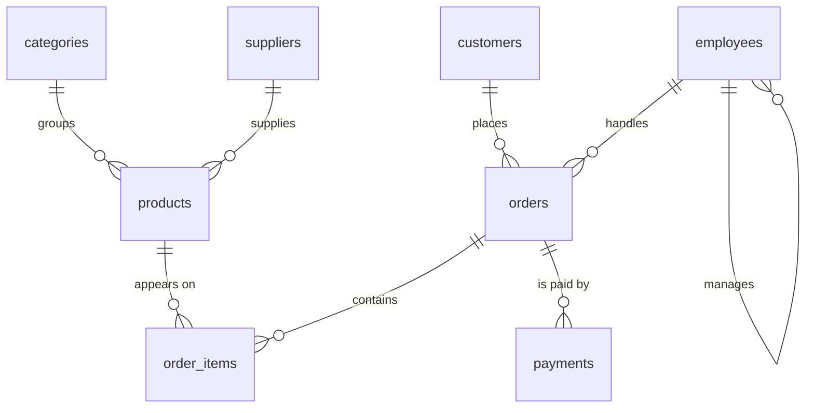
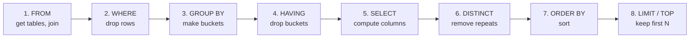

<!-- Generated by scripts/build-sql-course.cjs; edit docs/databases/sql-server-and-mysql.md. -->

[Part index](index.md) | [Prerequisites](00-start-here.md) | [Previous](00-start-here.md) | [Next](02-building-blocks.md) | [Full course](../sql-server-and-mysql.md)

## 🌱 PART 1 — FOUNDATIONS

---

### 1. What a database really is

| 🎚️ Level | ⏱️ Time | 🎯 After this chapter you can… |
|:---:|:---:|---|
| 🟢 Beginner | 10 min | Explain what a database, table, row, and column are · Say why a database is safer than a spreadsheet |

> [!NOTE]
> 📌 **In plain words:** A database is an organized place to keep information so that you can **find it again quickly**, **trust that it is correct**, and **let many people use it at the same time without chaos**.

#### 1.1 🌍 Start with something you already know: a spreadsheet

Imagine a spreadsheet for a small shop:

| customer_id | full_name | email | city |
|---|---|---|---|
| 1 | Amara Silva | amara@example.com | Colombo |
| 2 | John Baker | john@example.com | London |
| 3 | Mei Chen | mei@example.com | Singapore |

That is already a database in miniature. Look at the vocabulary:

| Spreadsheet word | Database word | What it means |
|---|---|---|
| File | **Database** | The whole collection |
| Sheet / tab | **Table** | One kind of thing (customers, orders, products) |
| Row | **Row** (or *record*) | One single thing (one customer) |
| Column | **Column** (or *field*) | One fact about that thing (their email) |
| Column header | **Column name + data type** | The name *and* the kind of value allowed |
| The "ID" column | **Primary key** | The value that uniquely identifies a row |

> 🌍 **Analogy:** A table is a **filing cabinet drawer**. Each folder in the drawer is a row. Each folder has the same labelled pockets (columns): name, email, city. The primary key is the number written on the folder tab so you can find it instantly.

#### 1.2 ❓ So why not just use a spreadsheet?

A spreadsheet breaks the moment your shop becomes real. Here is exactly where it fails and what a database does instead:

| Problem with a spreadsheet | What a real database does |
|---|---|
| Two people edit at once, one change is lost | **Transactions and locking** keep every change safe |
| Someone types "Colomb0" in the city column | **Constraints** reject invalid data at the door |
| 5 million rows makes it unusable | **Indexes** find a row in milliseconds among billions |
| The customer name is retyped in 900 order rows | **Relationships** store the name once and link to it |
| Power cut halfway through a sale | **Durability**: once a change is saved (*committed*), a crash cannot lose it |
| Anyone who opens the file sees salaries | **Permissions** control who sees what, column by column |
| "Delete the last 3 months" was a mistake | **Backups** — and *point-in-time restore*, which rewinds the data to an exact moment — undo it |

> [!NOTE]
> 📌 **In plain words:** A spreadsheet stores data. A database **protects** data.

#### 1.3 🧩 The vocabulary you need for the rest of this guide

| Term | Simple explanation | Example from our shop |
|---|---|---|
| **Database** | The whole container | `ShopDB` |
| **Table** | One list of one kind of thing | `customers` |
| **Row** | One item in that list | Customer #7, Amara Silva |
| **Column** | One fact about the item | `email` |
| **Data type** | What kind of value is allowed | `DECIMAL(10,2)` for money |
| **Primary key (PK)** | The unique ID of a row | `customer_id` |
| **Foreign key (FK)** | A pointer to a row in another table | `orders.customer_id` points at `customers` |
| **Index** | A sorted lookup list that makes searching fast | index on `customers.email` |
| **Query** | A question you ask the database | "Who bought a laptop last month?" |
| **Schema** | The blueprint: which tables and columns exist | The design of `ShopDB` |
| **Transaction** | A group of changes that all succeed or all fail | Take money **and** ship the item |
| **RDBMS** | *Relational database management system* — the software that runs all of this | SQL Server, MySQL |

> 🌍 **Analogy for a foreign key:** In a school, the class register does not repeat every student's home address. It writes the **student number**, and the address lives once in the student file. If the family moves, you update **one** place. That student number in the register is a foreign key.

<a id="14--what-relational-means"></a>

#### 1.4 🏛️ What "relational" means

The **R** in RDBMS means *relational*. It simply means: **split your data into small, focused tables and connect them by keys**, instead of one giant table that repeats itself.

**❌ The bad, repeating way (one giant table):**

| order_id | customer_name | customer_email | customer_city | product | price |
|---|---|---|---|---|---|
| 1001 | Amara Silva | amara@example.com | Colombo | Laptop | 1200.00 |
| 1002 | Amara Silva | amara@example.com | Colombo | Mouse | 25.00 |
| 1003 | Amara Silva | amara@exampel.com | Colombo | Keyboard | 45.00 |

Look at row 1003. The email has a typo. Now Amara exists **twice** in your system with two different emails, and nobody can tell which one is real. This is called an **update anomaly**, and it is why relational design exists.

**✅ The relational way (two tables joined by a key):**

`customers`

| customer_id | full_name | email | city |
|---|---|---|---|
| 7 | Amara Silva | amara@example.com | Colombo |

`orders`

| order_id | **customer_id** | order_date |
|---|---|---|
| 1001 | 7 | 2026-03-01 |
| 1002 | 7 | 2026-03-04 |
| 1003 | 7 | 2026-03-09 |

Now the email exists **once**. Fix it once, and all three orders are correct. That is the entire point of a relational database, and everything in [Chapter 51](../sql-server-and-mysql.md#51-normalization-1nf-to-bcnf) is this same idea, explained step by step.

<a id="15--types-of-databases-so-you-know-what-you-are-not-learning"></a>

#### 1.5 🗂️ Types of databases (so you know what you are *not* learning)

| Type | What it is | Examples | Best for |
|---|---|---|---|
| **Relational (SQL)** | Tables with fixed columns and relationships | **SQL Server, MySQL**, PostgreSQL, Oracle | Business data, money, anything needing correctness |
| **Document (NoSQL)** | Each record is a flexible text document (JSON) instead of a fixed row | MongoDB, CouchDB | Data whose shape keeps changing, such as website content |
| **Key-value** | A giant dictionary | Redis, DynamoDB | Very fast, short-lived data such as website logins and caches |
| **Column-family** | Very wide tables spread across many servers | Cassandra, HBase | Enormous streams of incoming data, such as sensor readings |
| **Graph** | Things (nodes) and the links between them | Neo4j | Social networks, fraud rings, recommendations |
| **Search** | Word indexes, like the index at the back of a book | Elasticsearch | Full-text search, log analytics |

> [!IMPORTANT]
> 🎯 **This guide is 100% about relational databases**, specifically **Microsoft SQL Server** and **MySQL** — the two most common engines in enterprise and web development respectively.

> [!TIP]
> 💡 **Pro tip:** Do not let anyone tell you SQL is old-fashioned. Every "modern" data stack — Snowflake, BigQuery, Databricks, Spark, DuckDB — speaks SQL. Learning SQL properly once pays you back for your whole career.

> ### 🧭 In practice — deciding that you need a database at all
>
> **How to use it.** Write down the questions your data must answer and the rules it must never break. If any rule is “two people must not change this at the same time”, “this value must always be valid”, or “this must survive a crash”, you need a database rather than a file. **Expected result:** a short list of tables (one per kind of thing) and, for each, the fact that uniquely identifies a row.
>
> **When to use it.** As soon as more than one person, or more than one program, reads and writes the same data — or as soon as losing it would matter.
>
> **Where to use it.** Any system that keeps records: orders, patients, bookings, transactions, inventory, users. **Scenario:** the shop in this guide starts as one spreadsheet. The day a second person edits it while the first has it open, one of their changes silently disappears. That is the moment a database stops being optional.
>
> **When _not_ to use it.** A spreadsheet is genuinely the right tool for a one-person list that nobody else reads, for ad-hoc analysis you will throw away, and for anything a human needs to eyeball and reshape freely. A relational database is also the wrong shape for data with no fixed columns at all — see the comparison of document, key-value, and graph stores in [§1.5](../sql-server-and-mysql.md#15--types-of-databases-so-you-know-what-you-are-not-learning).
>
> **Best practices.** Split repeating data into its own table from the start and join it back — the single most expensive mistake in this chapter is one wide table that repeats the customer's email on every order row, because then a typo creates two customers and nobody can tell which is real. Give every table a primary key on day one; adding one later means deciding what to do with the duplicates you have already accumulated.

#### 🧪 Try it yourself

**Goal:** prove to yourself, with a text editor and no database engine at all, why the "one giant table" design breaks and the relational design doesn't.

1. Open any plain-text or spreadsheet file and type the **bad, repeating table** from [§1.4](../sql-server-and-mysql.md#14--what-relational-means) by hand — three order rows, each repeating Amara's name, email, and city.
2. Deliberately mistype the email on just the **third** row (`amara@exampel.com` instead of `amara@example.com`), exactly like the example.
3. Now answer, in writing, one sentence each:
   - Which email address is "the real one" for Amara — row 1, row 2, or row 3? How would a program decide?
   - If Amara really did change her email, how many rows would you have to find and edit in the bad design?
4. Now split the same data into the two **relational** tables (`customers` and `orders`) shown in the "✅ relational way" example. Change Amara's email **once**, in the `customers` table only, and confirm by inspection that all three orders are now consistent.

**✅ Checkpoint:** you should be able to explain, in one sentence, why "split the data and join it with a key" prevents the typo problem — this sentence is the entire justification for everything in Chapters 2 onward.

**🏋️ Exercise:** sketch (on paper or in a spreadsheet) the table design for a very small library: `books` and `borrowers`. Decide what the primary key of each table is, and what foreign key links a borrowed book back to the person who borrowed it. There is no SQL yet — the goal is to practice *thinking* in tables and keys before you write a single query.

---

### 2. What SQL is, and the two engines we use

| 🎚️ Level | ⏱️ Time | 🎯 After this chapter you can… |
|:---:|:---:|---|
| 🟢 Beginner | 15 min | Describe what SQL is · Name the five groups of SQL commands · Know how SQL Server and MySQL differ |

> [!NOTE]
> 📌 **In plain words:** **SQL** (Structured Query Language) is the language you use to *talk* to a relational database. You describe **what you want**, and the database figures out **how to get it**.

#### 2.1 🗣️ SQL is a language of intent, not instructions

In most programming languages you say *how*: loop over this, check that, add to a list. In SQL you say *what*:

```sql
-- "Give me the names of customers in Colombo, alphabetically."
SELECT full_name
FROM customers
WHERE city = 'Colombo'
ORDER BY full_name;
```

You never wrote a loop. You never said which order to read the disk in. The database's **query optimizer** decided all of that.

> 🌍 **Analogy:** SQL is ordering in a restaurant. You say *"a medium-rare steak with no onions."* You do not walk into the kitchen and explain how to light the grill. The kitchen (the optimizer) chooses the fastest way to make exactly what you asked for.

> [!TIP]
> 💡 **Pro tip:** This is the single biggest mindset shift for programmers learning SQL. If you find yourself writing loops (or *cursors*, SQL's row-by-row loops) to process rows one at a time, you are fighting the language. See [Chapter 59](../sql-server-and-mysql.md#59-dynamic-sql-cursors-and-set-based-thinking).

#### 2.2 🧬 The five families of SQL commands

Every SQL statement you will ever write belongs to one of these five groups. Memorize this table — it is asked in almost every interview.

| Family | Full name | What it does | Commands |
|:---:|---|---|---|
| **DDL** | Data **Definition** Language | Builds and changes the *structure* | `CREATE`, `ALTER`, `DROP`, `TRUNCATE`, `RENAME` |
| **DML** | Data **Manipulation** Language | Changes the *data* inside | `INSERT`, `UPDATE`, `DELETE`, `MERGE` |
| **DQL** | Data **Query** Language | Reads the data | `SELECT` |
| **DCL** | Data **Control** Language | Controls *who is allowed* to do things | `GRANT`, `REVOKE`, `DENY` |
| **TCL** | **Transaction** Control Language | Groups changes into all-or-nothing units | `COMMIT`, `ROLLBACK`, `SAVEPOINT`, `BEGIN TRAN` |

> 🌍 **Analogy:** Building a house. **DDL** builds the rooms. **DML** moves the furniture in and out. **DQL** looks around and describes what is there. **DCL** hands out the door keys. **TCL** makes sure that "move the sofa in and take the old one out" either fully happens or does not happen at all.

#### 2.3 🔀 MSSQL vs MySQL — the honest comparison

| Topic | 🟥 Microsoft SQL Server (MSSQL) | 🟦 MySQL |
|---|---|---|
| **Made by** | Microsoft | Oracle (open source, community + enterprise) |
| **Dialect name** | **T-SQL** (Transact-SQL) | MySQL SQL |
| **Cost** | Free Developer/Express; paid Standard/Enterprise | Free Community edition |
| **Runs on** | Windows, Linux, Docker, Azure | Linux, Windows, macOS, Docker, everywhere |
| **Typical home** | Large companies, Microsoft .NET applications, banks, business systems | Websites and web apps (WordPress, the classic Linux + PHP stack), startups |
| **Main tool** (the program you type SQL into) | SQL Server Management Studio (SSMS), VS Code with the MSSQL extension | MySQL Workbench, DBeaver, phpMyAdmin |
| **Storage engine** (the part that writes data to disk) | One built-in engine | **InnoDB** (always use this); the older MyISAM and MEMORY also exist |
| **Limit rows** | `SELECT TOP 10` / `OFFSET … FETCH` | `LIMIT 10` |
| **Joining text together** | `+` or `CONCAT()` | `CONCAT()` (the `+` adds numbers!) |
| **Quoting a name** (e.g. a column called `order date`) | `[square brackets]` | `` `backticks` `` |
| **Auto number** | `IDENTITY(1,1)` | `AUTO_INCREMENT` |
| **Current time** | `GETDATE()`, `SYSDATETIME()` | `NOW()`, `CURRENT_TIMESTAMP` |
| **Variables** | `DECLARE @x INT` | `SET @x = 1`, or `DECLARE x INT` inside stored procedures |
| **Stored procedure body** (a saved SQL program — Chapter 37) | `AS BEGIN … END` | `BEGIN … END` with `DELIMITER` change |
| **Error handling** | `TRY … CATCH` | `DECLARE … HANDLER` |
| **Default isolation** (how two users' work is kept apart — Chapter 43) | READ COMMITTED, using locks | REPEATABLE READ, using snapshots (MVCC) |
| **Case sensitivity** | `'abc' = 'ABC'` is usually true (case-**insensitive**) | Table names are case-sensitive on Linux |
| **Top strength** | Excellent tools, a very smart query planner, features for big companies | Simple, fast, and available on almost every web host |

> [!TIP]
> 💡 **Pro tip:** Roughly **85% of everyday SQL is identical** in both engines. `SELECT`, `WHERE`, `JOIN`, `GROUP BY`, and window functions are the same. The differences are mostly at the edges: showing results page by page, built-in functions, and procedural code (SQL with variables, `IF`, and loops). This guide flags every difference with a 🔀 box.

#### 2.4 ⚙️ What the database is actually doing when you press Execute

```text
   You type SQL
        │
        ▼
 ┌───────────────┐   Is the syntax valid? Do these tables exist?
 │  1. PARSER    │   Do you have permission?
 └───────┬───────┘
         ▼
 ┌───────────────┐   Rewrites your query into an internal form.
 │ 2. ALGEBRIZER │   Works out exactly which tables and columns you mean.
 └───────┬───────┘
         ▼
 ┌───────────────┐   Considers MANY ways to run it, estimates the
 │ 3. OPTIMIZER  │   cost of each using STATISTICS (a summary of your data), picks the cheapest.
 └───────┬───────┘   ← this is where indexes matter
         ▼
 ┌───────────────┐   Runs the chosen plan: reads pages from the
 │ 4. EXECUTION  │   buffer pool (memory) or disk, applies filters,
 └───────┬───────┘   joins, sorts, and streams rows back.
         ▼
    Your result (the rows you see)
```

> [!NOTE]
> 📌 **In plain words:** You ask a question. The database *plans* the cheapest way to answer it, then runs that plan. When a query is slow, it is almost always because the plan was bad — usually because an index was missing, or the database's summary of your data (its *statistics*) was out of date. That is the whole story of [Part 10](../sql-server-and-mysql.md#46-indexes-the-complete-guide).

#### 2.5 📝 SQL syntax rules you must know from minute one

```sql
-- 1. Statements end with a semicolon. (Optional in MSSQL, required in MySQL scripts.)
SELECT 1;

-- 2. SQL keywords are case-insensitive. These three are identical:
select * from customers;
SELECT * FROM customers;
SeLeCt * FrOm customers;

-- 3. Convention: KEYWORDS IN UPPERCASE, table and column names in lowercase. Do this.
SELECT full_name FROM customers;

-- 4. Single quotes for text. Double quotes are NOT for text.
SELECT * FROM customers WHERE city = 'Colombo';   -- ✅ correct
-- SELECT * FROM customers WHERE city = "Colombo"; -- ⚠️ works in MySQL, fails in MSSQL

-- 5. Two dashes make a line comment.
/* And this is a
   block comment. */

-- 6. Whitespace and line breaks do not matter. Use them to stay readable.
```

> [!CAUTION]
> 🐛 **Common mistake:** Using double quotes for a string in MSSQL. In standard SQL, `"customers"` means *the thing named* customers (a table or a column), not the *text* `customers`. **Always use single quotes for text values in both engines.**

> [!TIP]
> 💡 **Pro tip — the formatting style used in this guide:** one clause per line, keywords uppercase, joins indented. Six months from now, you will be the person reading your own query.

```sql
SELECT
    c.full_name,
    o.order_id,
    o.order_date
FROM customers AS c
INNER JOIN orders AS o
    ON o.customer_id = c.customer_id
WHERE o.order_date >= '2026-01-01'
ORDER BY o.order_date DESC;
```

> ### 🧭 In practice — SQL itself, and choosing an engine
>
> **How to use it.** Learn the five command families separately — querying (`SELECT`), changing data (`INSERT`/`UPDATE`/`DELETE`), defining structure (`CREATE`/`ALTER`/`DROP`), controlling access (`GRANT`/`REVOKE`), and controlling transactions (`COMMIT`/`ROLLBACK`). Pick **one** engine to start. **Expected result:** you can read any SQL statement and say which family it belongs to, which tells you how dangerous it is.
>
> **When to use it.** Choose **SQL Server** if you work on Windows or in a Microsoft shop; choose **MySQL** if you build web applications or work on macOS or Linux. Both are taught here, so the choice is reversible — do not spend a day on it.
>
> **Where to use it.** SQL Server dominates enterprise and internal business systems; MySQL dominates web hosting, content platforms, and small-to-medium services. **Scenario:** you learn on MySQL because it installs in two minutes on your laptop, then join a team running SQL Server. Nearly everything transfers; the differences are mostly function names (`LEN` versus `CHAR_LENGTH`) and paging syntax (`TOP` versus `LIMIT`), both of which this guide shows side by side.
>
> **When _not_ to use it.** Do not try to learn both dialects at once as a beginner — you will spend your effort memorising which syntax belongs to which engine instead of learning what a join does. Also do not assume SQL is uniformly portable: the *core* is standard, but paging, date functions, string functions, and everything administrative differ.
>
> **Best practices.** Write standard SQL wherever a standard form exists (`COALESCE` rather than `ISNULL`/`IFNULL`, `CASE` rather than `IIF`/`IF`) so your knowledge and your queries travel. When you do use an engine-specific feature, know that you are doing it — this guide marks every such block with 🟥 or 🟦 precisely so that you can tell.

#### 🧪 Try it yourself

**Goal:** spot the five SQL command families in a block of SQL you did not write yet, before you ever run a query.

1. Without running anything, read this list of statements and label each one with its family — **Query (DQL)**, **Data change (DML)**, **Structure (DDL)**, **Access (DCL)**, or **Transaction (TCL)**:
   ```sql
   SELECT * FROM customers;
   INSERT INTO customers (full_name, email) VALUES ('Nadia Lopez', 'nadia@example.com');
   CREATE TABLE products (product_id INT PRIMARY KEY, name VARCHAR(100));
   GRANT SELECT ON customers TO reporting_user;
   ROLLBACK;
   ```
2. Rewrite the formatted multi-line `JOIN` query from [§2.5](../sql-server-and-mysql.md#25--sql-syntax-rules-you-must-know-from-minute-one) as a single line with no formatting, then rewrite it back — notice that SQL does not care about whitespace, only *you* do.
3. Deliberately break rule 4 by changing one of the single-quoted strings in the query above to double quotes, and predict (before you have a database to test on) which engine you'd expect to complain.

**✅ Checkpoint:** you should be able to say, for any SQL statement someone shows you, which of the five families it belongs to and therefore how "dangerous" running it is (a `SELECT` can't lose data; a bare `DELETE` can).

---

### 3. Installing and connecting

| 🎚️ Level | ⏱️ Time | 🎯 After this chapter you can… |
|:---:|:---:|---|
| 🟢 Beginner | 15–30 min | Install SQL Server or MySQL · Connect a query tool · Run your first query |

> [!NOTE]
> 📌 **In plain words:** Before you can practise, you need a database running on your own machine and a tool to type queries into. This chapter gets you there in under 15 minutes.

> 🌍 **Analogy:** You are setting up a **kitchen**. The **server** is the cooker — it does the actual work, and it runs quietly in the background whether or not you are looking at it. The **client tool** (SSMS, Workbench, DBeaver) is your **worktop**: where you stand, write, and see what comes out. They are two separate things, and beginners often install one and wonder why nothing happens. **You need both.**

#### 3.1 🟥 Installing SQL Server (free)

| Option | Best for | How |
|---|---|---|
| **Developer Edition** ⭐ | Learning on Windows. Every feature included, free for learning and testing (not for a live business). | Download *SQL Server Developer* from Microsoft's website and choose the **Basic** installation. |
| **Express Edition** | Small real applications (10 GB per database in SQL Server 2019/2022; later-version limits differ). | The same download page — choose **Express**. |
| **Docker** | Mac, Linux, or a throwaway practice copy. | One command — see below. |
| **Azure SQL Database (free offer)** | Practising in the cloud without installing anything. | Create a free Azure SQL Database with a Microsoft account. |

**🐳 Docker (works on Windows, Mac, and Linux):** Docker runs a ready-made copy of SQL Server inside an isolated "container", so nothing is installed into your system itself. Install and start **Docker Desktop** first. `ACCEPT_EULA=Y` accepts Microsoft's licence; replace the password with your own strong one. If you have never used Docker, the normal installer above is simpler.

```bash
docker run -e "ACCEPT_EULA=Y" -e "MSSQL_SA_PASSWORD=YourStrong!Passw0rd" \
   -p 1433:1433 --name mssql-learn -d mcr.microsoft.com/mssql/server:2022-latest
```

**Then install a client tool** (the program you type SQL into):

- **SSMS (SQL Server Management Studio)** — free, Windows only, the most complete tool. ⭐ Best choice on Windows.
- **VS Code with the MSSQL extension** — free, works on Windows, Mac, and Linux. (Microsoft retired *Azure Data Studio* in 2026; this is its replacement.)

**Connect with:** Server `localhost` (it means "this computer"), Authentication **SQL Server Authentication**, Login `sa` (the built-in *system administrator*), and the password you chose.

> [!WARNING]
> ⚠️ **If the connection fails with "The certificate chain was issued by an authority that is not trusted":** tick **Trust server certificate** in the connection window and connect again. Newer tools refuse a server's self-made security certificate by default; for a database on your own computer, trusting it is safe and normal.

#### 3.2 🟦 Installing MySQL (free)

| Option | Best for | How |
|---|---|---|
| **Windows installer (.msi)** ⭐ | Windows learners | Download **MySQL Community Server 8.4 LTS** from dev.mysql.com. The setup wizard asks you to choose a `root` password — write it down. Install **MySQL Workbench** from the same site. |
| **Homebrew** | macOS | `brew install mysql@8.4` then `brew services start mysql@8.4` |
| **apt** | Linux (Ubuntu, Debian) | `sudo apt install mysql-server` (installs your Linux version's MySQL) |
| **Docker** | A practice copy on any computer | One command — see below. |

> [!WARNING]
> ⚠️ **Avoid XAMPP and MAMP for this guide.** They install **MariaDB**, a close cousin of MySQL — not MySQL itself. Several examples here, including the ShopDB build script in Chapter 4, use MySQL-only features and will fail on MariaDB.

**🐳 Docker:**

```bash
docker run --name mysql-learn -e MYSQL_ROOT_PASSWORD=YourStrong!Passw0rd \
   -p 3306:3306 -d mysql:8.4
```

**Then install a client tool:**

- **MySQL Workbench** — official, free, includes an ER diagram designer.
- **DBeaver** — free, connects to *both* MySQL and SQL Server (handy for this guide).
- **phpMyAdmin** — browser-based, common on shared hosting.

**Connect with:** Host `127.0.0.1` (it means "this computer"), Port `3306`, User `root` (the built-in administrator), and the password you chose.

#### 3.3 ⌨️ Connecting from the command line

These commands let you type SQL in a terminal window instead of a graphical tool. **Beginners can skip this section** and use SSMS, Workbench, or DBeaver. (`ShopDB` is created in Chapter 4 — until then, leave `-d ShopDB` and `ShopDB` off the end.)

```bash
# 🟥 MSSQL
sqlcmd -S localhost -U sa -P "YourStrong!Passw0rd" -d ShopDB -C     # -C trusts the local server's certificate

# 🟦 MySQL
mysql -h 127.0.0.1 -u root -p ShopDB
```

> [!TIP]
> 💡 **Pro tip:** Install **DBeaver** if you plan to follow both dialects in this guide. One window, two connections, side-by-side tabs. It is the fastest way to *feel* the differences between the engines.

> [!WARNING]
> ⚠️ **Security note:** The `sa` and `root` accounts are the all-powerful administrators. Use them to set up your learning environment, then create a normal user for daily work — exactly as you would on a real, live (*production*) server. [Chapter 54](../sql-server-and-mysql.md#54-security-users-roles-and-permissions) shows how.

#### 3.4 🧪 Your very first query

Run this in each engine to confirm everything works:

```sql
-- ✅ MSSQL
SELECT @@VERSION AS engine_version, GETDATE() AS server_time;
```

```sql
-- ✅ MySQL
SELECT VERSION() AS engine_version, NOW() AS server_time;
```

**What you should see:** one row with two columns — a long version description (for example *Microsoft SQL Server 2022 … Developer Edition* or *8.4.x*) and the current date and time. If you see that, **you are ready**. 🎉

**If it did not work:**

| What you see | What it means | What to do |
|---|---|---|
| *Cannot connect* / *server was not found* | The database server is not running | Start the service (or `docker start` the container) and try again |
| *Login failed* / *Access denied* | Wrong user name or password | Check the password you chose when installing |
| *Certificate … not trusted* | Your tool does not trust the local server | Tick **Trust server certificate** (SSMS / VS Code) or add `-C` (sqlcmd) |

**✅ Checkpoint (this *is* your Chapter 3 "try it yourself"):** if the query above returned one row with a version string and a timestamp, your server and client are both working — you have officially run your first SQL statement.

**🏋️ Exercise:** run the version query again, but change it to also select the literal text `'hello from SQL'` as a third column (`SELECT @@VERSION AS engine_version, GETDATE() AS server_time, 'hello from SQL' AS greeting;` for MSSQL, swapping in `VERSION()`/`NOW()` for MySQL). Confirm you get three columns back. This proves you can add to a query, not just copy one.

> ### 🧭 In practice — installing and connecting
>
> **How to use it.** Install one server and one client. For SQL Server that is the free **Developer** or **Express** edition plus SSMS or VS Code with the MSSQL extension; for MySQL it is the Community Server plus MySQL Workbench. Connect to `localhost`, run `SELECT 1;`, and confirm you get a single row back. **Expected result:** a window where you can type SQL and see results — nothing else in this guide works until that exists.
>
> **When to use it.** Once, at the start. Docker is a good alternative if you would rather not install a server on your machine directly — one container, deleted when you are done.
>
> **Where to use it.** Your own machine, for everything in this guide. **Scenario:** you install SQL Server Developer edition locally. It is the *full* Enterprise feature set, licensed for development only — so you can practise features beyond Express limits without paying for a production licence. Express also supports partitioning; consult the version-specific edition matrix.
>
> **When _not_ to use it.** Never point these lessons at a production server. Chapter 4's build script **deletes and recreates** a database called `ShopDB`, and later chapters `UPDATE` and `DELETE` freely. Practise only on an instance you own and can rebuild from scratch.
>
> **Best practices.** Keep the connection details for your practice server somewhere sensible, and **never put a password in a script you commit to version control** — use your client's saved-connection feature, an environment variable, or your platform's secret store. Use a non-administrative account for day-to-day querying; `sa` and `root` should not be what you are connected as while learning `DELETE`.


---

### 4. The sample database: ShopDB

| 🎚️ Level | ⏱️ Time | 🎯 After this chapter you can… |
|:---:|:---:|---|
| 🟢 Beginner | 20 min | Build the ShopDB practice database · Load its sample data · Check that your copy matches the guide |

> [!NOTE]
> 📌 **In plain words:** Every example in this guide uses **one** realistic database — a small online electronics store. Build it once now, and every query in all 66 chapters will run on your machine.

#### 4.1 🏪 The business we are modelling

**ShopDB** runs an online electronics store. In real life the business needs to answer questions like:

- *Which products are about to run out of stock?*
- *Who are our top 10 customers by lifetime spend?*
- *What is our revenue per month, per category?*
- *Which orders were paid but never shipped?*
- *Which sales rep closed the most revenue this quarter?*

Every one of those questions becomes a query later in this guide.

#### 4.2 🗺️ The schema at a glance

```text
   ┌───────────────┐          ┌──────────────┐
   │  categories   │          │  suppliers   │
   │  category_id ◄├───┐  ┌───┤ supplier_id  │
   └───────────────┘   │  │   └──────────────┘
                       │  │
                  ┌────┴──┴────────┐
                  │    products    │
                  │   product_id ◄─┼──────────┐
                  └────────────────┘          │
                                              │
  ┌────────────┐      ┌──────────────┐   ┌────┴─────────┐
  │ customers  │      │   orders     │   │ order_items  │
  │customer_id◄├──────┤ customer_id  │   │  order_id    │
  └────────────┘      │  order_id   ◄├───┤  product_id  │
                      │ employee_id  │   └──────────────┘
  ┌────────────┐      └──────┬───────┘
  │ employees  │             │            ┌──────────────┐
  │employee_id◄├─────────────┘            │   payments   │
  │ manager_id │ ◄── self-reference       │  order_id ───┼──► orders
  └────────────┘                          └──────────────┘
```

The same schema as an entity-relationship diagram. `||--o{` reads as *"one to many"*:



**Reading the diagram:** an arrow means *"points to"*. `orders.customer_id` points at `customers.customer_id`. One customer has **many** orders — that is a **one-to-many** relationship, the most common kind in any database.

Note `employees` pointing at **itself**: an employee has a manager, who is also an employee. And note
that `orders` and `products` are *not* joined directly — they meet in `order_items`, because an order
holds many products and a product appears on many orders.

| Relationship | Type | Meaning in business terms |
|---|---|---|
| `categories` → `products` | One-to-many | One category holds many products |
| `suppliers` → `products` | One-to-many | One supplier provides many products |
| `customers` → `orders` | One-to-many | One customer places many orders |
| `employees` → `orders` | One-to-many | One sales rep handles many orders |
| `employees` → `employees` | Self-referencing | An employee has a manager, who is an employee |
| `orders` ↔ `products` | **Many-to-many** | Solved with a middle table, `order_items` (a *bridge table*) |
| `orders` → `payments` | One-to-many | An order can be paid in instalments or refunded |

> 🌍 **Analogy for the bridge table:** An order can contain many products, and a product can appear on many orders. You cannot express that with a single column on either side — so you create a middle table (`order_items`) where each row says *"this order, this product, this quantity, this price."* Every many-to-many relationship in every database you will ever build is solved this exact way.

#### 4.3 🟥 Build ShopDB — MSSQL version

**What to do:** in SSMS click **New Query** (in VS Code, open a new SQL file and connect), paste the whole script below, and run it with **F5**.

**What it does:** creates an empty database called `ShopDB` with eight empty tables. You do not need to understand every line yet — each piece is explained in Chapters 6 to 10.

**What you should see:** the message *Commands completed successfully.* Then go on to 4.5 to fill the tables with data.

> [!WARNING]
> ⚠️ **This script starts from scratch.** If a database called `ShopDB` already exists, the first lines **delete it**. That is exactly what you want when you break your practice data — but never run it on a real server that has a database with this name.

```sql
-- ✅ MSSQL: create the database
IF DB_ID('ShopDB') IS NOT NULL
BEGIN
    ALTER DATABASE ShopDB SET SINGLE_USER WITH ROLLBACK IMMEDIATE;
    DROP DATABASE ShopDB;
END;
GO

CREATE DATABASE ShopDB;
GO

USE ShopDB;
GO

-- ─────────────────────────────────────────────
-- Lookup tables
-- ─────────────────────────────────────────────
CREATE TABLE categories (
    category_id     INT IDENTITY(1,1) PRIMARY KEY,
    category_name   NVARCHAR(50)  NOT NULL UNIQUE,
    description     NVARCHAR(255) NULL
);

CREATE TABLE suppliers (
    supplier_id     INT IDENTITY(1,1) PRIMARY KEY,
    company_name    NVARCHAR(100) NOT NULL,
    contact_name    NVARCHAR(100) NULL,
    country         NVARCHAR(50)  NOT NULL,
    phone           NVARCHAR(30)  NULL
);

-- ─────────────────────────────────────────────
-- People
-- ─────────────────────────────────────────────
CREATE TABLE employees (
    employee_id     INT IDENTITY(1,1) PRIMARY KEY,
    first_name      NVARCHAR(50)  NOT NULL,
    last_name       NVARCHAR(50)  NOT NULL,
    title           NVARCHAR(60)  NOT NULL,
    department      NVARCHAR(40)  NOT NULL,
    manager_id      INT           NULL,
    hire_date       DATE          NOT NULL,
    salary          DECIMAL(10,2) NOT NULL,
    CONSTRAINT fk_employees_manager
        FOREIGN KEY (manager_id) REFERENCES employees(employee_id),
    CONSTRAINT ck_employees_salary CHECK (salary > 0)
);

CREATE TABLE customers (
    customer_id     INT IDENTITY(1,1) PRIMARY KEY,
    full_name       NVARCHAR(100) NOT NULL,
    email           NVARCHAR(150) NOT NULL UNIQUE,
    phone           NVARCHAR(30)  NULL,
    city            NVARCHAR(60)  NULL,
    country         NVARCHAR(60)  NOT NULL,
    signup_date     DATE          NOT NULL DEFAULT (CAST(GETDATE() AS DATE)),
    loyalty_tier    VARCHAR(10)   NOT NULL DEFAULT 'Bronze',
    CONSTRAINT ck_customers_tier
        CHECK (loyalty_tier IN ('Bronze','Silver','Gold','Platinum'))
);

-- ─────────────────────────────────────────────
-- Catalogue
-- ─────────────────────────────────────────────
CREATE TABLE products (
    product_id      INT IDENTITY(1,1) PRIMARY KEY,
    product_name    NVARCHAR(120) NOT NULL,
    category_id     INT           NOT NULL,
    supplier_id     INT           NULL,
    unit_price      DECIMAL(10,2) NOT NULL,
    units_in_stock  INT           NOT NULL DEFAULT 0,
    reorder_level   INT           NOT NULL DEFAULT 10,
    discontinued    BIT           NOT NULL DEFAULT 0,
    created_at      DATETIME2(0)  NOT NULL DEFAULT SYSDATETIME(),
    CONSTRAINT fk_products_category
        FOREIGN KEY (category_id) REFERENCES categories(category_id),
    CONSTRAINT fk_products_supplier
        FOREIGN KEY (supplier_id) REFERENCES suppliers(supplier_id),
    CONSTRAINT ck_products_price CHECK (unit_price >= 0),
    CONSTRAINT ck_products_stock CHECK (units_in_stock >= 0)
);

-- ─────────────────────────────────────────────
-- Sales
-- ─────────────────────────────────────────────
CREATE TABLE orders (
    order_id        INT IDENTITY(1000,1) PRIMARY KEY,
    customer_id     INT          NOT NULL,
    employee_id     INT          NULL,
    order_date      DATE         NOT NULL,
    ship_date       DATE         NULL,
    status          VARCHAR(20)  NOT NULL DEFAULT 'Pending',
    shipping_city   NVARCHAR(60) NULL,
    shipping_country NVARCHAR(60) NULL,
    CONSTRAINT fk_orders_customer
        FOREIGN KEY (customer_id) REFERENCES customers(customer_id),
    CONSTRAINT fk_orders_employee
        FOREIGN KEY (employee_id) REFERENCES employees(employee_id),
    CONSTRAINT ck_orders_status
        CHECK (status IN ('Pending','Paid','Shipped','Delivered','Cancelled','Refunded'))
);

CREATE TABLE order_items (
    order_id        INT           NOT NULL,
    product_id      INT           NOT NULL,
    unit_price      DECIMAL(10,2) NOT NULL,
    quantity        INT           NOT NULL,
    discount        DECIMAL(4,3)  NOT NULL DEFAULT 0,
    CONSTRAINT pk_order_items PRIMARY KEY (order_id, product_id),
    CONSTRAINT fk_items_order
        FOREIGN KEY (order_id) REFERENCES orders(order_id) ON DELETE CASCADE,
    CONSTRAINT fk_items_product
        FOREIGN KEY (product_id) REFERENCES products(product_id),
    CONSTRAINT ck_items_qty CHECK (quantity > 0),
    CONSTRAINT ck_items_discount CHECK (discount >= 0 AND discount <= 0.9)
);

CREATE TABLE payments (
    payment_id      INT IDENTITY(1,1) PRIMARY KEY,
    order_id        INT           NOT NULL,
    payment_date    DATETIME2(0)  NOT NULL,
    amount          DECIMAL(10,2) NOT NULL,
    method          VARCHAR(20)   NOT NULL,
    status          VARCHAR(20)   NOT NULL DEFAULT 'Captured',
    CONSTRAINT fk_payments_order
        FOREIGN KEY (order_id) REFERENCES orders(order_id) ON DELETE CASCADE,
    CONSTRAINT ck_payments_method
        CHECK (method IN ('Card','PayPal','BankTransfer','CashOnDelivery')),
    CONSTRAINT ck_payments_status
        CHECK (status IN ('Captured','Pending','Failed','Refunded'))
);
GO
```

#### 4.4 🟦 Build ShopDB — MySQL version

**What to do:** in MySQL Workbench open a new SQL tab (**File → New Query Tab**), paste the whole script below, and run all of it with **Ctrl + Shift + Enter** (the plain ⚡ lightning-bolt button).

**What it does:** creates an empty database called `ShopDB` with eight empty tables. You do not need to understand every line yet — each piece is explained in Chapters 6 to 10.

**What you should see:** a green tick for every statement in the *Action Output* panel. Click the refresh icon in the *Schemas* panel and `ShopDB` appears. Then go on to 4.5.

> [!WARNING]
> ⚠️ **This script starts from scratch.** The first line **deletes** any existing database called `ShopDB`. Never run it on a real server that has a database with this name.

```sql
-- ✅ MySQL: create the database
DROP DATABASE IF EXISTS ShopDB;
CREATE DATABASE ShopDB
    CHARACTER SET utf8mb4
    COLLATE utf8mb4_0900_ai_ci;

USE ShopDB;

-- ─────────────────────────────────────────────
-- Lookup tables
-- ─────────────────────────────────────────────
CREATE TABLE categories (
    category_id     INT AUTO_INCREMENT PRIMARY KEY,
    category_name   VARCHAR(50)  NOT NULL UNIQUE,
    description     VARCHAR(255) NULL
) ENGINE=InnoDB;

CREATE TABLE suppliers (
    supplier_id     INT AUTO_INCREMENT PRIMARY KEY,
    company_name    VARCHAR(100) NOT NULL,
    contact_name    VARCHAR(100) NULL,
    country         VARCHAR(50)  NOT NULL,
    phone           VARCHAR(30)  NULL
) ENGINE=InnoDB;

-- ─────────────────────────────────────────────
-- People
-- ─────────────────────────────────────────────
CREATE TABLE employees (
    employee_id     INT AUTO_INCREMENT PRIMARY KEY,
    first_name      VARCHAR(50)  NOT NULL,
    last_name       VARCHAR(50)  NOT NULL,
    title           VARCHAR(60)  NOT NULL,
    department      VARCHAR(40)  NOT NULL,
    manager_id      INT          NULL,
    hire_date       DATE         NOT NULL,
    salary          DECIMAL(10,2) NOT NULL,
    CONSTRAINT fk_employees_manager
        FOREIGN KEY (manager_id) REFERENCES employees(employee_id),
    CONSTRAINT ck_employees_salary CHECK (salary > 0)
) ENGINE=InnoDB;

CREATE TABLE customers (
    customer_id     INT AUTO_INCREMENT PRIMARY KEY,
    full_name       VARCHAR(100) NOT NULL,
    email           VARCHAR(150) NOT NULL UNIQUE,
    phone           VARCHAR(30)  NULL,
    city            VARCHAR(60)  NULL,
    country         VARCHAR(60)  NOT NULL,
    signup_date     DATE         NOT NULL DEFAULT (CURRENT_DATE),
    loyalty_tier    VARCHAR(10)  NOT NULL DEFAULT 'Bronze',
    CONSTRAINT ck_customers_tier
        CHECK (loyalty_tier IN ('Bronze','Silver','Gold','Platinum'))
) ENGINE=InnoDB;

-- ─────────────────────────────────────────────
-- Catalogue
-- ─────────────────────────────────────────────
CREATE TABLE products (
    product_id      INT AUTO_INCREMENT PRIMARY KEY,
    product_name    VARCHAR(120) NOT NULL,
    category_id     INT          NOT NULL,
    supplier_id     INT          NULL,
    unit_price      DECIMAL(10,2) NOT NULL,
    units_in_stock  INT          NOT NULL DEFAULT 0,
    reorder_level   INT          NOT NULL DEFAULT 10,
    discontinued    BOOLEAN      NOT NULL DEFAULT 0,
    created_at      DATETIME     NOT NULL DEFAULT CURRENT_TIMESTAMP,
    CONSTRAINT fk_products_category
        FOREIGN KEY (category_id) REFERENCES categories(category_id),
    CONSTRAINT fk_products_supplier
        FOREIGN KEY (supplier_id) REFERENCES suppliers(supplier_id),
    CONSTRAINT ck_products_price CHECK (unit_price >= 0),
    CONSTRAINT ck_products_stock CHECK (units_in_stock >= 0)
) ENGINE=InnoDB;

-- ─────────────────────────────────────────────
-- Sales
-- ─────────────────────────────────────────────
CREATE TABLE orders (
    order_id        INT AUTO_INCREMENT PRIMARY KEY,
    customer_id     INT         NOT NULL,
    employee_id     INT         NULL,
    order_date      DATE        NOT NULL,
    ship_date       DATE        NULL,
    status          VARCHAR(20) NOT NULL DEFAULT 'Pending',
    shipping_city   VARCHAR(60) NULL,
    shipping_country VARCHAR(60) NULL,
    CONSTRAINT fk_orders_customer
        FOREIGN KEY (customer_id) REFERENCES customers(customer_id),
    CONSTRAINT fk_orders_employee
        FOREIGN KEY (employee_id) REFERENCES employees(employee_id),
    CONSTRAINT ck_orders_status
        CHECK (status IN ('Pending','Paid','Shipped','Delivered','Cancelled','Refunded'))
) ENGINE=InnoDB AUTO_INCREMENT=1000;

CREATE TABLE order_items (
    order_id        INT           NOT NULL,
    product_id      INT           NOT NULL,
    unit_price      DECIMAL(10,2) NOT NULL,
    quantity        INT           NOT NULL,
    discount        DECIMAL(4,3)  NOT NULL DEFAULT 0,
    CONSTRAINT pk_order_items PRIMARY KEY (order_id, product_id),
    CONSTRAINT fk_items_order
        FOREIGN KEY (order_id) REFERENCES orders(order_id) ON DELETE CASCADE,
    CONSTRAINT fk_items_product
        FOREIGN KEY (product_id) REFERENCES products(product_id),
    CONSTRAINT ck_items_qty CHECK (quantity > 0),
    CONSTRAINT ck_items_discount CHECK (discount >= 0 AND discount <= 0.9)
) ENGINE=InnoDB;

CREATE TABLE payments (
    payment_id      INT AUTO_INCREMENT PRIMARY KEY,
    order_id        INT           NOT NULL,
    payment_date    DATETIME      NOT NULL,
    amount          DECIMAL(10,2) NOT NULL,
    method          VARCHAR(20)   NOT NULL,
    status          VARCHAR(20)   NOT NULL DEFAULT 'Captured',
    CONSTRAINT fk_payments_order
        FOREIGN KEY (order_id) REFERENCES orders(order_id) ON DELETE CASCADE,
    CONSTRAINT ck_payments_method
        CHECK (method IN ('Card','PayPal','BankTransfer','CashOnDelivery')),
    CONSTRAINT ck_payments_status
        CHECK (status IN ('Captured','Pending','Failed','Refunded'))
) ENGINE=InnoDB;
```

> 🔀 **MSSQL vs MySQL — spot the differences in the scripts above:**
>
> | | 🟥 MSSQL | 🟦 MySQL |
> |---|---|---|
> | Text in any language (Unicode) | `NVARCHAR` | `VARCHAR` with `utf8mb4` |
> | Auto number | `IDENTITY(1,1)` | `AUTO_INCREMENT` |
> | Starting value | `IDENTITY(1000,1)` | `AUTO_INCREMENT=1000` on the table |
> | Boolean | `BIT` | `BOOLEAN` (stored as `TINYINT(1)`) |
> | Timestamp type | `DATETIME2(0)` | `DATETIME` |
> | "Now" | `SYSDATETIME()` | `CURRENT_TIMESTAMP` |
> | Storage engine | n/a | `ENGINE=InnoDB` |
> | Batch separator (splits a script into parts sent one after another) | `GO` | not needed |

#### 4.5 🌱 Seed the data (identical in both engines)

This script runs unchanged in **both** MSSQL and MySQL. It fills the lookup tables, the people, and the products.

> [!WARNING]
> ⚠️ **Run it inside `ShopDB`.** The easiest way: paste it into the **same query window** you used for the build script, which has already switched to `ShopDB`. In a new window, first choose `ShopDB` in the database drop-down (SSMS) or double-click `ShopDB` in the Schemas panel so it turns bold (Workbench). Otherwise you will see *Invalid object name 'categories'* (MSSQL) or *No database selected* (MySQL).

```sql
-- ✅ Works in BOTH MSSQL and MySQL

INSERT INTO categories (category_name, description) VALUES
('Laptops',      'Portable computers'),
('Smartphones',  'Mobile phones and accessories'),
('Audio',        'Headphones, speakers, microphones'),
('Peripherals',  'Keyboards, mice, webcams'),
('Monitors',     'Displays and screens'),
('Storage',      'SSDs, hard drives, memory cards');

INSERT INTO suppliers (company_name, contact_name, country, phone) VALUES
('NovaTech Industries', 'Li Wei',        'China',       '+86-21-5555-0100'),
('Baltic Components',   'Anna Kalnina',  'Latvia',      '+371-2555-0111'),
('Pacific Devices',     'Hiro Tanaka',   'Japan',       '+81-3-5555-0122'),
('Lanka Distributors',  'Nimal Perera',  'Sri Lanka',   '+94-11-555-0133'),
('EuroSound GmbH',      'Klaus Meyer',   'Germany',     '+49-30-5555-0144');

INSERT INTO employees (first_name, last_name, title, department, manager_id, hire_date, salary) VALUES
('Sarah',  'Mitchell', 'Chief Executive Officer', 'Executive', NULL, '2018-01-15', 185000.00),
('David',  'Okafor',   'Sales Director',          'Sales',     1,    '2019-03-01', 120000.00),
('Priya',  'Raman',    'Senior Sales Executive',  'Sales',     2,    '2020-06-10',  78000.00),
('Tom',    'Becker',   'Sales Executive',         'Sales',     2,    '2021-09-20',  62000.00),
('Yuki',   'Sato',     'Sales Executive',         'Sales',     2,    '2022-02-14',  59000.00),
('Amara',  'Nwosu',    'Support Lead',            'Support',   1,    '2020-11-05',  71000.00),
('Marco',  'Rossi',    'Support Agent',           'Support',   6,    '2023-04-18',  46000.00),
('Elena',  'Petrova',  'Warehouse Manager',       'Logistics', 1,    '2019-08-22',  68000.00);

INSERT INTO customers (full_name, email, phone, city, country, signup_date, loyalty_tier) VALUES
('Amara Silva',     'amara.silva@example.com',  '+94-77-555-0101', 'Colombo',   'Sri Lanka', '2024-02-11', 'Gold'),
('John Baker',      'john.baker@example.com',   '+44-20-555-0102', 'London',    'UK',        '2024-03-05', 'Silver'),
('Mei Chen',        'mei.chen@example.com',     '+65-8555-0103',   'Singapore', 'Singapore', '2024-05-19', 'Platinum'),
('Carlos Mendez',   'carlos.mendez@example.com','+34-91-555-0104', 'Madrid',    'Spain',     '2024-07-02', 'Bronze'),
('Fatima Al-Sayed', 'fatima.alsayed@example.com','+971-4-555-0105','Dubai',     'UAE',       '2024-09-14', 'Gold'),
('Peter Novak',     'peter.novak@example.com',  '+420-2-555-0106', 'Prague',    'Czechia',   '2025-01-08', 'Bronze'),
('Grace Adeyemi',   'grace.adeyemi@example.com','+234-1-555-0107', 'Lagos',     'Nigeria',   '2025-02-23', 'Silver'),
('Hannah Weiss',    'hannah.weiss@example.com', '+49-89-555-0108', 'Munich',    'Germany',   '2025-04-30', 'Bronze'),
('Raj Patel',       'raj.patel@example.com',    '+91-22-555-0109', 'Mumbai',    'India',     '2025-06-17', 'Silver'),
('Sofia Rossi',     'sofia.rossi@example.com',  '+39-06-555-0110', 'Rome',      'Italy',     '2025-08-09', 'Bronze'),
('Kenji Watanabe',  'kenji.watanabe@example.com','+81-3-555-0111', 'Tokyo',     'Japan',     '2025-10-21', 'Gold'),
('Laura Jensen',    'laura.jensen@example.com', '+45-33-555-0112', 'Copenhagen','Denmark',   '2026-01-12', 'Bronze');

INSERT INTO products (product_name, category_id, supplier_id, unit_price, units_in_stock, reorder_level, discontinued) VALUES
('UltraBook Pro 14',        1, 1, 1499.00, 25,  10, 0),
('UltraBook Air 13',        1, 1,  999.00, 40,  15, 0),
('WorkStation X17',         1, 3, 2450.00,  6,   5, 0),
('Legacy Netbook 10',       1, 2,  299.00,  0,   5, 1),
('Zenith Phone 12',         2, 3,  899.00, 60,  20, 0),
('Zenith Phone 12 Mini',    2, 3,  749.00, 35,  20, 0),
('Budget Phone A3',         2, 4,  199.00, 120, 40, 0),
('StudioBuds Wireless',     3, 5,  179.00, 85,  30, 0),
('Concert Over-Ear',        3, 5,  349.00, 18,  10, 0),
('PodMic USB',              3, 5,   99.00, 52,  20, 0),
('MechKey RGB Keyboard',    4, 2,  129.00, 45,  15, 0),
('Silent Mouse Pro',        4, 2,   45.00, 200, 50, 0),
('Stream Cam 4K',           4, 1,  159.00,  9,  10, 0),
('VisionPanel 27 QHD',      5, 1,  399.00, 22,  10, 0),
('VisionPanel 32 4K',       5, 1,  749.00, 11,   8, 0),
('NanoSSD 1TB',             6, 4,  109.00, 150, 40, 0),
('NanoSSD 2TB',             6, 4,  189.00, 75,  30, 0),
('ArchiveDrive 8TB',        6, 2,  199.00,  4,  10, 0);
```

**Orders, items, and payments.** SQL Server normally invents order numbers by itself. So that your orders get exactly the same numbers as the guide (1000, 1001, …), the first small block temporarily lets us supply our own numbers, and the third block switches that off again. MySQL needs no switch.

> [!WARNING]
> ⚠️ **SQL Server:** run the next three blocks **in the same query window, in order**. The `IDENTITY_INSERT` switch only lasts for the window (the *session*) it was run in.

```sql
-- ✅ MSSQL only: allow explicit order_id values
SET IDENTITY_INSERT orders ON;
```

```sql
-- ✅ Works in BOTH (run the SET IDENTITY_INSERT line above first on MSSQL)

INSERT INTO orders (order_id, customer_id, employee_id, order_date, ship_date, status, shipping_city, shipping_country) VALUES
(1000,  1, 3, '2026-01-05', '2026-01-07', 'Delivered', 'Colombo',   'Sri Lanka'),
(1001,  2, 4, '2026-01-11', '2026-01-14', 'Delivered', 'London',    'UK'),
(1002,  3, 3, '2026-01-18', '2026-01-19', 'Delivered', 'Singapore', 'Singapore'),
(1003,  1, 5, '2026-02-02', '2026-02-05', 'Delivered', 'Colombo',   'Sri Lanka'),
(1004,  4, 4, '2026-02-09', NULL,         'Cancelled', 'Madrid',    'Spain'),
(1005,  5, 3, '2026-02-15', '2026-02-17', 'Delivered', 'Dubai',     'UAE'),
(1006,  3, 3, '2026-02-27', '2026-03-01', 'Delivered', 'Singapore', 'Singapore'),
(1007,  6, 5, '2026-03-03', '2026-03-08', 'Delivered', 'Prague',    'Czechia'),
(1008,  7, 4, '2026-03-12', '2026-03-15', 'Shipped',   'Lagos',     'Nigeria'),
(1009,  2, 4, '2026-03-21', NULL,         'Paid',      'London',    'UK'),
(1010,  8, 5, '2026-04-02', '2026-04-06', 'Delivered', 'Munich',    'Germany'),
(1011,  9, 3, '2026-04-14', '2026-04-16', 'Delivered', 'Mumbai',    'India'),
(1012,  3, 3, '2026-04-25', '2026-04-26', 'Delivered', 'Singapore', 'Singapore'),
(1013, 10, 4, '2026-05-06', NULL,         'Pending',   'Rome',      'Italy'),
(1014,  5, 5, '2026-05-13', '2026-05-16', 'Delivered', 'Dubai',     'UAE'),
(1015, 11, 3, '2026-05-22', '2026-05-24', 'Delivered', 'Tokyo',     'Japan'),
(1016,  1, 3, '2026-06-04', '2026-06-06', 'Delivered', 'Colombo',   'Sri Lanka'),
(1017,  7, 4, '2026-06-15', NULL,         'Refunded',  'Lagos',     'Nigeria'),
(1018, 12, 5, '2026-06-28', '2026-07-01', 'Delivered', 'Copenhagen','Denmark'),
(1019,  3, 3, '2026-07-09', '2026-07-10', 'Shipped',   'Singapore', 'Singapore'),
(1020,  9, 4, '2026-07-19', NULL,         'Paid',      'Mumbai',    'India'),
(1021, 11, 3, '2026-08-01', '2026-08-04', 'Delivered', 'Tokyo',     'Japan'),
(1022,  2, 5, '2026-08-14', NULL,         'Pending',   'London',    'UK');
```

```sql
-- ✅ MSSQL only: turn it back off
SET IDENTITY_INSERT orders OFF;
```

```sql
-- ✅ Works in BOTH

INSERT INTO order_items (order_id, product_id, unit_price, quantity, discount) VALUES
(1000,  1, 1499.00, 1, 0.000), (1000, 12,   45.00, 2, 0.000),
(1001,  5,  899.00, 1, 0.050), (1001,  8,  179.00, 1, 0.000),
(1002,  3, 2450.00, 1, 0.100), (1002, 15,  749.00, 2, 0.050), (1002, 11, 129.00, 1, 0.000),
(1003, 16,  109.00, 3, 0.000),
(1004,  7,  199.00, 1, 0.000),
(1005,  2,  999.00, 1, 0.000), (1005, 14,  399.00, 1, 0.000), (1005, 12,  45.00, 1, 0.000),
(1006,  9,  349.00, 2, 0.100),
(1007, 11,  129.00, 1, 0.000), (1007, 12,   45.00, 1, 0.000), (1007, 10,  99.00, 1, 0.000),
(1008,  6,  749.00, 1, 0.000), (1008, 17,  189.00, 1, 0.000),
(1009,  1, 1499.00, 2, 0.050),
(1010, 13,  159.00, 1, 0.000), (1010, 10,   99.00, 2, 0.000),
(1011,  7,  199.00, 4, 0.100), (1011, 12,   45.00, 4, 0.000),
(1012,  5,  899.00, 1, 0.000), (1012,  8,  179.00, 2, 0.050),
(1013, 14,  399.00, 1, 0.000),
(1014,  2,  999.00, 2, 0.100), (1014, 16,  109.00, 2, 0.000),
(1015, 15,  749.00, 1, 0.000), (1015,  9,  349.00, 1, 0.050),
(1016, 17,  189.00, 2, 0.000), (1016, 11,  129.00, 1, 0.000),
(1017,  3, 2450.00, 1, 0.000),
(1018, 18,  199.00, 1, 0.000), (1018, 12,   45.00, 3, 0.000),
(1019,  1, 1499.00, 1, 0.050), (1019, 15,  749.00, 1, 0.000), (1019, 8, 179.00, 1, 0.000),
(1020,  6,  749.00, 1, 0.000),
(1021,  5,  899.00, 2, 0.050), (1021, 10,   99.00, 1, 0.000),
(1022, 13,  159.00, 1, 0.000);

INSERT INTO payments (order_id, payment_date, amount, method, status) VALUES
(1000, '2026-01-05 10:12:00', 1589.00, 'Card',           'Captured'),
(1001, '2026-01-11 14:31:00', 1033.05, 'PayPal',         'Captured'),
(1002, '2026-01-18 09:05:00', 3757.10, 'BankTransfer',   'Captured'),
(1003, '2026-02-02 16:44:00',  327.00, 'Card',           'Captured'),
(1004, '2026-02-09 11:20:00',  199.00, 'Card',           'Refunded'),
(1005, '2026-02-15 08:59:00', 1443.00, 'Card',           'Captured'),
(1006, '2026-02-27 19:23:00',  628.20, 'PayPal',         'Captured'),
(1007, '2026-03-03 12:00:00',  273.00, 'Card',           'Captured'),
(1008, '2026-03-12 15:47:00',  938.00, 'BankTransfer',   'Captured'),
(1009, '2026-03-21 10:02:00', 2848.10, 'Card',           'Captured'),
(1010, '2026-04-02 13:15:00',  357.00, 'PayPal',         'Captured'),
(1011, '2026-04-14 17:38:00',  896.40, 'Card',           'Captured'),
(1012, '2026-04-25 09:44:00', 1239.10, 'Card',           'Captured'),
(1014, '2026-05-13 11:11:00', 2016.20, 'Card',           'Captured'),
(1015, '2026-05-22 14:06:00', 1080.55, 'BankTransfer',   'Captured'),
(1016, '2026-06-04 08:22:00',  507.00, 'Card',           'Captured'),
(1017, '2026-06-15 16:50:00', 2450.00, 'Card',           'Refunded'),
(1018, '2026-06-28 10:35:00',  334.00, 'PayPal',         'Captured'),
(1019, '2026-07-09 12:41:00', 2352.05, 'Card',           'Captured'),
(1020, '2026-07-19 18:09:00',  749.00, 'Card',           'Captured'),
(1021, '2026-08-01 09:57:00', 1807.10, 'Card',           'Captured'),
(1022, '2026-08-14 20:30:00',  159.00, 'CashOnDelivery', 'Pending');
```

#### 4.6 ✅ Verify your build

Run this check. It counts the rows in every table, so you can compare your copy with the guide's.

```sql
-- ✅ Works in BOTH
SELECT 'categories'  AS table_name, COUNT(*) AS row_count FROM categories
UNION ALL SELECT 'suppliers',   COUNT(*) FROM suppliers
UNION ALL SELECT 'employees',   COUNT(*) FROM employees
UNION ALL SELECT 'customers',   COUNT(*) FROM customers
UNION ALL SELECT 'products',    COUNT(*) FROM products
UNION ALL SELECT 'orders',      COUNT(*) FROM orders
UNION ALL SELECT 'order_items', COUNT(*) FROM order_items
UNION ALL SELECT 'payments',    COUNT(*) FROM payments;
```

**Expected result:**

| table_name | row_count |
|---|---|
| categories | 6 |
| suppliers | 5 |
| employees | 8 |
| customers | 12 |
| products | 18 |
| orders | 23 |
| order_items | 42 |
| payments | 22 |

> 🎉 **If your numbers match, you are ready for every example in this guide.** Keep this script — you can rebuild ShopDB in seconds whenever you break it (and you *should* break it, that is how you learn).

> [!WARNING]
> ⚠️ **A number is different?** A script was skipped or run twice. Simply start again: run the build script (4.3 or 4.4) — it deletes and recreates ShopDB — then the data scripts in 4.5, then this check.

> [!TIP]
> 💡 **Pro tip:** Notice `order_items.unit_price` duplicates `products.unit_price`. That is **deliberate, not a mistake**. Product prices change over time; an order must remember the price *at the moment of sale*. This is a real-world design decision you will meet in every e-commerce system. See [Chapter 52](../sql-server-and-mysql.md#52-denormalization-and-when-to-break-the-rules).

> ### 🧭 In practice — the ShopDB practice database
>
> **How to use it.** Run the build script for your engine — [§4.3](../sql-server-and-mysql.md#43--build-shopdb--mssql-version) for SQL Server, [§4.4](../sql-server-and-mysql.md#44--build-shopdb--mysql-version) for MySQL — then the shared seed data in [§4.5](../sql-server-and-mysql.md#45--seed-the-data-identical-in-both-engines), then the row-count check in [§4.6](../sql-server-and-mysql.md#46--verify-your-build). **Expected result:** eight tables whose row counts match the published numbers exactly (6, 5, 8, 12, 18, 23, 42, 22). If they match, the baseline dataset is ready. Later chapters have engine/version requirements, additional objects and independent destructive exercises; use each chapter’s prerequisites and rebuild the baseline when required.
>
> **When to use it.** Before Chapter 5, and again any time your practice data drifts. Rebuilding takes seconds and is the correct response to “my numbers no longer match the guide”.
>
> **Where to use it.** Your local practice instance only. **Scenario:** Chapter 18 asks you to run an `UPDATE` without a `WHERE` clause so you can see what happens. That is a genuinely valuable thing to experience once — and it is only safe because rebuilding ShopDB is a thirty-second operation.
>
> **When _not_ to use it.** Never run the build script anywhere that already has a database named `ShopDB` that you care about: the first statements **drop it**. And do not treat this schema as a model to copy wholesale into production — it is deliberately small, and it omits auditing, soft deletes, and indexing that a real shop would need.
>
> **Best practices.** Notice that `order_items.unit_price` duplicates `products.unit_price` **on purpose**: an order must remember the price at the moment of sale, because product prices change. That is a real design decision, not a normalisation mistake, and [Chapter 52](../sql-server-and-mysql.md#52-denormalization-and-when-to-break-the-rules) explains when duplication is correct. Keep the build script handy — breaking your practice data deliberately is how you learn.

#### 🏋️ Try it yourself

**Goal:** prove you can both *verify* and *extend* ShopDB, not just run someone else's script.

1. Re-run the row-count query from [§4.6](../sql-server-and-mysql.md#46--verify-your-build) and confirm your numbers match the table exactly.
2. Add one new row to `categories` for a category that does not exist yet (for example `'Outdoor'`), then add one new `products` row that references it by `category_id`.
3. Re-run the row-count query — `categories` and `products` should each be exactly one higher than before.

**✅ Checkpoint:** if both counts increased by exactly 1, you have successfully inserted related rows across two tables and verified the result yourself — the same loop (change → verify) you will use in every chapter from here on.

**🧹 Clean up:** delete the row you added (`DELETE FROM products WHERE product_name = '...';` then the matching category) so your ShopDB matches the guide's numbers again for later chapters — or simply re-run the build script from [§4.3](../sql-server-and-mysql.md#43--build-shopdb--mssql-version)/[§4.4](../sql-server-and-mysql.md#44--build-shopdb--mysql-version).

---

### 5. How a query actually runs

| 🎚️ Level | ⏱️ Time | 🎯 After this chapter you can… |
|:---:|:---:|---|
| 🟢 Beginner | 15 min | Know the real order a query runs in · Fix the most common beginner error · Tell `WHERE` and `HAVING` apart |

> [!NOTE]
> 📌 **In plain words:** SQL is not executed in the order you write it. Learning the **real** order explains 90% of the confusing errors beginners hit.

#### 5.1 ✍️ The order you WRITE a query

```text
SELECT      ...    <- 1st written
FROM        ...    <- 2nd
WHERE       ...    <- 3rd
GROUP BY    ...    <- 4th
HAVING      ...    <- 5th
ORDER BY    ...    <- 6th
LIMIT/TOP   ...    <- 7th
```

#### 5.2 🧠 The order the DATABASE runs it (logical query processing)

Behind the scenes, the database reads your query in a completely different order. You have not met every keyword below yet — that is fine. Come back to this list whenever a query does something surprising.

```text
 1. FROM      →  get the tables, do the joins        🧱 "Which rows exist at all?"
 2. WHERE     →  throw away rows that fail the test   🔍 "Which rows do I care about?"
 3. GROUP BY  →  squash rows into groups              📦 "Bundle them into buckets"
 4. HAVING    →  throw away whole groups              🗑️ "Which buckets do I care about?"
 5. SELECT    →  compute the output columns           🎨 "What do I want to see?"
 6. DISTINCT  →  remove duplicate output rows         ♻️ "No repeats"
 7. ORDER BY  →  sort the final rows                  🔤 "In what order?"
 8. LIMIT/TOP →  keep only the first N                ✂️ "Just the top few"
```



> 🌍 **Analogy — a fruit market:** You **go to the market** (FROM). You **pick only ripe fruit** (WHERE). You **sort it into baskets by type** (GROUP BY). You **discard baskets with fewer than 3 pieces** (HAVING). You **write a label for each remaining basket** (SELECT). You **remove duplicate labels** (DISTINCT). You **line the baskets up by weight** (ORDER BY). You **take the heaviest 5 home** (LIMIT).

#### 5.3 💥 Three mysteries this instantly solves

##### Mystery 1 — Why can I not use a column alias in WHERE?

An **alias** is a temporary name you give a result column with `AS`. Below, `price_with_tax` is an alias for `unit_price * 1.15`.

```sql
-- ❌ FAILS in both engines
SELECT unit_price * 1.15 AS price_with_tax
FROM products
WHERE price_with_tax > 1000;
```

**Why:** `WHERE` (step 2) runs **before** `SELECT` (step 5). When `WHERE` is evaluated, the alias `price_with_tax` does not exist yet.

```sql
-- ✅ FIX 1: repeat the expression
SELECT unit_price * 1.15 AS price_with_tax
FROM products
WHERE unit_price * 1.15 > 1000;

-- ✅ FIX 2 (cleaner): compute it in a subquery or CTE first
SELECT price_with_tax
FROM (
    SELECT unit_price * 1.15 AS price_with_tax
    FROM products
) AS t
WHERE price_with_tax > 1000;
```

> 🔀 **MySQL exception:** MySQL *does* allow aliases in `GROUP BY`, `HAVING`, and `ORDER BY`, and MSSQL allows them in `ORDER BY`. **Neither** allows them in `WHERE`.

##### Mystery 2 — Why does ORDER BY accept an alias?

```sql
-- ✅ WORKS in both
SELECT unit_price * 1.15 AS price_with_tax
FROM products
ORDER BY price_with_tax DESC;
```

**Why:** `ORDER BY` (step 7) runs **after** `SELECT` (step 5), so the alias already exists.

##### Mystery 3 — What is the real difference between WHERE and HAVING?

`GROUP BY` collects rows into groups (below: one group per category), and `HAVING` then filters those groups. Chapter 26 covers both in detail.

```sql
-- ✅ Works in BOTH
SELECT
    category_id,
    COUNT(*)        AS product_count,
    AVG(unit_price) AS avg_price
FROM products
WHERE discontinued = 0          -- 🔍 filters individual PRODUCTS (before grouping)
GROUP BY category_id
HAVING COUNT(*) >= 3            -- 🗑️ filters whole CATEGORIES (after grouping)
ORDER BY avg_price DESC;
```

| Clause | Filters | Can use aggregates (`COUNT`, `SUM`, `AVG` …)? | Runs |
|---|---|---|---|
| `WHERE` | Individual **rows** | ❌ No | Before grouping |
| `HAVING` | Whole **groups** | ✅ Yes | After grouping |

> [!TIP]
> 💡 **Pro tip:** If a filter does not need an aggregate function, put it in `WHERE`, not `HAVING`. `WHERE` removes rows *before* the expensive grouping work, so it is faster. Putting non-aggregate filters in `HAVING` is a classic performance mistake.

#### 5.4 🧪 Try it yourself

1. Write a query that returns each product's name and its price in a second currency (multiply by 3.6), sorted from most expensive.
2. Now try to filter that computed column in `WHERE`. Watch it fail. Read the error carefully.
3. Fix it two different ways: by repeating the expression, and with a subquery (a query inside another query — like FIX 2 above).
4. Write a query listing every category that has **more than 2** products with a price above 150.

> ### 🧭 In practice — logical query processing order
>
> **How to use it.** Memorise the execution order — `FROM` → `WHERE` → `GROUP BY` → `HAVING` → `SELECT` → `DISTINCT` → `ORDER BY` → `LIMIT` — and use it as a diagnostic. When a query errors or surprises you, ask which step had run by that point. **Expected result:** you can explain, without guessing, why an alias works in `ORDER BY` but not in `WHERE`.
>
> **When to use it.** Every time a query fails with “unknown column” on something you can plainly see in your `SELECT` list, and every time you are unsure whether a filter belongs in `WHERE` or `HAVING`.
>
> **Where to use it.** At the keyboard, constantly — this is the single most useful mental model in the whole guide. **Scenario:** you write `WHERE price_with_tax > 1000` referring to an alias you defined in the `SELECT`, and it fails. The order tells you instantly why (`WHERE` runs at step 2, `SELECT` at step 5) and gives you both fixes: repeat the expression, or compute it first in a subquery or CTE.
>
> **When _not_ to use it.** This is the **logical** order, not necessarily the physical one. The optimiser is free to reorder and combine steps as long as the answer is identical, so do not use this list to reason about *performance* — that is what execution plans ([Chapter 47](../sql-server-and-mysql.md#47-execution-plans)) are for.
>
> **Best practices.** Put a filter in `WHERE` whenever it does not need an aggregate. `WHERE` discards rows **before** the expensive grouping work; the same condition in `HAVING` makes the database group rows it is about to throw away. Putting non-aggregate filters in `HAVING` is a classic and easily avoided performance mistake.


---


[Part index](index.md) | [Prerequisites](00-start-here.md) | [Previous](00-start-here.md) | [Next](02-building-blocks.md) | [Full course](../sql-server-and-mysql.md)

