<div align="center">

# 🧸➡️🧠 Data Science & Machine Learning — From Zero to Expert
### A friendly, picture-filled, code-first handbook


<br>


</div>

---

<a name="sec-read-this-first"></a>
## 👋 Read this first

Hi! 😊 This book assumes you know **nothing** about programming, data or machine learning.

- 🍼 Every topic starts with a **simple story** – no maths, no jargon.
- 📚 Every new word is explained in a **"New words"** box.
- 🖼️ There are **pictures** everywhere.
- 🧪 Every topic has **many small code examples**. Under each example you see the **real output** (what the computer prints) and the **real chart** it draws.
- 🏋️ Every topic ends with **practice exercises** and a **🧪 Lab**: a mini-project with tasks, starter code, hints, a hidden solution and an automatic self-check (`✅ Lab passed!`).
- 🎓 The **"Expert corner"** parts are for later. Skip them on your first read!

### 🚦 Levels – read in this order

| Badge | Meaning | First read? |
|:---:|---|:---:|
| 🟢 | **Beginner** – stories, tiny examples | ✅ Yes |
| 🟡 | **Intermediate** – real datasets, real projects | ✅ Yes, slowly |
| 🔴 | **Expert corner** – production tricks, edge cases | ⏳ Later |

### 🗺️ Your learning road


> [!NOTE]
> 📦 **Data for every chapter** is in the `datasets/` folder that comes with this book. A full list with official download links is in **Part 2 → 📥 Where to Download Data**.

> [!TIP]
> 💡 **How to study:** read the story → look at the picture → **type** the code yourself (don't copy-paste!) → compare your output with the book → do the practice. One topic per day is a great speed.

### 🗂️ Table of contents

   - [👋 Read this first](#sec-read-this-first)
   - [⚙️ Setup – get Python running (10 minutes)](#sec-setup-get-python-running-10-minutes)
- [🧸 Part 0 – The Absolute Basics](#sec-part-0-the-absolute-basics)
   - [📓 0.0 How a notebook works (and how to read errors) 🟢](#sec-0-0-how-a-notebook-works-and-how-to-read-errors)
   - [🐍 0.1 Python in 30 minutes 🟢](#sec-0-1-python-in-30-minutes)
   - [🔢 0.2 NumPy – fast lists of numbers 🟢](#sec-0-2-numpy-fast-lists-of-numbers)
   - [🐼 0.3 pandas – tables like Excel, but in code 🟢](#sec-0-3-pandas-tables-like-excel-but-in-code)
   - [📊 0.4 Drawing charts 🟢](#sec-0-4-drawing-charts)
   - [📏 0.5 Statistics in plain words 🟢](#sec-0-5-statistics-in-plain-words)
   - [🤖 0.6 What is Machine Learning? 🟢](#sec-0-6-what-is-machine-learning)
   - [🏁 0.7 Your First Complete ML Project (all 10 steps in 15 minutes) 🟢](#sec-0-7-your-first-complete-ml-project-all-10-steps-in-15-minutes)
- [🔄 Part 1 – The Data Science Pipeline](#sec-part-1-the-data-science-pipeline)
   - [🎯 1.1 Problem Definition](#sec-1-1-problem-definition)
   - [📥 1.2 Data Collection](#sec-1-2-data-collection)
- [🧹 1.3 Data Cleaning & Preprocessing](#sec-1-3-data-cleaning-preprocessing)
   - [🗑️ 1.3.0 Remove Unwanted Data](#sec-1-3-0-remove-unwanted-data)
   - [🕳️ 1.3.1 Handle Missing Values](#sec-1-3-1-handle-missing-values)
   - [👯 1.3.2 Remove Duplicates](#sec-1-3-2-remove-duplicates)
   - [🧩 1.3.3 Fix Inconsistent Data](#sec-1-3-3-fix-inconsistent-data)
   - [🚨 1.3.4 Handle Outliers](#sec-1-3-4-handle-outliers)
   - [⚖️ 1.3.5 Normalize or Standardize Data](#sec-1-3-5-normalize-or-standardize-data)
   - [🏷️ 1.3.6 Convert Categorical Data](#sec-1-3-6-convert-categorical-data)
   - [📝 1.3.7 Text Data Cleaning](#sec-1-3-7-text-data-cleaning)
   - [✅❌ 1.3.8 Handle Boolean Data](#sec-1-3-8-handle-boolean-data)
   - [📅 1.3.9 Handle Date/Time Data](#sec-1-3-9-handle-date-time-data)
   - [🔢 1.3.10 Handle Large Numbers](#sec-1-3-10-handle-large-numbers)
   - [🧬 Data Types, Issues & Preprocessing Techniques](#sec-data-types-issues-preprocessing-techniques)
   - [⚖️ Data – 8 Scaling & Transformation Techniques](#sec-data-8-scaling-transformation-techniques)
   - [🧭 Which Technique Should You Use?](#sec-which-technique-should-you-use)
   - [🔍 1.4 Exploratory Data Analysis (EDA)](#sec-1-4-exploratory-data-analysis-eda)
   - [🧪 1.5 Feature Engineering & Feature Selection](#sec-1-5-feature-engineering-feature-selection)
   - [✂️ 1.6 Data Splitting](#sec-1-6-data-splitting)
   - [🏋️ 1.7 Model Selection & Training](#sec-1-7-model-selection-training)
   - [📏 1.8 Model Evaluation](#sec-1-8-model-evaluation)
   - [🚀 1.9 Model Deployment](#sec-1-9-model-deployment)
   - [📡 1.10 Model Monitoring & Maintenance](#sec-1-10-model-monitoring-maintenance)
- [🗃️ Part 2 – Practise on 13 Famous Datasets](#sec-part-2-practise-on-13-famous-datasets)
   - [📥 Where to Download Data – for Every Topic](#sec-where-to-download-data-for-every-topic)
   - [💼 2.1 Salary & Experience Dataset](#sec-2-1-salary-experience-dataset)
   - [🚢 2.2 Titanic Dataset](#sec-2-2-titanic-dataset)
   - [🏠 2.3 House Prices Dataset (Ames, Iowa)](#sec-2-3-house-prices-dataset-ames-iowa)
   - [🌸 2.4 Iris Dataset](#sec-2-4-iris-dataset)
   - [💵 2.5 UCI Adult Income Dataset](#sec-2-5-uci-adult-income-dataset)
   - [🍷 2.6 Wine Quality Dataset](#sec-2-6-wine-quality-dataset)
   - [🏚️ 2.7 Boston Housing Dataset](#sec-2-7-boston-housing-dataset)
   - [✍️ 2.8 MNIST Dataset](#sec-2-8-mnist-dataset)
   - [🛍️ 2.9 Customer Segmentation Dataset (Mall Customers)](#sec-2-9-customer-segmentation-dataset-mall-customers)
   - [📞 2.10 Bank Marketing Dataset](#sec-2-10-bank-marketing-dataset)
   - [❤️ 2.11 Heart Disease Dataset (Cleveland)](#sec-2-11-heart-disease-dataset-cleveland)
   - [👕 2.12 Fashion-MNIST](#sec-2-12-fashion-mnist)
   - [📱 2.13 Google Play Store Dataset](#sec-2-13-google-play-store-dataset)
- [🤖 Part 3 – Machine Learning Categories](#sec-part-3-machine-learning-categories)
   - [🎯 3.1 Supervised Learning](#sec-3-1-supervised-learning)
   - [🧭 3.2 Unsupervised Learning](#sec-3-2-unsupervised-learning)
   - [🧩 3.3 Semi-Supervised Learning](#sec-3-3-semi-supervised-learning)
   - [🎮 3.4 Reinforcement Learning](#sec-3-4-reinforcement-learning)
   - [📊 Summary of Machine Learning Categories](#sec-summary-of-machine-learning-categories)
   - [🧠 Machine Learning Algorithms (Every Data Scientist Must Know)](#sec-machine-learning-algorithms-every-data-scientist-must-know)
- [🖥️ Part 4 – A Desktop App: Train, Save, Load, Predict & Update a Model](#sec-part-4-a-desktop-app-train-save-load-predict-update-a-model)
   - [🧾 4.1 Create the data files](#sec-4-1-create-the-data-files)
   - [🧠 4.2 The ML engine: `model_service.py`](#sec-4-2-the-ml-engine-model-service-py)
   - [🔬 4.3 Try the engine step by step (no window yet)](#sec-4-3-try-the-engine-step-by-step-no-window-yet)
   - [🪟 4.4 Tkinter basics in 3 tiny windows 🟢](#sec-4-4-tkinter-basics-in-3-tiny-windows)
   - [🏠 4.5 The full app: `house_price_app.py`](#sec-4-5-the-full-app-house-price-app-py)
   - [▶️ 4.6 Using the app – step by step with screenshots](#sec-4-6-using-the-app-step-by-step-with-screenshots)
   - [📦 4.7 Share it as a program (optional) 🔴](#sec-4-7-share-it-as-a-program-optional)
- [🏭 Part 5 – Real-World Data: Beyond CSV Files](#sec-part-5-real-world-data-beyond-csv-files)
   - [🗄️ 5.1 Build a database (just run this – it plays the role of the company's system)](#sec-5-1-build-a-database-just-run-this-it-plays-the-role-of-the-company-s-system)
   - [🧱 5.2 From many tables to one feature table (SQL)](#sec-5-2-from-many-tables-to-one-feature-table-sql)
   - [⚙️ 5.3 Train from the database and save model v1](#sec-5-3-train-from-the-database-and-save-model-v1)
   - [🔮 5.4 One prediction service – many kinds of input](#sec-5-4-one-prediction-service-many-kinds-of-input)
   - [🔁 5.5 New data arrives → same pipeline → model v2 → the service switches](#sec-5-5-new-data-arrives-same-pipeline-model-v2-the-service-switches)
- [🎓 Part 6 – From Here to Expert](#sec-part-6-from-here-to-expert)
   - [🗺️ The road from zero to expert](#sec-the-road-from-zero-to-expert)
   - [📖 Glossary – every word in this book, A to Z](#sec-glossary-every-word-in-this-book-a-to-z)
   - [🎉 You made it!](#sec-you-made-it)

### 📖 The icons

| Icon | Meaning | Icon | Meaning |
|:---:|---|:---:|---|
| 🍼 | Simple story | 📚 | New words |
| 🖼️ | Picture | 🛠️ | How to do it |
| 🖨️ | What the computer prints | ✅ | How to check it worked |
| ⏰ | When to use | 📍 | Where it's used in real life |
| ⚠️ | Common mistake | 🏋️ | Practice |
| 🎓 | Expert corner | 🧠 | Recap |

> [!NOTE]
> 🗺️ The flow diagrams are drawn with **Mermaid**. They show as pictures on GitHub, in VS Code (with the free "Markdown Preview Mermaid" extension), Obsidian and Typora. In other viewers you'll see their text – every important diagram also has a normal picture.

> [!NOTE]
> 🖨️ Your printed numbers may differ a tiny bit from the book (different computer or library version). That's normal.

---

<a name="sec-setup-get-python-running-10-minutes"></a>
## ⚙️ Setup – get Python running (10 minutes)

### 🍼 The story
Python is a language for talking to the computer. **Jupyter Notebook** is like a notebook where you write a little code, press a button, and see the answer right below it. Perfect for learning.

### 🛠️ Option A – easiest: Google Colab (nothing to install)
1. Open **https://colab.research.google.com** and sign in with a Google account.
2. Click **"New notebook"**.
3. Type `print("Hello!")` in the grey box and press **Shift + Enter**. 🎉

### 🛠️ Option B – on your own computer
1. Install **Python 3.12** from https://www.python.org/downloads/ (on Windows tick the box **"Add Python to PATH"**).
2. Open a **terminal** – a window where you type commands instead of clicking:
   - Windows: press the Windows key, type `cmd`, press Enter.
   - Mac: press Cmd + Space, type `Terminal`, press Enter.
3. Copy this line **exactly**, paste it into the terminal and press Enter. It downloads the free tools ("libraries") this book uses:

```bash
pip install jupyterlab pandas numpy scikit-learn scipy matplotlib seaborn
```

4. Then type `jupyter lab` and press Enter. A browser window opens → click **Python 3 (Notebook)**. 🎉

> 💡 Later chapters need a few extra tools. When they do, the chapter tells you the exact `pip install …` line.

### 🧪 Test that everything works

```python
import sys, pandas, numpy, sklearn, matplotlib    # load the tools we will use

print("Python version:", sys.version.split()[0])
print("pandas:", pandas.__version__, "| numpy:", numpy.__version__,
      "| scikit-learn:", sklearn.__version__, "| matplotlib:", matplotlib.__version__)
print("All good! 🎉")
```

**🖨️ Output:**

```text
Python version: 3.13.18
pandas: 3.0.5 | numpy: 2.5.3 | scikit-learn: 1.9.1 | matplotlib: 3.11.2
All good! 🎉
```

---

<a name="sec-part-0-the-absolute-basics"></a>
# 🧸 Part 0 – The Absolute Basics

> You need these tools for everything later. Take your time here – it makes the rest **much** easier. 🐢

---

<a name="sec-0-0-how-a-notebook-works-and-how-to-read-errors"></a>
## 📓 0.0 How a notebook works (and how to read errors) 🟢

### 🍼 The story
A notebook is a list of **cells** (grey boxes). You type code into a cell and press **Shift + Enter** to run it. The answer appears right under the cell.

**Important:** the notebook **remembers** everything you ran before. If cell 1 says `x = 5`, cell 2 can use `x`. That's why, in this book, the examples inside one topic build on each other – **run them in order, top to bottom**.

```python
x = 5            # cell 1: store 5 in a box called x
```

```python
print(x + 1)     # cell 2: x is remembered from cell 1
```

**🖨️ Output:**

```text
6
```

> [!TIP]
> 💡 If something strange happens, click **Run → Run All Cells** (Colab: **Runtime → Run all**) to run everything again from the top.

### 🛠️ Reading an error message
Errors are normal – every programmer sees hundreds per day. 😄 Read the **last line** first: it says *what* went wrong.

```python
print(y)
```

```text
NameError: name 'y' is not defined
```

That means "you never created a box called `y`". The most common errors:

| Last line says… | It means… | Fix |
|---|---|---|
| `NameError: name 'y' is not defined` | you use a name that doesn't exist (typo, or cell not run) | check spelling / run the earlier cell |
| `SyntaxError: invalid syntax` | Python can't read the line (missing `:` `)` or `"`) | look at the line it points to |
| `IndentationError` | the spaces at the start of a line are wrong | use 4 spaces inside `if` / `for` / `def` |
| `KeyError: 'agee'` | that column/label doesn't exist | check the column name |
| `ModuleNotFoundError: No module named 'x'` | a tool isn't installed | run `pip install x` |
| `TypeError` | you mixed things that don't fit (text + number) | convert first, e.g. `str(5)` |

---

<a name="sec-0-1-python-in-30-minutes"></a>
## 🐍 0.1 Python in 30 minutes 🟢

### 🍼 The story
Python is like giving instructions to a very fast, very literal helper. It does **exactly** what you write, line by line, from top to bottom.

### 📚 New words
| Word | Simple meaning |
|---|---|
| **code** | instructions for the computer |
| **variable** | a labelled box that stores a value (`age = 7`) |
| **string** | text, written in quotes: `"hello"` |
| **integer / float** | whole number (`7`) / number with a decimal point (`7.5`) |
| **boolean** | only two values: `True` or `False` |
| **list** | a row of values in `[ ]`: `[1, 2, 3]` |
| **dictionary** | a set of *label → value* pairs in `{ }` |
| **function** | a mini-recipe you call by name with brackets: `print(...)` |
| **comment** | a note for humans after `#` – the computer ignores it |

### 🛠️ Example 1 – print and variables

```python
# print() shows something on the screen
print("Hello, I am learning data science!")

age = 7                 # "=" means: put 7 into the box called age
name = "Mia"            # a box holding text (a "string")
print(name, "is", age, "years old")
```

**🖨️ Output:**

```text
Hello, I am learning data science!
Mia is 7 years old
```

### 🛠️ Example 2 – maths

```python
apples = 12
friends = 4
print("Apples each:", apples / friends)     # /  divide
print("Total with 5 more:", apples + 5)     # +  add
print("Square of 3:", 3 ** 2)               # ** power (3 × 3)
print("Remainder of 13 ÷ 4:", 13 % 4)       # %  what is left over
print("Rounded:", round(7.4567, 2))         # round to 2 decimals
```

**🖨️ Output:**

```text
Apples each: 3.0
Total with 5 more: 17
Square of 3: 9
Remainder of 13 ÷ 4: 1
Rounded: 7.46
```

> 💡 `12 / 4` prints `3.0`, not `3`. Dividing always gives a **float** (a number with a decimal point). `3.0` and `3.` both just mean "three".

### 🛠️ Example 3 – comparing things → True or False

```python
print(5 > 3)        # is 5 bigger than 3?        → True
print(5 < 3)        # is 5 smaller than 3?       → False
print(5 == 5)       # "==" asks "is it equal?"   → True
print(5 != 4)       # "!=" asks "is it different?" → True
print(10 >= 10)     # bigger OR equal            → True
```

**🖨️ Output:**

```text
True
False
True
True
True
```

> [!IMPORTANT]
> 🔑 `=` **stores** a value (`age = 7`). `==` **asks a question** (`age == 7` → True or False). Mixing them up is the #1 beginner mistake.

### 🛠️ Example 4 – combining True/False: `and`, `or`, `not`

```python
sunny = True
warm = False
print("sunny and warm:", sunny and warm)   # both must be True  → False
print("sunny or warm :", sunny or warm)    # at least one True  → True
print("not warm      :", not warm)         # flips it           → True
```

**🖨️ Output:**

```text
sunny and warm: False
sunny or warm : True
not warm      : True
```

### 🛠️ Example 5 – putting values into text (f-strings)

```python
name = "Mia"
score = 92
print(f"{name} scored {score} points")     # f"..." lets you put {variables} inside text
print(f"Half of the score is {score / 2}")
```

**🖨️ Output:**

```text
Mia scored 92 points
Half of the score is 46.0
```

### 🛠️ Example 6 – lists (a row of values)

```python
scores = [70, 85, 90, 60]          # a list of 4 test scores
print("First score:", scores[0])   # positions start at 0, not 1!
print("Last score:", scores[-1])   # -1 means "the last one"
print("First two:", scores[0:2])   # from position 0 up to (not including) 2
print("How many:", len(scores))    # len = length
```

**🖨️ Output:**

```text
First score: 70
Last score: 60
First two: [70, 85]
How many: 4
```

### 🛠️ Example 7 – the "dot": things that belong to a value

```python
scores = [70, 85, 90, 60]
scores.append(95)                  # thing.action() – "scores, add 95 to yourself"
print(scores)

word = "hello"
print(word.upper())                # "word, give me yourself in CAPITALS"
print(len(word))                   # len() is a general tool that works on many things
```

**🖨️ Output:**

```text
[70, 85, 90, 60, 95]
HELLO
5
```

> 💡 **Rule of thumb:** `len(x)`, `print(x)`, `round(x)` are general tools. `x.something()` is an action that belongs to that kind of value (lists can `.append`, text can `.upper`, tables can `.mean`).

### 🛠️ Example 8 – dictionaries (labels → values)

```python
pet = {"name": "Rex", "animal": "dog", "age": 3}
print(pet["name"], "is a", pet["animal"])
pet["age"] = 4                     # change a value
pet["color"] = "brown"             # add a new label
print(pet)
```

**🖨️ Output:**

```text
Rex is a dog
{'name': 'Rex', 'animal': 'dog', 'age': 4, 'color': 'brown'}
```

### 🛠️ Example 9 – decisions with `if`

```python
temperature = 28
if temperature > 25:               # notice the colon :
    print("It's hot – wear shorts 🩳")        # indented lines (4 spaces) belong to the if
elif temperature > 15:             # elif = "else, if ..."
    print("Nice weather 🙂")
else:
    print("Cold – take a jacket 🧥")
```

**🖨️ Output:**

```text
It's hot – wear shorts 🩳
```

### 🛠️ Example 10 – repeat with `for`

```python
fruits = ["apple", "banana", "cherry"]
for fruit in fruits:               # do the indented line once for each fruit
    print("I like", fruit)

for number in range(1, 4):         # range(1, 4) gives 1, 2, 3 (stops before 4)
    print(number, "x 10 =", number * 10)
```

**🖨️ Output:**

```text
I like apple
I like banana
I like cherry
1 x 10 = 10
2 x 10 = 20
3 x 10 = 30
```

### 🛠️ Example 11 – your own function

```python
def average(numbers):              # def = define a new recipe called "average"
    total = sum(numbers)           # sum() adds all numbers in a list
    return total / len(numbers)    # return = give the answer back

print("Average score:", average([70, 85, 90, 60]))
```

**🖨️ Output:**

```text
Average score: 76.25
```

### 🛠️ Example 12 – `in`, `not in` and `None`

```python
fruits = ["apple", "banana", "cherry"]
print("banana" in fruits)          # is it inside the list? → True
print("kiwi" not in fruits)        # → True
answer = None                      # None = "nothing here yet" (an empty box)
print(answer is None)              # → True
```

**🖨️ Output:**

```text
True
True
True
```

### 🛠️ Example 13 – unpacking, `enumerate` and the throw-away name `_`

```python
point = (3, 7)                     # a "tuple" = a fixed pair/group of values
x, y = point                       # unpacking: put the two values into two boxes at once
print("x =", x, "| y =", y)

for position, fruit in enumerate(["apple", "banana", "cherry"], start=1):   # enumerate counts for you
    print(position, fruit)

first, _ = ("keep me", "I don't need this")   # _ is a name for values we want to ignore
print(first)
```

**🖨️ Output:**

```text
x = 3 | y = 7
1 apple
2 banana
3 cherry
keep me
```

### 🛠️ Example 14 – one-line lists (list comprehensions)

```python
numbers = [1, 2, 3, 4, 5]
squares = [n * n for n in numbers]           # "n × n for every n in numbers"
big_ones = [n for n in numbers if n > 2]     # keep only some
print(squares, big_ones)
print([int(n > 3) for n in numbers])         # True/False → 1/0
```

**🖨️ Output:**

```text
[1, 4, 9, 16, 25] [3, 4, 5]
[0, 0, 0, 1, 1]
```

### 🛠️ Example 15 – `while` and `try/except`

```python
count = 3
while count > 0:                   # repeat as long as the condition is True
    print("countdown", count)
    count = count - 1

try:                               # try something that might fail …
    print(10 / 0)
except ZeroDivisionError:          # … and say what to do if it does, instead of crashing
    print("You can't divide by zero!")
```

**🖨️ Output:**

```text
countdown 3
countdown 2
countdown 1
You can't divide by zero!
```

### 🛠️ Example 16 – tiny one-line functions (`lambda`) and copying a dictionary with `**`

```python
double = lambda x: x * 2           # lambda = a function written in one line, without a name
print(double(21))

house = {"rooms": 3, "garden": True}
bigger = {**house, "rooms": 5}     # ** = "copy everything from house", then change rooms
print(house, "→", bigger)
```

**🖨️ Output:**

```text
42
{'rooms': 3, 'garden': True} → {'rooms': 5, 'garden': True}
```

### 🛠️ Example 17 – `yield`: hand out values one at a time

```python
def conveyor_belt():
    for parcel in ["box A", "box B", "box C"]:
        yield parcel               # yield = give back ONE value, pause, continue next time

for item in conveyor_belt():       # the loop asks the belt for the next parcel each round
    print("received", item)
```

**🖨️ Output:**

```text
received box A
received box B
received box C
```

### 🛠️ Example 18 – classes: your own kind of object (needed for apps in Part 4)
A **class** is a blueprint 📐 – like a cookie cutter. Each **object** made from it has its own data and its own functions ("methods").
- `__init__` runs automatically when you create an object – it sets things up.
- `self` means "this object itself" – `self.name` is *this* dog's name.

```python
class Dog:
    def __init__(self, name, age):     # runs when you write Dog("Rex", 3)
        self.name = name               # store data inside the object
        self.age = age

    def bark(self):                    # a method: a function that belongs to the object
        return self.name + " says woof!"

    def birthday(self):
        self.age = self.age + 1        # change the object's own data

rex = Dog("Rex", 3)                    # create an object from the blueprint
bella = Dog("Bella", 5)
print(rex.bark(), "|", bella.bark())
rex.birthday()
print("Rex is now", rex.age, "– Bella is still", bella.age)
```

**🖨️ Output:**

```text
Rex says woof! | Bella says woof!
Rex is now 4 – Bella is still 5
```

> 💡 You'll see `@staticmethod` once in Part 4: it marks a method that doesn't need `self` – just a helper that lives inside the class.

### 🛠️ Example 19 – importing tools (libraries)

```python
import math                        # load the whole "math" toolbox
print("Square root of 16:", math.sqrt(16))

from math import sqrt              # or: take just ONE tool out of the toolbox
print("Square root of 81:", sqrt(81))

import numpy as np                 # load a toolbox and give it a short nickname
print("Pi from numpy:", round(np.pi, 4))
```

**🖨️ Output:**

```text
Square root of 16: 4.0
Square root of 81: 9.0
Pi from numpy: 3.1416
```

> 💡 You'll see three styles all the time: `import math`, `from math import sqrt`, `import numpy as np`. They all just load tools.

### ⚠️ Common mistakes
| Mistake | Fix |
|---|---|
| `print("hi)` – missing quote | every `"` needs a partner |
| `if x = 5:` | use `==` to compare |
| forgot the `:` after `if` / `for` / `def` | always end those lines with `:` |
| wrong indentation | use 4 spaces inside `if`, `for`, `def` |
| `scores[4]` on a 4-item list | positions are 0, 1, 2, 3 |

### 🏋️ Practice
1. Make a list of 5 temperatures and print the average.
2. Write a function `is_even(n)` that gives back `True` if `n` is even. (Hint: a number is even if the remainder after dividing by 2 is 0.)

<details><summary>👀 Show answers</summary>

```python
temps = [21, 25, 19, 30, 24]
print(sum(temps) / len(temps))

def is_even(n):
    return n % 2 == 0        # remainder 0 → True
print(is_even(4), is_even(7))
```

**🖨️ Output:**

```text
23.8
True False
```
</details>

### 🧪 Lab 0.1 – Pocket-money calculator 💰

**🎯 Goal:** use variables, lists, dictionaries, `if`, `for` and a function together.

**📝 Your tasks**

1. Make a dictionary `prices` with snack → price: crisps 1.5, juice 2.0, apple 0.5, chocolate 1.2.
2. Make a list `basket = ["crisps", "apple", "apple", "juice"]`.
3. Write a function `total(basket, prices)` that adds up the prices.
4. If the total is more than 3, print "Too expensive!", otherwise "OK".
5. With a one-line list, make `cheap = [...]` of snacks costing less than 1.5.
6. Self-check: total must be 4.5 and cheap must be `['apple', 'chocolate']`.

**🧩 Starter code** (replace every `...`)

```python
prices = {...}
basket = [...]

def total(basket, prices):
    ...

amount = total(basket, prices)
print(amount)
cheap = [...]
```

<details><summary>💡 Hints</summary>

- Loop: `for item in basket: s = s + prices[item]`
- `[name for name, p in prices.items() if p < 1.5]`

</details>

<details><summary>✅ Solution (try first!)</summary>

```python
prices = {"crisps": 1.5, "juice": 2.0, "apple": 0.5, "chocolate": 1.2}
basket = ["crisps", "apple", "apple", "juice"]

def total(basket, prices):
    s = 0
    for item in basket:
        s = s + prices[item]
    return s

amount = total(basket, prices)
print("Total:", amount)
print("Too expensive!" if amount > 3 else "OK")
cheap = [name for name, p in prices.items() if p < 1.5]
print("Cheap snacks:", cheap)
assert amount == 4.5 and cheap == ["apple", "chocolate"]
print("✅ Lab passed!")
```

**🖨️ Output:**

```text
Total: 4.5
Too expensive!
Cheap snacks: ['apple', 'chocolate']
✅ Lab passed!
```
</details>

### 🧠 Recap
- Variables store values. `=` stores, `==` compares and gives `True`/`False`.
- Lists hold many values (positions start at 0); dictionaries hold labelled values.
- `if` decides, `for` repeats, `def` makes a recipe, `import` loads tools, `thing.action()` uses a tool that belongs to the thing.

---

<a name="sec-0-2-numpy-fast-lists-of-numbers"></a>
## 🔢 0.2 NumPy – fast lists of numbers 🟢

### 🍼 The story
A NumPy **array** is a super-fast list made only of numbers. You can do maths on **all numbers at once** – no loop needed.

### 🛠️ Example 1 – create an array and do maths on everything

```python
import numpy as np                       # "np" is the usual nickname

prices = np.array([10, 20, 30, 40])
print("Prices:", prices)
print("With 10% tax:", prices * 1.10)    # every price × 1.10 in one go
```

**🖨️ Output:**

```text
Prices: [10 20 30 40]
With 10% tax: [11. 22. 33. 44.]
```

> 💡 NumPy prints `11.` instead of `11.0` – the dot just means "this number can have decimals".

### 🛠️ Example 2 – ask a question about every value

```python
print("Bigger than 15?", prices > 15)    # one True/False per price
cheap = prices[prices < 25]              # keep only the values where the answer is True
print("Cheap prices:", cheap)
```

**🖨️ Output:**

```text
Bigger than 15? [False  True  True  True]
Cheap prices: [10 20]
```

### 🛠️ Example 3 – quick statistics

```python
heights = np.array([150, 160, 165, 170, 200])
print("mean (average):", heights.mean())
print("median (middle):", np.median(heights))
print("std (typical spread):", heights.std().round(1))    # std is explained in 0.5
print("min / max:", heights.min(), "/", heights.max())
```

**🖨️ Output:**

```text
mean (average): 169.0
median (middle): 165.0
std (typical spread): 16.9
min / max: 150 / 200
```

### 🛠️ Example 4 – random numbers (to create practice data)

```python
rng = np.random.default_rng(42)          # a random generator; 42 = "seed" → same numbers every time
dice = rng.integers(1, 7, size=10)       # 10 dice rolls (1 to 6; 7 is not included)
print("Dice:", dice)

heights = rng.normal(loc=170, scale=10, size=5)   # bell-shaped: average 170, spread 10
print("Random heights:", heights.round(1))
```

**🖨️ Output:**

```text
Dice: [1 5 4 3 3 6 1 5 2 1]
Random heights: [157.  171.3 166.8 169.8 161.5]
```

> 💡 **Why a seed?** Random numbers change every run. A seed makes them the **same** every time, so your output matches this book.

### 🛠️ Example 5 – tables of numbers (2-D arrays)

```python
grid = np.array([[1, 2, 3],
                 [4, 5, 6]])
print("Shape (rows, columns):", grid.shape)
print("Row 0:", grid[0])
print("Column 1:", grid[:, 1])           # ":" means "all rows"
```

**🖨️ Output:**

```text
Shape (rows, columns): (2, 3)
Row 0: [1 2 3]
Column 1: [2 5]
```

### 🏋️ Practice
Make an array of weekly savings `[5, 8, 2, 10, 7, 4]` and print the total and the weeks above 5.

<details><summary>👀 Show answer</summary>

```python
s = np.array([5, 8, 2, 10, 7, 4])
print(s.sum(), s[s > 5])
```

**🖨️ Output:**

```text
36 [ 8 10  7]
```
</details>

### 🧪 Lab 0.2 – A week of weather ☀️

**🎯 Goal:** do maths on a whole array at once.

**📝 Your tasks**

1. Create `celsius = np.array([18, 22, 25, 31, 28, 19, 24])`.
2. Convert to Fahrenheit with `F = C × 9/5 + 32` (one line, no loop).
3. Print the mean and the std of the Celsius values (rounded to 1 decimal).
4. Keep only the hot days (above 25 °C).
5. Self-check: Fahrenheit of 31 °C is 87.8 and there are 2 hot days.

**🧩 Starter code** (replace every `...`)

```python
import numpy as np
celsius = ...
fahrenheit = ...
hot = ...
```

<details><summary>💡 Hints</summary>

- `celsius * 9 / 5 + 32`
- `celsius[celsius > 25]`

</details>

<details><summary>✅ Solution (try first!)</summary>

```python
import numpy as np
celsius = np.array([18, 22, 25, 31, 28, 19, 24])
fahrenheit = celsius * 9 / 5 + 32
print("Fahrenheit:", fahrenheit)
print("mean:", round(celsius.mean(), 1), "| std:", round(celsius.std(), 1))
hot = celsius[celsius > 25]
print("Hot days:", hot)
assert fahrenheit[3] == 87.8 and len(hot) == 2
print("✅ Lab passed!")
```

**🖨️ Output:**

```text
Fahrenheit: [64.4 71.6 77.  87.8 82.4 66.2 75.2]
mean: 23.9 | std: 4.3
Hot days: [31 28]
✅ Lab passed!
```
</details>

### 🧠 Recap
- `np.array([...])` makes a fast number list; maths happens on all values at once.
- `array[array > 5]` keeps only values that pass a test.
- `.mean()`, `np.median()`, `.std()`, `.min()`, `.max()` give quick statistics.

---

<a name="sec-0-3-pandas-tables-like-excel-but-in-code"></a>
## 🐼 0.3 pandas – tables like Excel, but in code 🟢

### 🍼 The story
pandas gives you a **DataFrame** – a table with rows and columns, exactly like a spreadsheet. Almost all data science starts with a DataFrame.

### 🖼️ Picture
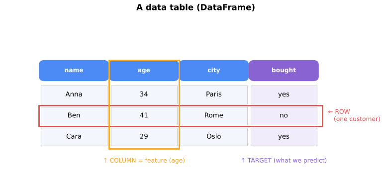

### 📚 New words
| Word | Simple meaning |
|---|---|
| **DataFrame** | a table |
| **row** | one thing (one customer, one house) |
| **column** | one property of every row (age, price) – also called a **feature** |
| **Series** | one single column |
| **index** | the row labels (0, 1, 2, …) on the left |
| **NaN** | "Not a Number" = an empty cell (missing value) |
| **dtype** | the kind of values in a column: `int64` = whole numbers, `float64` = decimals, `object`/`str` = text, `bool` = True/False |
| **mask** | a column of True/False used to pick rows |

### 🛠️ Example 1 – make a table

```python
import pandas as pd                       # "pd" is the usual nickname

shop = pd.DataFrame({
    "customer": ["Anna", "Ben", "Cara", "Dan", "Eva"],
    "age": [34, 41, 29, 52, 23],
    "city": ["Paris", "Rome", "Oslo", "Rome", "Paris"],
    "spent": [120.5, 80.0, 45.2, 300.0, 60.9],
})
print(shop)
```

**🖨️ Output:**

```text
  customer  age   city  spent
0     Anna   34  Paris  120.5
1      Ben   41   Rome   80.0
2     Cara   29   Oslo   45.2
3      Dan   52   Rome  300.0
4      Eva   23  Paris   60.9
```

### 🛠️ Example 2 – look at the table

```python
print("Shape:", shop.shape)               # (rows, columns)
print("Columns:", list(shop.columns))
print(shop.head(3))                       # first 3 rows
print(shop.dtypes)                        # the kind of values in each column
```

**🖨️ Output:**

```text
Shape: (5, 4)
Columns: ['customer', 'age', 'city', 'spent']
  customer  age   city  spent
0     Anna   34  Paris  120.5
1      Ben   41   Rome   80.0
2     Cara   29   Oslo   45.2
customer        str
age           int64
city            str
spent       float64
dtype: object
```

### 🛠️ Example 3 – pick columns

```python
print(shop["age"])                        # one column (a Series)
```

**🖨️ Output:**

```text
0    34
1    41
2    29
3    52
4    23
Name: age, dtype: int64
```

> 💡 **How to read this output:** left = row number (index), right = the values, last line = `Name: age` (the column) and `dtype: int64` (whole numbers).

```python
print(shop[["customer", "spent"]])        # several columns → a list inside the brackets
```

**🖨️ Output:**

```text
  customer  spent
0     Anna  120.5
1      Ben   80.0
2     Cara   45.2
3      Dan  300.0
4      Eva   60.9
```

### 🛠️ Example 4 – filter rows with a mask

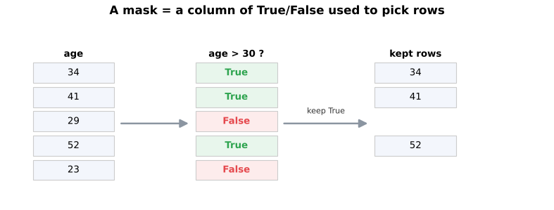

```python
older = shop["age"] > 30                  # the mask: one True/False per row
print(older)
print(shop[older])                        # keep only rows where the mask is True
```

**🖨️ Output:**

```text
0     True
1     True
2    False
3     True
4    False
Name: age, dtype: bool
  customer  age   city  spent
0     Anna   34  Paris  120.5
1      Ben   41   Rome   80.0
3      Dan   52   Rome  300.0
```

### 🛠️ Example 5 – combine conditions: `&` AND, `|` OR, `~` NOT

```python
print(shop[(shop["city"] == "Paris") & (shop["spent"] > 100)])   # Paris AND spent > 100
print(shop[(shop["city"] == "Oslo") | (shop["age"] > 50)])       # Oslo OR older than 50
print(shop[~(shop["city"] == "Rome")])                           # NOT Rome
```

**🖨️ Output:**

```text
  customer  age   city  spent
0     Anna   34  Paris  120.5
  customer  age  city  spent
2     Cara   29  Oslo   45.2
3      Dan   52  Rome  300.0
  customer  age   city  spent
0     Anna   34  Paris  120.5
2     Cara   29   Oslo   45.2
4      Eva   23  Paris   60.9
```

> ⚠️ In pandas write `&`, `|`, `~` (not `and`, `or`, `not`) and put **brackets around each condition**.

### 🛠️ Example 6 – one cell with `.loc[row, column]`

```python
print(shop.loc[0, "customer"])            # row 0, column "customer"
print(shop.loc[shop["age"] > 40, "customer"])   # rows that pass the test, one column
```

**🖨️ Output:**

```text
Anna
1    Ben
3    Dan
Name: customer, dtype: str
```

### 🛠️ Example 7 – sort and add a new column

```python
shop["spent_with_tax"] = shop["spent"] * 1.2               # new column from an old one
print(shop.sort_values("spent", ascending=False))          # biggest spender first
```

**🖨️ Output:**

```text
  customer  age   city  spent  spent_with_tax
3      Dan   52   Rome  300.0          360.00
0     Anna   34  Paris  120.5          144.60
1      Ben   41   Rome   80.0           96.00
4      Eva   23  Paris   60.9           73.08
2     Cara   29   Oslo   45.2           54.24
```

### 🛠️ Example 8 – quick summary

```python
print(shop.describe().round(1))           # count, mean, std, min, 25%, 50%, 75%, max – all explained in 0.5
print(shop["city"].value_counts())        # how many rows per city
```

**🖨️ Output:**

```text
        age  spent  spent_with_tax
count   5.0    5.0             5.0
mean   35.8  121.3           145.6
std    11.2  103.8           124.5
min    23.0   45.2            54.2
25%    29.0   60.9            73.1
50%    34.0   80.0            96.0
75%    41.0  120.5           144.6
max    52.0  300.0           360.0
city
Paris    2
Rome     2
Oslo     1
Name: count, dtype: int64
```

### 🛠️ Example 9 – group and summarise (like a pivot table)

```python
print(shop.groupby("city")["spent"].mean().round(1))      # average spend per city
```

**🖨️ Output:**

```text
city
Oslo      45.2
Paris     90.7
Rome     190.0
Name: spent, dtype: float64
```

### 🛠️ Example 10 – read a CSV file

```python
import io
csv_text = """name,score
Lea,88
Max,92
Noa,75
"""
grades = pd.read_csv(io.StringIO(csv_text))   # io.StringIO pretends this text is a file
print(grades)
```

**🖨️ Output:**

```text
  name  score
0  Lea     88
1  Max     92
2  Noa     75
```

> 💡 With a real file it's just `pd.read_csv("grades.csv")`. In Colab, click the 📁 folder icon on the left → upload your file → then use its name.

### 🛠️ Example 11 – find empty cells

```python
import numpy as np
messy = shop.copy()                        # .copy() = work on a copy, keep the original safe
messy.loc[2, "age"] = np.nan               # make Cara's age empty
print(messy.isna().sum())                  # count empty cells per column
print(messy["age"])                        # note: now shows 34.0 – NaN forces decimals
```

**🖨️ Output:**

```text
customer          0
age               1
city              0
spent             0
spent_with_tax    0
dtype: int64
0    34.0
1    41.0
2     NaN
3    52.0
4    23.0
Name: age, dtype: float64
```

### 🏋️ Practice
Using `shop`: (1) show only customers from Rome, (2) the total `spent` per city.

<details><summary>👀 Show answers</summary>

```python
print(shop[shop["city"] == "Rome"])
print(shop.groupby("city")["spent"].sum())
```

**🖨️ Output:**

```text
  customer  age  city  spent  spent_with_tax
1      Ben   41  Rome   80.0            96.0
3      Dan   52  Rome  300.0           360.0
city
Oslo      45.2
Paris    181.4
Rome     380.0
Name: spent, dtype: float64
```
</details>

### 🧪 Lab 0.3 – The school library 📚

**🎯 Goal:** filter, sort, group and find empty cells in a table.

**🧾 Data** – run this cell first:

```python
import numpy as np
import pandas as pd

library = pd.DataFrame({
    "title": ["Dune", "Matilda", "Hobbit", "Emma", "Gruffalo", "Odyssey", "Coraline"],
    "genre": ["sci-fi", "children", "fantasy", "classic", "children", "classic", "fantasy"],
    "pages": [612, 240, 310, 474, 32, 541, np.nan],
    "times_borrowed": [12, 30, 25, 4, 41, 2, 18],
})
print(library)
```

**🖨️ Output:**

```text
      title     genre  pages  times_borrowed
0      Dune    sci-fi  612.0              12
1   Matilda  children  240.0              30
2    Hobbit   fantasy  310.0              25
3      Emma   classic  474.0               4
4  Gruffalo  children   32.0              41
5   Odyssey   classic  541.0               2
6  Coraline   fantasy    NaN              18
```

**📝 Your tasks**

1. How many books have more than 300 pages?
2. Sort by `times_borrowed`, most popular first. Which book is top?
3. Average `times_borrowed` per genre.
4. Which column has an empty cell, and how many?
5. Self-check: 4 books > 300 pages, top book is Gruffalo, children's books are borrowed 35.5 times on average.

**🧩 Starter code** (replace every `...`)

```python
long_books = library[...]
top = library.sort_values(...).iloc[0]["title"]
per_genre = library.groupby(...)[...].mean()
print(library.isna().sum())
```

<details><summary>💡 Hints</summary>

- `library[library["pages"] > 300]`
- `sort_values("times_borrowed", ascending=False)`
- `groupby("genre")["times_borrowed"].mean()`

</details>

<details><summary>✅ Solution (try first!)</summary>

```python
long_books = library[library["pages"] > 300]
top = library.sort_values("times_borrowed", ascending=False).iloc[0]["title"]
per_genre = library.groupby("genre")["times_borrowed"].mean()
print("Books > 300 pages:", len(long_books), "| most borrowed:", top)
print(per_genre)
print(library.isna().sum())
assert len(long_books) == 4 and top == "Gruffalo" and per_genre["children"] == 35.5
print("✅ Lab passed!")
```

**🖨️ Output:**

```text
Books > 300 pages: 4 | most borrowed: Gruffalo
genre
children    35.5
classic      3.0
fantasy     21.5
sci-fi      12.0
Name: times_borrowed, dtype: float64
title             0
genre             0
pages             1
times_borrowed    0
dtype: int64
✅ Lab passed!
```
</details>

### 🧠 Recap
- `pd.DataFrame({...})` makes a table; `df["col"]` picks a column; `df[mask]` keeps rows where the mask is True.
- `&` AND, `|` OR, `~` NOT. `.loc[rows, column]` picks exact cells.
- `describe()`, `value_counts()`, `groupby()` summarise; `isna()` finds empty cells.

---

<a name="sec-0-4-drawing-charts"></a>
## 📊 0.4 Drawing charts 🟢

### 🍼 The story
A chart lets your eyes see patterns in one second that would take minutes in a table. `matplotlib` is Python's drawing tool.

### 🛠️ Example 1 – line chart (change over time)

```python
import matplotlib.pyplot as plt          # the drawing toolbox, nickname plt

months = ["Jan", "Feb", "Mar", "Apr", "May"]
sales = [100, 120, 90, 150, 170]
plt.plot(months, sales, marker="o")      # draw a line with dots
plt.title("Ice-cream sales")
plt.ylabel("cones sold")
plt.show()                               # show the picture
```

**🖼️ What you will see:**

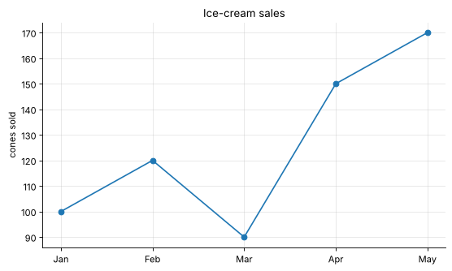

### 🛠️ Example 2 – bar chart (compare groups)

```python
plt.bar(["Paris", "Rome", "Oslo"], [181.4, 380.0, 45.2], color=["#4C8BF5", "#F5A623", "#2EA44F"])
plt.title("Total spent per city")
plt.show()
```

**🖼️ What you will see:**

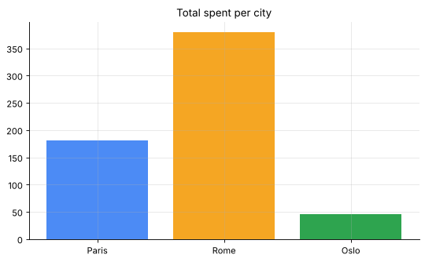

### 🛠️ Example 3 – histogram (how values are spread)
A histogram puts values into "buckets" and counts how many fall in each bucket.

```python
import numpy as np
heights = np.random.default_rng(0).normal(170, 10, 1000)
plt.hist(heights, bins=30, color="#8A63D2", edgecolor="white")   # bins = number of buckets
plt.title("Heights of 1,000 people – a bell shape")
plt.xlabel("cm"); plt.ylabel("how many people")
plt.show()
```

**🖼️ What you will see:**

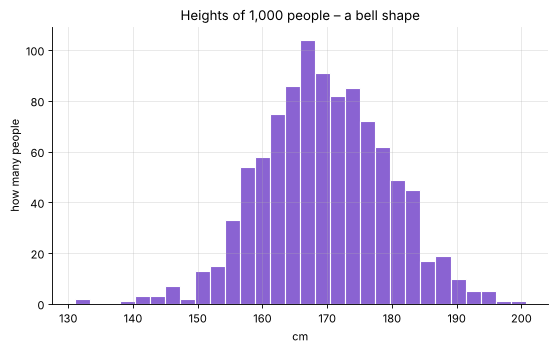

### 🛠️ Example 4 – scatter plot (do two things move together?)

```python
size = np.array([50, 60, 80, 100, 120, 150])
price = np.array([150, 180, 240, 290, 360, 450])
plt.scatter(size, price, s=80)            # s = dot size
plt.xlabel("house size (m²)"); plt.ylabel("price (k$)")
plt.title("Bigger houses cost more")
plt.show()
```

**🖼️ What you will see:**

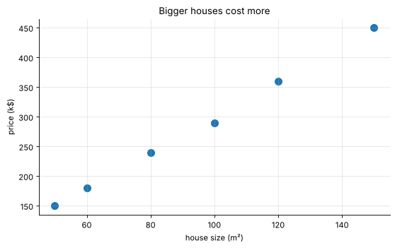

### 🛠️ Example 5 – boxplot (middle, spread and strange values)

```python
test_scores = [55, 60, 62, 64, 65, 66, 68, 70, 72, 75, 78, 99]
plt.boxplot(test_scores)
plt.title("Box = middle half of the scores, dot = unusual score (99)")
plt.ylabel("score")
plt.xticks([1], ["class 3B"])
plt.show()
```

**🖼️ What you will see:**

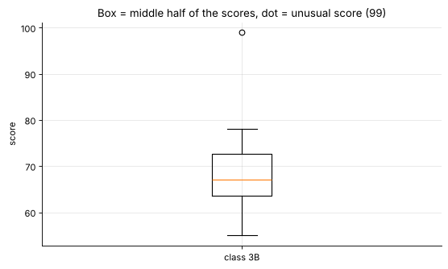

### 🧪 Lab 0.4 – Rain diary 🌧️

**🎯 Goal:** pick the right chart for each question.

**🧾 Data** – run this cell first:

```python
import numpy as np
import pandas as pd
import matplotlib.pyplot as plt

rain = pd.DataFrame({"month": ["Jan", "Feb", "Mar", "Apr", "May", "Jun"],
                     "rain_mm": [78, 60, 55, 42, 50, 38],
                     "rainy_days": [14, 11, 11, 9, 10, 8]})
```

**📝 Your tasks**

1. Line chart of `rain_mm` per month (change over time).
2. Bar chart of `rainy_days` (compare months).
3. Scatter plot: `rainy_days` (x) vs `rain_mm` (y). Do they move together?
4. Self-check: the correlation between the two columns should be above 0.9.

**🧩 Starter code** (replace every `...`)

```python
plt.plot(...)
plt.show()
plt.bar(...)
plt.show()
plt.scatter(...)
plt.show()
print(rain["rain_mm"].corr(...))
```

<details><summary>💡 Hints</summary>

- `plt.plot(rain["month"], rain["rain_mm"], marker="o")`
- Always end with `plt.show()`

</details>

<details><summary>✅ Solution (try first!)</summary>

```python
plt.plot(rain["month"], rain["rain_mm"], marker="o"); plt.title("Rain per month"); plt.ylabel("mm"); plt.show()
plt.bar(rain["month"], rain["rainy_days"], color="#4C8BF5"); plt.title("Rainy days"); plt.show()
plt.scatter(rain["rainy_days"], rain["rain_mm"], s=80); plt.xlabel("rainy days"); plt.ylabel("rain mm"); plt.show()
corr = rain["rain_mm"].corr(rain["rainy_days"])
print("Correlation:", round(corr, 3))
assert corr > 0.9
print("✅ Lab passed!")
```

**🖨️ Output:**

```text
Correlation: 0.992
✅ Lab passed!
```

**🖼️ What you will see:**

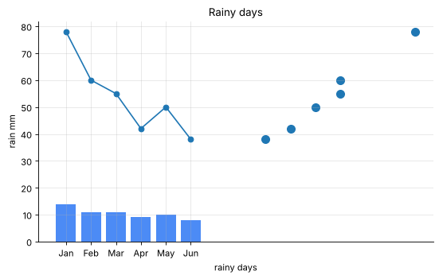
</details>

### 🧠 Recap
| Chart | Use it to see… |
|---|---|
| line | change over time |
| bar | compare groups |
| histogram | how values are spread |
| scatter | relationship between two numbers |
| boxplot | middle, spread and outliers |

---

<a name="sec-0-5-statistics-in-plain-words"></a>
## 📏 0.5 Statistics in plain words 🟢

### 🍼 The story
Statistics are tiny summaries of many numbers. You'll use these words in every chapter, so let's meet them with one class of 7 test scores.

### 🛠️ Example 1 – the middle of the data

```python
import numpy as np
import pandas as pd

scores = pd.Series([55, 60, 62, 65, 70, 72, 99])
print("mean   (add all, divide by 7):", round(scores.mean(), 1))
print("median (the middle one when sorted):", scores.median())
```

**🖨️ Output:**

```text
mean   (add all, divide by 7): 69.0
median (the middle one when sorted): 65.0
```

> [!TIP]
> 💡 The one **99** pulls the **mean** up to 69, but the **median** stays at 65. The median is "robust" – extreme values don't fool it.

```python
shoe_sizes = pd.Series([38, 39, 39, 40, 41, 39])
print("mode (the most common value):", shoe_sizes.mode()[0])
```

**🖨️ Output:**

```text
mode (the most common value): 39
```

### 🛠️ Example 2 – the spread: standard deviation, by hand
**Standard deviation (std)** = "on average, how far are the values from the mean?" Small std = everyone similar, big std = very different.

```python
small = pd.Series([4, 5, 6])
mean = small.mean()                          # 5
distances = small - mean                     # -1, 0, +1
squared = distances ** 2                     # 1, 0, 1   (squaring removes the minus signs)
variance = squared.sum() / (len(small) - 1)  # 2 / 2 = 1  (n-1 instead of n: a small correction for samples – ignore it for now)
std = variance ** 0.5                        # square root → back to normal units
print("by hand:", std, "| pandas:", small.std())
print("std of class scores:", round(scores.std(), 1))
```

**🖨️ Output:**

```text
by hand: 1.0 | pandas: 1.0
std of class scores: 14.4
```

### 🛠️ Example 3 – quartiles and the IQR

```python
print("min:", scores.min(), "| max:", scores.max())
print("Q1 (25 % of scores are below):", scores.quantile(0.25))
print("Q3 (75 % of scores are below):", scores.quantile(0.75))
print("IQR = Q3 - Q1 (width of the middle half):", scores.quantile(0.75) - scores.quantile(0.25))
```

**🖨️ Output:**

```text
min: 55 | max: 99
Q1 (25 % of scores are below): 61.0
Q3 (75 % of scores are below): 71.0
IQR = Q3 - Q1 (width of the middle half): 10.0
```

### 🖼️ The bell curve and the z-score
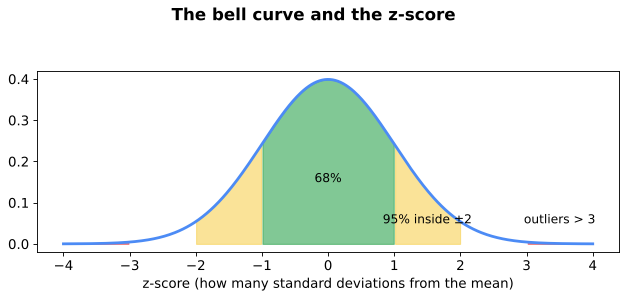

**z-score** = "how many standard deviations away from the average?"
- z near **0** → normal · z around **2** → unusual · z beyond **3** (or below −3) → **outlier**, very rare

```python
z = (scores - scores.mean()) / scores.std()
print(pd.DataFrame({"score": scores, "z_score": z.round(2)}))
```

**🖨️ Output:**

```text
   score  z_score
0     55    -0.97
1     60    -0.62
2     62    -0.48
3     65    -0.28
4     70     0.07
5     72     0.21
6     99     2.08
```

> 💡 The 99 has z ≈ 2.1: unusual, but not beyond 3. With only 7 values, the 99 itself makes the std big – keep that in mind for the outlier chapter.

### 🛠️ Example 4 – correlation: do two things move together?
Correlation goes from **−1** (one goes up, the other goes down) through **0** (no relation) to **+1** (both go up together).

```python
study_hours = pd.Series([1, 2, 3, 4, 5, 6])
test_score = pd.Series([52, 58, 65, 70, 78, 85])
tv_hours = pd.Series([6, 5, 5, 3, 2, 1])
print("study vs score:", round(study_hours.corr(test_score), 2))
print("tv vs score   :", round(tv_hours.corr(test_score), 2))
```

**🖨️ Output:**

```text
study vs score: 1.0
tv vs score   : -0.97
```

> [!WARNING]
> ⚠️ **Correlation is not causation.** Ice-cream sales and sunburns rise together – but ice-cream doesn't cause sunburn. The sun causes both. ☀️

### 🛠️ Example 5 – skew: is the data lopsided?
"Skewed" data has a **long tail** on one side – like incomes: most people earn a normal amount, a few earn enormous amounts.

```python
import matplotlib.pyplot as plt
from scipy.stats import skew

rng = np.random.default_rng(1)
incomes = rng.lognormal(10.5, 0.8, 2000)     # realistic incomes: most small, few huge
fig, axes = plt.subplots(1, 2, figsize=(11, 3.5))
axes[0].hist(rng.normal(170, 10, 2000), bins=40, color="#2EA44F"); axes[0].set_title("Balanced (heights) – skew ≈ 0")
axes[1].hist(incomes, bins=60, color="#F5A623"); axes[1].set_title("Skewed (incomes) – long tail to the right")
plt.show()
print("skew of incomes:", round(skew(incomes), 2), "→ bigger than 1 = strongly lopsided")
```

**🖨️ Output:**

```text
skew of incomes: 3.88 → bigger than 1 = strongly lopsided
```

**🖼️ What you will see:**

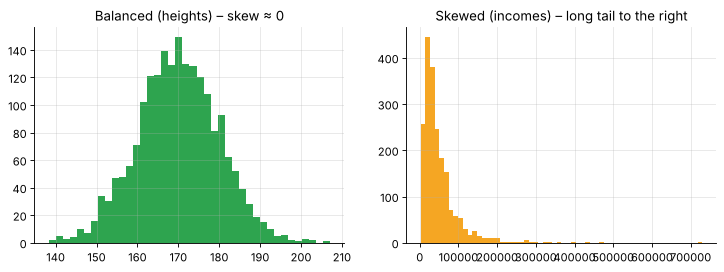

### 🛠️ Example 6 – what does "log" do?
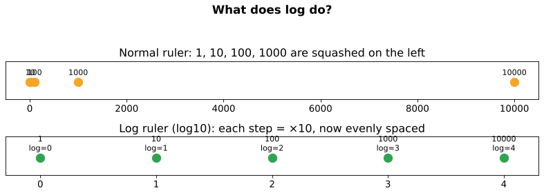

`log10(x)` asks: "10 to the power of **what** gives x?" → log10(100) = 2, log10(1000) = 3. It turns "×10" steps into "+1" steps, which **squeezes huge numbers** together.

```python
values = np.array([1, 10, 100, 1_000, 1_000_000])
print("values :", values)
print("log10  :", np.log10(values))
print("log1p  :", np.log1p(values).round(2), "← log(1 + x): works even when x = 0")
```

**🖨️ Output:**

```text
values : [      1      10     100    1000 1000000]
log10  : [0. 1. 2. 3. 6.]
log1p  : [ 0.69  2.4   4.62  6.91 13.82] ← log(1 + x): works even when x = 0
```

### 🏋️ Practice
For `[2, 4, 4, 4, 5, 5, 7, 9]` find mean, median, mode and std.

<details><summary>👀 Show answer</summary>

```python
s = pd.Series([2, 4, 4, 4, 5, 5, 7, 9])
print(s.mean(), s.median(), s.mode()[0], round(s.std(), 2))
```

**🖨️ Output:**

```text
5.0 4.5 4 2.14
```
</details>

### 🧪 Lab 0.5 – Delivery times 🚚

**🎯 Goal:** describe data with mean, median, std, IQR and z-scores – and spot the odd one.

**🧾 Data** – run this cell first:

```python
import pandas as pd
minutes = pd.Series([31, 28, 35, 30, 33, 29, 32, 34, 30, 95], name="delivery_minutes")
```

**📝 Your tasks**

1. Print mean and median. Which one is pulled up by the late delivery?
2. Print the std and the IQR.
3. Compute z-scores and list deliveries with z above 2.
4. Self-check: median is 31.5 and only the 95-minute delivery has z > 2.

**🧩 Starter code** (replace every `...`)

```python
print(minutes.mean(), minutes.median())
iqr = ...
z = ...
print(minutes[z > 2])
```

<details><summary>💡 Hints</summary>

- `minutes.quantile(0.75) - minutes.quantile(0.25)`
- `(minutes - minutes.mean()) / minutes.std()`

</details>

<details><summary>✅ Solution (try first!)</summary>

```python
print("mean:", minutes.mean(), "| median:", minutes.median(), "→ the mean is pulled up by 95")
iqr = minutes.quantile(0.75) - minutes.quantile(0.25)
print("std:", round(minutes.std(), 1), "| IQR:", iqr)
z = (minutes - minutes.mean()) / minutes.std()
odd = minutes[z > 2]
print("Unusual deliveries:", odd.tolist())
assert minutes.median() == 31.5 and odd.tolist() == [95]
print("✅ Lab passed!")
```

**🖨️ Output:**

```text
mean: 37.7 | median: 31.5 → the mean is pulled up by 95
std: 20.3 | IQR: 3.75
Unusual deliveries: [95]
✅ Lab passed!
```
</details>

### 🧠 Recap
| Word | Meaning |
|---|---|
| mean / median / mode | average / middle / most common |
| std | typical distance from the mean |
| Q1, Q3, IQR | 25 % point, 75 % point, width of the middle half |
| z-score | distance from the mean in std units (beyond ±3 = outlier) |
| correlation | −1 … +1, do two things move together |
| skew | lopsidedness; log squeezes long right tails |

---

<a name="sec-0-6-what-is-machine-learning"></a>
## 🤖 0.6 What is Machine Learning? 🟢

### 🍼 The story
Imagine teaching a child to recognise apples 🍎 and oranges 🍊. You don't explain rules like "red + round + stem". You **show many examples** and say "apple", "orange"… Soon the child guesses correctly on fruit they've never seen.
**Machine learning = the computer learns the rules from examples**, instead of us writing the rules.

### 🖼️ Picture
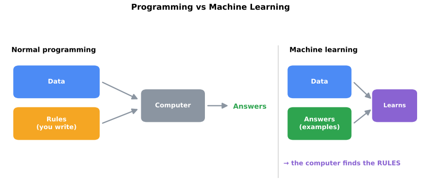

### 📚 New words
| Word | Simple meaning | Fruit example |
|---|---|---|
| **features** (X) | the clues we give | weight, smoothness |
| **target / label** (y) | the answer we want | "apple" or "orange" |
| **model** | the "brain" that learns the rule | |
| **training** (`fit`) | letting the model study examples | showing it 8 fruits |
| **prediction** (`predict`) | the model's guess on new data | "this new fruit is an apple" |
| **classification** | the answer is a category | apple / orange |
| **regression** | the answer is a number | price in $ |
| **accuracy** | share of correct answers | 9 of 10 right = 0.9 |

### 🛠️ Example 1 – your first model (regression): house price from size
A **linear regression** draws the **straight line** that fits the points best, then reads new prices off that line.

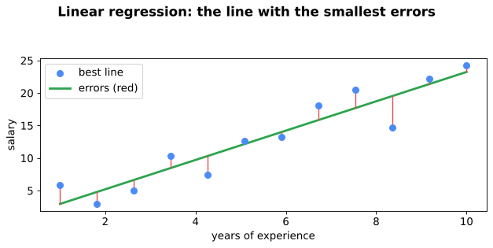

```python
import pandas as pd
from sklearn.linear_model import LinearRegression

houses = pd.DataFrame({"size_m2": [50, 60, 80, 100, 120],
                       "price_k": [150, 180, 240, 300, 360]})

X = houses[["size_m2"]]       # features: double brackets → a table (models want a table)
y = houses["price_k"]         # target: single brackets → one column

model = LinearRegression()    # 1. choose a model
model.fit(X, y)               # 2. train it on the examples

new_house = pd.DataFrame({"size_m2": [90]})
print("Predicted price for 90 m²:", model.predict(new_house).round(1), "k$")   # 3. predict
print("Learned rule: price =", round(model.coef_[0], 2), "× size +", round(model.intercept_, 2))
```

**🖨️ Output:**

```text
Predicted price for 90 m²: [270.] k$
Learned rule: price = 3.0 × size + 0.0
```

### 🛠️ Example 2 – your first classifier: apple 🍎 or orange 🍊?
A **decision tree** learns a set of yes/no questions, like a game of "20 questions".

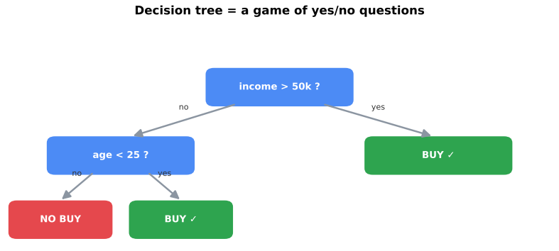

```python
from sklearn.tree import DecisionTreeClassifier, export_text

fruits = pd.DataFrame({
    "weight_g":   [150, 170, 140, 130, 200, 210, 190, 220],
    "smoothness": [9, 8, 9, 10, 3, 2, 4, 3],          # 10 = very smooth skin
    "fruit":      ["apple", "apple", "apple", "apple", "orange", "orange", "orange", "orange"],
})
clf = DecisionTreeClassifier(random_state=0)          # random_state = seed → same result every run
clf.fit(fruits[["weight_g", "smoothness"]], fruits["fruit"])
print(export_text(clf, feature_names=["weight_g", "smoothness"]))   # the questions it learned

mystery = pd.DataFrame({"weight_g": [160, 205], "smoothness": [9, 3]})
print("Predictions:", clf.predict(mystery))
```

**🖨️ Output:**

```text
|--- smoothness <= 6.00
|   |--- class: orange
|--- smoothness >  6.00
|   |--- class: apple

Predictions: ['apple' 'orange']
```

### 🛠️ Example 3 – test the model on fruit it never saw
We hide some examples (the **test set**), train on the rest (the **training set**), then check answers on the hidden ones – like a surprise quiz.

```python
from sklearn.model_selection import train_test_split

X = fruits[["weight_g", "smoothness"]]
y = fruits["fruit"]
# train_test_split gives back 4 things at once, in this order:
X_train, X_test, y_train, y_test = train_test_split(
    X, y,
    test_size=0.25,        # hide 25 % (2 of 8 fruits) for the test
    random_state=1,        # seed → same split every run
    stratify=y,            # keep the apple/orange mix equal in both parts
)
print("Training fruits:", len(X_train), "| Test fruits:", len(X_test))

clf = DecisionTreeClassifier(random_state=0).fit(X_train, y_train)
print("Accuracy on the 2 unseen fruits:", clf.score(X_test, y_test))
```

**🖨️ Output:**

```text
Training fruits: 6 | Test fruits: 2
Accuracy on the 2 unseen fruits: 1.0
```

> ⚠️ 1.0 = 100 % correct – but it was only **2** test fruits! Real projects test on hundreds or thousands of rows.

### 🖼️ The 4 kinds of ML
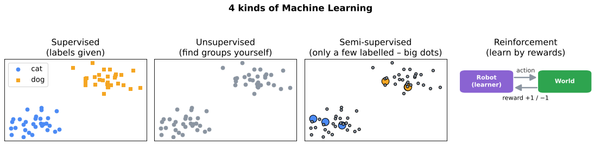

| Kind | You give the computer… | Example |
|---|---|---|
| 🎯 **Supervised** | examples **with** answers | spam / not spam |
| 🧭 **Unsupervised** | examples **without** answers | group similar customers |
| 🧩 **Semi-supervised** | a few answers + many without | label 50 photos, learn from 5,000 |
| 🎮 **Reinforcement** | a world + rewards | robot learns to walk |

### 🖼️ The steps of every project (the "pipeline")
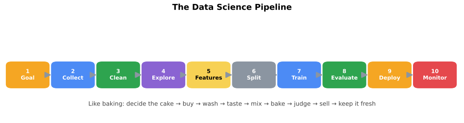

Part 1 of this book walks through these 10 steps one by one. 🚶

### 🧪 Lab 0.6 – Pizza price predictor 🍕

**🎯 Goal:** train your first regression and classification models with `fit` and `predict`.

**🧾 Data** – run this cell first:

```python
import pandas as pd
pizzas = pd.DataFrame({"diameter_cm": [20, 25, 30, 35, 40, 45],
                       "price": [6.0, 8.0, 10.5, 12.5, 15.0, 17.0],
                       "size_name": ["small", "small", "medium", "medium", "large", "large"]})
```

**📝 Your tasks**

1. Train a `LinearRegression` that predicts `price` from `diameter_cm`.
2. Predict the price of a 32 cm pizza.
3. Train a `DecisionTreeClassifier` that predicts `size_name` from `diameter_cm`; predict 22 cm and 43 cm.
4. Self-check: the 32 cm price is between 11 and 12, and the sizes are small and large.

**🧩 Starter code** (replace every `...`)

```python
from sklearn.linear_model import LinearRegression
from sklearn.tree import DecisionTreeClassifier

reg = LinearRegression().fit(..., ...)
print(reg.predict(pd.DataFrame({"diameter_cm": [32]})))
clf = DecisionTreeClassifier(random_state=0).fit(..., ...)
```

<details><summary>💡 Hints</summary>

- Features need double brackets: `pizzas[["diameter_cm"]]`
- Target: `pizzas["price"]`

</details>

<details><summary>✅ Solution (try first!)</summary>

```python
from sklearn.linear_model import LinearRegression
from sklearn.tree import DecisionTreeClassifier

reg = LinearRegression().fit(pizzas[["diameter_cm"]], pizzas["price"])
p32 = reg.predict(pd.DataFrame({"diameter_cm": [32]}))[0]
print("32 cm pizza costs about", round(p32, 2))
clf = DecisionTreeClassifier(random_state=0).fit(pizzas[["diameter_cm"]], pizzas["size_name"])
sizes = clf.predict(pd.DataFrame({"diameter_cm": [22, 43]})).tolist()
print("22 cm and 43 cm are:", sizes)
assert 11 < p32 < 12 and sizes == ["small", "large"]
print("✅ Lab passed!")
```

**🖨️ Output:**

```text
32 cm pizza costs about 11.28
22 cm and 43 cm are: ['small', 'large']
✅ Lab passed!
```
</details>

### 🧠 Recap
- ML = learning rules from examples. Features **X** → model → target **y**.
- Every scikit-learn model works the same way: `model.fit(X, y)`, then `model.predict(new_X)`.
- Always test on data the model has **not** seen.

---

<a name="sec-0-7-your-first-complete-ml-project-all-10-steps-in-15-minutes"></a>
## 🏁 0.7 Your First Complete ML Project (all 10 steps in 15 minutes) 🟢

### 🍼 The story
Before learning each step in detail, let's do the **whole journey once**, quickly – like a test drive 🚗. We'll predict whether a student **passes an exam**. Don't worry if a step feels fast; every step has its own chapter later.

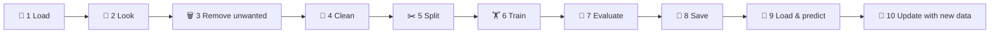

### 🛠️ Step 0 – create the practice file (just run this cell)
In real life you'd **receive** a file. Here we create `students.csv` on your computer with realistic problems hidden inside.

```python
import numpy as np
import pandas as pd

rng = np.random.default_rng(7)
n = 300
hours = rng.uniform(0, 12, n).round(1)
attendance = rng.uniform(50, 100, n).round()
previous = rng.normal(60, 12, n).clip(20, 100).round()
chance = 1 / (1 + np.exp(-(-6 + 0.45 * hours + 0.04 * attendance + 0.02 * previous)))   # hidden rule
passed = (rng.random(n) < chance).astype(int)

students = pd.DataFrame({
    "student_id": range(1001, 1001 + n),
    "name": [f"Student {i}" for i in range(n)],
    "email": [f"student{i}@school.org" for i in range(n)],
    "school": "Green Hill High",                                     # same for everyone
    "hours_studied": hours,
    "attendance_pct": attendance,
    "previous_score": previous,
    "favourite_color": rng.choice(["red", "blue", "green"], n),     # has nothing to do with passing
    "teacher_notes": np.where(rng.random(n) < 0.95, None, "talkative"),   # 95 % empty
    "final_grade": np.where(passed == 1, rng.integers(50, 100, n), rng.integers(0, 50, n)),   # known only AFTER the exam!
    "passed": passed,
})
students.loc[rng.choice(n, 12, replace=False), "attendance_pct"] = np.nan      # some holes
students.loc[5, "attendance_pct"] = 450                                         # a typing mistake
students = pd.concat([students, students.iloc[[10, 20, 30]]], ignore_index=True)   # 3 duplicated rows
students.loc[len(students) - 1, "passed"] = np.nan                              # the last row has no answer
students.to_csv("students.csv", index=False)
print("Saved students.csv with", len(students), "rows")
```

**🖨️ Output:**

```text
Saved students.csv with 303 rows
```

### 📄 Step 1 – load the data

```python
df = pd.read_csv("students.csv")
print("Rows, columns:", df.shape)
```

**🖨️ Output:**

```text
Rows, columns: (303, 11)
```

### 👀 Step 2 – look at it

```python
print(df.head())
print(df.isna().sum())                        # empty cells per column
print("Duplicate rows:", df.duplicated().sum())
print(df.describe().round(1))
```

**🖨️ Output:**

```text
   student_id       name                email           school  hours_studied  attendance_pct  \
0        1001  Student 0  student0@school.org  Green Hill High            7.5            82.0
1        1002  Student 1  student1@school.org  Green Hill High           10.8            59.0
2        1003  Student 2  student2@school.org  Green Hill High            9.3            88.0
3        1004  Student 3  student3@school.org  Green Hill High            2.7            88.0
4        1005  Student 4  student4@school.org  Green Hill High            3.6            86.0

   previous_score favourite_color teacher_notes  final_grade  passed
0            65.0           green           NaN           88     1.0
1            61.0           green           NaN           63     1.0
2            72.0             red           NaN           68     1.0
3            51.0             red           NaN           71     1.0
4            59.0            blue           NaN           82     1.0
student_id           0
name                 0
email                0
school               0
hours_studied        0
attendance_pct      12
previous_score       0
favourite_color      0
teacher_notes      287
final_grade          0
passed               1
dtype: int64
Duplicate rows: 2
       student_id  hours_studied  attendance_pct  previous_score  final_grade  passed
count       303.0          303.0           291.0           303.0        303.0   302.0
mean       1149.2            6.0            76.8            59.9         56.3     0.6
std          87.3            3.5            25.9            11.7         26.5     0.5
min        1001.0            0.0            51.0            27.0          1.0     0.0
25%        1073.5            3.0            64.0            52.0         37.0     0.0
50%        1149.0            6.2            76.0            59.0         60.0     1.0
75%        1224.5            9.2            88.0            68.0         75.5     1.0
max        1300.0           12.0           450.0            91.0         99.0     1.0
```

> 💡 **What we notice:** 2 exact duplicate rows (a third copy lost its answer, so it is no longer identical), one row without an answer, holes in `attendance_pct`, an attendance of **450 %** (impossible), `teacher_notes` almost empty, `school` the same for everyone, and `final_grade` – which tells the answer!

### 🗑️ Step 3 – remove unwanted data

```python
df = df.drop_duplicates()                                          # a) copied rows
df = df.dropna(subset=["passed"])                                  # b) rows without an answer can't teach anything
df = df.drop(columns=[
    "student_id", "name", "email",          # c) IDs and personal data – no meaning for passing, privacy risk
    "school",                               # d) never changes → no information
    "teacher_notes",                        # e) 95 % empty
    "final_grade",                          # f) LEAK: only known after the exam
    "favourite_color",                      # g) unrelated to the question
])
print("Columns we keep:", list(df.columns), "| rows:", len(df))
```

**🖨️ Output:**

```text
Columns we keep: ['hours_studied', 'attendance_pct', 'previous_score', 'passed'] | rows: 300
```

### 🧹 Step 4 – clean what's left

```python
df.loc[~df["attendance_pct"].between(0, 100), "attendance_pct"] = np.nan    # impossible → empty
print("Empty attendance cells now:", df["attendance_pct"].isna().sum(), "(we'll fill them inside the model pipeline)")
```

**🖨️ Output:**

```text
Empty attendance cells now: 13 (we'll fill them inside the model pipeline)
```

### ✂️ Step 5 – split into study data and exam data

```python
from sklearn.model_selection import train_test_split

X = df[["hours_studied", "attendance_pct", "previous_score"]]     # the clues
y = df["passed"].astype(int)                                       # the answer
X_train, X_test, y_train, y_test = train_test_split(X, y, test_size=0.25, stratify=y, random_state=0)
print("Training rows:", len(X_train), "| test rows:", len(X_test))
```

**🖨️ Output:**

```text
Training rows: 225 | test rows: 75
```

### 🏋️ Step 6 – train a model (a pipeline: fill holes → scale → model)

```python
from sklearn.impute import SimpleImputer
from sklearn.linear_model import LogisticRegression
from sklearn.pipeline import make_pipeline
from sklearn.preprocessing import StandardScaler

model = make_pipeline(
    SimpleImputer(strategy="median"),   # 1. fill empty cells with the middle value (1.3.1)
    StandardScaler(),                   # 2. put all columns on the same ruler (1.3.5)
    LogisticRegression(),               # 3. a yes/no model that gives a chance between 0 and 1 (Part 3)
)                                       # make_pipeline = run these 3 steps in order, every time
model.fit(X_train, y_train)
print("Trained! ✅")
```

**🖨️ Output:**

```text
Trained! ✅
```

### 📏 Step 7 – evaluate on the unseen test data

```python
from sklearn.dummy import DummyClassifier
from sklearn.metrics import accuracy_score, confusion_matrix

pred = model.predict(X_test)
baseline = DummyClassifier(strategy="most_frequent").fit(X_train, y_train).predict(X_test)
print("Model accuracy   :", round(accuracy_score(y_test, pred), 3))
print("Baseline accuracy:", round(accuracy_score(y_test, baseline), 3), "(always guesses the most common answer)")
print(pd.DataFrame(confusion_matrix(y_test, pred), index=["really failed", "really passed"], columns=["said fail", "said pass"]))
```

**🖨️ Output:**

```text
Model accuracy   : 0.747
Baseline accuracy: 0.64 (always guesses the most common answer)
               said fail  said pass
really failed         18          9
really passed         10         38
```

### 💾 Step 8 – save the model to a file

```python
import joblib

joblib.dump(model, "student_model.joblib")
print("Saved student_model.joblib")
```

**🖨️ Output:**

```text
Saved student_model.joblib
```

### 📂 Step 9 – load it (tomorrow, on another computer…) and predict a new student

```python
loaded = joblib.load("student_model.joblib")
new_students = pd.DataFrame({"hours_studied": [2, 9], "attendance_pct": [60, 95], "previous_score": [50, 75]})
# predict_proba gives 2 columns: chance of 0 (fail) and chance of 1 (pass); [:, 1] takes the "pass" column
new_students["chance_to_pass"] = loaded.predict_proba(new_students)[:, 1].round(2)
new_students["prediction"] = loaded.predict(new_students[["hours_studied", "attendance_pct", "previous_score"]])
print(new_students)
```

**🖨️ Output:**

```text
   hours_studied  attendance_pct  previous_score  chance_to_pass  prediction
0              2              60              50            0.20           0
1              9              95              75            0.95           1
```

### 🔁 Step 10 – new data arrives → retrain → predict with the new model
Next term, 100 more students finish the exam. We add them to the old data, retrain, check the new model is at least as good, and save it as **version 2**.

```python
new_term = pd.DataFrame({"hours_studied": rng.uniform(0, 12, 100).round(1),
                         "attendance_pct": rng.uniform(50, 100, 100).round(),
                         "previous_score": rng.normal(60, 12, 100).clip(20, 100).round()})
chance_new = 1 / (1 + np.exp(-(-6 + 0.45 * new_term.hours_studied + 0.04 * new_term.attendance_pct + 0.02 * new_term.previous_score)))
new_term["passed"] = (rng.random(100) < chance_new).astype(int)

all_X = pd.concat([X_train, new_term[X.columns]])                 # old training data + new data
all_y = pd.concat([y_train, new_term["passed"]])
model_v2 = make_pipeline(SimpleImputer(strategy="median"), StandardScaler(), LogisticRegression()).fit(all_X, all_y)

print("Old model on the test set:", round(loaded.score(X_test, y_test), 3))
print("New model on the test set:", round(model_v2.score(X_test, y_test), 3))
joblib.dump(model_v2, "student_model_v2.joblib")
print("Prediction with version 2:", model_v2.predict(new_students[X.columns]).tolist())
```

**🖨️ Output:**

```text
Old model on the test set: 0.747
New model on the test set: 0.76
Prediction with version 2: [0, 1]
```

> 💡 Part 4 turns these 10 steps into a **desktop app with buttons** (Tkinter) – train, save, load, predict and update, without touching code.

### 🧪 Lab 0.7 – Do all 10 steps yourself: will the car pass its inspection? 🚗

**🎯 Goal:** repeat the whole pipeline on new data, with less help.

**🧾 Data** – run this cell first:

```python
import numpy as np
import pandas as pd

rng = np.random.default_rng(3)
n = 400
age = rng.integers(1, 20, n)
km = (age * rng.normal(15_000, 4_000, n)).clip(1_000).round(-2)
services = rng.integers(0, age + 1)
chance = 1 / (1 + np.exp(-(3 - 0.25 * age - 0.000006 * km + 0.35 * services)))
cars = pd.DataFrame({"plate": [f"AB{1000 + i}" for i in range(n)], "owner_name": [f"Owner {i}" for i in range(n)],
                     "country": "NL", "age_years": age, "km_driven": km, "services_done": services,
                     "colour": rng.choice(["black", "white", "red"], n),
                     "passed": (rng.random(n) < chance).astype(int)})
cars["repair_cost_after_test"] = np.where(cars["passed"] == 1, 0, rng.integers(200, 2000, n))   # only known after the test → leak
cars.loc[rng.choice(n, 10, replace=False), "km_driven"] = np.nan
cars = pd.concat([cars, cars.iloc[:4]])
cars.to_csv("cars.csv", index=False)
```

**📝 Your tasks**

1. Load `cars.csv` and look at it (shape, holes, duplicates).
2. Remove duplicates and the unwanted columns: IDs/personal data, the constant column, the unrelated `colour` and the **leaking** `repair_cost_after_test`.
3. Split 75 / 25 (stratified), train a pipeline `SimpleImputer → StandardScaler → LogisticRegression`.
4. Evaluate accuracy vs a `DummyClassifier`.
5. Save the model, load it again and predict a 3-year-old car with 40,000 km and 3 services.
6. Self-check: model accuracy beats the baseline, and the loaded model gives the same prediction as the original.

**🧩 Starter code** (replace every `...`)

```python
df = pd.read_csv("cars.csv")
df = df.drop_duplicates().drop(columns=[...])
X, y = df[[...]], df["passed"]
...
```

<details><summary>💡 Hints</summary>

- Keep `age_years`, `km_driven`, `services_done` as features.
- `repair_cost_after_test` is only known after the test → leak!
- Reuse the code of steps 5–9 above.

</details>

<details><summary>✅ Solution (try first!)</summary>

```python
import joblib
from sklearn.dummy import DummyClassifier
from sklearn.impute import SimpleImputer
from sklearn.linear_model import LogisticRegression
from sklearn.model_selection import train_test_split
from sklearn.pipeline import make_pipeline
from sklearn.preprocessing import StandardScaler

df = pd.read_csv("cars.csv")
print(df.shape, "| duplicates:", df.duplicated().sum(), "| holes:", df.isna().sum().sum())
df = df.drop_duplicates().drop(columns=["plate", "owner_name", "country", "colour", "repair_cost_after_test"])
X, y = df[["age_years", "km_driven", "services_done"]], df["passed"]
X_train, X_test, y_train, y_test = train_test_split(X, y, test_size=0.25, stratify=y, random_state=0)
car_model = make_pipeline(SimpleImputer(strategy="median"), StandardScaler(), LogisticRegression()).fit(X_train, y_train)
acc = car_model.score(X_test, y_test)
base = DummyClassifier(strategy="most_frequent").fit(X_train, y_train).score(X_test, y_test)
print("model:", round(acc, 3), "| baseline:", round(base, 3))
joblib.dump(car_model, "car_model.joblib")
again = joblib.load("car_model.joblib")
new_car = pd.DataFrame({"age_years": [3], "km_driven": [40_000], "services_done": [3]})
print("Chance to pass:", round(again.predict_proba(new_car)[0, 1], 2))   # [0, 1] = row 0 (our car), "pass" column
assert acc > base and (again.predict(X_test) == car_model.predict(X_test)).all()
print("✅ Lab passed!")
```

**🖨️ Output:**

```text
(404, 9) | duplicates: 4 | holes: 10
model: 0.84 | baseline: 0.7
Chance to pass: 0.93
✅ Lab passed!
```
</details>

### 🧠 Recap
Load → look → remove unwanted → clean → split → train → evaluate → save → load & predict → update with new data. That's the whole job! Everything else in this book makes each step **better**.

---

<a name="sec-part-1-the-data-science-pipeline"></a>
# 🔄 Part 1 – The Data Science Pipeline

### 🍼 The story
Every data science project – predicting house prices, finding fraud, recommending films – follows the **same 10 steps**, like a recipe. 🍰


| Step | Question it answers | Chapter |
|:---:|---|:---:|
| 1 🎯 | What exactly do we want to predict, and how do we know we succeeded? | 1.1 |
| 2 📥 | Where do we get the data? | 1.2 |
| 3 🧹 | How do we fix holes, typos, duplicates and strange values? | 1.3 |
| 4 🔍 | What does the data tell us? | 1.4 |
| 5 🧪 | Which clues (features) help the model most? | 1.5 |
| 6 ✂️ | How do we keep a fair "final exam"? | 1.6 |
| 7 🏋️ | Which model learns best? | 1.7 |
| 8 📏 | How good is it really? | 1.8 |
| 9 🚀 | How do people use it? | 1.9 |
| 10 📡 | Does it still work next month? | 1.10 |

---

<a name="sec-1-1-problem-definition"></a>
## 🎯 1.1 Problem Definition

### 🍼 The story 🟢
Before cooking, you decide **what** you're cooking and **for whom**. "Make food" is too vague; "a chocolate cake for 8 people by 6 pm" is clear.
Same with data science: "use AI on our customers" is vague. **"Predict which customers will cancel next month, so we can call the top 500"** is a real problem.

### 📚 New words
| Word | Simple meaning |
|---|---|
| **business question** | what the company actually wants to know |
| **ML task** | the type of answer: category (classification), number (regression), groups (clustering) |
| **target** | the column we want to predict |
| **metric** | the score we use to judge the model (accuracy, recall, error …) |
| **baseline** | the score of a "dumb" method – the model must beat it |
| **churn** | a customer leaving / cancelling |

### 🖼️ Turning a wish into a problem

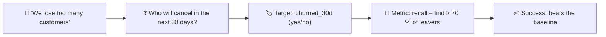

### 🛠️ How to define a problem

#### 🔹 Example 1 – the 6 questions, written down 🟢

```python
problem = {
    "business question": "Which subscribers will cancel in the next 30 days?",
    "ML task":           "classification (yes / no)",
    "target column":     "churned_30d",
    "one row means":     "one customer",
    "metric":            "recall (share of real leavers we find)",
    "success":           "recall of at least 0.70",
}
for question, answer in problem.items():          # .items() gives (label, value) pairs
    print(question, "→", answer)
```

**🖨️ Output:**

```text
business question → Which subscribers will cancel in the next 30 days?
ML task → classification (yes / no)
target column → churned_30d
one row means → one customer
metric → recall (share of real leavers we find)
success → recall of at least 0.70
```

#### 🔹 Example 2 – which ML task is it? 🟢

```python
questions = {
    "Will this email be spam?":                 "classification (2 categories)",
    "Which of 10 digits is in this photo?":     "classification (10 categories)",
    "How many ice-creams will we sell tomorrow?": "regression (a number)",
    "What price will this house sell for?":     "regression (a number)",
    "Which customers are similar to each other?": "clustering (find groups)",
    "Is this credit-card payment unusual?":     "anomaly detection",
}
for q, task in questions.items():
    print(task.ljust(32), "←", q)                 # .ljust(32) pads the text to 32 characters
```

**🖨️ Output:**

```text
classification (2 categories)    ← Will this email be spam?
classification (10 categories)   ← Which of 10 digits is in this photo?
regression (a number)            ← How many ice-creams will we sell tomorrow?
regression (a number)            ← What price will this house sell for?
clustering (find groups)         ← Which customers are similar to each other?
anomaly detection                ← Is this credit-card payment unusual?
```

#### 🔹 Example 3 – the same thing as a reusable "form" (a dataclass) 🟡
A `dataclass` is a neat way to make a form with named fields.

```python
from dataclasses import dataclass, field

@dataclass
class ProblemSpec:
    business_question: str
    ml_task: str              # "binary_classification", "regression", ...
    target: str
    primary_metric: str       # must be a valid scikit-learn score name
    success_threshold: float
    constraints: list = field(default_factory=list)

churn_spec = ProblemSpec(
    business_question="Which subscribers will cancel in the next 30 days?",
    ml_task="binary_classification",
    target="churned_30d",
    primary_metric="recall",
    success_threshold=0.70,
    constraints=["retention team can call max 500 customers per week",
                 "age and gender must not be used"],
)
print(churn_spec)
```

**🖨️ Output:**

```text
ProblemSpec(business_question='Which subscribers will cancel in the next 30 days?', ml_task='binary_classification',
    target='churned_30d', primary_metric='recall', success_threshold=0.7, constraints=['retention team can call max 500 customers
    per week', 'age and gender must not be used'])
```

#### 🔹 Example 4 – build the data the problem describes 🧾
Just run this – it creates 5,000 practice customers. Customers with short contracts, high fees and many complaints cancel more often.

```python
import numpy as np
import pandas as pd

rng = np.random.default_rng(42)
n = 5_000
subs = pd.DataFrame({
    "tenure_months": rng.integers(1, 72, n),                       # how long they've been a customer
    "monthly_fee": rng.choice([9.99, 14.99, 19.99, 29.99], n, p=[0.4, 0.3, 0.2, 0.1]),
    "support_tickets_90d": rng.poisson(1.2, n),                    # complaints in the last 90 days
})
# a "secret recipe" for how likely each customer is to cancel:
# the 1 / (1 + exp(-...)) part turns any number into a chance between 0 and 1
chance = 1 / (1 + np.exp(-(-2.2 - 0.03 * subs.tenure_months + 0.04 * subs.monthly_fee
                           + 0.45 * subs.support_tickets_90d)))
subs["churned_30d"] = (rng.random(n) < chance).astype(int)          # 1 = cancelled, 0 = stayed
print(subs.head())
print("Share who cancelled:", round(subs["churned_30d"].mean(), 3))    # average of 0s and 1s = share of 1s
```

**🖨️ Output:**

```text
   tenure_months  monthly_fee  support_tickets_90d  churned_30d
0              7         9.99                    2            0
1             55        14.99                    1            0
2             47        29.99                    4            0
3             32        19.99                    2            0
4             31         9.99                    2            0
Share who cancelled: 0.134
```

> 💡 `rng.poisson(1.2, n)` makes realistic counts (0, 1, 2, … complaints); `p=[0.4, 0.3, …]` sets how common each fee is.

### ✅ How to validate the problem definition

#### 🔹 Check 1 – does the data match the plan?

```python
from sklearn.metrics import get_scorer_names

def check_spec(spec, df):
    problems = []
    if spec.target not in df.columns:
        return ["target column is missing"]
    y = df[spec.target]
    if spec.ml_task == "binary_classification" and y.nunique() != 2:
        problems.append("a yes/no task needs exactly 2 different target values")
    if y.value_counts().min() < 100:
        problems.append("fewer than 100 examples of the rare answer – too few to learn")
    if spec.primary_metric not in get_scorer_names():
        problems.append("unknown metric name")
    return problems

print(check_spec(churn_spec, subs) or "✅ the data fits the problem")    # empty list → print the ✅ text
```

**🖨️ Output:**

```text
✅ the data fits the problem
```

#### 🔹 Check 2 – can a simple model beat a "dumb" baseline?
The **baseline** here always guesses "nobody cancels". The smarter model is a **logistic regression** – a simple model that turns the clues into a chance of cancelling (more in Part 3). `class_weight="balanced"` tells it to pay extra attention to the rarer "cancelled" customers. It finds **0 %** of leavers (recall = 0). If our model can't beat that, the problem (or the data) needs rethinking.

```python
from sklearn.dummy import DummyClassifier
from sklearn.linear_model import LogisticRegression
from sklearn.model_selection import cross_val_score

X = subs.drop(columns="churned_30d")          # everything except the target
y = subs["churned_30d"]

dumb = DummyClassifier(strategy="most_frequent")            # always guesses the most common answer
smart = LogisticRegression(class_weight="balanced", max_iter=1000)
for name, model in [("baseline (always 'stays')", dumb), ("logistic regression", smart)]:
    recall = cross_val_score(model, X, y, cv=5, scoring="recall").mean()   # tested 5 times, averaged (see 1.6)
    print(name, "→ recall:", round(recall, 2), "| reaches 0.70?", recall >= churn_spec.success_threshold)
```

**🖨️ Output:**

```text
baseline (always 'stays') → recall: 0.0 | reaches 0.70? False
logistic regression → recall: 0.65 | reaches 0.70? False
```

> 💡 The model finds about two out of three leavers – far better than the baseline, a little under the 0.70 goal. That's useful information **early**: we may need more clues (features) to reach the goal.

### ⏰ When to use
| Situation | Why define the problem |
|---|---|
| 🆕 Start of every project | so you don't build the wrong thing |
| 🤝 People disagree on "success" | a number settles it |
| 📉 Model is "accurate" but useless | usually the metric didn't match the real goal |

### 📍 Where to use
- 🏦 **Bank** – "Is this payment fraud?" → classification, metric = recall
- 🛒 **Shop** – "How many units next week?" → regression, metric = average error
- 🏥 **Hospital** – "Will the patient come back within 30 days?" → classification
- 📺 **Streaming** – "Which users have similar taste?" → clustering

### ⚠️ Common mistakes
| Mistake | Better |
|---|---|
| Choosing accuracy when 95 % never churn | a model saying "nobody churns" gets 95 %! Use recall/precision |
| Predicting something you only know afterwards | use only information available **at prediction time** |
| No baseline | always compare with a dumb method first |

### 🏋️ Practice
Write the 6 questions for: "A pizza shop wants to know how many pizzas to prepare each evening."

<details><summary>👀 Show answer</summary>

Business question: how many pizzas will be ordered tonight? · ML task: regression · target: `pizzas_sold` · one row: one evening · metric: average error in pizzas (MAE) · success: error below 10 pizzas and better than "same as last week".
</details>

### 🧪 Lab 1.1 – Define the taxi-demand problem 🚕

**🎯 Goal:** turn a vague wish into a measurable problem, then check it beats a baseline.

**🧾 Data** – run this cell first:

```python
import numpy as np
import pandas as pd

rng = np.random.default_rng(5)
hours = pd.date_range("2026-01-01", periods=24 * 60, freq="h")
hour, weekday = hours.hour.to_numpy(), hours.dayofweek.to_numpy()
rides = np.clip(40 + 25 * np.sin(2 * np.pi * (hour - 7) / 24) + 15 * (weekday >= 5)
                + rng.normal(0, 6, len(hours)), 0, None).round()
taxi = pd.DataFrame({"hour": hour, "weekday": weekday, "rides": rides})
```

**📝 Your tasks**

1. Write the problem as a dictionary: question, ML task, target, one row means, metric, success.
2. Use the first 80 % of rows to train and the last 20 % to test (time order!).
3. Baseline: always predict the training average. Model: `RandomForestRegressor` on `hour` and `weekday`.
4. Self-check: the model's MAE must be less than half of the baseline's MAE.

**🧩 Starter code** (replace every `...`)

```python
problem = {"question": ..., "ML task": ..., "target": ..., "metric": ...}
cut = int(len(taxi) * 0.8)
train, test = taxi.iloc[:cut], taxi.iloc[cut:]
...
```

<details><summary>💡 Hints</summary>

- Task = regression (a number), metric = MAE.
- `mean_absolute_error(test["rides"], [train["rides"].mean()] * len(test))`

</details>

<details><summary>✅ Solution (try first!)</summary>

```python
from sklearn.ensemble import RandomForestRegressor
from sklearn.metrics import mean_absolute_error

problem = {"question": "How many taxi rides will be booked in each hour?", "ML task": "regression",
           "target": "rides", "one row": "one hour", "metric": "MAE (rides)", "success": "beat the average by 50 %"}
print(problem)
cut = int(len(taxi) * 0.8)
train, test = taxi.iloc[:cut], taxi.iloc[cut:]
base_mae = mean_absolute_error(test["rides"], [train["rides"].mean()] * len(test))
rf = RandomForestRegressor(n_estimators=200, random_state=0).fit(train[["hour", "weekday"]], train["rides"])
model_mae = mean_absolute_error(test["rides"], rf.predict(test[["hour", "weekday"]]))
print("baseline MAE:", round(base_mae, 1), "| model MAE:", round(model_mae, 1))
assert model_mae < base_mae / 2
print("✅ Lab passed!")
```

**🖨️ Output:**

```text
{'question': 'How many taxi rides will be booked in each hour?', 'ML task': 'regression', 'target': 'rides', 'one row': 'one
    hour', 'metric': 'MAE (rides)', 'success': 'beat the average by 50 %'}
baseline MAE: 17.3 | model MAE: 4.8
✅ Lab passed!
```
</details>

### 🧠 Recap
- Write down: question, task type, target, what one row is, metric, success threshold.
- Check the data fits the plan, and that a simple model beats a dumb baseline.

---

<a name="sec-1-2-data-collection"></a>
## 📥 1.2 Data Collection

### 🍼 The story 🟢
Before cooking you go shopping 🛒: some things come from the supermarket (a **file**), some from your fridge (a **database**), some you order online (an **API**). Then you put everything on one table. That's data collection.

### 📚 New words
| Word | Simple meaning |
|---|---|
| **CSV file** | a text file where values are separated by commas – opens in Excel |
| **database / SQL** | an organised store of tables; SQL is the language to ask it questions |
| **API** | a web address that sends data to programs (often as JSON) |
| **JSON** | text that looks like Python dictionaries: `{"name": "Ana"}` |
| **merge / join** | combine two tables using a shared column (like customer ID) |

### 🛠️ How to collect data

#### 🔹 Example 1 – from a CSV file 🟢

```python
import io
import pandas as pd

csv_text = """order_id,customer_id,order_date,amount_usd
1001,C01,2026-09-01,34.90
1002,C02,2026-09-01,129.00
1003,C01,2026-09-03,15.50
1004,C03,2026-09-04,72.25
1005,C04,2026-09-05,310.00
1006,C02,2026-09-07,45.10
"""
orders = pd.read_csv(io.StringIO(csv_text), parse_dates=["order_date"])   # parse_dates = read as real dates
print(orders)
print(orders.dtypes)
```

**🖨️ Output:**

```text
   order_id customer_id order_date  amount_usd
0      1001         C01 2026-09-01       34.90
1      1002         C02 2026-09-01      129.00
2      1003         C01 2026-09-03       15.50
3      1004         C03 2026-09-04       72.25
4      1005         C04 2026-09-05      310.00
5      1006         C02 2026-09-07       45.10
order_id                int64
customer_id               str
order_date     datetime64[us]
amount_usd            float64
dtype: object
```

> 💡 With a real file: `pd.read_csv("orders.csv")`. Excel files: `pd.read_excel("orders.xlsx")` (needs `pip install openpyxl`).

#### 🔹 Example 2 – from a database (SQL) 🟢
We create a tiny database in memory, then ask it a question with SQL.

```python
import sqlite3

con = sqlite3.connect(":memory:")               # a temporary database inside your computer's memory
pd.DataFrame({
    "customer_id": ["C01", "C02", "C03", "C05"],
    "name": ["Olivia Brown", "Liam Smith", "Emma Wilson", "Noah Taylor"],
    "country": ["UK", "US", "US", "DE"],
}).to_sql("customers", con, index=False)         # save a table called "customers"

customers = pd.read_sql("SELECT customer_id, name, country FROM customers", con)
us_only = pd.read_sql("SELECT name FROM customers WHERE country = 'US'", con)
con.close()                                      # always close the connection when done
print(customers)
print(us_only)
```

**🖨️ Output:**

```text
  customer_id          name country
0         C01  Olivia Brown      UK
1         C02    Liam Smith      US
2         C03   Emma Wilson      US
3         C05   Noah Taylor      DE
          name
0   Liam Smith
1  Emma Wilson
```

> 💡 **SQL in one line:** `SELECT` columns `FROM` table `WHERE` condition.

#### 🔹 Example 3 – from an API answer (JSON) 🟢
APIs often send **nested** data (a dictionary inside a dictionary). `json_normalize` flattens it into a table.

```python
api_answer = {
    "data": [
        {"customer_id": "C01", "loyalty": {"tier": "gold", "points": 1200}},
        {"customer_id": "C02", "loyalty": {"tier": "silver", "points": 430}},
        {"customer_id": "C03", "loyalty": {"tier": "bronze", "points": 85}},
    ]
}
loyalty = pd.json_normalize(api_answer["data"], sep="_")     # loyalty.tier → loyalty_tier
print(loyalty)
```

**🖨️ Output:**

```text
  customer_id loyalty_tier  loyalty_points
0         C01         gold            1200
1         C02       silver             430
2         C03       bronze              85
```

#### 🔹 Example 4 – from a real public API (needs internet) 🟡
Open-Meteo gives free weather data, no account needed.

```python
import requests                                   # pip install requests

answer = requests.get(
    "https://api.open-meteo.com/v1/forecast",
    params={"latitude": 52.52, "longitude": 13.41, "hourly": "temperature_2m"},
    timeout=10,                                   # give up after 10 seconds
)
answer.raise_for_status()                         # stop with an error if the website said "no"
weather = pd.DataFrame(answer.json()["hourly"])
weather["time"] = pd.to_datetime(weather["time"])
print(weather.head())
```

#### 🔹 Example 5 – combine everything into one table (merge) 🟢
`merge` is like matching name tags: rows with the same `customer_id` are glued together.

```python
combined = orders.merge(customers, on="customer_id", how="left")    # keep ALL orders
combined = combined.merge(loyalty, on="customer_id", how="left")
print(combined)
```

**🖨️ Output:**

```text
   order_id customer_id order_date  amount_usd          name country loyalty_tier  loyalty_points
0      1001         C01 2026-09-01       34.90  Olivia Brown      UK         gold          1200.0
1      1002         C02 2026-09-01      129.00    Liam Smith      US       silver           430.0
2      1003         C01 2026-09-03       15.50  Olivia Brown      UK         gold          1200.0
3      1004         C03 2026-09-04       72.25   Emma Wilson      US       bronze            85.0
4      1005         C04 2026-09-05      310.00           NaN     NaN          NaN             NaN
5      1006         C02 2026-09-07       45.10    Liam Smith      US       silver           430.0
```

> 💡 `how="left"` = keep every row of the left table (orders) even if there's no match – the missing info becomes NaN. Customer **C04** has no customer record, so his name is empty.

| `how=` | keeps |
|---|---|
| `"left"` | all rows of the left table |
| `"inner"` | only rows found in **both** tables |
| `"outer"` | all rows of both tables |

### ✅ How to validate data collection

#### 🔹 Check 1 – the columns have the right types

```python
from pandas.api import types as ptypes

print("order_id is whole numbers? ", ptypes.is_integer_dtype(orders["order_id"]))
print("order_date is dates?       ", ptypes.is_datetime64_any_dtype(orders["order_date"]))
print("amount_usd is decimals?    ", ptypes.is_float_dtype(orders["amount_usd"]))
```

**🖨️ Output:**

```text
order_id is whole numbers?  True
order_date is dates?        True
amount_usd is decimals?     True
```

#### 🔹 Check 2 – the merge didn't lose or double rows, and every order found its customer

```python
print("orders:", len(orders), "| combined:", len(combined), "→ same?", len(orders) == len(combined))
missing_customer = combined[combined["name"].isna()]
print("Orders without customer info:", missing_customer["customer_id"].tolist())
```

**🖨️ Output:**

```text
orders: 6 | combined: 6 → same? True
Orders without customer info: ['C04']
```

#### 🔹 Check 3 – a safer merge that complains if something is wrong 🟡
`validate="many_to_one"` stops with an error if a customer ID appears twice in the customer table (which would duplicate orders). `indicator=True` adds a `_merge` column telling where each row came from.

```python
safe = orders.merge(customers, on="customer_id", how="left", validate="many_to_one", indicator=True)
print(safe[["order_id", "customer_id", "_merge"]])
```

**🖨️ Output:**

```text
   order_id customer_id     _merge
0      1001         C01       both
1      1002         C02       both
2      1003         C01       both
3      1004         C03       both
4      1005         C04  left_only
5      1006         C02       both
```

### ⏰ When to use each source
| Source | Use when | Watch out for |
|---|---|---|
| 📄 CSV / Excel | exports, small data | wrong separators, dates read as text |
| 🗄️ SQL database | company data | filter in SQL, not pandas, for big tables |
| 🌐 API | outside or live data | limits on requests, internet errors |

### 📍 Where to use
- 🛒 Shop: orders (database) + weather (API) → predict sales
- 🏭 Factory: machine sensors (logs) + repair records (Excel)
- 📣 Marketing: customer list (CSV) + ad results (API)

### ⚠️ Common mistakes
| Mistake | Better |
|---|---|
| Merge creates more rows than before | the key isn't unique – use `validate=` |
| Dates stay as text | `parse_dates=[...]` or `pd.to_datetime` |
| Not recording where/when data came from | add a "loaded_at" column, keep the query |

### 🏋️ Practice
Make a table `cities = pd.DataFrame({"country": ["UK", "US", "DE"], "capital": ["London", "Washington", "Berlin"]})` and merge it onto `customers` so every customer gets their capital.

<details><summary>👀 Show answer</summary>

```python
cities = pd.DataFrame({"country": ["UK", "US", "DE"], "capital": ["London", "Washington", "Berlin"]})
print(customers.merge(cities, on="country", how="left"))
```

**🖨️ Output:**

```text
  customer_id          name country     capital
0         C01  Olivia Brown      UK      London
1         C02    Liam Smith      US  Washington
2         C03   Emma Wilson      US  Washington
3         C05   Noah Taylor      DE      Berlin
```
</details>

### 🎓 Expert corner 🔴
- Push filters into SQL with **parameters** (`params=(...)`) – safer than gluing text into queries.
- Add **lineage** columns (source, load time) for reproducibility.
- For big data use Parquet files (`df.to_parquet`) – faster and keeps dtypes.

```python
lineage = combined.assign(_source="orders.csv + customers DB + loyalty API",
                          _loaded_at=pd.Timestamp("2026-10-28 09:00", tz="UTC"))
print(lineage[["order_id", "_source", "_loaded_at"]].head(2))
```

**🖨️ Output:**

```text
   order_id                                  _source                _loaded_at
0      1001  orders.csv + customers DB + loyalty API 2026-10-28 09:00:00+00:00
1      1002  orders.csv + customers DB + loyalty API 2026-10-28 09:00:00+00:00
```

### 🧪 Lab 1.2 – Collect a school's data from 3 sources 🏫

**🎯 Goal:** read a CSV, a SQL table and a JSON answer, then merge them safely.

**🧾 Data** – run this cell first:

```python
import io, sqlite3
import pandas as pd

grades_csv = "student_id,math,english\nS1,78,85\nS2,92,74\nS3,65,90\nS4,88,81\n"
con = sqlite3.connect(":memory:")
pd.DataFrame({"student_id": ["S1", "S2", "S3", "S5"], "class": ["7A", "7B", "7A", "7B"]}).to_sql("students", con, index=False)
api = {"results": [{"student_id": "S1", "sport": {"team": "football", "years": 2}},
                   {"student_id": "S3", "sport": {"team": "chess", "years": 4}}]}
```

**📝 Your tasks**

1. Read `grades_csv` with `pd.read_csv(io.StringIO(...))`.
2. Read the `students` table with SQL.
3. Flatten the API answer with `pd.json_normalize`.
4. Merge everything onto the grades (keep all grades rows). Which student has no class?
5. Self-check: 4 rows after merging, and S4 has no class.

**🧩 Starter code** (replace every `...`)

```python
grades = ...
students = pd.read_sql(..., con)
sports = pd.json_normalize(..., sep="_")
school = grades.merge(...).merge(...)
```

<details><summary>💡 Hints</summary>

- `how="left"` keeps all grades rows.
- `validate="one_to_one"` checks keys are unique.

</details>

<details><summary>✅ Solution (try first!)</summary>

```python
grades = pd.read_csv(io.StringIO(grades_csv))
students = pd.read_sql("SELECT student_id, class FROM students", con)
con.close()
sports = pd.json_normalize(api["results"], sep="_")
school = (grades.merge(students, on="student_id", how="left", validate="one_to_one")
                .merge(sports, on="student_id", how="left", validate="one_to_one"))
print(school)
no_class = school.loc[school["class"].isna(), "student_id"].tolist()
assert len(school) == 4 and no_class == ["S4"]
print("✅ Lab passed!")
```

**🖨️ Output:**

```text
  student_id  math  english class sport_team  sport_years
0         S1    78       85    7A   football          2.0
1         S2    92       74    7B        NaN          NaN
2         S3    65       90    7A      chess          4.0
3         S4    88       81   NaN        NaN          NaN
✅ Lab passed!
```
</details>

### 🧠 Recap
- Read files with `pd.read_csv`, databases with `pd.read_sql`, APIs with `requests` + `json_normalize`.
- Combine tables with `merge`; check row counts and missing matches afterwards.

---

<a name="sec-1-3-data-cleaning-preprocessing"></a>
# 🧹 1.3 Data Cleaning & Preprocessing

### 🍼 The story
Real data is **messy** – like vegetables from the garden: dirt, bruises, a few rotten ones, different sizes. Before cooking you wash, peel and cut them. Before modelling you **clean** data. Data scientists often spend **most of their time** here! 🧽

| Problem | Example | Chapter |
|---|---|:---:|
| 🗑️ columns/rows we don't need | IDs, empty columns, answer-leaking columns | 1.3.0 |
| 🕳️ empty cells | age = ? | 1.3.1 |
| 👯 the same row twice | Anna appears 2 times | 1.3.2 |
| 🧩 same thing written differently | "USA", "U.S.A.", "united states" | 1.3.3 |
| 🚨 crazy values | height = 1,190 cm | 1.3.4 |
| ⚖️ numbers on different scales | age 30 vs income 50,000 | 1.3.5 |
| 🏷️ text categories | "red", "green" → numbers | 1.3.6 |
| 📝 messy text | "<p>LOVE it!!! 😍</p>" | 1.3.7 |
| ✅ yes/no in 10 spellings | "Y", "yes", 1, "TRUE" | 1.3.8 |
| 📅 dates in many formats | "14/03/2026", "March 14, 2026" | 1.3.9 |
| 🔢 huge numbers as text | "$1.2B", "3,400" | 1.3.10 |

> [!IMPORTANT]
> 🔒 **Golden rule:** anything the cleaning *learns* from data (a median, a scaler, an encoder) must be learned from the **training data only**, then applied to the test data. Otherwise the test is no longer a fair surprise. scikit-learn **Pipelines** do this automatically (you'll see them soon).

---


<a name="sec-1-3-0-remove-unwanted-data"></a>
## 🗑️ 1.3.0 Remove Unwanted Data

### 🍼 The story 🟢
Before packing a suitcase 🧳 you take out things you don't need: the umbrella for a desert trip, the broken charger, the second identical T-shirt. Data is the same: some columns and rows **don't help** – or even **harm** – the model. Removing them first makes every later step easier.

### 📚 New words
| Word | Simple meaning |
|---|---|
| **identifier (ID)** | a number/name that only labels a row (customer_id) – no meaning for prediction |
| **constant column** | the same value in every row → tells nothing |
| **leakage column** | contains the answer, or information only known **after** the event |
| **personal data (PII)** | names, emails, phone numbers – privacy risk, rarely useful |
| **out-of-scope rows** | rows that don't belong to the question (test accounts, other countries) |
| **near-duplicate column** | two columns with the same information (price in $ and in €) |

### 🖼️ The "do I keep this?" checklist

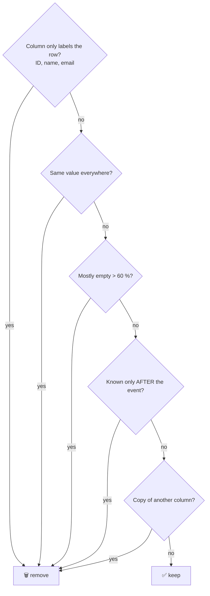

### 🛠️ How to remove unwanted data – tiny examples 🟢

#### 🔹 Example 1 – drop columns by name

```python
import numpy as np
import pandas as pd

orders = pd.DataFrame({
    "order_id": [1, 2, 3, 4],
    "customer_email": ["a@x.com", "b@x.com", "c@x.com", "d@x.com"],
    "country": ["UK", "UK", "UK", "UK"],
    "items": [2, 5, 1, 3],
    "total_eur": [20.0, 55.0, 9.5, 31.0],
    "total_usd": [21.6, 59.4, 10.3, 33.5],
    "refund_reason": [None, None, "late", None],
    "was_refunded": [0, 0, 1, 0],
})
print(orders.drop(columns=["order_id", "customer_email"]))       # drop the ID and the personal data
```

**🖨️ Output:**

```text
  country  items  total_eur  total_usd refund_reason  was_refunded
0      UK      2       20.0       21.6           NaN             0
1      UK      5       55.0       59.4           NaN             0
2      UK      1        9.5       10.3          late             1
3      UK      3       31.0       33.5           NaN             0
```

#### 🔹 Example 2 – find constant columns automatically

```python
constant = [col for col in orders.columns if orders[col].nunique(dropna=False) == 1]    # nunique = number of different values
print("Constant columns:", constant)
```

**🖨️ Output:**

```text
Constant columns: ['country']
```

#### 🔹 Example 3 – find mostly-empty columns

```python
empty_share = orders.isna().mean()
print(empty_share.round(2))
print("More than 60 % empty:", empty_share[empty_share > 0.6].index.tolist())
```

**🖨️ Output:**

```text
order_id          0.00
customer_email    0.00
country           0.00
items             0.00
total_eur         0.00
total_usd         0.00
refund_reason     0.75
was_refunded      0.00
dtype: float64
More than 60 % empty: ['refund_reason']
```

#### 🔹 Example 4 – find copies of other columns

```python
print(orders[["total_eur", "total_usd"]].corr().round(3))      # 1.0 → same information, keep one
```

**🖨️ Output:**

```text
           total_eur  total_usd
total_eur        1.0        1.0
total_usd        1.0        1.0
```

#### 🔹 Example 5 – spot leakage: "would I know this at prediction time?"
We want to predict `was_refunded` **when the order is placed**. `refund_reason` is only filled **after** a refund → it gives the answer away.

```python
print(pd.crosstab(orders["refund_reason"].fillna("none"), orders["was_refunded"]))   # perfect match = leak!
```

**🖨️ Output:**

```text
was_refunded   0  1
refund_reason
late           0  1
none           3  0
```

#### 🔹 Example 6 – remove unwanted rows

```python
signups = pd.DataFrame({
    "user": ["ana", "test_user_1", "ben", "cara", "dev_test"],
    "country": ["UK", "UK", "US", "UK", "UK"],
    "age": [34, 99, 28, None, 1],
    "bought": [1, 0, 0, None, 1],
})
keep = (~signups["user"].str.contains("test")          # a) internal test accounts
        & signups["bought"].notna()                    # b) rows without the answer (target)
        & (signups["country"] == "UK"))                # c) out of scope: the question is about the UK
print(signups[keep])
```

**🖨️ Output:**

```text
  user country   age  bought
0  ana      UK  34.0     1.0
```

---

### 🛠️ Real-world example – a messy customer export (2,000 rows) 🟡

```python
import numpy as np
import pandas as pd

rng = np.random.default_rng(4)
n = 2_000
tenure = rng.integers(1, 60, n)
spend = rng.gamma(2, 40, n).round(2)
churn_chance = 1 / (1 + np.exp(-(-0.5 - 0.05 * tenure + 0.004 * spend)))
churned = (rng.random(n) < churn_chance).astype(int)
export = pd.DataFrame({
    "customer_id": np.arange(50_000, 50_000 + n),
    "full_name": [f"Customer {i}" for i in range(n)],
    "phone": [f"+44 7700 {rng.integers(100000, 999999)}" for _ in range(n)],
    "account_type": "consumer",                                   # constant
    "tenure_months": tenure,
    "monthly_spend_gbp": spend,
    "monthly_spend_pence": (spend * 100).round(),                 # copy in another unit
    "fax_number": np.where(rng.random(n) < 0.97, None, "+44 20 0000"),   # almost always empty
    "cancellation_date": np.where(churned == 1, "2026-05-01", None),     # only exists AFTER churning → leak
    "is_test_account": rng.random(n) < 0.02,
    "region": rng.choice(["England", "Scotland", "Wales", "Spain"], n, p=[0.6, 0.2, 0.15, 0.05]),
    "churned": churned.astype(float),
})
export.loc[rng.choice(n, 15, replace=False), "churned"] = np.nan      # target missing in some rows
print(export.head())
```

**🖨️ Output:**

```text
   customer_id   full_name            phone account_type  tenure_months  monthly_spend_gbp  \
0        50000  Customer 0  +44 7700 420637     consumer             43             201.48
1        50001  Customer 1  +44 7700 713723     consumer             56             117.29
2        50002  Customer 2  +44 7700 643444     consumer             53              18.38
3        50003  Customer 3  +44 7700 835864     consumer             31             109.48
4        50004  Customer 4  +44 7700 235336     consumer             56              47.39

   monthly_spend_pence fax_number cancellation_date  is_test_account    region  churned
0              20148.0        NaN        2026-05-01            False   England      1.0
1              11729.0        NaN               NaN            False     Spain      0.0
2               1838.0        NaN               NaN            False     Spain      0.0
3              10948.0        NaN               NaN            False  Scotland      0.0
4               4739.0        NaN               NaN            False  Scotland      0.0
```

#### 🔹 Step 1 – a reusable "unwanted columns" report

```python
def unwanted_columns_report(df, target, id_like=("id", "name", "phone", "email"), max_empty=0.6, max_corr=0.98):
    report = []
    for col in df.columns.drop(target):
        reasons = []
        if any(word in col.lower() for word in id_like):
            reasons.append("ID / personal data")
        if df[col].nunique(dropna=False) <= 1:
            reasons.append("constant")
        if df[col].isna().mean() > max_empty:
            reasons.append("mostly empty")
        if reasons:
            report.append({"column": col, "why": ", ".join(reasons)})
    numeric = df.drop(columns=[target]).select_dtypes("number")
    corr = numeric.corr().abs()
    for i, a in enumerate(corr.columns):
        for b in corr.columns[i + 1:]:
            if corr.loc[a, b] > max_corr:
                report.append({"column": b, "why": "copy of " + a})
    return pd.DataFrame(report)

print(unwanted_columns_report(export, target="churned"))
```

**🖨️ Output:**

```text
                column                        why
0          customer_id         ID / personal data
1            full_name         ID / personal data
2                phone         ID / personal data
3         account_type                   constant
4           fax_number               mostly empty
5    cancellation_date               mostly empty
6  monthly_spend_pence  copy of monthly_spend_gbp
```

> 💡 `cancellation_date` shows up as "mostly empty" – but the much bigger problem is **leakage** (next step).

#### 🔹 Step 2 – the leakage test: does one column alone predict the answer almost perfectly?

```python
from sklearn.metrics import roc_auc_score

for col in ["tenure_months", "monthly_spend_gbp", "cancellation_date"]:
    is_number = pd.api.types.is_numeric_dtype(export[col])
    signal = export[col] if is_number else export[col].notna().astype(int)    # text column → "is it filled?"
    known = export["churned"].notna()
    auc = roc_auc_score(export.loc[known, "churned"], signal[known])
    print(col.ljust(20), "AUC alone:", round(max(auc, 1 - auc), 3), "← suspicious!" if max(auc, 1 - auc) > 0.95 else "")
```

**🖨️ Output:**

```text
tenure_months        AUC alone: 0.727
monthly_spend_gbp    AUC alone: 0.535
cancellation_date    AUC alone: 1.0 ← suspicious!
```

> 💡 **AUC** (1.8) = 0.5 is guessing, 1.0 is perfect. A single column with ~1.0 is almost always a leak – here `cancellation_date` only exists for people who already left.

#### 🔹 Step 3 – remove columns and rows

```python
drop_cols = ["customer_id", "full_name", "phone", "account_type", "fax_number",
             "monthly_spend_pence", "cancellation_date"]
clean = export.drop(columns=drop_cols)
keep = (~clean["is_test_account"]                      # test accounts out
        & (clean["region"] != "Spain")                 # out of scope: UK customers only
        & clean["churned"].notna())                    # rows without the target out
clean = clean[keep].drop(columns=["is_test_account"])
print("Before:", export.shape, "→ after:", clean.shape)
print(clean.head())
```

**🖨️ Output:**

```text
Before: (2000, 12) → after: (1870, 4)
   tenure_months  monthly_spend_gbp    region  churned
0             43             201.48   England      1.0
3             31             109.48  Scotland      0.0
4             56              47.39  Scotland      0.0
5             58             159.05  Scotland      0.0
6             58              56.71   England      1.0
```

### ✅ How to validate

```python
checks = {
    "no ID/personal columns left": not any(w in c for c in clean.columns for w in ["id", "name", "phone"]),
    "no constant columns": all(clean[c].nunique() > 1 for c in clean.columns),
    "no leak column": "cancellation_date" not in clean.columns,
    "target has no holes": clean["churned"].notna().all(),
    "only UK regions": set(clean["region"]) <= {"England", "Scotland", "Wales"},
}
for name, ok in checks.items():
    print("✅" if ok else "❌", name)
```

**🖨️ Output:**

```text
✅ no ID/personal columns left
✅ no constant columns
✅ no leak column
✅ target has no holes
✅ only UK regions
```

### ⏰ When to use
| Remove … | because … |
|---|---|
| IDs, names, emails, phones | no meaning + privacy risk |
| constant / almost constant columns | no information |
| mostly-empty columns | too little to learn from |
| columns known only after the event | leakage – the model would cheat |
| copies of other columns | redundant, can confuse models |
| test accounts, out-of-scope rows | they're not the population you predict for |
| rows with an empty target | nothing to learn |

### 📍 Where to use
Every project, **first**. 🏦 Bank exports (account numbers), 🏥 patient data (names, IDs – also legally required), 🛒 shops (test orders), 📞 churn (cancellation date leaks).

### ⚠️ Common mistakes
| Mistake | Better |
|---|---|
| keeping `id` because "the model might find something" | it finds noise (or a leak via row order) |
| removing a column that's empty because it's **informative** | keep a 0/1 "was filled" flag if emptiness means something |
| deleting data permanently | keep the raw file; clean in code so you can redo it |

### 🎓 Expert corner 🔴
- Hash or pseudonymise IDs if you must join tables later; never use them as features.
- GDPR/HIPAA: remove or protect personal data – collect only what you need ("data minimisation").
- Keep a written **data dictionary**: column → meaning → keep/drop → reason.

### 🧪 Lab 1.3.0 – Clean a gym's member export 🏋️

**🎯 Goal:** decide which columns and rows to throw away before predicting who cancels.

**🧾 Data** – run this cell first:

```python
import numpy as np
import pandas as pd

rng = np.random.default_rng(8)
n = 600
visits = rng.poisson(6, n)
cancel = (rng.random(n) < 1 / (1 + np.exp(-(1 - 0.35 * visits)))).astype(float)
gym = pd.DataFrame({"member_no": range(1, n + 1), "email": [f"m{i}@mail.com" for i in range(n)],
                    "gym_branch": "Central", "visits_per_month": visits, "age": rng.integers(18, 70, n),
                    "locker_code": np.where(rng.random(n) < 0.9, None, "A12"),
                    "exit_survey_score": np.where(cancel == 1, rng.integers(1, 6, n), np.nan),
                    "is_staff": rng.random(n) < 0.03, "cancelled": cancel})
gym.loc[rng.choice(n, 8, replace=False), "cancelled"] = np.nan
```

**📝 Your tasks**

1. Find ID/personal, constant and mostly-empty columns.
2. Find the **leaking** column (only filled for people who already cancelled).
3. Remove staff rows and rows without `cancelled`.
4. Self-check: you keep exactly `visits_per_month`, `age`, `cancelled`, and fewer than 600 rows.

**🧩 Starter code** (replace every `...`)

```python
drop_cols = [...]
clean = gym.drop(columns=drop_cols)
clean = clean[...]
```

<details><summary>💡 Hints</summary>

- `gym.nunique()` and `gym.isna().mean()` help.
- `exit_survey_score` exists only after cancelling.
- Don't forget to drop `is_staff` after filtering.

</details>

<details><summary>✅ Solution (try first!)</summary>

```python
print(gym.nunique())
print(gym.isna().mean().round(2))
drop_cols = ["member_no", "email", "gym_branch", "locker_code", "exit_survey_score"]
clean = gym.drop(columns=drop_cols)
clean = clean[~clean["is_staff"] & clean["cancelled"].notna()].drop(columns=["is_staff"])
print(clean.shape, list(clean.columns))
assert list(clean.columns) == ["visits_per_month", "age", "cancelled"] and len(clean) < 600
print("✅ Lab passed!")
```

**🖨️ Output:**

```text
member_no            600
email                600
gym_branch             1
visits_per_month      15
age                   52
locker_code            1
exit_survey_score      5
is_staff               2
cancelled              2
dtype: int64
member_no            0.00
email                0.00
gym_branch           0.00
visits_per_month     0.00
age                  0.00
locker_code          0.90
exit_survey_score    0.72
is_staff             0.00
cancelled            0.01
dtype: float64
(572, 3) ['visits_per_month', 'age', 'cancelled']
✅ Lab passed!
```
</details>

### 🧠 Recap
- Remove IDs/personal data, constant, mostly-empty, leaking and duplicated columns; remove test, out-of-scope and target-less rows.
- Check with a report, a leakage test and a final checklist.

---

<a name="sec-1-3-1-handle-missing-values"></a>
## 🕳️ 1.3.1 Handle Missing Values

### 🍼 The story 🟢
A teacher's grade book has some empty boxes – a student was sick, a test got lost. You can't calculate an average with holes. You can **skip** those students, or **fill** the boxes with a sensible guess.

### 🖼️ Picture
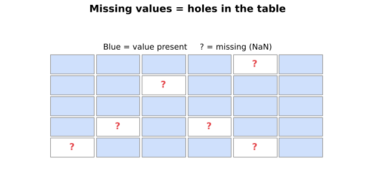

### 📚 New words
| Word | Simple meaning |
|---|---|
| **missing value / NaN** | an empty cell |
| **drop** | delete rows or columns |
| **impute / fill** | put a sensible guess into the empty cell |
| **MCAR** | missing completely by chance (a page got wet) |
| **MAR** | missing because of *another* column (older patients skip a test) |
| **MNAR** | missing because of the value itself (people with very high income don't tell it) |
| **indicator** | an extra 0/1 column: "this was empty" |

### 🛠️ How to handle missing values

#### 🔹 Example 1 – find the holes 🟢

```python
import numpy as np
import pandas as pd

grades = pd.DataFrame({
    "student": ["Ana", "Ben", "Cleo", "Dev", "Eli", "Fay"],
    "math":    [85, np.nan, 78, 92, np.nan, 70],        # np.nan = an empty cell
    "english": [90, 75, np.nan, 88, 80, 65],
    "club":    ["chess", "art", None, "chess", "art", "art"],   # None also means empty
})
print(grades)
print("\nEmpty cells per column:")
print(grades.isna().sum())
print("\nShare empty (%):")
print((grades.isna().mean() * 100).round(1))
```

**🖨️ Output:**

```text
  student  math  english   club
0     Ana  85.0     90.0  chess
1     Ben   NaN     75.0    art
2    Cleo  78.0      NaN    NaN
3     Dev  92.0     88.0  chess
4     Eli   NaN     80.0    art
5     Fay  70.0     65.0    art

Empty cells per column:
student    0
math       2
english    1
club       1
dtype: int64

Share empty (%):
student     0.0
math       33.3
english    16.7
club       16.7
dtype: float64
```

#### 🔹 Example 2 – drop rows with holes 🟢

```python
print(grades.dropna())                          # remove every row with ANY empty cell
print(grades.dropna(subset=["math"]))           # remove rows only where math is empty
```

**🖨️ Output:**

```text
  student  math  english   club
0     Ana  85.0     90.0  chess
3     Dev  92.0     88.0  chess
5     Fay  70.0     65.0    art
  student  math  english   club
0     Ana  85.0     90.0  chess
2    Cleo  78.0      NaN    NaN
3     Dev  92.0     88.0  chess
5     Fay  70.0     65.0    art
```

> ⚠️ `dropna()` lost half the students! Dropping is only OK when very few rows are missing.

#### 🔹 Example 3 – fill with a number 🟢

```python
filled = grades.copy()
filled["math"] = filled["math"].fillna(filled["math"].mean())        # fill with the average
filled["english"] = filled["english"].fillna(filled["english"].median())  # fill with the middle value
filled["club"] = filled["club"].fillna(filled["club"].mode()[0])     # fill text with the most common value
print(filled)
```

**🖨️ Output:**

```text
  student   math  english   club
0     Ana  85.00     90.0  chess
1     Ben  81.25     75.0    art
2    Cleo  78.00     80.0    art
3     Dev  92.00     88.0  chess
4     Eli  81.25     80.0    art
5     Fay  70.00     65.0    art
```

#### 🔹 Example 4 – fill with "unknown" for text 🟢

```python
print(grades["club"].fillna("unknown"))       # sometimes "unknown" is more honest than a guess
```

**🖨️ Output:**

```text
0      chess
1        art
2    unknown
3      chess
4        art
5        art
Name: club, dtype: str
```

#### 🔹 Example 5 – remember which cells were empty (indicator) 🟢

```python
flagged = grades.copy()
flagged["math_was_missing"] = flagged["math"].isna().astype(int)   # 1 = was empty
flagged["math"] = flagged["math"].fillna(flagged["math"].median())
print(flagged[["student", "math", "math_was_missing"]])
```

**🖨️ Output:**

```text
  student  math  math_was_missing
0     Ana  85.0                 0
1     Ben  81.5                 1
2    Cleo  78.0                 0
3     Dev  92.0                 0
4     Eli  81.5                 1
5     Fay  70.0                 0
```

#### 🔹 Example 6 – fill by group 🟢
Fill each empty math score with the median of **that student's club**.

```python
by_club = grades.copy()
by_club["math"] = by_club.groupby("club")["math"].transform(lambda s: s.fillna(s.median()))
print(by_club)
```

**🖨️ Output:**

```text
  student  math  english   club
0     Ana  85.0     90.0  chess
1     Ben  70.0     75.0    art
2    Cleo   NaN      NaN    NaN
3     Dev  92.0     88.0  chess
4     Eli  70.0     80.0    art
5     Fay  70.0     65.0    art
```

> 💡 Cleo stays empty: she has no club, so there is no group to copy from – fill her afterwards with the overall median.
> 💡 `transform` runs the little recipe (`lambda` = a tiny one-line function) **inside each group** and puts the results back in the right rows.

#### 🔹 Example 7 – time series: carry forward or draw a line 🟢

```python
temps = pd.Series([21.4, 21.6, np.nan, np.nan, 22.3, 22.1, np.nan, 21.8],
                  index=pd.date_range("2026-07-01 08:00", periods=8, freq="15min"))
print(pd.DataFrame({
    "raw": temps,
    "ffill": temps.ffill(),            # copy the last known value forward
    "interpolate": temps.interpolate(),  # draw a straight line between known values
}))
```

**🖨️ Output:**

```text
                      raw  ffill  interpolate
2026-07-01 08:00:00  21.4   21.4    21.400000
2026-07-01 08:15:00  21.6   21.6    21.600000
2026-07-01 08:30:00   NaN   21.6    21.833333
2026-07-01 08:45:00   NaN   21.6    22.066667
2026-07-01 09:00:00  22.3   22.3    22.300000
2026-07-01 09:15:00  22.1   22.1    22.100000
2026-07-01 09:30:00   NaN   22.1    21.950000
2026-07-01 09:45:00  21.8   21.8    21.800000
```

---

### 🛠️ Real-world example – 1,000 patient records 🟡

#### 🧾 The data – just run this cell
Realistic patients where cholesterol and blood pressure depend on age and BMI. Then we punch holes like real life does:
- `bmi` – 8 % missing by pure chance (**MCAR**)
- `cholesterol` – often missing for patients over 65 who skip the lab test (**MAR**)
- `systolic_bp` – very high values are sometimes not recorded (**MNAR**)
- `smoker` – 5 % missing

```python
import numpy as np
import pandas as pd

rng = np.random.default_rng(7)
n = 1_000
age = rng.integers(18, 90, n).astype(float)
bmi = rng.normal(27, 4.5, n).round(1)
patients = pd.DataFrame({
    "age": age,
    "sex": rng.choice(["F", "M"], n),
    "bmi": bmi,
    "systolic_bp": (100 + 0.45 * age + 0.5 * bmi + rng.normal(0, 10, n)).round(),
    "cholesterol": (150 + 0.6 * age + 1.2 * bmi + rng.normal(0, 20, n)).round(),
    "smoker": rng.choice(["yes", "no"], n, p=[0.22, 0.78]),
})
full_patients = patients.copy()                     # keep the TRUE values to check our guesses later

patients.loc[rng.random(n) < 0.08, "bmi"] = np.nan
patients.loc[(patients["age"] > 65) & (rng.random(n) < 0.35), "cholesterol"] = np.nan
patients.loc[(patients["systolic_bp"] > 150) & (rng.random(n) < 0.30), "systolic_bp"] = np.nan
patients.loc[rng.random(n) < 0.05, "smoker"] = np.nan
print(patients.head(8))
```

**🖨️ Output:**

```text
    age sex   bmi  systolic_bp  cholesterol smoker
0  86.0   M  30.4          NaN        192.0     no
1  63.0   F  30.7        133.0        193.0     no
2  67.0   M  22.7        142.0        223.0    NaN
3  82.0   F  20.7        154.0          NaN     no
4  59.0   F  25.4        144.0        211.0     no
5  73.0   F  33.3        168.0        239.0     no
6  78.0   M  14.3        156.0        226.0     no
7  34.0   M  29.4        125.0        164.0     no
```

#### 🔹 Step 1 – a missing-values report

```python
report = pd.DataFrame({
    "missing": patients.isna().sum(),
    "missing_%": (patients.isna().mean() * 100).round(1),
}).sort_values("missing_%", ascending=False)
print(report)
```

**🖨️ Output:**

```text
             missing  missing_%
cholesterol      118       11.8
bmi               90        9.0
systolic_bp       62        6.2
smoker            55        5.5
sex                0        0.0
age                0        0.0
```

#### 🔹 Step 2 – the scikit-learn way: `SimpleImputer` 🟡
An **imputer** is a tool that learns the fill-value (e.g. the median) with `.fit` and fills holes with `.transform`. A **ColumnTransformer** applies different tools to different columns.

```python
from sklearn.compose import ColumnTransformer
from sklearn.impute import SimpleImputer

num_cols = ["age", "bmi", "systolic_bp", "cholesterol"]
cat_cols = ["sex", "smoker"]

simple_imputer = ColumnTransformer([
    ("numbers", SimpleImputer(strategy="median"), num_cols),           # numbers → median
    ("text", SimpleImputer(strategy="most_frequent"), cat_cols),       # text → most common
], verbose_feature_names_out=False).set_output(transform="pandas")     # keep a nice table as output

patients_simple = simple_imputer.fit_transform(patients)               # fit = learn medians, transform = fill
print(patients_simple.head())
print("Empty cells left:", patients_simple.isna().sum().sum())
```

**🖨️ Output:**

```text
    age   bmi  systolic_bp  cholesterol sex smoker
0  86.0  30.4        137.0        192.0   M     no
1  63.0  30.7        133.0        193.0   F     no
2  67.0  22.7        142.0        223.0   M     no
3  82.0  20.7        154.0        214.0   F     no
4  59.0  25.4        144.0        211.0   F     no
Empty cells left: 0
```

#### 🔹 Step 3 – KNN imputer: copy from similar patients 🟡
**KNN** = K Nearest Neighbours. For a patient with an empty cholesterol, find the 5 most similar patients (by age, BMI, BP) and use their average. Numbers must first be **scaled** (made comparable, see 1.3.5) so that "similar" is fair.

```python
from sklearn.impute import KNNImputer
from sklearn.pipeline import make_pipeline
from sklearn.preprocessing import StandardScaler

knn = make_pipeline(StandardScaler(), KNNImputer(n_neighbors=5))      # a pipeline = steps run in order
filled_scaled = knn.fit_transform(patients[num_cols])
patients_knn = pd.DataFrame(knn.named_steps["standardscaler"].inverse_transform(filled_scaled),
                            columns=num_cols, index=patients.index)    # undo the scaling
print(patients_knn.head().round(1))
```

**🖨️ Output:**

```text
    age   bmi  systolic_bp  cholesterol
0  86.0  30.4        158.6        192.0
1  63.0  30.7        133.0        193.0
2  67.0  22.7        142.0        223.0
3  82.0  20.7        154.0        226.4
4  59.0  25.4        144.0        211.0
```

#### 🔹 Step 4 – Iterative imputer: predict each column from the others 🟡
It builds a small model for each column with holes ("predict cholesterol from age, BMI, BP"), repeats a few rounds, and fills with the predictions.

```python
from sklearn.experimental import enable_iterative_imputer  # noqa – this line switches the tool on
from sklearn.impute import IterativeImputer

iter_imp = IterativeImputer(max_iter=10, random_state=0)
patients_iter = pd.DataFrame(iter_imp.fit_transform(patients[num_cols]), columns=num_cols, index=patients.index)
print(patients_iter.head().round(1))
```

**🖨️ Output:**

```text
    age   bmi  systolic_bp  cholesterol
0  86.0  30.4        152.3        192.0
1  63.0  30.7        133.0        193.0
2  67.0  22.7        142.0        223.0
3  82.0  20.7        154.0        225.2
4  59.0  25.4        144.0        211.0
```

#### 🔹 Step 5 – fill + keep a "was missing" flag

```python
indicator_imputer = SimpleImputer(strategy="median", add_indicator=True).set_output(transform="pandas")
with_flags = indicator_imputer.fit_transform(patients[num_cols])
print(with_flags.columns.tolist())
```

**🖨️ Output:**

```text
['age', 'bmi', 'systolic_bp', 'cholesterol', 'missingindicator_bmi', 'missingindicator_systolic_bp',
    'missingindicator_cholesterol']
```

---

### ✅ How to validate missing-value handling

#### 🔹 Check 1 – nothing is empty anymore

```python
print("Empty after median filling   :", patients_simple.isna().sum().sum())
print("Empty after iterative filling:", patients_iter.isna().sum().sum())
```

**🖨️ Output:**

```text
Empty after median filling   : 0
Empty after iterative filling: 0
```

#### 🔹 Check 2 – did filling change the spread?
Filling many cells with the **same** median makes the data look less varied than it really is.

```python
compare = pd.DataFrame({
    "std before filling": patients[num_cols].std(),
    "std after median": patients_simple[num_cols].std(),
    "std after iterative": patients_iter.std(),
}).round(2)
print(compare)
```

**🖨️ Output:**

```text
             std before filling  std after median  std after iterative
age                       20.80             20.80                20.80
bmi                        4.54              4.33                 4.36
systolic_bp               13.15             12.74                12.99
cholesterol               24.19             22.72                23.42
```

#### 🔹 Check 3 – the best test: hide known values and see who guesses best 🟡
We take complete data, **hide 15 %** of the cholesterol values on purpose, let each method guess, and measure the average error (smaller = better guesses).

```python
complete = full_patients[num_cols]
check_rng = np.random.default_rng(1)                # its own seed → same result even if you re-run cells
hide = check_rng.random(len(complete)) < 0.15
corrupted = complete.copy()
corrupted.loc[hide, "cholesterol"] = np.nan
truth = complete.loc[hide, "cholesterol"]

methods = {
    "median": SimpleImputer(strategy="median"),
    "knn": make_pipeline(StandardScaler(), KNNImputer(n_neighbors=5)),
    "iterative": IterativeImputer(random_state=0),
}
for name, imp in methods.items():
    filled = imp.fit_transform(corrupted)
    if name == "knn":
        filled = imp.named_steps["standardscaler"].inverse_transform(filled)
    guess = pd.DataFrame(filled, columns=num_cols, index=corrupted.index).loc[hide, "cholesterol"]
    avg_error = (guess - truth).abs().mean()
    print(name.ljust(10), "average error:", round(avg_error, 1), "mg/dL")
```

**🖨️ Output:**

```text
median     average error: 19.7 mg/dL
knn        average error: 16.0 mg/dL
iterative  average error: 15.4 mg/dL
```

> 💡 The smart methods guess better because cholesterol really depends on age and BMI.

#### 🔹 Check 4 – is it MCAR or MAR?
If cholesterol were missing **by pure chance**, patients with and without cholesterol would have the same ages. Let's compare.

```python
from scipy.stats import mannwhitneyu

missing_chol = patients["cholesterol"].isna()
print("Average age – cholesterol missing :", round(patients.loc[missing_chol, "age"].mean(), 1))
print("Average age – cholesterol present :", round(patients.loc[~missing_chol, "age"].mean(), 1))
p_value = mannwhitneyu(patients.loc[missing_chol, "age"], patients.loc[~missing_chol, "age"]).pvalue
print("p-value:", p_value, "→", "MAR (depends on age)" if p_value < 0.05 else "looks random (MCAR)")
```

**🖨️ Output:**

```text
Average age – cholesterol missing : 77.8
Average age – cholesterol present : 51.3
p-value: 9.770231504345032e-39 → MAR (depends on age)
```

> 💡 A **p-value** below 0.05 means "this difference is very unlikely to be pure luck". `9.77e-39` is computer shorthand for 0.000…0977 with 38 zeros after the point – incredibly small.

### ⏰ When to use which strategy
| Situation | Strategy |
|---|---|
| Very few holes (< 5 %), by chance | drop rows, or median / most frequent |
| Holes depend on other columns (MAR) | KNN or Iterative imputer |
| The hole itself means something (MNAR) | fill **+ missing indicator** |
| Column mostly empty (> 40–60 %) | drop the column (or keep only the indicator) |
| Time series | `ffill` (status, price) / `interpolate` (temperature) |
| The **target** is empty | drop the row – never invent the answer |

### 📍 Where to use
- 🏥 Hospitals – tests not ordered for every patient
- 📊 Surveys – people skip the income question
- 🏭 Sensors – the signal drops out for a minute
- 💳 Loan forms – optional fields left blank

### ⚠️ Common mistakes
| Mistake | Better |
|---|---|
| Filling with the mean of the **whole** dataset before splitting | learn the fill value on training data only (use a Pipeline) |
| Filling the target column | drop those rows |
| Filling 0 for "unknown" age | 0 is a real age! Use median + indicator |
| Forgetting that `dropna()` may delete most rows | check `len(df)` before and after |

### 🏋️ Practice
`s = pd.Series([4, np.nan, 6, np.nan, 10])` – fill with (a) the median, (b) linear interpolation.

<details><summary>👀 Show answers</summary>

```python
s = pd.Series([4, np.nan, 6, np.nan, 10])
print(s.fillna(s.median()).tolist())     # median of 4, 6, 10 = 6
print(s.interpolate().tolist())          # 4, 5, 6, 8, 10
```

**🖨️ Output:**

```text
[4.0, 6.0, 6.0, 6.0, 10.0]
[4.0, 5.0, 6.0, 8.0, 10.0]
```
</details>

### 🎓 Expert corner 🔴
- Put imputers **inside** a `Pipeline` with the model, so cross-validation learns fill values per fold – no leakage.
- `HistGradientBoosting*` models accept NaN directly and learn where missing values should go.
- For MNAR data, the indicator column is often one of the most predictive features.

```python
from sklearn.ensemble import HistGradientBoostingRegressor
from sklearn.model_selection import cross_val_score

X = patients[["age", "bmi", "cholesterol"]]           # still contains NaN
y = full_patients["systolic_bp"]                        # use true BP as a demo target
score = cross_val_score(HistGradientBoostingRegressor(random_state=0), X, y, cv=5, scoring="r2").mean()
print("HistGradientBoosting works with NaN directly – R² =", round(score, 3))
```

**🖨️ Output:**

```text
HistGradientBoosting works with NaN directly – R² = 0.362
```

### 🧪 Lab 1.3.1 – Fill the holes in a used-phone price list 📱

**🎯 Goal:** fill missing values in 3 ways and prove which guesses best.

**🧾 Data** – run this cell first:

```python
import numpy as np
import pandas as pd

rng = np.random.default_rng(12)
n = 500
storage = rng.choice([64, 128, 256, 512], n)
age = rng.integers(0, 6, n)
battery = (100 - 6 * age + rng.normal(0, 3, n)).clip(50, 100).round()
price = (150 + 0.9 * storage - 45 * age + 2 * battery + rng.normal(0, 25, n)).round()
phones = pd.DataFrame({"storage_gb": storage, "age_years": age, "battery_pct": battery, "price": price})
truth = phones.copy()
phones.loc[rng.random(n) < 0.2, "battery_pct"] = np.nan
```

**📝 Your tasks**

1. How many `battery_pct` values are missing?
2. Fill them with (a) the median, (b) KNN (5 neighbours, after scaling), (c) IterativeImputer.
3. Compare each method's average error against `truth` on the hidden cells.
4. Self-check: KNN and Iterative must both beat the median.

**🧩 Starter code** (replace every `...`)

```python
missing = phones["battery_pct"].isna()
median_fill = phones["battery_pct"].fillna(...)
...
error = (guess[missing] - truth.loc[missing, "battery_pct"]).abs().mean()
```

<details><summary>💡 Hints</summary>

- Battery depends on age, so smart methods can use `age_years`.
- KNN: `make_pipeline(StandardScaler(), KNNImputer(n_neighbors=5))` then `inverse_transform` the scaler.

</details>

<details><summary>✅ Solution (try first!)</summary>

```python
from sklearn.experimental import enable_iterative_imputer  # noqa
from sklearn.impute import IterativeImputer, KNNImputer
from sklearn.pipeline import make_pipeline
from sklearn.preprocessing import StandardScaler

missing = phones["battery_pct"].isna()
print("Missing battery values:", missing.sum())
cols = ["storage_gb", "age_years", "battery_pct", "price"]
guesses = {"median": phones["battery_pct"].fillna(phones["battery_pct"].median())}
knn = make_pipeline(StandardScaler(), KNNImputer(n_neighbors=5))
scaled = knn.fit_transform(phones[cols])
guesses["knn"] = pd.Series(knn.named_steps["standardscaler"].inverse_transform(scaled)[:, 2], index=phones.index)
guesses["iterative"] = pd.Series(IterativeImputer(random_state=0).fit_transform(phones[cols])[:, 2], index=phones.index)
errors = {name: (g[missing] - truth.loc[missing, "battery_pct"]).abs().mean() for name, g in guesses.items()}
print({k: round(v, 2) for k, v in errors.items()})
assert errors["knn"] < errors["median"] and errors["iterative"] < errors["median"]
print("✅ Lab passed!")
```

**🖨️ Output:**

```text
Missing battery values: 79
{'median': np.float64(8.84), 'knn': np.float64(2.42), 'iterative': np.float64(2.34)}
✅ Lab passed!
```
</details>

### 🧠 Recap
- Find holes with `isna().sum()`. Drop only when few; otherwise fill.
- Simple: median/mode. Smart: KNN / Iterative. Honest: add a "was missing" flag.
- Validate by hiding known values and measuring the guessing error.

---

<a name="sec-1-3-2-remove-duplicates"></a>
## 👯 1.3.2 Remove Duplicates

### 🍼 The story 🟢
You're inviting friends to a party and your list says "Anna" **twice**. If you don't notice, you'll print two invitations and count one person too many. Duplicates make counts, totals and models wrong.

### 📚 New words
| Word | Simple meaning |
|---|---|
| **exact duplicate** | the whole row is identical (copied twice by mistake) |
| **key duplicate** | same ID, but different versions (old address vs new address) |
| **fuzzy duplicate** | same person, slightly different spelling ("Ava Johnson" vs "Ava Jonson") |
| **key** | the column that should be unique, like `customer_id` or `email` |
| **normalize** | make text uniform (lowercase, remove spaces) before comparing |

### 🖼️ Picture

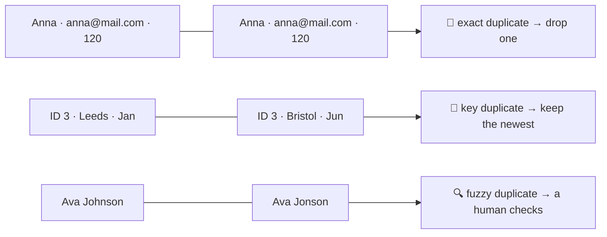

### 🛠️ How to remove duplicates

#### 🔹 Example 1 – spot exact duplicates 🟢

```python
import pandas as pd

party = pd.DataFrame({
    "name": ["Anna", "Ben", "Anna", "Cara", "Ben", "Dan"],
    "drink": ["juice", "cola", "juice", "water", "tea", "cola"],
})
print(party)
print("Is each row a repeat of an earlier one?")
print(party.duplicated())            # True = this exact row appeared before
print("Number of exact duplicates:", party.duplicated().sum())
```

**🖨️ Output:**

```text
   name  drink
0  Anna  juice
1   Ben   cola
2  Anna  juice
3  Cara  water
4   Ben    tea
5   Dan   cola
Is each row a repeat of an earlier one?
0    False
1    False
2     True
3    False
4    False
5    False
dtype: bool
Number of exact duplicates: 1
```

#### 🔹 Example 2 – drop them 🟢

```python
print(party.drop_duplicates())       # Anna's second identical row is gone; Ben stays twice (different drinks)
```

**🖨️ Output:**

```text
   name  drink
0  Anna  juice
1   Ben   cola
3  Cara  water
4   Ben    tea
5   Dan   cola
```

#### 🔹 Example 3 – duplicates by one column only 🟢

```python
print(party.drop_duplicates(subset="name"))                 # one row per name, keeps the FIRST
print(party.drop_duplicates(subset="name", keep="last"))    # keeps the LAST instead
```

**🖨️ Output:**

```text
   name  drink
0  Anna  juice
1   Ben   cola
3  Cara  water
5   Dan   cola
   name  drink
2  Anna  juice
3  Cara  water
4   Ben    tea
5   Dan   cola
```

#### 🔹 Example 4 – hidden duplicates: spaces and capital letters 🟢

```python
emails = pd.Series(["anna@mail.com", "ANNA@mail.com ", "ben@mail.com", " Ben@Mail.com"])
print("Duplicates before cleaning:", emails.duplicated().sum())
clean = emails.str.strip().str.lower()       # .strip() removes spaces at the ends, .lower() makes lowercase
print(clean.tolist())
print("Duplicates after cleaning :", clean.duplicated().sum())
```

**🖨️ Output:**

```text
Duplicates before cleaning: 0
['anna@mail.com', 'anna@mail.com', 'ben@mail.com', 'ben@mail.com']
Duplicates after cleaning : 2
```

#### 🔹 Example 5 – how similar are two words? 🟢
`SequenceMatcher` gives a similarity from 0 (totally different) to 1 (identical).

```python
from difflib import SequenceMatcher

for a, b in [("Ava Johnson", "Ava Jonson"), ("Ava Johnson", "Mia Davies"), ("colour", "color")]:
    print(a, "vs", b, "→ similarity", round(SequenceMatcher(None, a, b).ratio(), 2))
```

**🖨️ Output:**

```text
Ava Johnson vs Ava Jonson → similarity 0.95
Ava Johnson vs Mia Davies → similarity 0.29
colour vs color → similarity 0.91
```

---

### 🛠️ Real-world example – a messy customer list (CRM) 🟡

```python
import pandas as pd

crm = pd.DataFrame({
    "customer_id": [1, 2, 2, 3, 3, 4, 5, 6, 7, 8],
    "name": ["Olivia Brown", "Liam Smith", "Liam Smith", "Emma Wilson", "Emma Wilson",
             "Noah Taylor ", "noah taylor", "Ava Johnson", "Ava Jonson", "Mia Davies"],
    "email": ["olivia.brown@gmail.com", "liam.smith@yahoo.com", "liam.smith@yahoo.com",
              "emma.w@outlook.com", "emma.w@outlook.com", "NOAH.TAYLOR@gmail.com",
              "noah.taylor@gmail.com ", "ava.johnson@gmail.com", "ava.j@gmail.com", "mia.d@icloud.com"],
    "city": ["London", "Manchester", "Manchester", "Leeds", "Bristol",
             "London", "london", "Leeds", "Leeds", "York"],
    "updated_at": pd.to_datetime(["2026-01-10", "2026-02-02", "2026-02-02", "2026-01-15", "2026-06-20",
                                  "2026-03-01", "2026-03-05", "2026-04-11", "2026-04-12", "2026-05-30"]),
    "lifetime_value": [1200, 340, 340, 560, 610, 80, 95, 430, 120, 760],   # money the customer spent
})
print(crm)
```

**🖨️ Output:**

```text
   customer_id          name                   email        city updated_at  lifetime_value
0            1  Olivia Brown  olivia.brown@gmail.com      London 2026-01-10            1200
1            2    Liam Smith    liam.smith@yahoo.com  Manchester 2026-02-02             340
2            2    Liam Smith    liam.smith@yahoo.com  Manchester 2026-02-02             340
3            3   Emma Wilson      emma.w@outlook.com       Leeds 2026-01-15             560
4            3   Emma Wilson      emma.w@outlook.com     Bristol 2026-06-20             610
5            4  Noah Taylor    NOAH.TAYLOR@gmail.com      London 2026-03-01              80
6            5   noah taylor  noah.taylor@gmail.com       london 2026-03-05              95
7            6   Ava Johnson   ava.johnson@gmail.com       Leeds 2026-04-11             430
8            7    Ava Jonson         ava.j@gmail.com       Leeds 2026-04-12             120
9            8    Mia Davies        mia.d@icloud.com        York 2026-05-30             760
```

**What's wrong here?** Liam is copied twice (exact). Emma moved from Leeds to Bristol (two versions of ID 3). Noah has two accounts (same email, different spelling). Ava might be one person with two emails.

#### 🔹 Step 1 – exact duplicates

```python
print("Exact duplicate rows:", crm.duplicated().sum())
crm_1 = crm.drop_duplicates()
```

**🖨️ Output:**

```text
Exact duplicate rows: 1
```

#### 🔹 Step 2 – same ID → keep the newest version

```python
crm_2 = crm_1.sort_values("updated_at").drop_duplicates(subset="customer_id", keep="last")
print(crm_2[crm_2["customer_id"] == 3])          # only Emma's newest (Bristol) record survives
```

**🖨️ Output:**

```text
   customer_id         name               email     city updated_at  lifetime_value
4            3  Emma Wilson  emma.w@outlook.com  Bristol 2026-06-20             610
```

#### 🔹 Step 3 – normalize to reveal hidden duplicates

```python
crm_3 = crm_2.assign(                            # .assign = add/replace columns, give back a new table
    email_key=crm_2["email"].str.strip().str.lower(),
    city=crm_2["city"].str.strip().str.title(),  # .title() → "London"
)
print(crm_3[crm_3.duplicated("email_key", keep=False)][["customer_id", "name", "email_key"]])  # keep=False → show all copies
```

**🖨️ Output:**

```text
   customer_id          name              email_key
5            4  Noah Taylor   noah.taylor@gmail.com
6            5   noah taylor  noah.taylor@gmail.com
```

#### 🔹 Step 4 – merge duplicates instead of deleting (keep the money!) 🟡
Noah's two accounts both spent money. Deleting one would lose 80 or 95. Instead we **combine** them with `groupby` + `agg` (aggregate = summarise).

```python
crm_4 = (crm_3.sort_values("updated_at")
              .groupby("email_key", as_index=False)
              .agg(customer_id=("customer_id", "min"),        # keep the smallest ID
                   name=("name", "last"),                     # newest name spelling
                   city=("city", "last"),
                   lifetime_value=("lifetime_value", "sum"),  # add the money together
                   merged_ids=("customer_id", lambda ids: sorted(ids.tolist()))))
print(crm_4)
```

**🖨️ Output:**

```text
                email_key  customer_id          name        city  lifetime_value merged_ids
0         ava.j@gmail.com            7    Ava Jonson       Leeds             120        [7]
1   ava.johnson@gmail.com            6   Ava Johnson       Leeds             430        [6]
2      emma.w@outlook.com            3   Emma Wilson     Bristol             610        [3]
3    liam.smith@yahoo.com            2    Liam Smith  Manchester             340        [2]
4        mia.d@icloud.com            8    Mia Davies        York             760        [8]
5   noah.taylor@gmail.com            4   noah taylor      London             175     [4, 5]
6  olivia.brown@gmail.com            1  Olivia Brown      London            1200        [1]
```

#### 🔹 Step 5 – find fuzzy duplicates for a human to check

```python
from difflib import SequenceMatcher
from itertools import combinations

suspects = []
for city, group in crm_4.groupby("city"):                     # only compare people in the same city
    for (i, a), (j, b) in combinations(group["name"].str.lower().items(), 2):   # every pair once
        score = SequenceMatcher(None, a, b).ratio()
        if score >= 0.85:
            suspects.append({"city": city, "name_a": crm_4.loc[i, "name"],
                             "name_b": crm_4.loc[j, "name"], "similarity": round(score, 2)})
print(pd.DataFrame(suspects))
```

**🖨️ Output:**

```text
    city      name_a       name_b  similarity
0  Leeds  Ava Jonson  Ava Johnson        0.95
```

### ✅ How to validate duplicate removal

```python
print("Emails unique?      ", crm_4["email_key"].is_unique)
print("Customer IDs unique?", crm_4["customer_id"].is_unique)
print("Money before:", crm_2["lifetime_value"].sum(), "| money after:", crm_4["lifetime_value"].sum(),
      "→ nothing lost?", crm_2["lifetime_value"].sum() == crm_4["lifetime_value"].sum())
print("Rows:", len(crm), "→", len(crm_1), "(exact) →", len(crm_2), "(by ID) →", len(crm_4), "(by person)")
```

**🖨️ Output:**

```text
Emails unique?       True
Customer IDs unique? True
Money before: 3635 | money after: 3635 → nothing lost? True
Rows: 10 → 9 (exact) → 8 (by ID) → 7 (by person)
```

### ⏰ When to use
| Duplicate type | Action |
|---|---|
| Exact copies (double import) | `drop_duplicates()` |
| Same ID, several versions | sort by date + `keep="last"` |
| Same person, several accounts | normalize the key + `groupby().agg()` |
| Spelling variants | fuzzy match → **human review**, never auto-delete |

### 📍 Where to use
- 📧 Marketing lists – don't email someone twice
- 🏥 Patient records – merging records is safety-critical
- 🪵 App logs – the same event sent twice
- 🧪 ML datasets – a duplicate in both train and test makes the score look too good

### ⚠️ Common mistakes
| Mistake | Better |
|---|---|
| `drop_duplicates()` without normalizing first | strip + lowercase the key |
| Deleting a duplicate that had different money/values | aggregate (sum, latest) instead |
| Auto-merging fuzzy matches | send them to a person to confirm |

### 🏋️ Practice
`pets = pd.DataFrame({"pet": ["Rex", "rex ", "Tom", "Tom"], "age": [3, 3, 5, 5]})` – remove duplicates **after** cleaning the names.

<details><summary>👀 Show answer</summary>

```python
pets = pd.DataFrame({"pet": ["Rex", "rex ", "Tom", "Tom"], "age": [3, 3, 5, 5]})
pets["pet"] = pets["pet"].str.strip().str.title()
print(pets.drop_duplicates())
```

**🖨️ Output:**

```text
   pet  age
0  Rex    3
2  Tom    5
```
</details>

### 🎓 Expert corner 🔴
- Deduplicate **before** splitting into train/test, or rows of the same entity leak across sets.
- For millions of names use blocking (only compare within city / first letter) + libraries like `rapidfuzz` or `recordlinkage`.
- Keep a mapping table (`old_id → new_id`) so other tables can be updated consistently.

```python
id_map = crm_4.explode("merged_ids")[["merged_ids", "customer_id"]].rename(
    columns={"merged_ids": "old_id", "customer_id": "new_id"})
print(id_map)
```

**🖨️ Output:**

```text
  old_id  new_id
0      7       7
1      6       6
2      3       3
3      2       2
4      8       8
5      4       4
5      5       4
6      1       1
```

### 🧪 Lab 1.3.2 – Workshop sign-ups 🎟️

**🎯 Goal:** remove exact, hidden and versioned duplicates without losing information.

**🧾 Data** – run this cell first:

```python
import pandas as pd
signups = pd.DataFrame({
    "email": ["ana@x.com", "ana@x.com", "BEN@x.com", "ben@x.com ", "cara@x.com", "dev@x.com", "dev@x.com"],
    "name": ["Ana", "Ana", "Ben", "Ben", "Cara", "Dev", "Dev"],
    "tickets": [1, 1, 2, 2, 1, 1, 3],
    "signed_up": pd.to_datetime(["2026-03-01", "2026-03-01", "2026-03-02", "2026-03-04", "2026-03-02", "2026-03-01", "2026-03-05"]),
})
```

**📝 Your tasks**

1. Count and remove exact duplicates.
2. Normalise the email (strip + lower).
3. Keep only the **latest** sign-up per email.
4. Self-check: 4 people remain, Ben has 2 tickets and Dev has 3.

**🧩 Starter code** (replace every `...`)

```python
step1 = signups.drop_duplicates()
step1["email"] = ...
latest = step1.sort_values(...).drop_duplicates(subset=..., keep=...)
```

<details><summary>💡 Hints</summary>

- `.str.strip().str.lower()`
- `sort_values("signed_up")` then `keep="last"`

</details>

<details><summary>✅ Solution (try first!)</summary>

```python
print("Exact duplicates:", signups.duplicated().sum())
step1 = signups.drop_duplicates().copy()
step1["email"] = step1["email"].str.strip().str.lower()
latest = step1.sort_values("signed_up").drop_duplicates(subset="email", keep="last")
print(latest)
tickets = dict(zip(latest["name"], latest["tickets"]))
assert len(latest) == 4 and tickets["Ben"] == 2 and tickets["Dev"] == 3
print("✅ Lab passed!")
```

**🖨️ Output:**

```text
Exact duplicates: 1
        email  name  tickets  signed_up
0   ana@x.com   Ana        1 2026-03-01
4  cara@x.com  Cara        1 2026-03-02
3   ben@x.com   Ben        2 2026-03-04
6   dev@x.com   Dev        3 2026-03-05
✅ Lab passed!
```
</details>

### 🧠 Recap
- `duplicated()` finds, `drop_duplicates()` removes; normalize text first.
- Same ID → keep newest. Same person → aggregate. Similar spelling → human review.
- Check: keys unique, totals preserved.

---

<a name="sec-1-3-3-fix-inconsistent-data"></a>
## 🧩 1.3.3 Fix Inconsistent Data

### 🍼 The story 🟢
Three friends write the same shopping list: "Tomatoes", "tomato", "TOMATOS 🍅". To the computer these are **three different things**! Inconsistent data = the same fact written in different ways.

### 📚 New words
| Word | Simple meaning |
|---|---|
| **canonical value** | the one official spelling we choose ("United States") |
| **mapping** | a dictionary that translates variants to the official value |
| **regex** | a mini-language to find patterns in text (like "a number followed by kg") |
| **unit conversion** | turning lbs, g, kg all into kg |
| **valid range** | the values that make sense (age 0–120) |

### 🛠️ How to fix inconsistent data

#### 🔹 Example 1 – see the problem with `value_counts` 🟢

```python
import pandas as pd

answers = pd.Series(["Yes", "yes", "YES ", "No", "no", " no", "Y", "N"])
print(answers.value_counts())       # 7 "different" answers – really just 2!
```

**🖨️ Output:**

```text
Yes     1
yes     1
YES     1
No      1
no      1
 no     1
Y       1
N       1
Name: count, dtype: int64
```

#### 🔹 Example 2 – clean the text: spaces and capitals 🟢

```python
cleaned = answers.str.strip().str.lower()     # remove outer spaces, make lowercase
print(cleaned.value_counts())
```

**🖨️ Output:**

```text
yes    3
no     3
y      1
n      1
Name: count, dtype: int64
```

#### 🔹 Example 3 – map variants to one official value 🟢

```python
mapping = {"yes": "yes", "y": "yes", "no": "no", "n": "no"}
print(cleaned.map(mapping).value_counts())    # .map looks up each value in the dictionary
```

**🖨️ Output:**

```text
yes    4
no     4
Name: count, dtype: int64
```

#### 🔹 Example 4 – fix country names 🟢

```python
countries = pd.Series(["USA", "U.S.A.", "united states", " US", "Germany", "DE", "Deutschland", "UK"])
COUNTRY_MAP = {"usa": "United States", "u.s.a.": "United States", "united states": "United States",
               "us": "United States", "germany": "Germany", "de": "Germany", "deutschland": "Germany",
               "uk": "United Kingdom", "united kingdom": "United Kingdom"}
print(pd.DataFrame({"raw": countries, "clean": countries.str.strip().str.lower().map(COUNTRY_MAP)}))
```

**🖨️ Output:**

```text
             raw           clean
0            USA   United States
1         U.S.A.   United States
2  united states   United States
3             US   United States
4        Germany         Germany
5             DE         Germany
6    Deutschland         Germany
7             UK  United Kingdom
```

#### 🔹 Example 5 – pull numbers out of text (regex) 🟢
`r"(\d+\.?\d*)"` means "one or more digits, maybe a dot, maybe more digits" – i.e. a number.

```python
sizes = pd.Series(["12 kg", "3.5kg", "7 KG", "800 g"])
numbers = sizes.str.extract(r"(\d+\.?\d*)")[0].astype(float)   # pull out the number part
units = sizes.str.lower().str.extract(r"(kg|g)")[0]             # pull out the unit part
print(pd.DataFrame({"raw": sizes, "number": numbers, "unit": units}))
```

**🖨️ Output:**

```text
     raw  number unit
0  12 kg    12.0   kg
1  3.5kg     3.5   kg
2   7 KG     7.0   kg
3  800 g   800.0    g
```

#### 🔹 Example 6 – convert all units to one 🟢

```python
TO_KG = {"kg": 1.0, "g": 0.001}
print(pd.DataFrame({"raw": sizes, "kg": numbers * units.map(TO_KG)}))
```

**🖨️ Output:**

```text
     raw    kg
0  12 kg  12.0
1  3.5kg   3.5
2   7 KG   7.0
3  800 g   0.8
```

#### 🔹 Example 7 – impossible values → empty 🟢

```python
ages = pd.Series([34, 41, -1, 29, 250, 0, 45])
valid = ages.between(16, 110)                   # True if 16 ≤ age ≤ 110
print(pd.DataFrame({"age": ages, "valid": valid, "clean": ages.where(valid)}))   # .where keeps valid, others → NaN
```

**🖨️ Output:**

```text
   age  valid  clean
0   34   True   34.0
1   41   True   41.0
2   -1  False    NaN
3   29   True   29.0
4  250  False    NaN
5    0  False    NaN
6   45   True   45.0
```

---

### 🛠️ Real-world example – an international orders export 🟡

```python
import numpy as np
import pandas as pd

orders = pd.DataFrame({
    "order_id": range(1, 11),
    "country": ["USA", "U.S.A.", "united states", " US", "Germany", "germany", "DE", "Deutschland", "UK", "United Kingdom"],
    "weight": ["12 kg", "26.4 lbs", "5000 g", "3.2kg", "7 KG", "15 lb", "800g", "2.5 kg", "11 lbs", "4 kg"],
    "phone": ["+1 (415) 555-0132", "415.555.0198", "1-415-555-0101", "4155550177", "+49 30 123456",
              "030-123457", "+49 30 123458", "0049 30 123459", "+44 20 7946 0958", "020 7946 0959"],
    "status": ["Delivered", "delivered", "DELIVERED", "shipped", "Shipped ", "in transit", "In-Transit",
               "cancelled", "canceled", "Delivered"],
    "customer_age": [34, 41, -1, 29, 250, 38, 52, 0, 45, 31],
})
print(orders)
```

**🖨️ Output:**

```text
   order_id         country    weight              phone      status  customer_age
0         1             USA     12 kg  +1 (415) 555-0132   Delivered            34
1         2          U.S.A.  26.4 lbs       415.555.0198   delivered            41
2         3   united states    5000 g     1-415-555-0101   DELIVERED            -1
3         4              US     3.2kg         4155550177     shipped            29
4         5         Germany      7 KG      +49 30 123456    Shipped            250
5         6         germany     15 lb         030-123457  in transit            38
6         7              DE      800g      +49 30 123458  In-Transit            52
7         8     Deutschland    2.5 kg     0049 30 123459   cancelled             0
8         9              UK    11 lbs   +44 20 7946 0958    canceled            45
9        10  United Kingdom      4 kg      020 7946 0959   Delivered            31
```

#### 🔹 Step 1 – countries

```python
COUNTRY_MAP = {
    "usa": "United States", "u.s.a.": "United States", "united states": "United States", "us": "United States",
    "germany": "Germany", "de": "Germany", "deutschland": "Germany",
    "uk": "United Kingdom", "united kingdom": "United Kingdom",
}
orders["country_clean"] = orders["country"].str.strip().str.lower().map(COUNTRY_MAP)
print(orders[["country", "country_clean"]])
```

**🖨️ Output:**

```text
          country   country_clean
0             USA   United States
1          U.S.A.   United States
2   united states   United States
3              US   United States
4         Germany         Germany
5         germany         Germany
6              DE         Germany
7     Deutschland         Germany
8              UK  United Kingdom
9  United Kingdom  United Kingdom
```

#### 🔹 Step 2 – status words

```python
orders["status_clean"] = (orders["status"].str.strip().str.lower()
                          .str.replace("-", " ", regex=False)        # "in-transit" → "in transit"
                          .replace({"canceled": "cancelled"}))       # US vs UK spelling
print(orders["status_clean"].value_counts())
```

**🖨️ Output:**

```text
status_clean
delivered     4
shipped       2
in transit    2
cancelled     2
Name: count, dtype: int64
```

#### 🔹 Step 3 – weights in kg, lbs and g → all kg

```python
UNIT_TO_KG = {"kg": 1.0, "g": 0.001, "lb": 0.45359237, "lbs": 0.45359237}
parts = orders["weight"].str.strip().str.lower().str.extract(r"^(?P<value>\d+(?:\.\d+)?)\s*(?P<unit>kg|g|lbs?)$")
orders["weight_kg"] = (parts["value"].astype(float) * parts["unit"].map(UNIT_TO_KG)).round(3)
print(orders[["weight", "weight_kg"]])
```

**🖨️ Output:**

```text
     weight  weight_kg
0     12 kg     12.000
1  26.4 lbs     11.975
2    5000 g      5.000
3     3.2kg      3.200
4      7 KG      7.000
5     15 lb      6.804
6      800g      0.800
7    2.5 kg      2.500
8    11 lbs      4.990
9      4 kg      4.000
```

> 💡 The regex in plain words: start `^`, a number `\d+(\.\d+)?`, optional spaces `\s*`, then `kg`, `g`, `lb` or `lbs`, end `$`. `(?P<value>...)` just names the piece.

#### 🔹 Step 4 – phone numbers → one international format (E.164) 🟡
The `phonenumbers` library (`pip install phonenumbers`) knows every country's phone rules.

```python
import phonenumbers

REGION = {"United States": "US", "Germany": "DE", "United Kingdom": "GB"}

def to_e164(raw, region):
    try:
        number = phonenumbers.parse(raw, region)
        return phonenumbers.format_number(number, phonenumbers.PhoneNumberFormat.E164)
    except phonenumbers.NumberParseException:     # if it can't be read, give back None instead of crashing
        return None

orders["phone_e164"] = [to_e164(p, REGION[c]) for p, c in zip(orders["phone"], orders["country_clean"])]
print(orders[["country_clean", "phone", "phone_e164"]])
```

**🖨️ Output:**

```text
    country_clean              phone     phone_e164
0   United States  +1 (415) 555-0132   +14155550132
1   United States       415.555.0198   +14155550198
2   United States     1-415-555-0101   +14155550101
3   United States         4155550177   +14155550177
4         Germany      +49 30 123456    +4930123456
5         Germany         030-123457    +4930123457
6         Germany      +49 30 123458    +4930123458
7         Germany     0049 30 123459    +4930123459
8  United Kingdom   +44 20 7946 0958  +442079460958
9  United Kingdom      020 7946 0959  +442079460959
```

#### 🔹 Step 5 – impossible ages → empty

```python
valid_age = orders["customer_age"].between(16, 110)
orders["customer_age_clean"] = orders["customer_age"].where(valid_age)
print(orders.loc[~valid_age, ["order_id", "customer_age"]])
```

**🖨️ Output:**

```text
   order_id  customer_age
2         3            -1
4         5           250
7         8             0
```

#### 🔹 Step 6 – lock the allowed values (categorical type) 🟡
A `Categorical` column only accepts the values you list – anything else becomes NaN, so new typos show up immediately.

```python
orders["status_clean"] = pd.Categorical(orders["status_clean"],
                                        categories=["shipped", "in transit", "delivered", "cancelled"])
print(orders["status_clean"].cat.categories.tolist())
```

**🖨️ Output:**

```text
['shipped', 'in transit', 'delivered', 'cancelled']
```

### ✅ How to validate consistency

```python
checks = {
    "countries not mapped": orders["country_clean"].isna().sum(),
    "weights not parsed": orders["weight_kg"].isna().sum(),
    "weights outside 0.01–100 kg": (~orders["weight_kg"].between(0.01, 100)).sum(),
    "phones not in +digits format": (~orders["phone_e164"].fillna("").str.match(r"^\+\d{8,15}$")).sum(),
    "status not in the allowed list": orders["status_clean"].isna().sum(),
    "invalid ages (now empty)": orders["customer_age_clean"].isna().sum(),
}
for name, count in checks.items():
    print("✅" if count == 0 else "⚠️", name, ":", count)
```

**🖨️ Output:**

```text
✅ countries not mapped : 0
✅ weights not parsed : 0
✅ weights outside 0.01–100 kg : 0
✅ phones not in +digits format : 0
✅ status not in the allowed list : 0
⚠️ invalid ages (now empty) : 3
```

> 💡 The 3 invalid ages are expected (we emptied them on purpose) – fill them later with 1.3.1.

### ⏰ When to use
| You see… | Fix |
|---|---|
| almost-identical labels in `value_counts()` | strip + lower + mapping |
| numbers with units ("5 kg") | regex + conversion table |
| IDs / phones / postcodes in many formats | a specialised library |
| impossible values | range rule → NaN → impute |
| new strange labels keep arriving | a validation check (Categorical or allowed list) |

### 📍 Where to use
- 🌍 International shops and logistics (countries, units, phones)
- 📋 Forms and surveys (free text answers)
- 🏦 Banks – customer identity checks (KYC)

### ⚠️ Common mistakes
| Mistake | Better |
|---|---|
| Forgetting hidden spaces `" US"` | always `.str.strip()` |
| Mixing lb and kg in one column | convert to one unit |
| Silently dropping unmapped values | count them and review them |

### 🏋️ Practice
Clean `s = pd.Series(["NY", "new york", "New York ", "LA", "los angeles"])` into "New York" / "Los Angeles".

<details><summary>👀 Show answer</summary>

```python
s = pd.Series(["NY", "new york", "New York ", "LA", "los angeles"])
city_map = {"ny": "New York", "new york": "New York", "la": "Los Angeles", "los angeles": "Los Angeles"}
print(s.str.strip().str.lower().map(city_map).tolist())
```

**🖨️ Output:**

```text
['New York', 'New York', 'New York', 'Los Angeles', 'Los Angeles']
```
</details>

### 🎓 Expert corner 🔴
- Keep mapping tables in a CSV/database, versioned, so business people can update them.
- Unicode tricks: `"café"` can be stored two ways – normalize with `unicodedata.normalize("NFKC", text)`.
- Report unmapped values instead of silently making them NaN:

```python
raw = pd.Series(["USA", "Germany", "Atlantis"])
mapped = raw.str.strip().str.lower().map(COUNTRY_MAP)
print("Unmapped values to review:", raw[mapped.isna()].tolist())
```

**🖨️ Output:**

```text
Unmapped values to review: ['Atlantis']
```

### 🧪 Lab 1.3.3 – A messy drinks catalogue 🥤

**🎯 Goal:** turn many spellings and units into one clean format.

**🧾 Data** – run this cell first:

```python
import pandas as pd
drinks = pd.DataFrame({
    "product": ["Cola", "cola zero", "Orange Juice", "Water", "Lemonade", "Iced Tea"],
    "volume": ["1L", "500 ml", "0.33 l", "1.5 L", "330ml", "2 l"],
    "colour": ["Brown", "brown ", "ORANGE", "clear", "yellow", "Brn"],
    "price": [1.99, 1.49, 0.99, 0.79, 1.2, -5],
})
```

**📝 Your tasks**

1. Convert every `volume` to litres (`volume_l`).
2. Clean `colour` (strip, lower) and map `brn` to `brown`.
3. Make impossible prices (≤ 0) empty.
4. Self-check: volumes are `[1.0, 0.5, 0.33, 1.5, 0.33, 2.0]`, 3 drinks are brown, 1 price is empty.

**🧩 Starter code** (replace every `...`)

```python
parts = drinks["volume"].str.lower().str.extract(r"(\d+(?:\.\d+)?)\s*(ml|l)")
drinks["volume_l"] = ...
drinks["colour"] = ...
drinks["price"] = drinks["price"].where(...)
```

<details><summary>💡 Hints</summary>

- ml → divide by 1000: `parts[0].astype(float) * parts[1].map({"l": 1, "ml": 0.001})`
- `.replace({"brn": "brown"})`

</details>

<details><summary>✅ Solution (try first!)</summary>

```python
parts = drinks["volume"].str.lower().str.extract(r"(\d+(?:\.\d+)?)\s*(ml|l)")
drinks["volume_l"] = (parts[0].astype(float) * parts[1].map({"l": 1, "ml": 0.001})).round(2)
drinks["colour"] = drinks["colour"].str.strip().str.lower().replace({"brn": "brown"})
drinks["price"] = drinks["price"].where(drinks["price"] > 0)
print(drinks)
assert drinks["volume_l"].tolist() == [1.0, 0.5, 0.33, 1.5, 0.33, 2.0]
assert (drinks["colour"] == "brown").sum() == 3 and drinks["price"].isna().sum() == 1
print("✅ Lab passed!")
```

**🖨️ Output:**

```text
        product  volume  colour  price  volume_l
0          Cola      1L   brown   1.99      1.00
1     cola zero  500 ml   brown   1.49      0.50
2  Orange Juice  0.33 l  orange   0.99      0.33
3         Water   1.5 L   clear   0.79      1.50
4      Lemonade   330ml  yellow   1.20      0.33
5      Iced Tea     2 l   brown    NaN      2.00
✅ Lab passed!
```
</details>

### 🧠 Recap
- Normalize (strip, lower) → map to official values → convert units → check allowed values and ranges.

---

<a name="sec-1-3-4-handle-outliers"></a>
## 🚨 1.3.4 Handle Outliers

### 🍼 The story 🟢
Your class measures everyone's height: 120, 122, 118, 125, 121 … and **1,190 cm**! 😲
Nobody is 12 metres tall – someone typed an extra zero. That strange value is an **outlier**: a value far away from all the others.

Outliers come in **two kinds**:
- ❌ **Mistakes** – typing errors, wrong units, broken sensors → fix or remove them.
- ⭐ **Real but rare** – a basketball player who is 210 cm, a billionaire's income → **keep** them (maybe handle them gently).

If we ignore mistakes, the **average** gets ruined and models learn wrong things.

### 🖼️ Picture
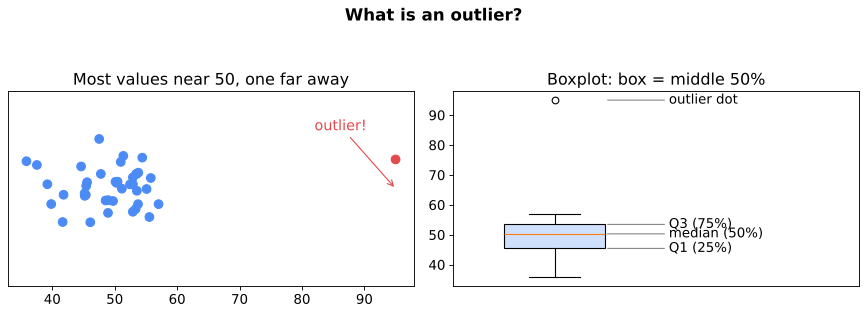

### 📚 New words
| Word | Simple meaning |
|---|---|
| **outlier** | a value very far from the others |
| **Q1 / Q3** | the values that 25 % / 75 % of the data are below (see 0.5) |
| **IQR** | Q3 − Q1 = the width of the "middle half" |
| **fence** | a border line; values outside it are suspicious |
| **z-score** | how many standard deviations from the average (see 0.5) |
| **capping / clipping** | pushing too-big values down to a maximum allowed value |
| **flag** | an extra 0/1 column saying "this row was strange" |

---

### 🛠️ How to handle outliers – step by step

#### 🔹 Example 1 – see the damage one outlier does 🟢

```python
import pandas as pd

heights = pd.Series([120, 122, 118, 125, 121, 119, 1190], name="height_cm")
print("Average WITH the mistake   :", round(heights.mean(), 1))
print("Average WITHOUT the mistake:", round(heights[heights < 300].mean(), 1))
print("Median (not fooled)        :", heights.median())
```

**🖨️ Output:**

```text
Average WITH the mistake   : 273.6
Average WITHOUT the mistake: 120.8
Median (not fooled)        : 121.0
```

#### 🔹 Example 2 – find it with the IQR rule, step by step 🟢
**The rule:** a value is an outlier if it is below **Q1 − 1.5 × IQR** or above **Q3 + 1.5 × IQR**.
(Why 1.5? It's a long-used habit that works well in practice – you can make it bigger to flag fewer values.)

```python
q1 = heights.quantile(0.25)          # 25 % of heights are below this
q3 = heights.quantile(0.75)          # 75 % of heights are below this
iqr = q3 - q1                        # width of the middle half
low_fence = q1 - 1.5 * iqr
high_fence = q3 + 1.5 * iqr
print("Q1 =", q1, "| Q3 =", q3, "| IQR =", iqr)
print("Allowed range:", low_fence, "to", high_fence)

is_outlier = (heights < low_fence) | (heights > high_fence)     # | means OR
print("Outliers:", heights[is_outlier].tolist())
```

**🖨️ Output:**

```text
Q1 = 119.5 | Q3 = 123.5 | IQR = 4.0
Allowed range: 113.5 to 129.5
Outliers: [1190]
```

#### 🔹 Example 3 – turn it into a reusable function 🟢

```python
def iqr_outliers(s, k=1.5):
    """Give back True for every value outside the IQR fences."""
    q1 = s.quantile(0.25)
    q3 = s.quantile(0.75)
    iqr = q3 - q1
    return (s < q1 - k * iqr) | (s > q3 + k * iqr)

print(pd.DataFrame({"height": heights, "is_outlier": iqr_outliers(heights)}))
```

**🖨️ Output:**

```text
   height  is_outlier
0     120       False
1     122       False
2     118       False
3     125       False
4     121       False
5     119       False
6    1190        True
```

#### 🔹 Example 4 – find it with the z-score 🟢
**The rule:** if the z-score is above 3 or below −3, the value is an outlier.

```python
import numpy as np

# 🧾 practice data: 200 normal adult weights + one typo (250 kg)
rng = np.random.default_rng(0)
weights = pd.Series(np.append(rng.normal(70, 8, 200), 250).round(1))

z = (weights - weights.mean()) / weights.std()
table = pd.DataFrame({"weight": weights, "z": z.round(2)})
print(table.sort_values("z", ascending=False).head(3))        # the 3 biggest z-scores
print("Outliers (z above 3 or below -3):", weights[z.abs() > 3].tolist())   # .abs() removes the minus sign
```

**🖨️ Output:**

```text
     weight      z
200   250.0  12.06
79     86.0   1.01
47     85.7   0.99
Outliers (z above 3 or below -3): [250.0]
```

> [!WARNING]
> ⚠️ The z-score needs **many values**. On our 7 heights it fails: the 1190 makes the std so big that its own z is only about 2.3.

```python
z_small = (heights - heights.mean()) / heights.std()
print("z of 1190 cm:", round(z_small.iloc[-1], 2), "→ not above 3, the z-score misses it!")   # .iloc[-1] = last value
```

**🖨️ Output:**

```text
z of 1190 cm: 2.27 → not above 3, the z-score misses it!
```

#### 🔹 Example 5 – a boxplot shows outliers as dots 🟢

```python
import matplotlib.pyplot as plt

plt.boxplot(weights)
plt.title("Box = middle half, line = median, dot at the top = the 250 kg typo")
plt.ylabel("weight (kg)")
plt.xticks([1], ["adults"])
plt.show()
```

**🖼️ What you will see:**

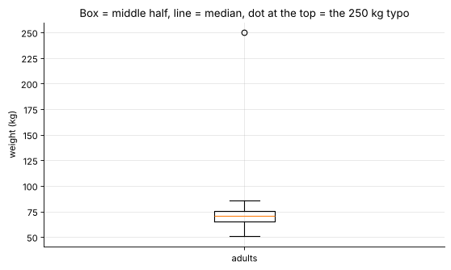

#### 🔹 Example 6 – five ways to treat an outlier 🟢

```python
mask = iqr_outliers(heights)                 # True for the 1190
treated = pd.DataFrame({
    "original":  heights,
    "removed":   heights.where(~mask),       # ~ means NOT: keep non-outliers, outlier → empty (NaN)
    "capped":    heights.clip(upper=heights[~mask].max()),   # pushed down to the biggest normal value
    "median":    heights.mask(mask, heights.median()),       # replaced by the median
    "log":       np.log10(heights).round(2), # squeezed (good for real-but-big values, see 0.5)
    "flag":      mask.astype(int),           # kept as is + a 0/1 "was strange" column
})
print(treated)
```

**🖨️ Output:**

```text
   original  removed  capped  median   log  flag
0       120    120.0     120     120  2.08     0
1       122    122.0     122     122  2.09     0
2       118    118.0     118     118  2.07     0
3       125    125.0     125     125  2.10     0
4       121    121.0     121     121  2.08     0
5       119    119.0     119     119  2.08     0
6      1190      NaN     125     121  3.08     1
```

| Treatment | Use when… |
|---|---|
| remove | it's clearly a mistake and you have plenty of data |
| cap | the value is real-ish but too extreme for your model |
| replace by median | it's a mistake but you don't want to lose the row |
| log | values are real, just huge (incomes, prices) |
| flag | you're not sure – let the model decide |

#### 🔹 Example 7 – a middle-sized example: 20 salaries 🟢
One **mistake** (someone typed 4,800,000 instead of 48,000) and one **real** CEO salary (250,000).

```python
salaries = pd.DataFrame({
    "employee": [f"E{i:02d}" for i in range(1, 21)],          # E01, E02, ... E20
    "role": ["staff"] * 18 + ["staff", "CEO"],
    "salary": [41_000, 45_500, 39_800, 52_000, 47_300, 44_100, 50_200, 43_900, 46_700, 49_000,
               42_800, 51_500, 45_000, 48_200, 40_900, 53_100, 44_700, 47_800, 4_800_000, 250_000],
})
salaries["iqr_flag"] = iqr_outliers(salaries["salary"])
print(salaries[salaries["iqr_flag"]])
```

**🖨️ Output:**

```text
   employee   role   salary  iqr_flag
18      E19  staff  4800000      True
19      E20    CEO   250000      True
```

Both are flagged – but only one is a mistake. A **domain rule** (what you know about the business) decides:

```python
too_big_for_staff = (salaries["role"] == "staff") & (salaries["salary"] > 200_000)
salaries.loc[too_big_for_staff, "salary"] = salaries.loc[too_big_for_staff, "salary"] / 100   # fix the typo
print(salaries.loc[salaries["iqr_flag"], ["employee", "role", "salary"]])
print("Average salary now:", round(salaries["salary"].mean()))
```

**🖨️ Output:**

```text
   employee   role  salary
18      E19  staff   48000
19      E20    CEO  250000
Average salary now: 56575
```

> 💡 **Lesson:** statistics *find* suspicious values; **you** decide which are mistakes.

---

### 🛠️ Real-world example – 805 apartment listings 🟡

#### 🧾 The data – just run this cell, it creates practice data
800 normal apartments + **10 typing mistakes** (an extra zero on the price, or a wrong area like 2 m²) + **5 real luxury penthouses** (very big and very expensive – but **true**). The column `is_injected_error` tells us which rows are the mistakes, so we can check our detectors later. (In real life you don't have this column!)

```python
import numpy as np
import pandas as pd

rng = np.random.default_rng(21)
n = 800
area = rng.gamma(shape=6, scale=12, size=n).round().clip(20, None)   # realistic flat sizes, mostly 40–110 m²
listings = pd.DataFrame({"area_m2": area,
                         "price_usd": (area * rng.normal(4_200, 500, n)).round(-3)})  # about $4,200 per m²
listings["is_injected_error"] = False

err_price = rng.choice(n, 6, replace=False)                 # pick 6 random rows ...
listings.loc[err_price, "price_usd"] *= 10                  # ... and add an extra zero to the price
err_area = rng.choice(np.setdiff1d(np.arange(n), err_price), 4, replace=False)   # 4 other rows ...
listings.loc[err_area, "area_m2"] = [2, 3, 1, 4]            # ... get an impossible area
listings.loc[np.r_[err_price, err_area], "is_injected_error"] = True

luxury = pd.DataFrame({"area_m2": [310, 355, 420, 390, 450],          # real penthouses – NOT errors
                       "price_usd": [1_750_000, 2_050_000, 2_400_000, 2_200_000, 2_600_000],
                       "is_injected_error": False})
listings = pd.concat([listings, luxury], ignore_index=True)           # stick the two tables together
listings["price_per_m2"] = listings["price_usd"] / listings["area_m2"]
print(listings.describe().round(0))
```

**🖨️ Output:**

```text
       area_m2  price_usd  price_per_m2
count    805.0      805.0         805.0
mean      73.0   333589.0        5199.0
std       38.0   289671.0       12576.0
min        1.0    61000.0        3050.0
25%       50.0   215000.0        3905.0
50%       68.0   293000.0        4261.0
75%       89.0   384000.0        4590.0
max      450.0  3550000.0      330000.0
```

> 💡 Look at the `max` of `price_per_m2`: over a million dollars **per m²**? That's a mistake for sure.

#### 🔹 Step 1 – look at it

```python
import matplotlib.pyplot as plt

fig, axes = plt.subplots(1, 2, figsize=(11, 4))      # two pictures side by side
axes[0].boxplot(listings["price_per_m2"])
axes[0].set_title("Price per m²: the box is squashed flat\nbecause the mistakes are SO far away")
axes[1].scatter(listings["area_m2"], listings["price_usd"] / 1e6, s=8, alpha=0.6)   # 1e6 = 1,000,000
axes[1].set(xlabel="area (m²)", ylabel="price (million $)", title="Dots far from the cloud = suspicious")
plt.show()
```

**🖼️ What you will see:**

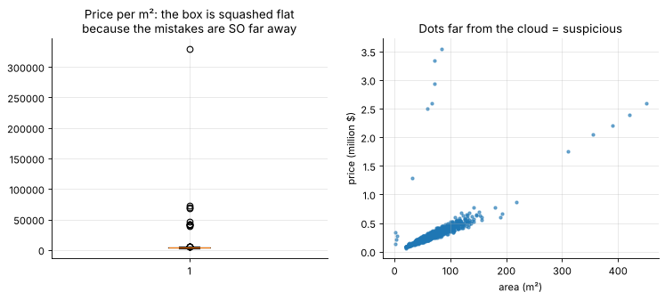

#### 🔹 Step 2 – IQR rule

```python
def iqr_outliers(s, k=1.5):
    q1, q3 = s.quantile(0.25), s.quantile(0.75)
    iqr = q3 - q1
    return (s < q1 - k * iqr) | (s > q3 + k * iqr)

listings["out_iqr"] = iqr_outliers(listings["price_per_m2"])
print("IQR flagged", listings["out_iqr"].sum(), "rows")       # True counts as 1, so sum() counts the Trues
```

**🖨️ Output:**

```text
IQR flagged 16 rows
```

#### 🔹 Step 3 – z-score

```python
def zscore_outliers(s, threshold=3.0):
    z = (s - s.mean()) / s.std()
    return z.abs() > threshold

listings["out_z"] = zscore_outliers(listings["price_per_m2"])
print("Z-score flagged", listings["out_z"].sum(), "rows")
```

**🖨️ Output:**

```text
Z-score flagged 5 rows
```

#### 🔹 Step 4 – "MAD" score: a z-score that can't be fooled 🟡
The normal z-score uses the mean and std, which the outliers themselves push around. The **MAD** version uses **medians** instead (and medians are robust – see 0.5).
- MAD = the **median** distance of all values from the median.
- 0.6745 is a fixed number that makes the result comparable to a normal z-score; 3.5 is the usual cut-off.

```python
def mad_outliers(s, threshold=3.5):
    median = s.median()
    mad = (s - median).abs().median()
    robust_z = 0.6745 * (s - median) / mad
    return robust_z.abs() > threshold

listings["out_mad"] = mad_outliers(listings["price_per_m2"])
print("MAD flagged", listings["out_mad"].sum(), "rows")
```

**🖨️ Output:**

```text
MAD flagged 10 rows
```

#### 🔹 Step 5 – look at two columns together (Isolation Forest & LOF) 🟡
A 200 m² flat is fine. A $1,000,000 flat is fine. A **2 m² flat for $300,000** is not – you only notice by looking at **both columns together**.
- **Isolation Forest** cuts the data with random lines; strange points get cut off alone very quickly.
- **LOF (Local Outlier Factor)** checks if a point is much lonelier than its neighbours.
- `contamination=0.02` = "I expect about 2 % strange rows".
- Both answer **−1 = strange**, **1 = normal**; `== -1` turns that into True/False.

```python
from sklearn.ensemble import IsolationForest
from sklearn.neighbors import LocalOutlierFactor

features = np.log10(listings[["area_m2", "price_usd"]])      # log makes big and small flats comparable
listings["out_iforest"] = IsolationForest(contamination=0.02, random_state=0).fit_predict(features) == -1
listings["out_lof"] = LocalOutlierFactor(n_neighbors=20, contamination=0.02).fit_predict(features) == -1
print("Isolation Forest flagged", listings["out_iforest"].sum(), "| LOF flagged", listings["out_lof"].sum())
```

**🖨️ Output:**

```text
Isolation Forest flagged 17 | LOF flagged 17
```

#### 🔹 Step 6 – treat them

```python
mask = listings["out_mad"]
removed = listings.loc[~mask]                                            # a) remove
low, high = listings["price_per_m2"].quantile([0.01, 0.99])              # 1 % and 99 % points
capped = listings.assign(price_per_m2=listings["price_per_m2"].clip(low, high))   # b) cap
flagged = listings.assign(is_outlier=mask.astype(int))                   # c) keep + flag
print(len(listings), "rows →", len(removed), "after removing")
print("Biggest price per m² after capping:", round(capped["price_per_m2"].max()))
```

**🖨️ Output:**

```text
805 rows → 795 after removing
Biggest price per m² after capping: 40752
```

---

### ✅ How to validate (check) your outlier handling

#### 🔹 Check 1 – did each method catch the real mistakes?
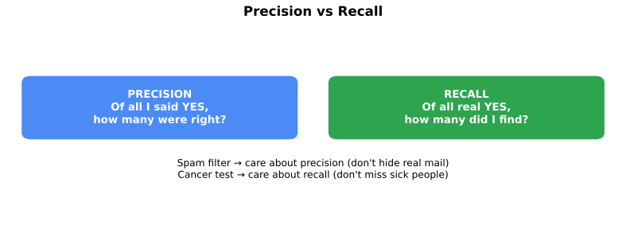

- **Precision** = of all rows I flagged, how many were real mistakes? (1.0 = no false alarms)
- **Recall** = of all real mistakes, how many did I find? (1.0 = found them all)

```python
from sklearn.metrics import precision_score, recall_score

truth = listings["is_injected_error"]
for col in ["out_iqr", "out_z", "out_mad", "out_iforest", "out_lof"]:
    flagged_n = listings[col].sum()
    p = round(precision_score(truth, listings[col]), 2)
    r = round(recall_score(truth, listings[col]), 2)
    print(col, "→ flagged:", flagged_n, "| precision:", p, "| recall:", r)
```

**🖨️ Output:**

```text
out_iqr → flagged: 16 | precision: 0.62 | recall: 1.0
out_z → flagged: 5 | precision: 1.0 | recall: 0.5
out_mad → flagged: 10 | precision: 1.0 | recall: 1.0
out_iforest → flagged: 17 | precision: 0.59 | recall: 1.0
out_lof → flagged: 17 | precision: 0.59 | recall: 1.0
```

> 💡 **MAD** found all 10 mistakes and nothing else (precision 1.0, recall 1.0). IQR also flagged the real penthouses – that's why a human must **look** before deleting.

#### 🔹 Check 2 – look at what was flagged

```python
print(listings.loc[listings["out_iqr"], ["area_m2", "price_usd", "price_per_m2", "is_injected_error"]]
      .sort_values("price_per_m2").round(0))
```

**🖨️ Output:**

```text
     area_m2  price_usd  price_per_m2  is_injected_error
445    120.0   675000.0        5625.0              False
803    390.0  2200000.0        5641.0              False
800    310.0  1750000.0        5645.0              False
802    420.0  2400000.0        5714.0              False
801    355.0  2050000.0        5775.0              False
804    450.0  2600000.0        5778.0              False
543     67.0  2600000.0       38806.0               True
429     72.0  2940000.0       40833.0               True
572     31.0  1280000.0       41290.0               True
708     84.0  3550000.0       42262.0               True
358     59.0  2500000.0       42373.0               True
583     71.0  3340000.0       47042.0               True
385      4.0   271000.0       67750.0               True
45       2.0   139000.0       69500.0               True
61       3.0   217000.0       72333.0               True
20       1.0   330000.0      330000.0               True
```

> 💡 The first rows (≈ $5,500–5,800 per m²) are the real penthouses (`is_injected_error = False`) plus a couple of ordinary flats that are just a bit pricey. The bottom rows (tens of thousands per m²) are the mistakes.

#### 🔹 Check 3 – statistics before vs after

```python
print(pd.DataFrame({"before": listings["price_per_m2"].describe(),
                    "after removing": removed["price_per_m2"].describe()}).round(0))
```

**🖨️ Output:**

```text
         before  after removing
count     805.0           795.0
mean     5199.0          4268.0
std     12576.0           509.0
min      3050.0          3050.0
25%      3905.0          3897.0
50%      4261.0          4250.0
75%      4590.0          4583.0
max    330000.0          5778.0
```

#### 🔹 Check 4 – does a prediction model get better?
We train a model to predict price from area, once on raw data and once on cleaned data, and measure the **MAE** (Mean Absolute Error = the average size of the model's mistakes in dollars; **smaller is better**).

```python
from sklearn.linear_model import LinearRegression
from sklearn.metrics import mean_absolute_error
from sklearn.model_selection import train_test_split

train, test = train_test_split(listings, test_size=0.3, random_state=0)
test_clean = test[~test["is_injected_error"]]                 # judge only on trustworthy rows

def average_error(train_df):
    model = LinearRegression().fit(train_df[["area_m2"]], train_df["price_usd"])
    return mean_absolute_error(test_clean["price_usd"], model.predict(test_clean[["area_m2"]]))

print("Average error, trained on raw data   : $", round(average_error(train)))
print("Average error, trained on clean data : $", round(average_error(train[~mad_outliers(train["price_per_m2"])])))
```

**🖨️ Output:**

```text
Average error, trained on raw data   : $ 41974
Average error, trained on clean data : $ 36132
```

---

### ⏰ When to use which method
| Your situation | Detect with | Then |
|---|---|---|
| One column, bell-shaped, lots of rows | z-score | remove mistakes |
| One column, lopsided or few rows | IQR or **MAD** | cap or flag |
| Strange only in **combination** of columns | Isolation Forest / LOF | flag → human review |
| Impossible value (age −3, area 1 m²) | a simple rule | set empty → fill (see 1.3.1) |
| Rare but **real** | — | keep; log-transform or a robust model |
| The outliers **are** what you look for (fraud) | — | **never remove** – they're the signal! |

### 📍 Where to use
- 🏠 Real estate – typed prices and areas
- 💳 Banks – fraud transactions **are** outliers
- 🏭 Factories – broken sensor spikes
- 🏥 Hospitals – impossible blood pressure like 0 or 900
- 📈 Finance – market crashes (real – don't delete!)

### ⚠️ Common mistakes
| Mistake | Better |
|---|---|
| Deleting every flagged value automatically | Look first – some are real |
| Using z-score on tiny or lopsided data | Use IQR or MAD |
| Removing outliers from the **test** data | Clean only training data; the test should stay realistic |
| Removing fraud cases as "outliers" | They are the target! |

### 🏋️ Practice
1. For `ages = [21, 23, 22, 25, 24, 22, 230]` find the outlier with the IQR rule.
2. Replace it with the median.

<details><summary>👀 Show answers</summary>

```python
ages = pd.Series([21, 23, 22, 25, 24, 22, 230])
m = iqr_outliers(ages)
print(ages[m].tolist())
print(ages.mask(m, ages.median()).tolist())
```

**🖨️ Output:**

```text
[230]
[21, 23, 22, 25, 24, 22, 23]
```
</details>

### 🎓 Expert corner 🔴
- Prefer **robust models** (Huber regression, tree ensembles) over deleting borderline points.
- Compute fences on **training data only**, store them, and apply the same fences to new data in production.
- Winsorizing (capping) at the 1st/99th percentile is common in finance – document the cut-offs.
- For time series, compare each value with a **rolling median** – a spike is only strange relative to its neighbours:

```python
ts = pd.Series([10, 11, 10, 12, 80, 11, 10, 12, 11, 10])
rolling_med = ts.rolling(5, center=True, min_periods=1).median()   # median of each 5-value window
typical_jump = ts.diff().abs().median()                             # typical change between neighbours
print(pd.DataFrame({"value": ts, "rolling_median": rolling_med,
                    "spike": (ts - rolling_med).abs() > 3 * typical_jump}))
```

**🖨️ Output:**

```text
   value  rolling_median  spike
0     10            10.0  False
1     11            10.5  False
2     10            11.0  False
3     12            11.0  False
4     80            11.0   True
5     11            12.0  False
6     10            11.0  False
7     12            11.0  False
8     11            10.5  False
9     10            11.0  False
```

### 🧪 Lab 1.3.4 – A fridge sensor with glitches 🧊

**🎯 Goal:** find sensor glitches, measure how well each method finds them, and fix them.

**🧾 Data** – run this cell first:

```python
import numpy as np
import pandas as pd

rng = np.random.default_rng(30)
temps = pd.Series(rng.normal(4.0, 0.4, 500).round(2), name="fridge_temp_c")
glitch = rng.choice(500, 8, replace=False)
temps[glitch] = rng.choice([-40.0, 85.0, 99.9], 8)              # broken readings
is_glitch = pd.Series(False, index=temps.index); is_glitch[glitch] = True
```

**📝 Your tasks**

1. Draw a boxplot.
2. Detect outliers with IQR, z-score (|z| > 3) and MAD (> 3.5). Count each.
3. For each method print precision and recall against `is_glitch`.
4. Replace the MAD-flagged values with the median.
5. Self-check: MAD finds every glitch (recall 1.0) with precision ≥ 0.8; after fixing, the max temperature is below 6 °C. (Here the data is bell-shaped with many rows, so the z-score also works perfectly – remember 1.3.4's table!)

**🧩 Starter code** (replace every `...`)

```python
import matplotlib.pyplot as plt
from sklearn.metrics import precision_score, recall_score
plt.boxplot(temps); plt.show()
iqr_flag = ...
z_flag = ...
mad_flag = ...
```

<details><summary>💡 Hints</summary>

- Reuse `iqr_outliers`, `zscore_outliers`, `mad_outliers` from this chapter (copy them).
- `temps.mask(mad_flag, temps.median())`

</details>

<details><summary>✅ Solution (try first!)</summary>

```python
import matplotlib.pyplot as plt
from sklearn.metrics import precision_score, recall_score

plt.boxplot(temps); plt.title("Fridge readings – the dots are glitches"); plt.show()
q1, q3 = temps.quantile([0.25, 0.75])
iqr_flag = (temps < q1 - 1.5 * (q3 - q1)) | (temps > q3 + 1.5 * (q3 - q1))
z_flag = ((temps - temps.mean()) / temps.std()).abs() > 3
mad = (temps - temps.median()).abs().median()
mad_flag = (0.6745 * (temps - temps.median()) / mad).abs() > 3.5
for name, flag in [("IQR", iqr_flag), ("z-score", z_flag), ("MAD", mad_flag)]:
    print(name, "flagged", int(flag.sum()), "| precision", round(precision_score(is_glitch, flag), 2),
          "| recall", round(recall_score(is_glitch, flag), 2))
fixed = temps.mask(mad_flag, temps.median())
print("Max after fixing:", fixed.max())
assert recall_score(is_glitch, mad_flag) == 1.0 and precision_score(is_glitch, mad_flag) >= 0.8 and fixed.max() < 6
print("✅ Lab passed!")
```

**🖨️ Output:**

```text
IQR flagged 14 | precision 0.57 | recall 1.0
z-score flagged 8 | precision 1.0 | recall 1.0
MAD flagged 10 | precision 0.8 | recall 1.0
Max after fixing: 5.28
✅ Lab passed!
```

**🖼️ What you will see:**

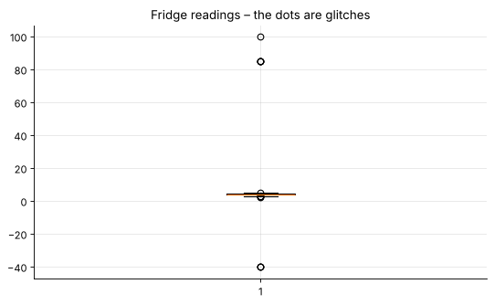
</details>

### 🧠 Recap
- Outlier = far from the rest. **Mistake → fix/remove. Real → keep.**
- Detect with IQR (simple), z-score (bell-shaped, many rows), MAD (robust), Isolation Forest (many columns).
- Always **look before you delete**, and check that your model really improves.

---

<a name="sec-1-3-5-normalize-or-standardize-data"></a>
## ⚖️ 1.3.5 Normalize or Standardize Data

### 🍼 The story 🟢
You compare two friends: Anna is **30 years** old and earns **50,000 $**; Ben is **60 years** old and earns **51,000 $**. Who is "more different"?
Their ages differ by **30**, their incomes by **1,000**. A computer that just subtracts numbers thinks income matters 33× more – only because income uses **bigger numbers**. Scaling puts every column on the **same ruler** so each one gets a fair vote.

### 🖼️ Picture
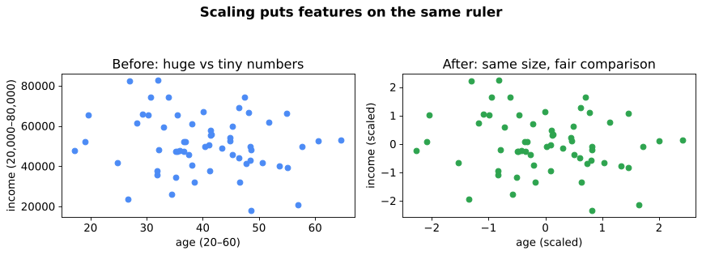

### 📚 New words
| Word | Simple meaning |
|---|---|
| **scale** | how big the numbers in a column are |
| **normalization (Min-Max)** | squeeze values into 0 … 1 (smallest → 0, biggest → 1) |
| **standardization (Z-score)** | shift so the average is 0 and the std is 1 |
| **fit** | learn the min/max or mean/std from data |
| **transform** | apply what was learned |
| **inverse_transform** | go back to the original numbers |
| **data leakage** | the model secretly learns from the test data – makes scores too optimistic |

### 🛠️ How to scale data

#### 🔹 Example 1 – Min-Max by hand: squeeze into 0 … 1 🟢
Formula: `(value − min) / (max − min)`

```python
import pandas as pd

ages = pd.Series([20, 30, 40, 60], name="age")
scaled = (ages - ages.min()) / (ages.max() - ages.min())
print(pd.DataFrame({"age": ages, "min_max": scaled}))
```

**🖨️ Output:**

```text
   age  min_max
0   20     0.00
1   30     0.25
2   40     0.50
3   60     1.00
```

#### 🔹 Example 2 – Z-score by hand: average 0, std 1 🟢
Formula: `(value − mean) / std`

```python
z = (ages - ages.mean()) / ages.std(ddof=0)     # ddof=0: divide by n (what scikit-learn does)
print(pd.DataFrame({"age": ages, "z_score": z.round(2)}))
print("new mean:", round(z.mean(), 2), "| new std:", round(z.std(ddof=0), 2))
```

**🖨️ Output:**

```text
   age  z_score
0   20    -1.18
1   30    -0.51
2   40     0.17
3   60     1.52
new mean: 0.0 | new std: 1.0
```

#### 🔹 Example 3 – why it matters: who is Anna's nearest neighbour? 🟢

```python
people = pd.DataFrame({"name": ["Anna", "Ben", "Cara", "Dan"],
                       "age": [30, 60, 32, 45],
                       "income": [50_000, 51_000, 53_000, 70_000]})

def distance(table, a, b):
    """Straight-line distance between row a and row b (Pythagoras)."""
    diff = table.loc[a, ["age", "income"]] - table.loc[b, ["age", "income"]]
    return (diff ** 2).sum() ** 0.5

print("RAW    → Anna–Ben:", round(distance(people, 0, 1), 2), "| Anna–Cara:", round(distance(people, 0, 2), 2))

scaled = people.copy()
for col in ["age", "income"]:
    scaled[col] = (people[col] - people[col].min()) / (people[col].max() - people[col].min())
print("SCALED → Anna–Ben:", round(distance(scaled, 0, 1), 2), "| Anna–Cara:", round(distance(scaled, 0, 2), 2))
```

**🖨️ Output:**

```text
RAW    → Anna–Ben: 1000.45 | Anna–Cara: 3000.0
SCALED → Anna–Ben: 1.0 | Anna–Cara: 0.16
```

> 💡 With raw numbers, Ben looks closest to Anna (only income counts). After scaling, Cara (almost the same age, similar income) is clearly closest – which matches common sense. Scaling changed the answer!

#### 🔹 Example 4 – the scikit-learn tools 🟢

```python
from sklearn.preprocessing import MinMaxScaler, StandardScaler

table = people[["age", "income"]]
print(pd.DataFrame(MinMaxScaler().fit_transform(table), columns=["age_01", "income_01"]).round(2))
print(pd.DataFrame(StandardScaler().fit_transform(table), columns=["age_z", "income_z"]).round(2))
```

**🖨️ Output:**

```text
   age_01  income_01
0    0.00       0.00
1    1.00       0.05
2    0.07       0.15
3    0.50       1.00
   age_z  income_z
0  -0.98     -0.74
1   1.52     -0.61
2  -0.81     -0.37
3   0.27      1.72
```

---

### 🛠️ Real-world example – wine chemistry 🟡
178 wines, 13 chemical measurements, 3 grape types. `proline` goes up to ~1,700 while `hue` is around 1 – very different scales.

#### 🔹 Step 1 – fit on train, apply to test (the golden rule)

```python
import numpy as np
import pandas as pd
from sklearn.datasets import load_wine
from sklearn.model_selection import train_test_split
from sklearn.preprocessing import MinMaxScaler, StandardScaler

X, y = load_wine(return_X_y=True, as_frame=True)       # comes with scikit-learn, no download
X_train, X_test, y_train, y_test = train_test_split(X, y, test_size=0.25, stratify=y, random_state=0)
print(X_train[["proline", "hue"]].describe().loc[["mean", "std", "min", "max"]].round(2))

std = StandardScaler().set_output(transform="pandas").fit(X_train)      # learn mean/std from TRAIN only
X_train_std, X_test_std = std.transform(X_train), std.transform(X_test)  # apply to both
print(X_train_std[["proline", "hue"]].describe().loc[["mean", "std"]].round(2))
```

**🖨️ Output:**

```text
      proline   hue
mean   754.20  0.96
std    324.82  0.22
min    278.00  0.48
max   1680.00  1.42
      proline  hue
mean      0.0 -0.0
std       1.0  1.0
```

#### 🔹 Step 2 – put the scaler and the model in a Pipeline (automatic golden rule)
A **Pipeline** glues steps together. When you call `fit`, each step learns from training data only; `predict` reuses what was learned.

```python
from sklearn.neighbors import KNeighborsClassifier
from sklearn.pipeline import make_pipeline

model = make_pipeline(StandardScaler(), KNeighborsClassifier(n_neighbors=5))
model.fit(X_train, y_train)
print("Test accuracy:", round(model.score(X_test, y_test), 3))
```

**🖨️ Output:**

```text
Test accuracy: 0.933
```

#### 🔹 Step 3 – go back to the original numbers

```python
back = std.inverse_transform(X_test_std)
print(pd.DataFrame(back, columns=X.columns).iloc[:3, :4].round(2))
```

**🖨️ Output:**

```text
   alcohol  malic_acid   ash  alcalinity_of_ash
0    13.32        3.24  2.38               21.5
1    13.50        1.81  2.61               20.0
2    12.42        2.55  2.27               22.0
```

### ✅ How to validate scaling

```python
from sklearn.model_selection import cross_val_score

print("Train mean ≈ 0?", np.allclose(X_train_std.mean(), 0, atol=1e-9))     # allclose = "almost equal"
print("Train std ≈ 1? ", np.allclose(X_train_std.std(ddof=0), 1))
print("Test mean (not exactly 0 – that's expected):", round(X_test_std.mean().abs().max(), 2))

raw = cross_val_score(KNeighborsClassifier(), X, y, cv=5).mean()
scaled = cross_val_score(make_pipeline(StandardScaler(), KNeighborsClassifier()), X, y, cv=5).mean()
print("KNN accuracy without scaling:", round(raw, 3), "| with scaling:", round(scaled, 3))
```

**🖨️ Output:**

```text
Train mean ≈ 0? True
Train std ≈ 1?  True
Test mean (not exactly 0 – that's expected): 0.22
KNN accuracy without scaling: 0.691 | with scaling: 0.949
```

> 💡 Same model, same data – accuracy jumps just from scaling. That's how important it is for distance-based models.

### ⏰ When to use
| Model | Scale? |
|---|---|
| KNN, K-Means, SVM, PCA, neural networks | ✅ **Required** |
| Linear / logistic regression with regularization | ✅ Required (fair penalty) |
| Decision trees, Random Forest, Gradient Boosting | ❌ Not needed (they only ask "bigger or smaller than…?") |

| Min-Max or Z-score? | |
|---|---|
| Min-Max | values have natural limits (pixels 0–255, percentages) |
| Z-score | default choice for everything else |
| Neither – use Robust/Log | big outliers or lopsided data → see the 8 techniques section |

### 📍 Where to use
- 🍷 Chemistry measurements on different scales
- 🖼️ Image pixels (÷ 255 → 0…1)
- 🧠 Neural network inputs
- 📍 Clustering customers by age + income

### ⚠️ Common mistakes
| Mistake | Better |
|---|---|
| `scaler.fit(all_data)` before splitting | fit on train only (Pipeline) |
| Scaling the target by accident | scale only features X |
| Scaling for tree models | not needed – skip it |

### 🏋️ Practice
Min-Max scale `[5, 10, 15, 20]` by hand. What does 15 become?

<details><summary>👀 Show answer</summary>

```python
s = pd.Series([5, 10, 15, 20])
print(((s - s.min()) / (s.max() - s.min())).tolist())   # 15 → 0.667
```

**🖨️ Output:**

```text
[0.0, 0.3333333333333333, 0.6666666666666666, 1.0]
```
</details>

### 🎓 Expert corner 🔴
- `MinMaxScaler(clip=True)` keeps unseen extreme test values inside 0…1.
- Leakage demo: scaling on all data before CV is subtly optimistic; with outliers and small data the gap can be large.
- Use `ColumnTransformer` to scale only numeric columns and encode categories in the same pipeline (see 1.7).

### 🧪 Lab 1.3.5 – Does scaling help the tumour classifier? 🔬

**🎯 Goal:** prove with cross-validation that KNN needs scaling, and that a tree doesn't.

**🧾 Data** – run this cell first:

```python
from sklearn.datasets import load_breast_cancer
X, y = load_breast_cancer(return_X_y=True, as_frame=True)
print(X[["mean area", "mean smoothness"]].describe().loc[["min", "max"]])
```

**🖨️ Output:**

```text
     mean area  mean smoothness
min      143.5          0.05263
max     2501.0          0.16340
```

**📝 Your tasks**

1. Score `KNeighborsClassifier()` with 5-fold CV, without and with `StandardScaler` (in a pipeline).
2. Do the same for `DecisionTreeClassifier(random_state=0)`.
3. Self-check: scaling improves KNN by more than 0.02 accuracy, and changes the tree by less than 0.01.

**🧩 Starter code** (replace every `...`)

```python
from sklearn.model_selection import cross_val_score
from sklearn.neighbors import KNeighborsClassifier
from sklearn.pipeline import make_pipeline
from sklearn.preprocessing import StandardScaler
from sklearn.tree import DecisionTreeClassifier

knn_raw = cross_val_score(..., X, y, cv=5).mean()
knn_scaled = cross_val_score(make_pipeline(..., ...), X, y, cv=5).mean()
```

<details><summary>💡 Hints</summary>

- Trees only ask 'bigger or smaller than …?', so scaling doesn't change their splits.

</details>

<details><summary>✅ Solution (try first!)</summary>

```python
from sklearn.model_selection import cross_val_score
from sklearn.neighbors import KNeighborsClassifier
from sklearn.pipeline import make_pipeline
from sklearn.preprocessing import StandardScaler
from sklearn.tree import DecisionTreeClassifier

knn_raw = cross_val_score(KNeighborsClassifier(), X, y, cv=5).mean()
knn_scaled = cross_val_score(make_pipeline(StandardScaler(), KNeighborsClassifier()), X, y, cv=5).mean()
tree_raw = cross_val_score(DecisionTreeClassifier(random_state=0), X, y, cv=5).mean()
tree_scaled = cross_val_score(make_pipeline(StandardScaler(), DecisionTreeClassifier(random_state=0)), X, y, cv=5).mean()
print("KNN :", round(knn_raw, 3), "→", round(knn_scaled, 3))
print("Tree:", round(tree_raw, 3), "→", round(tree_scaled, 3))
assert knn_scaled - knn_raw > 0.02 and abs(tree_scaled - tree_raw) < 0.01
print("✅ Lab passed!")
```

**🖨️ Output:**

```text
KNN : 0.928 → 0.965
Tree: 0.917 → 0.917
✅ Lab passed!
```
</details>

### 🧠 Recap
- Scaling = same ruler for every column. Min-Max → 0…1, Z-score → mean 0 / std 1.
- Fit on training data only – easiest with a Pipeline.
- Needed for distance/gradient models, not for trees.

---

<a name="sec-1-3-6-convert-categorical-data"></a>
## 🏷️ 1.3.6 Convert Categorical Data

### 🍼 The story 🟢
Models only understand **numbers**. But lots of data is words: colours, cities, sizes. We need a fair way to turn words into numbers.
- **Sizes** have an order: small < medium < large → 1, 2, 3 makes sense. ✅
- **Colours** have **no** order: if red = 1, green = 2, blue = 3, the model would think blue is "bigger" than red. ❌ Instead we give each colour its own yes/no column.

### 🖼️ Picture
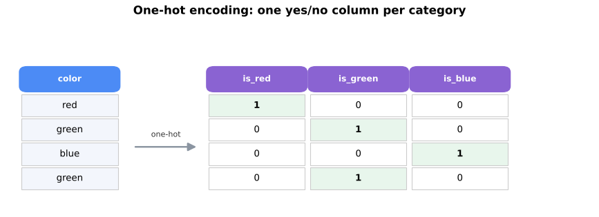

### 📚 New words
| Word | Simple meaning |
|---|---|
| **categorical** | a column of labels/groups (colour, city) |
| **nominal** | categories with **no** order (red, green, blue) |
| **ordinal** | categories **with** an order (small < medium < large) |
| **one-hot encoding** | one 0/1 column per category |
| **ordinal encoding** | ordered numbers 0, 1, 2 … |
| **cardinality** | how many different categories (2 sexes = low, 3,000 cities = high) |
| **target encoding** | replace a category by the average target of that category |
| **unseen category** | a category that appears in new data but not in training |

### 🛠️ How to convert categories

#### 🔹 Example 1 – one-hot with pandas 🟢

```python
import pandas as pd

shirts = pd.DataFrame({"color": ["red", "green", "blue", "green"],
                       "size": ["S", "L", "M", "S"],
                       "price": [10, 12, 11, 10]})
print(pd.get_dummies(shirts, columns=["color"], dtype=int))      # dtype=int → 0/1 instead of True/False
```

**🖨️ Output:**

```text
  size  price  color_blue  color_green  color_red
0    S     10           0            0          1
1    L     12           0            1          0
2    M     11           1            0          0
3    S     10           0            1          0
```

#### 🔹 Example 2 – ordinal: sizes keep their order 🟢

```python
size_order = {"S": 0, "M": 1, "L": 2}
shirts["size_code"] = shirts["size"].map(size_order)
print(shirts)
```

**🖨️ Output:**

```text
   color size  price  size_code
0    red    S     10          0
1  green    L     12          2
2   blue    M     11          1
3  green    S     10          0
```

#### 🔹 Example 3 – the same with scikit-learn 🟢

```python
from sklearn.preprocessing import OneHotEncoder, OrdinalEncoder

ohe = OneHotEncoder(sparse_output=False).set_output(transform="pandas")   # sparse_output=False → normal table
print(ohe.fit_transform(shirts[["color"]]))

ordenc = OrdinalEncoder(categories=[["S", "M", "L"]])            # we tell it the correct order
print(ordenc.fit_transform(shirts[["size"]]).ravel())             # .ravel() → flat list
```

**🖨️ Output:**

```text
   color_blue  color_green  color_red
0         0.0          0.0        1.0
1         0.0          1.0        0.0
2         1.0          0.0        0.0
3         0.0          1.0        0.0
[0. 2. 1. 0.]
```

#### 🔹 Example 4 – a new colour appears later! 🟢
In real life, tomorrow's data may contain "purple". Without care, the encoder crashes.

```python
safe_ohe = OneHotEncoder(handle_unknown="ignore", sparse_output=False).fit(shirts[["color"]])
tomorrow = pd.DataFrame({"color": ["purple", "red"]})
print(safe_ohe.transform(tomorrow))          # purple → all zeros instead of an error
```

**🖨️ Output:**

```text
[[0. 0. 0.]
 [0. 0. 1.]]
```

#### 🔹 Example 5 – frequency encoding: "how common is this category?" 🟢

```python
cities = pd.Series(["Paris", "Rome", "Paris", "Oslo", "Paris", "Rome"])
freq = cities.value_counts(normalize=True)     # share of each city
print(pd.DataFrame({"city": cities, "city_frequency": cities.map(freq).round(2)}))
```

**🖨️ Output:**

```text
    city  city_frequency
0  Paris            0.50
1   Rome            0.33
2  Paris            0.50
3   Oslo            0.17
4  Paris            0.50
5   Rome            0.33
```

#### 🔹 Example 6 – target encoding by hand: "average price per brand" 🟢

```python
cars = pd.DataFrame({"brand": ["BMW", "Fiat", "BMW", "Kia", "Fiat", "BMW"],
                     "price": [40, 12, 44, 18, 14, 42]})
brand_avg = cars.groupby("brand")["price"].mean()
cars["brand_avg_price"] = cars["brand"].map(brand_avg)
print(cars)
```

**🖨️ Output:**

```text
  brand  price  brand_avg_price
0   BMW     40             42.0
1  Fiat     12             13.0
2   BMW     44             42.0
3   Kia     18             18.0
4  Fiat     14             13.0
5   BMW     42             42.0
```

> ⚠️ Doing this on the **whole** data leaks the answer into the feature (each car helps make its own number). scikit-learn's `TargetEncoder` fixes this – see Step 4 of the real-world example below.

#### 🔹 Example 7 – encoding the target (the answer column) 🟢

```python
from sklearn.preprocessing import LabelEncoder

le = LabelEncoder()
labels = le.fit_transform(["cat", "dog", "cat", "bird"])
print(labels, "←", le.classes_.tolist())       # bird=0, cat=1, dog=2
print("Back to words:", le.inverse_transform([2, 0]))
```

**🖨️ Output:**

```text
[1 2 1 0] ← ['bird', 'cat', 'dog']
Back to words: ['dog' 'bird']
```

---

### 🛠️ Real-world example – 2,000 used-car listings 🟡

#### 🧾 The data – just run this cell
Price depends on brand (nominal), condition (ordinal), the city (150 cities = high cardinality) and mileage.

```python
import numpy as np
import pandas as pd

rng = np.random.default_rng(3)
n = 2_000
brands = ["Toyota", "Volkswagen", "Ford", "BMW", "Tesla", "Kia", "Volvo", "Fiat"]
cities = [f"city_{i:03d}" for i in range(150)]                       # city_000 … city_149
cars = pd.DataFrame({
    "brand": rng.choice(brands, n, p=[0.2, 0.18, 0.15, 0.12, 0.1, 0.1, 0.1, 0.05]),
    "fuel": rng.choice(["petrol", "diesel", "hybrid", "electric"], n, p=[0.45, 0.25, 0.18, 0.12]),
    "condition": rng.choice(["poor", "fair", "good", "excellent"], n, p=[0.1, 0.3, 0.4, 0.2]),
    "city": rng.choice(cities, n),
    "mileage_km": rng.integers(5_000, 250_000, n),
})
brand_premium = {"Toyota": 2000, "Volkswagen": 1500, "Ford": 0, "BMW": 9000, "Tesla": 14000,
                 "Kia": -500, "Volvo": 5000, "Fiat": -2500}
condition_value = {"poor": -4000, "fair": -1500, "good": 0, "excellent": 2500}
city_effect = dict(zip(cities, rng.normal(0, 2500, len(cities))))
cars["price_usd"] = (18_000 + cars.brand.map(brand_premium) + cars.condition.map(condition_value)
                     + cars.city.map(city_effect) - 0.05 * cars.mileage_km + rng.normal(0, 1500, n)).round(-1)
print(cars.head())
print("Different cities:", cars["city"].nunique())
```

**🖨️ Output:**

```text
        brand    fuel  condition      city  mileage_km  price_usd
0      Toyota  diesel  excellent  city_093      180270    11690.0
1  Volkswagen  petrol       fair  city_148      184274     7250.0
2         Kia  petrol       fair  city_056      212996     6740.0
3         BMW  diesel  excellent  city_036      176493    14460.0
4      Toyota  diesel       good  city_026      130844     9400.0
Different cities: 150
```

#### 🔹 Step 1 – one-hot + group rare brands together

```python
from sklearn.preprocessing import OneHotEncoder

ohe = OneHotEncoder(handle_unknown="infrequent_if_exist", min_frequency=0.06, sparse_output=False)
brand_cols = ohe.set_output(transform="pandas").fit_transform(cars[["brand"]])
print(brand_cols.columns.tolist())       # Fiat (only 5 %) is grouped into "infrequent"
```

**🖨️ Output:**

```text
['brand_BMW', 'brand_Ford', 'brand_Kia', 'brand_Tesla', 'brand_Toyota', 'brand_Volkswagen', 'brand_Volvo',
    'brand_infrequent_sklearn']
```

#### 🔹 Step 2 – ordinal for condition

```python
from sklearn.preprocessing import OrdinalEncoder

ord_enc = OrdinalEncoder(categories=[["poor", "fair", "good", "excellent"]])
cars["condition_code"] = ord_enc.fit_transform(cars[["condition"]]).ravel()
print(cars.groupby("condition")["condition_code"].first().sort_values())
```

**🖨️ Output:**

```text
condition
poor         0.0
fair         1.0
good         2.0
excellent    3.0
Name: condition_code, dtype: float64
```

#### 🔹 Step 3 – frequency encoding for city

```python
cars["city_freq"] = cars["city"].map(cars["city"].value_counts(normalize=True))
print(cars[["city", "city_freq"]].head())
```

**🖨️ Output:**

```text
       city  city_freq
0  city_093     0.0070
1  city_148     0.0085
2  city_056     0.0075
3  city_036     0.0060
4  city_026     0.0080
```

#### 🔹 Step 4 – target encoding for city (leak-safe) 🟡
`TargetEncoder.fit_transform` uses **cross-fitting**: it splits the data into parts and encodes each part using only the *other* parts, so a car never helps make its own number.

```python
from sklearn.preprocessing import TargetEncoder

te = TargetEncoder(target_type="continuous")          # continuous = the target is a number (price)
cars["city_te"] = te.fit_transform(cars[["city"]], cars["price_usd"]).ravel()
print(cars[["city", "city_te"]].head())
```

**🖨️ Output:**

```text
       city       city_te
0  city_093  13915.351417
1  city_148  13150.985175
2  city_056  15141.484234
3  city_036   7767.869645
4  city_026  11743.634218
```

#### 🔹 Step 5 – everything in one ColumnTransformer + model 🟡

```python
from sklearn.compose import ColumnTransformer
from sklearn.linear_model import Ridge
from sklearn.pipeline import make_pipeline
from sklearn.preprocessing import StandardScaler

feature_cols = ["brand", "fuel", "condition", "city", "mileage_km"]
preprocess = ColumnTransformer([
    ("onehot", OneHotEncoder(handle_unknown="ignore"), ["brand", "fuel"]),
    ("ordinal", OrdinalEncoder(categories=[["poor", "fair", "good", "excellent"]]), ["condition"]),
    ("target", TargetEncoder(target_type="continuous"), ["city"]),
    ("numbers", StandardScaler(), ["mileage_km"]),
])
# Ridge = linear regression with a small penalty that stops any single weight from getting huge
price_model = make_pipeline(preprocess, Ridge(alpha=1.0))
price_model.fit(cars[feature_cols], cars["price_usd"])
print("First 3 real prices:", cars["price_usd"].head(3).tolist())
print("First 3 predictions:", price_model.predict(cars[feature_cols].head(3)).round(-1).tolist())
```

**🖨️ Output:**

```text
First 3 real prices: [11690.0, 7250.0, 6740.0]
First 3 predictions: [12620.0, 7620.0, 5160.0]
```

### ✅ How to validate categorical encoding

#### 🔹 Check 1 – new, unseen categories don't crash

```python
new_car = pd.DataFrame([{"brand": "Rivian", "fuel": "electric", "condition": "good",
                         "city": "city_999", "mileage_km": 12_000}])
print("Prediction for an unseen brand and city:", round(price_model.predict(new_car)[0]), "$")
```

**🖨️ Output:**

```text
Prediction for an unseen brand and city: 21083 $
```

#### 🔹 Check 2 – which encoding works best for city? Let cross-validation decide
**R²** = how much of the price differences the model explains (1.0 = perfect, 0 = useless).

```python
from sklearn.model_selection import cross_val_score

def pipeline_with(city_encoder):
    steps = [("onehot", OneHotEncoder(handle_unknown="ignore"), ["brand", "fuel"]),
             ("ordinal", OrdinalEncoder(categories=[["poor", "fair", "good", "excellent"]]), ["condition"]),
             ("numbers", StandardScaler(), ["mileage_km"])]
    if city_encoder is not None:
        steps.append(("city", city_encoder, ["city"]))
    return make_pipeline(ColumnTransformer(steps), Ridge())

for name, enc in [("no city at all", None),
                  ("one-hot city (150 columns)", OneHotEncoder(handle_unknown="ignore")),
                  ("target-encoded city", TargetEncoder(target_type="continuous"))]:
    r2 = cross_val_score(pipeline_with(enc), cars[feature_cols], cars["price_usd"], cv=5, scoring="r2").mean()
    print(name.ljust(28), "R² =", round(r2, 3))
```

**🖨️ Output:**

```text
no city at all               R² = 0.811
one-hot city (150 columns)   R² = 0.941
target-encoded city          R² = 0.881
```

> 💡 City clearly matters. Here (about 13 cars per city) one-hot works best; target encoding wins when there are **thousands** of categories or with tree models. Let the numbers decide, not habit.

#### 🔹 Check 3 – the leakage trap 🟡

```python
naive = TargetEncoder(target_type="continuous").fit(cars[["city"]], cars["price_usd"]).transform(cars[["city"]]).ravel()
print("Correlation with price – naive (leaky):", round(np.corrcoef(naive, cars["price_usd"])[0, 1], 3))
print("Correlation with price – cross-fitted :", round(np.corrcoef(cars["city_te"], cars["price_usd"])[0, 1], 3))
```

**🖨️ Output:**

```text
Correlation with price – naive (leaky): 0.426
Correlation with price – cross-fitted : 0.251
```

> 💡 The naive version looks "better" only because it cheated.

### ⏰ When to use
| Column | How many categories | Linear models / NN | Tree models |
|---|---|---|---|
| no order (nominal) | few (< 15) | one-hot | one-hot or ordinal |
| no order (nominal) | many (> 15) | target / frequency | target / frequency |
| with order (ordinal) | any | ordinal encoder (correct order!) | ordinal encoder |
| the target itself | – | LabelEncoder | LabelEncoder |

### 📍 Where to use
- 🚗 Car/house marketplaces (brand, city), 🛒 shops (product category, store), 🏦 loans (job type, region), 📣 online ads (thousands of websites → target encoding)

### ⚠️ Common mistakes
| Mistake | Better |
|---|---|
| Numbers 1, 2, 3 for colours | one-hot (colours have no order) |
| Alphabetical order for sizes (L < M < S) | give the order explicitly |
| One-hot for 10,000 categories | target / frequency encoding |
| Crash on new categories | `handle_unknown="ignore"` |
| Target encoding on all data | `TargetEncoder` (cross-fitting) inside a pipeline |

### 🏋️ Practice
One-hot encode `pets = pd.Series(["cat", "dog", "fish", "dog"])` with pandas.

<details><summary>👀 Show answer</summary>

```python
pets = pd.Series(["cat", "dog", "fish", "dog"])
print(pd.get_dummies(pets, dtype=int))
```

**🖨️ Output:**

```text
   cat  dog  fish
0    1    0     0
1    0    1     0
2    0    0     1
3    0    1     0
```
</details>

### 🎓 Expert corner 🔴
- `HistGradientBoosting*(categorical_features="from_dtype")` handles pandas `category` columns natively – no one-hot needed.
- `OneHotEncoder(drop="first")` avoids perfectly correlated columns for un-regularized linear models.
- Hashing (`FeatureHasher`) handles millions of categories with fixed memory.

```python
from sklearn.ensemble import HistGradientBoostingRegressor

native = cars[["brand", "fuel", "condition", "city", "mileage_km"]].copy()
for col in ["brand", "fuel", "condition", "city"]:
    native[col] = native[col].astype("category")
hgb = HistGradientBoostingRegressor(categorical_features="from_dtype", random_state=0)
print("Native categorical HGB R²:", round(cross_val_score(hgb, native, cars["price_usd"], cv=5, scoring="r2").mean(), 3))
```

**🖨️ Output:**

```text
Native categorical HGB R²: 0.872
```

### 🧪 Lab 1.3.6 – Hotel room prices 🏨

**🎯 Goal:** encode nominal and ordinal categories correctly and survive unseen values.

**🧾 Data** – run this cell first:

```python
import numpy as np
import pandas as pd

rng = np.random.default_rng(6)
n = 800
hotels = pd.DataFrame({"room_type": rng.choice(["single", "double", "suite"], n, p=[0.4, 0.45, 0.15]),
                       "stars": rng.choice(["2-star", "3-star", "4-star", "5-star"], n),
                       "city": rng.choice(["Rome", "Paris", "Oslo", "Lisbon"], n),
                       "nights": rng.integers(1, 8, n)})
room = hotels.room_type.map({"single": 0, "double": 30, "suite": 120})
star = hotels.stars.map({"2-star": 0, "3-star": 25, "4-star": 60, "5-star": 120})
city = hotels.city.map({"Rome": 20, "Paris": 50, "Oslo": 40, "Lisbon": 0})
hotels["price_per_night"] = (60 + room + star + city + rng.normal(0, 10, n)).round()
```

**📝 Your tasks**

1. One-hot encode `room_type` and `city`; ordinal-encode `stars` in the right order.
2. Build a `ColumnTransformer` + `Ridge` pipeline and score it with 5-fold CV (R²).
3. Predict a booking with an unseen city ("Vienna") – it must not crash.
4. Self-check: R² above 0.9.

**🧩 Starter code** (replace every `...`)

```python
from sklearn.compose import ColumnTransformer
from sklearn.linear_model import Ridge
from sklearn.model_selection import cross_val_score
from sklearn.pipeline import make_pipeline
from sklearn.preprocessing import OneHotEncoder, OrdinalEncoder

prep = ColumnTransformer([("onehot", OneHotEncoder(...), [...]),
                          ("ordinal", OrdinalEncoder(categories=[[...]]), ["stars"]),
                          ("rest", "passthrough", ["nights"])])
```

<details><summary>💡 Hints</summary>

- `handle_unknown="ignore"` lets new cities through.
- Star order: `["2-star", "3-star", "4-star", "5-star"]`.

</details>

<details><summary>✅ Solution (try first!)</summary>

```python
from sklearn.compose import ColumnTransformer
from sklearn.linear_model import Ridge
from sklearn.model_selection import cross_val_score
from sklearn.pipeline import make_pipeline
from sklearn.preprocessing import OneHotEncoder, OrdinalEncoder

prep = ColumnTransformer([("onehot", OneHotEncoder(handle_unknown="ignore"), ["room_type", "city"]),
                          ("ordinal", OrdinalEncoder(categories=[["2-star", "3-star", "4-star", "5-star"]]), ["stars"]),
                          ("rest", "passthrough", ["nights"])])
hotel_model = make_pipeline(prep, Ridge())
X, y = hotels.drop(columns="price_per_night"), hotels["price_per_night"]
r2 = cross_val_score(hotel_model, X, y, cv=5, scoring="r2").mean()
hotel_model.fit(X, y)
new = pd.DataFrame([{"room_type": "double", "stars": "4-star", "city": "Vienna", "nights": 2}])
print("R²:", round(r2, 3), "| Vienna double, 4-star:", round(hotel_model.predict(new)[0]))
assert r2 > 0.9
print("✅ Lab passed!")
```

**🖨️ Output:**

```text
R²: 0.96 | Vienna double, 4-star: 189
✅ Lab passed!
```
</details>

### 🧠 Recap
- No order → one-hot. Order → ordinal (with the right order). Many categories → target/frequency.
- Always handle unseen categories, and never let target encoding see the answer it predicts.

---

<a name="sec-1-3-7-text-data-cleaning"></a>
## 📝 1.3.7 Text Data Cleaning

### 🍼 The story 🟢
Reviews from a website look like this: `"<p>LOVE it!!! 😍 Visit www.shop.com</p>"`. For a computer, "LOVE", "love" and "love!!!" are three different words, and `<p>` is meaningless. Text cleaning is like **tidying a messy room** so the important things are easy to find.

### 📚 New words
| Word | Simple meaning |
|---|---|
| **token** | one word (or piece of a word) |
| **lowercase** | all small letters |
| **HTML tag** | website code like `<p>` or `<b>` |
| **stop words** | very common words that carry little meaning: "the", "is", "and" |
| **negation** | "not", "no", "never" – these **flip meaning**, so keep them! |
| **lemmatize** | turn a word into its dictionary form: "running" → "run" |
| **vectorize / TF-IDF** | turn text into numbers; TF-IDF gives rare-but-present words a higher score |

### 🖼️ Picture – a cleaning conveyor belt

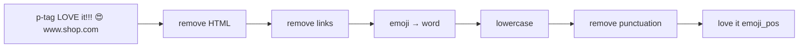

### 🛠️ How to clean text – one step at a time

#### 🔹 Example 1 – lowercase and strip spaces 🟢

```python
text = "   Absolutely LOVE This Blender   "
print(repr(text.strip().lower()))          # repr shows the quotes, so you can see the spaces are gone
```

**🖨️ Output:**

```text
'absolutely love this blender'
```

#### 🔹 Example 2 – remove HTML tags with a regex 🟢
`<[^>]+>` means "a `<`, then anything that is not `>`, then `>`" – i.e. any tag.

```python
import re

html_text = "<p>Great <b>value</b>!</p>"
print(re.sub(r"<[^>]+>", " ", html_text))   # re.sub(pattern, replacement, text)
```

**🖨️ Output:**

```text
 Great  value !
```

#### 🔹 Example 3 – fix HTML codes like `&amp;` 🟢

```python
import html
print(html.unescape("Fast &amp; cheap &lt;3"))
```

**🖨️ Output:**

```text
Fast & cheap <3
```

#### 🔹 Example 4 – remove links 🟢

```python
print(re.sub(r"https?://\S+|www\.\S+", " ", "See https://example.com/review or www.shop.com now"))
```

**🖨️ Output:**

```text
See   or   now
```

#### 🔹 Example 5 – expand short forms (contractions) 🟢

```python
CONTRACTIONS = {"won't": "will not", "can't": "cannot", "n't": " not", "'re": " are", "'m": " am"}
sentence = "i don't like it and i won't buy it"
for short, full in CONTRACTIONS.items():
    sentence = sentence.replace(short, full)
print(sentence)
```

**🖨️ Output:**

```text
i do not like it and i will not buy it
```

#### 🔹 Example 6 – keep emoji meaning as a word 🟢

```python
EMOJI = {"😍": " emoji_pos ", "👍": " emoji_pos ", "😡": " emoji_neg ", "👎": " emoji_neg "}
review = "Broke after 2 days 😡"
for emo, word in EMOJI.items():
    review = review.replace(emo, word)
print(review)
```

**🖨️ Output:**

```text
Broke after 2 days  emoji_neg
```

#### 🔹 Example 7 – remove punctuation and numbers 🟢

```python
print(re.sub(r"[^a-z\s]", " ", "it's ok!!! 5/10, nothing special."))   # keep only a–z and spaces
```

**🖨️ Output:**

```text
it s ok          nothing special
```

#### 🔹 Example 8 – split into words and drop stop words (keep "not"!) 🟢

```python
from sklearn.feature_extraction.text import ENGLISH_STOP_WORDS

STOP_WORDS = ENGLISH_STOP_WORDS - {"no", "not", "nor", "never", "cannot"}     # remove negations from the stop list
words = "this is not a good product and the lid is broken".split()
print([w for w in words if w not in STOP_WORDS])
```

**🖨️ Output:**

```text
['not', 'good', 'product', 'lid', 'broken']
```

#### 🔹 Example 9 – turn text into numbers: word counts 🟢

```python
from sklearn.feature_extraction.text import CountVectorizer
import pandas as pd

docs = ["good phone", "bad phone", "good good camera"]
cv = CountVectorizer()
counts = cv.fit_transform(docs)
print(pd.DataFrame(counts.toarray(), columns=cv.get_feature_names_out(), index=docs))
```

**🖨️ Output:**

```text
                  bad  camera  good  phone
good phone          0       0     1      1
bad phone           1       0     0      1
good good camera    0       1     2      0
```

---

### 🛠️ Real-world example – product reviews 🟡

```python
import html
import re
import unicodedata
import pandas as pd

reviews = pd.DataFrame({
    "review": [
        "<p>Absolutely LOVE this blender!!! 😍 Works great.</p>",
        "Terrible. Broke after 2 days... won't buy again 😡",
        "It's ok, nothing special. See https://example.com/review/123",
        "Don't waste your money &amp; time. NOT worth $79.99",
        "Great value for the price, would recommend 👍",
        "The lid doesn't fit properly and it leaks.",
        "Five stars!!! Fast shipping, works perfectly.",
        "Customer service never replied to my 3 emails. Awful.",
    ],
    "sentiment": [1, 0, 1, 0, 1, 0, 1, 0],          # 1 = happy, 0 = unhappy
})
```

#### 🔹 Step 1 – one cleaning function that does all steps in order

```python
EMOJI_SENTIMENT = {"😍": " emoji_pos ", "👍": " emoji_pos ", "😡": " emoji_neg ", "👎": " emoji_neg "}
CONTRACTIONS = {"won't": "will not", "can't": "cannot", "n't": " not", "'re": " are",
                "'s": " is", "'ll": " will", "'ve": " have", "'m": " am", "'d": " would"}
HTML_TAG = re.compile(r"<[^>]+>")                 # re.compile = prepare a pattern once, use it many times
URL = re.compile(r"https?://\S+|www\.\S+")
NUMBER = re.compile(r"\$?\d+(?:[.,]\d+)?")
NON_LETTER = re.compile(r"[^a-z_\s]")

def clean_text(text):
    text = html.unescape(text)                              # &amp; → &
    text = HTML_TAG.sub(" ", text)                          # remove <p> tags
    text = URL.sub(" ", text)                               # remove links
    for emo, token in EMOJI_SENTIMENT.items():              # keep emoji meaning
        text = text.replace(emo, token)
    text = unicodedata.normalize("NFKC", text).lower().replace("’", "'")   # same letters, lowercase
    for short, full in CONTRACTIONS.items():                # don't → do not
        text = text.replace(short, full)
    text = NUMBER.sub(" num ", text)                        # $79.99 → num
    text = NON_LETTER.sub(" ", text)                        # punctuation & other emojis
    return re.sub(r"\s+", " ", text).strip()                # many spaces → one

reviews["clean"] = reviews["review"].map(clean_text)
for raw, clean in zip(reviews["review"], reviews["clean"]):
    print("RAW  :", raw)
    print("CLEAN:", clean, "\n")
```

**🖨️ Output:**

```text
RAW  : <p>Absolutely LOVE this blender!!! 😍 Works great.</p>
CLEAN: absolutely love this blender emoji_pos works great

RAW  : Terrible. Broke after 2 days... won't buy again 😡
CLEAN: terrible broke after num days will not buy again emoji_neg

RAW  : It's ok, nothing special. See https://example.com/review/123
CLEAN: it is ok nothing special see

RAW  : Don't waste your money &amp; time. NOT worth $79.99
CLEAN: do not waste your money time not worth num

RAW  : Great value for the price, would recommend 👍
CLEAN: great value for the price would recommend emoji_pos

RAW  : The lid doesn't fit properly and it leaks.
CLEAN: the lid does not fit properly and it leaks

RAW  : Five stars!!! Fast shipping, works perfectly.
CLEAN: five stars fast shipping works perfectly

RAW  : Customer service never replied to my 3 emails. Awful.
CLEAN: customer service never replied to my num emails awful
```

#### 🔹 Step 2 – remove stop words but keep negations

```python
from sklearn.feature_extraction.text import ENGLISH_STOP_WORDS

STOP_WORDS = ENGLISH_STOP_WORDS - {"no", "not", "nor", "never", "cannot"}
reviews["tokens"] = reviews["clean"].str.split().map(lambda words: [w for w in words if w not in STOP_WORDS])
print(reviews["tokens"].head(4).tolist())
```

**🖨️ Output:**

```text
[['absolutely', 'love', 'blender', 'emoji_pos', 'works', 'great'], ['terrible', 'broke', 'num', 'days', 'not', 'buy',
    'emoji_neg'], ['ok', 'special'], ['not', 'waste', 'money', 'time', 'not', 'worth', 'num']]
```

#### 🔹 Step 3 – lemmatize with spaCy (optional, needs a download) 🟡

```python
# pip install spacy   and then:   python -m spacy download en_core_web_sm
import spacy

nlp = spacy.load("en_core_web_sm", disable=["parser", "ner"])
reviews["lemmas"] = [" ".join(tok.lemma_ for tok in doc) for doc in nlp.pipe(reviews["clean"])]
print(reviews["lemmas"].head(3).tolist())     # "works" → "work", "replied" → "reply"
```

#### 🔹 Step 4 – turn clean text into numbers with TF-IDF
`ngram_range=(1, 2)` also uses **word pairs** like "not worth" – very useful for meaning.

```python
from sklearn.feature_extraction.text import TfidfVectorizer

tfidf = TfidfVectorizer(ngram_range=(1, 2), stop_words=list(STOP_WORDS))
X_text = tfidf.fit_transform(reviews["clean"])
print("Shape (reviews, word features):", X_text.shape)
print("Some features:", list(tfidf.get_feature_names_out()[:10]))
```

**🖨️ Output:**

```text
Shape (reviews, word features): (8, 74)
Some features: ['absolutely', 'absolutely love', 'awful', 'blender', 'blender emoji_pos', 'broke', 'broke num', 'buy', 'buy
    emoji_neg', 'customer']
```

#### 🔹 Step 5 – a tiny sentiment model on top 🟡

```python
from sklearn.linear_model import LogisticRegression
from sklearn.pipeline import make_pipeline

sentiment_model = make_pipeline(TfidfVectorizer(ngram_range=(1, 2), stop_words=list(STOP_WORDS)),
                                LogisticRegression())
sentiment_model.fit(reviews["clean"], reviews["sentiment"])
new_reviews = ["works great love it", "broke after one day not worth it"]
print(dict(zip(new_reviews, sentiment_model.predict([clean_text(r) for r in new_reviews]).tolist())))   # .tolist() → plain numbers
```

**🖨️ Output:**

```text
{'works great love it': 1, 'broke after one day not worth it': 0}
```

> ⚠️ 8 reviews are far too few for a real model – this only shows the steps. Real sentiment models train on thousands of reviews.

### ✅ How to validate text cleaning

```python
cleaned = reviews["clean"]
checks = {
    "HTML tags left": cleaned.str.contains(r"<[^>]+>").sum(),
    "links left": cleaned.str.contains(r"http|www\.").sum(),
    "digits left": cleaned.str.contains(r"\d").sum(),
    "capital letters left": cleaned.str.contains(r"[A-Z]").sum(),
    "empty texts": (cleaned.str.len() == 0).sum(),
}
for name, count in checks.items():
    print("✅" if count == 0 else "❌", name, ":", count)

print("Negation kept?", "not" in clean_text("Don't buy it").split())
raw_vocab = {w for text in reviews["review"] for w in text.split()}           # a set = unique values
clean_vocab = {w for words in reviews["tokens"] for w in words}
print("Different words: raw", len(raw_vocab), "→ clean", len(clean_vocab))
```

**🖨️ Output:**

```text
✅ HTML tags left : 0
✅ links left : 0
✅ digits left : 0
✅ capital letters left : 0
✅ empty texts : 0
Negation kept? True
Different words: raw 62 → clean 37
```

### ⏰ When to use
| Goal | How much cleaning |
|---|---|
| word counts / TF-IDF models | full cleaning + stop words + lemmatize |
| sentiment (happy/unhappy) | keep **negations** and emojis (as words) |
| modern AI models (BERT, GPT) | **minimal**: remove HTML/links only – they understand the rest |
| finding names/places | keep capital letters and punctuation |

### 📍 Where to use
- 🛒 Review analysis · 🎫 sorting support tickets · 📰 news topics · 🐦 social media monitoring · 📧 spam filters

### ⚠️ Common mistakes
| Mistake | Better |
|---|---|
| Removing "not" as a stop word | "not good" becomes "good" – keep negations |
| Removing emojis | they carry feelings – turn them into words |
| Heavy cleaning for BERT/GPT | they need natural text |

### 🏋️ Practice
Clean `"<b>BEST pizza EVER!!!</b> 🍕 www.pizza.com"` to `"best pizza ever"`.

<details><summary>👀 Show answer</summary>

```python
t = "<b>BEST pizza EVER!!!</b> 🍕 www.pizza.com"
t = re.sub(r"<[^>]+>", " ", t)
t = re.sub(r"https?://\S+|www\.\S+", " ", t).lower()
t = re.sub(r"[^a-z\s]", " ", t)
print(re.sub(r"\s+", " ", t).strip())
```

**🖨️ Output:**

```text
best pizza ever
```
</details>

### 🎓 Expert corner 🔴
- Put `clean_text` inside the pipeline with `FunctionTransformer` or `TfidfVectorizer(preprocessor=clean_text)`, so serving uses the identical cleaning.
- Language detection and Unicode normalization matter for multilingual data.
- For modern NLP, use sentence embeddings (e.g. `sentence-transformers`) instead of TF-IDF.

```python
pipe = make_pipeline(TfidfVectorizer(preprocessor=clean_text, ngram_range=(1, 2)), LogisticRegression())
pipe.fit(reviews["review"], reviews["sentiment"])                 # raw text in – cleaning happens inside
print(pipe.predict(["<p>LOVE it 😍</p>", "Awful, never again 😡"]))
```

**🖨️ Output:**

```text
[1 0]
```

### 🧪 Lab 1.3.7 – Clean social-media posts 🐦

**🎯 Goal:** write a cleaning function and check it removes the noise but keeps the meaning.

**🧾 Data** – run this cell first:

```python
import pandas as pd
posts = pd.Series([
    "LOVING the new phone!!! 😍 https://t.co/abc123",
    "@shop the delivery was NOT on time... 2 days late 😡",
    "<b>Best</b> purchase ever &amp; great price #happy",
    "Don't buy this. Battery dies in 3 hours. www.review.com",
])
```

**📝 Your tasks**

1. Write `clean_post(text)`: unescape HTML, remove tags, links, @mentions and the `#` sign, emojis → `emoji_pos`/`emoji_neg`, lowercase, `n't` → ` not`, numbers → `num`, remove punctuation and extra spaces.
2. Apply it to all posts.
3. Self-check: no `http`, `www`, `@`, `#` or digits remain, and both negations (`not`) survive.

**🧩 Starter code** (replace every `...`)

```python
import html, re
def clean_post(text):
    text = html.unescape(text)
    ...
    return text
cleaned = posts.map(clean_post)
```

<details><summary>💡 Hints</summary>

- Mentions: `re.sub(r"@\w+", " ", text)`
- Do `n't` → ` not` **before** removing punctuation.

</details>

<details><summary>✅ Solution (try first!)</summary>

```python
import html, re

EMOJI = {"😍": " emoji_pos ", "😡": " emoji_neg "}
def clean_post(text):
    text = html.unescape(text)
    text = re.sub(r"<[^>]+>", " ", text)
    text = re.sub(r"https?://\S+|www\.\S+", " ", text)
    text = re.sub(r"@\w+", " ", text).replace("#", " ")
    for e, w in EMOJI.items():
        text = text.replace(e, w)
    text = text.lower().replace("n't", " not")
    text = re.sub(r"\d+", " num ", text)
    text = re.sub(r"[^a-z_\s]", " ", text)
    return re.sub(r"\s+", " ", text).strip()

cleaned = posts.map(clean_post)
print(cleaned.tolist())
joined = " ".join(cleaned)
assert not re.search(r"http|www|@|#|\d", joined) and joined.split().count("not") == 2
print("✅ Lab passed!")
```

**🖨️ Output:**

```text
['loving the new phone emoji_pos', 'the delivery was not on time num days late emoji_neg', 'best purchase ever great price happy',
    'do not buy this battery dies in num hours']
✅ Lab passed!
```
</details>

### 🧠 Recap
- Clean in order: HTML → links → emojis → lowercase → contractions → numbers → punctuation → spaces.
- Keep negations; then vectorize (counts / TF-IDF).

---

<a name="sec-1-3-8-handle-boolean-data"></a>
## ✅❌ 1.3.8 Handle Boolean Data

### 🍼 The story 🟢
A **boolean** is a yes/no answer: is the customer active? did they subscribe? But different systems write "yes" in many ways: `Yes`, `y`, `1`, `TRUE`, `true`, `t` … and "no" as `No`, `n`, `0`, `false`, `""`. We must turn all of them into **True / False**, and keep "we don't know" as **unknown**.

### 📚 New words
| Word | Simple meaning |
|---|---|
| **boolean (bool)** | True or False |
| **nullable boolean** | True, False **or** `<NA>` (unknown) – pandas type `"boolean"` |
| **mapping** | a dictionary from every spelling → True/False |
| **flag** | a True/False (or 1/0) column |

### 🛠️ How to handle booleans

#### 🔹 Example 1 – the trap: `bool("False")` is True! ⚠️ 🟢

```python
print(bool("False"))   # any text that isn't empty counts as True!
print(bool("no"))      # True
print(bool(""))        # only empty text is False
print(bool(0), bool(1))
```

**🖨️ Output:**

```text
True
True
False
False True
```

#### 🔹 Example 2 – the trap in a table 🟢

```python
import pandas as pd

answers = pd.Series(["yes", "no", "false", "TRUE", "0"])
print(answers.astype(bool).tolist())      # ALL True – completely wrong!
```

**🖨️ Output:**

```text
[True, True, True, True, True]
```

#### 🔹 Example 3 – the correct way: a mapping dictionary 🟢

```python
BOOL_MAP = {"true": True, "t": True, "yes": True, "y": True, "1": True,
            "false": False, "f": False, "no": False, "n": False, "0": False}
clean = answers.str.strip().str.lower().map(BOOL_MAP)
print(pd.DataFrame({"raw": answers, "clean": clean}))
```

**🖨️ Output:**

```text
     raw  clean
0    yes   True
1     no  False
2  false  False
3   TRUE   True
4      0  False
```

#### 🔹 Example 4 – keep "unknown" honest with the nullable type 🟢

```python
messy = pd.Series(["Yes", None, "n/a", "N"])
result = messy.str.strip().str.lower().map(BOOL_MAP).astype("boolean")   # "boolean" (lowercase) = allows <NA>
print(result)
```

**🖨️ Output:**

```text
0     True
1     <NA>
2     <NA>
3    False
dtype: boolean
```

#### 🔹 Example 5 – True/False → 1/0 for models 🟢

```python
flags = pd.Series([True, False, True])
print(flags.astype(int).tolist())          # True → 1, False → 0
print("How many True:", flags.sum())       # True counts as 1 when adding
```

**🖨️ Output:**

```text
[1, 0, 1]
How many True: 2
```

---

### 🛠️ Real-world example – accounts from three systems 🟡

```python
import numpy as np
import pandas as pd

accounts = pd.DataFrame({
    "account_id": range(1, 13),
    "is_active": ["Yes", "no", "Y", "1", 1, True, "TRUE", "false", "N", None, "n/a", "yes "],
    "newsletter_opt_in": ["true", "false", "False", "True", "0", "1", "yes", "no", "", "Y", "N", "t"],
    "has_premium": [1, 0, 0, 1, 1, 0, 1, 0, 0, 1, 0, 1],
})
print(accounts)
```

**🖨️ Output:**

```text
    account_id is_active newsletter_opt_in  has_premium
0            1       Yes              true            1
1            2        no             false            0
2            3         Y             False            0
3            4         1              True            1
4            5         1                 0            1
5            6      True                 1            0
6            7      TRUE               yes            1
7            8     false                no            0
8            9         N                              0
9           10      None                 Y            1
10          11       n/a                 N            0
11          12      yes                  t            1
```

#### 🔹 Step 1 – one function for every messy column
`.astype("string")` first turns **everything** (numbers, True, None) into text, so the same mapping works for all.

```python
BOOL_MAP = {"true": True, "t": True, "yes": True, "y": True, "1": True,
            "false": False, "f": False, "no": False, "n": False, "0": False}
MISSING_TOKENS = {"", "n/a", "na", "none", "null", "<na>"}     # spellings that honestly mean "unknown"

def to_bool(s):
    key = s.astype("string").str.strip().str.lower()
    return key.map(BOOL_MAP).astype("boolean")

accounts["is_active_bool"] = to_bool(accounts["is_active"])
accounts["newsletter_bool"] = to_bool(accounts["newsletter_opt_in"])
accounts["has_premium_bool"] = accounts["has_premium"].astype("boolean")
print(accounts[["is_active", "is_active_bool", "newsletter_opt_in", "newsletter_bool"]])
```

**🖨️ Output:**

```text
   is_active  is_active_bool newsletter_opt_in  newsletter_bool
0        Yes            True              true             True
1         no           False             false            False
2          Y            True             False            False
3          1            True              True             True
4          1            True                 0            False
5       True            True                 1             True
6       TRUE            True               yes             True
7      false           False                no            False
8          N           False                               <NA>
9       None            <NA>                 Y             True
10       n/a            <NA>                 N            False
11      yes             True                 t             True
```

#### 🔹 Step 2 – decide what "unknown" means for the model

```python
model_ready = pd.DataFrame({
    "is_active": accounts["is_active_bool"].fillna(False).astype("int8"),    # business rule: unknown = inactive
    "is_active_unknown": accounts["is_active_bool"].isna().astype("int8"),   # but remember it was unknown
    "newsletter": accounts["newsletter_bool"].astype("Int8"),                # Int8 (capital I) keeps <NA>
})
print(model_ready)
```

**🖨️ Output:**

```text
    is_active  is_active_unknown  newsletter
0           1                  0           1
1           0                  0           0
2           1                  0           0
3           1                  0           1
4           1                  0           0
5           1                  0           1
6           1                  0           1
7           0                  0           0
8           0                  0        <NA>
9           0                  1           1
10          0                  1           0
11          1                  0           1
```

#### 🔹 Step 3 – combine flags into new features

```python
flags = accounts[["is_active_bool", "newsletter_bool", "has_premium_bool"]]
accounts["engagement_score"] = flags.fillna(False).astype(int).sum(axis=1)   # axis=1 → add across the row
accounts["active_premium"] = accounts["is_active_bool"] & accounts["has_premium_bool"]
print(accounts[["account_id", "engagement_score", "active_premium"]])
```

**🖨️ Output:**

```text
    account_id  engagement_score  active_premium
0            1                 3            True
1            2                 0           False
2            3                 1           False
3            4                 3            True
4            5                 2            True
5            6                 2           False
6            7                 3            True
7            8                 0           False
8            9                 0           False
9           10                 2            <NA>
10          11                 0           False
11          12                 3            True
```

> 💡 `True & <NA>` stays `<NA>` ("maybe"), but `False & <NA>` is `False` – pandas reasons like a careful human.

### ✅ How to validate booleans

```python
def unmapped_values(raw, parsed):
    """Values that became <NA> although they were not an honest 'unknown' spelling."""
    key = raw.astype("string").str.strip().str.lower()
    bad = parsed.isna() & raw.notna() & ~key.isin(MISSING_TOKENS).fillna(False)
    return raw[bad].unique().tolist()

for col, parsed in [("is_active", "is_active_bool"), ("newsletter_opt_in", "newsletter_bool")]:
    bad = unmapped_values(accounts[col], accounts[parsed])
    print("✅" if not bad else "❌", col, "| unmapped:", bad, "| type:", accounts[parsed].dtype)
    counts = accounts[parsed].value_counts(dropna=False)
    print("   counts:", {str(k): int(v) for k, v in counts.items()})
```

**🖨️ Output:**

```text
✅ is_active | unmapped: [] | type: boolean
   counts: {'True': 7, 'False': 3, '<NA>': 2}
✅ newsletter_opt_in | unmapped: [] | type: boolean
   counts: {'True': 6, 'False': 5, '<NA>': 1}
```

### ⏰ When to use
| Situation | Do this |
|---|---|
| many spellings of yes/no | an explicit mapping dictionary |
| unknown must stay unknown | `"boolean"` or `"Int8"` type |
| model input | 0/1 integers + an "unknown" flag |

### 📍 Where to use
- 🧾 Survey answers · 📨 newsletter consent · 🏦 "identity verified?" · 🩺 symptom present/absent

### ⚠️ Common mistakes
| Mistake | Better |
|---|---|
| `astype(bool)` on text | mapping dictionary |
| turning unknown into False silently | keep `<NA>` or add an "unknown" flag |
| forgetting spaces "yes " | `.str.strip()` first |

### 🏋️ Practice
Convert `pd.Series(["Y", "nope", "N", "yes"])` – which value is unmapped?

<details><summary>👀 Show answer</summary>

```python
s = pd.Series(["Y", "nope", "N", "yes"])
parsed = to_bool(s)
print(parsed.tolist(), "→ unmapped:", s[parsed.isna()].tolist())
```

**🖨️ Output:**

```text
[True, <NA>, False, True] → unmapped: ['nope']
```
</details>

### 🎓 Expert corner 🔴
- Store booleans as `bool`/`boolean` in Parquet – CSV turns them back into text.
- When reading CSVs, `pd.read_csv(..., true_values=["Y"], false_values=["N"])` maps at load time.

```python
import io
csv = "id,active\n1,Y\n2,N\n3,Y\n"
print(pd.read_csv(io.StringIO(csv), true_values=["Y"], false_values=["N"]).dtypes)
```

**🖨️ Output:**

```text
id        int64
active     bool
dtype: object
```

### 🧪 Lab 1.3.8 – A survey with messy yes/no answers 📋

**🎯 Goal:** map every spelling to True/False and keep 'unknown' honest.

**🧾 Data** – run this cell first:

```python
import pandas as pd
survey = pd.DataFrame({"likes_product": ["Yes", "y", "NO", "n", "1", "0", "maybe", None, " yes", "TRUE"],
                       "would_recommend": [1, 0, 1, 1, 0, None, 1, 0, 1, 1]})
```

**📝 Your tasks**

1. Map `likes_product` to the nullable `boolean` type.
2. List the values that could not be mapped.
3. Convert `would_recommend` to `boolean` too, and count people who like the product **and** would recommend it.
4. Self-check: 5 True, 3 False, 2 unknown in `likes_product`; unmapped value = `maybe`; 3 people both like and recommend.

**🧩 Starter code** (replace every `...`)

```python
MAP = {...}
likes = survey["likes_product"].astype("string").str.strip().str.lower().map(MAP).astype("boolean")
```

<details><summary>💡 Hints</summary>

- Remember `"1"`/`"0"` and `"true"`.
- `(likes & recommend).sum()` – pandas skips `<NA>`.

</details>

<details><summary>✅ Solution (try first!)</summary>

```python
MAP = {"yes": True, "y": True, "1": True, "true": True, "no": False, "n": False, "0": False, "false": False}
likes = survey["likes_product"].astype("string").str.strip().str.lower().map(MAP).astype("boolean")
recommend = survey["would_recommend"].astype("boolean")
counts = likes.value_counts(dropna=False)
unmapped = survey.loc[likes.isna() & survey["likes_product"].notna(), "likes_product"].tolist()
both = int((likes & recommend).fillna(False).sum())
print({str(k): int(v) for k, v in counts.items()}, "| unmapped:", unmapped, "| like AND recommend:", both)
assert counts[True] == 5 and counts[False] == 3 and likes.isna().sum() == 2 and unmapped == ["maybe"] and both == 3
print("✅ Lab passed!")
```

**🖨️ Output:**

```text
{'True': 5, 'False': 3, '<NA>': 2} | unmapped: ['maybe'] | like AND recommend: 3
✅ Lab passed!
```
</details>

### 🧠 Recap
- Never `astype(bool)` on text. Map every spelling, keep unknown as `<NA>`, give models 0/1 + an unknown flag.

---

<a name="sec-1-3-9-handle-date-time-data"></a>
## 📅 1.3.9 Handle Date/Time Data

### 🍼 The story 🟢
"03/04/2026" – is that **3 April** (Europe) or **March 4** (USA)? 🤔 Dates arrive in many formats, time zones and even as huge numbers (seconds since 1970). We turn them into real dates the computer understands, then pull out useful clues: **weekday, hour, month, weekend?**

### 📚 New words
| Word | Simple meaning |
|---|---|
| **datetime** | a real date + time the computer can calculate with |
| **parse** | read text and turn it into a datetime |
| **format code** | a pattern like `%d/%m/%Y` = day/month/year |
| **timestamp (Unix)** | seconds since 1 January 1970 |
| **time zone** | local clock (Berlin) vs world clock (**UTC**) |
| **DST** | daylight saving time – clocks jump 1 hour in spring/autumn |
| **feature extraction** | pulling numbers like hour or weekday out of a date |
| **cyclical encoding** | sin/cos trick so 23:00 is "close" to 00:00 |

### 🛠️ How to handle dates

#### 🔹 Example 1 – text → real date 🟢

```python
import pandas as pd

d = pd.to_datetime("2026-03-14")
print(d, "| year:", d.year, "| month:", d.month, "| weekday:", d.day_name())
```

**🖨️ Output:**

```text
2026-03-14 00:00:00 | year: 2026 | month: 3 | weekday: Saturday
```

#### 🔹 Example 2 – tell it the format (no guessing!) 🟢

| Code | Means | Example |
|---|---|---|
| `%Y` | 4-digit year | 2026 |
| `%m` | month number | 03 |
| `%d` | day | 14 |
| `%H:%M` | hour:minute (24h) | 18:05 |
| `%B` | month name | March |
| `%I %p` | hour (12h) + AM/PM | 07 PM |

```python
print(pd.to_datetime("14/03/2026", format="%d/%m/%Y"))          # European style
print(pd.to_datetime("03/14/2026", format="%m/%d/%Y"))          # US style – same day!
print(pd.to_datetime("March 15, 2026 7:00 PM", format="%B %d, %Y %I:%M %p"))
```

**🖨️ Output:**

```text
2026-03-14 00:00:00
2026-03-14 00:00:00
2026-03-15 19:00:00
```

#### 🔹 Example 3 – Unix timestamps 🟢

```python
print(pd.to_datetime(1773568800, unit="s"))     # seconds since 1 Jan 1970
```

**🖨️ Output:**

```text
2026-03-15 10:00:00
```

#### 🔹 Example 4 – calculate with dates 🟢

```python
start = pd.to_datetime("2026-03-01")
end = pd.to_datetime("2026-03-15 18:30")
gap = end - start                               # a "Timedelta" = a length of time
print("Gap:", gap, "| in days:", gap.days, "| in hours:", gap.total_seconds() / 3600)
print("One week later:", start + pd.Timedelta(days=7))
```

**🖨️ Output:**

```text
Gap: 14 days 18:30:00 | in days: 14 | in hours: 354.5
One week later: 2026-03-08 00:00:00
```

#### 🔹 Example 5 – pull out features from a column of dates 🟢

```python
orders = pd.DataFrame({"order_time": pd.to_datetime(
    ["2026-03-14 09:30", "2026-03-15 18:05", "2026-03-16 23:40", "2026-03-21 12:00"])})
orders["weekday"] = orders["order_time"].dt.day_name()      # .dt = date tools for a whole column
orders["hour"] = orders["order_time"].dt.hour
orders["is_weekend"] = orders["order_time"].dt.dayofweek >= 5   # Monday=0 … Saturday=5, Sunday=6
orders["month"] = orders["order_time"].dt.month
print(orders)
```

**🖨️ Output:**

```text
           order_time   weekday  hour  is_weekend  month
0 2026-03-14 09:30:00  Saturday     9        True      3
1 2026-03-15 18:05:00    Sunday    18        True      3
2 2026-03-16 23:40:00    Monday    23       False      3
3 2026-03-21 12:00:00  Saturday    12        True      3
```

#### 🔹 Example 6 – time zones 🟢

```python
utc_time = pd.Timestamp("2026-07-01 12:00", tz="UTC")
print("UTC   :", utc_time)
print("Berlin:", utc_time.tz_convert("Europe/Berlin"))
print("Tokyo :", utc_time.tz_convert("Asia/Tokyo"))
```

**🖨️ Output:**

```text
UTC   : 2026-07-01 12:00:00+00:00
Berlin: 2026-07-01 14:00:00+02:00
Tokyo : 2026-07-01 21:00:00+09:00
```

#### 🔹 Example 7 – why sin/cos for hours? 🟢
As plain numbers, 23 and 0 look far apart (23 − 0 = 23), but they are only 1 hour apart. Putting hours on a **circle** fixes that.

```python
import numpy as np
import matplotlib.pyplot as plt

hours = np.arange(24)
x, y = np.cos(2 * np.pi * hours / 24), np.sin(2 * np.pi * hours / 24)
plt.figure(figsize=(5, 5))
plt.scatter(x, y, s=60)
for h in [0, 6, 12, 18, 23]:
    plt.annotate(f"{h}:00", (x[h], y[h]), xytext=(6, 6), textcoords="offset points")
plt.title("Hours on a circle: 23:00 sits next to 0:00")
plt.axis("equal")
plt.show()
```

**🖼️ What you will see:**

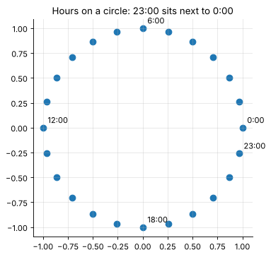

---

### 🛠️ Real-world example – a messy event log from 4 apps 🟡

```python
import numpy as np
import pandas as pd

events = pd.DataFrame({
    "event_id": range(1, 9),
    "raw_ts": ["2026-03-14 09:30:00", "2026-03-14T18:05:00Z", "14/03/2026 21:15",
               "March 15, 2026 7:00 PM", "1773568800", "2026-03-28 23:45:00",
               "2026-03-29 02:30:00", "not recorded"],
})
print(events)
```

**🖨️ Output:**

```text
   event_id                  raw_ts
0         1     2026-03-14 09:30:00
1         2    2026-03-14T18:05:00Z
2         3        14/03/2026 21:15
3         4  March 15, 2026 7:00 PM
4         5              1773568800
5         6     2026-03-28 23:45:00
6         7     2026-03-29 02:30:00
7         8            not recorded
```

#### 🔹 Step 1 – try each known format, one after another

```python
FORMATS = ["%Y-%m-%d %H:%M:%S", "%Y-%m-%dT%H:%M:%SZ", "%d/%m/%Y %H:%M", "%B %d, %Y %I:%M %p"]

def parse_timestamp(value):
    value = str(value).strip()
    if value.isdigit():                                    # only digits → Unix seconds
        return pd.to_datetime(int(value), unit="s")
    for fmt in FORMATS:
        try:                                               # try … except: "try this, and if it fails, don't crash"
            return pd.to_datetime(value, format=fmt)
        except ValueError:
            continue                                       # wrong format → try the next one
    return pd.NaT                                          # NaT = "Not a Time" (empty date)

events["ts_utc"] = events["raw_ts"].map(parse_timestamp).astype("datetime64[ns]").dt.tz_localize("UTC")
print(events)
```

**🖨️ Output:**

```text
   event_id                  raw_ts                    ts_utc
0         1     2026-03-14 09:30:00 2026-03-14 09:30:00+00:00
1         2    2026-03-14T18:05:00Z 2026-03-14 18:05:00+00:00
2         3        14/03/2026 21:15 2026-03-14 21:15:00+00:00
3         4  March 15, 2026 7:00 PM 2026-03-15 19:00:00+00:00
4         5              1773568800 2026-03-15 10:00:00+00:00
5         6     2026-03-28 23:45:00 2026-03-28 23:45:00+00:00
6         7     2026-03-29 02:30:00 2026-03-29 02:30:00+00:00
7         8            not recorded                       NaT
```

#### 🔹 Step 2 – the quick way: `format="mixed"` (pandas guesses per value) 🟡

```python
quick = pd.to_datetime(events["raw_ts"].where(~events["raw_ts"].str.isdigit()),
                       format="mixed", dayfirst=True, utc=True, errors="coerce")   # errors="coerce" → bad values become NaT
print(quick.tolist())
```

**🖨️ Output:**

```text
[Timestamp('2026-03-14 09:30:00+0000', tz='UTC'), Timestamp('2026-03-14 18:05:00+0000', tz='UTC'), Timestamp('2026-03-14
    21:15:00+0000', tz='UTC'), Timestamp('2026-03-15 19:00:00+0000', tz='UTC'), NaT, Timestamp('2026-03-28 23:45:00+0000',
    tz='UTC'), Timestamp('2026-03-29 02:30:00+0000', tz='UTC'), NaT]
```

> ⚠️ Guessing is risky for dates like 03/04/2026. Prefer explicit formats when you know them.

#### 🔹 Step 3 – local time and daylight saving

```python
events["ts_berlin"] = events["ts_utc"].dt.tz_convert("Europe/Berlin")
print(events[["raw_ts", "ts_utc", "ts_berlin"]])

impossible = pd.Series(pd.to_datetime(["2026-03-29 02:30:00"]))      # clocks jump from 02:00 to 03:00 that night
print(impossible.dt.tz_localize("Europe/Berlin", nonexistent="shift_forward"))
```

**🖨️ Output:**

```text
                   raw_ts                    ts_utc                 ts_berlin
0     2026-03-14 09:30:00 2026-03-14 09:30:00+00:00 2026-03-14 10:30:00+01:00
1    2026-03-14T18:05:00Z 2026-03-14 18:05:00+00:00 2026-03-14 19:05:00+01:00
2        14/03/2026 21:15 2026-03-14 21:15:00+00:00 2026-03-14 22:15:00+01:00
3  March 15, 2026 7:00 PM 2026-03-15 19:00:00+00:00 2026-03-15 20:00:00+01:00
4              1773568800 2026-03-15 10:00:00+00:00 2026-03-15 11:00:00+01:00
5     2026-03-28 23:45:00 2026-03-28 23:45:00+00:00 2026-03-29 00:45:00+01:00
6     2026-03-29 02:30:00 2026-03-29 02:30:00+00:00 2026-03-29 04:30:00+02:00
7            not recorded                       NaT                       NaT
0   2026-03-29 03:00:00+02:00
dtype: datetime64[us, Europe/Berlin]
```

#### 🔹 Step 4 – features from 3,000 taxi trips 🧾

```python
rng = np.random.default_rng(5)
trips = pd.DataFrame({"pickup_utc": pd.date_range("2026-03-01", periods=3_000, freq="37min", tz="UTC")})
trips["duration_min"] = rng.gamma(4, 5, len(trips)).round(1)
trips["dropoff_utc"] = trips["pickup_utc"] + pd.to_timedelta(trips["duration_min"], unit="min")

local = trips["pickup_utc"].dt.tz_convert("Europe/Berlin")
trips["hour"] = local.dt.hour
trips["day_of_week"] = local.dt.dayofweek
trips["is_weekend"] = trips["day_of_week"] >= 5
trips["is_rush_hour"] = trips["hour"].isin([7, 8, 9, 16, 17, 18])
trips["hour_sin"] = np.sin(2 * np.pi * trips["hour"] / 24)
trips["hour_cos"] = np.cos(2 * np.pi * trips["hour"] / 24)
print(trips.head())
```

**🖨️ Output:**

```text
                 pickup_utc  duration_min               dropoff_utc  hour  day_of_week  is_weekend  \
0 2026-03-01 00:00:00+00:00          11.7 2026-03-01 00:11:42+00:00     1            6        True
1 2026-03-01 00:37:00+00:00          16.1 2026-03-01 00:53:06+00:00     1            6        True
2 2026-03-01 01:14:00+00:00          31.5 2026-03-01 01:45:30+00:00     2            6        True
3 2026-03-01 01:51:00+00:00          13.5 2026-03-01 02:04:30+00:00     2            6        True
4 2026-03-01 02:28:00+00:00          26.5 2026-03-01 02:54:30+00:00     3            6        True

   is_rush_hour  hour_sin  hour_cos
0         False  0.258819  0.965926
1         False  0.258819  0.965926
2         False  0.500000  0.866025
3         False  0.500000  0.866025
4         False  0.707107  0.707107
```

#### 🔹 Step 5 – daily totals, last week's value, 7-day average 🟡
- `resample("D")` = group by day
- `shift(7)` = the value from 7 days earlier (a **lag**)
- `rolling(7)` = average of the last 7 days

```python
daily = (trips.set_index("pickup_utc")
              .resample("D")
              .agg(trips=("duration_min", "size"), avg_duration=("duration_min", "mean")))
daily["trips_last_week"] = daily["trips"].shift(7)
daily["trips_7day_avg"] = daily["trips"].rolling(7, min_periods=1).mean()
print(daily.head(10).round(1))

import matplotlib.pyplot as plt
daily["avg_duration"].plot(title="Average trip duration per day", ylabel="minutes")
plt.show()
```

**🖨️ Output:**

```text
                           trips  avg_duration  trips_last_week  trips_7day_avg
pickup_utc
2026-03-01 00:00:00+00:00     39          19.3              NaN            39.0
2026-03-02 00:00:00+00:00     39          19.9              NaN            39.0
2026-03-03 00:00:00+00:00     39          20.3              NaN            39.0
2026-03-04 00:00:00+00:00     39          20.9              NaN            39.0
2026-03-05 00:00:00+00:00     39          19.4              NaN            39.0
2026-03-06 00:00:00+00:00     39          21.8              NaN            39.0
2026-03-07 00:00:00+00:00     39          20.3              NaN            39.0
2026-03-08 00:00:00+00:00     39          19.7             39.0            39.0
2026-03-09 00:00:00+00:00     39          20.9             39.0            39.0
2026-03-10 00:00:00+00:00     39          20.3             39.0            39.0
```

**🖼️ What you will see:**

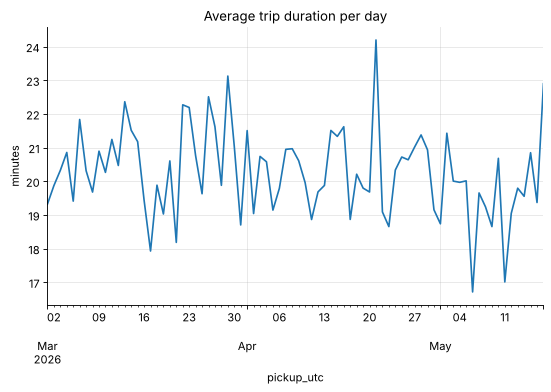

### ✅ How to validate dates

```python
checks = {
    "dates that could not be read": events["ts_utc"].isna().sum(),
    "dates in the future": (events["ts_utc"] > pd.Timestamp("2026-10-28", tz="UTC")).sum(),
    "dates before 2020": (events["ts_utc"] < pd.Timestamp("2020-01-01", tz="UTC")).sum(),
    "drop-off before pick-up": (trips["dropoff_utc"] <= trips["pickup_utc"]).sum(),
    "trips not in time order": int(not trips["pickup_utc"].is_monotonic_increasing),
}
for name, count in checks.items():
    print("✅" if count == 0 else "⚠️", name, ":", count)
print("Raw values to review:", events.loc[events["ts_utc"].isna(), "raw_ts"].tolist())
print("Has a time zone?", events["ts_utc"].dt.tz is not None)
```

**🖨️ Output:**

```text
⚠️ dates that could not be read : 1
✅ dates in the future : 0
✅ dates before 2020 : 0
✅ drop-off before pick-up : 0
✅ trips not in time order : 0
Raw values to review: ['not recorded']
Has a time zone? True
```

### ⏰ When to use
| Need | Technique |
|---|---|
| you know the format | `format=` – fast and safe |
| messy old exports | try-several-formats function (or `format="mixed"` + review NaT) |
| human behaviour (shopping, taxis) | convert to **local** time first |
| hour / weekday in linear models or neural nets | sin/cos encoding |
| forecasting | resample + lags + rolling averages |

### 📍 Where to use
- 🚕 Taxi demand · 🛒 seasonal sales · 🔐 strange login times · ⚡ electricity use · 🏥 days until a patient returns

### ⚠️ Common mistakes
| Mistake | Better |
|---|---|
| letting pandas guess 03/04 | give `format=` or `dayfirst=True` |
| mixing time zones | store in UTC, convert for features |
| using today's date to build features for old data | only use information known at that time |

### 🏋️ Practice
How many days between `"2026-01-01"` and `"2026-12-25"`? Which weekday is Christmas 2026?

<details><summary>👀 Show answer</summary>

```python
a, b = pd.to_datetime("2026-01-01"), pd.to_datetime("2026-12-25")
print((b - a).days, b.day_name())
```

**🖨️ Output:**

```text
358 Friday
```
</details>

### 🎓 Expert corner 🔴
- Use `pd.Timestamp(..., tz=...)`-aware data everywhere; naive + aware mixing raises errors (good!).
- Holidays matter: `pip install holidays` and add an `is_holiday` flag.
- For lags in ML, use `TimeSeriesSplit` with a `gap` so features never peek into the future (see 1.6).

### 🧪 Lab 1.3.9 – Pizza delivery times 🍕⏱️

**🎯 Goal:** parse mixed date formats, compute durations and extract features.

**🧾 Data** – run this cell first:

```python
import pandas as pd
deliveries = pd.DataFrame({
    "ordered": ["2026-05-01 18:05", "01/05/2026 19:40", "May 2, 2026 12:15 PM", "2026-05-02 20:55"],
    "delivered": ["2026-05-01 18:41", "01/05/2026 20:32", "May 2, 2026 12:44 PM", "2026-05-02 21:20"],
})
```

**📝 Your tasks**

1. Write `parse(value)` that tries the formats `%Y-%m-%d %H:%M`, `%d/%m/%Y %H:%M`, `%B %d, %Y %I:%M %p`.
2. Compute `minutes = delivered − ordered` in minutes.
3. Add `weekday` and `is_evening` (hour ≥ 18).
4. Self-check: minutes are `[36, 52, 29, 25]` and 3 orders are in the evening.

**🧩 Starter code** (replace every `...`)

```python
FORMATS = [...]
def parse(value):
    for fmt in FORMATS:
        try:
            return pd.to_datetime(value, format=fmt)
        except ValueError:
            pass
deliveries["ordered_t"] = deliveries["ordered"].map(parse)
```

<details><summary>💡 Hints</summary>

- `(b - a).dt.total_seconds() / 60`
- `.dt.day_name()`, `.dt.hour`

</details>

<details><summary>✅ Solution (try first!)</summary>

```python
FORMATS = ["%Y-%m-%d %H:%M", "%d/%m/%Y %H:%M", "%B %d, %Y %I:%M %p"]
def parse(value):
    for fmt in FORMATS:
        try:
            return pd.to_datetime(value, format=fmt)
        except ValueError:
            pass
    return pd.NaT

for col in ["ordered", "delivered"]:
    deliveries[col + "_t"] = deliveries[col].map(parse)
deliveries["minutes"] = ((deliveries["delivered_t"] - deliveries["ordered_t"]).dt.total_seconds() / 60).astype(int)
deliveries["weekday"] = deliveries["ordered_t"].dt.day_name()
deliveries["is_evening"] = deliveries["ordered_t"].dt.hour >= 18
print(deliveries[["ordered_t", "minutes", "weekday", "is_evening"]])
assert deliveries["minutes"].tolist() == [36, 52, 29, 25] and deliveries["is_evening"].sum() == 3
print("✅ Lab passed!")
```

**🖨️ Output:**

```text
            ordered_t  minutes   weekday  is_evening
0 2026-05-01 18:05:00       36    Friday        True
1 2026-05-01 19:40:00       52    Friday        True
2 2026-05-02 12:15:00       29  Saturday       False
3 2026-05-02 20:55:00       25  Saturday        True
✅ Lab passed!
```
</details>

### 🧠 Recap
- Parse with explicit formats → store in UTC → convert to local for behaviour → extract hour/weekday/month → sin/cos for cycles → lags & rolling for forecasting.

---

<a name="sec-1-3-10-handle-large-numbers"></a>
## 🔢 1.3.10 Handle Large Numbers

### 🍼 The story 🟢
Websites write big numbers for **humans**: "$1.2B", "850K", "3,400,000". A computer sees these as **text**, not numbers – it can't add them. Big numbers also cause sneaky problems: some number boxes are too **small** (overflow), long ID numbers get **rounded** by mistake, and one billionaire can dwarf everyone else.

### 📚 New words
| Word | Simple meaning |
|---|---|
| **K / M / B** | thousand / million / billion (1,000 / 1,000,000 / 1,000,000,000) |
| **parse** | turn text into a real number |
| **int32 / int64** | number boxes that hold up to ~2.1 billion / ~9.2 quintillion |
| **overflow** | the number is too big for its box and "wraps around" to nonsense |
| **float precision** | decimals can only store ~15–16 digits exactly |
| **downcast** | use a smaller box to save memory when numbers are small |
| **1e6** | scientific notation for 1 × 10⁶ = 1,000,000 |

### 🛠️ How to handle large numbers

#### 🔹 Example 1 – commas and dollar signs 🟢

```python
import pandas as pd

prices = pd.Series(["$1,250", "$980", "$12,400"])
clean = prices.str.replace("$", "", regex=False).str.replace(",", "", regex=False).astype(float)
print(clean.tolist(), "| total:", clean.sum())
```

**🖨️ Output:**

```text
[1250.0, 980.0, 12400.0] | total: 14630.0
```

#### 🔹 Example 2 – K, M and B 🟢

```python
MULTIPLIER = {"K": 1_000, "M": 1_000_000, "B": 1_000_000_000}     # _ in numbers is just for readability
values = pd.Series(["850K", "1.2M", "3.4B"])
number = values.str[:-1].astype(float)          # everything except the last character
letter = values.str[-1]                         # only the last character
print(pd.DataFrame({"raw": values, "number": number * letter.map(MULTIPLIER)}))
```

**🖨️ Output:**

```text
    raw        number
0  850K  8.500000e+05
1  1.2M  1.200000e+06
2  3.4B  3.400000e+09
```

#### 🔹 Example 3 – scientific notation 🟢

```python
print(float("1e6"), float("2.5e3"), 3.4e9)      # e6 = × 1,000,000
print("Readable:", f"{3.4e9:,.0f}")             # :,.0f = add commas, no decimals
```

**🖨️ Output:**

```text
1000000.0 2500.0 3400000000.0
Readable: 3,400,000,000
```

#### 🔹 Example 4 – overflow: the number box is too small ⚠️ 🟢

```python
import numpy as np

print("Biggest int32:", np.iinfo(np.int32).max)
views = np.array([2_000_000_000, 1_500_000_000], dtype=np.int32)
print("Sum in int32 (WRONG, wrapped around):", views.sum(dtype=np.int32))
print("Sum in int64 (correct):              ", views.astype(np.int64).sum())
```

**🖨️ Output:**

```text
Biggest int32: 2147483647
Sum in int32 (WRONG, wrapped around): -794967296
Sum in int64 (correct):               3500000000
```

#### 🔹 Example 5 – long IDs lose digits as decimals ⚠️ 🟢

```python
account = "9007199254740993"
print("As text :", account)
print("As float:", int(float(account)), "← last digit changed!")
```

**🖨️ Output:**

```text
As text : 9007199254740993
As float: 9007199254740992 ← last digit changed!
```

> 💡 Decimal numbers (floats) only keep about 16 digits exactly. **IDs, card numbers, phone numbers → always store as text.**

#### 🔹 Example 6 – huge differences → log scale 🟢

```python
followers = pd.Series([120, 3_500, 48_000, 900_000, 25_000_000])
print(pd.DataFrame({"followers": followers, "log10": np.log10(followers).round(2)}))
```

**🖨️ Output:**

```text
   followers  log10
0        120   2.08
1       3500   3.54
2      48000   4.68
3     900000   5.95
4   25000000   7.40
```

---

### 🛠️ Real-world example – a startup database scraped from the web 🟡

```python
import io
import re
import numpy as np
import pandas as pd

startups = pd.DataFrame({
    "company": ["NovaPay", "GreenGrid", "MediScan", "CloudNest", "AgriBot", "FinFlow", "EduSpark", "ShipFast"],
    "valuation": ["$1.2B", "850M", "$3,400,000", "2.5b", "1e9", "€12.75M", "N/A", "450K"],
    "users": ["12,500", "3.4M", "980k", "1,200,000", "75000", "2.1 million", "—", "15K"],
})
print(startups)
```

**🖨️ Output:**

```text
     company   valuation        users
0    NovaPay       $1.2B       12,500
1  GreenGrid        850M         3.4M
2   MediScan  $3,400,000         980k
3  CloudNest        2.5b    1,200,000
4    AgriBot         1e9        75000
5    FinFlow     €12.75M  2.1 million
6   EduSpark         N/A            —
7   ShipFast        450K          15K
```

#### 🔹 Step 1 – a parser for every human style
The regex reads: optional currency sign, a number (maybe with decimals or e-notation), optional spaces, optional word/letter suffix.

```python
SUFFIX = {"": 1, "k": 1e3, "thousand": 1e3, "m": 1e6, "million": 1e6, "b": 1e9, "billion": 1e9, "t": 1e12}
PATTERN = re.compile(r"^[\$€£]?\s*(\d+(?:\.\d+)?(?:e[+-]?\d+)?)\s*([a-z]*)$")

def parse_big_number(value):
    if pd.isna(value):
        return np.nan
    text = str(value).strip().lower().replace(",", "")
    match = PATTERN.match(text)
    if not match or match.group(2) not in SUFFIX:      # group(1) = the number, group(2) = the suffix
        return np.nan
    return float(match.group(1)) * SUFFIX[match.group(2)]

startups["valuation_num"] = startups["valuation"].map(parse_big_number)   # note: € is not converted to $ here
startups["users_num"] = startups["users"].map(parse_big_number).astype("Int64")
print(startups)
```

**🖨️ Output:**

```text
     company   valuation        users  valuation_num  users_num
0    NovaPay       $1.2B       12,500   1.200000e+09      12500
1  GreenGrid        850M         3.4M   8.500000e+08    3400000
2   MediScan  $3,400,000         980k   3.400000e+06     980000
3  CloudNest        2.5b    1,200,000   2.500000e+09    1200000
4    AgriBot         1e9        75000   1.000000e+09      75000
5    FinFlow     €12.75M  2.1 million   1.275000e+07    2100000
6   EduSpark         N/A            —            NaN       <NA>
7   ShipFast        450K          15K   4.500000e+05      15000
```

#### 🔹 Step 2 – read ID columns as text from files

```python
csv = "account_number,balance\n9007199254740993,10.5\n1234567890123456789,99.0\n"
wrong = pd.read_csv(io.StringIO(csv), dtype={"account_number": float})
right = pd.read_csv(io.StringIO(csv), dtype={"account_number": "string"})
print("As float:", int(wrong["account_number"][0]), "| as text:", right["account_number"][0])
```

**🖨️ Output:**

```text
As float: 9007199254740992 | as text: 9007199254740993
```

#### 🔹 Step 3 – save memory on a big table (1 million rows) 🟡

```python
rng = np.random.default_rng(0)
big = pd.DataFrame({
    "store_id": rng.integers(1, 500, 1_000_000),
    "units": rng.integers(0, 200, 1_000_000),
    "revenue": rng.random(1_000_000) * 1_000,
})
before_mb = big.memory_usage(deep=True).sum() / 1e6
small = big.assign(
    store_id=pd.to_numeric(big["store_id"], downcast="unsigned"),   # unsigned = no negative numbers needed
    units=pd.to_numeric(big["units"], downcast="unsigned"),
    revenue=pd.to_numeric(big["revenue"], downcast="float"),
)
after_mb = small.memory_usage(deep=True).sum() / 1e6
print("Memory:", round(before_mb, 1), "MB →", round(after_mb, 1), "MB")
print(small.dtypes)
```

**🖨️ Output:**

```text
Memory: 24.0 MB → 7.0 MB
store_id     uint16
units         uint8
revenue     float32
dtype: object
```

#### 🔹 Step 4 – log for models, pretty text for reports

```python
startups["log10_valuation"] = np.log10(startups["valuation_num"])

def human(n):
    for unit, size in [("T", 1e12), ("B", 1e9), ("M", 1e6), ("K", 1e3)]:
        if abs(n) >= size:
            return str(round(n / size, 1)) + unit
    return str(round(n))

startups["valuation_pretty"] = startups["valuation_num"].map(lambda v: human(v) if pd.notna(v) else "–")
print(startups[["company", "valuation_num", "log10_valuation", "valuation_pretty"]])
```

**🖨️ Output:**

```text
     company  valuation_num  log10_valuation valuation_pretty
0    NovaPay   1.200000e+09         9.079181             1.2B
1  GreenGrid   8.500000e+08         8.929419           850.0M
2   MediScan   3.400000e+06         6.531479             3.4M
3  CloudNest   2.500000e+09         9.397940             2.5B
4    AgriBot   1.000000e+09         9.000000             1.0B
5    FinFlow   1.275000e+07         7.105510            12.8M
6   EduSpark            NaN              NaN                –
7   ShipFast   4.500000e+05         5.653213           450.0K
```

### ✅ How to validate large numbers

```python
missing_tokens = {"n/a", "—", ""}
unparsed = startups.loc[startups["valuation_num"].isna() & ~startups["valuation"].str.lower().isin(missing_tokens), "valuation"]
print("Unparsed values:", unparsed.tolist() or "none ✅")

print("Known answers correct?", parse_big_number("$1.2B") == 1.2e9 and parse_big_number("980k") == 980_000)
print("Downcast kept the values?", (small["units"].astype("int64") == big["units"]).all()
      and np.allclose(small["revenue"], big["revenue"], rtol=1e-6))
print("Biggest store_id fits its box?", small["store_id"].max() <= np.iinfo(small["store_id"].dtype).max)
```

**🖨️ Output:**

```text
Unparsed values: none ✅
Known answers correct? True
Downcast kept the values? True
Biggest store_id fits its box? True
```

### ⏰ When to use
| Problem | Fix |
|---|---|
| "1.2M", "$3,400" | a parser with a suffix table |
| IDs, card numbers, phones | `dtype="string"` |
| adding up big counts | `int64` (money: `Decimal` or cents as int64) |
| memory errors | downcast, categories, Parquet files |
| values from 10 to 10,000,000 | log10 / log1p (see 0.5 and the Log technique) |

### 📍 Where to use
- 💰 Company valuations, transaction volumes · 📱 app installs, views · 🧬 gene read counts · 🌐 bytes transferred

### ⚠️ Common mistakes
| Mistake | Better |
|---|---|
| reading IDs as numbers | read as text |
| summing in int32 | use int64 |
| comparing "$1.2B" with "850M" as text | parse first |

### 🏋️ Practice
Parse `["2.5K", "$7M", "300"]` with `parse_big_number` and add them up.

<details><summary>👀 Show answer</summary>

```python
vals = [parse_big_number(v) for v in ["2.5K", "$7M", "300"]]
print(vals, sum(vals))
```

**🖨️ Output:**

```text
[2500.0, 7000000.0, 300.0] 7002800.0
```
</details>

### 🎓 Expert corner 🔴
- Money: never use floats for accounting sums; use integer cents or `decimal.Decimal`.
- Convert currencies with a dated exchange-rate table, not a fixed number.

```python
from decimal import Decimal
print("float :", 0.1 + 0.2)
print("Decimal:", Decimal("0.1") + Decimal("0.2"))
```

**🖨️ Output:**

```text
float : 0.30000000000000004
Decimal: 0.3
```

### 🧪 Lab 1.3.10 – Football transfer fees ⚽

**🎯 Goal:** turn human-readable money text into numbers and summarise them.

**🧾 Data** – run this cell first:

```python
import pandas as pd
transfers = pd.DataFrame({"player": ["A", "B", "C", "D", "E", "F"],
                          "fee": ["€120M", "€85.5m", "€1.2B", "€900K", "free", "€45,000,000"]})
```

**📝 Your tasks**

1. Write `parse_fee(text)` that returns a number in euros, and 0 for `free`.
2. Add `fee_eur` and `fee_pretty` (like `120.0M`).
3. Self-check: the total is 1,451,400,000 € and player C's fee is 1,200,000,000.

**🧩 Starter code** (replace every `...`)

```python
import re
def parse_fee(text):
    ...
transfers["fee_eur"] = transfers["fee"].map(parse_fee)
```

<details><summary>💡 Hints</summary>

- Remove `€` and `,`, lowercase, then match number + optional `k/m/b`.
- Multiply by `{"": 1, "k": 1e3, "m": 1e6, "b": 1e9}`.

</details>

<details><summary>✅ Solution (try first!)</summary>

```python
import re
MULT = {"": 1, "k": 1e3, "m": 1e6, "b": 1e9}
def parse_fee(text):
    t = text.lower().replace("€", "").replace(",", "").strip()
    if t == "free":
        return 0.0
    m = re.fullmatch(r"(\d+(?:\.\d+)?)\s*([kmb]?)", t)
    return float(m.group(1)) * MULT[m.group(2)]

def pretty(n):
    for unit, size in [("B", 1e9), ("M", 1e6), ("K", 1e3)]:
        if n >= size:
            return str(round(n / size, 1)) + unit
    return str(int(n))

transfers["fee_eur"] = transfers["fee"].map(parse_fee)
transfers["fee_pretty"] = transfers["fee_eur"].map(pretty)
print(transfers, "\nTotal:", f"{transfers['fee_eur'].sum():,.0f} €")
assert transfers["fee_eur"].sum() == 1_451_400_000 and transfers.loc[2, "fee_eur"] == 1.2e9
print("✅ Lab passed!")
```

**🖨️ Output:**

```text
  player          fee       fee_eur fee_pretty
0      A        €120M  1.200000e+08     120.0M
1      B       €85.5m  8.550000e+07      85.5M
2      C        €1.2B  1.200000e+09       1.2B
3      D        €900K  9.000000e+05     900.0K
4      E         free  0.000000e+00          0
5      F  €45,000,000  4.500000e+07      45.0M
Total: 1,451,400,000 €
✅ Lab passed!
```
</details>

### 🧠 Recap
- Parse human text into numbers, keep IDs as text, use big-enough number types, log-scale huge ranges.

---

<a name="sec-data-types-issues-preprocessing-techniques"></a>
## 🧬 Data Types, Issues & Preprocessing Techniques

### 🍼 The story 🟢
Different kinds of data get dirty in different ways – like different clothes need different washing programmes 🧺. This table is your **washing guide**.

| 🧬 Data type | Example | ⚠️ Typical problems | 🛠️ Fix with | 📖 Chapter |
|---|---|---|---|:---:|
| 🔢 Continuous number | income, temperature | holes, outliers, lopsided, different scales | fill, IQR/MAD, log/power, scale | 1.3.1, 1.3.4, 1.3.5, below |
| 🔟 Count (whole number) | children, visits | outliers, many zeros | cap, log1p, binning | 1.3.4, below |
| 🏷️ Category without order | brand, city | spelling variants, rare & new values, too many | map, group rare, one-hot / target | 1.3.3, 1.3.6 |
| 📶 Category with order | S < M < L | stored as text, wrong order | ordinal encoder with order | 1.3.6 |
| ✅ Yes/No | active? | many spellings, unknown | mapping, `boolean` type | 1.3.8 |
| 📅 Date/time | timestamps | many formats, time zones | parse, UTC, features, sin/cos | 1.3.9 |
| 📝 Text | reviews | HTML, links, noise | clean, stop words, TF-IDF | 1.3.7 |
| 🆔 ID | customer_id | read as number, duplicates | text type, de-duplicate, **never a feature** | 1.3.2, 1.3.10 |
| 💰 Big number | "$1.2B" | text, overflow, precision | parse, int64, log10 | 1.3.10 |
| 🖼️ Image | pixels 0–255 | scale, size | ÷255, resize | 2.8 |

---

<a name="sec-data-8-scaling-transformation-techniques"></a>
## ⚖️ Data – 8 Scaling & Transformation Techniques

### 🍼 The story 🟢
In 1.3.5 we met two rulers (Min-Max and Z-score). Real data needs a **toolbox** of 8 rulers 🧰, because data comes in different shapes: balanced, lopsided, with outliers, with curves.

| # | Technique | One-line idea | Picture in your head |
|:-:|---|---|---|
| 1 | Min-Max | squeeze into 0…1 | a percentage bar |
| 2 | Z-score | average 0, spread 1 | "how unusual?" |
| 3 | Log | squeeze huge numbers | the log ruler |
| 4 | Robust | like Z-score but ignores outliers | median + IQR |
| 5 | Power (Box-Cox / Yeo-Johnson) | bend data into a bell shape | automatic log-like bend |
| 6 | Quantile | replace values by their rank | race positions 1st, 2nd … |
| 7 | Binning | numbers → groups | age bands 18–24, 25–34 … |
| 8 | Polynomial | add x², x·y | let straight lines bend |

### 🧾 The shared dataset – 3,000 shop customers (just run this cell)
Each column has a different shape on purpose: `age` balanced, `annual_income` lopsided, `sessions_per_month` counts, `basket_value` lopsided **plus** 15 big-spending VIPs ("whales" 🐳), `days_since_last_purchase` with many small values and zeros.

```python
import numpy as np
import pandas as pd
import matplotlib.pyplot as plt
from scipy.stats import skew
from sklearn.model_selection import train_test_split

rng = np.random.default_rng(10)
n = 3_000
shop = pd.DataFrame({
    "age": rng.normal(38, 11, n).clip(18, 80).round(),
    "annual_income": rng.lognormal(10.8, 0.55, n).round(-2),
    "sessions_per_month": rng.poisson(6, n),
    "basket_value": rng.gamma(2.2, 30, n).round(2),
    "days_since_last_purchase": rng.exponential(25, n).round(),
})
whales = rng.choice(n, 15, replace=False)
shop.loc[whales, "basket_value"] *= 25                     # VIP outliers
chance = 1 / (1 + np.exp(-(-1.2 + 0.04 * shop.days_since_last_purchase - 0.25 * shop.sessions_per_month
                           + 0.00001 * shop.annual_income)))
shop["churned"] = (rng.random(n) < chance).astype(int)      # did the customer leave?

features = list(shop.columns.drop("churned"))
train, test = train_test_split(shop, test_size=0.25, random_state=0, stratify=shop["churned"])
print(train[features].describe().round(1))
print("\nSkew (0 = balanced, > 1 = very lopsided):")
print(train[features].apply(skew).round(2))
```

**🖨️ Output:**

```text
          age  annual_income  sessions_per_month  basket_value  days_since_last_purchase
count  2250.0         2250.0              2250.0        2250.0                    2250.0
mean     37.6        56996.3                 6.0          72.1                      24.4
std      10.5        34742.4                 2.4         116.0                      24.1
min      18.0         7200.0                 0.0           1.3                       0.0
25%      30.0        33825.0                 4.0          33.6                       7.0
50%      37.0        48550.0                 6.0          56.2                      16.0
75%      44.0        71275.0                 8.0          89.5                      34.0
max      71.0       368800.0                15.0        3824.8                     185.0

Skew (0 = balanced, > 1 = very lopsided):
age                          0.18
annual_income                2.37
sessions_per_month           0.42
basket_value                20.27
days_since_last_purchase     1.69
dtype: float64
```

#### 🖼️ Look at the shapes first

```python
fig, axes = plt.subplots(1, 5, figsize=(16, 3))
for ax, col in zip(axes, features):
    ax.hist(train[col], bins=40, color="#4C8BF5")
    ax.set_title(col, fontsize=10)
plt.show()
```

**🖼️ What you will see:**

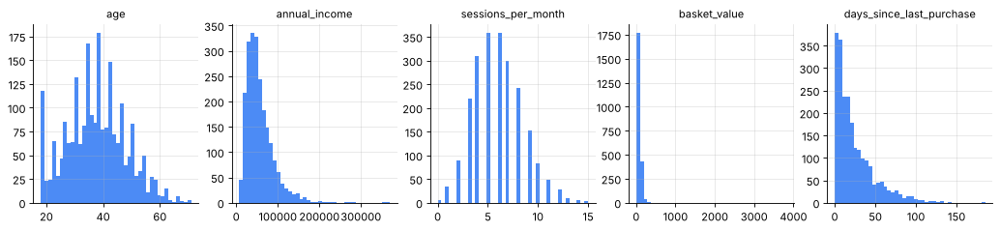

---

### 1️⃣ Min-Max Scaling (Normalization)

> 🍼 **Story:** turn every value into a **percentage of the way** from the smallest to the biggest. Smallest → 0, biggest → 1.
> 📐 **Formula:** `(x − min) / (max − min)`

#### 🛠️ Tiny example

```python
ages = pd.Series([18, 30, 45, 80])
print(((ages - ages.min()) / (ages.max() - ages.min())).round(3).tolist())
```

**🖨️ Output:**

```text
[0.0, 0.194, 0.435, 1.0]
```

#### 🛠️ With scikit-learn on the shop data

```python
from sklearn.preprocessing import MinMaxScaler

mm = MinMaxScaler().set_output(transform="pandas")
train_mm = mm.fit_transform(train[["age", "sessions_per_month"]])     # learn min/max on TRAIN
test_mm = mm.transform(test[["age", "sessions_per_month"]])           # reuse them on TEST
print(train_mm.describe().loc[["min", "max"]])
```

**🖨️ Output:**

```text
     age  sessions_per_month
min  0.0                 0.0
max  1.0                 1.0
```

#### ⚠️ Why outliers break Min-Max

```python
basket_mm = MinMaxScaler().fit_transform(train[["basket_value"]]).ravel()
print("Share of customers squeezed below 0.05:", round((basket_mm < 0.05).mean(), 3))
```

**🖨️ Output:**

```text
Share of customers squeezed below 0.05: 0.976
```

> 💡 Because a few whales define the maximum, almost everybody else is squeezed into a tiny corner near 0.

#### ✅ How to validate

```python
print("Train min all 0?", train_mm.min().eq(0).all(), "| Train max all 1?", train_mm.max().eq(1).all())
print("Test values outside 0…1:", ((test_mm < 0) | (test_mm > 1)).sum().to_dict())
```

**🖨️ Output:**

```text
Train min all 0? True | Train max all 1? True
Test values outside 0…1: {'age': 1, 'sessions_per_month': 1}
```

| ⏰ When | 📍 Where | 🚫 Avoid when |
|---|---|---|
| values have natural limits, no big outliers; neural nets, KNN | 🖼️ pixels, 🎚️ percentages, ⭐ ratings 1–5 | outliers present |

---

### 2️⃣ Z-Score Standardization (Standardization)

> 🍼 **Story:** "how many steps (standard deviations) away from average are you?" Average → 0.
> 📐 **Formula:** `(x − mean) / std`

#### 🛠️ Tiny example

```python
scores = pd.Series([50, 60, 70, 80, 90])
print(((scores - scores.mean()) / scores.std(ddof=0)).round(2).tolist())
```

**🖨️ Output:**

```text
[-1.41, -0.71, 0.0, 0.71, 1.41]
```

#### 🛠️ With scikit-learn

```python
from sklearn.preprocessing import StandardScaler

std = StandardScaler().set_output(transform="pandas")
train_std = std.fit_transform(train[features])
test_std = std.transform(test[features])
print(pd.DataFrame({"learned mean": std.mean_, "learned std": std.scale_}, index=features).round(2))
```

**🖨️ Output:**

```text
                          learned mean  learned std
age                              37.56        10.48
annual_income                 56996.27     34734.70
sessions_per_month                5.97         2.44
basket_value                     72.05       116.01
days_since_last_purchase         24.37        24.13
```

#### ✅ How to validate

```python
print(train_std.agg(["mean", "std"]).round(3))
inside = (train_std["basket_value"].abs() < 1).mean()
print("basket_value within ±1 std:", round(inside * 100), "% (a bell shape would give ~68 %)")
```

**🖨️ Output:**

```text
      age  annual_income  sessions_per_month  basket_value  days_since_last_purchase
mean  0.0           -0.0                 0.0           0.0                      -0.0
std   1.0            1.0                 1.0           1.0                       1.0
basket_value within ±1 std: 97 % (a bell shape would give ~68 %)
```

> 💡 About 97 % instead of 68 % → the whales stretched the std, so the z-score works poorly for `basket_value`. Better: Log, Robust or Power.

| ⏰ When | 📍 Where | 🚫 Avoid when |
|---|---|---|
| roughly balanced data; default for linear models, SVM, PCA | 🩺 body measurements, 🍷 chemistry | heavy outliers / very lopsided |

---

### 3️⃣ Log Transformation (Log Scaling)

> 🍼 **Story:** the log ruler turns ×10 steps into +1 steps, so 100 and 1,000,000 become 2 and 6. Great for lopsided data like incomes.
> 📐 **Formula:** `log(1 + x)` (the "+1" makes 0 safe)

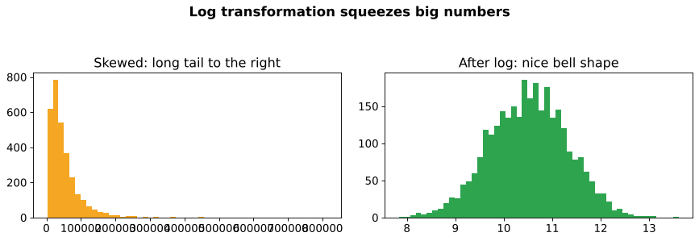

#### 🛠️ Tiny example

```python
values = pd.Series([0, 9, 99, 999, 9999])
print(np.log1p(values).round(2).tolist())
```

**🖨️ Output:**

```text
[0.0, 2.3, 4.61, 6.91, 9.21]
```

#### 🛠️ With scikit-learn (reversible)

```python
from sklearn.preprocessing import FunctionTransformer

log_cols = ["annual_income", "basket_value", "days_since_last_purchase"]
log_tf = FunctionTransformer(np.log1p, inverse_func=np.expm1, feature_names_out="one-to-one")
train_log = log_tf.set_output(transform="pandas").fit_transform(train[log_cols])
print(train_log.head().round(2))
```

**🖨️ Output:**

```text
      annual_income  basket_value  days_since_last_purchase
930           10.89          3.34                      3.91
2177          10.83          4.15                      2.64
350            9.78          3.96                      0.69
506           11.05          4.23                      3.71
875           11.27          3.10                      1.95
```

#### 🖼️ Before vs after

```python
fig, axes = plt.subplots(1, 2, figsize=(10, 3.2))
axes[0].hist(train["annual_income"], bins=50, color="#F5A623"); axes[0].set_title("income – lopsided")
axes[1].hist(train_log["annual_income"], bins=50, color="#2EA44F"); axes[1].set_title("log(income) – bell shape")
plt.show()
```

**🖼️ What you will see:**

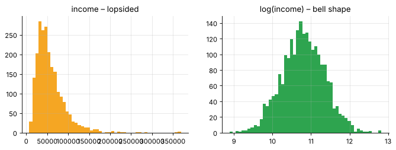

#### ✅ How to validate

```python
print(pd.DataFrame({"skew before": train[log_cols].apply(skew), "skew after": train_log.apply(skew)}).round(2))
print("Reversible?", np.allclose(log_tf.inverse_transform(train_log), train[log_cols]))
print("No negative inputs?", (train[log_cols] >= 0).all().all())
```

**🖨️ Output:**

```text
                          skew before  skew after
annual_income                    2.37        0.02
basket_value                    20.27       -0.22
days_since_last_purchase         1.69       -0.42
Reversible? True
No negative inputs? True
```

| ⏰ When | 📍 Where | 🚫 Avoid when |
|---|---|---|
| positive, lopsided data spanning big ranges | 💰 income, prices · 📱 installs · 🌐 page views | negative values (use Yeo-Johnson) |

---

### 4️⃣ Robust Scaling (Median & IQR Scaling)

> 🍼 **Story:** like the z-score, but uses the **median** and **IQR** – the whales can't push those around.
> 📐 **Formula:** `(x − median) / IQR`

#### 🛠️ Tiny example

```python
spend = pd.Series([20, 25, 30, 35, 40, 5000])           # one whale
q1, med, q3 = spend.quantile([0.25, 0.5, 0.75])
print("robust:", ((spend - med) / (q3 - q1)).round(2).tolist())
print("z-score:", ((spend - spend.mean()) / spend.std(ddof=0)).round(2).tolist())
```

**🖨️ Output:**

```text
robust: [-1.0, -0.6, -0.2, 0.2, 0.6, 397.4]
z-score: [-0.45, -0.45, -0.45, -0.44, -0.44, 2.24]
```

> 💡 With the z-score, all normal customers become almost the same number (~ −0.45). With robust scaling they stay nicely spread out.

#### 🛠️ With scikit-learn

```python
from sklearn.preprocessing import RobustScaler

rob = RobustScaler().set_output(transform="pandas")
train_rob = rob.fit_transform(train[["basket_value"]])
print(train_rob.describe().round(2).T)
```

**🖨️ Output:**

```text
               count  mean   std   min  25%  50%  75%    max
basket_value  2250.0  0.28  2.07 -0.98 -0.4 -0.0  0.6  67.32
```

#### ✅ How to validate

```python
typical = train["basket_value"] < train["basket_value"].quantile(0.95)     # everyone except the top 5 %
print("Spread of normal customers – z-score:", round(train_std.loc[typical, "basket_value"].std(), 2),
      "| robust:", round(train_rob.loc[typical, "basket_value"].std(), 2))
print("Median after robust scaling:", round(train_rob["basket_value"].median(), 3))
```

**🖨️ Output:**

```text
Spread of normal customers – z-score: 0.31 | robust: 0.64
Median after robust scaling: -0.0
```

| ⏰ When | 📍 Where | 🚫 Avoid when |
|---|---|---|
| real outliers you must keep | 🐳 VIP spending · 🏭 sensor spikes · 💳 transaction amounts | you need a fixed 0…1 range |

---

### 5️⃣ Power Transformations (Box-Cox & Yeo-Johnson)

> 🍼 **Story:** an automatic "bender" that tries many bends (like square root, log …) and picks the one that makes your data look most like a bell.
> - **Box-Cox:** only for values > 0
> - **Yeo-Johnson:** also works with 0 and negative values
> The chosen bend strength is called **lambda (λ)**: λ = 1 means "no bend", λ = 0 is like log.

#### 🛠️ Tiny example

```python
from sklearn.preprocessing import PowerTransformer

tiny = pd.DataFrame({"x": [1, 2, 3, 5, 8, 13, 21, 34, 55, 89]})
pt = PowerTransformer(method="box-cox")
print("bent values:", pt.fit_transform(tiny).ravel().round(2).tolist())
print("chosen lambda:", pt.lambdas_.round(2))
```

**🖨️ Output:**

```text
bent values: [-1.62, -1.15, -0.87, -0.51, -0.18, 0.17, 0.51, 0.86, 1.22, 1.57]
chosen lambda: [0.02]
```

#### 🛠️ On the shop data

```python
boxcox = PowerTransformer(method="box-cox").set_output(transform="pandas")
train_bc = boxcox.fit_transform(train[["annual_income", "basket_value"]])              # all > 0
yeo = PowerTransformer(method="yeo-johnson").set_output(transform="pandas")
train_yj = yeo.fit_transform(train[["days_since_last_purchase", "sessions_per_month"]])   # contains zeros
print("Box-Cox λ:", dict(zip(boxcox.feature_names_in_, boxcox.lambdas_.round(3).tolist())))
print("Yeo-Johnson λ:", dict(zip(yeo.feature_names_in_, yeo.lambdas_.round(3).tolist())))
```

**🖨️ Output:**

```text
Box-Cox λ: {'annual_income': -0.009, 'basket_value': 0.086}
Yeo-Johnson λ: {'days_since_last_purchase': 0.167, 'sessions_per_month': 0.603}
```

#### ✅ How to validate

```python
for col, before, after in [("annual_income", train["annual_income"], train_bc["annual_income"]),
                           ("days_since_last_purchase", train["days_since_last_purchase"],
                            train_yj["days_since_last_purchase"])]:
    print(col, "→ skew", round(skew(before), 2), "→", round(skew(after), 2))
```

**🖨️ Output:**

```text
annual_income → skew 2.37 → -0.0
days_since_last_purchase → skew 1.69 → -0.04
```

| ⏰ When | 📍 Where | 🚫 Avoid when |
|---|---|---|
| models that like bell shapes (linear regression, LDA); log isn't enough | 💰 insurance claims · ⏱️ waiting times · 🧪 lab results | tree models (no need) |

---

### 6️⃣ Quantile Transformation (Rank Scaling)

> 🍼 **Story:** like a race 🏃 – it doesn't matter **how much** faster you were, only your **position**. Each value is replaced by its rank, then spread evenly (uniform) or into a bell (normal).

#### 🛠️ Tiny example

```python
race_times = pd.Series([10.1, 10.3, 10.4, 12.0, 30.0])
print("rank as 0…1:", race_times.rank(pct=True).tolist())      # the 30.0 is just "last", not "way out"
```

**🖨️ Output:**

```text
rank as 0…1: [0.2, 0.4, 0.6, 0.8, 1.0]
```

#### 🛠️ With scikit-learn

```python
from sklearn.preprocessing import QuantileTransformer

qt_uniform = QuantileTransformer(n_quantiles=1000, output_distribution="uniform", random_state=0)
qt_normal = QuantileTransformer(n_quantiles=1000, output_distribution="normal", random_state=0)
basket_uniform = qt_uniform.fit_transform(train[["basket_value"]]).ravel()
basket_normal = qt_normal.fit_transform(train[["basket_value"]]).ravel()

fig, axes = plt.subplots(1, 3, figsize=(13, 3))
axes[0].hist(train["basket_value"], bins=50); axes[0].set_title("original (whales far right)")
axes[1].hist(basket_uniform, bins=50, color="#F5A623"); axes[1].set_title("quantile → uniform (flat)")
axes[2].hist(basket_normal, bins=50, color="#2EA44F"); axes[2].set_title("quantile → normal (bell)")
plt.show()
```

**🖼️ What you will see:**

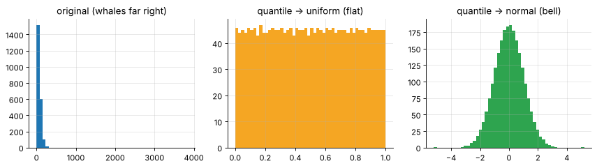

#### ✅ How to validate

```python
from scipy.stats import kstest

print("Distance from a perfect flat shape:", round(kstest(basket_uniform, "uniform").statistic, 4), "(0 = perfect)")
print("Biggest value after normal mapping:", round(basket_normal.max(), 2), "(whales tamed)")
print("Order kept?", pd.Series(train["basket_value"].to_numpy()).rank().corr(pd.Series(basket_uniform).rank()) > 0.999)
```

**🖨️ Output:**

```text
Distance from a perfect flat shape: 0.0013 (0 = perfect)
Biggest value after normal mapping: 5.2 (whales tamed)
Order kept? True
```

| ⏰ When | 📍 Where | 🚫 Avoid when |
|---|---|---|
| weird shapes + heavy outliers; rank is what matters | 🏆 credit scores · 📊 survey percentiles · 🧬 gene expression | distances matter (it changes them) |

---

### 7️⃣ Binning (Discretization)

> 🍼 **Story:** put numbers into **boxes** – like shoe sizes or age groups. You lose detail but gain simplicity, and the model can learn "steps".
> - `pd.cut` → boxes of the edges **you** choose (or equal width)
> - `pd.qcut` → boxes with the **same number of people** each

#### 🛠️ Tiny example

```python
ages = pd.Series([5, 15, 22, 37, 45, 68, 81])
print(pd.DataFrame({
    "age": ages,
    "my_groups": pd.cut(ages, bins=[0, 12, 19, 64, 120], labels=["child", "teen", "adult", "senior"]),
    "equal_count": pd.qcut(ages, q=3, labels=["young", "middle", "old"]),
}))
```

**🖨️ Output:**

```text
   age my_groups equal_count
0    5     child       young
1   15      teen       young
2   22     adult       young
3   37     adult      middle
4   45     adult      middle
5   68    senior         old
6   81    senior         old
```

#### 🛠️ On the shop data

```python
from sklearn.preprocessing import KBinsDiscretizer

shop["age_group"] = pd.cut(shop["age"], bins=[17, 24, 34, 44, 54, 64, 80],
                           labels=["18-24", "25-34", "35-44", "45-54", "55-64", "65+"])
shop["income_quintile"] = pd.qcut(shop["annual_income"], q=5, labels=["Q1", "Q2", "Q3", "Q4", "Q5"])
shop["recency_bucket"] = pd.cut(shop["days_since_last_purchase"], bins=[-1, 7, 30, 90, np.inf],
                                labels=["≤1 week", "≤1 month", "≤3 months", ">3 months"])   # np.inf = infinity

kbins = KBinsDiscretizer(n_bins=4, encode="onehot-dense", strategy="uniform")   # 4 equal-width boxes as 0/1 columns
age_onehot = kbins.fit_transform(shop[["age"]])
print("Box edges:", kbins.bin_edges_[0].round(1), "| one-hot shape:", age_onehot.shape)
```

**🖨️ Output:**

```text
Box edges: [18.  32.5 47.  61.5 76. ] | one-hot shape: (3000, 4)
```

#### ✅ How to validate

```python
for col in ["age_group", "income_quintile", "recency_bucket"]:
    print(col, "– values outside all boxes:", shop[col].isna().sum())
print(shop["income_quintile"].value_counts().sort_index().to_dict(), "← qcut → equal sizes")
print(shop.groupby("recency_bucket", observed=True)["churned"].mean().round(3), "← churn rises with time away")
```

**🖨️ Output:**

```text
age_group – values outside all boxes: 0
income_quintile – values outside all boxes: 0
recency_bucket – values outside all boxes: 0
{'Q1': 601, 'Q2': 602, 'Q3': 597, 'Q4': 602, 'Q5': 598} ← qcut → equal sizes
recency_bucket
≤1 week      0.146
≤1 month     0.205
≤3 months    0.461
>3 months    0.875
Name: churned, dtype: float64 ← churn rises with time away
```

| ⏰ When | 📍 Where | 🚫 Avoid when |
|---|---|---|
| step-like effects, explainable scorecards, noisy numbers | 🏦 credit scorecards · 📣 RFM marketing · 🏥 age bands | you have little data (many boxes = few people per box) |

---

### 8️⃣ Polynomial Features (Feature Expansion)

> 🍼 **Story:** a straight line can't follow a curve. If we add **x²** (and x·y …) as extra columns, a "straight-line" model can suddenly draw curves.

#### 🛠️ Tiny example

```python
from sklearn.preprocessing import PolynomialFeatures

tiny = pd.DataFrame({"x": [1, 2, 3], "y": [10, 20, 30]})
poly = PolynomialFeatures(degree=2, include_bias=False).set_output(transform="pandas")
print(poly.fit_transform(tiny))           # x, y, x², x·y, y²
```

**🖨️ Output:**

```text
     x     y  x^2   x y    y^2
0  1.0  10.0  1.0  10.0  100.0
1  2.0  20.0  4.0  40.0  400.0
2  3.0  30.0  9.0  90.0  900.0
```

#### 🛠️ Real example – fuel use is U-shaped in speed 🚗 🧾
Driving very slowly or very fast both use more fuel; ~75 km/h is the sweet spot.

```python
from sklearn.linear_model import LinearRegression, Ridge
from sklearn.pipeline import make_pipeline
from sklearn.preprocessing import StandardScaler

rng_car = np.random.default_rng(1)
speed = rng_car.uniform(20, 140, 400)
fuel = pd.DataFrame({"speed_kmh": speed, "load_kg": rng_car.uniform(0, 500, 400)})
fuel["l_per_100km"] = 5 + 0.0012 * (speed - 75) ** 2 + 0.000004 * fuel.load_kg * speed + rng_car.normal(0, 0.3, 400)

straight = LinearRegression().fit(fuel[["speed_kmh"]], fuel["l_per_100km"])
curved = make_pipeline(PolynomialFeatures(2, include_bias=False), LinearRegression()).fit(fuel[["speed_kmh"]], fuel["l_per_100km"])

grid = pd.DataFrame({"speed_kmh": np.linspace(20, 140, 100)})
plt.scatter(fuel["speed_kmh"], fuel["l_per_100km"], s=8, alpha=0.4, label="real trips")
plt.plot(grid["speed_kmh"], straight.predict(grid), color="#E5484D", lw=3, label="straight line (wrong)")
plt.plot(grid["speed_kmh"], curved.predict(grid), color="#2EA44F", lw=3, label="with speed² (right)")
plt.xlabel("speed km/h"); plt.ylabel("litres / 100 km"); plt.legend(); plt.title("Polynomial features let lines bend")
plt.show()
```

**🖼️ What you will see:**

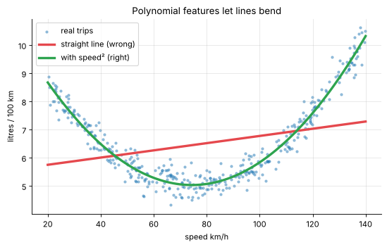

#### ✅ How to validate – choose the degree with cross-validation

```python
from sklearn.model_selection import cross_val_score

X_fuel, y_fuel = fuel[["speed_kmh", "load_kg"]], fuel["l_per_100km"]
for degree in [1, 2, 3, 6]:
    model = make_pipeline(PolynomialFeatures(degree, include_bias=False), StandardScaler(), Ridge(alpha=1e-3))
    r2 = cross_val_score(model, X_fuel, y_fuel, cv=5, scoring="r2").mean()
    print("degree", degree, "→ R² =", round(r2, 3))
```

**🖨️ Output:**

```text
degree 1 → R² = 0.084
degree 2 → R² = 0.951
degree 3 → R² = 0.951
degree 6 → R² = 0.949
```

> 💡 Big jump from 1 → 2, then nothing more – degree 2 is enough. Higher degrees add risk (overfitting, see 1.7) with no gain.

| ⏰ When | 📍 Where | 🚫 Avoid when |
|---|---|---|
| curved relationships with linear models; known interactions | 🚗 physics/engineering · 📈 price vs demand · 🌱 dose vs effect | many columns (features explode) |

---

<a name="sec-which-technique-should-you-use"></a>
## 🧭 Which Technique Should You Use?

### 🗺️ Decision map

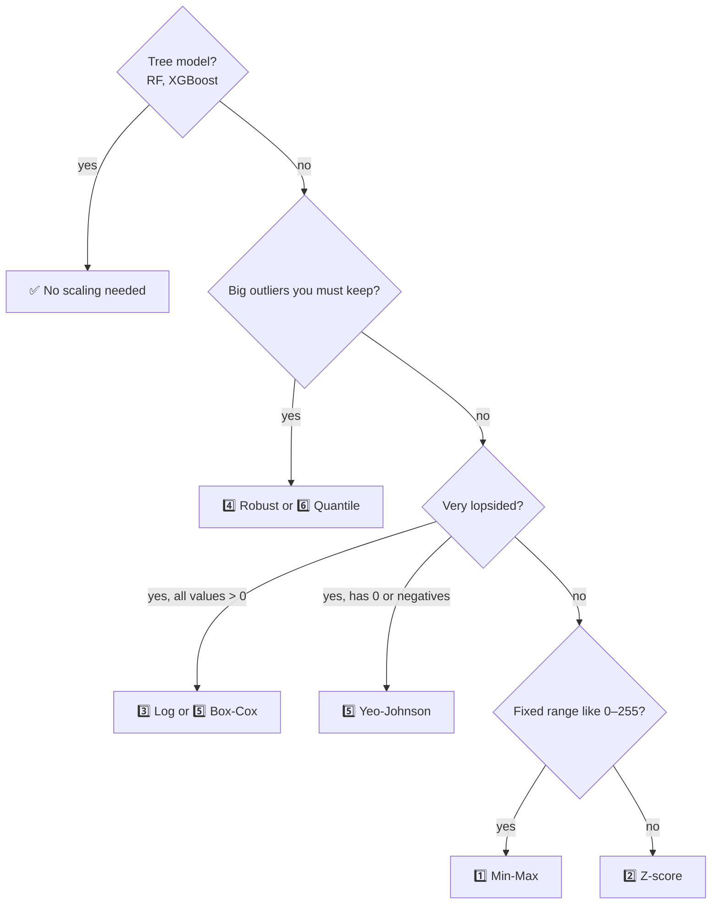

| Your data looks like… | ✅ Use | 🚫 Avoid |
|---|---|---|
| bounded, no outliers (pixels, %) | **Min-Max** | — |
| balanced, few outliers | **Z-score** | Quantile (loses detail) |
| positive, lopsided, huge range | **Log** | Min-Max |
| real extreme outliers | **Robust** (or Quantile) | Min-Max, Z-score |
| lopsided with zeros/negatives | **Yeo-Johnson** | Log, Box-Cox |
| strictly positive, need bell shape | **Box-Cox** | — |
| strange shape, only rank matters | **Quantile** | — |
| step effects / explainability | **Binning** | many boxes on small data |
| curved relationship, linear model | **Polynomial** | high degree without regularization |
| tree models | **nothing** | — |

#### 🤖 Let code suggest a technique per column

```python
def recommend_transform(s):
    s = s.dropna()
    q1, q3 = s.quantile([0.25, 0.75])
    extreme_share = ((s < q1 - 3 * (q3 - q1)) | (s > q3 + 3 * (q3 - q1))).mean()
    lopsided = skew(s)
    if extreme_share > 0.01:
        return "Robust scaling (extreme outliers)"
    if abs(lopsided) > 1:
        return "Log / Box-Cox" if s.min() > 0 else "Yeo-Johnson (has zeros/negatives)"
    if abs(lopsided) > 0.5:
        return "Yeo-Johnson (a bit lopsided)"
    return "Z-score"

print(train[features].apply(recommend_transform))
```

**🖨️ Output:**

```text
age                                                   Z-score
annual_income                                   Log / Box-Cox
sessions_per_month                                    Z-score
basket_value                                    Log / Box-Cox
days_since_last_purchase    Yeo-Johnson (has zeros/negatives)
dtype: str
```

#### 🏁 The real judge: test them all with your model

```python
from sklearn.linear_model import LogisticRegression
from sklearn.neighbors import KNeighborsClassifier
from sklearn.preprocessing import MinMaxScaler, PowerTransformer, QuantileTransformer, RobustScaler

scalers = {"none": "passthrough", "minmax": MinMaxScaler(), "zscore": StandardScaler(),
           "robust": RobustScaler(), "yeo-johnson": PowerTransformer(),
           "quantile-normal": QuantileTransformer(output_distribution="normal", n_quantiles=500)}
X_all, y_all = shop[features], shop["churned"]
for name, scaler in scalers.items():
    logistic = cross_val_score(make_pipeline(scaler, LogisticRegression(max_iter=2000)), X_all, y_all, cv=5, scoring="roc_auc").mean()
    knn = cross_val_score(make_pipeline(scaler, KNeighborsClassifier(n_neighbors=25)), X_all, y_all, cv=5, scoring="roc_auc").mean()
    print(name.ljust(16), "logistic AUC:", round(logistic, 3), "| KNN AUC:", round(knn, 3))
```

**🖨️ Output:**

```text
none             logistic AUC: 0.764 | KNN AUC: 0.562
minmax           logistic AUC: 0.764 | KNN AUC: 0.735
zscore           logistic AUC: 0.764 | KNN AUC: 0.741
robust           logistic AUC: 0.763 | KNN AUC: 0.737
yeo-johnson      logistic AUC: 0.755 | KNN AUC: 0.733
quantile-normal  logistic AUC: 0.753 | KNN AUC: 0.729
```

> 💡 **AUC** is a score from 0.5 (guessing) to 1.0 (perfect) – explained in 1.8. Notice: **KNN without scaling is terrible**, while logistic regression barely cares. The "best" scaler depends on **your** model – so test, don't guess.

### 🏋️ Practice
Which technique for: (a) house prices from 50k to 5M, (b) exam % scores 0–100, (c) bank balances that can be negative and lopsided?

<details><summary>👀 Show answers</summary>

(a) Log (or Box-Cox) · (b) Min-Max (or nothing) · (c) Yeo-Johnson
</details>

### 🧪 Lab 1.3.T – Pick the right ruler for each column 📐

**🎯 Goal:** look at shapes, choose a transformation per column, and confirm with a model.

**🧾 Data** – run this cell first:

```python
import numpy as np
import pandas as pd

rng = np.random.default_rng(14)
n = 1500
flats = pd.DataFrame({"size_m2": rng.normal(80, 20, n).clip(25).round(),
                      "income_k": rng.lognormal(3.8, 0.6, n).round(1),
                      "debt_k": rng.normal(5, 15, n).round(1),               # can be negative (savings)
                      "rating_1_5": rng.integers(1, 6, n)})
flats["approved"] = (rng.random(n) < 1 / (1 + np.exp(-(-1 + 0.03 * flats.income_k - 0.05 * flats.debt_k)))).astype(int)
```

**📝 Your tasks**

1. Print the skew of every feature column.
2. Choose: Z-score for `size_m2`, Log for `income_k`, Yeo-Johnson for `debt_k`, Min-Max for `rating_1_5`.
3. Build one `ColumnTransformer` with these and a `LogisticRegression`; compare CV AUC with "Z-score for everything".
4. Self-check: after the log, the skew of `income_k` is below 0.3 in absolute value.

**🧩 Starter code** (replace every `...`)

```python
from sklearn.compose import ColumnTransformer
from sklearn.preprocessing import FunctionTransformer, MinMaxScaler, PowerTransformer, StandardScaler
prep = ColumnTransformer([("z", StandardScaler(), ["size_m2"]),
                          ("log", ..., ["income_k"]),
                          ("yj", ..., ["debt_k"]),
                          ("mm", ..., ["rating_1_5"])])
```

<details><summary>💡 Hints</summary>

- `FunctionTransformer(np.log1p)` and `PowerTransformer(method="yeo-johnson")`

</details>

<details><summary>✅ Solution (try first!)</summary>

```python
from scipy.stats import skew
from sklearn.compose import ColumnTransformer
from sklearn.linear_model import LogisticRegression
from sklearn.model_selection import cross_val_score
from sklearn.pipeline import make_pipeline
from sklearn.preprocessing import FunctionTransformer, MinMaxScaler, PowerTransformer, StandardScaler

features = ["size_m2", "income_k", "debt_k", "rating_1_5"]
print(flats[features].apply(skew).round(2))
prep = ColumnTransformer([("z", StandardScaler(), ["size_m2"]),
                          ("log", make_pipeline(FunctionTransformer(np.log1p), StandardScaler()), ["income_k"]),
                          ("yj", PowerTransformer(method="yeo-johnson"), ["debt_k"]),
                          ("mm", MinMaxScaler(), ["rating_1_5"])])
X, y = flats[features], flats["approved"]
tailored = cross_val_score(make_pipeline(prep, LogisticRegression()), X, y, cv=5, scoring="roc_auc").mean()
simple = cross_val_score(make_pipeline(StandardScaler(), LogisticRegression()), X, y, cv=5, scoring="roc_auc").mean()
log_skew = skew(np.log1p(flats["income_k"]))
print("AUC tailored:", round(tailored, 3), "| AUC z-score only:", round(simple, 3), "| income skew after log:", round(log_skew, 2))
assert abs(log_skew) < 0.3
print("✅ Lab passed!")
```

**🖨️ Output:**

```text
size_m2       0.01
income_k      2.35
debt_k        0.04
rating_1_5    0.00
dtype: float64
AUC tailored: 0.776 | AUC z-score only: 0.779 | income skew after log: 0.06
✅ Lab passed!
```
</details>

### 🧠 Recap
- Look at the **shape** first (histogram + skew), then pick the ruler – and confirm with cross-validation.

---

<a name="sec-1-4-exploratory-data-analysis-eda"></a>
## 🔍 1.4 Exploratory Data Analysis (EDA)

### 🍼 The story 🟢
Before a detective 🕵️ names the culprit, they **look around**: who was where, what's strange, what fits together. EDA is detective work on data: **look at every column, find problems, and find clues that relate to what we want to predict.**

### 📚 New words
| Word | Simple meaning |
|---|---|
| **EDA** | Exploratory Data Analysis = looking carefully at data before modelling |
| **univariate** | looking at **one** column at a time |
| **bivariate** | looking at **two** columns together (e.g. a feature vs the target) |
| **multivariate** | three or more together |
| **distribution** | how values are spread (seen in a histogram) |
| **imbalanced** | one answer is much rarer than the other (5 % fraud, 95 % normal) |
| **hypothesis test** | a check whether a pattern could just be luck (p-value < 0.05 → probably real) |

### 🗺️ The EDA route

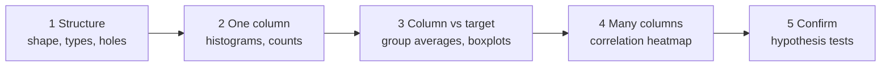

### 🛠️ EDA on a tiny class of 12 students 🟢

```python
import pandas as pd
import matplotlib.pyplot as plt

students = pd.DataFrame({
    "hours_studied": [1, 2, 2, 3, 4, 4, 5, 6, 6, 7, 8, 9],
    "slept_hours":   [5, 6, 8, 5, 7, 8, 6, 7, 8, 6, 7, 8],
    "has_tutor":     ["no", "no", "yes", "no", "yes", "no", "yes", "no", "yes", "yes", "no", "yes"],
    "passed":        [0, 0, 0, 0, 1, 0, 1, 1, 1, 1, 1, 1],
})
```

#### 🔹 Step 1 – structure

```python
print("Rows, columns:", students.shape)
print(students.dtypes)
print("Empty cells:", students.isna().sum().sum(), "| duplicate rows:", students.duplicated().sum())
```

**🖨️ Output:**

```text
Rows, columns: (12, 4)
hours_studied    int64
slept_hours      int64
has_tutor          str
passed           int64
dtype: object
Empty cells: 0 | duplicate rows: 0
```

#### 🔹 Step 2 – one column at a time

```python
print(students.describe().round(1))
print(students["has_tutor"].value_counts())
print("Pass rate:", round(students["passed"].mean(), 2))
```

**🖨️ Output:**

```text
       hours_studied  slept_hours  passed
count           12.0         12.0    12.0
mean             4.8          6.8     0.6
std              2.5          1.1     0.5
min              1.0          5.0     0.0
25%              2.8          6.0     0.0
50%              4.5          7.0     1.0
75%              6.2          8.0     1.0
max              9.0          8.0     1.0
has_tutor
no     6
yes    6
Name: count, dtype: int64
Pass rate: 0.58
```

#### 🔹 Step 3 – each column vs the target

```python
print(students.groupby("passed")[["hours_studied", "slept_hours"]].mean().round(1))
print(students.groupby("has_tutor")["passed"].mean().round(2))
```

**🖨️ Output:**

```text
        hours_studied  slept_hours
passed
0                 2.4          6.4
1                 6.4          7.0
has_tutor
no     0.33
yes    0.83
Name: passed, dtype: float64
```

#### 🔹 Step 4 – picture it

```python
colors = students["passed"].map({0: "#E5484D", 1: "#2EA44F"})    # red = failed, green = passed
plt.scatter(students["hours_studied"], students["slept_hours"], c=colors, s=120)
plt.xlabel("hours studied"); plt.ylabel("hours slept")
plt.title("Green = passed, red = failed → studying matters most")
plt.show()
```

**🖼️ What you will see:**

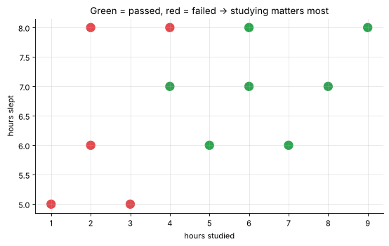

#### 🔹 Step 5 – correlation table

```python
print(students.assign(has_tutor=(students["has_tutor"] == "yes").astype(int)).corr().round(2))
```

**🖨️ Output:**

```text
               hours_studied  slept_hours  has_tutor  passed
hours_studied           1.00         0.42       0.31    0.82
slept_hours             0.42         1.00       0.38    0.27
has_tutor               0.31         0.38       1.00    0.51
passed                  0.82         0.27       0.51    1.00
```

> 💡 **Detective notes:** passing goes with more study hours (correlation ≈ 0.8). Sleep and tutors matter less. Now we have clues for the model!

---

### 🛠️ Real-world project – employee attrition (people leaving a company) 🟡

> [!NOTE]
> 🧾 Chapters **1.4 → 1.10** follow **one** realistic project from start to finish: predict which employees will **leave** (`left = 1`), so HR can talk to them in time. Keep your notebook open – later chapters reuse these variables.

#### 🧾 The data – just run this cell
3,000 employees. Leaving is more likely with overtime, low satisfaction, short tenure, long commute, lower salary, and in the Sales department. (In real life you wouldn't know these rules – that's what we'll discover.)

```python
import numpy as np
import pandas as pd

rng = np.random.default_rng(11)
n = 3_000
DEPTS = ["Sales", "R&D", "HR", "Support", "Finance"]
dept = rng.choice(DEPTS, n, p=[0.30, 0.35, 0.07, 0.18, 0.10])
level = rng.choice([1, 2, 3, 4, 5], n, p=[0.30, 0.30, 0.20, 0.13, 0.07])
age = (22 + 4 * level + rng.normal(0, 6, n)).clip(20, 65).round()
tenure = np.minimum(rng.exponential(4, n), age - 20).round(1)
dept_pay = pd.Series(dept).map({"Sales": 0, "R&D": 6000, "HR": -2000, "Support": -5000, "Finance": 4000}).to_numpy()

hr = pd.DataFrame({
    "employee_id": np.arange(10_001, 10_001 + n),
    "team_id": rng.integers(1, 150, n),
    "department": dept,
    "job_level": level,                                   # 1 = junior … 5 = director
    "age": age,
    "tenure_years": tenure,                               # years at the company
    "salary": (32_000 + 11_000 * level + dept_pay + 800 * tenure + rng.normal(0, 5000, n)).round(-2),
    "overtime": (rng.random(n) < 0.28).astype(int),       # 1 = works overtime
    "satisfaction": rng.integers(1, 5, n).astype(float),  # 1 = unhappy … 4 = happy
    "commute_km": rng.gamma(2, 8, n).round(1),
})
hr["monthly_salary"] = (hr["salary"] / 12).round(2)      # a redundant column, as real exports often have
hr["hire_date"] = (pd.Timestamp("2026-06-30") - pd.to_timedelta(hr["tenure_years"] * 365.25, unit="D")).dt.normalize()

def attrition_probability(df):
    """The hidden 'truth' – we reuse it in 1.10 to simulate the future."""
    logit = (-1.4 + 1.1 * df["overtime"] - 0.45 * (df["satisfaction"].fillna(2.5) - 2.5)
             - 0.12 * df["tenure_years"] + 0.025 * df["commute_km"]
             - 0.00003 * (df["salary"] - 70_000) + 0.4 * (df["department"] == "Sales"))
    return 1 / (1 + np.exp(-logit))

hr["left"] = (rng.random(n) < attrition_probability(hr)).astype(int)
hr.loc[rng.random(n) < 0.03, "satisfaction"] = np.nan       # 3 % didn't answer the survey
print(hr.head())
```

**🖨️ Output:**

```text
   employee_id  team_id department  job_level   age  tenure_years  ...  overtime  satisfaction  commute_km  \
0        10001       85      Sales          5  43.0           0.5  ...         0           2.0        23.0
1        10002       40        R&D          1  22.0           2.0  ...         0           1.0        13.7
2        10003       27        R&D          4  42.0           1.3  ...         0           1.0         5.8
3        10004      106      Sales          3  22.0           0.1  ...         0           1.0         2.3
4        10005        7      Sales          2  37.0           3.7  ...         0           3.0        46.1

   monthly_salary  hire_date left
0         7466.67 2025-12-29    0
1         4566.67 2024-06-29    1
2         6758.33 2025-03-12    1
3         5308.33 2026-05-24    0
4         5525.00 2022-10-17    0

[5 rows x 13 columns]
```

#### 🔹 Step 1 – structure & quality

```python
profile = pd.DataFrame({
    "type": hr.dtypes.astype(str),
    "empty_%": (hr.isna().mean() * 100).round(1),
    "different_values": hr.nunique(),
})
print("Shape:", hr.shape)
print(profile)
print("Duplicate rows:", hr.duplicated().sum(), "| duplicate IDs:", hr["employee_id"].duplicated().sum())
```

**🖨️ Output:**

```text
Shape: (3000, 13)
                          type  empty_%  different_values
employee_id              int64      0.0              3000
team_id                  int64      0.0               149
department                 str      0.0                 5
job_level                int64      0.0                 5
age                    float64      0.0                39
tenure_years           float64      0.0               150
salary                 float64      0.0               656
overtime                 int64      0.0                 2
satisfaction           float64      3.0                 4
commute_km             float64      0.0               473
monthly_salary         float64      0.0               656
hire_date       datetime64[ns]      0.0               150
left                     int64      0.0                 2
Duplicate rows: 0 | duplicate IDs: 0
```

#### 🔹 Step 2 – every number column as a histogram

```python
import matplotlib.pyplot as plt

num_cols = ["age", "tenure_years", "salary", "commute_km", "satisfaction", "job_level"]
print(hr[num_cols].describe().round(1))

fig, axes = plt.subplots(2, 3, figsize=(13, 7))
for ax, col in zip(axes.ravel(), num_cols):          # .ravel() turns the 2×3 grid into a simple list
    ax.hist(hr[col].dropna(), bins=30, color="#4C8BF5", edgecolor="white")
    ax.set_title(col)
plt.tight_layout()
plt.show()
```

**🖨️ Output:**

```text
          age  tenure_years    salary  commute_km  satisfaction  job_level
count  3000.0        3000.0    3000.0      3000.0        2911.0     3000.0
mean     31.7           3.2   62090.0        16.1           2.5        2.4
std       7.4           3.1   15531.5        11.4           1.1        1.2
min      20.0           0.0   27800.0         0.3           1.0        1.0
25%      26.0           0.9   50200.0         7.7           2.0        1.0
50%      31.0           2.2   59900.0        13.4           3.0        2.0
75%      37.0           4.5   72825.0        21.7           4.0        3.0
max      59.0          20.0  110200.0        98.0           4.0        5.0
```

**🖼️ What you will see:**

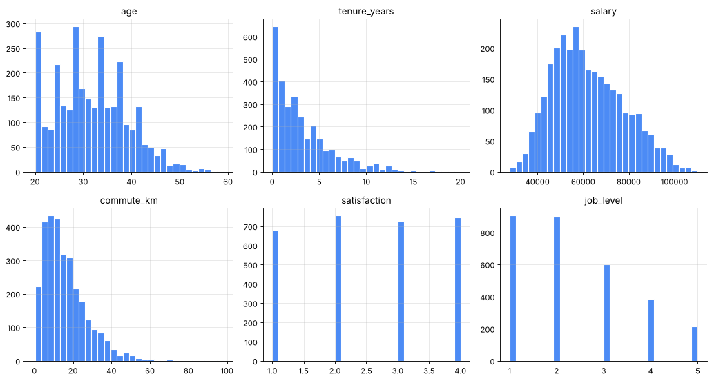

> 💡 **Detective notes:** tenure and commute are lopsided (long right tail), salary looks bell-shaped with bumps (job levels), satisfaction has 4 values.

#### 🔹 Step 3 – categories and the target

```python
print(hr["department"].value_counts(normalize=True).round(3))
print("Share who left:", round(hr["left"].mean(), 3), "→ about 1 in 3: somewhat imbalanced")
```

**🖨️ Output:**

```text
department
R&D        0.351
Sales      0.308
Support    0.175
Finance    0.093
HR         0.073
Name: proportion, dtype: float64
Share who left: 0.362 → about 1 in 3: somewhat imbalanced
```

#### 🔹 Step 4 – each feature vs "left"

```python
for col in ["department", "overtime", "satisfaction", "job_level"]:
    print(hr.groupby(col)["left"].agg(leave_rate="mean", employees="size").round(3), "\n")
```

**🖨️ Output:**

```text
            leave_rate  employees
department
Finance          0.333        279
HR               0.431        218
R&D              0.309       1054
Sales            0.424        923
Support          0.344        526

          leave_rate  employees
overtime
0              0.300       2152
1              0.519        848

              leave_rate  employees
satisfaction
1.0                0.501        682
2.0                0.431        756
3.0                0.300        727
4.0                0.227        746

           leave_rate  employees
job_level
1               0.461        905
2               0.408        895
3               0.297        602
4               0.223        386
5               0.179        212
```

```python
print(hr.groupby("left")[["salary", "tenure_years", "commute_km", "age"]].median())

fig, axes = plt.subplots(1, 3, figsize=(13, 4))
for ax, col in zip(axes, ["salary", "tenure_years", "commute_km"]):
    ax.boxplot([hr.loc[hr["left"] == 0, col], hr.loc[hr["left"] == 1, col]])
    ax.set_xticks([1, 2], ["stayed", "left"])
    ax.set_title(col)
plt.suptitle("Leavers earn less, are newer and commute further")
plt.tight_layout()
plt.show()
```

**🖨️ Output:**

```text
       salary  tenure_years  commute_km   age
left
0     63200.0           2.6        12.4  32.0
1     55800.0           1.7        15.6  30.0
```

**🖼️ What you will see:**

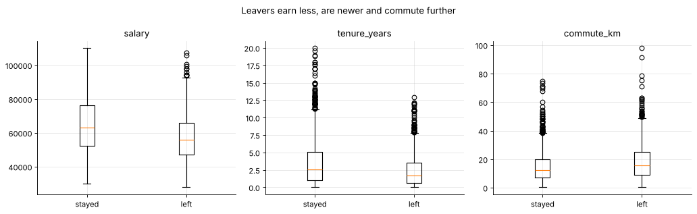

#### 🔹 Step 5 – correlation heatmap (all number pairs at once) 🟡
**Spearman** correlation works on ranks, so lopsided columns don't fool it.

```python
corr = hr[num_cols + ["overtime", "monthly_salary", "left"]].corr(method="spearman")
print(corr["left"].drop("left").sort_values(key=abs, ascending=False).round(3))   # strongest first

fig, ax = plt.subplots(figsize=(8, 7))
im = ax.imshow(corr, cmap="coolwarm", vmin=-1, vmax=1)      # blue = negative, red = positive
ax.set_xticks(range(len(corr)), corr.columns, rotation=45, ha="right")
ax.set_yticks(range(len(corr)), corr.columns)
for i in range(len(corr)):
    for j in range(len(corr)):
        ax.text(j, i, round(corr.iloc[i, j], 1), ha="center", va="center", fontsize=8)
fig.colorbar(im)
plt.title("Correlation heatmap")
plt.tight_layout()
plt.show()
```

**🖨️ Output:**

```text
salary           -0.228
monthly_salary   -0.228
satisfaction     -0.221
overtime          0.205
job_level        -0.195
tenure_years     -0.170
commute_km        0.141
age              -0.134
Name: left, dtype: float64
```

**🖼️ What you will see:**

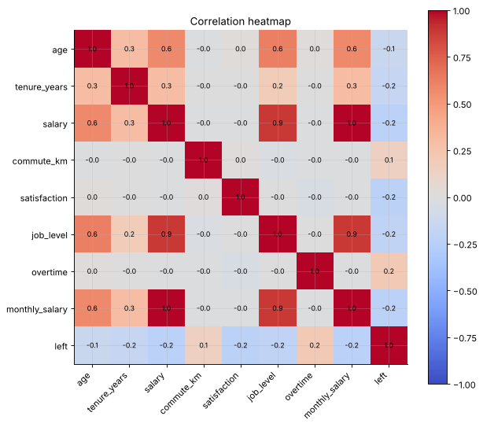

> 💡 `salary` and `monthly_salary` correlate 1.0 – they're the same information. We'll drop one in 1.5.

#### 🔹 Step 6 – two drivers together 🟡

```python
pivot = pd.pivot_table(hr, values="left", index="department", columns="overtime", aggfunc="mean").round(3)
pivot.columns = ["no_overtime", "overtime"]
pivot["extra_risk"] = pivot["overtime"] - pivot["no_overtime"]
print(pivot.sort_values("extra_risk", ascending=False))
```

**🖨️ Output:**

```text
            no_overtime  overtime  extra_risk
department
Sales             0.351     0.608       0.257
Support           0.266     0.522       0.256
Finance           0.280     0.500       0.220
HR                0.381     0.569       0.188
R&D               0.259     0.435       0.176
```

### ✅ How to validate EDA findings

#### 🔹 Check 1 – are the patterns real or luck? (hypothesis tests) 🟡
| Test | Use for |
|---|---|
| chi-square | category vs category (overtime vs left) |
| Mann-Whitney | a number in two groups (salary of leavers vs stayers) |
| Spearman | number vs number |

```python
from scipy.stats import chi2_contingency, mannwhitneyu, spearmanr

p_overtime = chi2_contingency(pd.crosstab(hr["overtime"], hr["left"]))[1]
p_salary = mannwhitneyu(hr.loc[hr["left"] == 1, "salary"], hr.loc[hr["left"] == 0, "salary"]).pvalue
p_commute = spearmanr(hr["commute_km"], hr["left"]).pvalue

for finding, p in [("overtime ↔ leaving", p_overtime), ("salary differs", p_salary), ("commute ↔ leaving", p_commute)]:
    print("✅ real pattern" if p < 0.05 else "➖ could be luck", "|", finding, "| p =", "{:.1e}".format(p))
```

**🖨️ Output:**

```text
✅ real pattern | overtime ↔ leaving | p = 3.8e-29
✅ real pattern | salary differs | p = 6.6e-36
✅ real pattern | commute ↔ leaving | p = 7.0e-15
```

> 💡 `{:.1e}` prints tiny numbers in short scientific form – `4.2e-29` = 0.000…042 with 28 zeros.

#### 🔹 Check 2 – turn findings into automatic data checks

```python
checks = {
    "employee IDs unique": hr["employee_id"].is_unique,
    "ages between 18 and 70": hr["age"].between(18, 70).all(),
    "tenure not longer than working life": (hr["tenure_years"] <= hr["age"] - 18).all(),
    "less than 5 % satisfaction missing": hr["satisfaction"].isna().mean() < 0.05,
}
for name, ok in checks.items():
    print("✅" if ok else "❌", name)
```

**🖨️ Output:**

```text
✅ employee IDs unique
✅ ages between 18 and 70
✅ tenure not longer than working life
✅ less than 5 % satisfaction missing
```

### ⏰ When to use EDA
| Moment | Focus |
|---|---|
| right after collecting data | structure, holes, duplicates |
| before feature engineering | what relates to the target |
| before choosing a model | straight vs curved relations, imbalance |
| when a model suddenly gets worse | compare old vs new data |

### 📍 Where to use
- 👥 HR · 🛒 customer churn · 🏥 patient groups · 📈 sales reviews – **every** project.

### ⚠️ Common mistakes
| Mistake | Better |
|---|---|
| jumping to modelling | 30 minutes of EDA saves days |
| believing every pattern | test it (p-value) and think about causes |
| only looking at averages | look at distributions (histograms, boxplots) |

### 🏋️ Practice
For `hr`, what is the leave rate for people with satisfaction 1 vs 4?

<details><summary>👀 Show answer</summary>

```python
print(hr.groupby("satisfaction")["left"].mean().round(3))
```

**🖨️ Output:**

```text
satisfaction
1.0    0.501
2.0    0.431
3.0    0.300
4.0    0.227
Name: left, dtype: float64
```
</details>

### 🎓 Expert corner 🔴
- Automated reports: `ydata-profiling` or `sweetviz` create full EDA reports in one line (`pip install ydata-profiling`).
- Check **target leakage** during EDA: a feature that predicts the target *too* well (correlation ≈ 1) is often recorded *after* the outcome.
- Use mutual information for non-linear relationships (see 1.5).

### 🧪 Lab 1.4 – Restaurant tips detective 🍽️

**🎯 Goal:** run the full EDA route on a real dataset (seaborn's `tips`, needs internet once).

**🧾 Data** – run this cell first:

```python
import seaborn as sns
tips = sns.load_dataset("tips")
print(tips.head())
```

**🖨️ Output:**

```text
   total_bill   tip     sex smoker  day    time  size
0       16.99  1.01  Female     No  Sun  Dinner     2
1       10.34  1.66    Male     No  Sun  Dinner     3
2       21.01  3.50    Male     No  Sun  Dinner     3
3       23.68  3.31    Male     No  Sun  Dinner     2
4       24.59  3.61  Female     No  Sun  Dinner     4
```

**📝 Your tasks**

1. Structure: shape, types, empty cells, duplicates.
2. Add `tip_pct = tip / total_bill * 100`. Histogram of `tip_pct`.
3. Average `tip_pct` by `day`, `time` and `smoker`.
4. Test with Mann-Whitney whether smokers and non-smokers tip a different percentage.
5. Self-check: 244 rows; the day with the highest average total bill is Sunday.

**🧩 Starter code** (replace every `...`)

```python
import matplotlib.pyplot as plt
print(tips.shape, tips.isna().sum().sum(), tips.duplicated().sum())
tips["tip_pct"] = ...
print(tips.groupby("day", observed=True)["tip_pct"].mean())
```

<details><summary>💡 Hints</summary>

- `observed=True` avoids a warning for category columns.
- `mannwhitneyu(a, b).pvalue`

</details>

<details><summary>✅ Solution (try first!)</summary>

```python
import matplotlib.pyplot as plt
from scipy.stats import mannwhitneyu

print(tips.shape, "| empty:", tips.isna().sum().sum(), "| duplicates:", tips.duplicated().sum())
tips["tip_pct"] = tips["tip"] / tips["total_bill"] * 100
plt.hist(tips["tip_pct"], bins=30, color="#2EA44F"); plt.title("Tip as % of the bill"); plt.show()
for col in ["day", "time", "smoker"]:
    print(tips.groupby(col, observed=True)["tip_pct"].mean().round(1), "\n")
p = mannwhitneyu(tips.loc[tips.smoker == "Yes", "tip_pct"], tips.loc[tips.smoker == "No", "tip_pct"]).pvalue
print("Smokers vs non-smokers p-value:", round(p, 3), "→", "different" if p < 0.05 else "no clear difference")
top_day = tips.groupby("day", observed=True)["total_bill"].mean().idxmax()
assert len(tips) == 244 and top_day == "Sun"
print("✅ Lab passed!")
```

**🖨️ Output:**

```text
(244, 7) | empty: 0 | duplicates: 1
day
Thur    16.1
Fri     17.0
Sat     15.3
Sun     16.7
Name: tip_pct, dtype: float64

time
Lunch     16.4
Dinner    16.0
Name: tip_pct, dtype: float64

smoker
Yes    16.3
No     15.9
Name: tip_pct, dtype: float64

Smokers vs non-smokers p-value: 0.561 → no clear difference
✅ Lab passed!
```

**🖼️ What you will see:**

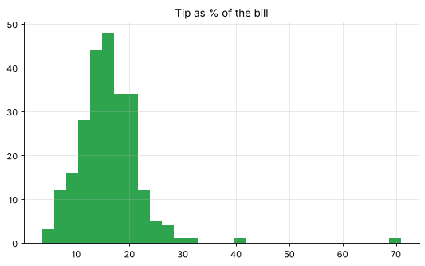
</details>

### 🧠 Recap
- Structure → one column → column vs target → many columns → confirm with tests.
- Write down clues, problems and data checks – they guide cleaning, features and the model.

---

<a name="sec-1-5-feature-engineering-feature-selection"></a>
## 🧪 1.5 Feature Engineering & Feature Selection

### 🍼 The story 🟢
A doctor doesn't just look at your weight and height separately – she calculates your **BMI** (weight ÷ height²), one number that says much more. **Feature engineering** = creating smarter clues from the raw columns.
**Feature selection** = throwing away clues that don't help (like your favourite colour for predicting blood pressure), so the model is simpler, faster and less confused.

### 📚 New words
| Word | Simple meaning |
|---|---|
| **feature** | an input column / clue |
| **ratio feature** | one column divided by another (price per m²) |
| **interaction** | two features combined (overtime **and** unhappy) |
| **aggregation** | a group summary (average salary in your department) |
| **redundant** | carries the same info as another column |
| **filter method** | judge each feature by a simple score |
| **wrapper method** | try models with different feature sets |
| **embedded method** | the model itself picks features while training (L1/Lasso) |
| **permutation importance** | shuffle one column: if the score drops a lot, that column mattered |

### 🛠️ Feature engineering – tiny examples 🟢

#### 🔹 Example 1 – ratio: BMI and price per m²

```python
import pandas as pd

people = pd.DataFrame({"weight_kg": [60, 85, 110], "height_m": [1.65, 1.80, 1.75]})
people["bmi"] = (people["weight_kg"] / people["height_m"] ** 2).round(1)
print(people)

flats = pd.DataFrame({"price": [300_000, 450_000, 280_000], "area_m2": [60, 75, 40]})
flats["price_per_m2"] = flats["price"] / flats["area_m2"]
print(flats)            # the 40 m² flat is actually the most expensive per m²!
```

**🖨️ Output:**

```text
   weight_kg  height_m   bmi
0         60      1.65  22.0
1         85      1.80  26.2
2        110      1.75  35.9
    price  area_m2  price_per_m2
0  300000       60        5000.0
1  450000       75        6000.0
2  280000       40        7000.0
```

#### 🔹 Example 2 – from a date: day of week, month, "age" of the account

```python
signups = pd.DataFrame({"signup": pd.to_datetime(["2025-01-15", "2025-06-01", "2026-03-20"])})
today = pd.Timestamp("2026-10-28")
signups["weekday"] = signups["signup"].dt.day_name()
signups["month"] = signups["signup"].dt.month
signups["days_as_customer"] = (today - signups["signup"]).dt.days
print(signups)
```

**🖨️ Output:**

```text
      signup    weekday  month  days_as_customer
0 2025-01-15  Wednesday      1               651
1 2025-06-01     Sunday      6               514
2 2026-03-20     Friday      3               222
```

#### 🔹 Example 3 – yes/no flags from a threshold

```python
trips = pd.DataFrame({"commute_km": [3, 12, 40, 55]})
trips["long_commute"] = (trips["commute_km"] > 25).astype(int)
print(trips)
```

**🖨️ Output:**

```text
   commute_km  long_commute
0           3             0
1          12             0
2          40             1
3          55             1
```

#### 🔹 Example 4 – interaction: two things together

```python
staff = pd.DataFrame({"overtime": [1, 1, 0, 0], "unhappy": [1, 0, 1, 0]})
staff["overtime_and_unhappy"] = staff["overtime"] * staff["unhappy"]    # 1 only if both are 1
print(staff)
```

**🖨️ Output:**

```text
   overtime  unhappy  overtime_and_unhappy
0         1        1                     1
1         1        0                     0
2         0        1                     0
3         0        0                     0
```

#### 🔹 Example 5 – group comparison: "am I paid more or less than my colleagues?"

```python
pay = pd.DataFrame({"dept": ["IT", "IT", "IT", "HR", "HR"], "salary": [60, 70, 80, 40, 50]})
pay["dept_average"] = pay.groupby("dept")["salary"].transform("mean")
pay["vs_colleagues"] = (pay["salary"] / pay["dept_average"]).round(2)    # 1.0 = exactly average
print(pay)
```

**🖨️ Output:**

```text
  dept  salary  dept_average  vs_colleagues
0   IT      60          70.0           0.86
1   IT      70          70.0           1.00
2   IT      80          70.0           1.14
3   HR      40          45.0           0.89
4   HR      50          45.0           1.11
```

### 🛠️ Feature selection – tiny examples 🟢

#### 🔹 Example 6 – drop a column that never changes

```python
from sklearn.feature_selection import VarianceThreshold

toy = pd.DataFrame({"useful": [1, 5, 3, 8], "always_one": [1, 1, 1, 1], "also_useful": [10, 20, 15, 5]})
vt = VarianceThreshold(threshold=0.0).fit(toy)               # variance 0 = the column never changes
print("Kept:", list(toy.columns[vt.get_support()]))           # get_support() = True for kept columns
```

**🖨️ Output:**

```text
Kept: ['useful', 'also_useful']
```

#### 🔹 Example 7 – drop a column that copies another

```python
toy2 = pd.DataFrame({"salary": [40, 55, 70, 90], "monthly_salary": [3.33, 4.58, 5.83, 7.5], "age": [25, 40, 31, 50]})
print(toy2.corr().round(2))            # salary vs monthly_salary = 1.0 → keep only one
```

**🖨️ Output:**

```text
                salary  monthly_salary  age
salary             1.0             1.0  0.8
monthly_salary     1.0             1.0  0.8
age                0.8             0.8  1.0
```

---

### 🛠️ Real-world project (continued) – HR attrition 🟡

> [!IMPORTANT]
> 🔗 **Before running this part** you need the `hr` table from **1.4**. Run those chapters' code first, in the same notebook.

#### 🔹 Step 1 – put feature logic in its own file (`features.py`)
**Why a separate file?** Later (1.9) the deployed app must create the **same** features. A file can be imported by both the notebook and the app.

👉 **How to create the file:** in Jupyter/Colab make a new cell, type `%%writefile features.py` as its **very first line**, paste the code below under it and run the cell – Jupyter saves the cell as a file called `features.py` next to your notebook. (Or create the file in any text editor.)

```python
# features.py
import pandas as pd

LONG_COMMUTE_KM = 25

def add_features(df: pd.DataFrame) -> pd.DataFrame:
    out = df.copy()
    out["salary_per_level"] = out["salary"] / out["job_level"]                       # ratio
    out["tenure_ratio"] = out["tenure_years"] / (out["age"] - 18).clip(lower=1)      # share of working life here
    out["long_commute"] = (out["commute_km"] > LONG_COMMUTE_KM).astype(int)          # threshold flag
    out["satisfaction_missing"] = out["satisfaction"].isna().astype(int)             # "didn't answer" flag
    out["overtime_low_sat"] = out["overtime"] * (out["satisfaction"].fillna(4) <= 2).astype(int)  # interaction
    out["new_joiner"] = (out["tenure_years"] < 1).astype(int)
    return out
```

```python
from features import add_features           # import our own file like a library

fe = add_features(hr)
print(fe[["salary_per_level", "tenure_ratio", "long_commute", "overtime_low_sat", "new_joiner"]].head())
```

**🖨️ Output:**

```text
   salary_per_level  tenure_ratio  long_commute  overtime_low_sat  new_joiner
0      17920.000000      0.020000             0                 0           1
1      54800.000000      0.500000             0                 0           0
2      20275.000000      0.054167             0                 0           0
3      21233.333333      0.025000             0                 0           1
4      33150.000000      0.194737             1                 0           0
```

#### 🔹 Step 2 – date features

```python
fe["hire_month"] = fe["hire_date"].dt.month
fe["hired_in_q4"] = (fe["hire_date"].dt.quarter == 4).astype(int)     # quarter 4 = Oct–Dec
```

#### 🔹 Step 3 – group comparison feature

```python
fe["salary_vs_peers"] = fe["salary"] / fe.groupby(["department", "job_level"])["salary"].transform("median")
print(fe.groupby(pd.cut(fe["salary_vs_peers"], [0, 0.9, 1.1, 2]), observed=True)["left"].mean().round(3))
```

**🖨️ Output:**

```text
salary_vs_peers
(0.0, 0.9]    0.464
(0.9, 1.1]    0.356
(1.1, 2.0]    0.302
Name: left, dtype: float64
```

> 💡 People paid **below** their peers leave more often. ⚠️ In a real project compute these medians on the **training** data only.

#### 🔹 Step 4 – make a model-ready table (numbers only)

```python
y = fe["left"]
X_sel = pd.get_dummies(fe.drop(columns=["employee_id", "team_id", "hire_date", "left"]),
                       columns=["department"], dtype=int)             # IDs and dates are not features
X_sel["satisfaction"] = X_sel["satisfaction"].fillna(X_sel["satisfaction"].median())
print(X_sel.shape)
print(list(X_sel.columns))
```

**🖨️ Output:**

```text
(3000, 22)
['job_level', 'age', 'tenure_years', 'salary', 'overtime', 'satisfaction', 'commute_km', 'monthly_salary', 'salary_per_level',
    'tenure_ratio', 'long_commute', 'satisfaction_missing', 'overtime_low_sat', 'new_joiner', 'hire_month', 'hired_in_q4',
    'salary_vs_peers', 'department_Finance', 'department_HR', 'department_R&D', 'department_Sales', 'department_Support']
```

#### 🔹 Step 5 – filter: near-constant columns

```python
from sklearn.feature_selection import VarianceThreshold

vt = VarianceThreshold(threshold=0.01).fit(X_sel)
print("Almost never changes:", X_sel.columns[~vt.get_support()].tolist() or "none")
```

**🖨️ Output:**

```text
Almost never changes: ['salary_vs_peers']
```

> 💡 `salary_vs_peers` is flagged only because its values all sit close to 1.0 (0.9 – 1.1), so its variance is tiny – yet Step 7 shows it **is** useful. Variance filters judge spread, not usefulness: scale first or use a smaller threshold for ratio features.

#### 🔹 Step 6 – filter: copies of other columns

```python
import numpy as np

corr_abs = X_sel.corr().abs()
upper = corr_abs.where(np.triu(np.ones(corr_abs.shape, dtype=bool), k=1))   # look at each pair only once
to_drop = [c for c in upper.columns if (upper[c] > 0.95).any()]
print("Redundant:", to_drop)
X_sel = X_sel.drop(columns=to_drop)
```

**🖨️ Output:**

```text
Redundant: ['monthly_salary']
```

#### 🔹 Step 7 – filter: mutual information ranking 🟡
**Mutual information** = "how much does knowing this column reduce my uncertainty about the target?" (0 = nothing). It also catches curved relationships.

```python
from sklearn.feature_selection import SelectKBest, mutual_info_classif

mi_scores = pd.Series(mutual_info_classif(X_sel, y, random_state=0), index=X_sel.columns)
print(mi_scores.sort_values(ascending=False).round(4).head(10))
```

**🖨️ Output:**

```text
salary              0.0345
overtime_low_sat    0.0291
job_level           0.0234
overtime            0.0210
satisfaction        0.0190
commute_km          0.0168
salary_per_level    0.0134
long_commute        0.0130
department_Sales    0.0129
salary_vs_peers     0.0127
dtype: float64
```

#### 🔹 Step 8 – wrapper: recursive feature elimination (RFECV) 🟡
It trains a model, removes the weakest feature, repeats, and keeps the set with the best cross-validated score.

```python
from sklearn.feature_selection import RFECV
from sklearn.linear_model import LogisticRegression
from sklearn.model_selection import StratifiedKFold
from sklearn.preprocessing import StandardScaler

X_scaled = pd.DataFrame(StandardScaler().fit_transform(X_sel), columns=X_sel.columns)
rfecv = RFECV(LogisticRegression(max_iter=2000), step=1, cv=StratifiedKFold(5), scoring="roc_auc").fit(X_scaled, y)
print("RFECV keeps", rfecv.n_features_, "features:", X_sel.columns[rfecv.support_].tolist())
```

**🖨️ Output:**

```text
RFECV keeps 13 features: ['job_level', 'age', 'tenure_years', 'salary', 'overtime', 'satisfaction', 'commute_km',
    'salary_per_level', 'hire_month', 'department_HR', 'department_R&D', 'department_Sales', 'department_Support']
```

#### 🔹 Step 9 – embedded: L1 (Lasso) sets useless weights to zero 🟡

```python
from sklearn.feature_selection import SelectFromModel

# scikit-learn ≥ 1.8: l1_ratio=1 means pure L1   (older versions: penalty="l1", solver="liblinear")
l1 = SelectFromModel(LogisticRegression(l1_ratio=1.0, solver="saga", C=0.02, max_iter=5000)).fit(X_scaled, y)
print("L1 keeps:", X_sel.columns[l1.get_support()].tolist())
```

**🖨️ Output:**

```text
L1 keeps: ['tenure_years', 'salary', 'overtime', 'satisfaction', 'commute_km', 'department_HR', 'department_Sales',
    'department_Support']
```

#### 🔹 Step 10 – permutation importance: shuffle a column, watch the score drop 🟡

```python
from sklearn.ensemble import RandomForestClassifier
from sklearn.inspection import permutation_importance
from sklearn.model_selection import train_test_split

Xa, Xb, ya, yb = train_test_split(X_sel, y, test_size=0.3, stratify=y, random_state=0)
rf = RandomForestClassifier(n_estimators=300, min_samples_leaf=5, random_state=0, n_jobs=-1).fit(Xa, ya)
perm = permutation_importance(rf, Xb, yb, scoring="roc_auc", n_repeats=10, random_state=0, n_jobs=-1)
importance = pd.Series(perm.importances_mean, index=X_sel.columns).sort_values()

import matplotlib.pyplot as plt
importance.tail(10).plot.barh(color="#8A63D2", title="Score drop when the column is shuffled (bigger = more important)")
plt.show()
```

**🖼️ What you will see:**

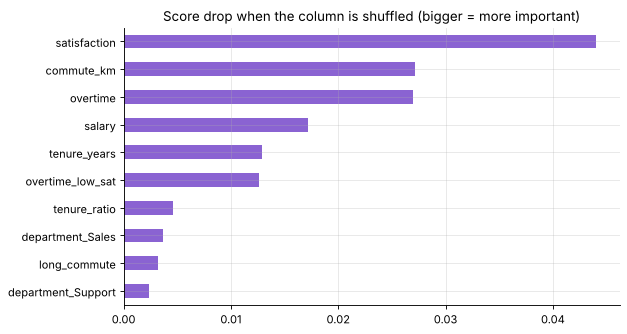

### ✅ How to validate features

#### 🔹 Check 1 – do the new features improve the cross-validated score?

```python
from sklearn.model_selection import cross_val_score
from sklearn.pipeline import make_pipeline

raw_cols = ["job_level", "age", "tenure_years", "salary", "overtime", "satisfaction", "commute_km"]
dept_cols = [c for c in X_sel.columns if c.startswith("department_")]
engineered = raw_cols + dept_cols + ["salary_per_level", "tenure_ratio", "long_commute",
                                     "satisfaction_missing", "overtime_low_sat", "new_joiner", "salary_vs_peers"]
model = make_pipeline(StandardScaler(), LogisticRegression(max_iter=2000))
cv5 = StratifiedKFold(5, shuffle=True, random_state=0)
for name, cols in [("raw features", raw_cols + dept_cols), ("+ engineered", engineered),
                   ("RFECV subset", X_sel.columns[rfecv.support_].tolist())]:
    auc = cross_val_score(model, X_sel[cols], y, cv=cv5, scoring="roc_auc")
    print(name.ljust(14), "AUC =", round(auc.mean(), 3), "±", round(auc.std(), 3), "|", len(cols), "features")
```

**🖨️ Output:**

```text
raw features   AUC = 0.755 ± 0.021 | 12 features
+ engineered   AUC = 0.754 ± 0.022 | 19 features
RFECV subset   AUC = 0.755 ± 0.02 | 13 features
```

> 💡 Honest result: here the extra features **don't** beat the raw ones (the differences are smaller than the ± wobble). When that happens, **keep the simpler set** – that's exactly why we validate.

#### 🔹 Check 2 – is the selection stable?
If a feature is picked in only 1 of 5 data slices, it's probably noise.

```python
picks = pd.Series(0, index=X_sel.columns)
for train_idx, _ in StratifiedKFold(5, shuffle=True, random_state=1).split(X_sel, y):
    sel = SelectKBest(lambda X, y: mutual_info_classif(X, y, random_state=0), k=8)
    sel.fit(X_sel.iloc[train_idx], y.iloc[train_idx])
    picks[sel.get_support()] += 1
print(picks.sort_values(ascending=False).head(12), "\n(5 = picked every time)")
```

**🖨️ Output:**

```text
job_level           5
salary              5
overtime_low_sat    5
satisfaction        4
salary_per_level    4
tenure_years        3
overtime            3
new_joiner          3
commute_km          2
department_Sales    2
age                 1
long_commute        1
dtype: int64
(5 = picked every time)
```

### ⏰ When to use
| Technique | Use when |
|---|---|
| ratios, flags, interactions | you (or an expert) know how things relate |
| group comparisons | rows belong to groups (department, store, user) |
| date features | anything time-related |
| variance + correlation filter | always – a cheap first clean-up |
| mutual information | quick ranking, also for curved relations |
| RFECV | small/medium data, want the smallest good set |
| L1 | linear models with many features |
| permutation importance | any model; explaining to stakeholders |

### 📍 Where to use
- 👥 HR attrition · 💳 credit (debt ÷ income) · 🛒 churn (days since last purchase, purchases per month) · 🏭 machines (rolling sensor averages)

### ⚠️ Common mistakes
| Mistake | Better |
|---|---|
| using IDs or dates directly as features | extract meaning (month, age) or drop them |
| features that use future information | only use what's known **at prediction time** |
| computing group averages on all data | compute on training data only |
| keeping features "just in case" | validate – simpler wins ties |

### 🏋️ Practice
For `hr`, create `age_at_hire = age - tenure_years`. What's its average?

<details><summary>👀 Show answer</summary>

```python
print(round((hr["age"] - hr["tenure_years"]).mean(), 1))
```

**🖨️ Output:**

```text
28.5
```
</details>

### 🎓 Expert corner 🔴
- Put group statistics inside a custom transformer (fit on train, apply on test) to avoid leakage.
- SHAP values explain individual predictions (`pip install shap`).
- Target leakage hunt: a feature with suspiciously high importance is often recorded after the outcome.

### 🧪 Lab 1.5 – Better clues for tips 💡

**🎯 Goal:** create features, then prove which ones matter.

**🧾 Data** – run this cell first:

```python
import seaborn as sns
tips = sns.load_dataset("tips")
```

**📝 Your tasks**

1. Create `bill_per_person = total_bill / size`, `is_weekend` (Sat/Sun) and `is_dinner`.
2. Make a numbers-only table with `pd.get_dummies` for `sex`, `smoker`, `day`, `time`.
3. Rank all features by mutual information with `tip`.
4. Compare CV R² of a `LinearRegression` with only `total_bill` vs all features.
5. Self-check: `total_bill` is in the top 2 of the ranking.

**🧩 Starter code** (replace every `...`)

```python
import pandas as pd
from sklearn.feature_selection import mutual_info_regression
tips["bill_per_person"] = ...
X = pd.get_dummies(tips.drop(columns="tip"), columns=[...], dtype=int)
mi = pd.Series(mutual_info_regression(X, tips["tip"], random_state=0), index=X.columns)
```

<details><summary>💡 Hints</summary>

- `tips["day"].isin(["Sat", "Sun"]).astype(int)`

</details>

<details><summary>✅ Solution (try first!)</summary>

```python
import pandas as pd
from sklearn.feature_selection import mutual_info_regression
from sklearn.linear_model import LinearRegression
from sklearn.model_selection import cross_val_score

tips["bill_per_person"] = tips["total_bill"] / tips["size"]
tips["is_weekend"] = tips["day"].isin(["Sat", "Sun"]).astype(int)
tips["is_dinner"] = (tips["time"] == "Dinner").astype(int)
X = pd.get_dummies(tips.drop(columns="tip"), columns=["sex", "smoker", "day", "time"], dtype=int)
mi = pd.Series(mutual_info_regression(X, tips["tip"], random_state=0), index=X.columns).sort_values(ascending=False)
print(mi.round(3).head(6))
one = cross_val_score(LinearRegression(), X[["total_bill"]], tips["tip"], cv=5, scoring="r2").mean()
allf = cross_val_score(LinearRegression(), X, tips["tip"], cv=5, scoring="r2").mean()
print("R² total_bill only:", round(one, 3), "| all features:", round(allf, 3))
assert "total_bill" in mi.index[:2]
print("✅ Lab passed!")
```

**🖨️ Output:**

```text
total_bill         0.316
size               0.122
time_Lunch         0.058
bill_per_person    0.053
day_Sun            0.019
day_Thur           0.013
dtype: float64
R² total_bill only: 0.457 | all features: 0.391
✅ Lab passed!
```
</details>

### 🧠 Recap
- Engineer: ratios, dates, flags, interactions, group comparisons.
- Select: remove constant & duplicate columns, rank (mutual information), eliminate (RFECV / L1), explain (permutation importance).
- Keep only what improves the cross-validated score.

---

<a name="sec-1-6-data-splitting"></a>
## ✂️ 1.6 Data Splitting

### 🍼 The story 🟢
A teacher gives students **practice questions** to study, and keeps different questions for the **final exam**. If the exam used the same questions, everyone would score 100 % by memorising – and we'd learn nothing about who really understands.
Splitting data does the same: the model **studies** the training data and is **examined** on data it has never seen.

### 🖼️ Pictures
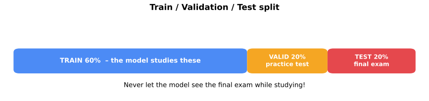

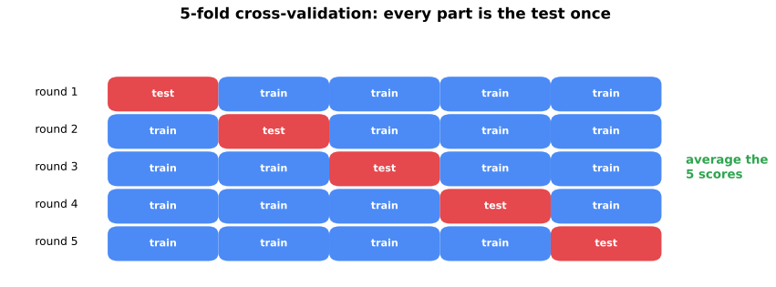

### 📚 New words
| Word | Simple meaning |
|---|---|
| **training set** | the data the model learns from |
| **validation set** | a practice exam to choose settings |
| **test set** | the final exam – used **once** at the very end |
| **cross-validation (K-fold)** | split into K parts; each part is the test once; average the K scores |
| **stratify** | keep the same share of each answer (e.g. 36 % leavers) in every part |
| **group split** | rows from the same person/team stay together |
| **time split** | always train on the past, test on the future |
| **leakage** | test information sneaking into training → scores that are too good to be true |

### 🛠️ How to split – tiny examples 🟢

#### 🔹 Example 1 – split 10 rows into train and test

```python
import pandas as pd
from sklearn.model_selection import train_test_split

data = pd.DataFrame({"x": range(10), "label": [0, 0, 0, 0, 0, 0, 1, 1, 1, 1]})
train, test = train_test_split(data, test_size=0.3, random_state=0)
print("TRAIN rows:", sorted(train.index.tolist()))
print("TEST rows: ", sorted(test.index.tolist()))
```

**🖨️ Output:**

```text
TRAIN rows: [0, 1, 3, 5, 6, 7, 9]
TEST rows:  [2, 4, 8]
```

#### 🔹 Example 2 – stratify: keep the label mix equal

```python
_, test_plain = train_test_split(data, test_size=0.4, random_state=3)
_, test_strat = train_test_split(data, test_size=0.4, random_state=3, stratify=data["label"])
print("Share of label 1 – all data:", data["label"].mean(),
      "| plain test:", test_plain["label"].mean(), "| stratified test:", test_strat["label"].mean())
```

**🖨️ Output:**

```text
Share of label 1 – all data: 0.4 | plain test: 0.0 | stratified test: 0.5
```

#### 🔹 Example 3 – K-fold: every row is tested exactly once

```python
from sklearn.model_selection import KFold

for fold, (train_idx, test_idx) in enumerate(KFold(n_splits=5).split(data), start=1):
    print("round", fold, "→ test rows:", test_idx.tolist())
```

**🖨️ Output:**

```text
round 1 → test rows: [0, 1]
round 2 → test rows: [2, 3]
round 3 → test rows: [4, 5]
round 4 → test rows: [6, 7]
round 5 → test rows: [8, 9]
```

#### 🔹 Example 4 – groups: the same patient never in both sets

```python
from sklearn.model_selection import GroupKFold

visits = pd.DataFrame({"patient": ["A", "A", "B", "B", "C", "C", "D", "D"], "value": range(8)})
for fold, (tr, te) in enumerate(GroupKFold(n_splits=4).split(visits, groups=visits["patient"]), start=1):
    print("round", fold, "→ test patients:", sorted(set(visits.loc[te, "patient"])))
```

**🖨️ Output:**

```text
round 1 → test patients: ['D']
round 2 → test patients: ['C']
round 3 → test patients: ['B']
round 4 → test patients: ['A']
```

#### 🔹 Example 5 – time: train on the past only

```python
from sklearn.model_selection import TimeSeriesSplit

months = pd.DataFrame({"month": pd.date_range("2026-01-01", periods=8, freq="MS")})   # MS = month start
for tr, te in TimeSeriesSplit(n_splits=3).split(months):
    print("train:", months.loc[tr, "month"].dt.strftime("%b").tolist(), "→ test:", months.loc[te, "month"].dt.strftime("%b").tolist())
```

**🖨️ Output:**

```text
train: ['Jan', 'Feb'] → test: ['Mar', 'Apr']
train: ['Jan', 'Feb', 'Mar', 'Apr'] → test: ['May', 'Jun']
train: ['Jan', 'Feb', 'Mar', 'Apr', 'May', 'Jun'] → test: ['Jul', 'Aug']
```

---

### 🛠️ Real-world project (continued) – HR attrition 🟡

> [!IMPORTANT]
> 🔗 **Before running this part** you need the `hr` table from **1.4**. Run those chapters' code first, in the same notebook.

#### 🔹 Step 1 – stratified train / test (80 / 20)

```python
from sklearn.model_selection import train_test_split

RAW_FEATURES = ["department", "job_level", "age", "tenure_years", "salary", "overtime", "satisfaction", "commute_km"]
X, y = hr[RAW_FEATURES], hr["left"]
X_train, X_test, y_train, y_test = train_test_split(X, y, test_size=0.2, stratify=y, random_state=42)
print("train:", len(X_train), "| test:", len(X_test))
```

**🖨️ Output:**

```text
train: 2400 | test: 600
```

#### 🔹 Step 2 – train / validation / test (60 / 20 / 20)
Split twice: first take 20 % as the final test, then take 25 % of the rest (= 20 % of all) as validation.

```python
X_tmp, X_test3, y_tmp, y_test3 = train_test_split(X, y, test_size=0.20, stratify=y, random_state=42)
X_train3, X_val3, y_train3, y_val3 = train_test_split(X_tmp, y_tmp, test_size=0.25, stratify=y_tmp, random_state=42)
print({"train": len(X_train3), "validation": len(X_val3), "test": len(X_test3)})
```

**🖨️ Output:**

```text
{'train': 1800, 'validation': 600, 'test': 600}
```

#### 🔹 Step 3 – stratified 5-fold cross-validation on the training set

```python
from sklearn.model_selection import StratifiedKFold

skf = StratifiedKFold(n_splits=5, shuffle=True, random_state=42)
for fold, (tr, va) in enumerate(skf.split(X_train, y_train), start=1):
    print("fold", fold, "| train:", len(tr), "| validate:", len(va), "| leave rate:", round(y_train.iloc[va].mean(), 3))
```

**🖨️ Output:**

```text
fold 1 | train: 1920 | validate: 480 | leave rate: 0.362
fold 2 | train: 1920 | validate: 480 | leave rate: 0.362
fold 3 | train: 1920 | validate: 480 | leave rate: 0.362
fold 4 | train: 1920 | validate: 480 | leave rate: 0.36
fold 5 | train: 1920 | validate: 480 | leave rate: 0.36
```

#### 🔹 Step 4 – group K-fold: a team never appears on both sides 🟡
People in the same team share a manager and mood – if the model saw some of them in training, testing on their teammates would be too easy.

```python
from sklearn.model_selection import GroupKFold

groups = hr.loc[X_train.index, "team_id"]
group_folds = list(GroupKFold(n_splits=5).split(X_train, y_train, groups=groups))
print("Teams in each validation fold:", [groups.iloc[va].nunique() for _, va in group_folds])
```

**🖨️ Output:**

```text
Teams in each validation fold: [29, 30, 30, 30, 30]
```

#### 🔹 Step 5 – time-series split for daily sales (with a gap) 🟡 🧾
`gap=7` leaves one week empty between train and test, so "last week's sales" features can't peek into the test period.

```python
import numpy as np
from sklearn.model_selection import TimeSeriesSplit

days = pd.date_range("2025-01-01", "2026-06-30", freq="D")
sales = pd.DataFrame({"date": days,
                      "units": (200 + 30 * np.sin(2 * np.pi * days.dayofyear / 365)
                                + np.random.default_rng(0).normal(0, 10, len(days))).round()})
tss = TimeSeriesSplit(n_splits=4, test_size=60, gap=7)
for tr, te in tss.split(sales):
    print("train", sales["date"][tr].min().date(), "→", sales["date"][tr].max().date(),
          "| test", sales["date"][te].min().date(), "→", sales["date"][te].max().date())
```

**🖨️ Output:**

```text
train 2025-01-01 → 2025-10-26 | test 2025-11-03 → 2026-01-01
train 2025-01-01 → 2025-12-25 | test 2026-01-02 → 2026-03-02
train 2025-01-01 → 2026-02-23 | test 2026-03-03 → 2026-05-01
train 2025-01-01 → 2026-04-24 | test 2026-05-02 → 2026-06-30
```

### ✅ How to validate splits

```python
print("Leave rate – all:", round(y.mean(), 4), "| train:", round(y_train.mean(), 4), "| test:", round(y_test.mean(), 4))
print("No row in both train and test?", set(X_train.index).isdisjoint(X_test.index))   # isdisjoint = no overlap
print("No team in both sides of any fold?",
      all(set(groups.iloc[tr]).isdisjoint(groups.iloc[va]) for tr, va in group_folds))
print("Test always after train?", all(sales["date"][tr].max() < sales["date"][te].min() for tr, te in tss.split(sales)))
identical = X_train.merge(X_test, how="inner", on=RAW_FEATURES)
print("Identical rows across train/test:", len(identical))
```

**🖨️ Output:**

```text
Leave rate – all: 0.3617 | train: 0.3617 | test: 0.3617
No row in both train and test? True
No team in both sides of any fold? True
Test always after train? True
Identical rows across train/test: 0
```

### ⏰ When to use
| Your data | Splitter |
|---|---|
| independent rows, balanced | `train_test_split`, `KFold` |
| one answer is rare | `stratify=y`, `StratifiedKFold` |
| many rows per person/team/shop | `GroupKFold` / `StratifiedGroupKFold` |
| over time | `TimeSeriesSplit` (with `gap`) |
| need tuning **and** an honest final score | train / validation / test, or nested CV |

### 📍 Where to use
- 🏥 patients with many visits (group) · 📈 sales forecasts (time) · 💳 fraud (stratified, rare) · 👥 HR teams (group)

### ⚠️ Common mistakes
| Mistake | Better |
|---|---|
| cleaning/scaling **before** splitting | split first, then fit cleaning on train (Pipeline) |
| looking at the test set many times | use validation/CV for decisions; test once |
| random split for time data | `TimeSeriesSplit` |
| forgetting `random_state` | results change every run |

### 🏋️ Practice
Split `hr` 70 / 30 with stratification. Is the leave rate the same in both parts?

<details><summary>👀 Show answer</summary>

```python
a, b = train_test_split(hr, test_size=0.3, stratify=hr["left"], random_state=1)
print(round(a["left"].mean(), 3), round(b["left"].mean(), 3))
```

**🖨️ Output:**

```text
0.361 0.362
```
</details>

### 🎓 Expert corner 🔴
- `StratifiedGroupKFold` keeps groups together **and** balances classes.
- **Nested CV**: an inner CV for tuning inside an outer CV for scoring – the honest way to report tuned models on small data.
- Deduplicate before splitting, and check near-duplicates (same person, slightly different row).

### 🧪 Lab 1.6 – Patients with many visits 🏥

**🎯 Goal:** split so that no patient appears in both training and test data.

**🧾 Data** – run this cell first:

```python
import numpy as np
import pandas as pd

rng = np.random.default_rng(2)
visits = pd.DataFrame({"patient_id": np.repeat(np.arange(100), 5),
                       "blood_pressure": rng.normal(130, 15, 500).round(),
                       "high_risk": rng.integers(0, 2, 500)})
```

**📝 Your tasks**

1. Do a normal `train_test_split` (25 %) and count patients that appear on both sides.
2. Now use `GroupShuffleSplit(test_size=0.25, random_state=0)` with `groups=patient_id`.
3. Self-check: the normal split leaks many patients; the group split leaks 0, and about 25 patients are in the test part.

**🧩 Starter code** (replace every `...`)

```python
from sklearn.model_selection import GroupShuffleSplit, train_test_split
tr, te = train_test_split(visits, test_size=0.25, random_state=0)
print(len(set(tr.patient_id) & set(te.patient_id)))
gss = GroupShuffleSplit(...)
train_idx, test_idx = next(gss.split(visits, groups=...))
```

<details><summary>💡 Hints</summary>

- `set(a) & set(b)` gives the shared patients.

</details>

<details><summary>✅ Solution (try first!)</summary>

```python
from sklearn.model_selection import GroupShuffleSplit, train_test_split

tr, te = train_test_split(visits, test_size=0.25, random_state=0)
leak_plain = len(set(tr.patient_id) & set(te.patient_id))
gss = GroupShuffleSplit(n_splits=1, test_size=0.25, random_state=0)
train_idx, test_idx = next(gss.split(visits, groups=visits["patient_id"]))
g_tr, g_te = visits.iloc[train_idx], visits.iloc[test_idx]
leak_group = len(set(g_tr.patient_id) & set(g_te.patient_id))
print("Shared patients – plain split:", leak_plain, "| group split:", leak_group, "| test patients:", g_te.patient_id.nunique())
assert leak_plain > 20 and leak_group == 0 and g_te.patient_id.nunique() == 25
print("✅ Lab passed!")
```

**🖨️ Output:**

```text
Shared patients – plain split: 79 | group split: 0 | test patients: 25
✅ Lab passed!
```
</details>

### 🧠 Recap
- Train = study, validation = practice exam, test = final exam (once).
- Stratify rare classes, keep groups together, respect time order.

---

<a name="sec-1-7-model-selection-training"></a>
## 🏋️ 1.7 Model Selection & Training

### 🍼 The story 🟢
Choosing a model is like choosing a **sport shoe** 👟: running, hiking and football shoes all exist. You try a few on the **same** track, pick the best, then **adjust the laces** (settings) until it fits perfectly.

Two dangers:
- 🥱 **Underfitting** – the model is too simple and misses the pattern (like drawing a straight line through a curve).
- 🤯 **Overfitting** – the model **memorises** the training data, noise included, and fails on new data (like memorising exam answers without understanding).

### 🖼️ Picture
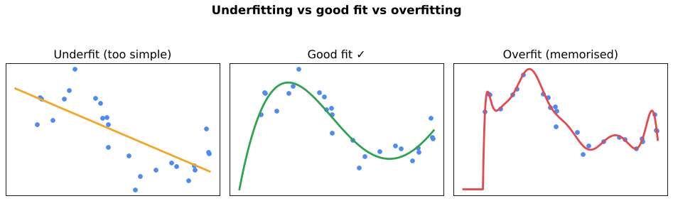

### 📚 New words
| Word | Simple meaning |
|---|---|
| **model / algorithm** | a method that learns from data (tree, linear, …) |
| **hyperparameter** | a setting **you** choose before training (tree depth, number of neighbours) – the "laces" |
| **parameter** | what the model learns itself (the line's slope) |
| **underfit / overfit** | too simple / memorised |
| **train score vs validation score** | score on studied data vs unseen data – a big gap = overfitting |
| **grid search** | try every combination of settings, keep the best |
| **random search** | try random combinations – faster when there are many settings |
| **pipeline** | preprocessing + model glued together |

### 🛠️ How to select & train – tiny examples 🟢

#### 🔹 Example 1 – see overfitting happen
We grow decision trees deeper and deeper. Watch the **train** score rise to 100 % while the **validation** score gets worse.

```python
import numpy as np
import pandas as pd
from sklearn.datasets import make_classification
from sklearn.model_selection import train_test_split
from sklearn.tree import DecisionTreeClassifier

X, y = make_classification(n_samples=600, n_features=8, n_informative=4, flip_y=0.15, random_state=0)  # practice data
X_tr, X_va, y_tr, y_va = train_test_split(X, y, test_size=0.3, random_state=0)

rows = []
for depth in [1, 2, 3, 5, 8, 12, 20]:
    tree = DecisionTreeClassifier(max_depth=depth, random_state=0).fit(X_tr, y_tr)
    rows.append({"depth": depth, "train": tree.score(X_tr, y_tr), "validation": tree.score(X_va, y_va)})
scores = pd.DataFrame(rows).round(3)
print(scores)
```

**🖨️ Output:**

```text
   depth  train  validation
0      1  0.705       0.683
1      2  0.771       0.711
2      3  0.855       0.822
3      5  0.931       0.867
4      8  0.974       0.861
5     12  0.998       0.828
6     20  1.000       0.833
```

```python
import matplotlib.pyplot as plt

plt.plot(scores["depth"], scores["train"], marker="o", label="train (studied data)")
plt.plot(scores["depth"], scores["validation"], marker="o", label="validation (new data)")
plt.axvspan(0.5, 2.5, color="#F5A623", alpha=0.15); plt.text(0.8, 0.62, "underfit")
plt.axvspan(8, 20.5, color="#E5484D", alpha=0.12); plt.text(12, 0.62, "overfit")
plt.xlabel("tree depth (complexity)"); plt.ylabel("accuracy"); plt.legend()
plt.title("The sweet spot is in the middle")
plt.show()
```

**🖼️ What you will see:**

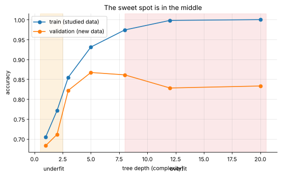

#### 🔹 Example 2 – compare several models on the same data

```python
from sklearn.linear_model import LogisticRegression
from sklearn.model_selection import cross_val_score
from sklearn.neighbors import KNeighborsClassifier
from sklearn.ensemble import RandomForestClassifier

models = {
    "logistic regression": LogisticRegression(max_iter=1000),
    "decision tree (depth 4)": DecisionTreeClassifier(max_depth=4, random_state=0),
    "k-nearest neighbours": KNeighborsClassifier(n_neighbors=15),
    "random forest": RandomForestClassifier(n_estimators=200, random_state=0),
}
for name, model in models.items():
    acc = cross_val_score(model, X, y, cv=5).mean()           # same 5 folds for everyone = fair race
    print(name.ljust(24), "accuracy:", round(acc, 3))
```

**🖨️ Output:**

```text
logistic regression      accuracy: 0.688
decision tree (depth 4)  accuracy: 0.845
k-nearest neighbours     accuracy: 0.897
random forest            accuracy: 0.89
```

#### 🔹 Example 3 – tune one setting with a grid search

```python
from sklearn.model_selection import GridSearchCV

search = GridSearchCV(KNeighborsClassifier(), param_grid={"n_neighbors": [1, 3, 5, 9, 15, 25, 41]}, cv=5)
search.fit(X, y)
print("Best setting:", search.best_params_, "| CV accuracy:", round(search.best_score_, 3))
print(pd.DataFrame(search.cv_results_)[["param_n_neighbors", "mean_test_score"]].round(3))
```

**🖨️ Output:**

```text
Best setting: {'n_neighbors': 9} | CV accuracy: 0.897
   param_n_neighbors  mean_test_score
0                  1            0.833
1                  3            0.885
2                  5            0.893
3                  9            0.897
4                 15            0.897
5                 25            0.887
6                 41            0.867
```

---

### 🛠️ Real-world project (continued) – HR attrition 🟡

> [!IMPORTANT]
> 🔗 **Before running this part** you need `hr` (1.4), the file `features.py` (1.5) and `X_train`, `y_train` (1.6). Run those chapters' code first, in the same notebook.

#### 🔹 Step 1 – one pipeline: features → cleaning → model
- `FunctionTransformer(add_features)` runs our `features.py` recipe.
- `ColumnTransformer` treats number columns (fill + scale) and the department column (one-hot) differently.

```python
from sklearn.compose import ColumnTransformer
from sklearn.impute import SimpleImputer
from sklearn.pipeline import Pipeline, make_pipeline
from sklearn.preprocessing import FunctionTransformer, OneHotEncoder, StandardScaler
from features import add_features

NUMERIC = ["job_level", "age", "tenure_years", "salary", "overtime", "satisfaction", "commute_km",
           "salary_per_level", "tenure_ratio", "long_commute", "satisfaction_missing", "overtime_low_sat", "new_joiner"]
preprocess = ColumnTransformer([
    ("num", make_pipeline(SimpleImputer(strategy="median"), StandardScaler()), NUMERIC),
    ("cat", OneHotEncoder(handle_unknown="ignore"), ["department"]),
])

def build(model):
    return Pipeline([("features", FunctionTransformer(add_features)), ("prep", preprocess), ("model", model)])
```

#### 🔹 Step 2 – a fair race between 5 models
**AUC** (explained in 1.8) – 0.5 = guessing, 1.0 = perfect. `return_train_score=True` also gives the train score so we can spot overfitting.

```python
from sklearn.dummy import DummyClassifier
from sklearn.ensemble import HistGradientBoostingClassifier, RandomForestClassifier
from sklearn.linear_model import LogisticRegression
from sklearn.model_selection import StratifiedKFold, cross_validate
from sklearn.svm import SVC

cv = StratifiedKFold(5, shuffle=True, random_state=42)
candidates = {
    "dummy": DummyClassifier(strategy="prior"),          # the "no skill" baseline
    "logistic": LogisticRegression(max_iter=2000, class_weight="balanced"),
    "random_forest": RandomForestClassifier(n_estimators=300, min_samples_leaf=5, class_weight="balanced", random_state=0, n_jobs=-1),
    "hist_gb": HistGradientBoostingClassifier(random_state=0),
    "svm_rbf": SVC(class_weight="balanced", random_state=0),
}
rows = []
for name, model in candidates.items():
    res = cross_validate(build(model), X_train, y_train, cv=cv, scoring="roc_auc", return_train_score=True, n_jobs=-1)
    rows.append({"model": name, "validation_auc": res["test_score"].mean(), "train_auc": res["train_score"].mean(),
                 "seconds_to_fit": res["fit_time"].mean()})
leaderboard = pd.DataFrame(rows)
leaderboard["overfit_gap"] = leaderboard["train_auc"] - leaderboard["validation_auc"]
print(leaderboard.sort_values("validation_auc", ascending=False).round(3))
```

**🖨️ Output:**

```text
           model  validation_auc  train_auc  seconds_to_fit  overfit_gap
1       logistic           0.746      0.752           0.028        0.006
2  random_forest           0.731      0.954           1.019        0.223
4        svm_rbf           0.725      0.795           0.126        0.069
3        hist_gb           0.704      0.994           0.216        0.290
0          dummy           0.500      0.500           0.021        0.000
```

> 💡 **Read it like a coach:** random forest and gradient boosting score 0.95–0.99 on the training data but much less on validation → they memorise (big gap). Logistic regression has a tiny gap **and** the best validation score. (Our hidden "truth" in 1.4 is a simple formula, so a simple model fits it best – on other data the winner can differ.)

#### 🔹 Step 3 – tune the best candidates 🟡
`model__C` means "the setting `C` of the step called `model`" (double underscore = "inside").

```python
from scipy.stats import loguniform, randint
from sklearn.model_selection import GridSearchCV, RandomizedSearchCV

log_search = GridSearchCV(build(LogisticRegression(max_iter=2000, class_weight="balanced")),
                          {"model__C": [0.01, 0.03, 0.1, 0.3, 1, 3]}, cv=cv, scoring="roc_auc", n_jobs=-1)
hgb_search = RandomizedSearchCV(
    build(HistGradientBoostingClassifier(random_state=0)),
    {"model__learning_rate": loguniform(0.01, 0.3), "model__max_leaf_nodes": randint(4, 32),
     "model__min_samples_leaf": randint(20, 150), "model__l2_regularization": loguniform(1e-3, 10)},
    n_iter=15, cv=cv, scoring="roc_auc", random_state=0, n_jobs=-1)      # try 15 random combinations

for search in (log_search, hgb_search):
    search.fit(X_train, y_train)
    print(type(search.estimator.named_steps["model"]).__name__, "→ best AUC:", round(search.best_score_, 3))
    print("   best settings:", {k: int(v) if float(v).is_integer() else round(float(v), 4)
                                 for k, v in search.best_params_.items()})

best_search = max([log_search, hgb_search], key=lambda s: s.best_score_)
best_model = best_search.best_estimator_          # already re-trained on all training data
print("🏆 Selected:", type(best_model.named_steps["model"]).__name__)
```

**🖨️ Output:**

```text
LogisticRegression → best AUC: 0.747
   best settings: {'model__C': 0.03}
HistGradientBoostingClassifier → best AUC: 0.736
   best settings: {'model__l2_regularization': 0.0668, 'model__learning_rate': 0.0691, 'model__max_leaf_nodes': 4,
    'model__min_samples_leaf': 73}
🏆 Selected: LogisticRegression
```

### ✅ How to validate training

#### 🔹 Check 1 – learning curve: would more data help? 🟡

```python
import matplotlib.pyplot as plt
from sklearn.model_selection import learning_curve

sizes, train_sc, val_sc = learning_curve(best_model, X_train, y_train, cv=cv, scoring="roc_auc",
                                         train_sizes=np.linspace(0.1, 1.0, 6), n_jobs=-1)
plt.plot(sizes, train_sc.mean(axis=1), marker="o", label="train")
plt.plot(sizes, val_sc.mean(axis=1), marker="o", label="validation")
plt.xlabel("number of training rows"); plt.ylabel("AUC"); plt.legend()
plt.title("Lines close together and flat → more data won't help much")
plt.show()
```

**🖼️ What you will see:**

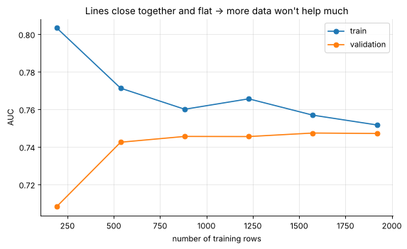

#### 🔹 Check 2 – sanity rules before moving on

```python
board = leaderboard.set_index("model")
print("Beats the dummy clearly?", best_search.best_score_ > board.loc["dummy", "validation_auc"] + 0.1)
print("Small overfit gap (< 0.05)?", board.loc["logistic", "overfit_gap"] < 0.05)
```

**🖨️ Output:**

```text
Beats the dummy clearly? True
Small overfit gap (< 0.05)? True
```

### ⏰ When to use which model family
| Data / need | Start with |
|---|---|
| table data, must explain decisions | logistic / linear regression |
| table data, best accuracy | gradient boosting (HistGB, XGBoost, LightGBM) |
| small data, curved patterns | random forest, SVM |
| images, sound, text | neural networks / pretrained models |
| always, as a reference | `DummyClassifier` / `DummyRegressor` |

### 📍 Where to use
- 👥 HR attrition · 💳 credit scoring (explainable) · 🛒 product ranking (boosting) · 🖼️ photo recognition (neural nets)

### ⚠️ Common mistakes
| Mistake | Better |
|---|---|
| judging by the training score | judge by validation/CV score |
| tuning on the test set | tune with CV on training data; test once |
| fitting preprocessing outside the pipeline | put everything in one Pipeline |
| always using the fanciest model | simple models often win on tabular data – the race decides |

### 🏋️ Practice
In Example 1, which depth had the best validation accuracy?

<details><summary>👀 Show answer</summary>

```python
print(scores.loc[scores["validation"].idxmax()])
```

**🖨️ Output:**

```text
depth         5.000
train         0.931
validation    0.867
Name: 3, dtype: float64
```
</details>

### 🎓 Expert corner 🔴
- `HalvingRandomSearchCV` and Optuna find good settings much faster on big searches.
- Report the **CV spread** (± std), not just the mean, when comparing models.
- Class imbalance: `class_weight="balanced"` changes probabilities – recalibrate if you need true probabilities (1.8).

### 🧪 Lab 1.7 – Race 4 models and tune the winner 🏁

**🎯 Goal:** compare models fairly with the same CV and tune one with a grid search.

**🧾 Data** – run this cell first:

```python
from sklearn.datasets import load_wine
X, y = load_wine(return_X_y=True, as_frame=True)
```

**📝 Your tasks**

1. Compare `DummyClassifier`, `LogisticRegression` (scaled), `KNeighborsClassifier` (scaled) and `RandomForestClassifier` with `StratifiedKFold(5, shuffle=True, random_state=0)`.
2. Tune `n_neighbors` in [1, 3, 5, 7, 11, 15] for the KNN pipeline with `GridSearchCV`.
3. Self-check: every real model beats the dummy by > 0.5, and the tuned KNN scores at least 0.95.

**🧩 Starter code** (replace every `...`)

```python
from sklearn.model_selection import GridSearchCV, StratifiedKFold, cross_val_score
cv = StratifiedKFold(5, shuffle=True, random_state=0)
models = {"dummy": ..., "logistic": ..., "knn": ..., "forest": ...}
for name, m in models.items():
    print(name, cross_val_score(m, X, y, cv=cv).mean())
```

<details><summary>💡 Hints</summary>

- Parameter name inside a pipeline: `kneighborsclassifier__n_neighbors`.

</details>

<details><summary>✅ Solution (try first!)</summary>

```python
from sklearn.dummy import DummyClassifier
from sklearn.ensemble import RandomForestClassifier
from sklearn.linear_model import LogisticRegression
from sklearn.model_selection import GridSearchCV, StratifiedKFold, cross_val_score
from sklearn.neighbors import KNeighborsClassifier
from sklearn.pipeline import make_pipeline
from sklearn.preprocessing import StandardScaler

cv = StratifiedKFold(5, shuffle=True, random_state=0)
models = {"dummy": DummyClassifier(), "logistic": make_pipeline(StandardScaler(), LogisticRegression(max_iter=2000)),
          "knn": make_pipeline(StandardScaler(), KNeighborsClassifier()), "forest": RandomForestClassifier(random_state=0)}
scores = {name: cross_val_score(m, X, y, cv=cv).mean() for name, m in models.items()}
print({k: round(v, 3) for k, v in scores.items()})
grid = GridSearchCV(models["knn"], {"kneighborsclassifier__n_neighbors": [1, 3, 5, 7, 11, 15]}, cv=cv).fit(X, y)
print("best:", grid.best_params_, round(grid.best_score_, 3))
assert all(scores[m] > scores["dummy"] + 0.5 for m in ["logistic", "knn", "forest"]) and grid.best_score_ >= 0.95
print("✅ Lab passed!")
```

**🖨️ Output:**

```text
{'dummy': np.float64(0.399), 'logistic': np.float64(0.983), 'knn': np.float64(0.961), 'forest': np.float64(0.972)}
best: {'kneighborsclassifier__n_neighbors': 15} 0.967
✅ Lab passed!
```
</details>

### 🧠 Recap
- Race several models on the **same** CV folds; watch the train-vs-validation gap.
- Tune settings with grid/random search inside a Pipeline. Pick by validation score, not training score.

---

<a name="sec-1-8-model-evaluation"></a>
## 📏 1.8 Model Evaluation

### 🍼 The story 🟢
A weather app says "no rain" every day. In a desert it's right 99 % of the time – but it's **useless** the one day it rains. ☔ A single "accuracy" number can lie. Evaluation means asking **the right questions**: *Which mistakes does the model make? How costly are they? Can I trust its probabilities?*

### 📚 New words
| Word | Simple meaning |
|---|---|
| **accuracy** | share of all answers that were right |
| **confusion matrix** | a 2×2 table of right and wrong answers (picture below) |
| **precision** | of all "YES" answers, how many were right? |
| **recall** | of all real YES cases, how many did we find? |
| **F1** | one number mixing precision and recall |
| **threshold** | the probability above which we say "YES" (default 0.5) |
| **ROC-AUC** | how well the model **ranks** YES above NO: 0.5 = coin flip, 1.0 = perfect |
| **PR-AUC** | like AUC but focused on the rare YES class |
| **calibration** | does "70 % chance" really happen 70 % of the time? |
| **MAE / RMSE** | average size of mistakes for number predictions (RMSE punishes big mistakes more) |
| **R²** | share of the variation explained: 1 = perfect, 0 = no better than the average |

### 🖼️ Pictures
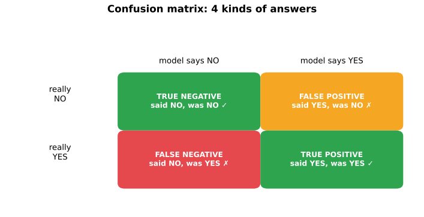


### 🛠️ Classification metrics – tiny examples 🟢

#### 🔹 Example 1 – 10 patients, count by hand

```python
import pandas as pd
from sklearn.metrics import accuracy_score, confusion_matrix, precision_score, recall_score, f1_score

really_sick   = [1, 1, 1, 0, 0, 0, 0, 0, 1, 0]
model_says    = [1, 0, 1, 0, 0, 1, 0, 0, 1, 0]

print(pd.DataFrame(confusion_matrix(really_sick, model_says),
                   index=["really healthy", "really sick"], columns=["said healthy", "said sick"]))
print("accuracy :", accuracy_score(really_sick, model_says), "← 8 of 10 right")
print("precision:", precision_score(really_sick, model_says), "← of 4 'sick' answers, 3 were sick")
print("recall   :", recall_score(really_sick, model_says), "← of 4 sick people, we found 3")
print("F1       :", round(f1_score(really_sick, model_says), 3))
```

**🖨️ Output:**

```text
                said healthy  said sick
really healthy             5          1
really sick                1          3
accuracy : 0.8 ← 8 of 10 right
precision: 0.75 ← of 4 'sick' answers, 3 were sick
recall   : 0.75 ← of 4 sick people, we found 3
F1       : 0.75
```

#### 🔹 Example 2 – the accuracy trap ⚠️

```python
fraud = [0] * 95 + [1] * 5                    # 95 normal payments, 5 frauds
lazy_model = [0] * 100                        # always says "not fraud"
print("accuracy:", accuracy_score(fraud, lazy_model), "← looks great")
print("recall  :", recall_score(fraud, lazy_model), "← caught ZERO frauds!")
```

**🖨️ Output:**

```text
accuracy: 0.95 ← looks great
recall  : 0.0 ← caught ZERO frauds!
```

#### 🔹 Example 3 – moving the threshold changes the mistakes

```python
probabilities = [0.95, 0.80, 0.65, 0.55, 0.45, 0.40, 0.30, 0.20, 0.10, 0.05]
truth         = [1,    1,    0,    1,    1,    0,    0,    0,    0,    0]
for threshold in [0.7, 0.5, 0.35]:
    said_yes = [int(p >= threshold) for p in probabilities]
    print("threshold", threshold, "→ precision", round(precision_score(truth, said_yes), 2),
          "| recall", round(recall_score(truth, said_yes), 2))
```

**🖨️ Output:**

```text
threshold 0.7 → precision 1.0 | recall 0.5
threshold 0.5 → precision 0.75 | recall 0.75
threshold 0.35 → precision 0.67 | recall 1.0
```

> 💡 Lower threshold → find more real YES (recall ↑) but more false alarms (precision ↓). You choose based on which mistake costs more.

#### 🔹 Example 4 – AUC: does the model rank YES above NO?

```python
from sklearn.metrics import roc_auc_score, roc_curve
import matplotlib.pyplot as plt

print("AUC:", round(roc_auc_score(truth, probabilities), 3))
fpr, tpr, _ = roc_curve(truth, probabilities)
plt.plot(fpr, tpr, marker="o", label="our model")
plt.plot([0, 1], [0, 1], "--", color="grey", label="coin flip (AUC 0.5)")
plt.xlabel("false alarms (share of NO called YES)"); plt.ylabel("found (share of YES caught)")
plt.title("ROC curve – the more it bulges to the top-left, the better"); plt.legend()
plt.show()
```

**🖨️ Output:**

```text
AUC: 0.917
```

**🖼️ What you will see:**


### 🛠️ Regression metrics – tiny example 🟢

#### 🔹 Example 5 – 5 house prices, by hand and with scikit-learn

```python
import numpy as np
from sklearn.metrics import mean_absolute_error, r2_score, root_mean_squared_error

real = np.array([200, 250, 300, 350, 400])
predicted = np.array([210, 240, 330, 340, 380])
errors = predicted - real
print("errors:", errors.tolist())
print("MAE  by hand:", np.abs(errors).mean(), "| sklearn:", mean_absolute_error(real, predicted))
print("RMSE by hand:", round(np.sqrt((errors ** 2).mean()), 2), "| sklearn:", round(root_mean_squared_error(real, predicted), 2))
print("R²:", round(r2_score(real, predicted), 3))
```

**🖨️ Output:**

```text
errors: [10, -10, 30, -10, -20]
MAE  by hand: 16.0 | sklearn: 16.0
RMSE by hand: 17.89 | sklearn: 17.89
R²: 0.936
```

> 💡 MAE = "on average we're off by 16 (k$)". RMSE is bigger because the 30 error counts extra.

---

### 🛠️ Real-world project (continued) – HR attrition 🟡

> [!IMPORTANT]
> 🔗 **Before running this part** you need `best_model`, `best_search`, `cv` (1.7) and `X_train`, `X_test`, `y_train`, `y_test` (1.6). Run those chapters' code first, in the same notebook.

#### 🔹 Step 1 – choose the threshold on training data (never on the test!)
Goal from HR: **find at least 70 % of leavers** (recall ≥ 0.70), with as few false alarms as possible.
`cross_val_predict` gives each training row a prediction from a model that did **not** train on it – honest practice answers.

```python
from sklearn.metrics import precision_recall_curve
from sklearn.model_selection import cross_val_predict

practice_proba = cross_val_predict(best_model, X_train, y_train, cv=cv, method="predict_proba", n_jobs=-1)[:, 1]
prec, rec, thr = precision_recall_curve(y_train, practice_proba)
ok = rec[:-1] >= 0.70                                        # thresholds that reach the recall goal
threshold = float(thr[ok][np.argmax(prec[:-1][ok])])         # among those, the best precision
print("Chosen threshold:", round(threshold, 3))
```

**🖨️ Output:**

```text
Chosen threshold: 0.492
```

#### 🔹 Step 2 – the final exam: score the test set once

```python
from sklearn.metrics import (average_precision_score, classification_report, confusion_matrix, roc_auc_score)

test_proba = best_model.predict_proba(X_test)[:, 1]           # probability of leaving
test_pred = (test_proba >= threshold).astype(int)             # 1 = "will leave"

print(classification_report(y_test, test_pred, target_names=["stayed", "left"], digits=3))
print(pd.DataFrame(confusion_matrix(y_test, test_pred),
                   index=["really stayed", "really left"], columns=["predicted stay", "predicted leave"]))
print("ROC-AUC:", round(roc_auc_score(y_test, test_proba), 3),
      "| PR-AUC:", round(average_precision_score(y_test, test_proba), 3), "(random would be", round(y_test.mean(), 3), ")")
```

**🖨️ Output:**

```text
              precision    recall  f1-score   support

      stayed      0.842     0.695     0.761       383
        left      0.588     0.770     0.667       217

    accuracy                          0.722       600
   macro avg      0.715     0.732     0.714       600
weighted avg      0.750     0.722     0.727       600

               predicted stay  predicted leave
really stayed             266              117
really left                50              167
ROC-AUC: 0.797 | PR-AUC: 0.663 (random would be 0.362 )
```

> 💡 **How to read the report:** each row is one class; `support` = how many test people are in that class; `macro avg` = simple average of both classes.

#### 🔹 Step 3 – calibration: can we trust "60 % chance"? 🟡

```python
from sklearn.calibration import calibration_curve
from sklearn.metrics import brier_score_loss

observed, predicted_chance = calibration_curve(y_test, test_proba, n_bins=8, strategy="quantile")
plt.plot(predicted_chance, observed, marker="o", label="our model")
plt.plot([0, 1], [0, 1], "--", color="grey", label="perfectly honest")
plt.xlabel("predicted chance of leaving"); plt.ylabel("real share who left"); plt.legend()
plt.title("Calibration: dots BELOW the line = model predicts more risk than really happens")
plt.show()
print("Brier score (0 = perfect, lower is better):", round(brier_score_loss(y_test, test_proba), 4))
```

**🖨️ Output:**

```text
Brier score (0 = perfect, lower is better): 0.1915
```

**🖼️ What you will see:**


> 💡 Most dots lie **below** the line: `class_weight="balanced"` made the model over-estimate risk. Fine for ranking people, but recalibrate (Expert corner) if HR needs real probabilities.

#### 🔹 Step 4 – translate into money 💰

```python
tn, fp, fn, tp = confusion_matrix(y_test, test_pred).ravel()      # true neg, false pos, false neg, true pos
COST_MISSED_LEAVER, COST_EXTRA_TALK = 30_000, 2_000              # replacing someone vs one unnecessary chat
with_model = fn * COST_MISSED_LEAVER + fp * COST_EXTRA_TALK
without_model = (fn + tp) * COST_MISSED_LEAVER
print("Cost with model:", with_model, "$ | without model:", without_model, "$ | saved:", without_model - with_model, "$")
```

**🖨️ Output:**

```text
Cost with model: 1734000 $ | without model: 6510000 $ | saved: 4776000 $
```

> ⚠️ This assumes every talk keeps the person – real savings are smaller. The point: **mistakes have prices**, and the threshold should reflect them.

#### 🔹 Step 5 – regression evaluation: predicting salary 🟡

```python
from sklearn.compose import ColumnTransformer
from sklearn.dummy import DummyRegressor
from sklearn.ensemble import HistGradientBoostingRegressor
from sklearn.metrics import mean_absolute_error, mean_absolute_percentage_error, r2_score, root_mean_squared_error
from sklearn.pipeline import make_pipeline
from sklearn.preprocessing import OneHotEncoder

reg_features = ["department", "job_level", "age", "tenure_years"]
Xr_train, Xr_test = X_train[reg_features], X_test[reg_features]
yr_train, yr_test = X_train["salary"], X_test["salary"]

reg = make_pipeline(ColumnTransformer([("cat", OneHotEncoder(handle_unknown="ignore"), ["department"])],
                                      remainder="passthrough"),          # remainder = other columns as they are
                    HistGradientBoostingRegressor(random_state=0)).fit(Xr_train, yr_train)
salary_pred = reg.predict(Xr_test)
baseline_pred = DummyRegressor(strategy="median").fit(Xr_train, yr_train).predict(Xr_test)

for name, pred in [("model", salary_pred), ("baseline (always median)", baseline_pred)]:
    print(name.ljust(25), "MAE:", round(mean_absolute_error(yr_test, pred)), "| RMSE:", round(root_mean_squared_error(yr_test, pred)),
          "| MAPE:", round(mean_absolute_percentage_error(yr_test, pred) * 100, 1), "% | R²:", round(r2_score(yr_test, pred), 3))
```

**🖨️ Output:**

```text
model                     MAE: 3923 | RMSE: 4983 | MAPE: 6.9 % | R²: 0.899
baseline (always median)  MAE: 12787 | RMSE: 15846 | MAPE: 21.4 % | R²: -0.026
```

```python
residuals = yr_test - salary_pred                    # residual = real − predicted
plt.scatter(salary_pred, residuals, s=10, alpha=0.5)
plt.axhline(0, color="red")
plt.xlabel("predicted salary"); plt.ylabel("error (real − predicted)")
plt.title("Errors should look like random noise around 0")
plt.show()
print(residuals.groupby(Xr_test["department"]).agg(["mean", "std"]).round(0))
```

**🖨️ Output:**

```text
             mean     std
department
Finance    -148.0  5267.0
HR         -373.0  3547.0
R&D        -268.0  4945.0
Sales       511.0  4862.0
Support    -974.0  5456.0
```

**🖼️ What you will see:**


### ✅ How to validate the evaluation

#### 🔹 Check 1 – how sure is the score? (bootstrap) 🟡
Re-sample the test set 1,000 times with replacement and recompute AUC → a range instead of one number.

```python
boot_rng = np.random.default_rng(0)
y_arr = y_test.to_numpy()
aucs = []
for _ in range(1000):
    idx = boot_rng.integers(0, len(y_arr), len(y_arr))      # pick rows at random, repeats allowed
    if y_arr[idx].min() != y_arr[idx].max():                # need both classes
        aucs.append(roc_auc_score(y_arr[idx], test_proba[idx]))
low, high = np.percentile(aucs, [2.5, 97.5])
print("Test ROC-AUC is probably between", round(low, 3), "and", round(high, 3), "(95 % range)")
```

**🖨️ Output:**

```text
Test ROC-AUC is probably between 0.755 and 0.832 (95 % range)
```

#### 🔹 Check 2 – test score close to the CV score? better than baselines?

```python
test_auc = roc_auc_score(y_test, test_proba)
print("CV AUC:", round(best_search.best_score_, 3), "| test AUC:", round(test_auc, 3),
      "→ close?", abs(test_auc - best_search.best_score_) < 0.05)
print("Salary model beats the median baseline?",
      mean_absolute_error(yr_test, salary_pred) < mean_absolute_error(yr_test, baseline_pred))
```

**🖨️ Output:**

```text
CV AUC: 0.747 | test AUC: 0.797 → close? True
Salary model beats the median baseline? True
```

### ⏰ When to use which metric
| Problem | Metric |
|---|---|
| balanced classes | accuracy, ROC-AUC |
| rare positives that matter | recall, precision, **PR-AUC**, F1 |
| probabilities drive decisions | calibration curve, Brier score |
| numbers, easy to explain | MAE |
| numbers, big errors very bad | RMSE |
| numbers on very different scales | MAPE (careful with zeros) |

### 📍 Where to use
- 🏥 cancer screening → recall · 📧 spam → precision · 💳 credit risk → calibration · 🏠 house prices → MAE · ⚡ electricity load → RMSE

### ⚠️ Common mistakes
| Mistake | Better |
|---|---|
| only reporting accuracy | confusion matrix + precision/recall |
| choosing the threshold on the test set | choose on CV predictions of the training set |
| one number without uncertainty | bootstrap range |
| no baseline | always compare with a dummy |

### 🏋️ Practice
`truth = [1, 0, 1, 1, 0]`, `pred = [1, 1, 0, 1, 0]`: compute precision and recall.

<details><summary>👀 Show answer</summary>

```python
print(precision_score([1, 0, 1, 1, 0], [1, 1, 0, 1, 0]), recall_score([1, 0, 1, 1, 0], [1, 1, 0, 1, 0]))   # 2/3, 2/3
```

**🖨️ Output:**

```text
0.6666666666666666 0.6666666666666666
```
</details>

### 🎓 Expert corner 🔴
- Recalibrate with `CalibratedClassifierCV(method="isotonic")` when probabilities matter.
- Use **cost curves** or expected-value curves to pick thresholds with the business.
- Evaluate per **subgroup** (department, gender, region) to catch unfair or failing segments.

```python
from sklearn.calibration import CalibratedClassifierCV

calibrated = CalibratedClassifierCV(best_model, method="isotonic", cv=5).fit(X_train, y_train)
print("Brier before:", round(brier_score_loss(y_test, test_proba), 4),
      "| after calibration:", round(brier_score_loss(y_test, calibrated.predict_proba(X_test)[:, 1]), 4))
```

**🖨️ Output:**

```text
Brier before: 0.1915 | after calibration: 0.1772
```

### 🧪 Lab 1.8 – Choose a threshold for a cancer screening 🩺

**🎯 Goal:** pick a decision threshold that finds at least 95 % of the sick patients.

**🧾 Data** – run this cell first:

```python
from sklearn.datasets import load_breast_cancer
from sklearn.linear_model import LogisticRegression
from sklearn.model_selection import cross_val_predict, train_test_split
from sklearn.pipeline import make_pipeline
from sklearn.preprocessing import StandardScaler

X, y = load_breast_cancer(return_X_y=True)
y = 1 - y                                      # 1 = malignant
X_tr, X_te, y_tr, y_te = train_test_split(X, y, test_size=0.3, stratify=y, random_state=1)
model = make_pipeline(StandardScaler(), LogisticRegression(C=0.1, max_iter=5000))
```

**📝 Your tasks**

1. Get honest training probabilities with `cross_val_predict(..., method="predict_proba")`.
2. Find the **highest** threshold whose recall on training is ≥ 0.95.
3. Fit on all training data, apply the threshold to the test set, print the confusion matrix, precision and recall.
4. Self-check: test recall ≥ 0.85 (a little lower than on training is normal – that's why we aim high).

**🧩 Starter code** (replace every `...`)

```python
from sklearn.metrics import confusion_matrix, precision_recall_curve, precision_score, recall_score
proba = cross_val_predict(model, X_tr, y_tr, cv=5, method="predict_proba")[:, 1]
prec, rec, thr = precision_recall_curve(y_tr, proba)
threshold = ...
```

<details><summary>💡 Hints</summary>

- `thr[rec[:-1] >= 0.95].max()`

</details>

<details><summary>✅ Solution (try first!)</summary>

```python
from sklearn.metrics import confusion_matrix, precision_recall_curve, precision_score, recall_score

proba = cross_val_predict(model, X_tr, y_tr, cv=5, method="predict_proba")[:, 1]
prec, rec, thr = precision_recall_curve(y_tr, proba)
threshold = float(thr[rec[:-1] >= 0.95].max())
model.fit(X_tr, y_tr)
pred = (model.predict_proba(X_te)[:, 1] >= threshold).astype(int)
print("threshold:", round(threshold, 3))
print(confusion_matrix(y_te, pred))
r = recall_score(y_te, pred)
print("precision:", round(precision_score(y_te, pred), 3), "| recall:", round(r, 3))
assert r >= 0.85
print("✅ Lab passed!")
```

**🖨️ Output:**

```text
threshold: 0.51
[[106   1]
 [  7  57]]
precision: 0.983 | recall: 0.891
✅ Lab passed!
```
</details>

### 🧠 Recap
- Look at the confusion matrix, precision, recall, AUC; choose the threshold by cost, on training CV.
- For numbers: MAE, RMSE, R², and check residuals. Always compare with a baseline and give a range.

---

<a name="sec-1-9-model-deployment"></a>
## 🚀 1.9 Model Deployment

### 🍼 The story 🟢
You baked a great cake 🎂 – but it's still in **your** kitchen. Deployment means putting it in a **shop window** where other people can get a slice. For a model: save it to a file, and put it behind a web address (an **API**) or run it every night on new data, so apps and colleagues can use its predictions.

### 🖼️ Picture


### 📚 New words
| Word | Simple meaning |
|---|---|
| **serialize / save** | store the trained model in a file (`.joblib`) |
| **load** | read it back later – no re-training needed |
| **API** | a web address programs can send data to and get answers back |
| **endpoint** | one address of the API, e.g. `/predict` |
| **JSON** | the text format used to send data to the API |
| **batch scoring** | predicting a whole file at once (e.g. every night) |
| **validation (input)** | rejecting bad requests (age = −5) before predicting |
| **Docker** | a box containing your app + all its tools, runs the same everywhere |

### 🛠️ How to deploy – tiny examples 🟢

#### 🔹 Example 1 – train, save, load, predict

```python
import joblib
import pandas as pd
from sklearn.linear_model import LinearRegression

houses = pd.DataFrame({"size_m2": [50, 60, 80, 100, 120], "price_k": [150, 180, 240, 300, 360]})
model = LinearRegression().fit(houses[["size_m2"]], houses["price_k"])

joblib.dump(model, "house_model.joblib")          # 💾 save to a file
loaded = joblib.load("house_model.joblib")        # 📂 load it again (could be another computer, next year)
print("Prediction from the loaded model:", loaded.predict(pd.DataFrame({"size_m2": [90]})).round(1))
```

**🖨️ Output:**

```text
Prediction from the loaded model: [270.]
```

#### 🔹 Example 2 – wrap it in a simple function

```python
def predict_price(size_m2):
    if size_m2 <= 0 or size_m2 > 1000:                     # input validation
        raise ValueError("size must be between 1 and 1000 m²")
    return float(loaded.predict(pd.DataFrame({"size_m2": [size_m2]}))[0])

print(round(predict_price(75), 1))
try:
    predict_price(-3)
except ValueError as problem:
    print("Rejected:", problem)
```

**🖨️ Output:**

```text
225.0
Rejected: size must be between 1 and 1000 m²
```

#### 🔹 Example 3 – the smallest possible web API (FastAPI) 🟢
Save as `tiny_api.py`, then in a terminal run `uvicorn tiny_api:app --reload` and open http://127.0.0.1:8000/docs – FastAPI makes a test page for you automatically. (`pip install fastapi uvicorn`)

```python
# tiny_api.py
import joblib
import pandas as pd
from fastapi import FastAPI

app = FastAPI()
model = joblib.load("house_model.joblib")

@app.get("/predict")                       # the address: /predict?size_m2=90
def predict(size_m2: float):
    price = float(model.predict(pd.DataFrame({"size_m2": [size_m2]}))[0])
    return {"size_m2": size_m2, "predicted_price_k": round(price, 1)}
```

#### 🔹 Example 4 – call the API from Python (test client, no server needed)

```python
from fastapi.testclient import TestClient
import tiny_api

client = TestClient(tiny_api.app)
answer = client.get("/predict", params={"size_m2": 90})
print("Status:", answer.status_code, "| JSON answer:", answer.json())
```

**🖨️ Output:**

```text
Status: 200 | JSON answer: {'size_m2': 90.0, 'predicted_price_k': 270.0}
```

---

### 🛠️ Real-world project (continued) – deploy the attrition model 🟡

> [!IMPORTANT]
> 🔗 **Before running this part** you need `best_model` (1.7), `threshold`, `test_proba`, `roc_auc_score` (1.8) and `RAW_FEATURES` (1.6). Run those chapters' code first, in the same notebook.

#### 🔹 Step 1 – save the model **with** its information (a "bundle")

```python
import joblib
import sklearn
from datetime import datetime, timezone

bundle = {
    "model": best_model,                          # the whole pipeline: features + cleaning + model
    "threshold": threshold,                       # the decision line chosen in 1.8
    "features": RAW_FEATURES,                     # which columns it expects
    "version": "attrition-1.0.0",
    "trained_at": datetime.now(timezone.utc).isoformat(),
    "sklearn_version": sklearn.__version__,       # load with the SAME version later
    "test_roc_auc": round(float(roc_auc_score(y_test, test_proba)), 4),
    "reference_data": X_train.sample(1000, random_state=0),     # a snapshot for monitoring (1.10)
}
joblib.dump(bundle, "attrition_model.joblib", compress=3)
print("Saved:", bundle["version"], "| test AUC", bundle["test_roc_auc"])
```

**🖨️ Output:**

```text
Saved: attrition-1.0.0 | test AUC 0.7965
```

#### 🔹 Step 2 – a real API with input checks (FastAPI + Pydantic)
`Pydantic` describes what a valid request looks like: allowed departments, level 1–5, age 18–70 … Bad requests are rejected automatically with status **422**.

```python
# app.py  –  run with:  uvicorn app:app --host 0.0.0.0 --port 8000
from typing import Literal, Optional

import joblib
import pandas as pd
from fastapi import FastAPI
from pydantic import BaseModel, Field

bundle = joblib.load("attrition_model.joblib")
model, threshold, FEATURES = bundle["model"], bundle["threshold"], bundle["features"]

class Employee(BaseModel):
    department: Literal["Sales", "R&D", "HR", "Support", "Finance"]     # only these words allowed
    job_level: int = Field(ge=1, le=5)                                   # ge = ≥, le = ≤
    age: float = Field(ge=18, le=70)
    tenure_years: float = Field(ge=0, le=50)
    salary: float = Field(gt=0)                                          # gt = >
    overtime: bool
    satisfaction: Optional[int] = Field(default=None, ge=1, le=4)        # may be missing
    commute_km: float = Field(ge=0, le=300)

app = FastAPI(title="Attrition risk API", version=bundle["version"])

@app.get("/health")
def health():
    return {"status": "ok", "model_version": bundle["version"]}

@app.post("/predict")
def predict(employee: Employee):
    X = pd.DataFrame([employee.model_dump()])[FEATURES].astype({"overtime": int, "satisfaction": float})
    proba = float(model.predict_proba(X)[0, 1])
    return {"attrition_probability": round(proba, 4), "high_risk": proba >= threshold,
            "model_version": bundle["version"]}
```

#### 🔹 Step 3 – batch scoring: a whole file every night

```python
def score_file(input_csv, output_csv, model_path="attrition_model.joblib"):
    b = joblib.load(model_path)
    df = pd.read_csv(input_csv)
    df["attrition_probability"] = b["model"].predict_proba(df[b["features"]])[:, 1].round(4)
    df["high_risk"] = df["attrition_probability"] >= b["threshold"]
    df["model_version"] = b["version"]
    df.to_csv(output_csv, index=False)
    return df

hr.loc[X_test.index, ["employee_id"] + RAW_FEATURES].to_csv("employees_today.csv", index=False)
scored = score_file("employees_today.csv", "employees_scored.csv")
print(scored.sort_values("attrition_probability", ascending=False).head()[["employee_id", "department", "attrition_probability", "high_risk"]])
```

**🖨️ Output:**

```text
     employee_id department  attrition_probability  high_risk
233        12217      Sales                 0.9494       True
439        10826      Sales                 0.9426       True
433        10838    Support                 0.9314       True
345        12853      Sales                 0.9287       True
359        12524         HR                 0.9213       True
```

#### 🔹 Step 4 – package it with Docker 🔴

```dockerfile
# Dockerfile
FROM python:3.12-slim
WORKDIR /app
COPY requirements.txt .
RUN pip install --no-cache-dir -r requirements.txt     # pin the SAME scikit-learn version used in training
COPY features.py app.py attrition_model.joblib ./
EXPOSE 8000
CMD ["uvicorn", "app:app", "--host", "0.0.0.0", "--port", "8000"]
```

### ✅ How to validate deployment

```python
import time
from fastapi.testclient import TestClient
import app as api                                          # our app.py

client = TestClient(api.app)

print("1) Health:", client.get("/health").json())

row = hr.loc[X_test.index[0], RAW_FEATURES]
payload = {**row.to_dict(), "overtime": bool(row["overtime"]), "job_level": int(row["job_level"]),
           "satisfaction": None if pd.isna(row["satisfaction"]) else int(row["satisfaction"])}
api_answer = client.post("/predict", json=payload).json()
offline = round(float(best_model.predict_proba(X_test.iloc[[0]])[0, 1]), 4)
print("2) API vs notebook:", api_answer["attrition_probability"], "vs", offline, "→ same?", api_answer["attrition_probability"] == offline)

print("3) Bad level rejected?", client.post("/predict", json={**payload, "job_level": 9}).status_code == 422)
print("   Unknown department rejected?", client.post("/predict", json={**payload, "department": "Marketing"}).status_code == 422)

start = time.perf_counter()
for _ in range(50):
    client.post("/predict", json=payload)
print("4) Average time per request:", round((time.perf_counter() - start) / 50 * 1000, 1), "ms")
```

**🖨️ Output:**

```text
1) Health: {'status': 'ok', 'model_version': 'attrition-1.0.0'}
2) API vs notebook: 0.4046 vs 0.4046 → same? True
3) Bad level rejected? True
   Unknown department rejected? True
4) Average time per request: 18.5 ms
```

### ⏰ When to use
| Pattern | Use when |
|---|---|
| REST API | an app/website needs an answer right now |
| batch job | daily/weekly lists, large volumes |
| streaming | events must be scored within seconds (fraud) |
| on the device | offline or privacy-sensitive (phones) |

### 📍 Where to use
- 👥 HR dashboard (nightly batch) · 💳 card payments (real-time API) · 📣 marketing lists (batch) · 🏭 machine alarms (streaming)

### ⚠️ Common mistakes
| Mistake | Better |
|---|---|
| saving only the model, not the preprocessing | save the whole Pipeline |
| different library versions in production | pin versions (requirements.txt, Docker) |
| custom functions defined only in the notebook | put them in a `.py` file (like `features.py`) |
| no input checks | validate requests (Pydantic) |

### 🏋️ Practice
Save the tiny house model as `v2.joblib`, load it, and predict 200 m².

<details><summary>👀 Show answer</summary>

```python
joblib.dump(model, "v2.joblib")
print(joblib.load("v2.joblib").predict(pd.DataFrame({"size_m2": [200]})))
```

**🖨️ Output:**

```text
[600.]
```
</details>

### 🎓 Expert corner 🔴
- Version models in a registry (MLflow), log every prediction with the model version.
- Shadow deployment: run the new model next to the old one, compare before switching.
- `joblib` files can run code when loaded – only load files you trust.

### 🧪 Lab 1.9 – Serve an iris-flower API 🌸

**🎯 Goal:** save a model bundle, load it in a FastAPI app and test it.

**🧾 Data** – run this cell first:

```python
from sklearn.datasets import load_iris
from sklearn.ensemble import RandomForestClassifier
iris = load_iris(as_frame=True)
flower_model = RandomForestClassifier(random_state=0).fit(iris.data, iris.target)
```

**📝 Your tasks**

1. Save `{"model": ..., "features": ..., "classes": ...}` with joblib as `iris_bundle.joblib`.
2. Write a FastAPI app with `POST /predict` taking the 4 measurements (all between 0 and 10) and returning the species name.
3. Test it with `TestClient`: a valid flower → 200 + a species; a petal length of 50 → 422.
4. Self-check: `[5.1, 3.5, 1.4, 0.2]` is predicted as `setosa`.

**🧩 Starter code** (replace every `...`)

```python
import joblib
from fastapi import FastAPI
from fastapi.testclient import TestClient
from pydantic import BaseModel, Field
joblib.dump({...}, "iris_bundle.joblib")
class Flower(BaseModel):
    sepal_length: float = Field(ge=0, le=10)
    ...
```

<details><summary>💡 Hints</summary>

- Column names must match training: use `bundle["features"]` to build the DataFrame.

</details>

<details><summary>✅ Solution (try first!)</summary>

```python
import joblib
import pandas as pd
from fastapi import FastAPI
from fastapi.testclient import TestClient
from pydantic import BaseModel, Field

joblib.dump({"model": flower_model, "features": list(iris.data.columns), "classes": list(iris.target_names)}, "iris_bundle.joblib")
bundle = joblib.load("iris_bundle.joblib")

class Flower(BaseModel):
    sepal_length: float = Field(ge=0, le=10)
    sepal_width: float = Field(ge=0, le=10)
    petal_length: float = Field(ge=0, le=10)
    petal_width: float = Field(ge=0, le=10)

flower_app = FastAPI()

@flower_app.post("/predict")
def predict_flower(f: Flower):
    row = pd.DataFrame([[f.sepal_length, f.sepal_width, f.petal_length, f.petal_width]], columns=bundle["features"])
    return {"species": bundle["classes"][int(bundle["model"].predict(row)[0])]}

client = TestClient(flower_app)
ok = client.post("/predict", json={"sepal_length": 5.1, "sepal_width": 3.5, "petal_length": 1.4, "petal_width": 0.2})
bad = client.post("/predict", json={"sepal_length": 5.1, "sepal_width": 3.5, "petal_length": 50, "petal_width": 0.2})
print(ok.status_code, ok.json(), "| bad request:", bad.status_code)
assert ok.status_code == 200 and ok.json()["species"] == "setosa" and bad.status_code == 422
print("✅ Lab passed!")
```

**🖨️ Output:**

```text
200 {'species': 'setosa'} | bad request: 422
✅ Lab passed!
```
</details>

### 🧠 Recap
- Save the **whole pipeline** + metadata → serve via API or batch → validate inputs → test parity and speed.

---

<a name="sec-1-10-model-monitoring-maintenance"></a>
## 📡 1.10 Model Monitoring & Maintenance

### 🍼 The story 🟢
A shop's sales model learned in winter ❄️. Now it's summer ☀️ and people buy ice-cream instead of soup – the model keeps predicting soup. **The world changed after training.** Monitoring = regularly checking that the data and the model's results still look like when it was trained, and **retraining** when they don't.

### 🖼️ Picture


### 📚 New words
| Word | Simple meaning |
|---|---|
| **data drift** | the input data changes (salaries rise, new customer types) |
| **concept drift** | the **relationship** changes (what used to predict leaving no longer does) |
| **prediction drift** | the model's answers change (suddenly many more "high risk") |
| **PSI** | Population Stability Index – a drift score: < 0.1 stable 🟢, 0.1–0.25 moderate 🟡, > 0.25 big 🔴 |
| **KS test** | a test whether two samples come from the same distribution |
| **reference data** | a snapshot of the training data to compare against |
| **retrain** | train again on newer data |
| **champion / challenger** | the current model vs a new candidate |

### 🛠️ How to monitor – tiny examples 🟢

#### 🔹 Example 1 – compare averages and spreads

```python
import numpy as np
import pandas as pd

rng = np.random.default_rng(0)
last_year = pd.Series(rng.normal(50, 8, 2000))          # salaries (k$) when we trained
this_year = pd.Series(rng.normal(56, 9, 2000))          # salaries today
print(pd.DataFrame({"training time": last_year.describe(), "today": this_year.describe()}).round(1))
```

**🖨️ Output:**

```text
       training time   today
count         2000.0  2000.0
mean            49.8    56.0
std              8.0     9.0
min             18.8    28.9
25%             44.4    49.8
50%             49.7    55.7
75%             55.3    62.0
max             74.5    85.3
```

#### 🔹 Example 2 – PSI step by step
1. cut the **old** data into 10 equal-sized buckets, 2. count which share of old and new values fall in each bucket, 3. add up `(new − old) × log(new / old)`.

```python
edges = np.quantile(last_year, np.linspace(0, 1, 11))   # 11 edges → 10 buckets
edges[0], edges[-1] = -np.inf, np.inf                    # catch everything outside the old range
old_share = np.histogram(last_year, edges)[0] / len(last_year)
new_share = np.histogram(this_year, edges)[0] / len(this_year)
print(pd.DataFrame({"old %": (old_share * 100).round(1), "new %": (new_share * 100).round(1)}))
psi_value = np.sum((new_share - old_share) * np.log(new_share / old_share))
print("PSI =", round(psi_value, 3), "→", "🔴 big drift" if psi_value > 0.25 else "🟡 moderate" if psi_value > 0.1 else "🟢 stable")
```

**🖨️ Output:**

```text
   old %  new %
0   10.0    3.6
1   10.0    3.8
2   10.0    4.4
3   10.0    6.0
4   10.0    6.8
5   10.0    9.8
6   10.0    9.2
7   10.0    9.2
8   10.0   15.0
9   10.0   32.3
PSI = 0.487 → 🔴 big drift
```

#### 🔹 Example 3 – the KS test

```python
from scipy.stats import ks_2samp

print("Same distribution? p =", ks_2samp(last_year, this_year).pvalue, "→ tiny p = changed")
print("Control (two old halves): p =", round(ks_2samp(last_year[:1000], last_year[1000:]).pvalue, 3), "→ big p = no change")
```

**🖨️ Output:**

```text
Same distribution? p = 1.1282138787753574e-69 → tiny p = changed
Control (two old halves): p = 0.134 → big p = no change
```

---

### 🛠️ Real-world project (continued) – one month in production 🟡

> [!IMPORTANT]
> 🔗 **Before running this part** you need `bundle` (1.9 above), `attrition_probability` (1.4) and `threshold` (1.8).

#### 🧾 Simulate next month (just run this)
Company-wide pay rise (+8 %), a busy season (more overtime), and survey fatigue (more missing satisfaction answers). Then the real outcomes arrive.

```python
prod_rng = np.random.default_rng(99)
production = hr.loc[X_test.index, RAW_FEATURES].copy()
production["salary"] *= 1.08
more_overtime = (production["overtime"] == 0) & (prod_rng.random(len(production)) < 0.25)
production.loc[more_overtime, "overtime"] = 1
production.loc[prod_rng.random(len(production)) < 0.15, "satisfaction"] = np.nan
production_labels = (prod_rng.random(len(production)) < attrition_probability(production)).astype(int)
reference = bundle["reference_data"]
print(production.head())
```

**🖨️ Output:**

```text
     department  job_level   age  tenure_years   salary  overtime  satisfaction  commute_km
2770      Sales          3  27.0           3.1  71604.0         0           3.0        20.8
2565      Sales          4  37.0           6.1  78624.0         0           4.0        22.1
1210      Sales          2  31.0           5.0  61020.0         0           NaN        19.1
815         R&D          3  33.0           4.2  74412.0         1           3.0        18.2
2474        R&D          2  31.0           0.5  62532.0         0           4.0        10.1
```

#### 🔹 Step 1 – a reusable PSI function

```python
def psi(expected, actual, bins=10):
    expected, actual = expected.dropna(), actual.dropna()
    edges = np.unique(np.quantile(expected, np.linspace(0, 1, bins + 1)))   # unique: handles repeated values
    edges[0], edges[-1] = -np.inf, np.inf
    e = np.histogram(expected, edges)[0] / len(expected)
    a = np.histogram(actual, edges)[0] / len(actual)
    e, a = np.clip(e, 1e-6, None), np.clip(a, 1e-6, None)                    # avoid dividing by zero
    return float(np.sum((a - e) * np.log(a / e)))
```

#### 🔹 Step 2 – drift report for every column

```python
from scipy.stats import ks_2samp

monitored = ["job_level", "age", "tenure_years", "salary", "overtime", "satisfaction", "commute_km"]
drift = pd.DataFrame([{
    "feature": col,
    "psi": psi(reference[col], production[col]),
    "ks_p_value": ks_2samp(reference[col].dropna(), production[col].dropna()).pvalue,
    "missing_before_%": reference[col].isna().mean() * 100,
    "missing_now_%": production[col].isna().mean() * 100,
} for col in monitored]).set_index("feature")
drift["status"] = pd.cut(drift["psi"], [-np.inf, 0.1, 0.25, np.inf], labels=["🟢 stable", "🟡 moderate", "🔴 major"])
print(drift.round(3))
```

**🖨️ Output:**

```text
                psi  ks_p_value  missing_before_%  missing_now_%      status
feature
job_level     0.007       0.902               0.0          0.000    🟢 stable
age           0.011       0.999               0.0          0.000    🟢 stable
tenure_years  0.026       0.369               0.0          0.000    🟢 stable
salary        0.102       0.000               0.0          0.000  🟡 moderate
overtime      0.000       0.000               0.0          0.000    🟢 stable
satisfaction  0.002       1.000               3.2         17.667    🟢 stable
commute_km    0.021       0.169               0.0          0.000    🟢 stable
```

#### 🔹 Step 3 – drift in a category column

```python
ref_share = reference["department"].value_counts(normalize=True)
prod_share = production["department"].value_counts(normalize=True).reindex(ref_share.index, fill_value=0)
dept_psi = float(np.sum((prod_share - ref_share) * np.log(np.clip(prod_share, 1e-6, None) / ref_share)))
print("department PSI:", round(dept_psi, 4))
```

**🖨️ Output:**

```text
department PSI: 0.0112
```

#### 🔹 Step 4 – are predictions and performance still OK?

```python
ref_scores = best_model.predict_proba(reference)[:, 1]
prod_scores = best_model.predict_proba(production)[:, 1]
print("Prediction PSI:", round(psi(pd.Series(ref_scores), pd.Series(prod_scores)), 3))
print("High-risk share:", round(np.mean(ref_scores >= threshold) * 100, 1), "% →", round(np.mean(prod_scores >= threshold) * 100, 1), "%")

live_auc = roc_auc_score(production_labels, prod_scores)
live_recall = ((prod_scores >= threshold) & (production_labels == 1)).sum() / production_labels.sum()
print("Live AUC:", round(live_auc, 3), "(at deployment:", bundle["test_roc_auc"], ") | live recall:", round(live_recall, 2))
```

**🖨️ Output:**

```text
Prediction PSI: 0.009
High-risk share: 46.2 % → 49.8 %
Live AUC: 0.763 (at deployment: 0.7965 ) | live recall: 0.75
```

#### 🔹 Step 5 – alarm rules → retrain?

```python
ALERTS = {"max_feature_psi": 0.25, "max_missing_increase_pp": 10,
          "min_auc": bundle["test_roc_auc"] - 0.05, "min_recall": 0.65}     # pp = percentage points

reasons = []
if drift["psi"].max() > ALERTS["max_feature_psi"]:
    reasons.append("feature drift in " + drift["psi"].idxmax())
missing_jump = (drift["missing_now_%"] - drift["missing_before_%"]).max()
if missing_jump > ALERTS["max_missing_increase_pp"]:
    reasons.append("missing values up by " + str(round(missing_jump)) + " pp")
if live_auc < ALERTS["min_auc"]:
    reasons.append("AUC dropped to " + str(round(live_auc, 3)))
if live_recall < ALERTS["min_recall"]:
    reasons.append("recall dropped to " + str(round(live_recall, 2)))
print("🔁 RETRAIN because:" if reasons else "✅ no action needed", reasons)
```

**🖨️ Output:**

```text
🔁 RETRAIN because: ['missing values up by 14 pp']
```

#### 🔹 Step 6 – champion vs challenger 🟡
Retrain on old + newer data (the challenger) and compare with the current model (the champion) on the **newest** data neither has trained on.

```python
from sklearn.base import clone

cut = int(len(production) * 0.7)                       # older 70 % → retrain, newest 30 % → judge
fit_X, eval_X = production.iloc[:cut], production.iloc[cut:]
fit_y, eval_y = production_labels.iloc[:cut], production_labels.iloc[cut:]

challenger = clone(best_model).fit(pd.concat([X_train, fit_X]), pd.concat([y_train, fit_y]))   # clone = fresh copy
champ_auc = roc_auc_score(eval_y, best_model.predict_proba(eval_X)[:, 1])
chall_auc = roc_auc_score(eval_y, challenger.predict_proba(eval_X)[:, 1])
print("champion AUC:", round(champ_auc, 3), "| challenger AUC:", round(chall_auc, 3), "→",
      "promote challenger 🏆" if chall_auc > champ_auc + 0.005 else "keep the champion")
```

**🖨️ Output:**

```text
champion AUC: 0.775 | challenger AUC: 0.77 → keep the champion
```

### ✅ How to validate the monitoring itself

```python
print("PSI ≈ 0 for identical data?", psi(reference["age"], reference["age"]) < 1e-6)
print("PSI big for a 30 % shift?   ", psi(reference["salary"], reference["salary"] * 1.3) > 0.25)
print("Salary rise detected?       ", drift.loc["salary", "psi"] > 0.1)
print("More missing detected?      ", drift.loc["satisfaction", "missing_now_%"] > drift.loc["satisfaction", "missing_before_%"] + 5)
print("No false alarm on commute?  ", drift.loc["commute_km", "psi"] < 0.1)
```

**🖨️ Output:**

```text
PSI ≈ 0 for identical data? True
PSI big for a 30 % shift?    True
Salary rise detected?        True
More missing detected?       True
No false alarm on commute?   True
```

### ⏰ When to use
| Signal | How often | Action |
|---|---|---|
| input PSI > 0.25 | daily / per batch | investigate, maybe retrain |
| missing values / new columns | every batch | stop and fix the data pipeline |
| prediction share changes a lot | daily | business change or bug? |
| live metric below target | when real outcomes arrive | retrain, champion vs challenger |
| calendar | monthly / quarterly | scheduled retrain |

### 📍 Where to use
- 💳 Fraud (criminals adapt fast) · 🛒 demand (seasons, promotions) · 👥 HR (new policies) · 🏥 hospitals (new lab machines change value ranges)

### ⚠️ Common mistakes
| Mistake | Better |
|---|---|
| deploy and forget | schedule drift + performance checks |
| judging a new model on data it trained on | judge on newer, unseen data |
| retraining on every tiny change | use alarm thresholds |

### 🏋️ Practice
Compute the PSI between `reference["commute_km"]` and `production["commute_km"] * 1.5`. Stable?

<details><summary>👀 Show answer</summary>

```python
value = psi(reference["commute_km"], production["commute_km"] * 1.5)
print(round(value, 3), "→ drift!" if value > 0.25 else "→ stable")
```

**🖨️ Output:**

```text
0.379 → drift!
```
</details>

### 🎓 Expert corner 🔴
- Tools: Evidently, WhyLabs, NannyML (estimates performance **before** labels arrive).
- Monitor per segment (department, region) – overall numbers can hide a broken segment.
- Keep training/serving feature code identical (one `features.py`), or you get "training-serving skew".

### 🧪 Lab 1.10 – Which column drifted? 🌊

**🎯 Goal:** compare last month with this month and find the drifted column with PSI.

**🧾 Data** – run this cell first:

```python
import numpy as np
import pandas as pd

rng = np.random.default_rng(17)
last_month = pd.DataFrame({"age": rng.normal(40, 10, 3000), "basket": rng.gamma(2, 30, 3000), "visits": rng.poisson(5, 3000)})
this_month = pd.DataFrame({"age": rng.normal(40, 10, 3000), "basket": rng.gamma(2, 30, 3000) * 1.4, "visits": rng.poisson(5, 3000)})
```

**📝 Your tasks**

1. Write (or copy) the `psi(expected, actual)` function from this chapter.
2. Compute PSI for every column and label it 🟢 / 🟡 / 🔴.
3. Self-check: only `basket` is above 0.1.

**🧩 Starter code** (replace every `...`)

```python
def psi(expected, actual, bins=10):
    ...
report = {col: psi(last_month[col], this_month[col]) for col in last_month.columns}
```

<details><summary>💡 Hints</summary>

- Cut buckets on the **old** data's quantiles; clip shares at 1e-6 to avoid log(0).

</details>

<details><summary>✅ Solution (try first!)</summary>

```python
def psi(expected, actual, bins=10):
    edges = np.unique(np.quantile(expected, np.linspace(0, 1, bins + 1)))
    edges[0], edges[-1] = -np.inf, np.inf
    e = np.clip(np.histogram(expected, edges)[0] / len(expected), 1e-6, None)
    a = np.clip(np.histogram(actual, edges)[0] / len(actual), 1e-6, None)
    return float(np.sum((a - e) * np.log(a / e)))

report = {col: round(psi(last_month[col], this_month[col]), 3) for col in last_month.columns}
for col, value in report.items():
    print(col.ljust(7), value, "🔴" if value > 0.25 else "🟡" if value > 0.1 else "🟢")
assert [c for c, v in report.items() if v > 0.1] == ["basket"]
print("✅ Lab passed!")
```

**🖨️ Output:**

```text
age     0.004 🟢
basket  0.174 🟡
visits  0.003 🟢
✅ Lab passed!
```
</details>

### 🧠 Recap
- Compare today's data and predictions with a reference snapshot (PSI, KS, missing rates).
- When labels arrive, track live metrics; retrain when alarms fire; promote a challenger only if it wins on fresh data.

---

<a name="sec-part-2-practise-on-13-famous-datasets"></a>
# 🗃️ Part 2 – Practise on 13 Famous Datasets

### 🍼 The story
You've learned the steps. Now it's time to **practise on real data** – like a learner driver going from the parking lot onto real roads 🚗. Each dataset below teaches something special.

| # | Dataset | Task | Teaches you | Internet? |
|:-:|---|---|---|:-:|
| 2.1 | 💼 Salary & Experience | predict a number | your first regression | ❌ |
| 2.2 | 🚢 Titanic | yes/no | missing values, features, leakage | ✅ |
| 2.3 | 🏠 House Prices | predict a number | "empty means none", log target | ✅ |
| 2.4 | 🌸 Iris | 3 classes | your first classifier | ❌ |
| 2.5 | 💵 Adult Income | yes/no | many categories, fairness | ✅ |
| 2.6 | 🍷 Wine Quality | classes / number | duplicates, imbalance | ✅ |
| 2.7 | 🏚️ Boston Housing | predict a number | **data ethics** | ✅ |
| 2.8 | ✍️ MNIST | 10 classes (images) | images as numbers | ✅ (offline version too) |
| 2.9 | 🛍️ Mall Customers | find groups | clustering | ❌ |
| 2.10 | 📞 Bank Marketing | yes/no | imbalance, leakage, lift | ✅ |
| 2.11 | ❤️ Heart Disease | yes/no | small medical data | ✅ |
| 2.12 | 👕 Fashion-MNIST | 10 classes (images) | harder images, neural nets | ✅ |
| 2.13 | 📱 Google Play Store | cleaning + EDA | very dirty text numbers | ❌ |

> [!NOTE]
> 🌐 Blocks marked **"needs internet"** download data from the official source (OpenML / UCI) the first time you run them. Their printed results aren't shown in this book – run them yourself and compare with the explanations. Datasets that only exist on Kaggle (behind a login) are **re-created in code** with the same columns and quirks.

---

<a name="sec-where-to-download-data-for-every-topic"></a>
## 📥 Where to Download Data – for Every Topic

### 🍼 The story
You can't learn to cook without ingredients 🥕. Here is **where to get the data** for every chapter – three ways:

1. 📦 **In the download of this book**: the folder `datasets/` contains every practice file used in the chapters (CSV, JSON lines and SQLite databases). Open them with `pd.read_csv("datasets/<file>")`.
2. 🧾 **Create it yourself**: every chapter's "🧾 just run this cell" block makes the same data on your computer.
3. 🌍 **Download the real thing** from the official sites below.

### 🗂️ Practice files by topic

| Topic | Practice file in `datasets/` | Real dataset to try next |
|---|---|---|
| 0.3 pandas · 0.7 first project | `students.csv`, `cars.csv` | Titanic |
| 1.1 Problem definition | (made in the chapter) | Bank Marketing |
| 1.2 Data collection | `shop.db` (SQLite), `trips.jsonl` | any public API, e.g. Open-Meteo |
| 1.3.0 Remove unwanted data | `customer_export_messy.csv` | Titanic (`alive` leak) |
| 1.3.1 Missing values | `patients_with_missing.csv` | Heart Disease, House Prices |
| 1.3.2 Duplicates | `crm_customers_duplicates.csv` | Wine Quality (many duplicate rows) |
| 1.3.3 Inconsistent data | `orders_international_messy.csv` | Google Play Store |
| 1.3.4 Outliers | `apartment_listings_outliers.csv` | House Prices (`GrLivArea`) |
| 1.3.5 Scaling | `wine.csv`, `breast_cancer.csv` | Wine Quality |
| 1.3.6 Categorical | `used_cars.csv` | Adult Income |
| 1.3.7 Text | `product_reviews.csv` | IMDB reviews (Kaggle) |
| 1.3.8 Booleans | `accounts_messy_booleans.csv` | Bank Marketing |
| 1.3.9 Dates | `event_log_mixed_dates.csv` | Google Play Store (`Last Updated`) |
| 1.3.10 Big numbers | `startups_big_numbers.csv` | Google Play Store (`Installs`) |
| 8 scaling techniques | `shop_customers.csv` | Adult Income (`capital-gain`) |
| 1.4 – 1.10 project | `hr_attrition.csv` | IBM HR Attrition (Kaggle search) |
| 3.1 Supervised | `breast_cancer.csv`, `diabetes.csv` | Heart Disease |
| 3.2 Unsupervised | `mall_customers.csv`, `coffee_customers.csv` | Mall Customers |
| 3.3 Semi-supervised | `iris.csv` | MNIST |
| 3.4 Reinforcement | (Gymnasium worlds, `pip install gymnasium`) | Gymnasium Atari / CartPole |
| 4 Tkinter app | `houses_2025.csv`, `houses_2026_new.csv`, `houses_2027_new.csv` | House Prices |
| 5 Beyond CSV | `shop.db`, `drivers.db`, `trips.jsonl` | your company's database |

### 🌍 Official download links

| Dataset | Official page | Load it in Python |
|---|---|---|
| 💼 Salary & Experience | Kaggle: search "salary data simple linear regression" – https://www.kaggle.com/search?q=salary+data+simple+linear+regression | `pd.read_csv("Salary_Data.csv")` |
| 🚢 Titanic | https://www.kaggle.com/c/titanic | `sns.load_dataset("titanic")` |
| 🏠 House Prices (Ames) | https://www.kaggle.com/c/house-prices-advanced-regression-techniques · OpenML: https://www.openml.org/d/42165 | `fetch_openml(name="house_prices", as_frame=True)` |
| 🌸 Iris | https://archive.ics.uci.edu/dataset/53/iris | `load_iris(as_frame=True)` (built in) |
| 💵 Adult Income | https://archive.ics.uci.edu/dataset/2/adult | `fetch_openml("adult", version=2)` |
| 🍷 Wine Quality | https://archive.ics.uci.edu/dataset/186/wine+quality | `pd.read_csv("https://archive.ics.uci.edu/ml/machine-learning-databases/wine-quality/winequality-red.csv", sep=";")` |
| 🏚️ Boston Housing ⚠️ | OpenML: https://www.openml.org/d/531 | `fetch_openml(name="boston", version=1)` |
| 🌴 California Housing (Boston's replacement) | scikit-learn docs: https://scikit-learn.org/stable/datasets/real_world.html | `fetch_california_housing()` |
| ✍️ MNIST | https://www.openml.org/d/554 | `fetch_openml("mnist_784", version=1)` |
| 🛍️ Mall Customers | https://www.kaggle.com/datasets/vjchoudhary7/customer-segmentation-tutorial-in-python | `pd.read_csv("Mall_Customers.csv")` |
| 📞 Bank Marketing | https://archive.ics.uci.edu/dataset/222/bank+marketing | `fetch_ucirepo(id=222)` |
| ❤️ Heart Disease | https://archive.ics.uci.edu/dataset/45/heart+disease | `fetch_ucirepo(id=45)` |
| 👕 Fashion-MNIST | https://github.com/zalandoresearch/fashion-mnist | `fetch_openml("Fashion-MNIST", version=1)` |
| 📱 Google Play Store | https://www.kaggle.com/datasets/lava18/google-play-store-apps | `pd.read_csv("googleplaystore.csv")` |

> [!TIP]
> 💡 **Kaggle downloads:** create a free account at kaggle.com → open the dataset page → click **Download** → unzip → put the CSV next to your notebook. For competitions (Titanic, House Prices) first click **"Join Competition"**.

> 💡 **Before using the loaders:** `import pandas as pd`, `import seaborn as sns` (`pip install seaborn`), `from sklearn.datasets import load_iris, fetch_openml, fetch_california_housing`, and for `fetch_ucirepo`: `pip install ucimlrepo` then `from ucimlrepo import fetch_ucirepo`.

### 🔎 Where to find MORE datasets
| Site | Good for |
|---|---|
| https://www.kaggle.com/datasets | thousands of datasets + example notebooks |
| https://archive.ics.uci.edu | classic, well-documented research datasets |
| https://www.openml.org | datasets you can load directly with `fetch_openml` |
| https://datasetsearch.research.google.com | Google's search engine for datasets |
| https://data.gov · https://data.europa.eu | government open data (USA / EU) |
| `sklearn.datasets` · `seaborn.load_dataset` | small datasets that load with one line |

---

<a name="sec-2-1-salary-experience-dataset"></a>
## 💼 2.1 Salary & Experience Dataset

### 🍼 About 🟢
30 people: **years of experience** → **salary**. One input, one number to predict – the "hello world" of regression.

| Column | Meaning |
|---|---|
| `years_experience` | years worked (1.1 – 10.5) |
| `salary` | yearly salary in $ – the **target** |

#### 📥 Load (generated, same shape as the popular Kaggle file)

```python
import numpy as np
import pandas as pd

rng = np.random.default_rng(0)
years = np.sort(rng.uniform(1.1, 10.5, 30)).round(1)
salary = pd.DataFrame({"years_experience": years,
                       "salary": (25_800 + 9_450 * years + rng.normal(0, 5_500, 30)).round(-1)})
print(salary.head())
print(salary.describe().round(1))
```

**🖨️ Output:**

```text
   years_experience   salary
0               1.1  30640.0
1               1.3  36930.0
2               1.4  38150.0
3               1.4  42000.0
4               1.5  41160.0
       years_experience    salary
count              30.0      30.0
mean                6.1   85246.7
std                 3.0   29330.6
min                 1.1   30640.0
25%                 3.7   61075.0
50%                 7.0   93540.0
75%                 8.5  105647.5
max                10.5  123180.0
```

#### 🔍 Look

```python
import matplotlib.pyplot as plt

plt.scatter(salary["years_experience"], salary["salary"], s=60)
plt.xlabel("years of experience"); plt.ylabel("salary ($)")
plt.title("More experience → higher salary, almost a straight line")
plt.show()
print("Correlation:", round(salary["years_experience"].corr(salary["salary"]), 3))
```

**🖨️ Output:**

```text
Correlation: 0.984
```

**🖼️ What you will see:**


#### 🤖 Train a linear regression

```python
from sklearn.linear_model import LinearRegression

lr = LinearRegression().fit(salary[["years_experience"]], salary["salary"])
print("Learned rule: salary ≈", round(lr.intercept_), "+", round(lr.coef_[0]), "× years")
print(pd.DataFrame({"years_experience": [2, 5, 8]}).assign(predicted_salary=lambda d: lr.predict(d).round(-2)))
```

**🖨️ Output:**

```text
Learned rule: salary ≈ 26816 + 9532 × years
   years_experience  predicted_salary
0                 2           45900.0
1                 5           74500.0
2                 8          103100.0
```

> 💡 `round(lr.coef_[0])` ≈ 9,500 means **each extra year adds about $9,500**. `intercept_` is the predicted salary at 0 years.

#### 🖼️ Draw the line

```python
line_x = pd.DataFrame({"years_experience": np.linspace(1, 11, 50)})
plt.scatter(salary["years_experience"], salary["salary"], s=60, label="people")
plt.plot(line_x["years_experience"], lr.predict(line_x), color="#2EA44F", lw=3, label="learned line")
plt.legend(); plt.xlabel("years"); plt.ylabel("salary ($)")
plt.show()
```

**🖼️ What you will see:**


#### ✅ Check

```python
from scipy.stats import shapiro
from sklearn.model_selection import LeaveOneOut, cross_val_score

mae = -cross_val_score(LinearRegression(), salary[["years_experience"]], salary["salary"],
                       cv=LeaveOneOut(), scoring="neg_mean_absolute_error").mean()   # leave one person out, 30 times
residuals = salary["salary"] - lr.predict(salary[["years_experience"]])
print("Average error on unseen people: $", round(mae))
print("R² on training data:", round(lr.score(salary[["years_experience"]], salary["salary"]), 3))
print("Errors look bell-shaped (p > 0.05)?", shapiro(residuals).pvalue > 0.05)
```

**🖨️ Output:**

```text
Average error on unseen people: $ 4435
R² on training data: 0.968
Errors look bell-shaped (p > 0.05)? True
```

> ⚠️ scikit-learn returns **negative** errors for `neg_mean_absolute_error` (it always maximises scores), so we put a minus in front.
> ⚠️ Predicting 20 years of experience would be **extrapolation** – outside the data the model saw (1–10.5 years). Don't trust it.

| ⏰ When | 📍 Where |
|---|---|
| learning regression, one clear input | 💼 salary benchmarks, 📈 simple trends |

### 🏋️ Practice
Predict the salary for 6.5 years.

<details><summary>👀 Show answer</summary>

```python
print(lr.predict(pd.DataFrame({"years_experience": [6.5]})).round(-2))
```

**🖨️ Output:**

```text
[88800.]
```
</details>

---

<a name="sec-2-2-titanic-dataset"></a>
## 🚢 2.2 Titanic Dataset

### 🍼 About 🟢
891 passengers of the Titanic (1912). Predict who **survived**. Famous for teaching **missing values, categories, feature engineering and leakage**.

| Column | Meaning |
|---|---|
| `survived` | 1 = survived – the **target** |
| `pclass` | ticket class 1 (rich) – 3 (cheap) |
| `sex`, `age` | passenger |
| `sibsp` / `parch` | siblings+spouse / parents+children aboard |
| `fare`, `embarked` | ticket price, port |
| `alive` | "yes"/"no" – **the target again in words (leak!)** |

#### 📥 Load (needs internet the first time; `pip install seaborn`)

```python
import numpy as np
import pandas as pd
import seaborn as sns

titanic = sns.load_dataset("titanic")
print(titanic.shape)
print(titanic.head())
```

**🖨️ Output:**

```text
(891, 15)
   survived  pclass     sex   age  sibsp  parch  ...    who adult_male deck  embark_town  alive  alone
0         0       3    male  22.0      1      0  ...    man       True  NaN  Southampton     no  False
1         1       1  female  38.0      1      0  ...  woman      False    C    Cherbourg    yes  False
2         1       3  female  26.0      0      0  ...  woman      False  NaN  Southampton    yes   True
3         1       1  female  35.0      1      0  ...  woman      False    C  Southampton    yes  False
4         0       3    male  35.0      0      0  ...    man       True  NaN  Southampton     no   True

[5 rows x 15 columns]
```

#### 🔍 Look

```python
print("Empty cells (share):")
print(titanic.isna().mean().sort_values(ascending=False).head(4).round(3))
print("\nSurvival by sex:")
print(titanic.groupby("sex")["survived"].mean().round(3))
print("\nSurvival by class and sex:")
print(titanic.pivot_table(values="survived", index="pclass", columns="sex", aggfunc="mean").round(3))
```

**🖨️ Output:**

```text
Empty cells (share):
deck           0.772
age            0.199
embarked       0.002
embark_town    0.002
dtype: float64

Survival by sex:
sex
female    0.742
male      0.189
Name: survived, dtype: float64

Survival by class and sex:
sex     female   male
pclass
1        0.968  0.369
2        0.921  0.157
3        0.500  0.135
```

```python
import matplotlib.pyplot as plt

titanic.groupby(["pclass", "sex"])["survived"].mean().unstack().plot.bar(rot=0)
plt.ylabel("survival rate"); plt.title("'Women and children first' – and 1st class")
plt.show()
```

**🖼️ What you will see:**


#### 🧹 Clean & create features

```python
df = titanic.drop(columns=["alive", "class", "who", "adult_male", "embark_town", "alone", "deck"])
#   alive = survived in words (LEAK) · class/embark_town repeat pclass/embarked · deck is 77 % empty
df["family_size"] = df["sibsp"] + df["parch"] + 1
df["is_alone"] = (df["family_size"] == 1).astype(int)
df["fare_log"] = np.log1p(df["fare"])                  # fares are very lopsided
print(df.head())
```

**🖨️ Output:**

```text
   survived  pclass     sex   age  sibsp  parch     fare embarked  family_size  is_alone  fare_log
0         0       3    male  22.0      1      0   7.2500        S            2         0  2.110213
1         1       1  female  38.0      1      0  71.2833        C            2         0  4.280593
2         1       3  female  26.0      0      0   7.9250        S            1         1  2.188856
3         1       1  female  35.0      1      0  53.1000        S            2         0  3.990834
4         0       3    male  35.0      0      0   8.0500        S            1         1  2.202765
```

#### 🤖 A full pipeline model

```python
from sklearn.compose import ColumnTransformer
from sklearn.ensemble import HistGradientBoostingClassifier
from sklearn.impute import SimpleImputer
from sklearn.model_selection import cross_val_score
from sklearn.pipeline import make_pipeline
from sklearn.preprocessing import OneHotEncoder

num = ["pclass", "age", "sibsp", "parch", "fare_log", "family_size", "is_alone"]
cat = ["sex", "embarked"]
titanic_model = make_pipeline(
    ColumnTransformer([
        ("num", SimpleImputer(strategy="median"), num),
        ("cat", make_pipeline(SimpleImputer(strategy="most_frequent"), OneHotEncoder(handle_unknown="ignore")), cat),
    ]),
    HistGradientBoostingClassifier(max_depth=3, learning_rate=0.05, random_state=0),
)
acc = cross_val_score(titanic_model, df[num + cat], df["survived"], cv=5, scoring="accuracy")
print("Accuracy:", round(acc.mean(), 3), "±", round(acc.std(), 3),
      "| always-'died' baseline:", round(1 - df["survived"].mean(), 3))
```

**🖨️ Output:**

```text
Accuracy: 0.819 ± 0.03 | always-'died' baseline: 0.616
```

#### ✅ Check – the leakage trap

```python
leaky = df.assign(alive=titanic["alive"])
leaky_model = make_pipeline(
    ColumnTransformer([("num", SimpleImputer(strategy="median"), num),
                       ("cat", make_pipeline(SimpleImputer(strategy="most_frequent"),
                                             OneHotEncoder(handle_unknown="ignore")), cat + ["alive"])]),
    HistGradientBoostingClassifier(random_state=0))
print("Accuracy WITH 'alive':", round(cross_val_score(leaky_model, leaky[num + cat + ["alive"]], df["survived"], cv=5).mean(), 3),
      "← 100 % = the answer was hidden in the features. Never ship this!")
```

**🖨️ Output:**

```text
Accuracy WITH 'alive': 1.0 ← 100 % = the answer was hidden in the features. Never ship this!
```

| ⏰ When | 📍 Where |
|---|---|
| learning the full clean → feature → model workflow | 🎓 teaching, job interviews, Kaggle's first competition |

### 🏋️ Practice
What was the survival rate of children under 12?

<details><summary>👀 Show answer</summary>

```python
print(round(titanic.loc[titanic["age"] < 12, "survived"].mean(), 3))
```

**🖨️ Output:**

```text
0.574
```
</details>

---

<a name="sec-2-3-house-prices-dataset-ames-iowa"></a>
## 🏠 2.3 House Prices Dataset (Ames, Iowa)

### 🍼 About 🟡
1,460 homes, 79 features (size, quality, garage, pool …). Predict `SalePrice`. Teaches **"empty means the house has none"**, a lopsided target and many category columns.

| Column (examples) | Meaning |
|---|---|
| `SalePrice` | price in $ – the **target** |
| `GrLivArea` | living area (sq ft) |
| `OverallQual` | quality 1–10 |
| `PoolQC`, `Alley`, `GarageType` … | **empty = no pool / no alley / no garage** |

#### 📥 Load 🌐 needs internet

```python
import numpy as np
import pandas as pd
from sklearn.datasets import fetch_openml

houses = fetch_openml(name="house_prices", as_frame=True).frame      # same data as the Kaggle competition
print(houses.shape)
print("Target skew:", round(houses["SalePrice"].skew(), 2), "→ lopsided, use log")
```

#### 🧹 Clean: here, empty usually means "none"

```python
NONE_MEANS_ABSENT = ["Alley", "PoolQC", "Fence", "MiscFeature", "FireplaceQu", "GarageType", "GarageFinish",
                     "GarageQual", "GarageCond", "BsmtQual", "BsmtCond", "BsmtExposure", "BsmtFinType1",
                     "BsmtFinType2", "MasVnrType"]
houses[NONE_MEANS_ABSENT] = houses[NONE_MEANS_ABSENT].astype("object").fillna("None")
houses["TotalSF"] = houses["TotalBsmtSF"].fillna(0) + houses["1stFlrSF"] + houses["2ndFlrSF"]   # new feature: total size
houses["HouseAge"] = houses["YrSold"] - houses["YearBuilt"]
houses = houses.drop(columns=["Id"])
houses = houses[~((houses["GrLivArea"] > 4000) & (houses["SalePrice"] < 300_000))]   # 2 known odd partial sales
print(houses.shape)
```

#### 🤖 Model with a log target (and Kaggle's metric RMSLE)
`TransformedTargetRegressor` trains on `log(price)` and turns predictions back into dollars automatically.

```python
from sklearn.compose import ColumnTransformer, TransformedTargetRegressor, make_column_selector
from sklearn.ensemble import HistGradientBoostingRegressor
from sklearn.impute import SimpleImputer
from sklearn.model_selection import KFold, cross_val_score
from sklearn.pipeline import make_pipeline
from sklearn.preprocessing import OrdinalEncoder

X, y = houses.drop(columns="SalePrice"), houses["SalePrice"]
cat_cols = X.select_dtypes(exclude="number").columns
X[cat_cols] = X[cat_cols].astype("category")

prep = ColumnTransformer([
    ("num", SimpleImputer(strategy="median"), make_column_selector(dtype_include="number")),
    ("cat", OrdinalEncoder(handle_unknown="use_encoded_value", unknown_value=-1, encoded_missing_value=-1),
     make_column_selector(dtype_include="category")),
])
house_model = TransformedTargetRegressor(
    regressor=make_pipeline(prep, HistGradientBoostingRegressor(learning_rate=0.05, max_iter=600, random_state=0)),
    func=np.log1p, inverse_func=np.expm1)

rmsle = -cross_val_score(house_model, X, y, cv=KFold(5, shuffle=True, random_state=0),
                         scoring="neg_root_mean_squared_log_error")
print("CV RMSLE:", round(rmsle.mean(), 4), "±", round(rmsle.std(), 4), "(≈ typical % error; lower is better)")
```

| ⏰ When | 📍 Where |
|---|---|
| practising regression with wide, messy tables | 🏠 property valuation, 🏦 mortgage risk |

---

<a name="sec-2-4-iris-dataset"></a>
## 🌸 2.4 Iris Dataset

### 🍼 About 🟢
150 iris flowers, 4 measurements (petal and sepal length/width, in cm), 3 species. Tiny, clean, built into scikit-learn – perfect for a first classifier.

#### 📥 Load & look

```python
import pandas as pd
from sklearn.datasets import load_iris

iris = load_iris(as_frame=True)
df = iris.frame.assign(species=lambda d: d["target"].map(dict(enumerate(iris.target_names))))
print(df.head())
print(df.groupby("species").mean(numeric_only=True).round(2))
print("Duplicate rows:", df.duplicated().sum())
```

**🖨️ Output:**

```text
   sepal length (cm)  sepal width (cm)  petal length (cm)  petal width (cm)  target species
0                5.1               3.5                1.4               0.2       0  setosa
1                4.9               3.0                1.4               0.2       0  setosa
2                4.7               3.2                1.3               0.2       0  setosa
3                4.6               3.1                1.5               0.2       0  setosa
4                5.0               3.6                1.4               0.2       0  setosa
            sepal length (cm)  sepal width (cm)  petal length (cm)  petal width (cm)  target
species
setosa                   5.01              3.43               1.46              0.25     0.0
versicolor               5.94              2.77               4.26              1.33     1.0
virginica                6.59              2.97               5.55              2.03     2.0
Duplicate rows: 1
```

#### 🖼️ Picture the species

```python
import matplotlib.pyplot as plt

for name, color in zip(iris.target_names, ["#4C8BF5", "#F5A623", "#2EA44F"]):
    part = df[df["species"] == name]
    plt.scatter(part["petal length (cm)"], part["petal width (cm)"], label=name, c=color, s=40)
plt.xlabel("petal length (cm)"); plt.ylabel("petal width (cm)"); plt.legend()
plt.title("Setosa is easy; versicolor and virginica overlap a little")
plt.show()
```

**🖼️ What you will see:**


#### 🤖 Compare three simple models

```python
from sklearn.linear_model import LogisticRegression
from sklearn.model_selection import StratifiedKFold, cross_val_score
from sklearn.neighbors import KNeighborsClassifier
from sklearn.pipeline import make_pipeline
from sklearn.preprocessing import StandardScaler
from sklearn.tree import DecisionTreeClassifier

X, y = iris.data, iris.target
cv = StratifiedKFold(5, shuffle=True, random_state=0)
for name, model in {"logistic": make_pipeline(StandardScaler(), LogisticRegression(max_iter=1000)),
                    "knn": make_pipeline(StandardScaler(), KNeighborsClassifier(5)),
                    "tree": DecisionTreeClassifier(max_depth=3, random_state=0)}.items():
    print(name.ljust(9), "accuracy:", round(cross_val_score(model, X, y, cv=cv).mean(), 3))
```

**🖨️ Output:**

```text
logistic  accuracy: 0.96
knn       accuracy: 0.953
tree      accuracy: 0.927
```

#### ✅ Check – where are the mistakes?

```python
from sklearn.metrics import confusion_matrix
from sklearn.model_selection import cross_val_predict

pred = cross_val_predict(make_pipeline(StandardScaler(), LogisticRegression(max_iter=1000)), X, y, cv=cv)
print(pd.DataFrame(confusion_matrix(y, pred), index=iris.target_names, columns=iris.target_names))
```

**🖨️ Output:**

```text
            setosa  versicolor  virginica
setosa          50           0          0
versicolor       0          48          2
virginica        0           4         46
```

> 💡 All mistakes are between versicolor and virginica – exactly the overlap we saw in the picture.

| ⏰ When | 📍 Where |
|---|---|
| your first classifier, testing new tools quickly | 🌱 botany, 🎓 every ML course |

---

<a name="sec-2-5-uci-adult-income-dataset"></a>
## 💵 2.5 UCI Adult Income Dataset

### 🍼 About 🟡
48,842 people from the 1994 US census. Predict whether income is **above $50K**. Many category columns, imbalance (~24 % yes) and an important **fairness** lesson.

#### 📥 Load 🌐 needs internet

```python
import numpy as np
import pandas as pd
from sklearn.datasets import fetch_openml

adult = fetch_openml("adult", version=2, as_frame=True).frame
adult["income_gt_50k"] = adult["class"].astype(str).str.contains(">50K").astype(int)
adult = adult.drop(columns=["class", "fnlwgt", "education"])      # education repeats education-num
print(adult.shape, "| share >50K:", round(adult["income_gt_50k"].mean(), 3))
print(adult.isna().mean().loc[lambda s: s > 0].round(3))           # workclass, occupation, native-country
```

#### 🤖 Model

```python
from sklearn.compose import ColumnTransformer
from sklearn.ensemble import HistGradientBoostingClassifier
from sklearn.impute import SimpleImputer
from sklearn.metrics import roc_auc_score
from sklearn.model_selection import train_test_split
from sklearn.pipeline import make_pipeline
from sklearn.preprocessing import OneHotEncoder

X, y = adult.drop(columns="income_gt_50k"), adult["income_gt_50k"]
cat = X.select_dtypes(exclude="number").columns.tolist()
num = X.select_dtypes(include="number").columns.tolist()
adult_model = make_pipeline(
    ColumnTransformer([("num", "passthrough", num),
                       ("cat", make_pipeline(SimpleImputer(strategy="constant", fill_value="missing"),
                                             OneHotEncoder(handle_unknown="ignore", min_frequency=50, sparse_output=False)), cat)]),
    HistGradientBoostingClassifier(random_state=0))
X_tr, X_te, y_tr, y_te = train_test_split(X, y, test_size=0.2, stratify=y, random_state=0)
proba = adult_model.fit(X_tr, y_tr).predict_proba(X_te)[:, 1]
print("Test ROC-AUC:", round(roc_auc_score(y_te, proba), 3))
```

#### ✅ Check – is it fair across groups?

```python
report = pd.DataFrame({"sex": X_te["sex"].astype(str), "real": y_te, "predicted": (proba >= 0.5).astype(int)})
print(report.groupby("sex").agg(real_rate=("real", "mean"), predicted_rate=("predicted", "mean"), people=("real", "size")).round(3))
```

> ⚠️ If the predicted rates differ a lot between groups, investigate before using the model for any decision about people.

| ⏰ When | 📍 Where |
|---|---|
| practising categories, imbalance and fairness | 🏛️ policy research, ⚖️ responsible-AI audits |

---

<a name="sec-2-6-wine-quality-dataset"></a>
## 🍷 2.6 Wine Quality Dataset

### 🍼 About 🟡
6,497 Portuguese wines (red + white): 11 lab measurements and a taste score 0–10. Teaches **duplicates**, an ordered target and imbalance (few great wines).

#### 📥 Load 🌐 needs internet (official UCI files)

```python
import pandas as pd

BASE = "https://archive.ics.uci.edu/ml/machine-learning-databases/wine-quality/"
red = pd.read_csv(BASE + "winequality-red.csv", sep=";").assign(is_red=1)       # sep=";" – this file uses semicolons
white = pd.read_csv(BASE + "winequality-white.csv", sep=";").assign(is_red=0)
wine = pd.concat([red, white], ignore_index=True)
print(wine.shape, "| duplicate rows:", wine.duplicated().sum())
print(wine["quality"].value_counts().sort_index())
```

#### 🧹 Clean & frame the task

```python
wine = wine.drop_duplicates()                         # repeated rows would leak between folds
wine["good"] = (wine["quality"] >= 7).astype(int)    # "good wine" = score 7 or more (~20 %)
X, y = wine.drop(columns=["quality", "good"]), wine["good"]
```

#### 🤖 Model & ✅ check

```python
from sklearn.ensemble import RandomForestClassifier
from sklearn.model_selection import StratifiedKFold, cross_validate

forest = RandomForestClassifier(n_estimators=400, min_samples_leaf=2, class_weight="balanced", random_state=0, n_jobs=-1)
res = cross_validate(forest, X, y, cv=StratifiedKFold(5, shuffle=True, random_state=0), scoring=["roc_auc", "average_precision"])
print("ROC-AUC:", round(res["test_roc_auc"].mean(), 3), "| PR-AUC:", round(res["test_average_precision"].mean(), 3),
      "| random PR-AUC:", round(y.mean(), 3))
```

| ⏰ When | 📍 Where |
|---|---|
| chemistry data, choosing regression vs classification | 🍇 winemaking QA, 🧪 food quality control |

---

<a name="sec-2-7-boston-housing-dataset"></a>
## 🏚️ 2.7 Boston Housing Dataset

### 🍼 About 🟡
506 Boston neighbourhoods (1970s), predict the median home value `MEDV` (in $1000s).

> [!WARNING]
> ⚠️ **Data ethics lesson:** scikit-learn **removed** this dataset (version 1.2) because the column `B` was built from the share of Black residents, an assumption that encodes racial bias. Study it to learn *why* datasets can be harmful; for real modelling use **California Housing** (below, works offline).

#### 📥 Load 🌐 needs internet

```python
import pandas as pd
from sklearn.datasets import fetch_openml

boston = fetch_openml(name="boston", version=1, as_frame=True).frame
boston = boston.drop(columns=["B"]).astype({"CHAS": int, "RAD": int})   # drop the problematic column
print(boston.shape)
print(boston.corr()["MEDV"].sort_values().round(2))                    # LSTAT and RM matter most
```

#### 🤖 Model & ✅ check

```python
from sklearn.ensemble import RandomForestRegressor
from sklearn.linear_model import RidgeCV
from sklearn.model_selection import KFold, cross_val_score
from sklearn.pipeline import make_pipeline
from sklearn.preprocessing import StandardScaler

X, y = boston.drop(columns="MEDV"), boston["MEDV"]
cv = KFold(5, shuffle=True, random_state=0)
for name, model in {"ridge": make_pipeline(StandardScaler(), RidgeCV()),
                    "random_forest": RandomForestRegressor(n_estimators=400, random_state=0, n_jobs=-1)}.items():
    mae = -cross_val_score(model, X, y, cv=cv, scoring="neg_mean_absolute_error").mean()
    print(name.ljust(14), "average error: $", round(mae * 1000))
print("Note: MEDV is capped at 50 ($50k) – the model can never learn prices above it")
```

#### 🔄 The recommended replacement: California Housing 🌐

```python
from sklearn.datasets import fetch_california_housing

cal = fetch_california_housing(as_frame=True)          # 20,640 districts, downloads once
print(cal.frame.head())
```

| ⏰ When | 📍 Where |
|---|---|
| reproducing old papers; teaching **dataset ethics** | 🎓 responsible-AI lessons (use California Housing for real models) |

---

<a name="sec-2-8-mnist-dataset"></a>
## ✍️ 2.8 MNIST Dataset

### 🍼 About 🟢
70,000 handwritten digits (0–9). Each image is **28 × 28 pixels = 784 numbers** from 0 (white) to 255 (black). To a computer, a picture is just a table of numbers!

#### 🧪 Start offline: scikit-learn's mini-MNIST (8 × 8 digits, built in)

```python
import numpy as np
import pandas as pd
import matplotlib.pyplot as plt
from sklearn.datasets import load_digits

digits = load_digits()
print("Images:", digits.images.shape, "→ 1,797 pictures of 8×8 pixels")
print("The first image as numbers (0 = white, 16 = black):")
print(digits.images[0].astype(int))

fig, axes = plt.subplots(1, 8, figsize=(12, 2))
for ax, img, label in zip(axes, digits.images, digits.target):
    ax.imshow(img, cmap="gray_r"); ax.set_title(label); ax.axis("off")
plt.show()
```

**🖨️ Output:**

```text
Images: (1797, 8, 8) → 1,797 pictures of 8×8 pixels
The first image as numbers (0 = white, 16 = black):
[[ 0  0  5 13  9  1  0  0]
 [ 0  0 13 15 10 15  5  0]
 [ 0  3 15  2  0 11  8  0]
 [ 0  4 12  0  0  8  8  0]
 [ 0  5  8  0  0  9  8  0]
 [ 0  4 11  0  1 12  7  0]
 [ 0  2 14  5 10 12  0  0]
 [ 0  0  6 13 10  0  0  0]]
```

**🖼️ What you will see:**


```python
from sklearn.model_selection import train_test_split
from sklearn.svm import SVC

X = digits.data / 16.0                                   # 64 numbers per image, scaled to 0…1
X_tr, X_te, y_tr, y_te = train_test_split(X, digits.target, test_size=0.25, stratify=digits.target, random_state=0)
svm = SVC(gamma="scale").fit(X_tr, y_tr)
print("Accuracy on unseen digits:", round(svm.score(X_te, y_te), 4))
```

**🖨️ Output:**

```text
Accuracy on unseen digits: 0.9867
```

```python
from sklearn.metrics import ConfusionMatrixDisplay

ConfusionMatrixDisplay.from_estimator(svm, X_te, y_te, cmap="Blues", colorbar=False)
plt.title("Rows = real digit, columns = predicted digit")
plt.show()
```

**🖼️ What you will see:**


#### 📥 The full MNIST 🌐 needs internet (~50 MB)

```python
from sklearn.datasets import fetch_openml

X, y = fetch_openml("mnist_784", version=1, as_frame=False, return_X_y=True)
X = (X / 255.0).astype(np.float32)                 # pixels 0–255 → 0–1
y = y.astype(int)
X_train, X_test, y_train, y_test = X[:60_000], X[60_000:], y[:60_000], y[60_000:]   # the official split
print(X_train.shape, np.bincount(y_train))         # bincount = how many of each digit
```

#### 🤖 Fast strong model: compress with PCA, then KNN

```python
from sklearn.decomposition import PCA
from sklearn.neighbors import KNeighborsClassifier
from sklearn.pipeline import make_pipeline

mnist_model = make_pipeline(PCA(n_components=50, random_state=0), KNeighborsClassifier(n_neighbors=3, n_jobs=-1))
mnist_model.fit(X_train, y_train)
print("Test accuracy:", round(mnist_model.score(X_test, y_test), 4))
```

#### ✅ Check – which digits get confused?

```python
from sklearn.metrics import confusion_matrix

cm = pd.DataFrame(confusion_matrix(y_test, mnist_model.predict(X_test)))
pairs = cm.where(~np.eye(10, dtype=bool)).stack().sort_values(ascending=False).head(5)   # ignore the diagonal (correct answers)
print("Most confused (real digit, predicted digit) → count:\n", pairs)
```

| ⏰ When | 📍 Where |
|---|---|
| first image model, testing algorithms | 📮 postal codes, 🏦 cheque reading, 📝 form digitising |

---

<a name="sec-2-9-customer-segmentation-dataset-mall-customers"></a>
## 🛍️ 2.9 Customer Segmentation Dataset (Mall Customers)

### 🍼 About 🟢
200 shoppers with age, income and a "spending score" (1–100). **No target** – we want the computer to find **groups** of similar customers so marketing can treat them differently. (Kaggle-only → generated here with the same 5-group structure.)


#### 📥 Load (generated)

```python
import numpy as np
import pandas as pd

rng = np.random.default_rng(42)
segments = {  # (income k$, spending score, age, number of people)
    "budget": (26, 20, 45, 23), "careless": (25, 79, 25, 22), "standard": (55, 50, 42, 81),
    "target_vip": (86, 82, 32, 39), "careful_rich": (88, 17, 41, 35)}
parts = []
for name, (inc, score, age, size) in segments.items():
    parts.append(pd.DataFrame({
        "Gender": rng.choice(["Female", "Male"], size, p=[0.56, 0.44]),
        "Age": rng.normal(age, 7, size).clip(18, 70).round(),
        "Annual Income (k$)": rng.normal(inc, 7, size).clip(15, 140).round(),
        "Spending Score (1-100)": rng.normal(score, 8, size).clip(1, 99).round(),
        "true_segment": name}))          # hidden answer, only used to check at the end
mall = pd.concat(parts, ignore_index=True).sample(frac=1, random_state=0).reset_index(drop=True)   # shuffle rows
mall.insert(0, "CustomerID", range(1, len(mall) + 1))
print(mall.head())
```

**🖨️ Output:**

```text
   CustomerID  Gender   Age  Annual Income (k$)  Spending Score (1-100)  true_segment
0           1    Male  49.0                31.0                    20.0        budget
1           2  Female  39.0                90.0                    22.0  careful_rich
2           3    Male  37.0                59.0                    71.0      standard
3           4  Female  46.0                45.0                    53.0      standard
4           5  Female  35.0                87.0                     7.0  careful_rich
```

#### 🔍 Look – can you see the groups yourself?

```python
import matplotlib.pyplot as plt

features = ["Annual Income (k$)", "Spending Score (1-100)"]
plt.scatter(mall[features[0]], mall[features[1]], s=30, c="grey")
plt.xlabel(features[0]); plt.ylabel(features[1]); plt.title("Your eyes can probably spot 5 clouds")
plt.show()
```

**🖼️ What you will see:**


#### 🤖 K-Means: how many groups? (elbow + silhouette)
- **inertia** = how spread out the groups are (smaller = tighter); look for the "elbow" where it stops dropping fast.
- **silhouette** = −1 … 1, how clearly separated the groups are (higher = better).

```python
from sklearn.cluster import KMeans
from sklearn.metrics import silhouette_score
from sklearn.preprocessing import StandardScaler

X = StandardScaler().fit_transform(mall[features])
rows = []
for k in range(2, 9):
    km = KMeans(n_clusters=k, n_init=10, random_state=0).fit(X)     # n_init=10: try 10 starts, keep the best
    rows.append({"k": k, "inertia": round(km.inertia_, 1), "silhouette": round(silhouette_score(X, km.labels_), 3)})
choice = pd.DataFrame(rows)
print(choice)

fig, axes = plt.subplots(1, 2, figsize=(11, 3.5))
axes[0].plot(choice["k"], choice["inertia"], marker="o"); axes[0].set_title("Elbow: the bend is at k = 5")
axes[1].plot(choice["k"], choice["silhouette"], marker="o", color="#2EA44F"); axes[1].set_title("Silhouette: highest at k = 5")
plt.show()
```

**🖨️ Output:**

```text
   k  inertia  silhouette
0  2    257.3       0.385
1  3    139.3       0.516
2  4     81.9       0.583
3  5     35.8       0.659
4  6     30.7       0.519
5  7     26.5       0.518
6  8     23.2       0.492
```

**🖼️ What you will see:**


```python
mall["cluster"] = KMeans(n_clusters=5, n_init=10, random_state=0).fit_predict(X)
plt.scatter(mall[features[0]], mall[features[1]], c=mall["cluster"], cmap="tab10", s=30)
plt.xlabel(features[0]); plt.ylabel(features[1]); plt.title("5 customer groups found by K-Means")
plt.show()

profile = mall.groupby("cluster")[features + ["Age"]].mean().round(1)
profile["customers"] = mall["cluster"].value_counts()
print(profile)
```

**🖨️ Output:**

```text
         Annual Income (k$)  Spending Score (1-100)   Age  customers
cluster
0                      26.0                    78.2  24.7         22
1                      88.2                    18.5  39.1         35
2                      85.1                    82.0  30.7         39
3                      54.9                    50.4  42.5         81
4                      26.6                    19.1  46.0         23
```

**🖼️ What you will see:**


> 💡 Now give each group a name marketing understands: "rich & spending" (VIP offers), "rich but careful" (quality messages), "young & spending" …

#### ✅ Check – stable? (and here we can peek at the hidden truth)
**ARI** (Adjusted Rand Index) compares two groupings: 1 = identical, 0 = random.

```python
from sklearn.metrics import adjusted_rand_score

runs = [KMeans(n_clusters=5, n_init=10, random_state=s).fit_predict(X) for s in range(5)]
print("Same groups with different random starts (ARI):", [round(adjusted_rand_score(runs[0], r), 3) for r in runs[1:]])
print("Agreement with the hidden true segments (ARI):", round(adjusted_rand_score(mall["true_segment"], mall["cluster"]), 3))
```

**🖨️ Output:**

```text
Same groups with different random starts (ARI): [1.0, 1.0, 1.0, 1.0]
Agreement with the hidden true segments (ARI): 1.0
```

| ⏰ When | 📍 Where |
|---|---|
| no labels, want groups you can act on | 🛒 retail marketing, 🏦 customer tiers, 📱 user personas |

---

<a name="sec-2-10-bank-marketing-dataset"></a>
## 📞 2.10 Bank Marketing Dataset

### 🍼 About 🟡
45,211 phone calls by a Portuguese bank: did the client open a term deposit (`y`)? Only ~12 % said yes. Teaches **imbalance**, **leakage** (`duration`) and **lift** (how much better than calling at random).

#### 📥 Load 🌐 needs internet (`pip install ucimlrepo`)

```python
import numpy as np
import pandas as pd
from ucimlrepo import fetch_ucirepo

bank = fetch_ucirepo(id=222)                                  # UCI dataset number 222
X = bank.data.features.replace("unknown", np.nan)              # "unknown" really means missing
y = (bank.data.targets.iloc[:, 0] == "yes").astype(int)
print(X.shape, "| share yes:", round(y.mean(), 3))
```

#### 🧹 Remove the leak

```python
X = X.drop(columns=["duration"])     # call length is only known AFTER the call – useless for deciding whom to call
```

#### 🤖 Model

```python
from sklearn.compose import ColumnTransformer
from sklearn.ensemble import HistGradientBoostingClassifier
from sklearn.impute import SimpleImputer
from sklearn.metrics import average_precision_score
from sklearn.model_selection import train_test_split
from sklearn.pipeline import make_pipeline
from sklearn.preprocessing import OneHotEncoder

cat = X.select_dtypes(exclude="number").columns.tolist()
num = X.select_dtypes(include="number").columns.tolist()
bank_model = make_pipeline(
    ColumnTransformer([("num", "passthrough", num),
                       ("cat", make_pipeline(SimpleImputer(strategy="constant", fill_value="missing"),
                                             OneHotEncoder(handle_unknown="ignore", sparse_output=False)), cat)]),
    HistGradientBoostingClassifier(random_state=0))
X_tr, X_te, y_tr, y_te = train_test_split(X, y, test_size=0.2, stratify=y, random_state=0)
proba = bank_model.fit(X_tr, y_tr).predict_proba(X_te)[:, 1]
print("PR-AUC:", round(average_precision_score(y_te, proba), 3), "| random:", round(y_te.mean(), 3))
```

#### ✅ Check – lift: who to call first?
Sort clients by predicted chance and cut into 10 equal groups (**deciles**). Lift 3 = "this group says yes 3× more often than average".

```python
deciles = pd.qcut(pd.Series(proba).rank(method="first", ascending=False), 10, labels=range(1, 11))
lift = pd.Series(y_te.to_numpy()).groupby(deciles.to_numpy()).mean() / y_te.mean()
print(lift.round(2))
```

| ⏰ When | 📍 Where |
|---|---|
| deciding whom to contact; rare yes/no outcomes | 📣 marketing campaigns, 🏦 cross-selling, 📞 call centres |

---

<a name="sec-2-11-heart-disease-dataset-cleveland"></a>
## ❤️ 2.11 Heart Disease Dataset (Cleveland)

### 🍼 About 🟡
303 patients, 13 clinical measurements (age, chest-pain type, cholesterol, max heart rate …). `num` 0 = healthy, 1–4 = disease. Small medical data → **finding the sick (recall) matters most**, and we repeat cross-validation for stable numbers.

#### 📥 Load 🌐 needs internet

```python
import pandas as pd
from ucimlrepo import fetch_ucirepo

heart = fetch_ucirepo(id=45)
X = heart.data.features
y = (heart.data.targets["num"] > 0).astype(int)             # any disease → 1
print(X.shape, "| share with disease:", round(y.mean(), 3))
print(X.isna().sum().loc[lambda s: s > 0])                   # ca and thal have a few holes
```

#### 🤖 An explainable model

```python
from sklearn.compose import ColumnTransformer
from sklearn.impute import SimpleImputer
from sklearn.linear_model import LogisticRegression
from sklearn.model_selection import RepeatedStratifiedKFold, cross_validate
from sklearn.pipeline import make_pipeline
from sklearn.preprocessing import OneHotEncoder, StandardScaler

categorical = ["cp", "restecg", "slope", "thal", "ca"]          # codes, not amounts → one-hot
numeric = ["age", "sex", "trestbps", "chol", "fbs", "thalach", "exang", "oldpeak"]
heart_model = make_pipeline(
    ColumnTransformer([
        ("num", make_pipeline(SimpleImputer(strategy="median"), StandardScaler()), numeric),
        ("cat", make_pipeline(SimpleImputer(strategy="most_frequent"), OneHotEncoder(handle_unknown="ignore")), categorical),
    ]),
    LogisticRegression(C=0.3, max_iter=2000, class_weight="balanced"))
```

#### ✅ Check – 5-fold CV repeated 10 times

```python
res = cross_validate(heart_model, X, y, cv=RepeatedStratifiedKFold(n_splits=5, n_repeats=10, random_state=0),
                     scoring=["roc_auc", "recall", "precision"])
for m in ["roc_auc", "recall", "precision"]:
    print(m.ljust(9), round(res["test_" + m].mean(), 3), "±", round(res["test_" + m].std(), 3))
```

| ⏰ When | 📍 Where |
|---|---|
| small clinical data, explainable models | 🏥 cardiology risk screening research |

---

<a name="sec-2-12-fashion-mnist"></a>
## 👕 2.12 Fashion-MNIST

### 🍼 About 🟡
Same format as MNIST (28×28, 70,000 images) but with **10 kinds of clothing** – harder and more realistic.

#### 📥 Load 🌐 needs internet

```python
import numpy as np
from sklearn.datasets import fetch_openml

CLASSES = ["T-shirt/top", "Trouser", "Pullover", "Dress", "Coat", "Sandal", "Shirt", "Sneaker", "Bag", "Ankle boot"]
X, y = fetch_openml("Fashion-MNIST", version=1, as_frame=False, return_X_y=True)
X, y = (X / 255.0).astype(np.float32), y.astype(int)
X_train, X_test, y_train, y_test = X[:60_000], X[60_000:], y[:60_000], y[60_000:]
```

#### 🖼️ Look at some clothes

```python
import matplotlib.pyplot as plt

fig, axes = plt.subplots(1, 10, figsize=(15, 2))
for ax, cls in zip(axes, range(10)):
    ax.imshow(X_train[y_train == cls][0].reshape(28, 28), cmap="gray_r")   # reshape 784 numbers → 28×28 picture
    ax.set_title(CLASSES[cls], fontsize=8); ax.axis("off")
plt.show()
```

#### 🤖 A small neural network (several minutes)

```python
from sklearn.neural_network import MLPClassifier

mlp = MLPClassifier(hidden_layer_sizes=(256, 128), early_stopping=True, max_iter=50, random_state=0)
mlp.fit(X_train, y_train)
print("Test accuracy:", round(mlp.score(X_test, y_test), 4))
```

#### ✅ Check – which clothes are hardest?

```python
import pandas as pd

pred = mlp.predict(X_test)
per_class = pd.Series(pred == y_test).groupby(y_test).mean().rename(index=dict(enumerate(CLASSES)))
print(per_class.sort_values().round(3))      # "Shirt" is usually hardest (looks like T-shirt / pullover / coat)
```

| ⏰ When | 📍 Where |
|---|---|
| testing image models beyond digits | 🛍️ fashion shop tagging, 🔎 visual search |

---

<a name="sec-2-13-google-play-store-dataset"></a>
## 📱 2.13 Google Play Store Dataset

### 🍼 About 🟢
App listings scraped from the Play Store (Kaggle). Famous for **dirty numbers stored as text**: `"10,000+"` installs, `"$4.99"` prices, `"19M"` / `"201k"` sizes, `"Varies with device"`, duplicated apps and one **column-shifted** row. Re-created here with exactly those quirks.

#### 📥 Load (generated – same columns & problems as the Kaggle CSV)

```python
import numpy as np
import pandas as pd

rng = np.random.default_rng(2018)
n = 1_500
levels = np.array([1_000, 10_000, 100_000, 1_000_000, 10_000_000, 100_000_000])
inst = rng.choice(levels, n, p=[0.15, 0.20, 0.25, 0.25, 0.12, 0.03])
paid = rng.random(n) < 0.08
size_mb = rng.lognormal(2.6, 0.9, n)
apps = pd.DataFrame({
    "App": [f"App {i:04d}" for i in range(n)],
    "Category": rng.choice(["GAME", "FAMILY", "TOOLS", "PRODUCTIVITY", "MEDICAL", "PHOTOGRAPHY", "FINANCE", "EDUCATION"], n),
    "Rating": (rng.normal(4.1, 0.45, n) + 0.05 * np.log10(inst)).clip(1, 5).round(1),
    "Reviews": (inst * rng.uniform(0.005, 0.05, n)).astype(int).astype(str),
    "Size": np.where(rng.random(n) < 0.12, "Varies with device",
                     np.where(size_mb < 1, (size_mb * 1024).round().astype(int).astype(str) + "k",
                              size_mb.round(1).astype(str) + "M")),
    "Installs": [f"{v:,}+" for v in inst],
    "Type": np.where(paid, "Paid", "Free"),
    "Price": np.where(paid, "$" + rng.choice(["0.99", "1.99", "2.99", "4.99", "9.99"], n), "0"),
    "Content Rating": rng.choice(["Everyone", "Teen", "Everyone 10+", "Mature 17+"], n, p=[0.75, 0.12, 0.07, 0.06]),
    "Last Updated": (pd.Timestamp("2018-08-08") - pd.to_timedelta(rng.exponential(200, n).astype(int), unit="D")).strftime("%B %d, %Y"),
    "Android Ver": rng.choice(["4.1 and up", "4.4 and up", "5.0 and up", "Varies with device"], n),
})
apps.loc[rng.random(n) < 0.13, "Rating"] = np.nan
dups = apps.sample(60, random_state=1).assign(Reviews=lambda d: (d.Reviews.astype(int) * 0.97).astype(int).astype(str))
shifted = pd.DataFrame([{"App": "Life Made WI-Fi Touchscreen Photo Frame", "Category": "1.9", "Rating": 19.0,
                         "Reviews": "3.0M", "Size": "1,000+", "Installs": "Free", "Type": "0", "Price": "Everyone",
                         "Content Rating": np.nan, "Last Updated": "1.0.19", "Android Ver": "4.0 and up"}])
playstore = pd.concat([apps, dups, shifted], ignore_index=True)
print(playstore.sample(5, random_state=0))
print(playstore.dtypes)
```

**🖨️ Output:**

```text
           App      Category  Rating Reviews                Size     Installs  Type Price Content Rating  \
319   App 0319        FAMILY     4.0  260710  Varies with device  10,000,000+  Free     0       Everyone
1042  App 1042        FAMILY     4.8     444                4.5M      10,000+  Free     0       Everyone
644   App 0644  PRODUCTIVITY     4.6   35062                7.2M   1,000,000+  Free     0       Everyone
579   App 0579        FAMILY     4.6      95                1.7M      10,000+  Free     0       Everyone
414   App 0414     EDUCATION     4.4     458                5.0M      10,000+  Free     0       Everyone

           Last Updated Android Ver
319       July 11, 2018  4.1 and up
1042      July 08, 2018  4.4 and up
644    January 10, 2018  4.1 and up
579        May 18, 2017  5.0 and up
414   February 21, 2017  5.0 and up
App                   str
Category              str
Rating            float64
Reviews               str
Size                  str
Installs              str
Type                  str
Price                 str
Content Rating     object
Last Updated          str
Android Ver           str
dtype: object
```

> 💡 Look at the types: almost everything is text (`object`/`str`), even Installs and Price. That's the problem to fix.

#### 🧹 Clean, step by step

```python
gp = playstore.copy()

shifted_rows = ~gp["Installs"].str.endswith("+")                              # 1. the row where columns slid sideways
print("Broken rows removed:", gp.loc[shifted_rows, "App"].tolist())
gp = gp.loc[~shifted_rows]

gp["Installs"] = gp["Installs"].str.replace(r"[+,]", "", regex=True).astype("int64")   # 2. "10,000+" → 10000
gp["Price"] = gp["Price"].str.lstrip("$").astype(float)                                # 3. "$4.99" → 4.99
gp["Reviews"] = gp["Reviews"].astype("int64")                                          # 4. text → whole number

def size_to_mb(s):                                                                     # 5. "19M" / "201k" → MB
    if s.endswith("M"):
        return float(s[:-1])
    if s.endswith("k"):
        return float(s[:-1]) / 1024
    return np.nan                                                                        # "Varies with device"
gp["Size_MB"] = gp["Size"].map(size_to_mb)

gp["Last Updated"] = pd.to_datetime(gp["Last Updated"], format="%B %d, %Y")            # 6. text → date
gp = gp.sort_values("Reviews").drop_duplicates("App", keep="last")                       # 7. keep the newest copy
print(gp.dtypes)
```

**🖨️ Output:**

```text
Broken rows removed: ['Life Made WI-Fi Touchscreen Photo Frame']
App                          str
Category                     str
Rating                   float64
Reviews                    int64
Size                         str
Installs                   int64
Type                         str
Price                    float64
Content Rating            object
Last Updated      datetime64[us]
Android Ver                  str
Size_MB                  float64
dtype: object
```

#### 🔍 Analyse

```python
import matplotlib.pyplot as plt

print(gp.groupby("Category")["Rating"].agg(["median", "count"]).sort_values("median", ascending=False).round(2))
print(gp.groupby("Type")["Installs"].median())

plt.scatter(np.log10(gp["Reviews"].clip(lower=1)), np.log10(gp["Installs"]), s=8, alpha=0.4)
plt.xlabel("log10(reviews)"); plt.ylabel("log10(installs)"); plt.title("More installs → more reviews")
plt.show()
```

**🖨️ Output:**

```text
              median  count
Category
FAMILY          4.40    160
FINANCE         4.40    169
TOOLS           4.40    175
MEDICAL         4.40    152
EDUCATION       4.35    168
GAME            4.30    173
PHOTOGRAPHY     4.30    179
PRODUCTIVITY    4.30    158
Type
Free    100000.0
Paid    100000.0
Name: Installs, dtype: float64
```

**🖼️ What you will see:**


#### ✅ Check the cleaning

```python
checks = {
    "app names unique": gp["App"].is_unique,
    "ratings between 1 and 5": gp["Rating"].dropna().between(1, 5).all(),
    "price > 0 exactly for paid apps": ((gp["Price"] > 0) == (gp["Type"] == "Paid")).all(),
    "installs are known levels": gp["Installs"].isin(levels).all(),
    "no update after the scrape date": gp["Last Updated"].max() <= pd.Timestamp("2018-08-08"),
}
for name, ok in checks.items():
    print("✅" if ok else "❌", name)
print(len(playstore), "raw rows →", len(gp), "clean apps | size unknown for", round(gp["Size_MB"].isna().mean() * 100), "%")
```

**🖨️ Output:**

```text
✅ app names unique
✅ ratings between 1 and 5
✅ price > 0 exactly for paid apps
✅ installs are known levels
✅ no update after the scrape date
1561 raw rows → 1500 clean apps | size unknown for 13 %
```

| ⏰ When | 📍 Where |
|---|---|
| practising real-world text-to-number cleaning | 📱 app-store analytics, 🧑‍💻 product strategy |

### 🏋️ Practice
Which category has the most apps with over 10 million installs?

<details><summary>👀 Show answer</summary>

```python
print(gp[gp["Installs"] >= 10_000_000]["Category"].value_counts().head(3))
```

**🖨️ Output:**

```text
Category
FINANCE    30
FAMILY     30
MEDICAL    30
Name: count, dtype: int64
```
</details>


### 🧪 Lab 2 – Capstone: your own Titanic pipeline 🚢🏆

**🎯 Goal:** combine everything from Parts 0–2 into one honest, complete project.

**🧾 Data** – run this cell first:

```python
import seaborn as sns
titanic = sns.load_dataset("titanic")
```

**📝 Your tasks**

1. Remove unwanted/leaking columns (`alive`, duplicates like `class`, `embark_town`, mostly-empty `deck`).
2. Engineer `family_size` and `is_alone`.
3. Build one pipeline (impute + one-hot + model) and compare 2 models with 5-fold CV.
4. Pick the best, report accuracy ± std, save it with joblib, reload, and predict: a 30-year-old woman in 1st class travelling alone, fare 80, embarked S.
5. Self-check: CV accuracy above 0.78, and the reloaded model gives the same predictions.

**🧩 Starter code** (replace every `...`)

```python
df = titanic.drop(columns=[...])
df["family_size"] = ...
num, cat = [...], [...]
...
```

<details><summary>💡 Hints</summary>

- Look at 2.2 if you get stuck – but try first!
- `sibsp` and `parch` are needed for `family_size`.

</details>

<details><summary>✅ Solution (try first!)</summary>

```python
import joblib
import pandas as pd
from sklearn.compose import ColumnTransformer
from sklearn.ensemble import RandomForestClassifier
from sklearn.impute import SimpleImputer
from sklearn.linear_model import LogisticRegression
from sklearn.model_selection import cross_val_score
from sklearn.pipeline import make_pipeline
from sklearn.preprocessing import OneHotEncoder, StandardScaler

df = titanic.drop(columns=["alive", "class", "who", "adult_male", "embark_town", "alone", "deck"])
df["family_size"] = df["sibsp"] + df["parch"] + 1
df["is_alone"] = (df["family_size"] == 1).astype(int)
num, cat = ["pclass", "age", "fare", "family_size", "is_alone"], ["sex", "embarked"]
prep = ColumnTransformer([("num", make_pipeline(SimpleImputer(strategy="median"), StandardScaler()), num),
                          ("cat", make_pipeline(SimpleImputer(strategy="most_frequent"), OneHotEncoder(handle_unknown="ignore")), cat)])
candidates = {"logistic": make_pipeline(prep, LogisticRegression(max_iter=1000)),
              "forest": make_pipeline(prep, RandomForestClassifier(n_estimators=300, min_samples_leaf=3, random_state=0))}
results = {name: cross_val_score(m, df[num + cat], df["survived"], cv=5) for name, m in candidates.items()}
for name, r in results.items():
    print(name, round(r.mean(), 3), "±", round(r.std(), 3))
best_name = max(results, key=lambda k: results[k].mean())
best = candidates[best_name].fit(df[num + cat], df["survived"])
joblib.dump(best, "titanic_model.joblib")
again = joblib.load("titanic_model.joblib")
passenger = pd.DataFrame([{"pclass": 1, "age": 30, "fare": 80, "family_size": 1, "is_alone": 1, "sex": "female", "embarked": "S"}])
print("Best:", best_name, "| survival chance:", round(again.predict_proba(passenger)[0, 1], 2))
assert results[best_name].mean() > 0.78 and (again.predict(df[num + cat]) == best.predict(df[num + cat])).all()
print("✅ Lab passed!")
```

**🖨️ Output:**

```text
logistic 0.792 ± 0.017
forest 0.827 ± 0.025
Best: forest | survival chance: 0.99
✅ Lab passed!
```
</details>

---

<a name="sec-part-3-machine-learning-categories"></a>
# 🤖 Part 3 – Machine Learning Categories


---

<a name="sec-3-1-supervised-learning"></a>
## 🎯 3.1 Supervised Learning

### 🍼 The story 🟢
Learning **with a teacher**: every example comes with the right answer ("this email is spam", "this house cost $300k"). The model studies the examples and learns to give answers for new ones.
- **Classification** → the answer is a **category** (spam / not spam, digit 0–9)
- **Regression** → the answer is a **number** (price, temperature)

### 🛠️ Tiny examples 🟢

#### 🔹 Example 1 – classification: will the student pass?

```python
import pandas as pd
from sklearn.linear_model import LogisticRegression

study = pd.DataFrame({"hours": [1, 2, 3, 4, 5, 6, 7, 8], "passed": [0, 0, 0, 1, 0, 1, 1, 1]})
clf = LogisticRegression().fit(study[["hours"]], study["passed"])
new = pd.DataFrame({"hours": [2.5, 4.5, 7.5]})
print(pd.DataFrame({"hours": new["hours"], "chance_to_pass": clf.predict_proba(new)[:, 1].round(2),
                    "prediction": clf.predict(new)}))
```

**🖨️ Output:**

```text
   hours  chance_to_pass  prediction
0    2.5            0.15           0
1    4.5            0.50           0
2    7.5            0.93           1
```

#### 🔹 Example 2 – regression: how much ice-cream?

```python
from sklearn.linear_model import LinearRegression

days = pd.DataFrame({"temp_c": [15, 18, 22, 25, 28, 31], "cones": [110, 135, 180, 210, 245, 280]})
reg = LinearRegression().fit(days[["temp_c"]], days["cones"])
print("At 20 °C:", reg.predict(pd.DataFrame({"temp_c": [20]})).round(), "cones")
print("Each extra degree sells about", round(reg.coef_[0], 1), "more cones")
```

**🖨️ Output:**

```text
At 20 °C: [159.] cones
Each extra degree sells about 10.7 more cones
```

---

### 🛠️ Real examples 🟡

#### 🔹 Classification – breast-cancer diagnosis (real clinical measurements, built into scikit-learn)

```python
import numpy as np
import pandas as pd
from sklearn.datasets import load_breast_cancer
from sklearn.linear_model import LogisticRegression
from sklearn.model_selection import train_test_split
from sklearn.pipeline import make_pipeline
from sklearn.preprocessing import StandardScaler

cancer = load_breast_cancer(as_frame=True)
Xc, yc = cancer.data, 1 - cancer.target            # flip so that 1 = malignant (the case we must find)
print(Xc.shape, "| share malignant:", round(yc.mean(), 3))
Xc_tr, Xc_te, yc_tr, yc_te = train_test_split(Xc, yc, test_size=0.25, stratify=yc, random_state=0)

clf = make_pipeline(StandardScaler(), LogisticRegression(C=0.5, max_iter=5000)).fit(Xc_tr, yc_tr)
print(pd.DataFrame({"chance_malignant": clf.predict_proba(Xc_te)[:5, 1].round(3), "really": yc_te[:5].to_numpy()}))
```

**🖨️ Output:**

```text
(569, 30) | share malignant: 0.373
   chance_malignant  really
0             1.000       1
1             0.028       0
2             0.042       0
3             0.015       0
4             0.329       0
```

#### 🔹 Regression – diabetes progression one year later

```python
from sklearn.datasets import load_diabetes
from sklearn.ensemble import HistGradientBoostingRegressor
from sklearn.linear_model import RidgeCV

Xd, yd = load_diabetes(return_X_y=True, as_frame=True)
Xd_tr, Xd_te, yd_tr, yd_te = train_test_split(Xd, yd, test_size=0.25, random_state=0)
ridge = RidgeCV(alphas=np.logspace(-3, 3, 13)).fit(Xd_tr, yd_tr)     # tries 13 penalty strengths
hgb = HistGradientBoostingRegressor(max_depth=3, learning_rate=0.05, random_state=0).fit(Xd_tr, yd_tr)
print("Strongest drivers (Ridge):")
print(pd.Series(ridge.coef_, index=Xd.columns).abs().nlargest(3).round(1))
```

**🖨️ Output:**

```text
Strongest drivers (Ridge):
bmi    580.6
s5     518.6
bp     291.9
dtype: float64
```

### ✅ How to validate supervised models

```python
from sklearn.dummy import DummyRegressor
from sklearn.metrics import classification_report, mean_absolute_error, roc_auc_score
from sklearn.model_selection import cross_val_score

print(classification_report(yc_te, clf.predict(Xc_te), target_names=["benign", "malignant"], digits=3))
print("Test AUC:", round(roc_auc_score(yc_te, clf.predict_proba(Xc_te)[:, 1]), 3),
      "| 5-fold CV AUC:", round(cross_val_score(clf, Xc, yc, cv=5, scoring="roc_auc").mean(), 3))

for name, model in [("always the average", DummyRegressor().fit(Xd_tr, yd_tr)), ("ridge", ridge), ("gradient boosting", hgb)]:
    print(name.ljust(20), "average error:", round(mean_absolute_error(yd_te, model.predict(Xd_te)), 1))
```

**🖨️ Output:**

```text
              precision    recall  f1-score   support

      benign      0.978     1.000     0.989        90
   malignant      1.000     0.962     0.981        53

    accuracy                          0.986       143
   macro avg      0.989     0.981     0.985       143
weighted avg      0.986     0.986     0.986       143

Test AUC: 0.996 | 5-fold CV AUC: 0.996
always the average   average error: 58.3
ridge                average error: 45.1
gradient boosting    average error: 46.6
```

| ⏰ When | 📍 Where |
|---|---|
| you have past examples **with the answer** | 🏥 diagnosis · 💳 fraud · 📧 spam · 🏠 prices · 📈 demand |

### 🧪 Lab 3.1 – One classifier and one regressor on wine 🍷

**🎯 Goal:** practise both supervised tasks on the same data.

**🧾 Data** – run this cell first:

```python
from sklearn.datasets import load_wine
wine = load_wine(as_frame=True)
X = wine.data
```

**📝 Your tasks**

1. **Classification:** predict the grape type (`wine.target`) with a scaled `LogisticRegression`; 5-fold CV accuracy.
2. **Regression:** predict `alcohol` from all *other* columns with `RandomForestRegressor`; 5-fold CV MAE, compared with a `DummyRegressor`.
3. Self-check: accuracy > 0.95 and the forest's MAE is less than 70 % of the dummy's.

**🧩 Starter code** (replace every `...`)

```python
from sklearn.model_selection import cross_val_score
acc = cross_val_score(..., X, wine.target, cv=5).mean()
Xr, yr = X.drop(columns="alcohol"), X["alcohol"]
...
```

<details><summary>💡 Hints</summary>

- `scoring="neg_mean_absolute_error"` and put a minus in front.

</details>

<details><summary>✅ Solution (try first!)</summary>

```python
from sklearn.dummy import DummyRegressor
from sklearn.ensemble import RandomForestRegressor
from sklearn.linear_model import LogisticRegression
from sklearn.model_selection import cross_val_score
from sklearn.pipeline import make_pipeline
from sklearn.preprocessing import StandardScaler

acc = cross_val_score(make_pipeline(StandardScaler(), LogisticRegression(max_iter=2000)), X, wine.target, cv=5).mean()
Xr, yr = X.drop(columns="alcohol"), X["alcohol"]
mae_rf = -cross_val_score(RandomForestRegressor(random_state=0), Xr, yr, cv=5, scoring="neg_mean_absolute_error").mean()
mae_dummy = -cross_val_score(DummyRegressor(), Xr, yr, cv=5, scoring="neg_mean_absolute_error").mean()
print("accuracy:", round(acc, 3), "| MAE forest:", round(mae_rf, 3), "| MAE dummy:", round(mae_dummy, 3))
assert acc > 0.95 and mae_rf < 0.7 * mae_dummy
print("✅ Lab passed!")
```

**🖨️ Output:**

```text
accuracy: 0.983 | MAE forest: 0.485 | MAE dummy: 0.798
✅ Lab passed!
```
</details>

### 🧠 Recap
- Supervised = examples + answers. Category → classification, number → regression. Validate on unseen data against a baseline.

---


<a name="sec-3-2-unsupervised-learning"></a>
## 🧭 3.2 Unsupervised Learning

### 🍼 The story 🟢
Learning **without a teacher**. You get a box of mixed LEGO 🧱 with no instructions and sort it yourself – by colour, by size, by shape. The computer looks for **structure** on its own. There are no "right answers" in the data, so we judge results by how **sensible, stable and useful** they are.

### 🗺️ The unsupervised family

| Job | Question | Algorithms | Sub-chapter |
|---|---|---|:---:|
| 🎯 **Clustering** | which rows belong together? | K-Means, Hierarchical, DBSCAN, Gaussian Mixture | 3.2.1 – 3.2.4 |
| 🗜️ **Dimensionality reduction** | can many columns be squeezed into a few? | PCA, t-SNE | 3.2.5 – 3.2.6 |
| 🚨 **Anomaly detection** | which rows are strange? | Isolation Forest, LOF | 3.2.7 |
| 🛒 **Association rules** | which things happen together? | Apriori idea | 3.2.8 |

### 📚 New words
| Word | Simple meaning |
|---|---|
| **cluster** | a group of similar rows |
| **centroid** | the middle point of a cluster |
| **distance** | how far apart two rows are (needs **scaled** features – see 1.3.5) |
| **silhouette** | −1 … 1: are clusters well separated? (higher = better) |
| **inertia** | total distance of points to their centroid (smaller = tighter) |
| **ARI** | compares two groupings: 1 = identical, 0 = random |
| **component** | a new summary column made by PCA |

### 🛠️ Three tiny warm-ups 🟢

#### 🔹 Clustering 8 customers into 2 groups

```python
import pandas as pd
from sklearn.cluster import KMeans

customers = pd.DataFrame({"visits_per_month": [1, 2, 1, 2, 12, 15, 11, 14],
                          "avg_spend": [20, 25, 18, 22, 90, 110, 95, 100]})
customers["group"] = KMeans(n_clusters=2, n_init=10, random_state=0).fit_predict(customers)
print(customers)
```

**🖨️ Output:**

```text
   visits_per_month  avg_spend  group
0                 1         20      1
1                 2         25      1
2                 1         18      1
3                 2         22      1
4                12         90      0
5                15        110      0
6                11         95      0
7                14        100      0
```

#### 🔹 Squeezing 2 almost-identical columns into 1 (PCA)

```python
from sklearn.decomposition import PCA

body = pd.DataFrame({"height_cm": [150, 160, 170, 180, 190], "arm_span_cm": [148, 161, 171, 178, 192]})
pca = PCA(n_components=1).fit(body)
print("One number keeps", round(pca.explained_variance_ratio_[0] * 100, 1), "% of the information")
print("The new single column:", pca.transform(body).ravel().round(1).tolist())
```

**🖨️ Output:**

```text
One number keeps 99.7 % of the information
The new single column: [-29.7, -13.4, 0.7, 12.7, 29.7]
```

#### 🔹 Finding the strange transaction

```python
from sklearn.ensemble import IsolationForest

amounts = pd.DataFrame({"amount": [12, 15, 9, 14, 11, 13, 950, 10]})
amounts["strange"] = IsolationForest(contamination=0.125, random_state=0).fit_predict(amounts) == -1   # -1 = strange
print(amounts)
```

**🖨️ Output:**

```text
   amount  strange
0      12    False
1      15    False
2       9    False
3      14    False
4      11    False
5      13    False
6     950     True
7      10    False
```

---

### 🎯 3.2.1 K-Means Clustering

#### 🍼 The story 🟢
Imagine placing **3 ice-cream stands** 🍦 on a beach so that everybody walks as little as possible:
1. put the stands anywhere,
2. every person walks to the **nearest** stand,
3. move each stand to the **middle** of its customers,
4. repeat 2–3 until the stands stop moving.
That is exactly K-Means. **K** = the number of groups you ask for.


#### 🛠️ Example 1 – K-Means by hand, step by step (so you see the magic) 🟢

```python
import numpy as np
import matplotlib.pyplot as plt

def nearest_centre(point, centres):
    distances = [np.sqrt(((point - c) ** 2).sum()) for c in centres]   # straight-line distance to each centre
    return int(np.argmin(distances))                                     # position of the smallest distance

rng = np.random.default_rng(1)
# 20 points scattered around (2, 2), 20 around (7, 3), 20 around (4, 7) – stacked into one table of 60 rows
points = np.vstack([rng.normal([2, 2], 0.6, (20, 2)), rng.normal([7, 3], 0.6, (20, 2)), rng.normal([4, 7], 0.6, (20, 2))])
centres = points[[0, 1, 2]].copy()                       # step 1: start with 3 random points as "stands"

fig, axes = plt.subplots(1, 4, figsize=(16, 3.8))        # 4 pictures side by side, one per round

for round_no, ax in enumerate(axes, start=1):
    nearest = np.array([nearest_centre(p, centres) for p in points])     # step 2: each point picks the nearest centre
    ax.scatter(points[:, 0], points[:, 1], c=nearest, cmap="tab10", s=25)
    ax.scatter(centres[:, 0], centres[:, 1], c="black", marker="X", s=200)
    ax.set_title("round " + str(round_no))
    centres = np.array([points[nearest == k].mean(axis=0) for k in range(3)])   # step 3: move centres to the middle
plt.suptitle("K-Means by hand: X = centres moving to the middle of their groups")
plt.show()
print("Final centres:", centres.round(2).tolist())
```

**🖨️ Output:**

```text
Final centres: [[3.96, 7.02], [2.0, 2.0], [6.97, 2.86]]
```

**🖼️ What you will see:**


#### 🛠️ Example 2 – the same with scikit-learn (one line) 🟢

```python
from sklearn.cluster import KMeans

km = KMeans(n_clusters=3, n_init=10, random_state=0).fit(points)   # n_init=10: try 10 different starts, keep the best
print("Centres:", km.cluster_centers_.round(2).tolist())
print("Group of the first 5 points:", km.labels_[:5].tolist())
print("Group of a NEW point (6.5, 3):", km.predict([[6.5, 3]]).tolist())
```

**🖨️ Output:**

```text
Centres: [[6.97, 2.86], [3.96, 7.02], [2.0, 2.0]]
Group of the first 5 points: [2, 2, 2, 2, 2]
Group of a NEW point (6.5, 3): [0]
```

#### 🛠️ Example 3 – how many groups? Elbow + silhouette 🟢

```python
from sklearn.metrics import silhouette_score

ks = range(2, 9)
inertias = [KMeans(k, n_init=10, random_state=0).fit(points).inertia_ for k in ks]
silhouettes = [silhouette_score(points, KMeans(k, n_init=10, random_state=0).fit_predict(points)) for k in ks]
fig, axes = plt.subplots(1, 2, figsize=(11, 3.5))
axes[0].plot(list(ks), inertias, marker="o"); axes[0].set_title("Elbow: the bend at k = 3")
axes[1].plot(list(ks), silhouettes, marker="o", color="#2EA44F"); axes[1].set_title("Silhouette: highest at k = 3")
plt.show()
```

**🖼️ What you will see:**


#### 🛠️ Example 4 – real data: always scale first! 🟡
Wine chemistry: `proline` is in the hundreds, `hue` around 1. Without scaling, K-Means only "sees" proline.

```python
from sklearn.datasets import load_wine
from sklearn.metrics import adjusted_rand_score
from sklearn.pipeline import make_pipeline
from sklearn.preprocessing import StandardScaler

wine = load_wine(as_frame=True)
raw_groups = KMeans(3, n_init=10, random_state=0).fit_predict(wine.data)
scaled_groups = make_pipeline(StandardScaler(), KMeans(3, n_init=10, random_state=0)).fit_predict(wine.data)
print("Agreement with the real grape type – unscaled:", round(adjusted_rand_score(wine.target, raw_groups), 3),
      "| scaled:", round(adjusted_rand_score(wine.target, scaled_groups), 3))
```

**🖨️ Output:**

```text
Agreement with the real grape type – unscaled: 0.371 | scaled: 0.897
```

#### ✅ How to validate K-Means

```python
Xw = StandardScaler().fit_transform(wine.data)
runs = [KMeans(3, n_init=10, random_state=s).fit_predict(Xw) for s in range(5)]
print("Stable across random starts (ARI):", [round(adjusted_rand_score(runs[0], r), 3) for r in runs[1:]])
print("Silhouette:", round(silhouette_score(Xw, runs[0]), 3))
print("Group sizes:", np.bincount(runs[0]).tolist(), "← no tiny or giant group = good sign")
```

**🖨️ Output:**

```text
Stable across random starts (ARI): [1.0, 1.0, 1.0, 1.0]
Silhouette: 0.285
Group sizes: [65, 51, 62] ← no tiny or giant group = good sign
```

| ⏰ When | 📍 Where | ⚠️ Not good for |
|---|---|---|
| round, similar-size groups; you can choose k | 🛒 customer segments · 🎨 colour reduction · 📄 grouping documents | odd shapes, very different sizes, lots of noise |

---

### 🌿 3.2.2 Hierarchical Clustering

#### 🍼 The story 🟢
Like building a **family tree** 🌳: start with every person alone, join the two most similar into a family, then join families into bigger families … until everyone is one big family. The tree is called a **dendrogram**. Cut it at any height to get groups.

#### 🛠️ Example 1 – 6 animals, a tiny family tree 🟢

```python
import pandas as pd
import matplotlib.pyplot as plt
from scipy.cluster.hierarchy import dendrogram, linkage

animals = pd.DataFrame({"weight_kg": [4, 5, 30, 35, 500, 600],
                        "legs": [4, 4, 4, 4, 4, 4],
                        "top_speed_kmh": [48, 45, 60, 55, 50, 60]},
                       index=["cat", "rabbit", "dog", "wolf", "horse", "cow"])
Z = linkage(animals[["weight_kg", "top_speed_kmh"]], method="ward")    # ward = keep groups compact
dendrogram(Z, labels=animals.index.tolist())
plt.title("Small animals join first, then medium, then big")
plt.ylabel("distance when merged")
plt.show()
```

**🖼️ What you will see:**


#### 🛠️ Example 2 – cut the tree into groups 🟢

```python
from scipy.cluster.hierarchy import fcluster

animals["group"] = fcluster(Z, t=3, criterion="maxclust")             # "give me 3 groups"
print(animals)
```

**🖨️ Output:**

```text
        weight_kg  legs  top_speed_kmh  group
cat             4     4             48      1
rabbit          5     4             45      1
dog            30     4             60      1
wolf           35     4             55      1
horse         500     4             50      2
cow           600     4             60      3
```

#### 🛠️ Example 3 – different ways to measure "closest family" 🟡
| `linkage=` | joins the two groups whose … |
|---|---|
| `"ward"` | merge increases spread the least (default, usually best) |
| `"complete"` | **furthest** members are closest |
| `"average"` | average distance is smallest |
| `"single"` | **nearest** members are closest (can make long chains) |

```python
import numpy as np
from sklearn.cluster import AgglomerativeClustering
from sklearn.datasets import load_wine
from sklearn.metrics import adjusted_rand_score
from sklearn.preprocessing import StandardScaler

wine = load_wine(as_frame=True)
Xw = StandardScaler().fit_transform(wine.data)
for method in ["ward", "complete", "average", "single"]:
    labels = AgglomerativeClustering(n_clusters=3, linkage=method).fit_predict(Xw)
    print(method.ljust(9), "ARI vs grape type:", round(adjusted_rand_score(wine.target, labels), 3),
          "| group sizes:", np.bincount(labels).tolist())
```

**🖨️ Output:**

```text
ward      ARI vs grape type: 0.79 | group sizes: [58, 56, 64]
complete  ARI vs grape type: 0.577 | group sizes: [69, 58, 51]
average   ARI vs grape type: -0.005 | group sizes: [174, 1, 3]
single    ARI vs grape type: -0.007 | group sizes: [174, 3, 1]
```

> 💡 `average` and `single` put almost everything into one giant group (174 of 178 wines) – the "chaining" problem. `ward` wins clearly here.

| ⏰ When | 📍 Where | ⚠️ Not good for |
|---|---|---|
| small/medium data, you want to see the whole tree | 🧬 gene families · 🐾 species · 📚 topic hierarchies | > ~20,000 rows (slow, memory-hungry) |

---

### 🌌 3.2.3 DBSCAN (density clustering)

#### 🍼 The story 🟢
Look at a city at night from a plane ✈️: bright **crowded areas** are towns; lonely lights in the countryside are just single houses. DBSCAN finds crowded areas as clusters and labels lonely points as **noise (−1)**. You don't choose the number of groups – but you choose:
- `eps` – how close a neighbour must be,
- `min_samples` – how many neighbours make a "crowd".

#### 🛠️ Example 1 – where K-Means fails and DBSCAN wins 🟢

```python
import numpy as np
import matplotlib.pyplot as plt
from sklearn.cluster import DBSCAN, KMeans
from sklearn.datasets import make_moons

X, _ = make_moons(n_samples=300, noise=0.06, random_state=0)       # two banana shapes
km_labels = KMeans(2, n_init=10, random_state=0).fit_predict(X)
db_labels = DBSCAN(eps=0.2, min_samples=5).fit_predict(X)
fig, axes = plt.subplots(1, 2, figsize=(11, 4))
axes[0].scatter(X[:, 0], X[:, 1], c=km_labels, cmap="coolwarm", s=12); axes[0].set_title("K-Means cuts straight ❌")
axes[1].scatter(X[:, 0], X[:, 1], c=db_labels, cmap="coolwarm", s=12); axes[1].set_title("DBSCAN follows the shape ✅")
plt.show()
```

**🖼️ What you will see:**


#### 🛠️ Example 2 – how to choose `eps`: the k-distance "knee" 🟡
For every point, measure the distance to its 5th nearest neighbour, sort, and plot. Where the curve bends sharply upward is a good `eps`.

```python
from sklearn.neighbors import NearestNeighbors

dist5 = np.sort(NearestNeighbors(n_neighbors=5).fit(X).kneighbors(X)[0][:, -1])
plt.plot(dist5)
plt.axhline(0.2, color="red", ls="--", label="our eps = 0.2")
plt.xlabel("points (sorted)"); plt.ylabel("distance to 5th neighbour"); plt.legend()
plt.title("Pick eps near the bend")
plt.show()
```

**🖼️ What you will see:**


#### 🛠️ Example 3 – delivery hot-spots from GPS points 🟡 🧾
**Haversine** distance measures real distances on the round Earth; it needs coordinates in **radians**, and `eps` in "Earth radians" (km ÷ 6371).

```python
rng = np.random.default_rng(0)
hubs = np.array([[52.520, 13.405], [52.500, 13.300], [52.545, 13.460]])        # three busy areas (lat, lon)
gps = np.vstack([h + rng.normal(0, 0.004, (150, 2)) for h in hubs] +
                [np.column_stack([rng.uniform(52.45, 52.60, 40), rng.uniform(13.20, 13.55, 40)])])
EARTH_RADIUS_KM = 6371.0
db = DBSCAN(eps=0.6 / EARTH_RADIUS_KM, min_samples=15, metric="haversine", algorithm="ball_tree").fit(np.radians(gps))
print("Hot-spots found:", len(set(db.labels_) - {-1}), "| lonely points (noise):", int((db.labels_ == -1).sum()))
plt.scatter(gps[:, 1], gps[:, 0], c=db.labels_, cmap="tab10", s=10)
plt.xlabel("longitude"); plt.ylabel("latitude"); plt.title("3 coloured hot-spots, scattered dots = noise")
plt.show()
```

**🖨️ Output:**

```text
Hot-spots found: 3 | lonely points (noise): 38
```

**🖼️ What you will see:**


#### ✅ How to validate DBSCAN

```python
from sklearn.metrics import silhouette_score

for eps in [0.05, 0.1, 0.2, 0.4]:
    labels = DBSCAN(eps=eps, min_samples=5).fit_predict(X)
    groups = len(set(labels) - {-1})
    noise = round(np.mean(labels == -1) * 100, 1)
    sil = round(silhouette_score(X[labels != -1], labels[labels != -1]), 3) if groups > 1 else "–"
    print("eps", eps, "→ groups:", groups, "| noise %:", noise, "| silhouette:", sil)
```

**🖨️ Output:**

```text
eps 0.05 → groups: 10 | noise %: 81.0 | silhouette: 0.852
eps 0.1 → groups: 11 | noise %: 5.0 | silhouette: 0.289
eps 0.2 → groups: 2 | noise %: 0.0 | silhouette: 0.327
eps 0.4 → groups: 1 | noise %: 0.0 | silhouette: –
```

> 💡 Too small eps → everything is noise; too big → everything merges into one group. The sweet spot gives 2 groups and little noise.

| ⏰ When | 📍 Where | ⚠️ Not good for |
|---|---|---|
| odd shapes, noise, unknown number of groups | 🗺️ GPS hot-spots · 🛰️ satellite images · 🧹 removing noise | groups with very different densities |

---

### 🫧 3.2.4 Gaussian Mixture Models (soft clustering)

#### 🍼 The story 🟢
K-Means says "you are **in** group A". A Gaussian Mixture says "you are **70 % A, 30 % B**" – like a person who is mostly a cat-lover but a bit of a dog-lover 🐱🐶. Each group is a soft, bell-shaped cloud that may be stretched and may overlap.

#### 🛠️ Example 1 – membership probabilities 🟢

```python
import numpy as np
import pandas as pd
from sklearn.mixture import GaussianMixture

rng = np.random.default_rng(3)
heights = np.r_[rng.normal(162, 6, 150), rng.normal(177, 7, 150)].reshape(-1, 1)   # two overlapping groups
gmm = GaussianMixture(n_components=2, random_state=0).fit(heights)
test = np.array([[155], [169], [185]])
print(pd.DataFrame(gmm.predict_proba(test).round(2), index=["155 cm", "169 cm", "185 cm"], columns=["group A", "group B"]))
```

**🖨️ Output:**

```text
        group A  group B
155 cm     0.00     1.00
169 cm     0.49     0.51
185 cm     1.00     0.00
```

> 💡 169 cm is "in between" – the model honestly says it's unsure, instead of forcing a hard choice.

#### 🛠️ Example 2 – choose the number of groups with BIC 🟡
**BIC** rewards a good fit but punishes extra complexity. Lowest BIC wins.

```python
from sklearn.datasets import load_wine
from sklearn.preprocessing import StandardScaler

Xw = StandardScaler().fit_transform(load_wine().data)
bics = {k: round(GaussianMixture(k, covariance_type="diag", random_state=0).fit(Xw).bic(Xw)) for k in range(1, 7)}
print("BIC per number of groups:", bics, "→ best:", min(bics, key=bics.get))
```

**🖨️ Output:**

```text
BIC per number of groups: {1: 6702, 2: 5990, 3: 5557, 4: 5536, 5: 5592, 6: 5649} → best: 4
```

#### ✅ How to validate
Check that soft memberships are mostly confident (not all 50/50) and that results are stable across seeds.

```python
best = GaussianMixture(3, covariance_type="diag", random_state=0).fit(Xw)
confidence = best.predict_proba(Xw).max(axis=1)
print("Rows assigned with > 90 % confidence:", round((confidence > 0.9).mean() * 100, 1), "%")
```

**🖨️ Output:**

```text
Rows assigned with > 90 % confidence: 97.2 %
```

| ⏰ When | 📍 Where |
|---|---|
| overlapping groups, need probabilities | 🛒 customer personas with "mixed" customers · 🎙️ speaker recognition · 📈 market regimes |

---

### 🗜️ 3.2.5 PCA – Principal Component Analysis

#### 🍼 The story 🟢
Taking a **photo of a 3-D statue** 📸: you lose one dimension, but from the **best angle** you still see almost everything. PCA finds the best "angles" (components) to describe many columns with only a few, keeping as much information (**variance**) as possible.

#### 🛠️ Example 1 – 2 columns → 1 column, with a picture 🟢

```python
import numpy as np
import matplotlib.pyplot as plt
from sklearn.decomposition import PCA

rng = np.random.default_rng(0)
x = rng.normal(0, 2, 100)
data = np.column_stack([x, 0.8 * x + rng.normal(0, 0.5, 100)])        # two strongly related columns
pca = PCA(n_components=1).fit(data)
direction = pca.components_[0] * 4
plt.scatter(data[:, 0], data[:, 1], s=15, alpha=0.6)
plt.arrow(0, 0, *direction, width=0.08, color="red")
plt.arrow(0, 0, *-direction, width=0.08, color="red")
plt.title("PCA finds the red direction that keeps most information")
plt.axis("equal")
plt.show()
print("Information kept with 1 component:", round(pca.explained_variance_ratio_[0] * 100, 1), "%")
```

**🖨️ Output:**

```text
Information kept with 1 component: 97.9 %
```

**🖼️ What you will see:**


#### 🛠️ Example 2 – how many components do I need? 🟢

```python
from sklearn.datasets import load_wine
from sklearn.preprocessing import StandardScaler

wine = load_wine(as_frame=True)
Xw = StandardScaler().fit_transform(wine.data)
cumulative = np.cumsum(PCA().fit(Xw).explained_variance_ratio_)
plt.plot(range(1, 14), cumulative, marker="o")
plt.axhline(0.95, color="red", ls="--"); plt.xlabel("number of components"); plt.ylabel("information kept")
plt.title("13 columns → about 10 keep 95 %, 2 keep 55 %")
plt.show()
print([round(v, 2) for v in cumulative])
```

**🖨️ Output:**

```text
[np.float64(0.36), np.float64(0.55), np.float64(0.67), np.float64(0.74), np.float64(0.8), np.float64(0.85), np.float64(0.89),
    np.float64(0.92), np.float64(0.94), np.float64(0.96), np.float64(0.98), np.float64(0.99), np.float64(1.0)]
```

**🖼️ What you will see:**


#### 🛠️ Example 3 – compress handwritten digits and rebuild them 🟡
64 pixels → 10 numbers → back to 64 pixels. Can you still read the digit?

```python
from sklearn.datasets import load_digits

digits = load_digits()
fig, axes = plt.subplots(3, 6, figsize=(10, 5))
for row, n_comp in enumerate([2, 10, 40]):
    p = PCA(n_components=n_comp, random_state=0).fit(digits.data)
    rebuilt = p.inverse_transform(p.transform(digits.data[:6]))
    for col in range(6):
        axes[row, col].imshow(rebuilt[col].reshape(8, 8), cmap="gray_r")
        axes[row, col].axis("off")
    axes[row, 0].set_title(str(n_comp) + " numbers", fontsize=10, loc="left")
plt.suptitle("More components → sharper rebuilt digits")
plt.show()
```

**🖼️ What you will see:**


#### 🛠️ Example 4 – what does a component mean? 🟡

```python
import pandas as pd

p2 = PCA(n_components=2).fit(Xw)
loadings = pd.DataFrame(p2.components_.T, index=wine.data.columns, columns=["PC1", "PC2"]).round(2)
print(loadings.sort_values("PC1", key=abs, ascending=False).head(5))
```

**🖨️ Output:**

```text
                               PC1   PC2
flavanoids                    0.42 -0.00
total_phenols                 0.39  0.07
od280/od315_of_diluted_wines  0.38 -0.16
proanthocyanins               0.31  0.04
nonflavanoid_phenols         -0.30  0.03
```

> 💡 Big numbers (+ or −) = the original columns that drive that component. PC1 here is mostly "phenols & flavanoids".

#### ✅ How to validate PCA
Measure how much is lost when you compress and rebuild (**reconstruction error**), and check a model still works on the compressed data.

```python
from sklearn.linear_model import LogisticRegression
from sklearn.model_selection import cross_val_score
from sklearn.pipeline import make_pipeline

for k in [2, 5, 10, 13]:
    p = PCA(k).fit(Xw)
    error = np.mean((Xw - p.inverse_transform(p.transform(Xw))) ** 2)
    acc = cross_val_score(make_pipeline(PCA(k), LogisticRegression(max_iter=2000)), Xw, wine.target, cv=5).mean()
    print(k, "components → rebuild error:", round(error, 3), "| model accuracy:", round(acc, 3))
```

**🖨️ Output:**

```text
2 components → rebuild error: 0.446 | model accuracy: 0.966
5 components → rebuild error: 0.198 | model accuracy: 0.967
10 components → rebuild error: 0.038 | model accuracy: 0.983
13 components → rebuild error: 0.0 | model accuracy: 0.989
```

| ⏰ When | 📍 Where | ⚠️ Not good for |
|---|---|---|
| many related columns, need speed or a 2-D plot | 🧬 genetics · 📷 image compression · 📊 survey analysis | curved structures (try t-SNE/UMAP for plots) |

---

### 🗺️ 3.2.6 t-SNE – a map for your eyes

#### 🍼 The story 🟢
Imagine making a **seating plan** for a wedding 💒: friends should sit near friends. t-SNE places every row on a 2-D map so that **similar rows sit close together**. It's only for **looking** – the positions have no meaning as numbers.

#### 🛠️ Example – 1,797 handwritten digits on one map 🟢

```python
import matplotlib.pyplot as plt
from sklearn.datasets import load_digits
from sklearn.manifold import TSNE, trustworthiness

digits = load_digits()
emb = TSNE(n_components=2, perplexity=30, init="pca", random_state=0).fit_transform(digits.data)
plt.figure(figsize=(7, 6))
plt.scatter(emb[:, 0], emb[:, 1], c=digits.target, cmap="tab10", s=6)
for d in range(10):
    x, y = emb[digits.target == d].mean(axis=0)
    plt.text(x, y, str(d), fontsize=16, fontweight="bold")
plt.title("t-SNE: each digit forms its own island – without being told the labels!")
plt.show()
print("Trustworthiness (1 = neighbours perfectly kept):", round(trustworthiness(digits.data, emb, n_neighbors=10), 3))
```

**🖨️ Output:**

```text
Trustworthiness (1 = neighbours perfectly kept): 0.993
```

**🖼️ What you will see:**


> ⚠️ Distances **between** islands and island sizes mean little in t-SNE. `perplexity` (≈ 5–50) controls how many neighbours each point cares about – try a few.

| ⏰ When | 📍 Where |
|---|---|
| "are there groups in my data?" pictures | 🧬 single-cell biology · 🤖 checking AI embeddings · 🔎 exploring customer behaviour |

---

### 🚨 3.2.7 Anomaly Detection

#### 🍼 The story 🟢
A security guard 💂 doesn't need a list of every possible thief – he just notices **who behaves differently** from everyone else. Anomaly detection learns what "normal" looks like and flags rows that don't fit.
- **Isolation Forest** – random cuts isolate strange points quickly.
- **LOF (Local Outlier Factor)** – is this point much lonelier than its neighbours?

#### 🛠️ Example 1 – two methods on simple 2-D data 🟢

```python
import numpy as np
import pandas as pd
import matplotlib.pyplot as plt
from sklearn.ensemble import IsolationForest
from sklearn.neighbors import LocalOutlierFactor

rng = np.random.default_rng(1)
normal = rng.normal(0, 1, (200, 2))
strange = np.array([[5, 5], [-4, 4.5], [5, -4], [0, 6]])
X = np.vstack([normal, strange])
iso_flags = IsolationForest(contamination=0.02, random_state=0).fit_predict(X) == -1
lof_flags = LocalOutlierFactor(n_neighbors=20, contamination=0.02).fit_predict(X) == -1
fig, axes = plt.subplots(1, 2, figsize=(10, 4))
for ax, flags, name in [(axes[0], iso_flags, "Isolation Forest"), (axes[1], lof_flags, "LOF")]:
    ax.scatter(X[:, 0], X[:, 1], c=np.where(flags, "#E5484D", "#4C8BF5"), s=20)
    ax.set_title(name + " – red = flagged")
plt.show()
print("Did both find the 4 strange points?", iso_flags[-4:].all(), lof_flags[-4:].all())
```

**🖨️ Output:**

```text
Did both find the 4 strange points? True True
```

**🖼️ What you will see:**


#### 🛠️ Example 2 – suspicious card payments 🟡 🧾

```python
n_tx = 5_000
tx = pd.DataFrame({"amount": rng.lognormal(3.5, 0.8, n_tx),            # mostly small purchases
                   "hour": rng.normal(14, 4, n_tx).clip(0, 23.9),      # mostly daytime
                   "km_from_home": rng.exponential(5, n_tx)})          # mostly near home
fraud_idx = rng.choice(n_tx, 25, replace=False)
tx.loc[fraud_idx, ["amount", "hour", "km_from_home"]] = np.column_stack(
    [rng.uniform(800, 3000, 25), rng.uniform(1, 4, 25), rng.uniform(300, 2000, 25)])   # big, at night, far away
tx["is_fraud"] = 0
tx.loc[fraud_idx, "is_fraud"] = 1

cols = ["amount", "hour", "km_from_home"]
iso = IsolationForest(n_estimators=300, contamination="auto", random_state=0).fit(tx[cols])
tx["anomaly_score"] = -iso.score_samples(tx[cols])        # higher = stranger
print(tx.nlargest(5, "anomaly_score").round(2))
```

**🖨️ Output:**

```text
       amount  hour  km_from_home  is_fraud  anomaly_score
1518  2598.30  2.87       1879.63         1           0.86
3339  2622.16  1.20       1668.13         1           0.86
525   2330.65  1.57       1867.82         1           0.86
1373  2344.90  2.55       1641.40         1           0.86
4553  2501.60  3.87       1685.40         1           0.85
```

#### ✅ How to validate
Without labels you review the top alerts with an expert. Here we have hidden labels, so we can measure precision and recall of the top alerts.

```python
for k in (25, 100):
    top = tx.nlargest(k, "anomaly_score")
    print("top", k, "alerts → precision:", round(top["is_fraud"].mean(), 2),
          "| recall:", round(top["is_fraud"].sum() / tx["is_fraud"].sum(), 2))
```

**🖨️ Output:**

```text
top 25 alerts → precision: 1.0 | recall: 1.0
top 100 alerts → precision: 0.25 | recall: 1.0
```

| ⏰ When | 📍 Where |
|---|---|
| rare events, few or no labels | 💳 fraud · 🔐 network attacks · 🏭 machine faults · 🧾 accounting errors |

---

### 🛒 3.2.8 Association Rules (market-basket analysis)

#### 🍼 The story 🟢
A supermarket notices: "people who buy **bread** 🍞 often buy **butter** 🧈". If true, put them close together or offer a deal. We count how often items appear **together**:
- **support** – share of all baskets that contain both items
- **confidence** – of baskets with A, the share that also have B
- **lift** – how much more likely B is when A is in the basket (1 = no relation, > 1 = they go together)

#### 🛠️ Example 1 – 6 baskets, by hand 🟢

```python
import pandas as pd

baskets = [{"bread", "butter"}, {"bread", "butter", "milk"}, {"milk"}, {"bread", "jam"}, {"bread", "butter"}, {"milk", "jam"}]
has = pd.DataFrame([{item: item in b for item in ["bread", "butter", "milk", "jam"]} for b in baskets]).astype(int)
print(has)
support_both = (has["bread"] & has["butter"]).mean()
confidence = support_both / has["bread"].mean()
lift = confidence / has["butter"].mean()
print("bread → butter | support:", round(support_both, 2), "| confidence:", round(confidence, 2), "| lift:", round(lift, 2))
```

**🖨️ Output:**

```text
   bread  butter  milk  jam
0      1       1     0    0
1      1       1     1    0
2      0       0     1    0
3      1       0     0    1
4      1       1     0    0
5      0       0     1    1
bread → butter | support: 0.5 | confidence: 0.75 | lift: 1.5
```

#### 🛠️ Example 2 – 2,000 shopping baskets, all pairs 🟡 🧾

```python
import numpy as np
from itertools import combinations

rng = np.random.default_rng(0)
items = ["bread", "butter", "milk", "coffee", "sugar", "beer", "chips"]
baskets = []
for _ in range(2_000):
    b = set(rng.choice(items, rng.integers(1, 4), replace=False))
    if "bread" in b and rng.random() < 0.6: b.add("butter")
    if "coffee" in b and rng.random() < 0.5: b.add("sugar")
    if "beer" in b and rng.random() < 0.7: b.add("chips")
    baskets.append(b)

onehot = pd.DataFrame([{i: i in b for i in items} for b in baskets])
support = onehot.mean()
rules = []
for a, b in combinations(items, 2):
    both = (onehot[a] & onehot[b]).mean()
    for x, y in [(a, b), (b, a)]:
        conf = both / support[x]
        rules.append({"rule": x + " → " + y, "support": round(both, 3), "confidence": round(conf, 3), "lift": round(conf / support[y], 2)})
rules = pd.DataFrame(rules).query("support >= 0.05").sort_values("lift", ascending=False)
print(rules.head(6))
```

**🖨️ Output:**

```text
              rule  support  confidence  lift
41    chips → beer    0.222       0.508  1.75
40    beer → chips    0.222       0.762  1.75
0   bread → butter    0.209       0.715  1.74
1   butter → bread    0.209       0.509  1.74
31  sugar → coffee    0.182       0.435  1.52
30  coffee → sugar    0.182       0.635  1.52
```

#### ✅ How to validate
A rule is only interesting if lift is clearly above 1 **and** support isn't tiny. Check it holds in a second time period:

```python
first, second = onehot.iloc[:1000], onehot.iloc[1000:]
for part, name in [(first, "first half"), (second, "second half")]:
    conf = (part["beer"] & part["chips"]).mean() / part["beer"].mean()
    print(name, "beer → chips lift:", round(conf / part["chips"].mean(), 2))
```

**🖨️ Output:**

```text
first half beer → chips lift: 1.71
second half beer → chips lift: 1.79
```

| ⏰ When | 📍 Where |
|---|---|
| transactions with many items | 🛒 supermarkets · 🍔 menu combos · 🎬 "people also watched" · 🌐 web pages visited together |

---

### 🧪 Lab 3.2 – Segment a coffee chain's customers ☕

**🎯 Goal:** group 400 customers into segments marketing can use, and find unusual customers.

**🧾 Data** – run this to create it:

```python
import numpy as np
import pandas as pd

rng = np.random.default_rng(21)
groups = {"morning_commuter": (22, 4.5, 8, 150), "weekend_family": (5, 18.0, 13, 120), "student": (12, 3.5, 17, 130)}
rows = []
for name, (visits, spend, hour, size) in groups.items():
    rows.append(pd.DataFrame({"visits_per_month": rng.normal(visits, 2, size).clip(1).round(),
                              "avg_spend_eur": rng.normal(spend, 1.2, size).clip(1).round(2),
                              "usual_hour": rng.normal(hour, 1.0, size).clip(6, 21).round(1),
                              "segment_truth": name}))
coffee = pd.concat(rows, ignore_index=True).sample(frac=1, random_state=0).reset_index(drop=True)
coffee.loc[[3, 77], ["visits_per_month", "avg_spend_eur"]] = [[60, 95.0], [1, 250.0]]   # two odd customers
coffee.to_csv("coffee_customers.csv", index=False)
print(coffee.head())
```

**🖨️ Output:**

```text
   visits_per_month  avg_spend_eur  usual_hour     segment_truth
0              20.0           1.98         8.6  morning_commuter
1              14.0           1.21        18.0           student
2              15.0           2.65        15.4           student
3              60.0          95.00        13.8    weekend_family
4               5.0          19.21        11.6    weekend_family
```

**📝 Your tasks**
1. Scale `visits_per_month`, `avg_spend_eur`, `usual_hour`.
2. Use Isolation Forest to find the 2 unusual customers, and remove them (they would distort the groups).
3. Try K-Means with k = 2…6 on the remaining customers and pick k with the best silhouette.
4. Describe each group with `groupby(...).mean()` and give it a name.
5. Self-check: ARI between your groups and `segment_truth` should be > 0.8.

**🧩 Starter code**

```python
from sklearn.cluster import KMeans
from sklearn.ensemble import IsolationForest
from sklearn.metrics import silhouette_score
from sklearn.preprocessing import StandardScaler

cols = ["visits_per_month", "avg_spend_eur", "usual_hour"]
X_all = ...                               # TODO 1: scale coffee[cols]
odd = ...                                 # TODO 2: IsolationForest(...).fit_predict(X_all) == -1
normal = coffee.loc[~odd].copy()
X = StandardScaler().fit_transform(normal[cols])
for k in range(2, 7):
    labels = ...                          # TODO 3: K-Means with k groups
    print(k, silhouette_score(X, labels))
```

<details><summary>💡 Hints</summary>

- `StandardScaler().fit_transform(coffee[cols])`
- `KMeans(n_clusters=k, n_init=10, random_state=0).fit_predict(X)`
- `IsolationForest(contamination=2/len(coffee), random_state=0)` and look where the answer is −1.
</details>

<details><summary>✅ Solution (try first!)</summary>

```python
from sklearn.cluster import KMeans
from sklearn.ensemble import IsolationForest
from sklearn.metrics import adjusted_rand_score, silhouette_score
from sklearn.preprocessing import StandardScaler

cols = ["visits_per_month", "avg_spend_eur", "usual_hour"]
X_all = StandardScaler().fit_transform(coffee[cols])
odd = IsolationForest(contamination=2 / len(coffee), random_state=0).fit_predict(X_all) == -1
print("Unusual customers (rows):", coffee.index[odd].tolist())

normal = coffee.loc[~odd].copy()
X = StandardScaler().fit_transform(normal[cols])
scores = {k: silhouette_score(X, KMeans(k, n_init=10, random_state=0).fit_predict(X)) for k in range(2, 7)}
best_k = max(scores, key=scores.get)
normal["group"] = KMeans(best_k, n_init=10, random_state=0).fit_predict(X)
print("best k:", best_k)
print(normal.groupby("group")[cols].mean().round(1))

ari = adjusted_rand_score(normal["segment_truth"], normal["group"])
print("ARI vs truth:", round(ari, 3))
assert set(coffee.index[odd]) == {3, 77} and best_k == 3 and ari > 0.8, "check your steps"
print("✅ Lab passed!")
```

**🖨️ Output:**

```text
Unusual customers (rows): [3, 77]
best k: 3
       visits_per_month  avg_spend_eur  usual_hour
group
0                  12.3            3.4        16.9
1                  21.9            4.3         8.2
2                   5.2           18.0        13.2
ARI vs truth: 1.0
✅ Lab passed!
```
</details>

---

<a name="sec-3-3-semi-supervised-learning"></a>
## 🧩 3.3 Semi-Supervised Learning

### 🍼 The story 🟢
A teacher only has time to mark **5 out of 100** homework sheets. The students compare the unmarked sheets with the marked ones: "this one looks like the one marked 'correct'". Semi-supervised learning uses **a few labels + lots of unlabelled data**. Unlabelled rows get the label **−1**.

### 🛠️ Tiny example 🟢 – 2 labels spread to 10 points

```python
import numpy as np
import pandas as pd
from sklearn.semi_supervised import LabelSpreading

points = pd.DataFrame({"x": [1.0, 1.2, 0.8, 1.1, 0.9, 5.0, 5.2, 4.8, 5.1, 4.9]})
labels = np.array([0, -1, -1, -1, -1, 1, -1, -1, -1, -1])          # only 2 known labels, the rest -1
spread = LabelSpreading(kernel="knn", n_neighbors=3).fit(points, labels)
print(pd.DataFrame({"x": points["x"], "given_label": labels, "spread_label": spread.transduction_}))
```

**🖨️ Output:**

```text
     x  given_label  spread_label
0  1.0            0             0
1  1.2           -1             0
2  0.8           -1             0
3  1.1           -1             0
4  0.9           -1             0
5  5.0            1             1
6  5.2           -1             1
7  4.8           -1             1
8  5.1           -1             1
9  4.9           -1             1
```

---

### 🛠️ Real example – handwritten digits with only 5 % labelled 🟡

```python
import numpy as np
from sklearn.datasets import load_digits
from sklearn.model_selection import train_test_split

X, y = load_digits(return_X_y=True)
X = X / 16.0
X_tr, X_te, y_tr, y_te = train_test_split(X, y, test_size=0.3, stratify=y, random_state=0)

rng = np.random.default_rng(0)
labelled = rng.random(len(y_tr)) < 0.05                    # keep labels for only ~5 % of the training rows
y_partial = np.where(labelled, y_tr, -1)                   # everyone else becomes -1 (unknown)
print("labelled:", labelled.sum(), "| unlabelled:", (~labelled).sum())
```

**🖨️ Output:**

```text
labelled: 61 | unlabelled: 1196
```

#### 🔹 Self-training – the model labels the rows it's confident about, then retrains

```python
from sklearn.linear_model import LogisticRegression
from sklearn.semi_supervised import SelfTrainingClassifier

self_training = SelfTrainingClassifier(LogisticRegression(C=10, max_iter=3000), threshold=0.75)   # only trust ≥ 75 % sure
self_training.fit(X_tr, y_partial)
print("Rows the model labelled itself:", (self_training.labeled_iter_ > 0).sum())
```

**🖨️ Output:**

```text
Rows the model labelled itself: 1118
```

#### 🔹 Label spreading – labels flow to similar neighbours

```python
from sklearn.semi_supervised import LabelSpreading

spreading = LabelSpreading(kernel="knn", n_neighbors=7, alpha=0.2).fit(X_tr, y_partial)
```

### ✅ How to validate semi-supervised learning
Compare with (a) a model that only uses the few labels and (b) a model that had **all** labels (the best possible).

```python
supervised_only = LogisticRegression(C=10, max_iter=3000).fit(X_tr[labelled], y_tr[labelled])
upper_bound = LogisticRegression(C=10, max_iter=3000).fit(X_tr, y_tr)

for name, model in [("only the 5 % labels", supervised_only), ("self-training", self_training),
                    ("label spreading", spreading), ("all labels (upper bound)", upper_bound)]:
    print(name.ljust(26), "test accuracy:", round(model.score(X_te, y_te), 3))
print("Spread labels correct on the unlabelled rows:", round((spreading.transduction_[~labelled] == y_tr[~labelled]).mean(), 3))
```

**🖨️ Output:**

```text
only the 5 % labels        test accuracy: 0.852
self-training              test accuracy: 0.909
label spreading            test accuracy: 0.93
all labels (upper bound)   test accuracy: 0.967
Spread labels correct on the unlabelled rows: 0.924
```

| ⏰ When | 📍 Where |
|---|---|
| labelling is expensive, unlabelled data is cheap | 🏥 medical images · 🎫 ticket sorting · 🗣️ speech · 🛡️ content moderation |

### 🧪 Lab 3.3 – Only 3 labelled examples per digit ✍️

**🎯 Goal:** see how much unlabelled data helps when labels are scarce.

**🧾 Data** – run this cell first:

```python
import numpy as np
from sklearn.datasets import load_digits
from sklearn.model_selection import train_test_split
X, y = load_digits(return_X_y=True)
X = X / 16.0
X_tr, X_te, y_tr, y_te = train_test_split(X, y, test_size=0.3, stratify=y, random_state=0)
rng = np.random.default_rng(1)
labelled = np.zeros(len(y_tr), bool)
for c in range(10):                                     # keep only 3 labels per digit = 30 labels
    labelled[rng.choice(np.flatnonzero(y_tr == c), 3, replace=False)] = True
```

**📝 Your tasks**

1. Make `y_partial` with −1 for unlabelled rows.
2. Train `LabelSpreading(kernel="knn", n_neighbors=7)` on all training rows.
3. Train a plain `LogisticRegression` on the labelled rows only.
4. Self-check: label spreading beats the labels-only model by at least 0.05.

**🧩 Starter code** (replace every `...`)

```python
from sklearn.semi_supervised import LabelSpreading
y_partial = np.where(labelled, y_tr, ...)
spread = LabelSpreading(...).fit(X_tr, y_partial)
```

<details><summary>💡 Hints</summary>

- `np.where(labelled, y_tr, -1)`

</details>

<details><summary>✅ Solution (try first!)</summary>

```python
from sklearn.linear_model import LogisticRegression
from sklearn.semi_supervised import LabelSpreading

y_partial = np.where(labelled, y_tr, -1)
spread = LabelSpreading(kernel="knn", n_neighbors=7).fit(X_tr, y_partial)
only_labels = LogisticRegression(max_iter=2000).fit(X_tr[labelled], y_tr[labelled])
print("labelled rows:", labelled.sum(), "| spreading:", round(spread.score(X_te, y_te), 3),
      "| labels only:", round(only_labels.score(X_te, y_te), 3))
assert spread.score(X_te, y_te) >= only_labels.score(X_te, y_te) + 0.05
print("✅ Lab passed!")
```

**🖨️ Output:**

```text
labelled rows: 30 | spreading: 0.902 | labels only: 0.822
✅ Lab passed!
```
</details>

### 🧠 Recap
- A few labels (others = −1) + structure of the unlabelled data. Self-training and label spreading.
- Always beat the "few labels only" baseline, or it isn't worth it.

---


<a name="sec-3-4-reinforcement-learning"></a>
## 🎮 3.4 Reinforcement Learning

### 🍼 The story 🟢
How do you teach a dog a trick? 🐶 It tries things; when it does well it gets a **treat** (+ reward), when it does badly it gets nothing (or a "no!"). Over many tries it learns what to do.
In reinforcement learning an **agent** (the learner) takes **actions** in an **environment**, gets **rewards**, and learns a **policy** (what to do in each situation).


### 📚 New words
| Word | Simple meaning |
|---|---|
| **agent** | the learner (robot, game player) |
| **environment** | the world it acts in |
| **state** | where it is now |
| **action** | what it does (up, down, left, right) |
| **reward** | the score for that action |
| **policy** | the learned rule "in this state, do that" |
| **Q-value** | "how good is action A in state S, counting future rewards?" |
| **exploration / exploitation** | try new things vs use what you know – ε (epsilon) = how often to explore |

### 🗺️ What's in this chapter
| Sub-chapter | Problem | Method |
|:---:|---|---|
| 3.4.1 | which slot machine pays best? (no states) | multi-armed bandit, ε-greedy |
| 3.4.2 | robot finds the way through a warehouse | Q-learning |
| 3.4.3 | careful vs bold robot near a cliff | SARSA vs Q-learning |
| 3.4.4 | a ready-made game world (slippery ice) | Gymnasium FrozenLake |


---

### 🎰 3.4.1 Multi-Armed Bandits – learning by trying

#### 🍼 The story 🟢
You're at a fair with **3 lemonade stands** 🍋. You don't know which one is best. Each day you pick one. If you always pick the same stand you might miss a better one (**no exploring**); if you always pick randomly you never enjoy the best one (**no exploiting**). The trick: **mostly** go to the best-so-far, **sometimes** try another. That's **ε-greedy** (ε = epsilon = "how often to explore", e.g. 10 %).

#### 🛠️ Example 1 – three machines, unknown win chances 🟢

```python
import numpy as np

true_win_chance = [0.20, 0.50, 0.75]          # hidden from the agent!
rng = np.random.default_rng(0)

def pull(machine):
    return 1 if rng.random() < true_win_chance[machine] else 0     # 1 = won, 0 = lost

print("10 pulls of machine 2:", [pull(2) for _ in range(10)])
```

**🖨️ Output:**

```text
10 pulls of machine 2: [1, 1, 1, 1, 0, 0, 1, 1, 1, 0]
```

#### 🛠️ Example 2 – the ε-greedy agent 🟢

```python
def play(epsilon, rounds=1000):
    wins = np.zeros(3)                          # total wins per machine
    tries = np.zeros(3)                         # times each machine was played
    total = 0
    for _ in range(rounds):
        if rng.random() < epsilon or tries.min() == 0:
            machine = int(rng.integers(3))      # explore: random machine
        else:
            machine = int(np.argmax(wins / tries))   # exploit: best average so far
        reward = pull(machine)
        wins[machine] += reward
        tries[machine] += 1
        total += reward
    return total, (wins / np.maximum(tries, 1)).round(2), tries.astype(int)

total, estimates, tries = play(0.1)
print("One game with ε = 0.1 → wins:", total, "| estimated chances:", estimates.tolist(), "| plays per machine:", tries.tolist())

# luck plays a role, so play 200 games for each ε and average
for eps in [0.0, 0.1, 0.5, 1.0]:
    games = [play(eps) for _ in range(200)]
    avg_wins = np.mean([g[0] for g in games])
    best_share = np.mean([g[2][2] / 1000 for g in games])          # share of plays on the truly best machine (no. 2)
    stuck = np.mean([g[2].argmax() != 2 for g in games])           # games where a worse machine was played most
    stuck_text = str(round(stuck * 100)) + " %" if eps < 1 else "– (always random)"
    print("ε =", eps, "→ avg wins:", round(avg_wins), "| plays on the best machine:", round(best_share * 100), "%",
          "| stuck on a worse one:", stuck_text)
```

**🖨️ Output:**

```text
One game with ε = 0.1 → wins: 726 | estimated chances: [0.2, 0.41, 0.76] | plays per machine: [40, 32, 928]
ε = 0.0 → avg wins: 673 | plays on the best machine: 76 % | stuck on a worse one: 24 %
ε = 0.1 → avg wins: 714 | plays on the best machine: 90 % | stuck on a worse one: 0 %
ε = 0.5 → avg wins: 616 | plays on the best machine: 66 % | stuck on a worse one: 0 %
ε = 1.0 → avg wins: 482 | plays on the best machine: 33 % | stuck on a worse one: – (always random)
```

> 💡 ε = 0 gets **stuck** on a worse machine in many games; ε = 1 (always random) plays the best machine only a third of the time. A little exploration (ε ≈ 0.1) wins on average.

#### 🛠️ Example 3 – watch learning over time 🟢

```python
import matplotlib.pyplot as plt

for eps in [0.0, 0.1, 1.0]:
    rewards = []
    wins, tries = np.zeros(3), np.zeros(3)
    for t in range(2000):
        machine = int(rng.integers(3)) if (rng.random() < eps or tries.min() == 0) else int(np.argmax(wins / tries))
        r = pull(machine); wins[machine] += r; tries[machine] += 1; rewards.append(r)
    plt.plot(np.cumsum(rewards) / np.arange(1, 2001), label="ε = " + str(eps))
plt.axhline(0.75, color="grey", ls="--", label="best possible (0.75)")
plt.xlabel("round"); plt.ylabel("average reward so far"); plt.legend(); plt.title("Exploring a little pays off")
plt.show()
```

**🖼️ What you will see:**


| ⏰ When | 📍 Where |
|---|---|
| choose between options repeatedly, learn from the results | 🌐 A/B testing website designs · 📣 which ad to show · 💊 adaptive clinical trials · 🎵 song recommendations |

---

### 🤖 3.4.2 Q-Learning – a robot learns a route


*(This is exactly the robot world used in the code below.)*

#### 🛠️ Step 1 – the robot world 🟢
A warehouse robot on a 6×6 floor: start top-left `S`, goal bottom-right `G`, shelves `#`. Every move costs −1 (battery), bumping into a shelf −5, reaching the goal +20.

```python
import numpy as np

GRID = [
    "S..#..",
    ".#.#..",
    ".#...#",
    "...#..",
    "#.#...",
    "...#.G",
]
ROWS, COLS = len(GRID), len(GRID[0])
ACTIONS = [(-1, 0), (1, 0), (0, -1), (0, 1)]                 # up, down, left, right
START, GOAL = (0, 0), (5, 5)

def step(state, action):
    r, c = state[0] + ACTIONS[action][0], state[1] + ACTIONS[action][1]
    if not (0 <= r < ROWS and 0 <= c < COLS) or GRID[r][c] == "#":
        return state, -5.0, False                            # bumped – stay in place
    if (r, c) == GOAL:
        return (r, c), 20.0, True                            # delivered! episode ends
    return (r, c), -1.0, False                               # a normal step

print("One step right from the start:", step(START, 3))
```

**🖨️ Output:**

```text
One step right from the start: ((0, 1), -1.0, False)
```

#### 🛠️ Step 2 – Q-learning: learn by trying 3,000 times 🟡
The learning rule in words: *new guess = old guess + a little × (reward now + best future value − old guess)*.

```python
rng = np.random.default_rng(0)
Q = np.zeros((ROWS, COLS, len(ACTIONS)))                     # a table: value of each action in each square
alpha, gamma, epsilon = 0.1, 0.95, 1.0                       # learning speed, care about future, exploration
returns = []
for episode in range(3_000):
    state, total, done = START, 0.0, False
    for _ in range(100):                                     # at most 100 moves per try
        if rng.random() < epsilon:
            action = int(rng.integers(4))                    # explore: random move
        else:
            action = int(np.argmax(Q[state]))                # exploit: best known move
        nxt, reward, done = step(state, action)
        target = reward + (0 if done else gamma * Q[nxt].max())
        Q[state][action] += alpha * (target - Q[state][action])   # move the old guess a little (alpha) towards the target
        state, total = nxt, total + reward
        if done:
            break
    epsilon = max(0.05, epsilon * 0.998)                     # explore a bit less every episode
    returns.append(total)
print("Average score – first 100 tries:", round(np.mean(returns[:100]), 1), "| last 100 tries:", round(np.mean(returns[-100:]), 1))
```

**🖨️ Output:**

```text
Average score – first 100 tries: -192.0 | last 100 tries: 9.6
```

```python
import matplotlib.pyplot as plt
import pandas as pd

plt.plot(pd.Series(returns).rolling(50).mean())
plt.xlabel("try (episode)"); plt.ylabel("score (50-try average)")
plt.title("The robot gets better with practice")
plt.show()
```

**🖼️ What you will see:**


#### 🛠️ Step 3 – the learned policy (arrows = best move in each square)

```python
ARROWS = "↑↓←→"
for r in range(ROWS):
    row = []
    for c in range(COLS):
        if GRID[r][c] == "#":
            row.append("#")
        elif (r, c) == GOAL:
            row.append("G")
        else:
            row.append(ARROWS[int(np.argmax(Q[r, c]))])
    print(" ".join(row))
```

**🖨️ Output:**

```text
→ → ↓ # ↓ ↓
↑ # ↓ # ↓ ←
↓ # → → ↓ #
→ → ↑ # ↓ ↓
# ↑ # → → ↓
→ ↑ ← # → G
```

#### ✅ How to validate
Compare with the **true shortest path** (found by a simple search) and with a **random** robot.

```python
from collections import deque

def greedy_path(max_steps=50):
    state, path = START, [START]
    for _ in range(max_steps):
        state, _, done = step(state, int(np.argmax(Q[state])))
        path.append(state)
        if done:
            return path
    return None                                              # never reached the goal

def shortest_path_length():                                  # breadth-first search: the true optimum
    queue, seen = deque([(START, 0)]), {START}
    while queue:
        (r, c), d = queue.popleft()
        if (r, c) == GOAL:
            return d
        for dr, dc in ACTIONS:
            nr, nc = r + dr, c + dc
            if 0 <= nr < ROWS and 0 <= nc < COLS and GRID[nr][nc] != "#" and (nr, nc) not in seen:
                seen.add((nr, nc))
                queue.append(((nr, nc), d + 1))

def random_robot_score(episodes=500):
    totals = []
    for _ in range(episodes):
        state, total = START, 0.0
        for _ in range(100):
            state, reward, done = step(state, int(rng.integers(4)))
            total += reward
            if done:
                break
        totals.append(total)
    return np.mean(totals)

path = greedy_path()
print("Reaches the goal?", path is not None)
print("Robot steps:", len(path) - 1, "| shortest possible:", shortest_path_length())
our_score = -1 * (len(path) - 2) + 20          # every step costs −1, the last step into the goal gives +20
print("Random robot average score:", round(random_robot_score(), 1), "| our robot:", our_score)
```

**🖨️ Output:**

```text
Reaches the goal? True
Robot steps: 10 | shortest possible: 10
Random robot average score: -269.5 | our robot: 11
```

| ⏰ When | 📍 Where |
|---|---|
| step-by-step decisions with delayed rewards; you can simulate safely | 🤖 robots & warehouses · 🎮 games · 📦 stock control · 🚦 traffic lights |

---

### 🧗 3.4.3 SARSA vs Q-Learning – bold or careful?

#### 🍼 The story 🟢
A path runs along a **cliff edge** 🏔️. The shortest way is right next to the edge – but while learning, the robot sometimes takes a random step (exploration) and falls (−100).
- **Q-learning** learns the **best possible** route assuming it will act perfectly later → walks the edge (bold).
- **SARSA** learns from what it **actually** does, including its random steps → chooses a safer path further from the edge (careful).

The only difference in code: Q-learning uses the **best** next action in its update; SARSA uses the **action it really takes next**.

#### 🛠️ Example – the cliff world (4 × 12) 🟡

```python
import numpy as np

ROWS, COLS = 4, 12
START, GOAL = (3, 0), (3, 11)
ACTIONS = [(-1, 0), (1, 0), (0, -1), (0, 1)]

def step(state, a):
    r = min(max(state[0] + ACTIONS[a][0], 0), ROWS - 1)
    c = min(max(state[1] + ACTIONS[a][1], 0), COLS - 1)
    if r == 3 and 0 < c < 11:                 # the cliff: bottom row between start and goal
        return START, -100.0, False            # fall → back to start
    return (r, c), -1.0, (r, c) == GOAL

def choose(Q, s, eps, rng):
    return int(rng.integers(4)) if rng.random() < eps else int(np.argmax(Q[s]))

def train(method, episodes=1000, alpha=0.5, gamma=1.0, eps=0.1, seed=0):
    rng = np.random.default_rng(seed)
    Q = np.zeros((ROWS, COLS, 4))
    scores = []
    for _ in range(episodes):
        s, total = START, 0.0
        a = choose(Q, s, eps, rng)
        for _ in range(500):
            s2, r, done = step(s, a)
            a2 = choose(Q, s2, eps, rng)
            future = Q[s2].max() if method == "q-learning" else Q[s2][a2]     # ← the ONE difference
            Q[s][a] += alpha * (r + (0 if done else gamma * future) - Q[s][a])
            s, a, total = s2, a2, total + r
            if done:
                break
        scores.append(total)
    return Q, scores

def route(Q):
    s, cells = START, [START]
    for _ in range(60):
        s, _, done = step(s, int(np.argmax(Q[s])))
        cells.append(s)
        if done:
            break
    return cells

for method in ["q-learning", "sarsa"]:
    Q, scores = train(method)
    path = route(Q)
    walking_rows = [r for r, c in path if 1 <= c <= 10]                     # rows used to cross the map
    main_row = max(set(walking_rows), key=walking_rows.count)
    print(method.ljust(10), "| steps:", len(path) - 1, "| walks along row:", main_row, "(row 2 = next to the cliff)",
          "| avg score while learning (last 100):", round(np.mean(scores[-100:]), 1))
```

**🖨️ Output:**

```text
q-learning | steps: 13 | walks along row: 2 (row 2 = next to the cliff) | avg score while learning (last 100): -39.0
sarsa      | steps: 17 | walks along row: 0 (row 2 = next to the cliff) | avg score while learning (last 100): -20.4
```

```python
import matplotlib.pyplot as plt

fig, axes = plt.subplots(1, 2, figsize=(12, 3))
for ax, method in zip(axes, ["q-learning", "sarsa"]):
    Q, _ = train(method)
    grid = np.zeros((ROWS, COLS)); grid[3, 1:11] = -1
    for r, c in route(Q):
        grid[r, c] = 1
    ax.imshow(grid, cmap="RdYlGn", vmin=-1, vmax=1)
    ax.set_title(method + ": green = route, red = cliff"); ax.set_xticks([]); ax.set_yticks([])
plt.show()
```

**🖼️ What you will see:**


> 💡 Q-learning walks right along the cliff (row 2 – shortest), SARSA takes the top row (row 0) – a longer but safer path – and falls much less **while learning** (better average score).

| ⏰ When | 📍 Where |
|---|---|
| Q-learning: you'll act perfectly after training (simulations) · SARSA: mistakes during learning are costly | 🤖 real robots (SARSA-style caution) · 🎮 game AI trained in simulation (Q-learning) |

---

### ❄️ 3.4.4 Gymnasium – ready-made RL worlds (FrozenLake)

#### 🍼 The story 🟢
**Gymnasium** (`pip install gymnasium`) is a library of standard game worlds for RL, so you don't have to code the world yourself. In **FrozenLake** an elf walks on a frozen lake (4×4): `S` start, `F` frozen (safe), `H` hole (fall in = game over), `G` goal (+1). With `is_slippery=True` the ice makes the elf slide in a random direction sometimes!

```text
S F F F
F H F H
F F F H
H F F G
```

Every Gymnasium world works the same way:
- `env.reset()` → start a new game, returns the first state
- `env.step(action)` → returns `new_state, reward, terminated, truncated, info`

#### 🛠️ Example 1 – look at the world and play randomly 🟢

```python
import numpy as np
import gymnasium as gym

env = gym.make("FrozenLake-v1", is_slippery=False)       # start without slipping
print("States:", env.observation_space.n, "| actions:", env.action_space.n, "(0 left, 1 down, 2 right, 3 up)")

state, info = env.reset(seed=0)
for _ in range(6):
    action = env.action_space.sample()                    # a random action
    state, reward, terminated, truncated, info = env.step(action)
    print("action", action, "→ state", state, "| reward", reward, "| game over?", terminated or truncated)
    if terminated or truncated:
        break
```

**🖨️ Output:**

```text
States: 16 | actions: 4 (0 left, 1 down, 2 right, 3 up)
action 3 → state 0 | reward 0 | game over? False
action 3 → state 0 | reward 0 | game over? False
action 0 → state 0 | reward 0 | game over? False
action 3 → state 0 | reward 0 | game over? False
action 2 → state 1 | reward 0 | game over? False
action 2 → state 2 | reward 0 | game over? False
```

#### 🛠️ Example 2 – Q-learning on FrozenLake 🟡

```python
def q_learning(env, episodes=4000, alpha=0.1, gamma=0.99, decay=0.999, seed=0):
    rng = np.random.default_rng(seed)
    Q = np.zeros((env.observation_space.n, env.action_space.n))

    def best_action(s):                                   # break ties RANDOMLY (important – see the tip below)
        return int(rng.choice(np.flatnonzero(Q[s] == Q[s].max())))

    eps = 1.0
    for ep in range(episodes):
        s, _ = env.reset(seed=int(rng.integers(1_000_000)))
        done = False
        while not done:
            a = int(rng.integers(4)) if rng.random() < eps else best_action(s)
            s2, r, terminated, truncated, _ = env.step(a)
            done = terminated or truncated
            Q[s, a] += alpha * (r + (0 if terminated else gamma * Q[s2].max()) - Q[s, a])
            s = s2
        eps = max(0.05, eps * decay)
    return Q

def success_rate(env, Q, games=1000):
    wins = 0
    for g in range(games):
        s, _ = env.reset(seed=g)
        done = False
        while not done:
            s, r, terminated, truncated, _ = env.step(int(np.argmax(Q[s])))
            done = terminated or truncated
        wins += r
    return wins / games

for slippery in [False, True]:
    env = gym.make("FrozenLake-v1", is_slippery=slippery)
    Q = q_learning(env, episodes=4000 if not slippery else 15000)
    print("slippery =", slippery, "→ success rate:", round(success_rate(env, Q), 3), "| random play:",
          round(success_rate(env, np.zeros((16, 4)) + np.random.default_rng(1).random((16, 4))), 3))
```

**🖨️ Output:**

```text
slippery = False → success rate: 1.0 | random play: 0.0
slippery = True → success rate: 0.751 | random play: 0.063
```

> 💡 **Why random tie-breaking?** At the start all Q-values are 0. `np.argmax` then always picks action 0 ("left"), so the elf keeps walking into the wall and never discovers the goal. Choosing randomly among equally good actions fixes that.
> 💡 On slippery ice even the **best possible** policy only wins about 75–80 % of the time – the world itself is random. RL learns the safest way, not a guaranteed way.

#### 🛠️ Example 3 – show the learned policy as arrows 🟢

```python
arrows = np.array(["←", "↓", "→", "↑"])
layout = env.unwrapped.desc.astype(str)                   # the map letters S F H G
policy = arrows[np.argmax(Q, axis=1)].reshape(4, 4)
print("\n".join(" ".join(layout[r, c] if layout[r, c] in "HG" else policy[r, c] for c in range(4)) for r in range(4)))
```

**🖨️ Output:**

```text
← ↑ ↑ ↑
← H → H
↑ ↓ ← H
H → ↓ G
```

| ⏰ When | 📍 Where |
|---|---|
| learning RL with standard, comparable worlds | 🎓 RL courses & research · 🤖 testing algorithms before real robots |

---

### 🎓 Expert corner 🔴
- Big worlds (images, many states) use neural networks instead of a table: **DQN, PPO, SAC** – see `stable-baselines3` (works with Gymnasium).
- **Reward design is everything:** agents exploit loopholes in badly designed rewards (e.g. spinning in circles to collect points).
- Real-world RL needs safe exploration, simulators, and offline evaluation before acting on real customers or machines.

---

### 🧪 Lab 3.4 – Which ad should we show? (bandit) + a bigger lake

**🎯 Part A – bandit:** a website has 4 ad banners with hidden click rates `[0.02, 0.035, 0.05, 0.03]`. Over 20,000 visitors, use ε-greedy to find the best banner and count total clicks.

**📝 Tasks**
1. Write `show(ad)` that returns 1 (click) with the ad's hidden rate.
2. Run ε-greedy with ε = 0.1 for 20,000 visitors.
3. Self-check: the most-shown ad should be ad 2, and total clicks > 850 (random showing gives ~675).

**🎯 Part B – FrozenLake 8×8:** train Q-learning on `gym.make("FrozenLake-v1", map_name="8x8", is_slippery=False)` and reach a success rate of 1.0.

**🧩 Starter code**

```python
import numpy as np
rates = [0.02, 0.035, 0.05, 0.03]
rng = np.random.default_rng(0)

def show(ad):
    return ...                      # TODO: 1 with probability rates[ad], else 0

clicks, shown = np.zeros(4), np.zeros(4)
for visitor in range(20_000):
    ...                             # TODO: choose an ad with ε-greedy, show it, update clicks/shown
```

<details><summary>💡 Hints</summary>

- `1 if rng.random() < rates[ad] else 0`
- Explore if `rng.random() < 0.1` or some ad was never shown; otherwise `np.argmax(clicks / shown)`.
- For Part B reuse `q_learning` from 3.4.4 (with random tie-breaking!) and about 5,000 episodes.
</details>

<details><summary>✅ Solution (try first!)</summary>

```python
import numpy as np
import gymnasium as gym

rates = [0.02, 0.035, 0.05, 0.03]
rng = np.random.default_rng(0)

def show(ad):
    return 1 if rng.random() < rates[ad] else 0

clicks, shown = np.zeros(4), np.zeros(4)
for visitor in range(20_000):
    if rng.random() < 0.1 or shown.min() == 0:
        ad = int(rng.integers(4))
    else:
        ad = int(np.argmax(clicks / shown))
    clicks[ad] += show(ad)
    shown[ad] += 1
print("Shown per ad:", shown.astype(int).tolist(), "| total clicks:", int(clicks.sum()))
assert int(np.argmax(shown)) == 2 and clicks.sum() > 850
print("✅ Part A passed!")

def q_learning(env, episodes, alpha=0.1, gamma=0.99, decay=0.999, seed=0):
    r_ = np.random.default_rng(seed)
    Q = np.zeros((env.observation_space.n, env.action_space.n))
    eps = 1.0
    for _ in range(episodes):
        s, _ = env.reset(seed=int(r_.integers(1_000_000)))
        done = False
        while not done:
            a = int(r_.integers(4)) if r_.random() < eps else int(r_.choice(np.flatnonzero(Q[s] == Q[s].max())))
            s2, r, terminated, truncated, _ = env.step(a)
            done = terminated or truncated
            Q[s, a] += alpha * (r + (0 if terminated else gamma * Q[s2].max()) - Q[s, a])
            s = s2
        eps = max(0.05, eps * decay)
    return Q

big = gym.make("FrozenLake-v1", map_name="8x8", is_slippery=False)
Q8 = q_learning(big, episodes=5_000)
s, _ = big.reset(seed=0); done = False
while not done:
    s, r, terminated, truncated, _ = big.step(int(np.argmax(Q8[s])))
    done = terminated or truncated
print("Reached the goal on the 8×8 lake?", r == 1.0)
assert r == 1.0
print("✅ Part B passed!")
```

**🖨️ Output:**

```text
Shown per ad: [524, 826, 18092, 558] | total clicks: 927
✅ Part A passed!
Reached the goal on the 8×8 lake? True
✅ Part B passed!
```
</details>

### 🧠 Recap
- RL = agent acts → reward → learns. Balance **exploring** and **exploiting** (ε).
- Bandits: no states, pick the best option. Q-learning: states + actions, learns values. SARSA: same but cautious.
- Gymnasium gives ready-made worlds: `reset()`, `step()`.
- Validate against a random agent and, when possible, the known optimum.

---

<a name="sec-summary-of-machine-learning-categories"></a>
## 📊 Summary of Machine Learning Categories

| Category | Data you need | Goal | Typical algorithms | How to validate | Examples |
|---|---|---|---|---|---|
| 🎯 **Supervised** | features + answers | predict a category or number | linear/logistic, trees, random forest, boosting, SVM, KNN, neural nets | held-out metrics (AUC, F1, MAE …) vs baseline | spam, credit risk, house prices |
| 🧭 **Unsupervised** | features only | find structure | K-Means, DBSCAN, hierarchical, GMM, PCA, t-SNE, Isolation Forest | silhouette, stability, domain review | segments, anomalies, compression |
| 🧩 **Semi-supervised** | few answers + many without | predict with less labelling | self-training, label propagation/spreading | labelled test set vs "few labels only" | medical images, text tagging |
| 🎮 **Reinforcement** | an environment + rewards | learn a policy | Q-learning, SARSA, DQN, PPO | score vs random / optimal, safety checks | robots, games, pricing |

---

<a name="sec-machine-learning-algorithms-every-data-scientist-must-know"></a>
## 🧠 Machine Learning Algorithms (Every Data Scientist Must Know)

### 🍼 The story
Algorithms are like **tools in a toolbox** 🧰: a hammer, a screwdriver, a saw. Each one is great for some jobs and bad for others. Here are the 18 you'll use most – each with a story, a tiny example you can see, and a real test.

### 🗺️ Cheat sheet

| Algorithm | Type | ⏰ Use when | ✅ Good at | ⚠️ Weak at |
|---|---|---|---|---|
| 📈 Linear Regression | regression | relationship is roughly a straight line | fast, explainable | curves |
| 🪢 Ridge / Lasso | regression | many related columns | stable; Lasso picks features | needs scaling |
| ➗ Logistic Regression | classification | baseline, need probabilities | fast, explainable | curved boundaries |
| 🌳 Decision Tree | both | rules humans can read | no scaling, explainable | overfits, unstable |
| 🌲 Random Forest | both | strong default for tables | robust, little tuning | big, slower |
| 🚀 Gradient Boosting | both | best accuracy on tables | state of the art | more tuning |
| ⚔️ SVM | both | small/medium, many columns | powerful | slow on big data |
| 👥 KNN | both | small data, "similar items" | simple | slow predictions, needs scaling |
| 🎲 Naive Bayes | classification | text, super-fast baseline | tiny data OK | assumes independence |
| 🧠 Neural Network | both | big data, complex patterns | flexible | data-hungry |
| 🎯 K-Means | clustering | round, similar-size groups | fast | choose k |
| 🌌 DBSCAN | clustering | odd shapes + noise | finds outliers | sensitive to eps |
| 🌿 Hierarchical | clustering | want a family tree of groups | no k needed upfront | slow on big data |
| 🫧 Gaussian Mixture | clustering | overlapping groups, soft membership | probabilities | assumes bell shapes |
| 🗜️ PCA | compression | too many columns, plots | fast | straight-line only |
| 🗺️ t-SNE | visualisation | 2-D picture of complex data | shows clusters | only for pictures |
| 🌲🚨 Isolation Forest | anomalies | unlabelled outliers | scales well | guess the % |
| 🛒 Association rules | patterns | shopping baskets | readable rules | many weak rules |

### 🧾 Shared setup – one classification, one regression and one unlabelled dataset
`clf_score(model)` and `reg_score(model)` run a fair 5-fold cross-validation so every algorithm is tested the same way.

```python
import numpy as np
import pandas as pd
import matplotlib.pyplot as plt
from sklearn.datasets import load_breast_cancer, load_diabetes, load_wine
from sklearn.model_selection import KFold, StratifiedKFold, cross_val_score
from sklearn.pipeline import make_pipeline
from sklearn.preprocessing import StandardScaler

Xc, yc = load_breast_cancer(return_X_y=True, as_frame=True)       # classification: 569 tumours, benign/malignant
Xr, yr = load_diabetes(return_X_y=True, as_frame=True)            # regression: 442 patients, disease progression
wine = load_wine(as_frame=True)
Xu = StandardScaler().fit_transform(wine.data)                    # unsupervised: 178 wines (labels hidden)

def clf_score(model):
    auc = cross_val_score(model, Xc, yc, cv=StratifiedKFold(5, shuffle=True, random_state=0), scoring="roc_auc")
    return "AUC " + str(round(auc.mean(), 3)) + " ± " + str(round(auc.std(), 3))

def reg_score(model):
    mae = -cross_val_score(model, Xr, yr, cv=KFold(5, shuffle=True, random_state=0), scoring="neg_mean_absolute_error")
    return "MAE " + str(round(mae.mean(), 1)) + " ± " + str(round(mae.std(), 1))
```

---

### 📈 1. Linear Regression
> 🍼 Draw the **straight line** that is closest to all points. Each feature gets a weight: "+1 year → +$9,500".


```python
from sklearn.linear_model import LinearRegression

tiny = pd.DataFrame({"size": [50, 70, 90, 110], "price": [150, 210, 260, 330]})
lr = LinearRegression().fit(tiny[["size"]], tiny["price"])
print("price ≈", round(lr.intercept_, 1), "+", round(lr.coef_[0], 2), "× size")

print("Real data:", reg_score(LinearRegression()))
print(pd.Series(LinearRegression().fit(Xr, yr).coef_, index=Xr.columns).round(1).sort_values())
```

**🖨️ Output:**

```text
price ≈ 1.5 + 2.95 × size
Real data: MAE 44.3 ± 1.4
s1    -792.2
sex   -239.8
age    -10.0
s6      67.6
s3     101.0
s4     177.1
bp     324.4
s2     476.7
bmi    519.8
s5     751.3
dtype: float64
```

📍 pricing, trend lines, "how much does X affect Y?"

---

### 🪢 2. Ridge & Lasso Regression
> 🍼 Linear regression with a **"don't exaggerate" penalty**. Ridge shrinks all weights a bit; Lasso can push useless weights to **exactly 0** (= automatic feature selection).

```python
from sklearn.linear_model import LassoCV, RidgeCV

print("Ridge:", reg_score(make_pipeline(StandardScaler(), RidgeCV(alphas=np.logspace(-3, 3, 13)))))
lasso = make_pipeline(StandardScaler(), LassoCV(cv=5, random_state=0)).fit(Xr, yr)
print("Lasso:", reg_score(make_pipeline(StandardScaler(), LassoCV(cv=5, random_state=0))))
print("Columns Lasso switched off:", list(Xr.columns[lasso[-1].coef_ == 0]))
```

**🖨️ Output:**

```text
Ridge: MAE 44.4 ± 1.3
Lasso: MAE 44.4 ± 1.4
Columns Lasso switched off: ['s3']
```

📍 many correlated columns: genetics, marketing mix, economics

---

### ➗ 3. Logistic Regression
> 🍼 Despite the name, it's for **classification**. It draws a straight border and squashes the distance to that border into a **probability** between 0 and 1 with an S-shaped curve.

```python
from sklearn.linear_model import LogisticRegression

hours = pd.DataFrame({"hours": [0.5, 1, 1.5, 2, 2.5, 3, 3.5, 4, 4.5, 5]})
passed = [0, 0, 0, 0, 1, 0, 1, 1, 1, 1]
log = LogisticRegression().fit(hours, passed)
grid = pd.DataFrame({"hours": np.linspace(0, 6, 100)})
plt.scatter(hours["hours"], passed, s=60, label="students")
plt.plot(grid["hours"], log.predict_proba(grid)[:, 1], color="#2EA44F", lw=3, label="chance to pass")
plt.xlabel("hours studied"); plt.legend(); plt.title("Logistic regression: the S-curve")
plt.show()

print("Real data:", clf_score(make_pipeline(StandardScaler(), LogisticRegression(C=0.5, max_iter=5000))))
```

**🖨️ Output:**

```text
Real data: AUC 0.996 ± 0.006
```

**🖼️ What you will see:**


📍 credit scoring, medical risk, churn – the classic baseline

---

### 🌳 4. Decision Tree
> 🍼 A game of **yes/no questions**: "income > 50k?" → "age < 25?" → answer. Easy to read, but a deep tree memorises.


```python
from sklearn.tree import DecisionTreeClassifier, DecisionTreeRegressor, export_text, plot_tree

small_tree = DecisionTreeClassifier(max_depth=2, random_state=0).fit(Xc, yc)
print(export_text(small_tree, feature_names=list(Xc.columns)))
plt.figure(figsize=(10, 5))
plot_tree(small_tree, feature_names=Xc.columns, class_names=["malignant", "benign"], filled=True, fontsize=9)
plt.show()

print("Tree (classification):", clf_score(DecisionTreeClassifier(max_depth=4, random_state=0)))
print("Tree (regression):    ", reg_score(DecisionTreeRegressor(max_depth=3, min_samples_leaf=20, random_state=0)))
```

**🖨️ Output:**

```text
|--- worst radius <= 16.80
|   |--- worst concave points <= 0.14
|   |   |--- class: 1
|   |--- worst concave points >  0.14
|   |   |--- class: 0
|--- worst radius >  16.80
|   |--- worst texture <= 19.91
|   |   |--- class: 1
|   |--- worst texture >  19.91
|   |   |--- class: 0

Tree (classification): AUC 0.921 ± 0.025
Tree (regression):     MAE 50.7 ± 3.5
```

**🖼️ What you will see:**


> 💡 In this dataset `target = 1` means **benign**, so the tree's class names are in that order.

📍 business rules, triage protocols, explainable decisions

---

### 🌲 5. Random Forest
> 🍼 Ask **300 different trees** (each trained on a random sample of rows and columns) and take the **majority vote**. A crowd is wiser than one tree.

```python
from sklearn.ensemble import RandomForestClassifier, RandomForestRegressor

forest = RandomForestClassifier(n_estimators=300, random_state=0, n_jobs=-1).fit(Xc, yc)   # n_jobs=-1: use all CPU cores
print(pd.Series(forest.feature_importances_, index=Xc.columns).nlargest(5).round(3))
print("Random forest (classification):", clf_score(RandomForestClassifier(n_estimators=300, random_state=0, n_jobs=-1)))
print("Random forest (regression):    ", reg_score(RandomForestRegressor(n_estimators=300, min_samples_leaf=5, random_state=0, n_jobs=-1)))
```

**🖨️ Output:**

```text
worst radius            0.125
worst concave points    0.125
worst perimeter         0.120
worst area              0.110
mean concave points     0.102
dtype: float64
Random forest (classification): AUC 0.992 ± 0.007
Random forest (regression):     MAE 45.9 ± 2.2
```

📍 strong default for any table, feature importance

---

### 🚀 6. Gradient Boosting (HistGradientBoosting · XGBoost · LightGBM)
> 🍼 Build trees **one after another**; each new small tree fixes the mistakes of the trees before it – like a student who studies their wrong answers.

```python
from sklearn.ensemble import HistGradientBoostingClassifier, HistGradientBoostingRegressor

print("HistGB (classification):", clf_score(HistGradientBoostingClassifier(learning_rate=0.05, random_state=0)))
print("HistGB (regression):    ", reg_score(HistGradientBoostingRegressor(max_depth=3, learning_rate=0.05, random_state=0)))
```

**🖨️ Output:**

```text
HistGB (classification): AUC 0.992 ± 0.007
HistGB (regression):     MAE 45.2 ± 2.1
```

```python
# pip install xgboost lightgbm
from xgboost import XGBClassifier
from lightgbm import LGBMClassifier

print("XGBoost: ", clf_score(XGBClassifier(n_estimators=400, learning_rate=0.05, max_depth=4, subsample=0.8)))
print("LightGBM:", clf_score(LGBMClassifier(n_estimators=400, learning_rate=0.05, num_leaves=15, verbose=-1)))
```

📍 Kaggle winners, credit risk, ranking, demand forecasting

---

### ⚔️ 7. Support Vector Machine (SVM)
> 🍼 Find the border with the **widest empty street** between the classes. With a "kernel" trick the border can bend.

```python
from sklearn.svm import SVC, SVR
from sklearn.datasets import make_moons

Xm, ym = make_moons(n_samples=200, noise=0.2, random_state=0)            # two half-moons – a curved border
svm = SVC(kernel="rbf", C=1.0).fit(Xm, ym)
xx, yy = np.meshgrid(np.linspace(-1.5, 2.5, 200), np.linspace(-1, 1.5, 200))
zz = svm.predict(np.c_[xx.ravel(), yy.ravel()]).reshape(xx.shape)
plt.contourf(xx, yy, zz, alpha=0.2, cmap="coolwarm")
plt.scatter(Xm[:, 0], Xm[:, 1], c=ym, cmap="coolwarm", s=20)
plt.title("SVM with an RBF kernel draws a curved border")
plt.show()

print("SVM (classification):", clf_score(make_pipeline(StandardScaler(), SVC(C=1.0, kernel="rbf"))))
print("SVM (regression):    ", reg_score(make_pipeline(StandardScaler(), SVR(C=50, epsilon=5))))
```

**🖨️ Output:**

```text
SVM (classification): AUC 0.996 ± 0.005
SVM (regression):     MAE 44.1 ± 2.9
```

**🖼️ What you will see:**


📍 text, bio-signals, small data with many columns

---

### 👥 8. K-Nearest Neighbours (KNN)
> 🍼 "Tell me who your neighbours are and I'll tell you who you are." Find the **k most similar** rows and let them vote.


```python
from sklearn.neighbors import KNeighborsClassifier, KNeighborsRegressor

for k in [1, 5, 15, 51]:
    print("k =", k, "→", clf_score(make_pipeline(StandardScaler(), KNeighborsClassifier(n_neighbors=k))))
print("KNN (regression):", reg_score(make_pipeline(StandardScaler(), KNeighborsRegressor(n_neighbors=15))))
```

**🖨️ Output:**

```text
k = 1 → AUC 0.951 ± 0.014
k = 5 → AUC 0.981 ± 0.009
k = 15 → AUC 0.99 ± 0.008
k = 51 → AUC 0.991 ± 0.006
KNN (regression): MAE 45.5 ± 1.1
```

📍 recommendations ("people like you bought …"), filling missing values

---

### 🎲 9. Naive Bayes
> 🍼 Uses probabilities: "emails with the word *free* are often spam; *meeting* is rarely spam" – and multiplies the clues together. "Naive" because it pretends each clue is independent.

```python
from sklearn.feature_extraction.text import CountVectorizer
from sklearn.naive_bayes import GaussianNB, MultinomialNB

emails = ["win a free prize now", "meeting moved to 3pm", "claim your free reward today",
          "project report attached", "free entry win cash", "lunch tomorrow with the team"]
is_spam = [1, 0, 1, 0, 1, 0]
spam_filter = make_pipeline(CountVectorizer(), MultinomialNB()).fit(emails, is_spam)
tests = ["free cash prize", "team meeting report"]
print(dict(zip(tests, spam_filter.predict(tests).tolist())), "(1 = spam)")

print("Gaussian NB on tumours:", clf_score(GaussianNB()))
```

**🖨️ Output:**

```text
{'free cash prize': 1, 'team meeting report': 0} (1 = spam)
Gaussian NB on tumours: AUC 0.989 ± 0.006
```

📍 spam filters, document classification, real-time baselines

---

### 🧠 10. Neural Network (Multi-Layer Perceptron)
> 🍼 Layers of tiny calculators ("neurons"). Each layer turns the numbers into slightly more useful numbers; training adjusts millions of little weights. The basis of modern AI.

```python
from sklearn.neural_network import MLPClassifier

mlp = make_pipeline(StandardScaler(), MLPClassifier(hidden_layer_sizes=(32, 16), alpha=1e-3, max_iter=2000, random_state=0))
print("MLP:", clf_score(mlp))
```

**🖨️ Output:**

```text
MLP: AUC 0.995 ± 0.005
```

> 💡 `hidden_layer_sizes=(32, 16)` = two hidden layers with 32 and 16 neurons. For images/text/sound, use PyTorch or TensorFlow.

📍 images, speech, text, very large tables

---

### 🎯 11. K-Means Clustering
> 🍼 Put k flags on the map, give every point to its nearest flag, move each flag to the middle of its points, repeat.


```python
from sklearn.cluster import KMeans
from sklearn.metrics import adjusted_rand_score, silhouette_score

km_labels = KMeans(n_clusters=3, n_init=10, random_state=0).fit_predict(Xu)
print("silhouette:", round(silhouette_score(Xu, km_labels), 3), "| ARI vs real grape type:", round(adjusted_rand_score(wine.target, km_labels), 3))
```

**🖨️ Output:**

```text
silhouette: 0.285 | ARI vs real grape type: 0.897
```

📍 customer segments, image colour reduction, grouping documents

---

### 🌌 12. DBSCAN
> 🍼 Groups = **crowded places**; people standing alone = noise. No need to choose the number of groups.

```python
from sklearn.cluster import DBSCAN
from sklearn.decomposition import PCA
from sklearn.neighbors import NearestNeighbors

Xu3 = PCA(n_components=3, random_state=0).fit_transform(Xu)            # density works better in fewer dimensions
k_dist = np.sort(NearestNeighbors(n_neighbors=10).fit(Xu3).kneighbors(Xu3)[0][:, -1])
eps = float(np.quantile(k_dist, 0.40))                                   # read eps off the k-distance curve
db_labels = DBSCAN(eps=eps, min_samples=10).fit_predict(Xu3)
print("eps:", round(eps, 2), "| groups:", len(set(db_labels) - {-1}), "| noise:", round(np.mean(db_labels == -1) * 100, 1), "%",
      "| ARI:", round(adjusted_rand_score(wine.target, db_labels), 2))
```

**🖨️ Output:**

```text
eps: 1.03 | groups: 3 | noise: 23.0 % | ARI: 0.61
```

> ⚠️ About a quarter of the wines become "noise": DBSCAN struggles on small, evenly spread data – K-Means fits better here. DBSCAN shines on dense, odd-shaped groups like the GPS hot-spots in 3.2.

📍 geographic hot-spots, odd-shaped clusters, removing noise

---

### 🌿 13. Hierarchical (Agglomerative) Clustering
> 🍼 Start with every point alone, then repeatedly **merge the two closest groups** – building a family tree (a **dendrogram**). Cut the tree where you like.

```python
from scipy.cluster.hierarchy import dendrogram, fcluster, linkage
from sklearn.cluster import AgglomerativeClustering

Z = linkage(Xu, method="ward")                                          # ward = merge to keep groups compact
plt.figure(figsize=(10, 4))
dendrogram(Z, no_labels=True, color_threshold=20)
plt.axhline(20, color="red", ls="--"); plt.title("Dendrogram – cut at the red line → 3 groups")
plt.show()

agg_labels = AgglomerativeClustering(n_clusters=3, linkage="ward").fit_predict(Xu)
print("ARI vs grape type:", round(adjusted_rand_score(wine.target, agg_labels), 3),
      "| same as cutting the tree?", adjusted_rand_score(agg_labels, fcluster(Z, 3, "maxclust")) == 1.0)
```

**🖨️ Output:**

```text
ARI vs grape type: 0.79 | same as cutting the tree? True
```

**🖼️ What you will see:**


📍 family trees of species/genes, document topics, small datasets

---

### 🫧 14. Gaussian Mixture Model (GMM)
> 🍼 Like K-Means, but every group is a soft "bell-shaped cloud", and every point gets a **probability** of belonging to each group.
> **BIC** is a score for choosing the number of groups (lower = better balance of fit and simplicity).

```python
from sklearn.mixture import GaussianMixture

bics = {k: round(GaussianMixture(k, covariance_type="diag", random_state=0).fit(Xu).bic(Xu)) for k in range(1, 7)}
best = min(bics, key=bics.get)
gmm = GaussianMixture(best, covariance_type="diag", random_state=0).fit(Xu)
print("BIC per k:", bics, "→ best k =", best)
print("First wine's membership probabilities:", gmm.predict_proba(Xu[:1]).round(3))
```

**🖨️ Output:**

```text
BIC per k: {1: 6702, 2: 5990, 3: 5557, 4: 5536, 5: 5592, 6: 5649} → best k = 4
First wine's membership probabilities: [[0. 0. 1. 0.]]
```

📍 overlapping customer segments, density estimation, speaker recognition

---

### 🗜️ 15. Principal Component Analysis (PCA)
> 🍼 Like photographing a 3-D object from its **best angle** – a flat picture that keeps as much detail as possible. PCA finds new "angles" (components) that keep the most information.

```python
pca = PCA(n_components=0.95, random_state=0).fit(Xu)          # keep enough components for 95 % of the information
print("Components needed for 95 %:", pca.n_components_, "of", Xu.shape[1])
print("What drives component 1:")
print(pd.Series(pca.components_[0], index=wine.data.columns).abs().nlargest(3).round(3))

plt.plot(range(1, 14), np.cumsum(PCA().fit(Xu).explained_variance_ratio_), marker="o")
plt.axhline(0.95, color="red", ls="--"); plt.xlabel("number of components"); plt.ylabel("information kept")
plt.title("How many components do we need?")
plt.show()
```

**🖨️ Output:**

```text
Components needed for 95 %: 10 of 13
What drives component 1:
flavanoids                      0.423
total_phenols                   0.395
od280/od315_of_diluted_wines    0.376
dtype: float64
```

**🖼️ What you will see:**


📍 compressing many columns, removing noise, 2-D plots

---

### 🗺️ 16. t-SNE
> 🍼 Makes a **2-D map** where similar rows end up close together – great for seeing groups. Only for pictures (don't use its output as features).
> **Trustworthiness** (0–1) = how well neighbours were kept.

```python
from sklearn.manifold import TSNE, trustworthiness

emb = TSNE(n_components=2, perplexity=30, init="pca", random_state=0).fit_transform(Xu)
plt.scatter(emb[:, 0], emb[:, 1], c=wine.target, cmap="tab10", s=25)
plt.title("t-SNE map of 178 wines (colour = real grape type)")
plt.show()
print("Trustworthiness:", round(trustworthiness(Xu, emb, n_neighbors=10), 3))
```

**🖨️ Output:**

```text
Trustworthiness: 0.956
```

**🖼️ What you will see:**


📍 exploring embeddings, single-cell biology, checking if groups exist

---

### 🌲🚨 17. Isolation Forest
> 🍼 Cut the data with random lines. Normal points hide in the crowd and need many cuts; **strange points get isolated after just a few cuts**.

```python
from sklearn.ensemble import IsolationForest

iso = IsolationForest(contamination=0.05, random_state=0).fit(Xu)       # expect ~5 % strange wines
flags = iso.predict(Xu) == -1
print("Wines flagged as unusual:", flags.sum(), "| first few row numbers:", np.where(flags)[0][:8].tolist())
```

**🖨️ Output:**

```text
Wines flagged as unusual: 9 | first few row numbers: [3, 14, 59, 69, 95, 110, 121, 146]
```

📍 fraud, network attacks, broken sensors

---

### 🛒 18. Association Rules (the Apriori idea)
> 🍼 "People who buy bread 🍞 often buy butter 🧈." Count how often items appear **together**.
> - **support** = share of all baskets that contain both
> - **confidence** = of baskets with A, how many also have B
> - **lift** = how much more likely B is when A is present (> 1 = they really go together)

```python
from itertools import combinations

rng = np.random.default_rng(0)
items = ["bread", "butter", "milk", "coffee", "sugar", "beer", "chips"]
baskets = []
for _ in range(2_000):
    b = set(rng.choice(items, rng.integers(1, 4), replace=False))
    if "bread" in b and rng.random() < 0.6: b.add("butter")
    if "coffee" in b and rng.random() < 0.5: b.add("sugar")
    if "beer" in b and rng.random() < 0.7: b.add("chips")
    baskets.append(b)

onehot = pd.DataFrame([{i: i in b for i in items} for b in baskets])      # one True/False column per item
support = onehot.mean()
rules = []
for a, b in combinations(items, 2):
    both = (onehot[a] & onehot[b]).mean()
    for x, y in [(a, b), (b, a)]:
        confidence = both / support[x]
        rules.append({"rule": x + " → " + y, "support": both, "confidence": confidence, "lift": confidence / support[y]})
rules = pd.DataFrame(rules).query("support >= 0.05").sort_values("lift", ascending=False)
print(rules.head(6).round(3))
```

**🖨️ Output:**

```text
              rule  support  confidence   lift
41    chips → beer    0.222       0.508  1.749
40    beer → chips    0.222       0.762  1.749
0   bread → butter    0.209       0.715  1.741
1   butter → bread    0.209       0.509  1.741
31  sugar → coffee    0.182       0.435  1.520
30  coffee → sugar    0.182       0.635  1.520
```

```python
# Production-grade alternative: pip install mlxtend
from mlxtend.frequent_patterns import apriori, association_rules

frequent = apriori(onehot, min_support=0.05, use_colnames=True)
print(association_rules(frequent, metric="lift", min_threshold=1.2).sort_values("lift", ascending=False).head())
```

📍 supermarket basket analysis, cross-selling, menu design

---

### 🏁 Leaderboard – all classifiers in one table

```python
from sklearn.ensemble import HistGradientBoostingClassifier, RandomForestClassifier
from sklearn.model_selection import cross_validate

leaderboard = []
for name, model in {
    "Logistic Regression": make_pipeline(StandardScaler(), LogisticRegression(C=0.5, max_iter=5000)),
    "Decision Tree": DecisionTreeClassifier(max_depth=4, random_state=0),
    "Random Forest": RandomForestClassifier(n_estimators=300, random_state=0, n_jobs=-1),
    "Hist Gradient Boosting": HistGradientBoostingClassifier(learning_rate=0.05, random_state=0),
    "SVM (RBF)": make_pipeline(StandardScaler(), SVC()),
    "KNN": make_pipeline(StandardScaler(), KNeighborsClassifier(7)),
    "Gaussian NB": GaussianNB(),
    "Neural net (MLP)": make_pipeline(StandardScaler(), MLPClassifier((32, 16), alpha=1e-3, max_iter=2000, random_state=0)),
}.items():
    res = cross_validate(model, Xc, yc, cv=StratifiedKFold(5, shuffle=True, random_state=0),
                         scoring=["roc_auc", "accuracy"], n_jobs=-1)
    leaderboard.append({"model": name, "auc": round(res["test_roc_auc"].mean(), 4),
                        "accuracy": round(res["test_accuracy"].mean(), 4), "seconds": round(res["fit_time"].mean(), 3)})
board = pd.DataFrame(leaderboard).sort_values("auc", ascending=False)
print(board.to_string(index=False))

board.plot.barh(x="model", y="accuracy", legend=False, color="#4C8BF5", xlim=(0.85, 1.0), title="Accuracy on the tumour data")
plt.show()
```

**🖨️ Output:**

```text
                 model    auc  accuracy  seconds
             SVM (RBF) 0.9957    0.9771    0.011
   Logistic Regression 0.9956    0.9807    0.009
      Neural net (MLP) 0.9947    0.9754    0.529
         Random Forest 0.9923    0.9578    0.707
Hist Gradient Boosting 0.9920    0.9719    0.196
           Gaussian NB 0.9885    0.9385    0.004
                   KNN 0.9823    0.9649    0.008
         Decision Tree 0.9207    0.9262    0.009
```

**🖼️ What you will see:**


> [!TIP]
> 💡 **No algorithm wins everywhere** ("no free lunch"). Start simple (logistic / linear), add a tree ensemble, and keep the complex model **only if validation says it's worth it**.


### 🧪 Lab 3.A – Algorithm tournament on handwritten digits ✍️

**🎯 Goal:** test 6 algorithms on the same data and explain the winner.

**🧾 Data** – run this cell first:

```python
from sklearn.datasets import load_digits
X, y = load_digits(return_X_y=True)
X = X / 16.0
```

**📝 Your tasks**

1. Score with 5-fold CV: logistic regression, decision tree, random forest, KNN, SVM (RBF), Gaussian naive Bayes.
2. Put the results in a sorted table with the fit time.
3. Self-check: SVM or KNN is in the top 2, and the decision tree is below 0.9.

**🧩 Starter code** (replace every `...`)

```python
from sklearn.model_selection import cross_validate
models = {...}
rows = []
for name, m in models.items():
    res = cross_validate(m, X, y, cv=5)
    rows.append({"model": name, "accuracy": res["test_score"].mean(), "seconds": res["fit_time"].mean()})
```

<details><summary>💡 Hints</summary>

- Distance-based models love pixel data that is already on the same scale (0–1).

</details>

<details><summary>✅ Solution (try first!)</summary>

```python
import pandas as pd
from sklearn.ensemble import RandomForestClassifier
from sklearn.linear_model import LogisticRegression
from sklearn.model_selection import cross_validate
from sklearn.naive_bayes import GaussianNB
from sklearn.neighbors import KNeighborsClassifier
from sklearn.svm import SVC
from sklearn.tree import DecisionTreeClassifier

models = {"logistic": LogisticRegression(max_iter=3000), "tree": DecisionTreeClassifier(random_state=0),
          "forest": RandomForestClassifier(n_estimators=200, random_state=0), "knn": KNeighborsClassifier(3),
          "svm": SVC(), "naive bayes": GaussianNB()}
rows = []
for name, m in models.items():
    res = cross_validate(m, X, y, cv=5)
    rows.append({"model": name, "accuracy": round(res["test_score"].mean(), 3), "seconds": round(res["fit_time"].mean(), 3)})
board = pd.DataFrame(rows).sort_values("accuracy", ascending=False)
print(board.to_string(index=False))
assert set(board["model"].head(2)) & {"svm", "knn"} and board.set_index("model").loc["tree", "accuracy"] < 0.9
print("✅ Lab passed!")
```

**🖨️ Output:**

```text
      model  accuracy  seconds
        knn     0.967    0.002
        svm     0.963    0.037
     forest     0.937    0.916
   logistic     0.928    0.068
naive bayes     0.807    0.003
       tree     0.786    0.026
✅ Lab passed!
```
</details>

---

<a name="sec-part-4-a-desktop-app-train-save-load-predict-update-a-model"></a>
# 🖥️ Part 4 – A Desktop App: Train, Save, Load, Predict & Update a Model

### 🍼 The story 🟢
So far everything happened inside a notebook. Real users – an estate agent, a shop manager – don't want code. They want **buttons**: *"Train"*, *"Predict"*, *"Update with new data"*. In this part we build a small **desktop app** with **Tkinter** (Python's built-in window toolkit) that does the full life of a model:


1. **Train** a model on house sales from 2025 and **save** it as version 1 💾
2. **Load** a saved model and **predict** the price of a house 🔮
3. Next year **new sales** arrive (prices went up!) → **update**: retrain on old + new data, compare old vs new model, save version 2 🔁
4. **Predict again with the new model**, and keep a **history** of all versions 📜

### 📚 New words
| Word | Simple meaning |
|---|---|
| **Tkinter** | Python's built-in toolkit for windows, buttons and text boxes |
| **widget** | one piece of a window: a button, a label, an entry box |
| **callback** | the function that runs when a button is clicked |
| **mainloop** | the "keep the window open and listen for clicks" loop |
| **model version** | each saved model gets a number: v1, v2, … so you can go back |
| **model registry / history** | a list of all versions with their scores and dates |
| **retrain** | train again, now including the new data |
| **rollback** | go back to an older version if the new one is worse |

### ⚙️ What you need
> [!IMPORTANT]
> 🖥️ Desktop windows need **Python on your own computer** (Setup → Option B). **Google Colab cannot open Tkinter windows.** You can still run 4.1–4.3 (the engine) in Colab.

- **Tkinter** comes with Python on **Windows** and **macOS**. On Linux: `sudo apt install python3-tk`.
- `pip install pandas scikit-learn joblib`

### 🗂️ The project folder

```text
house_app/
├── model_service.py        ← all the ML logic (train, save, load, predict, update)
├── house_price_app.py      ← the Tkinter window (buttons call model_service)
├── houses_2025.csv         ← first data
├── houses_2026_new.csv     ← new data that arrives later
├── models/                 ← saved models: house_model_v1.joblib, v2 … + history.csv
└── data/                   ← all_training_data.csv (grows with every update)
```

> 💡 **Why two files?** The ML logic lives in `model_service.py` so you can test it without any window, reuse it in a web API (1.9), and keep the window code simple.

---

<a name="sec-4-1-create-the-data-files"></a>
## 🧾 4.1 Create the data files

House prices depend on size, bedrooms, age, distance to the centre and garden. In 2026 the market rose about 12 % – our 2025 model doesn't know that yet.

```python
import numpy as np
import pandas as pd

def make_houses(n, year, seed):
    rng = np.random.default_rng(seed)
    df = pd.DataFrame({
        "area_m2": rng.normal(95, 30, n).clip(30, 250).round(),
        "bedrooms": rng.integers(1, 6, n),
        "age_years": rng.integers(0, 80, n),
        "distance_km": rng.gamma(2, 3, n).round(1),
        "has_garden": rng.integers(0, 2, n),
    })
    market = 1.0 if year == 2025 else 1.12                           # prices went up 12 % in 2026
    df["price"] = (market * (2_500 * df.area_m2 + 15_000 * df.bedrooms - 900 * df.age_years
                             - 6_000 * df.distance_km + 25_000 * df.has_garden + 60_000)
                   + rng.normal(0, 15_000, n)).round(-2)
    df["sold_year"] = year
    return df

make_houses(500, 2025, seed=1).to_csv("houses_2025.csv", index=False)
make_houses(300, 2026, seed=2).to_csv("houses_2026_new.csv", index=False)
print(pd.read_csv("houses_2025.csv").head())
```

**🖨️ Output:**

```text
   area_m2  bedrooms  age_years  distance_km  has_garden     price  sold_year
0    105.0         4         14          2.4           0  360500.0       2025
1    120.0         4         18         19.2           1  314600.0       2025
2    105.0         4         10          7.6           1  324900.0       2025
3     56.0         2         64          4.2           1  170000.0       2025
4    122.0         4         53          3.8           1  374100.0       2025
```

---

<a name="sec-4-2-the-ml-engine-model-service-py"></a>
## 🧠 4.2 The ML engine: `model_service.py`

👉 **Create the file:** in Jupyter make a new cell, type `%%writefile model_service.py` as the **first line**, paste the code below it and run the cell (or save it with any text editor in the same folder as your notebook).

Read it slowly – every function is one step you already know. **You don't need to understand every single line** – the comments say what each part does.

| Function | What it does | Learned in |
|---|---|:---:|
| `load_data` | read a CSV, check columns, remove duplicates & rows without price | 1.2, 1.3 |
| `build_model` | pipeline: fill holes → gradient boosting | 1.3.1, 1.7 |
| `train_first_model` | train, test on 20 % hidden rows, save version 1 | 1.6–1.9 |
| `save_model` / `load_model` | write/read `models/house_model_vN.joblib` + history | 1.9 |
| `predict_price` | check inputs, predict one house | 1.9 |
| `update_with_new_data` | retrain on old + new, compare on fresh data, save next version | 1.10 |
| `history` / `rollback` | list versions / make an older version "current" again | 1.10 |

```python
# model_service.py – all ML logic for the house price app
from datetime import datetime
from pathlib import Path

import joblib
import pandas as pd
from sklearn.ensemble import HistGradientBoostingRegressor
from sklearn.impute import SimpleImputer
from sklearn.metrics import mean_absolute_error, r2_score
from sklearn.model_selection import train_test_split
from sklearn.pipeline import make_pipeline

FEATURES = ["area_m2", "bedrooms", "age_years", "distance_km", "has_garden"]
TARGET = "price"
LIMITS = {"area_m2": (20, 400), "bedrooms": (0, 10), "age_years": (0, 200),
          "distance_km": (0, 100), "has_garden": (0, 1)}                 # allowed input ranges
MODEL_DIR = Path("models")
DATA_STORE = Path("data") / "all_training_data.csv"
HISTORY = MODEL_DIR / "history.csv"


def load_data(csv_path):
    """Read a CSV and keep only clean, useful rows."""
    df = pd.read_csv(csv_path)
    missing = [c for c in FEATURES + [TARGET] if c not in df.columns]
    if missing:
        raise ValueError(f"The file is missing these columns: {missing}")
    df = df.drop_duplicates()
    df = df.dropna(subset=[TARGET])                                    # no price → can't learn from it
    return df


def build_model():
    return make_pipeline(SimpleImputer(strategy="median"),
                         HistGradientBoostingRegressor(max_iter=300, learning_rate=0.05, random_state=0))


def evaluate(model, df):
    pred = model.predict(df[FEATURES])
    return {"mae": round(float(mean_absolute_error(df[TARGET], pred))), "r2": round(float(r2_score(df[TARGET], pred)), 3)}


def _next_version():
    existing = [int(p.stem.split("_v")[-1]) for p in MODEL_DIR.glob("house_model_v*.joblib")]
    return max(existing, default=0) + 1


def save_model(model, metrics, rows, note):
    """Save the model as the next version and add a line to the history."""
    MODEL_DIR.mkdir(exist_ok=True)
    version = _next_version()
    joblib.dump({"model": model, "features": FEATURES, "version": version}, MODEL_DIR / f"house_model_v{version}.joblib")
    line = pd.DataFrame([{"version": version, "saved_at": datetime.now().strftime("%Y-%m-%d %H:%M"),
                          "rows_used": rows, "mae": metrics["mae"], "r2": metrics["r2"],
                          "note": note, "current": True}])
    old = pd.read_csv(HISTORY) if HISTORY.exists() else pd.DataFrame()
    if len(old):
        old["current"] = False                                          # only the newest is "current"
    pd.concat([old, line], ignore_index=True).to_csv(HISTORY, index=False)
    return version


def history():
    return pd.read_csv(HISTORY) if HISTORY.exists() else pd.DataFrame()


def current_version():
    h = history()
    return int(h.loc[h["current"], "version"].iloc[0]) if len(h) else None


def load_model(version=None):
    """Load a saved model. version=None → the current one."""
    version = version or current_version()
    if version is None:
        raise FileNotFoundError("No model saved yet – train one first.")
    bundle = joblib.load(MODEL_DIR / f"house_model_v{version}.joblib")
    return bundle["model"], bundle["version"]


def train_first_model(csv_path):
    """Train on one CSV, test on 20 % hidden rows, save as a new version."""
    df = load_data(csv_path)
    train_df, test_df = train_test_split(df, test_size=0.2, random_state=0)
    model = build_model().fit(train_df[FEATURES], train_df[TARGET])
    metrics = evaluate(model, test_df)
    final = build_model().fit(df[FEATURES], df[TARGET])               # then learn from ALL rows
    DATA_STORE.parent.mkdir(exist_ok=True)
    df.to_csv(DATA_STORE, index=False)
    version = save_model(final, metrics, len(df), note=f"first model from {Path(csv_path).name}")
    return version, metrics


def check_inputs(values):
    clean = {}
    for name in FEATURES:
        if name not in values or str(values[name]).strip() == "":
            raise ValueError(f"Please fill in '{name}'.")
        number = float(values[name])
        low, high = LIMITS[name]
        if not low <= number <= high:
            raise ValueError(f"'{name}' must be between {low} and {high}.")
        clean[name] = number
    return clean


def predict_price(values, version=None):
    """values = {"area_m2": 100, "bedrooms": 3, ...} → (price, version used)."""
    model, used = load_model(version)
    row = pd.DataFrame([check_inputs(values)])[FEATURES]
    return float(model.predict(row)[0]), used


def update_with_new_data(new_csv_path, keep_years=None):
    """New data arrived: compare the current model with a retrained one on FRESH data, save the new version.
    keep_years=None → learn from ALL data;  keep_years=2 → only the 2 most recent sale years."""
    new = load_data(new_csv_path)
    new_train, new_check = train_test_split(new, test_size=0.3, random_state=0)   # new_check: unseen by both models
    current_model, current_v = load_model()
    old_metrics = evaluate(current_model, new_check)

    store = pd.read_csv(DATA_STORE)
    if len(new.merge(store, how="inner")) == len(new):
        raise ValueError("This file was already used for an update.")
    combined = pd.concat([store, new_train], ignore_index=True).drop_duplicates()
    # remove the "check" rows from the training data, so the new model is judged on rows it never saw
    check_rows = set(map(tuple, new_check.to_numpy()))
    combined = combined[[tuple(r) not in check_rows for r in combined[new_check.columns].to_numpy()]]
    if keep_years is not None:                                        # forget old prices if the market moved
        newest_year = combined["sold_year"].max()
        combined = combined[combined["sold_year"] > newest_year - keep_years]
    candidate = build_model().fit(combined[FEATURES], combined[TARGET])
    new_metrics = evaluate(candidate, new_check)

    final = build_model().fit(pd.concat([combined, new_check])[FEATURES], pd.concat([combined, new_check])[TARGET])
    pd.concat([store, new], ignore_index=True).drop_duplicates().to_csv(DATA_STORE, index=False)
    better = new_metrics["mae"] < old_metrics["mae"]
    version = save_model(final, new_metrics, len(combined) + len(new_check),
                         note=f"update with {Path(new_csv_path).name} (v{current_v} MAE on new data: {old_metrics['mae']})")
    if not better:
        rollback(current_v)                                           # keep the old one as current
    return {"old_version": current_v, "old_mae_on_new_data": old_metrics["mae"],
            "new_version": version, "new_mae_on_new_data": new_metrics["mae"], "promoted": better}


def rollback(version):
    """Make an older saved version the 'current' one again."""
    h = history()
    if version not in h["version"].tolist():
        raise ValueError(f"Version {version} does not exist.")
    h["current"] = h["version"] == version
    h.to_csv(HISTORY, index=False)
    return version
```

---

<a name="sec-4-3-try-the-engine-step-by-step-no-window-yet"></a>
## 🔬 4.3 Try the engine step by step (no window yet)

#### 🔹 Step 1 – train and save version 1

```python
import shutil
shutil.rmtree("models", ignore_errors=True); shutil.rmtree("data", ignore_errors=True)   # start fresh for this demo

import importlib, model_service as ms
importlib.reload(ms)                       # re-read model_service.py, in case you changed the file

version, metrics = ms.train_first_model("houses_2025.csv")
print("Saved version", version, "| test error (MAE): $", metrics["mae"], "| R²:", metrics["r2"])
```

**🖨️ Output:**

```text
Saved version 1 | test error (MAE): $ 18944 | R²: 0.906
```

#### 🔹 Step 2 – load the model and predict a house

```python
house = {"area_m2": 120, "bedrooms": 3, "age_years": 15, "distance_km": 4.0, "has_garden": 1}
price, used = ms.predict_price(house)
print("Predicted price with version", used, ": $", int(round(price, -2)))
```

**🖨️ Output:**

```text
Predicted price with version 1 : $ 387800
```

#### 🔹 Step 3 – bad inputs are rejected politely

```python
for bad in [{**house, "area_m2": 5000}, {**house, "bedrooms": ""}]:     # ** copies house, then changes one value
    try:
        ms.predict_price(bad)
    except ValueError as problem:
        print("Rejected:", problem)
```

**🖨️ Output:**

```text
Rejected: 'area_m2' must be between 20 and 400.
Rejected: Please fill in 'bedrooms'.
```

#### 🔹 Step 4 – new data arrives: update the model

```python
report = ms.update_with_new_data("houses_2026_new.csv")
for key, value in report.items():
    print(key.ljust(22), value)
```

**🖨️ Output:**

```text
old_version            1
old_mae_on_new_data    35921
new_version            2
new_mae_on_new_data    28863
promoted               True
```

> 💡 The old model (trained on 2025 prices) is clearly worse on 2026 houses – it never saw the 12 % rise. The retrained model learned it, so version 2 is **promoted** to current.
> ⚠️ Version 2 still mixes cheap 2025 sales with 2026 sales, so it only learns *part* of the rise. The lab below shows the fix: `keep_years` (learn only from recent years).

#### 🔹 Step 5 – predict again with the new model, and compare

```python
new_price, v_new = ms.predict_price(house)
old_price, v_old = ms.predict_price(house, version=1)
print("Version", v_old, "says: $", int(round(old_price, -2)))
print("Version", v_new, "says: $", int(round(new_price, -2)), "← includes the 2026 price rise")
```

**🖨️ Output:**

```text
Version 1 says: $ 387800
Version 2 says: $ 407700 ← includes the 2026 price rise
```

#### 🔹 Step 6 – the history, and going back (rollback)

```python
print(ms.history()[["version", "saved_at", "rows_used", "mae", "r2", "current"]])
ms.rollback(1)
print("Current version after rollback:", ms.current_version())
ms.rollback(2)
print("Current version again:", ms.current_version())
```

**🖨️ Output:**

```text
   version          saved_at  rows_used    mae     r2  current
0        1  2026-10-28 15:26        500  18944  0.906    False
1        2  2026-10-28 15:26        800  28863  0.878     True
Current version after rollback: 1
Current version again: 2
```

### ✅ How to validate the engine
Automatic checks you can re-run any time (a tiny "test suite"):

```python
checks = {
    "two model files exist": len(list(ms.MODEL_DIR.glob("house_model_v*.joblib"))) == 2,
    "history has 2 lines": len(ms.history()) == 2,
    "exactly one current version": ms.history()["current"].sum() == 1,
    "data store grew (500 + 300 rows)": len(pd.read_csv(ms.DATA_STORE)) == 800,
    "same input → same answer": ms.predict_price(house)[0] == ms.predict_price(house)[0],
    "new model better on new data": report["new_mae_on_new_data"] < report["old_mae_on_new_data"],
}
for name, ok in checks.items():
    print("✅" if ok else "❌", name)
```

**🖨️ Output:**

```text
✅ two model files exist
✅ history has 2 lines
✅ exactly one current version
✅ data store grew (500 + 300 rows)
✅ same input → same answer
✅ new model better on new data
```

---

<a name="sec-4-4-tkinter-basics-in-3-tiny-windows"></a>
## 🪟 4.4 Tkinter basics in 3 tiny windows 🟢

Run each as its own `.py` file (`python hello_tk.py`). In Jupyter **on your own computer** the window also works (not in Colab).

#### 🔹 Window 1 – a label and a button

```python
# hello_tk.py
import tkinter as tk

def say_hello():                                   # the "callback": runs when the button is clicked
    label.config(text="Hello! You clicked the button.")

window = tk.Tk()                                   # 1. create the window
window.title("My first window")
label = tk.Label(window, text="Click the button", font=("Arial", 14))
label.pack(padx=20, pady=10)                       # 2. place widgets with pack()
tk.Button(window, text="Click me", command=say_hello).pack(pady=10)
window.mainloop()                                  # 3. keep the window open and listen for clicks
```


#### 🔹 Window 2 – type a number, get an answer

```python
# square_tk.py
import tkinter as tk

def calculate():
    try:
        n = float(entry.get())                     # read the text the user typed
        result.config(text=f"{n} squared is {n * n}")
    except ValueError:
        result.config(text="Please type a number")

window = tk.Tk()
window.title("Squares")
tk.Label(window, text="Number:").grid(row=0, column=0, padx=8, pady=8)   # grid = place in rows and columns
entry = tk.Entry(window, width=10)
entry.grid(row=0, column=1)
tk.Button(window, text="Square it", command=calculate).grid(row=0, column=2, padx=8)
result = tk.Label(window, text="", font=("Arial", 13))
result.grid(row=1, column=0, columnspan=3, pady=8)
window.mainloop()
```


#### 🔹 Window 3 – tabs, a file chooser and a message box

```python
# tabs_tk.py
import tkinter as tk
from tkinter import filedialog, messagebox, ttk

window = tk.Tk()
window.title("Tabs")
tabs = ttk.Notebook(window)                        # a set of tabs
page1, page2 = ttk.Frame(tabs, padding=10), ttk.Frame(tabs, padding=10)
tabs.add(page1, text="Open file")
tabs.add(page2, text="About")
tabs.pack(fill="both", expand=True)

def choose():
    path = filedialog.askopenfilename(filetypes=[("CSV files", "*.csv")])   # opens the "choose a file" window
    if path:
        messagebox.showinfo("You chose", path)     # a small pop-up message

ttk.Button(page1, text="Choose a CSV…", command=choose).pack(pady=20)
ttk.Label(page2, text="Made with Tkinter").pack(pady=20)
window.mainloop()
```


---

<a name="sec-4-5-the-full-app-house-price-app-py"></a>
## 🏠 4.5 The full app: `house_price_app.py`

The window has **4 tabs** – one for each job. Every button just calls a function from `model_service.py`.

> 💡 **How to read this code** (see 0.1, Example 18 for classes): `class HousePriceApp` is the blueprint of the window. `__init__` builds all tabs when the app starts. Every `self.something` is a widget or value that belongs to the app. Each `on_…` method is a **callback** – it runs when its button is clicked. The last block, `if __name__ == "__main__":`, runs only when you start the file with `python house_price_app.py` (not when another file imports it). Save the code as `house_price_app.py` (again with `%%writefile` or a text editor).

```python
# house_price_app.py – run with:  python house_price_app.py
import tkinter as tk
from tkinter import filedialog, messagebox, ttk

import model_service as ms

FIELD_LABELS = {"area_m2": "Area (m²)", "bedrooms": "Bedrooms", "age_years": "Age (years)",
                "distance_km": "Distance to centre (km)", "has_garden": "Garden (1 = yes, 0 = no)"}


class HousePriceApp:
    def __init__(self, root):
        self.root = root
        root.title("House Price Predictor")
        root.geometry("640x440")
        self.tabs = ttk.Notebook(root)
        self.tabs.pack(fill="both", expand=True, padx=8, pady=8)
        self.train_tab = self._add_tab("1  Train")
        self.predict_tab = self._add_tab("2  Predict")
        self.update_tab = self._add_tab("3  Update with new data")
        self.history_tab = self._add_tab("4  History")
        self._build_train_tab()
        self._build_predict_tab()
        self._build_update_tab()
        self._build_history_tab()
        self.status = ttk.Label(root, text="", relief="sunken", anchor="w", padding=4)   # bottom bar: which model is live
        self.status.pack(fill="x", side="bottom")
        self.refresh_versions()

    def _add_tab(self, title):
        frame = ttk.Frame(self.tabs, padding=12)
        self.tabs.add(frame, text=title)
        return frame

    # ---------- tab 1: train ----------
    def _build_train_tab(self):
        self.train_path = tk.StringVar(value="houses_2025.csv")
        ttk.Label(self.train_tab, text="Training data (CSV):").grid(row=0, column=0, sticky="w")
        ttk.Entry(self.train_tab, textvariable=self.train_path, width=45).grid(row=0, column=1, padx=6)
        ttk.Button(self.train_tab, text="Browse…", command=lambda: self._browse(self.train_path)).grid(row=0, column=2)
        ttk.Button(self.train_tab, text="Train & save model", command=self.on_train).grid(row=1, column=1, pady=12, sticky="w")
        self.train_result = tk.Text(self.train_tab, height=10, width=72)
        self.train_result.grid(row=2, column=0, columnspan=3)

    def on_train(self):
        try:
            version, metrics = ms.train_first_model(self.train_path.get())
        except Exception as problem:                                  # show any error in a pop-up instead of crashing
            messagebox.showerror("Training failed", str(problem))
            return
        self._write(self.train_result, f"Model saved as version {version}\n"
                                       f"Test error (MAE): ${metrics['mae']:,}\nR²: {metrics['r2']}")
        self.refresh_versions()

    # ---------- tab 2: predict ----------
    def _build_predict_tab(self):
        ttk.Label(self.predict_tab, text="Model version:").grid(row=0, column=0, sticky="w")
        self.version_choice = ttk.Combobox(self.predict_tab, width=10, state="readonly")
        self.version_choice.grid(row=0, column=1, sticky="w", pady=4)
        self.inputs = {}
        defaults = {"area_m2": "120", "bedrooms": "3", "age_years": "15", "distance_km": "4", "has_garden": "1"}
        for i, name in enumerate(ms.FEATURES, start=1):
            ttk.Label(self.predict_tab, text=FIELD_LABELS[name]).grid(row=i, column=0, sticky="w", pady=3)
            entry = ttk.Entry(self.predict_tab, width=12)
            entry.insert(0, defaults[name])
            entry.grid(row=i, column=1, sticky="w")
            self.inputs[name] = entry
        ttk.Button(self.predict_tab, text="Predict price", command=self.on_predict).grid(row=7, column=1, sticky="w", pady=10)
        self.price_label = ttk.Label(self.predict_tab, text="", font=("Arial", 16, "bold"))
        self.price_label.grid(row=8, column=0, columnspan=3, sticky="w")

    def on_predict(self):
        values = {name: entry.get() for name, entry in self.inputs.items()}
        chosen = self.version_choice.get()
        version = int(chosen.replace("v", "").split()[0]) if chosen else None
        try:
            price, used = ms.predict_price(values, version)
        except (ValueError, FileNotFoundError) as problem:
            messagebox.showwarning("Cannot predict", str(problem))
            return
        self.price_label.config(text=f"Predicted price: ${price:,.0f}   (model v{used})")

    # ---------- tab 3: update ----------
    def _build_update_tab(self):
        self.new_path = tk.StringVar(value="houses_2026_new.csv")
        ttk.Label(self.update_tab, text="New data (CSV):").grid(row=0, column=0, sticky="w")
        ttk.Entry(self.update_tab, textvariable=self.new_path, width=45).grid(row=0, column=1, padx=6)
        ttk.Button(self.update_tab, text="Browse…", command=lambda: self._browse(self.new_path)).grid(row=0, column=2)
        ttk.Button(self.update_tab, text="Update model with new data", command=self.on_update).grid(row=1, column=1, pady=12, sticky="w")
        self.update_result = tk.Text(self.update_tab, height=10, width=72)
        self.update_result.grid(row=2, column=0, columnspan=3)

    def on_update(self):
        try:
            r = ms.update_with_new_data(self.new_path.get())
        except Exception as problem:
            messagebox.showerror("Update failed", str(problem))
            return
        verdict = "NEW model is better -> now current" if r["promoted"] else "OLD model kept as current"
        self._write(self.update_result,
                    f"Error of current model v{r['old_version']} on the new data: ${r['old_mae_on_new_data']:,}\n"
                    f"Error of retrained model v{r['new_version']} on the new data: ${r['new_mae_on_new_data']:,}\n\n{verdict}")
        self.refresh_versions()

    # ---------- tab 4: history ----------
    def _build_history_tab(self):
        cols = ("version", "saved_at", "rows_used", "mae", "r2", "current")
        self.table = ttk.Treeview(self.history_tab, columns=cols, show="headings", height=10)
        widths = {"version": 70, "saved_at": 140, "rows_used": 90, "mae": 90, "r2": 70, "current": 80}
        for c in cols:
            self.table.heading(c, text=c)
            self.table.column(c, width=widths[c], anchor="center")
        self.table.pack(fill="both", expand=True)
        buttons = ttk.Frame(self.history_tab)
        buttons.pack(pady=8)
        ttk.Button(buttons, text="Refresh", command=self.refresh_versions).pack(side="left", padx=4)
        ttk.Button(buttons, text="Make selected version current (rollback)", command=self.on_rollback).pack(side="left", padx=4)

    def on_rollback(self):
        selected = self.table.selection()
        if not selected:
            messagebox.showinfo("Rollback", "Select a version in the table first.")
            return
        version = int(self.table.item(selected[0])["values"][0])
        ms.rollback(version)
        self.refresh_versions()

    # ---------- helpers ----------
    def refresh_versions(self):
        h = ms.history()
        current = ms.current_version()
        self.status.config(text=f"The app is now using model v{current}" if current else "No model yet – train one in tab 1")
        self.table.delete(*self.table.get_children())
        for _, row in h.iterrows():
            self.table.insert("", "end", values=[row[c] for c in ("version", "saved_at", "rows_used", "mae", "r2", "current")])
        names = [f"v{v} (current)" if cur else f"v{v}" for v, cur in zip(h.get("version", []), h.get("current", []))]
        self.version_choice["values"] = names
        current_name = [n for n in names if "current" in n]
        self.version_choice.set(current_name[0] if current_name else "")      # predictions use the current model by default

    def _browse(self, variable):
        path = filedialog.askopenfilename(filetypes=[("CSV files", "*.csv")])
        if path:
            variable.set(path)

    @staticmethod
    def _write(box, text):
        box.delete("1.0", "end")
        box.insert("end", text)


if __name__ == "__main__":
    root = tk.Tk()
    HousePriceApp(root)
    root.mainloop()
```

---

<a name="sec-4-6-using-the-app-step-by-step-with-screenshots"></a>
## ▶️ 4.6 Using the app – step by step with screenshots

1. Put `model_service.py`, `house_price_app.py` and the two CSV files in one folder.
2. Open a terminal **in that folder**: type `cd ` (with a space), drag the folder into the terminal window, press Enter. (`cd` = "change directory" = go into that folder.)
3. Run `python house_price_app.py`. The window opens. Close it with the ✕ when you're done.

> 💡 These are **real screenshots** of the code above (taken on Linux – on Windows and macOS the buttons look a bit more modern).

#### 🔹 Tab 1 – click **Train & save model**
The model learns from `houses_2025.csv`, tests itself on 20 % hidden rows and is saved as **version 1**.


#### 🔹 Tab 2 – type a house, click **Predict price**


#### 🔹 Tab 3 – next year: click **Update model with new data**
The app compares the current model and a retrained model **on new houses neither has learned from**, saves version 2 and makes it current only if it's better.


#### 🔹 Tab 2 again – the app now predicts with the **new** model (v2)
Nothing to change in the app: after the update, `current_version()` is 2, so the Predict tab and the status bar automatically switch to **v2**. Every future prediction uses v2 – until the next update creates v3.


#### 🔹 Tab 4 – the history of all versions (and rollback)


---

<a name="sec-4-7-share-it-as-a-program-optional"></a>
## 📦 4.7 Share it as a program (optional) 🔴

```bash
pip install pyinstaller
pyinstaller --onefile --windowed house_price_app.py     # creates dist/house_price_app(.exe)
```

Copy the `.exe` together with the `models/` and `data/` folders and your CSV files to the other computer.

### ⏰ When to use a desktop app
| Situation | Best choice |
|---|---|
| a few people on their own computers, offline | 🖥️ Tkinter desktop app (this part) |
| many users, web browser, always up to date | 🌐 web API + website (1.9) |
| nightly lists for a whole company | 📅 batch job (1.9) |

### 📍 Where to use
- 🏠 estate agents pricing a house · 🏭 an engineer checking a machine reading · 🧪 a lab tool for scientists · 🎓 teaching demos

### ⚠️ Common mistakes
| Mistake | Better |
|---|---|
| putting all ML code inside button functions | keep it in `model_service.py` – testable and reusable |
| overwriting the only model file | save versions (v1, v2 …) + history, so you can roll back |
| comparing old vs new model on data the new one trained on | compare on **fresh** rows neither model saw |
| app crashes on a typo in an input | validate inputs and show a friendly message box |

---

### 🧪 Lab 4 – Another year of data, and a surprise 😮

**🎯 Goal:** practise the update cycle once more – and discover why "just add all the data" isn't always best.

> [!IMPORTANT]
> 🔗 **Before running this lab** run 4.1 (`make_houses`) and 4.3 (`ms`, `house`) in the same notebook.

**📝 Your tasks**
1. Create `houses_2027_new.csv` with 200 houses whose prices rose **another 8 %**.
2. Update the model with `ms.update_with_new_data("houses_2027_new.csv")` and predict the same `house` with every version.
3. 🤔 Does the newest version predict the **highest** price? Why not?
4. Go back to the state before step 2 (we make a backup copy first) and update again with `keep_years=1` (learn only from 2027). Compare both tries **on the same fresh 2027 houses**.
5. Self-check: the `keep_years` version must predict the highest price **and** have a lower error on the new data than the "all data" version.

**🧩 Starter code** (replace every `...`)

```python
d27 = make_houses(200, 2026, seed=3)
d27["price"] = ...                       # TODO 1: 8 % higher
d27["sold_year"] = 2027
d27.to_csv("houses_2027_new.csv", index=False)
report = ms.update_with_new_data(...)    # TODO 2
prices = {int(v): ms.predict_price(house, version=int(v))[0] for v in ms.history()["version"]}
print(prices)
```

<details><summary>💡 Hints</summary>

- Use `make_houses(200, 2026, seed=3)`, multiply `price` by 1.08 and set `sold_year = 2027`.
- `{int(v): ms.predict_price(house, version=int(v))[0] for v in ms.history()["version"]}`
- The model has no idea **which year** a sale happened – old cheap sales pull its average down.
</details>

<details><summary>✅ Solution (try first!)</summary>

```python
d27 = make_houses(200, 2026, seed=3)
d27["price"] = (d27["price"] * 1.08).round(-2)
d27["sold_year"] = 2027
d27.to_csv("houses_2027_new.csv", index=False)

import shutil
shutil.copytree("models", "backup_models", dirs_exist_ok=True)          # save the current state …
shutil.copytree("data", "backup_data", dirs_exist_ok=True)

all_data_report = ms.update_with_new_data("houses_2027_new.csv")                 # try 1: learn from 2025 + 2026 + 2027
print("All data   :", all_data_report)
all_data_price = ms.predict_price(house)[0]

shutil.rmtree("models"); shutil.rmtree("data")                          # … go back to the saved state …
shutil.copytree("backup_models", "models"); shutil.copytree("backup_data", "data")
recent_report = ms.update_with_new_data("houses_2027_new.csv", keep_years=1)      # try 2: learn from 2027 only
print("Recent only:", recent_report)

prices = {int(v): int(round(ms.predict_price(house, version=int(v))[0], -2)) for v in ms.history()["version"]}
print("Same house, every version:", prices, "| the 'all data' try said:", int(round(all_data_price, -2)))
newest = max(prices)
assert max(prices, key=prices.get) == newest and prices[newest] > all_data_price
assert recent_report["new_mae_on_new_data"] < all_data_report["new_mae_on_new_data"]
print("✅ Lab passed! Old, cheaper sales were dragging the 'all data' model down – recent data wins after a price change.")
```

**🖨️ Output:**

```text
All data   : {'old_version': 2, 'old_mae_on_new_data': 51141, 'new_version': 3, 'new_mae_on_new_data': 43507, 'promoted': True}
Recent only: {'old_version': 2, 'old_mae_on_new_data': 51141, 'new_version': 3, 'new_mae_on_new_data': 28862, 'promoted': True}
Same house, every version: {1: 387800, 2: 407700, 3: 477000} | the 'all data' try said: 402700
✅ Lab passed! Old, cheaper sales were dragging the 'all data' model down – recent data wins after a price change.
```
</details>

### 🧠 Recap
- Keep ML logic in a module; the window just calls it.
- Save every model as a **version** with a history; predict with any version.
- When new data arrives: compare current vs retrained **on fresh data**, promote only if better, keep rollback possible.

---

<a name="sec-part-5-real-world-data-beyond-csv-files"></a>
# 🏭 Part 5 – Real-World Data: Beyond CSV Files

### 🍼 The story 🟢
In tutorials, data comes in a neat CSV file. In a real company it lives in many places 🏢:
- a **database** (customers, orders, tickets – in separate tables),
- **Excel** sheets from colleagues,
- **JSON** from web APIs and apps,
- **forms** where a user types one record,
- a **stream** of new events arriving all day.

The idea is always the same: **turn the source into a DataFrame → ML pipeline → saved model**. Then **one saved model** answers every future question – whether the new data comes from a form, a database or an API.


### 📚 New words
| Word | Simple meaning |
|---|---|
| **database / table** | organised storage; each table is like a DataFrame |
| **SQL query** | a question to the database: `SELECT … FROM … WHERE …` |
| **JOIN** | combine tables on a shared column (like `merge`) |
| **feature table** | one row per thing we predict for (one customer), built from many tables |
| **prediction service** | a small piece of code that loads the model once and answers requests |
| **batch prediction** | predict many rows at once and store the results |
| **stream** | records arriving one after another, all day |
| **schema** | the list of columns and their types that the model expects |

---

<a name="sec-5-1-build-a-database-just-run-this-it-plays-the-role-of-the-company-s-system"></a>
## 🗄️ 5.1 Build a database (just run this – it plays the role of the company's system)

A subscription shop keeps **4 tables**: customers, orders, support tickets and – for past customers – whether they cancelled (`labels`). This is a real SQLite **file** (`shop.db`) on your disk.

```python
import sqlite3
import numpy as np
import pandas as pd

def make_shop(n_customers, start_id, seed, as_of="2026-06-30"):
    rng = np.random.default_rng(seed)
    ids = np.arange(start_id, start_id + n_customers)
    signup = pd.Timestamp(as_of) - pd.to_timedelta(rng.integers(30, 900, n_customers), unit="D")
    plan = rng.choice(["basic", "plus", "premium"], n_customers, p=[0.5, 0.35, 0.15])
    customers = pd.DataFrame({"customer_id": ids, "signup_date": signup.strftime("%Y-%m-%d"),
                              "plan": plan, "country": rng.choice(["UK", "DE", "FR"], n_customers)})
    n_orders = rng.poisson(np.where(plan == "premium", 9, 5))
    orders = pd.DataFrame({"customer_id": np.repeat(ids, n_orders),
                           "amount": rng.gamma(2, 25, n_orders.sum()).round(2)})
    n_tickets = rng.poisson(1.0, n_customers)
    tickets = pd.DataFrame({"customer_id": np.repeat(ids, n_tickets)})
    tenure = (pd.Timestamp(as_of) - signup).days.to_numpy()
    logit = 0.3 - 0.002 * tenure - 0.25 * n_orders + 0.6 * n_tickets - 0.5 * (plan == "premium")
    labels = pd.DataFrame({"customer_id": ids, "churned": (rng.random(n_customers) < 1 / (1 + np.exp(-logit))).astype(int)})
    return customers, orders, tickets, labels

con = sqlite3.connect("shop.db")                                       # a database FILE on your disk
for name, table in zip(["customers", "orders", "tickets", "labels"], make_shop(1500, 1, seed=1)):
    table.to_sql(name, con, if_exists="replace", index=False)
print(pd.read_sql("SELECT name FROM sqlite_master WHERE type = 'table'", con))
print(pd.read_sql("SELECT * FROM customers LIMIT 3", con))
```

**🖨️ Output:**

```text
        name
0  customers
1     orders
2    tickets
3     labels
   customer_id signup_date     plan country
0            1  2025-04-15     plus      FR
1            2  2025-03-12  premium      FR
2            3  2024-08-13    basic      UK
```

---

<a name="sec-5-2-from-many-tables-to-one-feature-table-sql"></a>
## 🧱 5.2 From many tables to one feature table (SQL)

Models need **one row per customer**. SQL can count, sum and join tables for us. `LEFT JOIN` keeps customers that have no orders (their count becomes 0).

```python
FEATURE_SQL = """
SELECT c.customer_id,
       c.plan,
       c.country,
       julianday(:as_of) - julianday(c.signup_date)  AS tenure_days,
       COALESCE(o.n_orders, 0)                         AS n_orders,
       COALESCE(o.total_spent, 0)                      AS total_spent,
       COALESCE(t.n_tickets, 0)                        AS n_tickets
FROM customers c
LEFT JOIN (SELECT customer_id, COUNT(*) AS n_orders, SUM(amount) AS total_spent
           FROM orders GROUP BY customer_id) o ON o.customer_id = c.customer_id
LEFT JOIN (SELECT customer_id, COUNT(*) AS n_tickets
           FROM tickets GROUP BY customer_id) t ON t.customer_id = c.customer_id
"""

def build_features(con, as_of="2026-06-30"):
    """One row per customer, ready for the model."""
    return pd.read_sql(FEATURE_SQL, con, params={"as_of": as_of})

features = build_features(con)
print(features.head())
print("Rows:", len(features), "| one per customer?", features["customer_id"].is_unique)
```

**🖨️ Output:**

```text
   customer_id     plan country  tenure_days  n_orders  total_spent  n_tickets
0            1     plus      FR        441.0         7       210.19          0
1            2  premium      FR        475.0        12       517.77          1
2            3    basic      UK        686.0         7       391.11          0
3            4     plus      UK        856.0         6       412.61          2
4            5  premium      FR         60.0         9       369.66          1
Rows: 1500 | one per customer? True
```

> 💡 `COALESCE(x, 0)` = "use x, but 0 if it's empty". `julianday` turns a date into a day number so we can subtract dates.

---

<a name="sec-5-3-train-from-the-database-and-save-model-v1"></a>
## ⚙️ 5.3 Train from the database and save model v1

```python
import json
from pathlib import Path

import joblib
from sklearn.compose import ColumnTransformer
from sklearn.ensemble import HistGradientBoostingClassifier
from sklearn.metrics import roc_auc_score
from sklearn.model_selection import train_test_split
from sklearn.pipeline import make_pipeline
from sklearn.preprocessing import OneHotEncoder

NUMERIC = ["tenure_days", "n_orders", "total_spent", "n_tickets"]
CATEGORICAL = ["plan", "country"]

def training_table(con, as_of="2026-06-30"):
    labels = pd.read_sql("SELECT customer_id, churned FROM labels", con)
    return build_features(con, as_of).merge(labels, on="customer_id", how="inner")   # only customers with a known answer

def train_and_save(con, version, folder="churn_models"):
    data = training_table(con)
    X, y = data[NUMERIC + CATEGORICAL], data["churned"]
    X_tr, X_te, y_tr, y_te = train_test_split(X, y, test_size=0.2, stratify=y, random_state=0)
    pipe = make_pipeline(
        ColumnTransformer([("cat", OneHotEncoder(handle_unknown="ignore"), CATEGORICAL)], remainder="passthrough"),
        HistGradientBoostingClassifier(max_depth=3, learning_rate=0.05, random_state=0))
    auc = roc_auc_score(y_te, pipe.fit(X_tr, y_tr).predict_proba(X_te)[:, 1])
    pipe.fit(X, y)                                                   # final model learns from all labelled rows
    Path(folder).mkdir(exist_ok=True)
    joblib.dump({"model": pipe, "columns": NUMERIC + CATEGORICAL, "version": version}, f"{folder}/churn_v{version}.joblib")
    Path(folder, "LATEST").write_text(str(version))                 # a tiny file that says which version is live
    return {"version": version, "rows": len(data), "test_auc": round(auc, 3)}

print(train_and_save(con, version=1))
```

**🖨️ Output:**

```text
{'version': 1, 'rows': 1500, 'test_auc': 0.725}
```

---

<a name="sec-5-4-one-prediction-service-many-kinds-of-input"></a>
## 🔮 5.4 One prediction service – many kinds of input

The service **loads the model once** (loading is slow, predicting is fast) and offers one method per input type. Every method ends in the **same** `_predict(table)` – so the answer is identical no matter where the data came from.

```python
class ChurnPredictor:
    def __init__(self, folder="churn_models"):
        self.folder = folder
        self.reload()

    def reload(self):
        """Load the version written in LATEST (call again after a new model is saved)."""
        version = Path(self.folder, "LATEST").read_text().strip()
        bundle = joblib.load(f"{self.folder}/churn_v{version}.joblib")
        self.model, self.columns, self.version = bundle["model"], bundle["columns"], bundle["version"]

    def _predict(self, table):
        missing = [c for c in self.columns if c not in table.columns]
        if missing:
            raise ValueError(f"Missing columns: {missing}")             # schema check
        return self.model.predict_proba(table[self.columns])[:, 1]

    # 1) one record typed into a form
    def predict_one(self, record):
        return round(float(self._predict(pd.DataFrame([record]))[0]), 3)

    # 2) a JSON message from an app or website
    def predict_json(self, text):
        records = json.loads(text)
        table = pd.DataFrame(records if isinstance(records, list) else [records])
        return [round(float(p), 3) for p in self._predict(table)]

    # 3) every customer in the database → results written back to a table
    def predict_database(self, con, as_of="2026-06-30"):
        feats = build_features(con, as_of)
        out = feats[["customer_id"]].assign(churn_risk=self._predict(feats).round(3),
                                            model_version=self.version, scored_on=as_of)
        out.to_sql("predictions", con, if_exists="replace", index=False)
        return out

service = ChurnPredictor()
print("Service is using model v" + str(service.version))
```

**🖨️ Output:**

```text
Service is using model v1
```

#### 🔹 Input 1 – a record from a form

```python
form = {"plan": "basic", "country": "UK", "tenure_days": 60, "n_orders": 1, "total_spent": 30.0, "n_tickets": 3}
print("Churn risk:", service.predict_one(form))
```

**🖨️ Output:**

```text
Churn risk: 0.831
```

#### 🔹 Input 2 – JSON from an app

```python
message = '[{"plan": "premium", "country": "DE", "tenure_days": 700, "n_orders": 14, "total_spent": 820.5, "n_tickets": 0}]'
print("Churn risk:", service.predict_json(message))
```

**🖨️ Output:**

```text
Churn risk: [0.006]
```

#### 🔹 Input 3 – the whole database, results stored back

```python
scored = service.predict_database(con)
print(scored.head())
print(pd.read_sql("SELECT model_version, COUNT(*) AS customers, ROUND(AVG(churn_risk), 3) AS avg_risk "
                  "FROM predictions GROUP BY model_version", con))
```

**🖨️ Output:**

```text
   customer_id  churn_risk  model_version   scored_on
0            1       0.148              1  2026-06-30
1            2       0.011              1  2026-06-30
2            3       0.143              1  2026-06-30
3            4       0.144              1  2026-06-30
4            5       0.210              1  2026-06-30
   model_version  customers  avg_risk
0              1       1500     0.223
```

#### 🔹 Input 4 – an Excel sheet from a colleague (`pip install openpyxl`)

```python
service_sheet = pd.DataFrame([form, {**form, "plan": "plus", "n_orders": 6}])   # ** copies form, then changes 2 values
service_sheet.to_excel("to_score.xlsx", index=False)                    # pretend a colleague sent this file
sheet = pd.read_excel("to_score.xlsx")
sheet["churn_risk"] = service._predict(sheet).round(3)
print(sheet)
```

**🖨️ Output:**

```text
    plan country  tenure_days  n_orders  total_spent  n_tickets  churn_risk
0  basic      UK           60         1           30          3       0.831
1   plus      UK           60         6           30          3       0.683
```

#### 🔹 Input 5 – a live stream of events 🌊
Here a Python **generator** pretends to be a stream (in real life: Kafka, a message queue, a webhook …). Each event is scored the moment it arrives.

```python
def event_stream():                       # yield hands out one event at a time, like a conveyor belt (0.1, Example 17)
    rng = np.random.default_rng(9)
    for i in range(5):
        yield {"customer_id": 9000 + i, "plan": str(rng.choice(["basic", "plus"])), "country": "FR",
               "tenure_days": int(rng.integers(30, 500)), "n_orders": int(rng.integers(0, 10)),
               "total_spent": float(rng.integers(0, 400)), "n_tickets": int(rng.integers(0, 4))}

for event in event_stream():
    risk = service.predict_one(event)
    alert = "🚨 call this customer" if risk > 0.5 else ""
    print(event["customer_id"], "risk", risk, alert)
```

**🖨️ Output:**

```text
9000 risk 0.163
9001 risk 0.301
9002 risk 0.143
9003 risk 0.474
9004 risk 0.518 🚨 call this customer
```

---

<a name="sec-5-5-new-data-arrives-same-pipeline-model-v2-the-service-switches"></a>
## 🔁 5.5 New data arrives → same pipeline → model v2 → the service switches

Six months later, **800 new customers** (and their outcomes) are in the database. We run the **same** `train_and_save` → **v2**, then tell the service to `reload()`.

```python
for name, table in zip(["customers", "orders", "tickets", "labels"], make_shop(800, 5001, seed=2)):
    table.to_sql(name, con, if_exists="append", index=False)          # append = add rows, keep the old ones
print("Customers in the database now:", pd.read_sql("SELECT COUNT(*) AS n FROM customers", con)["n"][0])

print(train_and_save(con, version=2))
before = service.predict_one(form)
service.reload()                                                       # the service now uses v2
print("Service is using model v" + str(service.version), "| same form, v1 said", before, "→ v2 says", service.predict_one(form))
print(service.predict_database(con)["model_version"].value_counts())
```

**🖨️ Output:**

```text
Customers in the database now: 2300
{'version': 2, 'rows': 2300, 'test_auc': 0.705}
Service is using model v2 | same form, v1 said 0.831 → v2 says 0.881
model_version
2    2300
Name: count, dtype: int64
```

### ✅ How to validate

```python
row = build_features(con).iloc[[0]]
same = service.predict_one(row.iloc[0].to_dict()) == round(float(service._predict(row)[0]), 3)
json_same = service.predict_json(row.to_json(orient="records"))[0] == service.predict_one(row.iloc[0].to_dict())
try:
    service.predict_one({"plan": "basic"})
    schema_ok = False
except ValueError:
    schema_ok = True
checks = {
    "form and table give the same answer": same,
    "JSON gives the same answer": json_same,
    "missing columns are rejected": schema_ok,
    "every customer was scored by v2": set(pd.read_sql("SELECT DISTINCT model_version FROM predictions", con)["model_version"]) == {2},
}
for name, ok in checks.items():
    print("✅" if ok else "❌", name)
con.close()
```

**🖨️ Output:**

```text
✅ form and table give the same answer
✅ JSON gives the same answer
✅ missing columns are rejected
✅ every customer was scored by v2
```

### ⏰ When to use which source
| Source | Read with | Typical use |
|---|---|---|
| 🗄️ database | `pd.read_sql(query, connection)` | company data: customers, orders |
| 📗 Excel | `pd.read_excel("file.xlsx")` | reports from colleagues |
| 🌐 API / JSON | `requests.get(...).json()` → `pd.json_normalize` | web services, apps |
| 🧍 form | a dict → `pd.DataFrame([record])` | one prediction for a user |
| 🌊 stream | loop over events | fraud checks, live alerts |
| 📦 Parquet | `pd.read_parquet` (`pip install pyarrow`) | big data files, keeps types |

### 📍 Where to use
- 🛒 Shops: database → nightly churn scores written back for the CRM
- 🏦 Banks: card payments streamed → fraud score in milliseconds
- 🏥 Hospitals: a form in the ward → risk score for one patient

### ⚠️ Common mistakes
| Mistake | Better |
|---|---|
| loading the model for every single prediction | load once in a service; `reload()` only after a new version |
| different feature code for training and predicting | one `build_features` used by both |
| forgetting `LEFT JOIN` → customers without orders disappear | `LEFT JOIN` + `COALESCE(…, 0)` |
| no version in the stored predictions | always save `model_version` with every prediction |

---

### 🧪 Lab 5 – Train from JSON lines + a database, predict from a form 🚚

**🎯 Goal:** build a model from non-CSV sources, save it, and use the saved model for new records.

**🧾 Data** – a delivery company stores trips as **JSON lines** (one JSON object per line) and drivers in a **database**:

```python
import json, sqlite3
import numpy as np
import pandas as pd

rng = np.random.default_rng(4)
with open("trips.jsonl", "w") as f:
    for i in range(600):
        km = float(rng.uniform(1, 30)); rain = int(rng.integers(0, 2)); driver = int(rng.integers(1, 6))
        minutes = 8 + 2.2 * km + 9 * rain + 2.5 * (6 - driver) + rng.normal(0, 4)
        f.write(json.dumps({"trip_id": i, "driver_id": driver, "km": round(km, 1), "rain": rain, "minutes": round(minutes, 1)}) + "\n")
db = sqlite3.connect("drivers.db")
pd.DataFrame({"driver_id": [1, 2, 3, 4, 5], "years_experience": [1, 2, 4, 7, 10]}).to_sql("drivers", db, if_exists="replace", index=False)
```

**📝 Your tasks**
1. Read the trips with `pd.read_json("trips.jsonl", lines=True)` and the drivers with SQL.
2. Merge them on `driver_id` (every trip must keep its row).
3. Train a `LinearRegression` that predicts `minutes` from `km`, `rain`, `years_experience`; save it with joblib.
4. Load the saved model and predict a trip typed in a form: 12 km, raining, driver with 7 years' experience.
5. Self-check: the merged table has 600 rows, the CV MAE is below 5 minutes, and the form prediction is between 40 and 50 minutes.

**🧩 Starter code** (replace every `...`)

```python
trips = pd.read_json(..., lines=True)
drivers = pd.read_sql(..., db)
data = trips.merge(..., on=..., how=...)
```

<details><summary>💡 Hints</summary>

- `how="left"` keeps all trips; check `len(data) == 600`.
- A form is just a dict → `pd.DataFrame([form])`.
</details>

<details><summary>✅ Solution (try first!)</summary>

```python
import joblib
from sklearn.linear_model import LinearRegression
from sklearn.model_selection import cross_val_score

trips = pd.read_json("trips.jsonl", lines=True)
drivers = pd.read_sql("SELECT driver_id, years_experience FROM drivers", db)
db.close()
data = trips.merge(drivers, on="driver_id", how="left", validate="many_to_one")
cols = ["km", "rain", "years_experience"]
mae = -cross_val_score(LinearRegression(), data[cols], data["minutes"], cv=5, scoring="neg_mean_absolute_error").mean()
joblib.dump({"model": LinearRegression().fit(data[cols], data["minutes"]), "columns": cols}, "trip_model.joblib")

bundle = joblib.load("trip_model.joblib")
form = {"km": 12, "rain": 1, "years_experience": 7}
eta = float(bundle["model"].predict(pd.DataFrame([form])[bundle["columns"]])[0])
print("rows:", len(data), "| CV MAE:", round(mae, 2), "min | predicted trip time:", round(eta, 1), "min")
assert len(data) == 600 and mae < 5 and 40 < eta < 50
print("✅ Lab passed!")
```

**🖨️ Output:**

```text
rows: 600 | CV MAE: 3.16 min | predicted trip time: 48.9 min
✅ Lab passed!
```
</details>

### 🧠 Recap
- Any source → DataFrame → **one** feature-building function → pipeline → saved, versioned model.
- A prediction service loads the model **once** and serves forms, JSON, database batches, Excel files and streams with the **same** answer.
- New data → same pipeline → v2 → `reload()` → everything now uses v2 (and every stored prediction says which version made it).

---

<a name="sec-part-6-from-here-to-expert"></a>
# 🎓 Part 6 – From Here to Expert

<a name="sec-the-road-from-zero-to-expert"></a>
## 🗺️ The road from zero to expert

| Stage | You can… | Practise with | Time |
|:---:|---|---|:---:|
| 🟢 1. Beginner | run Python, load a table, make charts, explain mean/median/std | Part 0 + Salary, Iris | 2–4 weeks |
| 🟢 2. Cleaner | handle holes, duplicates, typos, outliers, dates, text | 1.3 + Google Play Store, Titanic | 3–4 weeks |
| 🟡 3. Modeller | split, train, compare models, read a confusion matrix | 1.4–1.8 + Titanic, Wine, Heart | 4–6 weeks |
| 🟡 4. Builder | write pipelines, tune, explain features, save a model | 1.5–1.9 + House Prices, Adult | 4–6 weeks |
| 🔴 5. Professional | deploy an API, monitor drift, handle fairness & leakage | 1.9–1.10 + Bank Marketing | 4–8 weeks |
| 🔴 6. Expert | choose methods confidently, design experiments, mentor others | your own projects | ongoing |

### 🏗️ 5 portfolio projects (in order)
1. 🧹 **Clean the Google Play data** (2.13) and write 5 insights with charts.
2. 🚢 **Titanic**: full pipeline with cross-validation and a leakage check.
3. 🏠 **House prices**: log target, feature engineering, model comparison, residual analysis.
4. 🛍️ **Customer segments**: K-Means + a one-page "persona" for each group.
5. 🚀 **Attrition API**: the full 1.4–1.10 project, deployed with FastAPI + a drift report.

### ✅ Expert checklist – before you call any model "done"
- [ ] The problem, target, metric and success threshold are written down (1.1)
- [ ] Data split **before** any fitting; no row/group/time leakage (1.6)
- [ ] All preprocessing inside one `Pipeline` (1.3, 1.7)
- [ ] Compared with a dummy baseline and at least 2 model families (1.7)
- [ ] Metric matches the business cost; threshold chosen on training CV (1.8)
- [ ] Uncertainty reported (CV ± std or bootstrap range) (1.8)
- [ ] Checked per subgroup for failures/unfairness (2.5, 1.8)
- [ ] Saved the whole pipeline + versions + reference data (1.9)
- [ ] Drift and performance monitoring planned (1.10)

---

<a name="sec-glossary-every-word-in-this-book-a-to-z"></a>
## 📖 Glossary – every word in this book, A to Z

| Word | Simple meaning | Where |
|---|---|:---:|
| **Accuracy** | share of correct answers | 1.8 |
| **Agent** | the learner in reinforcement learning | 3.4 |
| **Aggregation** | a group summary like "average per department" | 1.5 |
| **Anomaly** | a strange, rare row | 3.2 |
| **API** | a web address programs use to send/receive data | 1.2, 1.9 |
| **Array** | a fast NumPy list of numbers | 0.2 |
| **AUC (ROC-AUC)** | how well a model ranks YES above NO (0.5 coin flip … 1 perfect) | 1.8 |
| **Baseline** | a dumb reference model the real model must beat | 1.1 |
| **Binning** | turning numbers into groups (age bands) | techniques |
| **Bootstrap** | re-sampling with replacement to get a range of scores | 1.8 |
| **Boolean** | True or False | 0.1, 1.3.8 |
| **Box-Cox / Yeo-Johnson** | automatic "bends" that make data bell-shaped | techniques |
| **Boxplot** | chart showing median, middle half and outliers | 0.4 |
| **Calibration** | do predicted chances match reality? | 1.8 |
| **Cardinality** | number of different categories | 1.3.6 |
| **Categorical** | a column of labels/groups | 1.3.6 |
| **Classification** | predicting a category | 0.6 |
| **Clustering** | finding groups without labels | 3.2 |
| **Column / feature** | one property of every row | 0.3 |
| **Concept drift** | the relationship between features and target changes | 1.10 |
| **Confusion matrix** | table of right/wrong answers | 1.8 |
| **Correlation** | −1 … +1: do two things move together? | 0.5 |
| **Cross-validation (K-fold)** | test K times on different parts, average | 1.6 |
| **CSV** | comma-separated text table | 1.2 |
| **DataFrame** | a pandas table | 0.3 |
| **Data drift** | input data changes over time | 1.10 |
| **Data leakage** | test/future information sneaking into training | 1.3, 1.6 |
| **Datetime** | a real date + time value | 1.3.9 |
| **DBSCAN** | clustering by crowded areas | 3.2 |
| **Decision tree** | model made of yes/no questions | 0.6 |
| **Deployment** | making a model usable by others | 1.9 |
| **Dimensionality reduction** | squeezing many columns into few | 3.2 |
| **dtype** | the kind of values in a column (int64, float64, str …) | 0.3 |
| **Duplicate** | the same record more than once | 1.3.2 |
| **EDA** | exploring data before modelling | 1.4 |
| **Encoding** | turning categories into numbers | 1.3.6 |
| **Endpoint** | one address of an API (`/predict`) | 1.9 |
| **Epsilon (ε)** | how often an RL agent explores randomly | 3.4 |
| **F1 score** | combines precision and recall | 1.8 |
| **Feature engineering** | creating better input columns | 1.5 |
| **Feature selection** | keeping only useful columns | 1.5 |
| **fit / transform / predict** | learn / apply / guess | 0.6, 1.3.5 |
| **Float / Integer** | decimal number / whole number | 0.1 |
| **Function** | a reusable recipe of code (`def`) | 0.1 |
| **Gradient boosting** | many small trees, each fixing earlier mistakes | 1.7 |
| **Grid / random search** | trying many settings to find the best | 1.7 |
| **Histogram** | chart of how values are spread | 0.4 |
| **Hyperparameter** | a setting you choose before training | 1.7 |
| **Imbalanced** | one class is much rarer | 1.4 |
| **Imputation** | filling missing values | 1.3.1 |
| **Index** | row labels of a table | 0.3 |
| **IQR** | Q3 − Q1, width of the middle half | 0.5, 1.3.4 |
| **Isolation Forest** | anomaly detector using random cuts | 1.3.4, 3.2 |
| **JSON** | text format like Python dictionaries | 1.2 |
| **K-Means** | clustering around k centres | 3.2 |
| **KNN** | predict from the k most similar rows | 1.3.1, algorithms |
| **Label / target** | the answer we predict | 0.6 |
| **Lag feature** | a value from an earlier time (last week's sales) | 1.3.9 |
| **Lasso / Ridge** | linear models with a penalty | algorithms |
| **Learning curve** | score vs amount of training data | 1.7 |
| **Lift** | how much better than random a group is | 2.10 |
| **Linear regression** | the best straight line | 0.6 |
| **Log transform** | squeezes big numbers (×10 → +1) | 0.5, techniques |
| **Logistic regression** | linear model for yes/no probabilities | algorithms |
| **MAE / RMSE** | average size of mistakes (RMSE punishes big ones more) | 1.8 |
| **MAD** | median distance from the median (robust spread) | 1.3.4 |
| **Mask** | a True/False column used to pick rows | 0.3 |
| **Mean / median / mode** | average / middle / most common | 0.5 |
| **Merge / join** | combine tables on a shared column | 1.2 |
| **Min-Max scaling** | squeeze into 0…1 | 1.3.5 |
| **Missing value (NaN)** | an empty cell | 1.3.1 |
| **Model** | the thing that learns rules from data | 0.6 |
| **Monitoring** | checking a deployed model over time | 1.10 |
| **Mutual information** | how much a feature tells about the target | 1.5 |
| **Neural network** | layers of tiny calculators | algorithms |
| **Normalization** | scaling to a fixed range | 1.3.5 |
| **Notebook** | Jupyter/Colab document of code cells | 0.0 |
| **One-hot encoding** | one 0/1 column per category | 1.3.6 |
| **Ordinal** | categories with an order | 1.3.6 |
| **Outlier** | a value far from the others | 1.3.4 |
| **Overfitting / underfitting** | memorising / too simple | 1.7 |
| **p-value** | chance a pattern is just luck (< 0.05 → probably real) | 1.3.1, 1.4 |
| **PCA** | compression into fewer "best angle" columns | 3.2 |
| **Permutation importance** | score drop when a column is shuffled | 1.5 |
| **Pipeline** | preprocessing + model glued together | 1.3.5, 1.7 |
| **Policy** | what an RL agent does in each state | 3.4 |
| **Polynomial features** | adding x², x·y so lines can bend | techniques |
| **Precision / recall** | how many YES answers were right / how many real YES we found | 1.8 |
| **PSI** | drift score (< 0.1 stable, > 0.25 big) | 1.10 |
| **Q-learning** | RL method that learns action values | 3.4 |
| **Quantile transform** | replace values by their rank | techniques |
| **R²** | share of variation explained (1 = perfect) | 1.8 |
| **Random forest** | many trees voting | 1.7 |
| **random_state / seed** | makes "random" results repeatable | 0.2 |
| **Regex** | mini-language for text patterns | 1.3.3, 1.3.7 |
| **Regression** | predicting a number | 0.6 |
| **Reinforcement learning** | learning from rewards | 3.4 |
| **Residual** | real − predicted | 1.8 |
| **Robust scaling** | scaling with median and IQR | techniques |
| **Row** | one record (one customer) | 0.3 |
| **Scaling** | putting columns on the same ruler | 1.3.5 |
| **Semi-supervised** | few labels + many unlabelled rows | 3.3 |
| **Series** | one pandas column | 0.3 |
| **Silhouette** | how well-separated clusters are (−1 … 1) | 2.9, 3.2 |
| **Skew** | lopsidedness of a distribution | 0.5 |
| **Standard deviation (std)** | typical distance from the mean | 0.5 |
| **Stop words** | very common words ("the", "is") | 1.3.7 |
| **Stratify** | keep class shares equal when splitting | 1.6 |
| **String** | text | 0.1 |
| **Supervised** | learning from examples with answers | 3.1 |
| **SVM** | model finding the widest border | algorithms |
| **Target encoding** | replace a category by its average target | 1.3.6 |
| **Test / train / validation set** | final exam / study material / practice exam | 1.6 |
| **TF-IDF** | text → numbers, rare-but-present words count more | 1.3.7 |
| **Threshold** | probability above which we say YES | 1.8 |
| **Time zone / UTC** | local clock / world clock | 1.3.9 |
| **t-SNE** | 2-D map for seeing groups | algorithms |
| **Unsupervised** | learning without answers | 3.2 |
| **Variance** | std² – how spread out values are | 0.5, 1.5 |
| **z-score** | distance from the mean in std units | 0.5 |

---

<a name="sec-you-made-it"></a>
## 🎉 You made it!

<div align="center">

**🎯 Define → 📥 Collect → 🧹 Clean → 🔍 Explore → 🧪 Engineer → ✂️ Split → 🏋️ Train → 📏 Evaluate → 🚀 Deploy → 📡 Monitor**

You now know every step a professional data scientist uses. Keep practising – every dataset teaches something new. 🚀

</div>