[🏠 Developer guides](../../../README.md) · [📚 Detailed reference](Data_Science_Handbook.md) · [🗺️ Longer learning path](../../../docs/learning-paths/machine-learning.md)

# 🌱 Machine Learning: Start Small, Learn by Doing

**Never written Python? Never trained a model? Start here.**

**[▶️ Start Lesson 1: run your first Python cell](#lesson-1)**

We will teach a computer to estimate a fictional pizza's price. Then we will classify flowers and help you build a project of your own.

Every teaching lesson follows the same four steps:

| Step | What you will see |
|---|---|
| **1 · Problem** | A small concrete difficulty, with the original input |
| **2 · How to fix it** | The reason for the chosen method and its limits |
| **3 · How to use it** | Commented code, visible output, and an explanation |
| **4 · How to use it in the real world** | The result used in a model, prediction request, evaluation, or operational workflow |

Then **change one input → run again → explain the difference**. New words are introduced beside their use. A four-step lesson is complete only when you can trace the input to its result and explain what the real-world example does not establish.

> 🎯 **Your first milestone:** independently complete and explain a small machine-learning project.

Mastery grows through projects, feedback, and experience. Start with this practical foundation, then use the later project roadmap to keep growing.

| 🟢 Start | 🔵 Build | 🟣 Become independent |
|---|---|---|
| Open a notebook and meet a small table | Train, compare, investigate, and reuse models | Apply the workflow to new data and explain your decisions |

No GPU, advanced mathematics, SQL, or desktop application is needed for the beginner route. Work one lesson at a time. Stop at its checkpoint before moving on.

<a id="course-map"></a>

## 🧭 Your learning map

| Lesson | What you will do | Your checkpoint |
|---|---|---|
| [1 · Start your notebook](#lesson-1) | Run and change your first Python instruction | Find the output and save your work |
| [2 · Understand a table](#lesson-2) | Inspect pizza sizes and prices | Identify inputs and the answer |
| [3 · Make an honest comparison](#lesson-3) | Reserve test rows and build a baseline | Explain why test answers stay separate |
| [4 · Train your first model](#lesson-4) | Predict a price and measure errors | Compare with the baseline |
| [5 · Investigate mistakes](#lesson-5) | Draw a graph and inspect errors | Describe a limitation |
| [6 · Handle missing data](#lesson-6) | Build a training-only pipeline | Explain the filling assumption |
| [7 · Save and reuse your model](#lesson-7) | Save files and reload the pipeline | Reproduce a prediction |
| [8 · Predict a category](#lesson-8) | Classify flowers in a separate notebook | Read a confusion matrix |
| [9 · Complete your own project](#lesson-9) | Work with a different dataset | Work without a supplied solution |
| [10 · Keep growing](#lesson-10) | Choose projects and advanced topics | Select your next challenge |

The colored symbols are navigation aids, not grades. You do not need to finish in one sitting.

<details markdown="1">
<summary>🔎 Help, vocabulary, files, and optional topics</summary>

- [Complete curriculum workshops](#complete-curriculum)
- [PDF and original-handbook coverage map](#source-coverage)
- [How to practice](#how-to-practice)
- [Local setup](#local-setup)
- [Fix common problems](#troubleshooting)
- [Plain-language vocabulary](#glossary)
- [Optional clustering exercise](#optional-clustering)
- [Files in this bundle](#guide-files)
- [Optional desktop application](#guide-run-the-desktop-example)
- [Maintainer checks](#guide-validation)
- [Official references](#references)

</details>

<a id="how-to-practice"></a>

## 🧪 How to practice

A box labelled **Run this cell** contains instructions to put into a notebook. A box labelled **Reference output** shows a result to compare with; do not execute it.

On a small screen, wide code and tables can scroll sideways inside their boxes. Do not insert arbitrary line breaks into Python just to fit the screen.

1. **Predict:** say what you think the code will do.
2. **Run:** inspect the actual result.
3. **Change:** make the small change requested in the practice task.
4. **Explain:** describe what happened in your own words.
5. **Restore:** undo experiments before continuing the guided example, unless told otherwise.

Copying a prepared starting cell is fine. Learning happens when you change, debug, explain, and adapt it.

**Suggested balance:** spend a short opening on the idea, then most of your session running, inspecting, changing, debugging, and explaining. Aim for roughly **95% active practice and 5% brief explanation**. This is a study design, not a measured property of the page. Keep essential explanations about evaluation and leakage.

**Recorded results:** these examples were checked with Python 3.12.10, pandas 2.2.3, scikit-learn 1.6.1, Matplotlib 3.10.0, and joblib 1.4.2. These are tested versions, not required exact versions. Formatting, graph appearance, and some model results can vary. Check the meaning and stated relationships rather than forcing a matching score.

<a id="lesson-1"></a>

## 🟢 1 · Start your notebook

### 1 · Problem

You have never run Python, and a page of code does not show where to type or how to see a result.

### 2 · How to fix it

Create one notebook, run a greeting, inspect its output, and check the two libraries before trying a model.

### 3 · How to use it

A **program** is a set of instructions. **Python** is the language we will use.

A **notebook** is a document containing **cells**: small boxes of code and results. A **kernel**, called a runtime in Colab, is the Python process that runs the code.

#### Step 1 · Choose one place to work

**Recommended first route: an online notebook.**

1. Open [Google Colab](https://colab.research.google.com/). This route needs internet and a Google account to save your work.
2. Create a new notebook.
3. Rename it **pizza-learning.ipynb**. The ending `.ipynb` identifies a notebook file.
4. Click a code cell, or add one using **+ Code**.
5. Enter this instruction.

**Run this cell:**

~~~python
# Comments start with #. Python ignores them; they explain code to people.
print("I can run Python!")
~~~


**Recorded output from this input:**

~~~text
I can run Python!
~~~
- `print(...)` displays a value.
- Quotation marks identify `"I can run Python!"` as **text**, also called a **string**.
- Parentheses hold the value passed to `print`.
- Press **Shift + Enter**, or click the run button. Do not copy the fence markers around the code.

🎯 **Try it:** change the message to your own sentence and run it again.

**Save:** save the notebook and download a copy from Colab's File menu. Saved notebook text and the running Python session are different things: remembered variables and temporary uploaded files can disappear when a runtime ends. Rerun cells in order when you return.

Prefer your own computer? Use the optional instructions below, then follow the same lessons.

<a id="local-setup"></a>

<details markdown="1">
<summary>💻 Optional local setup: Windows, macOS, or Linux</summary>

Install [Python](https://www.python.org/downloads/) if needed. Python 3.12 is the version used to check these examples.

A **terminal** is a window for commands. Terminal commands do not belong in an ordinary Python cell.

A **folder** holds files. A **working directory** is the folder a program uses for relative filenames. We will create a separate practice folder, keeping experiments away from the original datasets.

Choose **one** terminal route. If `ml-practice` already exists, choose a new name or deliberately reuse your own practice folder.

##### Windows · Command Prompt

Open **Command Prompt** from the Start menu:

~~~bat
python --version
mkdir ml-practice
cd ml-practice
python -m venv .venv
.venv\Scripts\activate.bat
~~~

If `python` is not recognized but the Python launcher is installed, use `py` for the version check and environment creation. After activation, use `python`.

##### Windows · PowerShell

Open **PowerShell** from the Start menu:

~~~powershell
python --version
mkdir ml-practice
cd ml-practice
python -m venv .venv
.\.venv\Scripts\Activate.ps1
~~~

If PowerShell blocks activation, use Command Prompt instead. Alternatively, call the environment's Python directly without changing execution policy:

~~~powershell
.\.venv\Scripts\python.exe -m pip install jupyterlab pandas scikit-learn matplotlib joblib
.\.venv\Scripts\python.exe -m jupyterlab
~~~

For this fallback, those two commands replace the common install-and-launch commands below.

##### macOS or Linux · Terminal

Open Terminal:

~~~bash
python3 --version
mkdir ml-practice
cd ml-practice
python3 -m venv .venv
source .venv/bin/activate
~~~

If `venv` is unavailable, follow your Python installation's instructions; some Linux distributions package it separately.

#### What the commands mean

| Command | Explanation |
|---|---|
| `python --version` or `python3 --version` | Show which Python that command opens |
| `mkdir ml-practice` | Make a practice folder |
| `cd ml-practice` | Change into it |
| `python -m venv .venv` | Ask Python to create an isolated environment named `.venv` |
| The activation command | Make this terminal use that environment's Python and packages |
| `source .venv/bin/activate` | The macOS/Linux activation command |
| `python -m pip install ...` | Install named packages into this Python environment |
| `python -m jupyterlab` | Start the notebook application using this Python |

After normal activation, run these **in the terminal**:

~~~sh
python -m pip install jupyterlab pandas scikit-learn matplotlib joblib
python -m jupyterlab
~~~

Installation needs internet. **Packages** are reusable tools:

- **JupyterLab:** the notebook interface.
- **pandas:** tables.
- **scikit-learn:** models and evaluation; its import name is `sklearn`.
- **Matplotlib:** graphs.
- **joblib:** model saving and loading in Lesson 7.

Create a **Python 3 notebook** in JupyterLab and save it as **pizza-learning.ipynb**. Run the greeting from Lesson 1. Keep the launching terminal open while working.

When finished, save your notebook, close JupyterLab, and stop its server with **Ctrl + C** in the terminal if needed. In an activated terminal, `deactivate` leaves the environment without deleting your work.

If a notebook uses a different Python installation, choose the environment's Python kernel. The [diagnostic cell](#troubleshooting) helps identify it.

</details>

#### Step 2 · Check the tools

In your **notebook**, run:

~~~python
import pandas as pd  # Load the table tool; pd is a short nickname.
import sklearn       # Check that the ML package can be imported.

print("The table and ML tools are ready.")
~~~


**Recorded output from this input:**

~~~text
The table and ML tools are ready.
~~~
`import` makes a package available; `as pd` gives it a shorter name. Neither installs a package. If an import fails, use [package troubleshooting](#troubleshooting) before continuing.

✅ **Checkpoint:** run a cell, change its message, find its output, and save the notebook.

### 4 · How to use it in the real world

Use this same notebook as the project record: save its code, outputs, and decisions together. When you return, restart and run cells in order; old hidden variables must not be a project dependency. A colleague should be able to open the saved notebook and reproduce the greeting and import checks.

[➡️ Next: understand a table](#lesson-2)

<a id="lesson-2"></a>

## 🟢 2 · Understand a table

### 1 · Problem

A model cannot learn from a table until we know what a row, input, and recorded answer mean.

### 2 · How to fix it

Build a twelve-row pizza table. Inspect the actual values and missing/duplicate reports before selecting features.

### 3 · How to use it

**Data** are recorded examples. A **dataset** is a collection of them.

Our fictional pizza shop records:

- **size_cm:** diameter in centimeters.
- **price_coins:** a made-up price in coins, not real market prices.

Question: **given a size, can we estimate a price?**

#### Step 1 · Create the practice table

Continue in **pizza-learning.ipynb**, running cells in order.

**Run this cell:**

~~~python
# pd.DataFrame makes a table from named columns.
pizza_table = pd.DataFrame({
    "size_cm": [15, 18, 21, 24, 27, 30, 33, 36, 39, 42, 45, 48],
    "price_coins": [5, 6.5, 7, 8.5, 9, 10, 11.5, 12, 13.5, 14, 15, 16.5],
})

print(pizza_table.head(4))  # Show the first four rows.
~~~


**Recorded output from this input:**

~~~text
   size_cm  price_coins
0       15          5.0
1       18          6.5
2       21          7.0
3       24          8.5
~~~
| Code | Meaning |
|---|---|
| `pizza_table = ...` | Store the table under a name; `=` assigns a value |
| `pd.DataFrame(...)` | Call pandas' table constructor |
| `{ ... }` | A **dictionary**: names paired with values |
| `"size_cm": [...]` | A column name followed by its values |
| `[15, 18, ...]` | A **list**: values in order, separated by commas |
| `.head(4)` | Ask the table for its first four rows |
| Numbers at the far left | The **index**, which labels rows; not another feature |

`15` is an integer; `6.5` has a fractional part. Quoted words are strings.

#### Step 2 · Inspect before modeling

**Run this cell:**

~~~python
print("Rows and columns:", pizza_table.shape)
print("Missing cells:", pizza_table.isna().sum().sum())
print("Repeated rows:", pizza_table.duplicated().sum())
~~~


**Recorded output from this input:**

~~~text
Rows and columns: (12, 2)
Missing cells: 0
Repeated rows: 0
~~~
- `.shape` reports `(rows, columns)`. It is a property, so it has no parentheses.
- `.isna()` marks missing cells as `True`, and other cells as `False`.
- The first `.sum()` counts missing cells per column; the second adds those counts.
- `.duplicated()` marks later exact copies of earlier rows; `.sum()` counts them.

A **feature** is an input. A **target** is the answer we want to predict. Here the feature is `size_cm` and the target is `price_coins`.

🎯 **Try it:** display six rows instead of four. Explain why price must not be an input when the task is to predict price.

✅ **Checkpoint:** identify a row, both columns, the feature, and the target without reading the definitions.

### 4 · How to use it in the real world

In an ordering system, one completed order supplies a measured size and recorded price. Keep both in the training table; a new order supplies size only. The following selection is the exact feature-table format the next lesson will split:

~~~python
print(pizza_table[["size_cm"]].head(3).to_string(index=False))
~~~


**Recorded output from this input:**

~~~text
 size_cm
      15
      18
      21
~~~
The answer column stays out of this input table. Change one size and explain which input changes; do not edit the recorded answer just to make the model look better.

[➡️ Next: make an honest comparison](#lesson-3)

<a id="lesson-3"></a>

## 🔵 3 · Make an honest comparison

### 1 · Problem

A model may appear useful because it memorizes its practice rows. Without a baseline, a small error has no context.

### 2 · How to fix it

Separate inputs from answers, reserve test rows, and fit a deliberately simple mean-price baseline on training rows only.

### 3 · How to use it

A model learns from **training examples**. Other examples are reserved to check it.

- **Training set:** examples used to learn.
- **Test set:** examples reserved for a final check.
- **Baseline:** a simple approach to compare against.

Do not teach the model using test answers. We want useful predictions, not memory of the answers.

#### Step 1 · Separate inputs and answers

**Run this cell:**

~~~python
pizza_X = pizza_table[["size_cm"]]      # Input table.
pizza_y = pizza_table["price_coins"]   # Answer column.
~~~


**What you see:** this setup cell prints no text. It defines or fits the objects used by the next cell in this experiment.

`X` and `y` are common names for inputs and target. The `pizza_` prefix keeps this project's objects distinct.

- Double brackets `[["size_cm"]]` keep the input two-dimensional: rows and columns.
- Single brackets `["price_coins"]` select one answer column.
- No learning has happened yet.

#### Step 2 · Reserve test rows

**Run this cell:**

~~~python
from sklearn.model_selection import train_test_split  # Import a splitting tool.

pizza_X_train, pizza_X_test, pizza_y_train, pizza_y_test = train_test_split(
    pizza_X, pizza_y, test_size=0.25, random_state=7
)

print("Training rows:", len(pizza_X_train))
print("Test rows:", len(pizza_X_test))
~~~


**Recorded output from this input:**

~~~text
Training rows: 9
Test rows: 3
~~~
- `from ... import ...` loads a particular tool from a package.
- `train_test_split` returns four objects in the displayed order. The names on the left receive them.
- `test_size=0.25` reserves one quarter of twelve rows.
- `random_state=7` makes this randomized split repeatable in the same implementation. Seven is a seed, not an accuracy setting.
- `len(...)` counts rows.

This random split is for separate fictional examples. Predicting future dates or using repeated records from one person may require time-aware or group-aware splitting instead.

#### Step 3 · Make a baseline

Always guessing the **mean training price** is a useful starting comparison. The mean is the total divided by the count. For `[4, 6, 8]`, it is `18 / 3 = 6`.

**Run this cell:**

~~~python
from sklearn.dummy import DummyRegressor  # A simple comparison rule.

pizza_baseline = DummyRegressor(strategy="mean")  # Use the training mean.
pizza_baseline.fit(pizza_X_train, pizza_y_train)  # Learn it from training data.
pizza_baseline_predictions = pizza_baseline.predict(pizza_X_test)

print("Baseline guesses:", pizza_baseline_predictions.round(2).tolist())
~~~


**Recorded output from this input:**

~~~text
Baseline guesses: [10.5, 10.5, 10.5]
~~~
- A **regressor** predicts a number.
- Creating `DummyRegressor(...)` selects the rule.
- `.fit(inputs, answers)` learns its settings from training examples.
- `.predict(inputs)` returns predictions; we supply test inputs, not their answers.
- `.round(2)` rounds displayed values; `.tolist()` displays an ordinary Python list.

#### Step 4 · Measure error

**Mean absolute error (MAE)** is the average size of the mistakes. Mistakes of 1, 2, and 3 coins give `(1 + 2 + 3) / 3 = 2` coins. Lower is better for this metric.

**Run this cell:**

~~~python
from sklearn.metrics import mean_absolute_error  # Compare answers and predictions.

pizza_baseline_mae = mean_absolute_error(pizza_y_test, pizza_baseline_predictions)
print("Baseline MAE:", round(pizza_baseline_mae, 2), "coins")
~~~


**Recorded output from this input:**

~~~text
Baseline MAE: 3.17 coins
~~~
`mean_absolute_error` takes the absolute difference between each answer and its matching prediction, then averages those differences. `round(value, 2)` rounds a number for display.

The baseline missed by about 3.17 coins on average across these three test rows. It does not mean every mistake was 3.17 coins.

🎯 **Try it:** calculate the mean of `[4, 6, 8]` yourself. Explain why the baseline learns from training prices rather than all twelve prices.

✅ **Checkpoint:** explain training, test, baseline, and MAE in one sentence each.

### 4 · How to use it in the real world

For a shop, the baseline is a working fallback: if a more complex model adds no reliable value, the simple rule may be sufficient. The learned comparison in Lesson 4 must use exactly the same reserved orders and error units. In an actual future-sales task, split chronologically instead of borrowing this independent-row random split.

[➡️ Next: train a model](#lesson-4)

<a id="lesson-4"></a>

## 🔵 4 · Train your first model

### 1 · Problem

A mean-price rule gives every customer the same estimate even when pizza sizes differ.

### 2 · How to fix it

Fit a linear relationship on training orders, compare its test MAE with the baseline, then make a request using the same named size input.

### 3 · How to use it

**Machine learning** fits a pattern from examples rather than requiring us to hand-write every prediction rule.

**Linear regression** fits a straight-line relationship. Here it learns how fictional price changes with size.

#### Step 1 · Train

**Run this cell:**

~~~python
from sklearn.linear_model import LinearRegression  # Import a straight-line model.

pizza_model = LinearRegression()              # Create a model that has not learned yet.
pizza_model.fit(pizza_X_train, pizza_y_train)  # Fit using only training examples.

print("The pizza model is trained.")
~~~


**Recorded output from this input:**

~~~text
The pizza model is trained.
~~~
`LinearRegression()` creates an **estimator**, scikit-learn's name for an object that can learn from data. `fit` learns the line's settings. The printed message describes the operation; it does not certify prediction quality.

#### Step 2 · Compare with the baseline

**Run this cell:**

~~~python
pizza_model_predictions = pizza_model.predict(pizza_X_test)
pizza_model_mae = mean_absolute_error(pizza_y_test, pizza_model_predictions)

print("Baseline MAE:", round(pizza_baseline_mae, 2), "coins")
print("Model MAE:", round(pizza_model_mae, 2), "coins")
~~~


**Recorded output from this input:**

~~~text
Baseline MAE: 3.17 coins
Model MAE: 0.29 coins
~~~
On this small test, the line made smaller average mistakes. **Three test rows do not establish real-world reliability.** These simple, fictional data teach the procedure.

A **prediction** is an estimate, not a guaranteed answer. It can fail when data are scarce, biased, different from future cases, or missing important information.

#### Step 3 · Predict a new order

**Run this cell:**

~~~python
pizza_new_order = pd.DataFrame({"size_cm": [30]})  # Keep the training column name and units.
pizza_new_price = pizza_model.predict(pizza_new_order)[0]

print("Estimated price:", round(pizza_new_price, 2), "coins")
~~~


**Recorded output from this input:**

~~~text
Estimated price: 10.27 coins
~~~
- `pd.DataFrame(...)` creates one row in the input format the model expects.
- `[30]` is a list containing one size.
- `predict` returns one prediction per row.
- `[0]` selects the first result; Python positions start at zero.

🎯 **Try it:** change the new size to 33 cm, predict whether the estimate will increase, then run the cell. Restore 30 cm before continuing. Be cautious with inputs far outside the training range.

**For later projects:** choose changes using training data and a validation procedure, not repeated attempts to improve the final test score. A **validation set** or training-only cross-validation helps choose settings; the final test checks the chosen process afterward. Once its result guides your choices, a test is no longer an untouched final check.

✅ **Checkpoint:** explain `fit`, `predict`, and why the baseline comparison matters.

### 4 · How to use it in the real world

An order form sends a size, not a completed order’s known price. Here is a batch of new requests, in the feature format used during fitting:

~~~python
pizza_requests = pd.DataFrame({"size_cm": [24, 30, 36]})
pizza_requests["estimated_price_coins"] = pizza_model.predict(pizza_requests[["size_cm"]])
print(pizza_requests.round(2).to_string(index=False))
~~~


**Recorded output from this input:**

~~~text
 size_cm  estimated_price_coins
      24                   8.25
      30                  10.27
      36                  12.30
~~~
These estimates are a teaching interface, not approved shop prices. Ask what happens outside the observed size range, and keep your baseline available when investigating the model.

[➡️ Next: investigate mistakes](#lesson-5)

<a id="lesson-5"></a>

## 🔵 5 · Investigate mistakes

### 1 · Problem

One average error can hide which orders fail and whether the fitted relationship is sensible.

### 2 · How to fix it

Inspect actual-versus-predicted prices, residuals, and a labelled scatter plot rather than reading one score alone.

### 3 · How to use it

One score hides individual errors. Inspect the rows and draw the pattern.

#### Step 1 · Read individual predictions

**Run this cell:**

~~~python
pizza_error_table = pd.DataFrame({
    "size_cm": pizza_X_test["size_cm"],
    "actual_price": pizza_y_test,
    "predicted_price": pizza_model_predictions,
})
pizza_error_table["absolute_error"] = (
    pizza_error_table["actual_price"] - pizza_error_table["predicted_price"]
).abs()

print(pizza_error_table.round(2))
~~~


**Recorded output from this input:**

~~~text
    size_cm  actual_price  predicted_price  absolute_error
7        36          12.0            12.30            0.30
10       45          15.0            15.34            0.34
2        21           7.0             7.23            0.23
~~~
- Dictionary entries become columns. Retained indexes keep the records aligned.
- `table["new_column"] = ...` creates a column.
- Subtraction calculates signed differences between matching rows.
- `.abs()` removes the sign to measure mistake size.
- Parentheses let the calculation continue across lines.
- Rounding this display does not change the model.

#### Step 2 · Draw the data

**Run this cell:**

~~~python
import matplotlib.pyplot as plt  # Import graph tools; plt is their short name.

plt.scatter(pizza_table["size_cm"], pizza_table["price_coins"], label="Recorded examples")
plt.scatter(pizza_X_test["size_cm"], pizza_model_predictions, marker="x", label="Test predictions")
plt.xlabel("Pizza size (cm)")
plt.ylabel("Price (fictional coins)")
plt.title("Does the model follow the example pattern?")
plt.legend()
plt.show()
~~~


**What you see:** the cell draws the chart below instead of printing a text table.

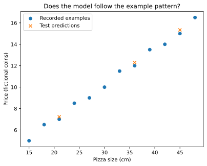

This chart was rendered from the supplied code and input; rerun the cell after changing the data.

**Expected result:** a graph with twelve recorded points and three prediction crosses, rather than a text message.

- `scatter` draws paired horizontal and vertical values as points.
- `label` names a group for the legend; `marker="x"` draws crosses.
- `xlabel` and `ylabel` name the axes and units.
- `title` states the question, `legend` identifies groups, and `show` displays the graph.

🎯 **Try it:** find the prediction with the largest error. Name something a real shop might need that this dataset lacks, such as ingredients or delivery distance.

**Overfitting** means learning details that do not generalize beyond training examples. **Underfitting** means the approach is too limited to capture a useful pattern. Separate evaluation examples help reveal these problems; a good training score alone cannot rule them out.

✅ **Checkpoint:** produce the graph, identify an error, and name a limitation. A numeric assertion alone cannot establish that you made or understood the graph.

### 4 · How to use it in the real world

A shop owner can review the largest errors to discover missing context such as toppings or promotions. Use the error table to identify a question to investigate; do not delete a valid expensive order merely to improve MAE. Record the suspected missing feature, when it would be available, and how you would evaluate a revised model on fresh evidence.

[➡️ Next: handle a missing value](#lesson-6)

<a id="lesson-6"></a>

## 🔵 6 · Handle missing data safely

### 1 · Problem

A missing size is not a zero-size pizza. Many estimators cannot fit or predict with an unhandled missing numeric value.

### 2 · How to fix it

Introduce one deliberate gap in a copy, learn a training median, and connect filling and regression in a pipeline.

### 3 · How to use it

A **missing value** means an observation was not recorded. It is not automatically zero: an unknown pizza size and a zero-size pizza are different things.

An **imputer** fills missing values using a rule. A **pipeline** connects preparation and prediction so the same process is applied during fitting and use.

#### Step 1 · Add a gap to a copy

This controlled exercise leaves the original table and its test rows unchanged.

**Run this cell:**

~~~python
pizza_X_train_gap = pizza_X_train.astype(float).copy()     # Keep the original table unchanged.
pizza_X_train_gap.iloc[0, 0] = float("nan")  # Mark the first training size as missing.

print("Missing training sizes:", pizza_X_train_gap["size_cm"].isna().sum())
~~~


**Recorded output from this input:**

~~~text
Missing training sizes: 1
~~~
- `copy` creates a separate table.
- `iloc[0, 0]` selects the first row and first column by position.
- `float("nan")` creates a missing numeric value. **NaN** means “not a number” in this context.
- `isna().sum()` counts the missing entries.

#### Step 2 · Connect filling and fitting

**Run this cell:**

~~~python
from sklearn.impute import SimpleImputer  # Fill gaps using a specified rule.
from sklearn.pipeline import make_pipeline  # Chain preparation and prediction.

pizza_pipeline = make_pipeline(
    SimpleImputer(strategy="median"),  # Learn the middle training size and fill gaps.
    LinearRegression(),               # Learn from the prepared inputs.
)
pizza_pipeline.fit(pizza_X_train_gap, pizza_y_train)

print("The missing-value pipeline is trained.")
~~~


**Recorded output from this input:**

~~~text
The missing-value pipeline is trained.
~~~
The **median** is the middle sorted value; with an even count, it is the average of the two middle values. Filling a gap with it is still an assumption.

`make_pipeline` connects steps in order. During `fit`, the filling rule and regression learn from training data. The test rows do not supply the median.

#### Step 3 · Reuse the same process

**Run this cell:**

~~~python
pizza_pipeline_price = pizza_pipeline.predict(pizza_new_order)[0]
print("Pipeline estimate:", round(pizza_pipeline_price, 2), "coins")
~~~


**Recorded output from this input:**

~~~text
Pipeline estimate: 10.27 coins
~~~
The filling rule happens to restore this missing size to its original value, so the displayed estimate matches the earlier one. Filling gaps does not generally recover their true values.

**Data leakage** happens when information that should be unavailable influences learning or evaluation. Learning filling values or selecting features using all data before evaluation can leak information. Keep learned preparation inside training, and inside each training fold when using cross-validation.

🎯 **Try it:** first duplicate the notebook: in JupyterLab use File → Save Notebook As with a new name; in Colab use File → Save a copy in Drive. In that copy, mark a different training size as missing. Rerun the pipeline and compare predictions for new orders. Return to the original guided notebook for Lesson 7 so its pizza_pipeline retains the guided settings. Do not choose a strategy by repeatedly comparing final test scores.

✅ **Checkpoint:** explain missing versus zero, the filling assumption, and why the imputer must learn from training data.

### 4 · How to use it in the real world

The same pipeline must process an incoming order, so filling cannot be a separate forgotten notebook step:

~~~python
missing_size_request = pd.DataFrame({"size_cm": [float("nan")]})
print("Estimate with missing size:", round(float(pizza_pipeline.predict(missing_size_request)[0]), 2))
~~~


**Recorded output from this input:**

~~~text
Estimate with missing size: 10.27
~~~
This shows the fallback behavior, not that an unknown size deserves an automatic quote. A real form may instead ask the customer to supply size; make that product decision explicit.

[➡️ Next: save your work](#lesson-7)

<a id="lesson-7"></a>

## 🔵 7 · Save and reuse your work

### 1 · Problem

Tomorrow’s program cannot use a model that exists only in today’s notebook memory.

### 2 · How to fix it

Save the practice table and the complete fitted pipeline, reload them, and check that the prediction survives the round trip.

### 3 · How to use it

A **CSV** stores a table as text, with commas separating columns. A **model artifact** stores a fitted model and, here, its preparation steps.

These cells write to a named practice subfolder. Saving to the same filename again replaces that file; choose new names to keep multiple attempts. They do not delete folders or modify the bundled datasets.

#### Step 1 · Save the table

**Run this cell:**

~~~python
from pathlib import Path  # Work with file and folder paths.

pizza_output_dir = Path("my-ml-practice")  # A subfolder of the working directory.
pizza_output_dir.mkdir(exist_ok=True)     # Create it, or reuse the existing folder.
pizza_csv_file = pizza_output_dir / "pizza-practice.csv"  # Join folder and filename.

pizza_table.to_csv(pizza_csv_file, index=False)
pizza_loaded_table = pd.read_csv(pizza_csv_file)

print("Loaded rows and columns:", pizza_loaded_table.shape)
~~~


**Recorded output from this input:**

~~~text
Loaded rows and columns: (12, 2)
~~~
- `Path(...)` describes a location without creating it.
- `mkdir` creates a directory; `exist_ok=True` permits an existing directory.
- `/` joins path parts here rather than dividing numbers.
- `to_csv` writes the table; `index=False` avoids adding the row index as a data column.
- `read_csv` reads it back.
- This path is relative to the working directory. Find that location using [the diagnostic cell](#troubleshooting).

#### Step 2 · Save the pipeline

**Run this cell:**

~~~python
import joblib  # Save and load fitted objects.

pizza_model_file = pizza_output_dir / "pizza-pipeline.joblib"
joblib.dump(pizza_pipeline, pizza_model_file)  # Save filling and prediction together.

print("Saved:", pizza_model_file.as_posix())
~~~


**Recorded output from this input:**

~~~text
Saved: my-ml-practice/pizza-pipeline.joblib
~~~
`dump` writes the artifact; `as_posix()` displays the path with forward slashes.

#### Step 3 · Reload and check it

**Run this cell:**

~~~python
pizza_reloaded_pipeline = joblib.load(pizza_model_file)  # Only load your own trusted artifact.
pizza_reloaded_price = pizza_reloaded_pipeline.predict(pizza_new_order)[0]

assert pizza_reloaded_price == pizza_pipeline_price  # Check this round trip.
print("Reloaded estimate:", round(pizza_reloaded_price, 2), "coins")
~~~


**Recorded output from this input:**

~~~text
Reloaded estimate: 10.27 coins
~~~
`assert` checks a condition and raises `AssertionError` if false. `==` compares; `=` assigns.

This checks one round trip, not every future prediction. Joblib loading can execute code: load only artifacts you created or trust. Use a compatible environment and retain package versions for artifacts you intend to reuse.

🎯 **Try it:** locate the CSV and model in the file browser. In Colab, download them before the runtime ends if you want to retain them.

✅ **Checkpoint:** save, restart, and run your pizza notebook from the beginning. In JupyterLab use Kernel → Restart Kernel and Run All Cells; in Colab use Runtime → Restart session, then Runtime → Run all (wording may vary). It should finish without old variables, recreating its explicitly named practice files. Restore experimental edits or keep them separate.

### 4 · How to use it in the real world

A separate prediction process should load one trusted artifact and use the same input schema. The reload check below is a tiny version of that handoff:

~~~python
print("Reloaded order estimate:", round(float(pizza_reloaded_pipeline.predict(pd.DataFrame({"size_cm": [30]}))[0]), 2))
~~~


**Recorded output from this input:**

~~~text
Reloaded order estimate: 10.27
~~~
Record the dependency versions and input units alongside a real artifact. Do not load an untrusted joblib file; loading it can execute code.

[➡️ Next: learn classification](#lesson-8)

<a id="lesson-8"></a>

## 🟣 8 · Predict a category: flowers

### 1 · Problem

A numerical price predictor does not answer a category question such as which flower species a measurement resembles.

### 2 · How to fix it

Start a separate notebook, reserve stratified test rows, compare a majority-class baseline and a small decision tree, and inspect class errors.

### 3 · How to use it

**Regression** predicts a number; **classification** predicts a category.

Create a **separate notebook**, **flower-learning.ipynb**. This lesson imports its own tools and uses `flower_` names.

Iris is a small flower dataset bundled with scikit-learn. No separate download is needed once that package is installed. There are 150 examples with four measurements; we will use two petal measurements.

#### Step 1 · Load inputs and labels

**Run this cell:**

~~~python
from sklearn.datasets import load_iris  # Load the bundled dataset.
from sklearn.model_selection import train_test_split
from sklearn.dummy import DummyClassifier
from sklearn.tree import DecisionTreeClassifier
from sklearn.metrics import accuracy_score, confusion_matrix

flower_data = load_iris(as_frame=True)  # Request measurements as a pandas table.
flower_X = flower_data.data[["petal length (cm)", "petal width (cm)"]]
flower_y = flower_data.target

print("Examples:", len(flower_X))
print("Category names:", flower_data.target_names.tolist())
~~~


**Recorded output from this input:**

~~~text
Examples: 150
Category names: ['setosa', 'versicolor', 'virginica']
~~~
- `load_iris` returns measurements, answers, category names, and a dataset description.
- `as_frame=True` requests tables/columns instead of plain arrays.
- `.data` contains inputs; `.target` contains the recorded answer per row.
- `.target_names` provides the names. Labels `0`, `1`, and `2` correspond to those names in order; they do not rank the flowers.
- The selected columns measure petal length and width in centimeters.
- The imported classifiers predict categories; the metric tools check their predictions.

#### Step 2 · Split before fitting

**Run this cell:**

~~~python
flower_X_train, flower_X_test, flower_y_train, flower_y_test = train_test_split(
    flower_X, flower_y, test_size=0.20, stratify=flower_y, random_state=42
)

print("Training rows:", len(flower_X_train), "| Test rows:", len(flower_X_test))
~~~


**Recorded output from this input:**

~~~text
Training rows: 120 | Test rows: 30
~~~
`stratify=flower_y` keeps class proportions approximately consistent between the sets. We reserve 20%; the seed makes the exercise repeatable.

#### Step 3 · Fit a baseline and a tree

**Run this cell:**

~~~python
flower_baseline = DummyClassifier(strategy="most_frequent")  # Guess the most common training class.
flower_baseline.fit(flower_X_train, flower_y_train)

flower_model = DecisionTreeClassifier(max_depth=3, random_state=42)
flower_model.fit(flower_X_train, flower_y_train)

flower_baseline_predictions = flower_baseline.predict(flower_X_test)
flower_predictions = flower_model.predict(flower_X_test)
~~~


**What you see:** this setup cell prints no text. It defines or fits the objects used by the next cell in this experiment.

A **decision tree** learns questions about feature values and follows branches to an answer. `max_depth=3` limits a path to at most three splits, helping control complexity. It does not mean there are only three leaves.

Both methods learn from the same training rows, without test answers during fitting.

#### Step 4 · Inspect results

**Run this cell:**

~~~python
print("Baseline accuracy:", round(accuracy_score(flower_y_test, flower_baseline_predictions), 3))
print("Tree accuracy:", round(accuracy_score(flower_y_test, flower_predictions), 3))

flower_confusion = confusion_matrix(flower_y_test, flower_predictions, labels=[0, 1, 2])
print("Rows = actual classes; columns = predicted classes")
print(flower_confusion)
~~~


**Recorded output from this input:**

~~~text
Baseline accuracy: 0.333
Tree accuracy: 0.967
Rows = actual classes; columns = predicted classes
[[10  0  0]
 [ 0  9  1]
 [ 0  0 10]]
~~~
**Accuracy** is correct predictions divided by all predictions. Here 29 of 30 tree predictions were correct.

A **confusion matrix** shows which classes were confused:

- Rows and columns use label order `0, 1, 2`: setosa, versicolor, virginica.
- Diagonal cells count correct predictions.
- The `1` in row 1, column 2 means one actual versicolor was predicted as virginica.
- Other off-diagonal cells count other mistakes.

Accuracy can mislead when classes are unbalanced. If 99 of 100 emails are ordinary mail, always guessing “ordinary” scores 99% but finds no spam. **Precision** measures how many positive predictions were correct; **recall** measures how many actual positives were found. Examine those and the costs of mistakes rather than accuracy alone.

🎯 **Try it:** explain every matrix cell. Name one use where false alarms matter and one where missing a positive case matters. This small benchmark does not establish real-world readiness.

✅ **Checkpoint:** explain regression, classification, baseline, accuracy, and confusion matrix in your own words.

### 4 · How to use it in the real world

A measurement form must send the same two petal measurements in centimeters. Use the fitted classifier on a newly entered record, and translate the numerical class back to its name using the dataset’s class-name mapping.
~~~python
import pandas as pd  # This separate flower notebook needs its own table import.
flower_request = pd.DataFrame([[1.5, 0.2]], columns=flower_X_train.columns)
flower_request_class = int(flower_model.predict(flower_request)[0])
print("Entered petal measurements:")
print(flower_request.to_string(index=False))
print("Predicted species:", flower_data.target_names[flower_request_class])
~~~


**Recorded output from this input:**

~~~text
Entered petal measurements:
 petal length (cm)  petal width (cm)
               1.5               0.2
Predicted species: setosa
~~~
The model’s earlier held-out evaluation, rather than this single request, is the evidence about performance.

[➡️ Next: complete an independent project](#lesson-9)

<a id="lesson-9"></a>

## 🟣 9 · Complete your own project

### 1 · Problem

Following a supplied solution can hide whether you can plan and complete a new prediction task independently.

### 2 · How to fix it

Use the salary dataset with a problem contract, honest split, baseline, suitable metric, and your own error investigation.

### 3 · How to use it

Create **salary-project.ipynb**, a fresh notebook, and use the supplied [salary and experience CSV](datasets/salary_experience.csv).

The columns are `years_experience` and `salary`. These practice data teach a method; they are not a tool for real employment or pay decisions.

Experience is measured in years. The CSV does not declare a currency for `salary`, so record the target as **salary units** unless its source documentation establishes the currency. Checking metadata is better than guessing units.

#### Step 1 · Put the CSV beside your notebook

- **GitHub:** open the CSV link, use its raw/download view, and save **salary_experience.csv**.
- **Colab:** upload the saved CSV through the notebook's Files panel.
- **Local notebook:** copy it into your practice folder. Leave the original bundle's file unchanged.

**Run this readiness cell in the new notebook:**

~~~python
from pathlib import Path  # Check the location before reading the file.

salary_file = Path("salary_experience.csv")
print("CSV is in the working directory:", salary_file.exists())
assert salary_file.is_file(), "Upload salary_experience.csv beside this notebook before continuing."
~~~


**Recorded output from this input:**

~~~text
CSV is in the working directory: True
~~~
**Expected result:** `True`. `exists()` asks whether the path exists. If it prints `False`, fix the filename/location first.

You know how to import pandas and call `read_csv`. Write those instructions yourself.

#### Step 2 · Follow the project brief

1. State the question. Identify the feature, target, and units supplied with the data.
2. Inspect counts, missing cells, duplicates, and implausible values. Investigate surprising records rather than automatically deleting rare ones.
3. Decide what information would be available **when predicting**. Exclude anything that reveals the future answer.
4. Reserve an appropriate test set before fitting learned preparation or models.
5. Fit a baseline using training data.
6. Fit one suitable model, using a training-only pipeline if preparation is needed.
7. Choose any alternative approaches or settings using training-only validation. Keep the final test for the chosen procedure.
8. Report final-test MAE in salary units and compare with the baseline.
9. Inspect individual errors and explain what this small dataset cannot establish.
10. Predict a new record in the same input format. Save your notebook and, if useful, your trusted pipeline.

Not beating the baseline is useful evidence. Investigate honestly; do not repeatedly change splits or remove difficult test rows to obtain a nicer result.

<details markdown="1">
<summary>💡 Hints, without the finished answer</summary>

- Inspect exact column names using `salary_table.columns`.
- Double brackets select a feature table; single brackets select an answer column.
- Reuse `train_test_split`, `DummyRegressor`, `LinearRegression`, and `mean_absolute_error`.
- Use `salary_` names to keep the project separate.
- To choose settings, use a validation split within the training portion or training-only cross-validation.
- Report the test row count and individual errors, not just one score.
- Record each decision: what you tried, the evidence, and what remains uncertain.

</details>

#### Step 3 · Check independence

| Skill | Evidence |
|---|---|
| **Run** | Restart and run without old variables or missing files |
| **Understand** | Explain target, inputs, split, baseline, metric, and preparation |
| **Adapt** | Predict a changed record and fix an introduced problem |
| **Evaluate** | Give an honest comparison, inspect errors, and state limits |

Ask a tutor or peer for an unseen variation: a missing input, changed column name, or unfamiliar dataset. Explain your response before running it.

**Reach the beginner milestone by doing these things independently, not by reproducing printed outputs.** Revisit a lesson if needed, then try another variation.

### 4 · How to use it in the real world

Deliver a notebook that another person can restart, plus a prediction for an explicitly supplied experience value and an explanation in salary units. In Workshop D1 a guided model-use cell provides a check after your independent attempt. A working salary demo is not evidence for a compensation policy.

[➡️ Next: continue toward mastery](#lesson-10)

<a id="lesson-10"></a>

## 🟣 10 · Keep growing toward mastery

### 1 · Problem

After one successful notebook, it is easy to confuse a familiar example with broad competence.

### 2 · How to fix it

Add one challenge at a time: mixed inputs, comparison, uncertainty, other learning settings, serving, and controlled updates.

### 3 · How to use it

Your repeatable workflow is:

**Question → inspect → reserve evaluation data → baseline → fit → evaluate → investigate → explain limits.**

Add one difficulty at a time. The detailed handbook is a **reference library**, not a requirement to read every method before building anything.

| Next stage | Practical project | Explain this before moving on |
|---|---|---|
| Mixed tables | Titanic or another dataset with numbers and categories | Missing data, encoding, leakage, and fold-local preparation |
| Model comparison | Compare a baseline and two reasonable model families | Validation choice, errors, and why the winner can change |
| Dependable estimates | Cross-validation or a suitable uncertainty method | Fold variation is not automatically a confidence or prediction interval |
| Unsupervised learning | Explore groups or compressed representations | No supplied answer labels; usefulness needs justification |
| Local serving | Reload a pipeline and expose one prediction interface | Input validation, versions, errors, and training/prediction parity |
| Updates and monitoring | Simulate changed data and evaluate a candidate | Promotion validation, genuinely unseen evaluation, and rollback |
| Responsible application | Inspect collection methods and subgroup errors | Privacy, bias, sample sizes, context, and limits of a fairness check |
| Advanced study | Choose time series, neural networks, or reinforcement learning for a reason | Their prerequisites, evaluation, costs, and failure modes |

**Cross-validation** repeats training and validation across several splits of training data. Each fold must learn its own preparation. Use an untouched final test or appropriate outer evaluation to assess a selection process.

**Hyperparameters** are choices made before fitting, such as tree depth. Choose them through validation, not by optimizing final test results.

A **production system** also needs reliable inputs, monitoring, access controls, failure handling, deployment processes, and operational ownership. A notebook or local demonstration does not establish all of those capabilities.

**Suggested portfolio progression:**

1. Complete the independent salary project.
2. Build a classification project with missing values and categories.
3. Compare approaches on unfamiliar data, document validation, and inspect subgroup errors.
4. Package a trusted pipeline with a validated local prediction interface.
5. Evaluate a simulated update and demonstrate safe rollback using isolated practice files.

For details, use the [published reference](../../../docs/data-science/machine-learning-handbook.md) or [original reference source](Data_Science_Handbook.md). They contain more examples and advanced workflows. Their archived printed outputs and illustrative demonstrations do not guarantee that every block is independently runnable in every environment. Keep unrelated projects isolated, avoid blindly executing reset/deletion commands, and keep learned preparation inside training. This README's guided route does not require running those advanced examples.

### 4 · How to use it in the real world

Use the full workshops below to build the five portfolio projects. For each, hand another learner a changed input or a broken schema, explain your response, and show the resulting prediction or clear rejection. Preserve the source-coverage map so breadth is visible without making a beginner start with every advanced tool.


<a id="optional-clustering"></a>

<details markdown="1">
<summary>🧩 Optional: group customers without answer labels</summary>

## 🧩 Group customers without answer labels

### 1 · Problem

You have customer measurements but no answer labels. A supervised classifier cannot learn invented “correct” segments.

### 2 · How to fix it

Fit groups from similarities, inspect their actual members, and keep group numbers separate from business judgments.

### 3 · How to use it


Create **customer-groups.ipynb**, a separate notebook.

**Unsupervised learning** finds structure without supplied target labels. **Clustering** groups similar examples. K-Means is clustering, not a standard supervised classifier.

Six fictional customers have visits per week and items per visit. The features use comparable scales here. We request two groups as an exercise; real data do not promise that two is appropriate.

**Run this cell:**

~~~python
import pandas as pd
from sklearn.cluster import KMeans

customer_table = pd.DataFrame({
    "visits_per_week": [1, 1, 2, 8, 8, 9],
    "items_per_visit": [1, 2, 1, 8, 9, 8],
})
customer_model = KMeans(n_clusters=2, n_init=10, random_state=0)
customer_groups = customer_model.fit_predict(customer_table)

print("Group numbers:", customer_groups.tolist())
~~~


**Recorded output from this input:**

~~~text
Group numbers: [1, 1, 1, 0, 0, 0]
~~~
- `n_clusters=2` requests two groups.
- `n_init=10` tries ten initial centroid configurations and retains the best fit under K-Means' objective.
- `random_state=0` makes initialization repeatable.
- A **centroid** is a cluster's center.
- `fit_predict` fits the groups and returns each row's group number.
- Table/list syntax is the same as Lesson 2; imports are explicit because this is a fresh notebook.

**Expected relationship:** the first three customers share a group, and the last three share another. Group numbers are arbitrary and may swap. They do not mean “good” or “bad” customers.

🎯 **Try it:** explain similarity using these measurements. Consider how feature scaling or changing the requested number of groups could change the result. Do not calculate accuracy against invented “correct” groups.

Other settings: **semi-supervised learning** uses labeled and unlabeled examples; **reinforcement learning** learns action policies through interaction and reward. Study them after the beginner route. PCA reduces dimensions rather than clustering; Linear Discriminant Analysis uses class labels, so its dimensionality reduction is supervised.

### 4 · How to use it in the real world

Use the fitted grouping rule for another measurement record:

~~~python
customer_request = pd.DataFrame({"visits_per_week": [2], "items_per_visit": [2]})
print("Group for the entered measurements:", customer_model.predict(customer_request).tolist())
~~~


**Recorded output from this input:**

~~~text
Group for the entered measurements: [1]
~~~
A team might use a descriptive group to plan research or service, after inspecting its profile and stability. The group number itself is not a customer-value score. This fixture uses comparable scales; realistic income/visit features need training-fitted scaling.

</details>

<a id="complete-curriculum"></a>

## 🧭 Continue here: the complete practical curriculum

The first ten lessons teach the basic workflow. The workshops below teach the remaining topics from the PDF and the original handbook. Work **A → B → C → D → E → F**. Each workshop has its own notebook and explains its own setup; do not run all examples in one shared notebook.

| Stage | Open this workshop | What you will build |
|---|---|---|
| A · Foundations | [Python, arrays, tables, charts, statistics](#workshop-foundations) | Small programs you can explain |
| B · Preparation | [Every cleaning step and transformation](#workshop-preprocessing) | A documented cleaning recipe |
| C · Honest experiments | [The complete data-science pipeline](#workshop-pipeline) | A mixed-table prediction experiment |
| D · Broaden your practice | [All 13 dataset projects](#workshop-datasets) | A portfolio with different data types |
| E · Learning methods | [Categories and algorithms](#workshop-algorithms) | Comparisons, clusters, and learning agents |
| F · Deliver and maintain | [Deployment, monitoring, desktop, databases](#workshop-systems) | A local prediction system you can update |

**How each workshop works:** read its goal, run one short cell, inspect the result, make the requested change, then explain the checkpoint. “Optional software” means an additional installation or dataset is required; it does not mean the topic has been silently skipped.

<details markdown="1">
<summary>🛠️ Find a complete worked continuation</summary>

| Need | Open the worked example |
|---|---|
| Fill missing values and actually predict | [Numeric mode](#gap-numeric-mode), [mean](#gap-mean-model), [Unknown category](#gap-unknown-category-model), [forward fill](#gap-forward-fill-model), [backward fill](#gap-backward-fill-model), [numeric interpolation](#gap-numeric-interpolation-model) |
| Preserve Boolean/date meaning | [Boolean mode](#gap-boolean-mode), [missing timestamps](#gap-datetime-interpolation) |
| Put text preparation inside a classifier | [Stop words](#gap-stopword-classifier), [WordNet lemmas](#gap-lemma-classifier) |
| Apply and compare transformations | [Signed Min–Max](#gap-minmax-signed-range), [Yeo–Johnson](#gap-yeojohnson-model), [normal quantiles](#gap-normal-quantile-model), [all eight with validation](#gap-compare-eight-transforms) |
| Inspect unusual new records or a map | [Training-derived z-score review](#topic-z-score-new-record-review), [t-SNE map and review](#topic-16-t-sne-investigate-neighborhoods-in-a-map) |
| Learn from labelled and unlabelled continuous outcomes | [Self-training regression](#topic-self-training-regression), [co-training regression](#topic-co-training-regression) |
| Turn unfamiliar raw data into model inputs | [Geocoded public landmarks](#topic-public-landmark-geocoding), [nested JSON](#topic-nested-json-model-flow), [decoded MP3 audio](#topic-mp3-decode-model-flow) |
| Practice on the PDF's 13 datasets | [D1–D13 and their worked continuations](#workshop-datasets), then [the D14 handoff](#topic-d14-show-that-you-can-transfer-the-workflow) |

</details>

Keep a decision journal with four columns: **question, action, evidence, limitation**. A successful run is one piece of evidence; being able to adapt the example is the learning goal.

<a id="source-coverage"></a>

<details markdown="1">
<summary>✅ Source coverage: find every PDF section and the original handbook’s additional chapters</summary>

This map locates the source topics in the rewritten curriculum. Small examples replace repeated stories and old outputs; optional software/data exercises state their prerequisites. Coverage is not a claim that every optional environment was executed or that reading alone establishes mastery.

| Source | Topics and subtopics | Practice here |
|---|---|---|
| Original 0.0–0.1 | Notebook/error handling; every Python foundation from values/operators through classes/generators/imports | [Lessons 1–2; Workshop A1–A2](#workshop-foundations) |
| Original 0.2–0.5 | NumPy, pandas, chart types, statistics, distributions, correlation, skew and logs | [Workshop A3–A5](#workshop-foundations) |
| Original 0.6–0.7 | Regression/classification and complete baseline-to-saved-model project | [Lessons 2–9](#lesson-2) |
| PDF 1.1–1.2 | Problem/task/metric/domain/constraints; files/databases/APIs/scraping, storage/metadata/privacy | [Workshop C1–C2 and extensions](#workshop-pipeline) |
| Original 1.3.0 | Unwanted/private/constant/redundant/leaking/out-of-scope data | [Workshop B, P0](#workshop-preprocessing) |
| PDF 1.3.1 | Missing-value detection, drop/fill strategies, KNN/iterative/group/sequence imputation and assumptions | [Workshop B, P1–P1h](#workshop-preprocessing) |
| PDF 1.3.2 | Exact, key/version, normalized and fuzzy duplicates | [Workshop B, P2](#workshop-preprocessing) |
| PDF 1.3.3 | Inconsistent formats, spellings, units, allowed values and phones | [Workshop B, P3](#workshop-preprocessing) |
| PDF 1.3.4 | Boxplots, z/IQR/MAD/detector flags; investigate/remove/cap/transform/flag | [Workshop B, P4](#workshop-preprocessing) |
| PDF 1.3.5 | Min-Max/standard/robust scaling, fitting/inversion and model sensitivity | [Workshop B, P5](#workshop-preprocessing) |
| PDF 1.3.6 | Nominal/ordinal/target labels, one-hot/ordinal/target/frequency/hash encodings, unseen categories | [Workshop B, P6](#workshop-preprocessing) |
| PDF 1.3.7 | Cleaning, tokens/stop words/lemmas, counts/TF-IDF/n-grams, Word2Vec and BERT | [Workshop B, P7](#workshop-preprocessing) |
| PDF 1.3.8 | Boolean mapping, mode/unknown and nullable flags | [Workshop B, P8](#workshop-preprocessing) |
| PDF 1.3.9 | Parsing/time zones, date parts, gaps/interpolation, cycles and past-only features | [Workshop B, P9](#workshop-preprocessing) |
| PDF 1.3.10 | Large numbers, suffixes, notation, precision/storage and currency | [Workshop B, P10](#workshop-preprocessing) |
| PDF image table, page 5 | All table types plus geographic/address, JSON/XML, image/CNN, audio/spectrogram/MFCC and video/LSTM | [Type map and Workshop F1](#workshop-systems) |
| PDF pages 6–8 | All eight transformations: Min-Max, z-score, log, robust, power, quantile, binning, polynomial; selection | [T1–T3](#transformation-workshops) |
| PDF 1.4–1.5 | EDA distributions/relationships/anomalies/collinearity/plots; engineering/selection/tests/importance | [Workshop C3–C4 and extensions](#workshop-pipeline) |
| PDF 1.6–1.8 | Splits/stratification; model selection/training/grid/random/Bayesian/CV; every classification/regression metric and evaluation plot | [Workshop C5–C7 and extensions](#workshop-pipeline) |
| PDF 1.9–1.10 | Deployment/API/REST/Flask/FastAPI/Streamlit/cloud; quality/drift/dashboard/alerts/retraining | [Workshop F2–F5](#workshop-systems) |
| PDF 2.1–2.13 | Salary, Titanic, Ames, Iris, Adult, Wine Quality, Boston/California, MNIST, Mall, Bank, Heart, Fashion-MNIST, Play Store and each preparation task | [Workshop D1–D13](#workshop-datasets) |
| PDF 3.1 | All named supervised regression/classification families, including SVR and tree/forest/boosting regressors | [Algorithms 1–10; mechanism K](#workshop-algorithms) |
| PDF 3.2 and page 19 | K-Means/hierarchy/DBSCAN/GMM; PCA/t-SNE/ICA; supervised LDA correction; Isolation Forest/One-Class SVM/LOF; Apriori/FP-Growth | [Algorithms 11–18; mechanism J](#workshop-algorithms) |
| PDF 3.3 | S3VM, propagation/spreading, self-training and co-training for classification and regression | [Semi-supervised workshop; mechanisms A–B](#semi-supervised-workshop) |
| PDF 3.4 and pages 18–19 | Agent/state/action/reward/policy/value; bandits/Q/SARSA; given/learned models; DQN/policy gradients/actor–critic/MCTS/FrozenLake | [RL workshop; mechanisms C–H](#reinforcement-workshop) |
| Original 4.1–4.7 | Annual data, engine, train/save/load/predict/update/rollback; three Tkinter warm-ups; full app/workflow/distribution | [Workshop F6](#workshop-systems) |
| Original 5.1–5.5 | SQLite/as-of/aggregate joins/database training; versions; form/JSON/Excel/batch/stream adapters; updates | [Workshop F7–F9](#workshop-systems) |
| Original Part 6 and labs | Transfer tasks, five portfolio projects, completion criteria and corrected full glossary | [Workshop F10 and glossary](#glossary) |

Source corrections are taught explicitly: standardization needs no Gaussian-input assumption; scientific notation is representation; K-Means is clustering, PCA/ICA are not; LDA is supervised; statistical flags are not automatic deletion rules; preparation and selection stay inside training.

</details>

<a id="workshop-foundations"></a>

## 🧰 Foundation workshops: learn one tool when you need it

<details markdown="1">
<summary>📍 Jump to a step in this workshop</summary>

- [🐍 A1 · Python values, decisions, and reusable instructions](#topic-a1-python-values-decisions-and-reusable-instructions)
- [🧩 A2 · Read the less familiar Python used in later examples](#topic-a2-read-the-less-familiar-python-used-in-later-examples)
- [🔢 A3 · NumPy: calculate across a collection](#topic-a3-numpy-calculate-across-a-collection)
- [🐼 A4 · pandas: select, summarize, and read a table](#topic-a4-pandas-select-summarize-and-read-a-table)
- [📊 A5 · Choose a chart and describe a numerical summary](#topic-a5-choose-a-chart-and-describe-a-numerical-summary)

</details>


Keep the short pizza route as your starting path. These workshops supply the Python, tables, statistics, and preparation tools used in the larger reference. Choose **one** workshop for a question you actually have; they are not another entrance exam.

Create **foundation-practice.ipynb**. Each complete experiment below imports its own tools and creates its own small data. Numbered continuation cells share that experiment’s variables. Run one box in a fresh notebook cell. To restore an experiment, replace the box with its original text and run it again. None of these ordinary boxes writes files, deletes data, or downloads a dataset. Read printed output below the cell; do not paste that output back into Python.

Every topic follows the same four steps: **Problem → How to fix it → How to use it → How to use it in the real world**. Step 3 makes the operation visible; Step 4 puts it into a model or reproducible workflow. Run continuation cells in order within that topic; start other topics with fresh variables. Recorded outputs below come from the ordinary examples in the checked environment; graphs appear in the notebook. Optional-package cells are labeled separately and are not represented as newly executed. A successful assertion checks its stated condition, not your understanding or all possible cases.

<a id="topic-a1-python-values-decisions-and-reusable-instructions"></a>

### 🐍 A1 · Python values, decisions, and reusable instructions

#### 1 · Problem

You need to turn a small basket of recorded values into a repeatable calculation, rather than editing a total by hand.

#### 2 · How to fix it

Give values names, store related items in lists/dictionaries, and define one function. Use comparisons and indented decisions to explain which branch ran; check several inputs.

#### 3 · How to use it

The literal values in the following code are this experiment's input. Run the commented example, inspect the recorded output, then make the stated change.

A **variable** is a name for a value. A list holds values in order; a dictionary associates keys with values. A function is a named recipe. Python uses indentation to show which instructions belong together.

**Run this cell:**

~~~python
# Text is a string; whole numbers are integers; decimals are floats.
name = "Mia"
prices = {"apple": 0.5, "juice": 2.0, "crisps": 1.5}
basket = ["apple", "apple", "juice"]

def basket_total(items, price_lookup):
    amount = 0.0
    for item in items:                 # Repeat for each item, in order.
        amount = amount + price_lookup[item]
    return amount                     # Give the answer to the caller.

total = basket_total(basket, prices)
print(f"{name}'s basket costs {total:.2f}")  # f inserts values; .2f shows two decimals.
if total > 3:
    print("Above the practice budget")
elif total == 3:
    print("Exactly the practice budget")
else:
    print("Below the practice budget")

print("First/last items:", basket[0], basket[-1])
print("First two:", basket[:2], "| Count:", len(basket))
print("Juice available?", "juice" in prices)
print("Budget test:", total <= 3 and "juice" in basket)
print("Other boolean operators:", False or True, not False)
print("Arithmetic:", 12 / 4, 13 % 4, 3 ** 2, round(1.456, 2))
assert total == 3.0
~~~


**Recorded output from this input:**

~~~text
Mia's basket costs 3.00
Exactly the practice budget
First/last items: apple juice
First two: ['apple', 'apple'] | Count: 3
Juice available? True
Budget test: True
Other boolean operators: True True
Arithmetic: 3.0 1 9 1.46
~~~
`=` assigns; `==` compares. `!=`, `<`, `<=`, `>`, and `>=` also compare. Comparisons return booleans, `True` or `False`. `/` divides, `%` gives a remainder, and `**` raises a power. List positions start at zero; a slice stops before its right-hand position. Colons introduce indented blocks after `def`, `for`, `if`, `elif`, and `else`. `print` displays; `return` hands back a result.

**Change and explain:** add a juice to the basket. Predict the new total and which message will appear. Restore the basket. Then write a new function for two identical pizzas plus one delivery fee; check three different inputs.

#### 4 · How to use it in the real world

A production prediction wrapper must build the same named features every time. This small function turns a caller's size into a model row; it separates input preparation from model fitting. The five training examples below are fictional. Try a changed size, and explain which lines prepare a row and which use the fitted model.

**Workflow input and commented code:**

~~~python
import pandas as pd
from sklearn.linear_model import LinearRegression

training = pd.DataFrame({"size_cm": [10, 20, 30, 40, 50]})
model = LinearRegression().fit(training, [4, 7, 10, 13, 16])
def estimate_price(size_cm):
    if size_cm <= 0:                  # Reject an impossible diameter before calling the model.
        raise ValueError("Size must be positive")
    row = pd.DataFrame({"size_cm": [size_cm]})
    return float(model.predict(row)[0])

print("Input size_cm:", 25)
print("Model estimate:", round(estimate_price(25), 2), "fictional coins")
~~~


**Recorded output from this input:**

~~~text
Input size_cm: 25
Model estimate: 8.5 fictional coins
~~~
<a id="topic-a2-read-the-less-familiar-python-used-in-later-examples"></a>

### 🧩 A2 · Read the less familiar Python used in later examples

#### 1 · Problem

Later model examples contain unpacking, comprehensions, generators, and objects. Copying unfamiliar syntax makes it hard to find where data or state changed.

#### 2 · How to fix it

Read one form at a time: unpack returned values, enumerate a sequence, generate batches, and keep state inside a small class. Use try/except for a named expected error, rather than hiding arbitrary failures.

#### 3 · How to use it

The literal values in the following code are this experiment's input. Run the commented example, inspect the recorded output, then make the stated change.

Use this workshop when later code needs these forms. A **tuple** holds a group of values; unpacking assigns its members to several names. A **comprehension** builds a list. A **generator** yields one value at a time. A **class** describes objects that hold their own values and methods.

**Run this cell:**

~~~python
import math                           # Import a whole module.
from math import sqrt                 # Import one function.

point = (3, 7)
x, y = point                          # Unpack two values.
first, _ = ("keep", "ignore")         # _ is an ordinary name used for an ignored value.
print("Coordinates:", x, y, "| Kept:", first)
print("Roots:", math.sqrt(16), sqrt(81))

words = ["apple", "pear", "plum"]
words.append("orange")                # A method changes this list.
print("Uppercase:", words[0].upper())
for position, word in enumerate(words, start=1):
    print(position, word)
print("Long words:", [word for word in words if len(word) > 4])
double = lambda number: number * 2     # A tiny function expression; def is often clearer.
print("Double:", double(6))
original = {"rooms": 2, "garden": True}
print("Changed copy:", {**original, "rooms": 3})

remaining = 2
while remaining > 0:                  # Repeat while this condition is true.
    print("Remaining:", remaining)
    remaining = remaining - 1
try:
    float("unknown")
except ValueError:                    # Handle this expected conversion error.
    print("That text is not a number")

def parcels():
    for label in ["A", "B"]:
        yield label                  # Produce one value, then pause.
print("Delivered:", list(parcels()))
~~~


**Recorded output from this input:**

~~~text
Coordinates: 3 7 | Kept: keep
Roots: 4.0 9.0
Uppercase: APPLE
1 apple
2 pear
3 plum
4 orange
Long words: ['apple', 'orange']
Double: 12
Changed copy: {'rooms': 3, 'garden': True}
Remaining: 2
Remaining: 1
That text is not a number
Delivered: ['A', 'B']
~~~
**Pause and inspect:** run the preceding step, inspect its values or shapes, and explain its comments. Then continue in the **same notebook**; the next cell uses this experiment's variables.

~~~python
class Counter:
    def __init__(self, start):
        self.value = start           # self refers to this particular object.

    def add_one(self):
        self.value = self.value + 1

    @staticmethod
    def description():               # A helper that does not use an object's state.
        return "A practice counter"

counter = Counter(4)
counter.add_one()
answer = None                         # Explicitly represent no answer yet.
print(Counter.description(), counter.value, "| Unanswered:", answer is None)
assert counter.value == 5
~~~


**Recorded output from this input:**

~~~text
A practice counter 5 | Unanswered: True
~~~
**Change and explain:** create a second counter starting at 20. Change only the first. Explain why the second keeps its own value. You do not need classes or generators for the first pizza model.

#### 4 · How to use it in the real world

A service can keep one fitted model and process small batches instead of refitting for every request. This class owns the fitted estimator; the generator supplies one request at a time. It is a tiny workflow example, not a concurrent or persistent server. Add another request and check that it uses the same fitted object.

**Workflow input and commented code:**

~~~python
import pandas as pd
from sklearn.linear_model import LinearRegression

class PriceService:
    def __init__(self):
        self.model = LinearRegression().fit(pd.DataFrame({"size_cm": [10, 20, 30]}), [4, 7, 10])
    def predict(self, size):
        row = pd.DataFrame({"size_cm": [size]})
        return round(float(self.model.predict(row)[0]), 2)

def requests():
    for size in [15, 25]:             # yield avoids building an unnecessary large batch.
        yield size
service = PriceService()
for request_number, size in enumerate(requests(), start=1):
    print("Request", request_number, "input", size, "estimate", service.predict(size))
~~~


**Recorded output from this input:**

~~~text
Request 1 input 15 estimate 5.5
Request 2 input 25 estimate 8.5
~~~
<a id="topic-a3-numpy-calculate-across-a-collection"></a>

### 🔢 A3 · NumPy: calculate across a collection

#### 1 · Problem

A model receives many numerical rows. Repeating scalar calculations by hand is slow and makes row/column mistakes easy.

#### 2 · How to fix it

Represent numbers as arrays, inspect shape, calculate across all values, and use boolean masks to select matching records. Recreate a seeded generator before expecting the same random sequence.

#### 3 · How to use it

The literal values in the following code are this experiment's input. Run the commented example, inspect the recorded output, then make the stated change.

An **array** stores values with a common data type. NumPy can apply an operation to every value without a Python loop. A **mask** is a collection of True/False answers used to select values.

**Run this cell:**

~~~python
import numpy as np

celsius = np.array([18, 22, 25, 31, 28, 19, 24], dtype=float)
fahrenheit = celsius * 9 / 5 + 32
hot = celsius > 25
print("Fahrenheit:", fahrenheit.round(1).tolist())
print("Hot readings:", celsius[hot].tolist())
print("Total/mean/median:", celsius.sum(), celsius.mean(), np.median(celsius))
print("Min/max/spread:", celsius.min(), celsius.max(), celsius.std())

grid = np.array([[1, 2, 3], [4, 5, 6]])
print("Shape:", grid.shape, "| First row:", grid[0], "| Second column:", grid[:, 1])
rng = np.random.default_rng(42)        # Seed this generator for repeatable practice.
print("Dice:", rng.integers(1, 7, size=5).tolist())  # Upper limit is excluded.
assert np.isclose(fahrenheit[3], 87.8) and hot.sum() == 2
~~~


**Recorded output from this input:**

~~~text
Fahrenheit: [64.4, 71.6, 77.0, 87.8, 82.4, 66.2, 75.2]
Hot readings: [31.0, 28.0]
Total/mean/median: 167.0 23.857142857142858 24.0
Min/max/spread: 18.0 31.0 4.323641700120445
Shape: (2, 3) | First row: [1 2 3] | Second column: [2 5]
Dice: [1, 5, 4, 3, 3]
~~~
`dtype=float` permits decimals. `[:, 1]` means every row, column position 1. NumPy's default standard deviation divides by the count (`ddof=0`); pandas' default uses count minus one (`ddof=1`). These are different conventions, not a broken calculator. A seed makes the same sequence repeat when you recreate the generator; rerunning only its next draw advances that sequence.

**Change and explain:** add a 35°C reading. Predict the hot-day count before running. Restore the original array.

#### 4 · How to use it in the real world

Array shape is part of a model's input contract: each row below is one case and each column one feature. This example predicts a batch, then calculates individual absolute errors in the original target units. Change one input without changing its recorded answer; explain why that makes a different evaluation case.

**Workflow input and commented code:**

~~~python
import numpy as np
from sklearn.linear_model import LinearRegression

train_X = np.array([[10.], [20.], [30.], [40.]])
model = LinearRegression().fit(train_X, np.array([4., 7., 10., 13.]))
new_X = np.array([[15.], [25.]])       # Shape (2, 1), not a flat two-feature row.
known_answers = np.array([6., 8.])
predictions = model.predict(new_X)
print("Input rows:", new_X.tolist())
print("Predictions:", predictions.round(2).tolist())
print("Absolute errors:", np.abs(known_answers - predictions).round(2).tolist())
~~~


**Recorded output from this input:**

~~~text
Input rows: [[15.0], [25.0]]
Predictions: [5.5, 8.5]
Absolute errors: [0.5, 0.5]
~~~
<a id="topic-a4-pandas-select-summarize-and-read-a-table"></a>

### 🐼 A4 · pandas: select, summarize, and read a table

#### 1 · Problem

A CSV can load successfully while you select the wrong columns, omit missing records, or accidentally mix row identities.

#### 2 · How to fix it

Inspect a DataFrame, select features by name, use explicit masks and row labels, and summarize counts as well as values. Keep raw data separate from derived columns.

#### 3 · How to use it

The literal values in the following code are this experiment's input. Run the commented example, inspect the recorded output, then make the stated change.

A **DataFrame** is a table; a **Series** is one column. A row label, or **index**, helps pandas align records. A column's **dtype** describes how its values are stored.

**Run this cell:**

~~~python
import io
import pandas as pd

csv_text = "name,city,spent\nAna,Rome,12\nBen,Oslo,8\nCara,Rome,20\nDan,Oslo,\n"
shop = pd.read_csv(io.StringIO(csv_text))  # Treat the supplied text as an in-memory file.
print(shop.head())
print("Shape:", shop.shape, "| Columns:", shop.columns.tolist())
print("Stored types:\n", shop.dtypes)
print("One column:\n", shop["spent"])
print("Two columns:\n", shop[["name", "spent"]])
mask = (shop["city"] == "Rome") & (shop["spent"] > 10)
print("Matching names:", shop.loc[mask, "name"].tolist())
print("Not Rome:", shop.loc[~(shop["city"] == "Rome"), "name"].tolist())
print("Rome OR spent over 15:\n", shop[(shop["city"] == "Rome") | (shop["spent"] > 15)])
shop["spent_with_tax"] = shop["spent"] * 1.2
print("Sorted:\n", shop.sort_values("spent", ascending=False))
print("Summary:\n", shop.describe())
print("City counts:\n", shop["city"].value_counts())
print("Mean spend by city:\n", shop.groupby("city")["spent"].mean())
print("Missing cells:\n", shop.isna().sum())
assert shop["spent"].isna().sum() == 1
~~~


**Recorded output from this input:**

~~~text
   name  city  spent
0   Ana  Rome   12.0
1   Ben  Oslo    8.0
2  Cara  Rome   20.0
3   Dan  Oslo    NaN
Shape: (4, 3) | Columns: ['name', 'city', 'spent']
Stored types:
 name      object
city      object
spent    float64
dtype: object
One column:
 0    12.0
1     8.0
2    20.0
3     NaN
Name: spent, dtype: float64
Two columns:
    name  spent
0   Ana   12.0
1   Ben    8.0
2  Cara   20.0
3   Dan    NaN
Matching names: ['Ana', 'Cara']
Not Rome: ['Ben', 'Dan']
Rome OR spent over 15:
    name  city  spent
0   Ana  Rome   12.0
2  Cara  Rome   20.0
Sorted:
    name  city  spent  spent_with_tax
2  Cara  Rome   20.0            24.0
0   Ana  Rome   12.0            14.4
1   Ben  Oslo    8.0             9.6
3   Dan  Oslo    NaN             NaN
Summary:
            spent  spent_with_tax
count   3.000000        3.000000
mean   13.333333       16.000000
std     6.110101        7.332121
min     8.000000        9.600000
25%    10.000000       12.000000
50%    12.000000       14.400000
75%    16.000000       19.200000
max    20.000000       24.000000
City counts:
 city
Rome    2
Oslo    2
Name: count, dtype: int64
Mean spend by city:
 city
Oslo     8.0
Rome    16.0
Name: spent, dtype: float64
Missing cells:
 name              0
city              0
spent             1
spent_with_tax    1
dtype: int64
~~~
For a real file, use `pd.read_csv("your-file.csv")` after putting it in the notebook's working directory. Here the text keeps the workshop self-contained. Use `&`, `|`, and `~` for column-wise AND, OR, and NOT, with parentheses around each comparison. Missing values propagate through many calculations; summary methods often skip them. Inspect counts rather than assuming every row contributed.

**Change and explain:** select only Oslo records, then calculate total spending by city. Explain why one city's recorded total has an unknown contribution.

#### 4 · How to use it in the real world

A model must receive the intended features in the expected order, rather than every column in an export. Here pandas selects the training feature and builds a two-row request batch. The name column stays available for reporting but does not enter the model. Add another name and verify the output remains aligned.

**Workflow input and commented code:**

~~~python
import pandas as pd
from sklearn.linear_model import LinearRegression

orders = pd.DataFrame({"customer": ["Ana", "Ben", "Cara", "Dan"],
                       "size_cm": [10, 20, 30, 40], "price": [4, 7, 10, 13]})
features = ["size_cm"]
model = LinearRegression().fit(orders[features], orders["price"])
requests = pd.DataFrame({"customer": ["Eva", "Finn"], "size_cm": [15, 25]})
report = requests.copy()              # Keep request identity; add predictions to a new table.
report["estimated_price"] = model.predict(requests[features]).round(2)
print(report.to_string(index=False))
~~~


**Recorded output from this input:**

~~~text
customer  size_cm  estimated_price
     Eva       15              5.5
    Finn       25              8.5
~~~
<a id="topic-a5-choose-a-chart-and-describe-a-numerical-summary"></a>

### 📊 A5 · Choose a chart and describe a numerical summary

#### 1 · Problem

A single average or model score can hide skew, unusual observations, and large individual errors.

#### 2 · How to fix it

Choose a chart for the question and calculate summaries with units. Compare mean/median/spread, inspect individual points, and distinguish association from causation.

#### 3 · How to use it

The literal values in the following code are this experiment's input. Run the commented example, inspect the recorded output, then make the stated change.

Mean = total divided by count. Median = the middle sorted value. Mode = a most frequent value. Standard deviation describes spread in the original units. Quartiles describe positions in sorted data; the **IQR** is the upper quartile minus the lower quartile. A z-score describes distance from a mean in standard-deviation units. It does not prove a value is an error.

**Run this cell:**

~~~python
import numpy as np
import pandas as pd
import matplotlib.pyplot as plt

scores = pd.Series([55, 60, 62, 65, 70, 72, 99], dtype=float)
print("Mean/median/modes:", scores.mean(), scores.median(), scores.mode().tolist())
print("Sample std:", scores.std())
q1, q3 = scores.quantile([0.25, 0.75])
print("Quartiles/IQR:", q1, q3, q3 - q1)
print("Z-scores:", ((scores - scores.mean()) / scores.std()).round(2).tolist())
print("Skew:", scores.skew())          # Asymmetry; tiny samples give unstable summaries.
hours = pd.Series([1, 2, 3, 4, 5, 6, 7])
print("Correlation with hours:", hours.corr(scores))
print("Log10:", np.log10([1, 10, 100, 1000]).tolist())
print("Log1p, including zero:", np.log1p([0, 9, 99]).round(2).tolist())

fig, axes = plt.subplots(2, 3, figsize=(11, 6))
axes[0, 0].plot(["Jan", "Feb", "Mar"], [4, 7, 6], marker="o")
axes[0, 0].set_title("Line: change over time")
axes[0, 1].bar(["Rome", "Oslo"], [32, 8])
axes[0, 1].set_title("Bar: compare categories")
axes[0, 2].hist(scores, bins=5)
axes[0, 2].set_title("Histogram: distribution")
axes[1, 0].scatter(hours, scores)
axes[1, 0].set(xlabel="study hours", ylabel="score", title="Scatter: relationship")
axes[1, 1].boxplot(scores)
axes[1, 1].set_title("Boxplot: quartiles and flagged extremes")
axes[1, 2].axis("off")
plt.tight_layout()
plt.show()
~~~


**Recorded output from this input:**

~~~text
Mean/median/modes: 69.0 65.0 [55.0, 60.0, 62.0, 65.0, 70.0, 72.0, 99.0]
Sample std: 14.445299120013633
Quartiles/IQR: 61.0 71.0 10.0
Z-scores: [-0.97, -0.62, -0.48, -0.28, 0.07, 0.21, 2.08]
Skew: 1.7918870930170736
Correlation with hours: 0.8759164204056714
Log10: [0.0, 1.0, 2.0, 3.0]
Log1p, including zero: [0.0, 2.3, 4.61]
~~~
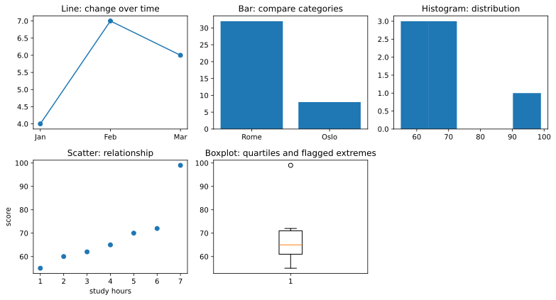

This chart was rendered from the supplied code and input; rerun the cell after changing the data.

`subplots` makes several drawing areas; `axes[row, column]` selects one. A histogram groups numeric ranges; a bar chart compares categories. `log10(100)` is 2 because ten squared is 100. `log1p(x)` calculates the natural logarithm of `1+x`, so zero is permitted. Neither transform repairs a mistaken measurement. Correlation measures association; it does not establish causation, and zero Pearson correlation can hide a nonlinear relationship.

**Change and explain:** temporarily replace 99 with 69. Compare mean, median, spread, and boxplot. Identify one conclusion the seven rows cannot support.

#### 4 · How to use it in the real world

A model review combines a metric with case-level evidence. This fixed model predicts two reserved examples, prints their errors, and draws those errors. Do not choose a new model because you prefer the reserved cases; use a separate development comparison for that. Explain why the overall MAE does not describe every individual mistake.

**Workflow input and commented code:**

~~~python
import numpy as np
import pandas as pd
import matplotlib.pyplot as plt
from sklearn.linear_model import LinearRegression
from sklearn.metrics import mean_absolute_error

train = pd.DataFrame({"size_cm": [10, 20, 30, 40]})
model = LinearRegression().fit(train, [4, 7, 10, 13])
reserved = pd.DataFrame({"size_cm": [15, 35]})
actual = np.array([6., 14.])
predicted = model.predict(reserved)
report = reserved.assign(actual=actual, predicted=predicted.round(2), absolute_error=np.abs(actual-predicted).round(2))
print(report.to_string(index=False))
print("Reserved MAE:", round(mean_absolute_error(actual, predicted), 2), "coins")
plt.scatter(predicted, actual-predicted)
plt.axhline(0, color="black")
plt.xlabel("Predicted coins"); plt.ylabel("Actual minus predicted coins")
plt.show()
~~~


**Recorded output from this input:**

~~~text
 size_cm  actual  predicted  absolute_error
      15     6.0        5.5             0.5
      35    14.0       11.5             2.5
Reserved MAE: 1.5 coins
~~~
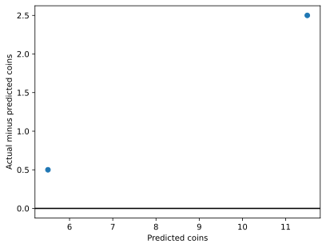

This chart was rendered from the supplied code and input; rerun the cell after changing the data.

<a id="workshop-preprocessing"></a>


[↑ Back to the curriculum](#complete-curriculum)

## 🧹 Preparation workshops: inspect, choose, and preserve evidence

<details markdown="1">
<summary>📍 Jump to a step in this workshop</summary>

- [🗑️ P0 · Remove unwanted data without discarding useful evidence](#topic-p0-remove-unwanted-data-without-discarding-useful-evidence)
- [🕳️ P1 · Missing values: simple fills, indicators, groups, and sequences](#topic-p1-missing-values-simple-fills-indicators-groups-and-sequences)
- [🧭 P1b · Compare KNN and iterative filling on deliberately hidden values](#topic-p1b-compare-knn-and-iterative-filling-on-deliberately-hidden-values)
- [👯 P2 · Exact, versioned, hidden, and fuzzy duplicates](#topic-p2-exact-versioned-hidden-and-fuzzy-duplicates)
- [🧩 P3 · Standardize spellings, units, allowed values, and ranges](#topic-p3-standardize-spellings-units-allowed-values-and-ranges)
- [🚨 P4 · Find unusual observations before deciding what to change](#topic-p4-find-unusual-observations-before-deciding-what-to-change)
- [⚖️ P5 · Fit a ruler on training data, then reuse it](#topic-p5-fit-a-ruler-on-training-data-then-reuse-it)
- [🏷️ P6 · Encode categories and handle unfamiliar values](#topic-p6-encode-categories-and-handle-unfamiliar-values)
- [📝 P7 · Clean text without erasing its meaning](#topic-p7-clean-text-without-erasing-its-meaning)
- [✅ P8 · Boolean values: preserve unknown and report unfamiliar spellings](#topic-p8-boolean-values-preserve-unknown-and-report-unfamiliar-spellings)
- [📅 P9 · Dates, time zones, cycles, and past-only features](#topic-p9-dates-time-zones-cycles-and-past-only-features)
- [🔢 P10 · Parse large numbers without losing identity or precision](#topic-p10-parse-large-numbers-without-losing-identity-or-precision)

</details>


Use a separate **preparation-practice.ipynb**. Each complete box is independent. Small tables make each operation visible; these demonstrations do not prove that a method improves your project.

**One rule throughout:** fixed rules based on the data's documented meaning can be applied consistently. Anything learned from data—means, medians, category lists, frequencies, clipping thresholds, power parameters, bin edges, vocabulary—must be fitted using training data, and refitted inside each training fold when comparing approaches. Keep your raw data. Preserve a record of what changed and why. Inspect genuinely unseen evaluation data with the chosen process; do not delete its hard examples to improve a score.

<a id="topic-p0-remove-unwanted-data-without-discarding-useful-evidence"></a>

### 🗑️ P0 · Remove unwanted data without discarding useful evidence

#### 1 · Problem

An export includes IDs, copied fields, missing answers, test accounts, and information recorded after the prediction. A model can learn an impossible shortcut.

#### 2 · How to fix it

Define the prediction time and row meaning first. Keep the raw export, filter documented out-of-scope records, exclude future-answer columns from features, and report constants, emptiness, and repeated information before deciding.

#### 3 · How to use it

The literal values in the following code are this experiment's input. Run the commented example, inspect the recorded output, then make the stated change.

Decide what one row represents and when the prediction occurs. IDs may be essential for joining records and grouping evaluation even when excluded from model inputs. A constant feature has no variation in the observed training sample; a mostly missing feature might still be informative. Thresholds such as “60% empty” are proposed choices, not universal laws.

**Run this cell:**

~~~python
import pandas as pd

raw = pd.DataFrame({
    "id": [1, 2, 3, 4, 4], "email": ["a@x", "b@x", "c@x", "d@x", "d@x"],
    "is_test": [False, True, False, False, False],
    "country": ["UK"] * 5, "visits": [2, 8, 4, 6, 6],
    "visits_copy": [2, 8, 4, 6, 6], "old_fax": [None] * 5,
    "refund_reason": [None, None, "late", None, None],
    "refunded": [0, 0, 1, None, None],
})
eligible = raw.loc[~raw["is_test"] & raw["refunded"].notna()].drop_duplicates().copy()
print("Before/eligible:", raw.shape, eligible.shape)
print("Observed distinct values:\n", eligible.nunique(dropna=False))
print("Missing shares:\n", eligible.isna().mean())
print("Exact repeated input column:", eligible["visits"].equals(eligible["visits_copy"]))
# The prediction is made when an order is placed: refund_reason is future information.
X = eligible[["visits"]].copy()
y = eligible["refunded"].copy()
print("Kept inputs:", X.columns.tolist(), "| Answers:", y.tolist())
print("Raw data retained:", len(raw))
assert len(raw) == 5 and "refund_reason" not in X
~~~


**Recorded output from this input:**

~~~text
Before/eligible: (5, 9) (2, 9)
Observed distinct values:
 id               2
email            2
is_test          1
country          1
visits           2
visits_copy      2
old_fax          1
refund_reason    2
refunded         2
dtype: int64
Missing shares:
 id               0.0
email            0.0
is_test          0.0
country          0.0
visits           0.0
visits_copy      0.0
old_fax          1.0
refund_reason    0.5
refunded         0.0
dtype: float64
Exact repeated input column: True
Kept inputs: ['visits'] | Answers: [0.0, 1.0]
Raw data retained: 5
~~~
**Inspect a training table:** `.nunique(dropna=False)` finds observed constants, `.isna().mean()` reports missing proportions, and `.corr()` compares numeric relationships. Correlation alone does not prove two columns are interchangeable or that a strong feature leaks the answer. Ask what each value means and whether it existed at prediction time. Keep unknown target rows separately if they represent future prediction requests; ordinary supervised fitting needs recorded targets.

**Practice:** write a keep/exclude/review reason for every original column. Add an out-of-scope country and describe the population your model is intended to serve. Never permanently remove your only raw copy.

#### 4 · How to use it in the real world

The feature list below is an explicit prediction contract. Model fitting uses visits only; IDs remain for joining and the post-event refund reason remains in the raw table. This demonstrates excluding an answer leak while preserving source evidence. Add a future-answer column and confirm it is still absent from the feature list; do not use this four-row fit as an accuracy claim.

**Workflow input and commented code:**

~~~python
import pandas as pd
from sklearn.linear_model import LinearRegression

training_export = pd.DataFrame({"customer_id": [1, 2, 3, 4], "visits": [1, 2, 3, 4],
                                "spend": [5, 10, 15, 20], "refund_reason_after_purchase": [None, "late", None, None]})
features = ["visits"]                 # Fields available before predicting spend.
model = LinearRegression().fit(training_export[features], training_export["spend"])
new = pd.DataFrame({"visits": [5]})
print("Model inputs:", features, "| New input:", new.to_dict("records"))
print("Estimated spend:", model.predict(new).round(2).tolist())
print("Raw ID retained:", "customer_id" in training_export)
~~~


**Recorded output from this input:**

~~~text
Model inputs: ['visits'] | New input: [{'visits': 5}]
Estimated spend: [25.0]
Raw ID retained: True
~~~
<a id="topic-p1-missing-values-simple-fills-indicators-groups-and-sequences"></a>

### 🕳️ P1 · Missing values: simple fills, indicators, groups, and sequences

#### 1 · Problem

An empty measurement is not the same thing as zero, but many models require numerical inputs without gaps. A careless fill can change the population or leak evaluation data.

#### 2 · How to fix it

Describe why values may be absent, compare dropping/filling/unknown indicators, and learn any fill statistics from training rows. Reuse those fitted rules for new rows; keep time-direction constraints when filling sequences.

#### 3 · How to use it

The literal values in the following code are this experiment's input. Run the commented example, inspect the recorded output, then make the stated change.

**MCAR** describes missingness independent of recorded and unrecorded values; **MAR** allows dependence on observed information; **MNAR** allows dependence on missing values after accounting for observed information. These are assumptions about a process. A statistical test or observed group difference cannot generally identify the mechanism by itself.

**Run this cell:**

~~~python
import numpy as np
import pandas as pd
from sklearn.impute import SimpleImputer

train = pd.DataFrame({"group": ["A", "A", "B", "B"],
                      "score": [4.0, np.nan, 8.0, 10.0],
                      "club": ["art", None, "music", "art"]})
print("Missing counts:", train.isna().sum().to_dict())
print("Rows if dropped:", len(train.dropna()))
print("Mean fill:", train["score"].fillna(train["score"].mean()).tolist())
print("Median fill:", train["score"].fillna(train["score"].median()).tolist())
print("Mode fill:", train["club"].fillna(train["club"].mode().iloc[0]).tolist())
print("Unknown category:", train["club"].fillna("unknown").tolist())

# Learn a per-group lookup on training rows, then reuse it on new rows.
group_medians = train.groupby("group")["score"].median()
new = pd.DataFrame({"group": ["A", "C"], "score": [np.nan, np.nan]})
new["was_missing"] = new["score"].isna().astype(int)
new["score"] = new["score"].fillna(new["group"].map(group_medians))
new["score"] = new["score"].fillna(train["score"].median())  # Unseen-group fallback.
print("Group fills:\n", new)

imputer = SimpleImputer(strategy="median", add_indicator=True)
print("Filled value + missing flag:\n", imputer.fit_transform(train[["score"]]))
sequence = pd.Series([2.0, np.nan, 6.0, np.nan])
print("Forward:", sequence.ffill().tolist())
print("Backward:", sequence.bfill().tolist())
print("Interpolated:", sequence.interpolate().tolist())
~~~


**Recorded output from this input:**

~~~text
Missing counts: {'group': 0, 'score': 1, 'club': 1}
Rows if dropped: 3
Mean fill: [4.0, 7.333333333333333, 8.0, 10.0]
Median fill: [4.0, 8.0, 8.0, 10.0]
Mode fill: ['art', 'art', 'music', 'art']
Unknown category: ['art', 'unknown', 'music', 'art']
Group fills:
   group  score  was_missing
0     A    4.0            1
1     C    8.0            1
Filled value + missing flag:
 [[ 4.  0.]
 [ 8.  1.]
 [ 8.  0.]
 [10.  0.]]
Forward: [2.0, 2.0, 6.0, 6.0]
Backward: [2.0, 6.0, 6.0, nan]
Interpolated: [2.0, 4.0, 6.0, 6.0]
~~~
Dropping records can change the represented population. Mean/median/mode fills can alter variation and relationships. An indicator preserves that a measurement was absent. For time-ordered prediction, backward fill and interpolation between later observations can reveal the future; use them only when those observations would already be available. Forward fill also needs a meaningful ordering and a limit on how stale a value may become.

**Practice:** add a group with no observed training scores. Use the overall training fallback and explain its assumption. Compare distributions before and after filling instead of merely checking that no gaps remain.

#### 4 · How to use it in the real world

The fitted pipeline learns a training median, retains a missing-value indicator, and applies both before regression. A new missing measurement receives the same learned rule; its missingness does not modify the median. Change the new input and inspect the prepared row. Whether the indicator helps requires development validation.

**Workflow input and commented code:**

~~~python
import numpy as np
import pandas as pd
from sklearn.impute import SimpleImputer
from sklearn.pipeline import make_pipeline
from sklearn.linear_model import LinearRegression

train = pd.DataFrame({"visits": [1., 2., np.nan, 4., 5., 6.]})
answers = [3., 5., 7., 9., 11., 13.]
model = make_pipeline(SimpleImputer(strategy="median", add_indicator=True), LinearRegression())
model.fit(train, answers)             # Only these rows determine the fill value.
new = pd.DataFrame({"visits": [np.nan]})
print("New input:", new.to_dict("records"))
print("Prepared value and missing flag:", model.named_steps["simpleimputer"].transform(new).tolist())
print("Estimated target:", model.predict(new).round(2).tolist())
~~~


**Recorded output from this input:**

~~~text
New input: [{'visits': nan}]
Prepared value and missing flag: [[4.0, 1.0]]
Estimated target: [7.0]
~~~
<a id="topic-p1b-compare-knn-and-iterative-filling-on-deliberately-hidden-values"></a>

### 🧭 P1b · Compare KNN and iterative filling on deliberately hidden values

#### 1 · Problem

A median ignores relationships between measurements. A more complicated imputer may help, but its filled values are still guesses.

#### 2 · How to fix it

Hide values whose answers you retain, fit each candidate only on a separate training table, and compare errors on the hidden probes. Scale distances for KNN and restore units when assessing imputation error.

#### 3 · How to use it

The literal values in the following code are this experiment's input. Run the commented example, inspect the recorded output, then make the stated change.

**KNN imputation** borrows values from nearby rows; distances depend on scale. **Iterative imputation** repeatedly predicts one incomplete column from others. Neither discovers the true missing observations. This tiny exercise hides values whose answers we retained, allowing a limited comparison.

**Run this cell:**

~~~python
import numpy as np
import pandas as pd
from sklearn.experimental import enable_iterative_imputer  # Enable this experimental estimator.
from sklearn.impute import SimpleImputer, KNNImputer, IterativeImputer
from sklearn.preprocessing import StandardScaler

train = pd.DataFrame({"age": [1., 2., 3., 4., 5., 6.],
                      "battery": [95., 90., 85., 80., 75., 70.]})
probe = pd.DataFrame({"age": [2., 5.], "battery": [np.nan, np.nan]})
truth = np.array([90., 75.])
median = SimpleImputer(strategy="median").fit(train)
scaler = StandardScaler().fit(train)
knn = KNNImputer(n_neighbors=2).fit(scaler.transform(train))
iterative = IterativeImputer(random_state=0, max_iter=20).fit(train)
guesses = {
    "median": median.transform(probe)[:, 1],
    "KNN": scaler.inverse_transform(knn.transform(scaler.transform(probe)))[:, 1],
    "iterative": iterative.transform(probe)[:, 1],
}
for name, guess in guesses.items():
    print(name, "guesses:", guess.round(2), "| hidden-value MAE:", np.abs(guess - truth).mean())
~~~


**Recorded output from this input:**

~~~text
median guesses: [82.5 82.5] | hidden-value MAE: 7.5
KNN guesses: [92.5 72.5] | hidden-value MAE: 2.5
iterative guesses: [90. 75.] | hidden-value MAE: 6.857149514871708e-09
~~~
`[:, 1]` selects the second output column. The scaler learns only from `train`; its inverse restores battery units before measuring error. Probe answers never enter fitting. This artificial hide-and-guess test may differ from your real missingness process. When comparing prediction models, put the imputer inside a pipeline and use training-only validation; do not include an unavailable target as an input to a production imputer.

**Practice:** change the probe ages and retain matching known answers before hiding them. Report errors without assuming a more complicated method must win.

#### 4 · How to use it in the real world

When the goal is prediction, compare complete imputer-plus-model recipes on development validation, not just their ability to reconstruct one feature. The target below stays out of the imputer's inputs. Ridge is a linear regressor with a penalty discouraging large fitted weights; `alpha` controls that penalty. This is a fixed small comparison, not proof that the lowest error will persist; use another reserved evaluation after selecting a recipe.

**Workflow input and commented code:**

~~~python
import numpy as np
import pandas as pd
from sklearn.experimental import enable_iterative_imputer
from sklearn.impute import SimpleImputer, KNNImputer, IterativeImputer
from sklearn.preprocessing import StandardScaler
from sklearn.pipeline import make_pipeline
from sklearn.linear_model import Ridge
from sklearn.metrics import mean_absolute_error

train = pd.DataFrame({"age": [1., 2., 3., 4., 5., 6.], "battery": [95., 90., np.nan, 80., 75., 70.]})
answers = [100., 90., 80., 70., 60., 50.]
validation = pd.DataFrame({"age": [2.5, 4.5], "battery": [np.nan, 78.]})
validation_answers = [85., 65.]
print("Validation input:", validation.to_dict("records"))
for name, imputer in [("median", SimpleImputer(strategy="median")), ("KNN", KNNImputer(n_neighbors=2)),
                       ("iterative", IterativeImputer(random_state=0))]:
    recipe = make_pipeline(StandardScaler(), imputer, Ridge(alpha=1.0))
    recipe.fit(train, answers)
    print(name, "validation MAE:", round(mean_absolute_error(validation_answers, recipe.predict(validation)), 2))
~~~


**Recorded output from this input:**

~~~text
Validation input: [{'age': 2.5, 'battery': nan}, {'age': 4.5, 'battery': 78.0}]
median validation MAE: 3.75
KNN validation MAE: 2.31
iterative validation MAE: 1.04
~~~
<a id="gap-numeric-mode"></a>

### P1c · Fill a numeric value with its training mode

#### 1 · Problem

A repeated count can be missing. A fractional mean may not represent an observed pack size.

#### 2 · How to fix it

The mode is the most frequent observed value. Fit it on training inputs only with strategy="most_frequent". For tied modes, scikit-learn chooses the smallest value; decide whether that policy fits the feature.

#### 3 · How to use it

**Input and commented code:**

~~~python
import numpy as np
from sklearn.impute import SimpleImputer
training = np.array([[2.], [2.], [2.], [4.], [4.], [6.]])
request = np.array([[np.nan], [4.]])
filler = SimpleImputer(strategy="most_frequent").fit(training)
print("Training counts:", training.ravel().tolist())
print("Request counts:", request.ravel().tolist())
print("Stored mode:", filler.statistics_.tolist())
print("Filled counts:", filler.transform(request).ravel().tolist())
~~~


**Recorded output from this input:**

~~~text
Training counts: [2.0, 2.0, 2.0, 4.0, 4.0, 6.0]
Request counts: [nan, 4.0]
Stored mode: [2.0]
Filled counts: [2.0, 4.0]
~~~
#### 4 · How to use it in the real world

A fictional packing-time predictor stores its numeric mode inside the fitted pipeline. A missing request uses the training mode; an observed count stays unchanged.

~~~python
import numpy as np
from sklearn.impute import SimpleImputer
from sklearn.pipeline import make_pipeline
from sklearn.linear_model import LinearRegression
training = np.array([[2.], [2.], [2.], [4.], [4.], [6.]])
model = make_pipeline(SimpleImputer(strategy="most_frequent"), LinearRegression())
model.fit(training, [5., 5., 5., 9., 9., 13.])  # Target: packing minutes.
request = np.array([[np.nan], [4.]])
print("Request counts:", request.ravel().tolist())
print("Model-ready counts:", model[0].transform(request).ravel().tolist())
print("Predicted packing minutes:", model.predict(request).round(2).tolist())
~~~


**Recorded output from this input:**

~~~text
Request counts: [nan, 4.0]
Model-ready counts: [2.0, 4.0]
Predicted packing minutes: [5.0, 9.0]
~~~
**Practice:** Make four the unique training mode, refit and inspect the missing request. Restore the original counts afterward.

<a id="gap-mean-model"></a>

### P1d · Use mean imputation inside a predictor

#### 1 · Problem

A numeric request feature can be missing. A mean calculated from each request batch would make one prediction depend on unrelated requests.

#### 2 · How to fix it

Fit the arithmetic mean on observed training inputs, store it in a pipeline, and reuse it for requests. Extreme values can move a mean; compare alternatives on validation data. Input filling does not authorize filling missing targets.

#### 3 · How to use it

**Input and commented code:**

~~~python
import numpy as np
from sklearn.impute import SimpleImputer
training = np.array([[2.], [4.], [np.nan], [8.], [10.]])
request = np.array([[np.nan], [7.]])
filler = SimpleImputer(strategy="mean").fit(training)
print("Training values:", training.ravel().tolist())
print("Request values:", request.ravel().tolist())
print("Stored training mean:", filler.statistics_.tolist())
print("Filled request:", filler.transform(request).ravel().tolist())
~~~


**Recorded output from this input:**

~~~text
Training values: [2.0, 4.0, nan, 8.0, 10.0]
Request values: [nan, 7.0]
Stored training mean: [6.0]
Filled request: [6.0, 7.0]
~~~
#### 4 · How to use it in the real world

A fictional effort estimator learns the mean with its predictor. The extra indicator distinguishes an unknown value from an observed value equal to the mean.

~~~python
import numpy as np
from sklearn.impute import SimpleImputer
from sklearn.pipeline import make_pipeline
from sklearn.linear_model import Ridge
training = np.array([[2.], [4.], [np.nan], [8.], [10.]])
model = make_pipeline(SimpleImputer(strategy="mean", add_indicator=True), Ridge(alpha=1.0))
model.fit(training, [5., 9., 13., 17., 21.])
request = np.array([[np.nan], [7.]])
print("Request values:", request.ravel().tolist())
print("Stored training mean:", model[0].statistics_.tolist())
print("Model inputs [value, unknown]:", model[0].transform(request).tolist())
print("Predicted effort units:", model.predict(request).round(2).tolist())
~~~


**Recorded output from this input:**

~~~text
Request values: [nan, 7.0]
Stored training mean: [6.0]
Model inputs [value, unknown]: [[6.0, 1.0], [7.0, 0.0]]
Predicted effort units: [13.0, 14.95]
~~~
**Practice:** Change the second request to 700 without refitting; verify the stored mean is still 6. Restore the request.

<a id="gap-unknown-category-model"></a>

### P1e · Model a missing category as Unknown

#### 1 · Problem

A missing category and an observed category are different states. Filling the common category erases that distinction.

#### 2 · How to fix it

Reserve an Unknown placeholder in the input contract, fill missing values with it, and one-hot encode. A new observed label is a separate case: handle_unknown="ignore" creates an all-zero category vector here, not the Unknown vector.

#### 3 · How to use it

**Input and commented code:**

~~~python
import numpy as np
from sklearn.impute import SimpleImputer
from sklearn.preprocessing import OneHotEncoder
from sklearn.pipeline import make_pipeline
training = np.array([["email"], ["phone"], [np.nan], ["email"]], dtype=object)
request = np.array([[np.nan], ["chat"], ["phone"]], dtype=object)
recipe = make_pipeline(SimpleImputer(strategy="constant", fill_value="Unknown"),
                       OneHotEncoder(handle_unknown="ignore", sparse_output=False))
recipe.fit(training)
print("Training categories:", training.ravel().tolist())
print("Request categories:", request.ravel().tolist())
print("Output columns:", recipe[1].get_feature_names_out().tolist())
print("Encoded request:", recipe.transform(request).tolist())
~~~


**Recorded output from this input:**

~~~text
Training categories: ['email', 'phone', nan, 'email']
Request categories: [nan, 'chat', 'phone']
Output columns: ['x0_Unknown', 'x0_email', 'x0_phone']
Encoded request: [[1.0, 0.0, 0.0], [0.0, 0.0, 0.0], [0.0, 0.0, 1.0]]
~~~
#### 4 · How to use it in the real world

A fictional support classifier is trained on observed and genuinely missing channels. Its Unknown column is reused for missing requests. Monitor unseen labels separately; this example deliberately chooses the all-zero fallback for them.

~~~python
import numpy as np
from sklearn.impute import SimpleImputer
from sklearn.preprocessing import OneHotEncoder
from sklearn.pipeline import make_pipeline
from sklearn.linear_model import LogisticRegression
training = np.array([["email"], ["email"], ["phone"], ["phone"], [np.nan], [np.nan]], dtype=object)
model = make_pipeline(SimpleImputer(strategy="constant", fill_value="Unknown"),
                      OneHotEncoder(handle_unknown="ignore", sparse_output=False),
                      LogisticRegression(random_state=0))
model.fit(training, [0, 0, 1, 1, 1, 1])  # 1 means manual review.
request = np.array([[np.nan], ["chat"], ["email"]], dtype=object)
print("Request channels:", request.ravel().tolist())
print("Encoded request:", model[:2].transform(request).tolist())
print("Manual-review labels:", model.predict(request).tolist())
print("Review probabilities:", model.predict_proba(request)[:, 1].round(3).tolist())
~~~


**Recorded output from this input:**

~~~text
Request channels: [nan, 'chat', 'email']
Encoded request: [[1.0, 0.0, 0.0], [0.0, 0.0, 0.0], [0.0, 1.0, 0.0]]
Manual-review labels: [1, 1, 0]
Review probabilities: [0.771, 0.68, 0.459]
~~~
**Practice:** Compare missing with chat: their vectors differ. Remove missing training examples and inspect the learned columns; restore afterward.

<a id="gap-forward-fill-model"></a>

### P1f · Use forward fill with only past observations

#### 1 · Problem

A live reading is missing at 10:00. The 11:00 observation has not arrived and cannot prepare the 10:00 prediction.

#### 2 · How to fix it

Forward fill carries the most recent observation forward chronologically. Keep that state between requests. Reject a leading gap with no past state; add an age limit in a real stream because an old reading may be stale.

#### 3 · How to use it

**Input and commented code:**

~~~python
import pandas as pd
readings = pd.Series([10., None, 12., None],
    index=pd.date_range("2025-01-01 09:00", periods=4, freq="h", tz="UTC"))
print("Hourly readings:", readings.tolist())
print("Past-only forward fill:", readings.ffill().tolist())
print("10:00 uses the 09:00 observation:", float(readings.ffill().iloc[1]))
~~~


**Recorded output from this input:**

~~~text
Hourly readings: [10.0, nan, 12.0, nan]
Past-only forward fill: [10.0, 10.0, 12.0, 12.0]
10:00 uses the 09:00 observation: 10.0
~~~
#### 4 · How to use it in the real world

An online effort predictor receives one observation at a time. Explicit state updates only when a reading arrives. Training uses the same past-only rule; the first request can reuse the final observed training reading only because that observation predates the request.

~~~python
import numpy as np
import pandas as pd
from sklearn.linear_model import LinearRegression
raw_training = pd.Series([10., None, 12., None, 14.])
prepared = raw_training.ffill().to_numpy().reshape(-1, 1)
model = LinearRegression().fit(prepared, [20., 20., 24., 24., 28.])
last_observed = float(raw_training.dropna().iloc[-1])
requests = [None, 16., None]  # Arrive in this order, one at a time.
features, predictions = [], []
for reading in requests:
    if reading is not None:
        last_observed = float(reading)
    if not np.isfinite(last_observed):
        raise ValueError("Need an earlier observed reading.")
    features.append(last_observed)
    predictions.append(float(model.predict([[last_observed]])[0]))
print("Incoming readings:", requests)
print("Past-only model inputs:", features)
print("Predicted effort units:", np.round(predictions, 2).tolist())
print("State for the next request:", last_observed)
~~~


**Recorded output from this input:**

~~~text
Incoming readings: [None, 16.0, None]
Past-only model inputs: [14.0, 16.0, 16.0]
Predicted effort units: [28.0, 32.0, 32.0]
State for the next request: 16.0
~~~
**Practice:** Change the final training reading to 15 and refit: the first missing request should use 15. Restore it. Extend the state with a timestamp and a two-hour age limit.

<a id="gap-backward-fill-model"></a>

### P1g · Use backward fill after a batch closes

#### 1 · Problem

A retrospective report has a missing opening reading and a known later reading. Using that later value in a live opening-time prediction would leak future information.

#### 2 · How to fix it

Backward fill is acceptable only when later readings are already available at prediction time. Here each row is one closed batch and columns are ordered slots. Fill across slots within each batch, never across different batches or a train/test boundary. Reject a batch without a later observation.

#### 3 · How to use it

**Input and commented code:**

~~~python
import pandas as pd
batches = pd.DataFrame({"opening": [None, 4.], "middle": [2., None], "closing": [3., 6.]})
print("Closed batches:", batches.to_dict("records"))
print("Backward-filled batches:", batches.bfill(axis=1).to_dict("records"))
~~~


**Recorded output from this input:**

~~~text
Closed batches: [{'opening': nan, 'middle': 2.0, 'closing': 3.0}, {'opening': 4.0, 'middle': nan, 'closing': 6.0}]
Backward-filled batches: [{'opening': 2.0, 'middle': 2.0, 'closing': 3.0}, {'opening': 4.0, 'middle': 6.0, 'closing': 6.0}]
~~~
#### 4 · How to use it in the real world

A fictional report predicts batch cost after closing. Its model uses the backward-filled opening feature. The transformer applies the identical within-batch rule to training and request batches; closing measurements are legitimately available at this report time.

~~~python
import numpy as np
import pandas as pd
from sklearn.preprocessing import FunctionTransformer
from sklearn.pipeline import make_pipeline
from sklearn.linear_model import LinearRegression
def closed_opening(frame):
    filled = frame[["opening", "middle", "closing"]].bfill(axis=1)["opening"]
    if filled.isna().any():
        raise ValueError("Batch needs an observed later reading.")
    return filled.to_numpy().reshape(-1, 1)
training = pd.DataFrame({"opening": [np.nan, 4., np.nan, 8.],
    "middle": [2., 5., 6., 9.], "closing": [3., 6., 7., 10.]})
model = make_pipeline(FunctionTransformer(closed_opening), LinearRegression())
model.fit(training, [5., 9., 13., 17.])
request = pd.DataFrame({"opening": [np.nan, 10.], "middle": [9., 11.], "closing": [10., 12.]})
print("Closed request batches:", request.to_dict("records"))
print("Backward-filled model inputs:", model[0].transform(request).ravel().tolist())
print("Predicted batch cost:", model.predict(request).round(2).tolist())
~~~


**Recorded output from this input:**

~~~text
Closed request batches: [{'opening': nan, 'middle': 9.0, 'closing': 10.0}, {'opening': 10.0, 'middle': 11.0, 'closing': 12.0}]
Backward-filled model inputs: [9.0, 10.0]
Predicted batch cost: [19.0, 21.0]
~~~
**Practice:** Explain why the same preparation would be unsafe at opening time. Make an entire request row missing and check the guard; restore it.

<a id="gap-numeric-interpolation-model"></a>

### P1h · Interpolate numeric gaps before a retrospective predictor

#### 1 · Problem

A closed sensor batch has missing interior measurements. Forward fill assumes no change; interpolation assumes progression between known neighbors.

#### 2 · How to fix it

For equally spaced ordered slots, interpolate within a closed batch using observed endpoints. limit_area="inside" prevents edge extrapolation. Later endpoints must already exist. Keep batches separate and reject unresolved gaps.

#### 3 · How to use it

**Input and commented code:**

~~~python
import pandas as pd
series = pd.Series([2., None, 6., 8.])
print("Equally spaced batch input:", series.tolist())
print("Interpolated output:", series.interpolate(limit_area="inside").tolist())
print("Missing edge stays unknown:", pd.Series([None, 2., 4.]).interpolate(limit_area="inside").isna().tolist())
~~~


**Recorded output from this input:**

~~~text
Equally spaced batch input: [2.0, nan, 6.0, 8.0]
Interpolated output: [2.0, 4.0, 6.0, 8.0]
Missing edge stays unknown: [True, False, False]
~~~
#### 4 · How to use it in the real world

The report model uses the interpolated middle measurement. Rows below are independent closed batches and columns are ordered slots; interpolation cannot reach into another batch or evaluation data.

~~~python
import numpy as np
import pandas as pd
from sklearn.preprocessing import FunctionTransformer
from sklearn.pipeline import make_pipeline
from sklearn.linear_model import LinearRegression
def middle_reading(frame):
    filled = frame[["start", "middle", "end"]].interpolate(axis=1, limit_area="inside")
    if filled.isna().any().any():
        raise ValueError("Need observed endpoints for every closed batch.")
    return filled[["middle"]].to_numpy()
training = pd.DataFrame({"start": [2., 4., 6., 8.], "middle": [np.nan, 6., np.nan, 10.],
    "end": [6., 8., 10., 12.]})
model = make_pipeline(FunctionTransformer(middle_reading), LinearRegression())
model.fit(training, [8., 12., 16., 20.])
request = pd.DataFrame({"start": [10., 12.], "middle": [np.nan, 14.], "end": [14., 16.]})
print("Closed request batches:", request.to_dict("records"))
print("Interpolated model inputs:", model[0].transform(request).ravel().tolist())
print("Predicted batch cost:", model.predict(request).round(2).tolist())
~~~


**Recorded output from this input:**

~~~text
Closed request batches: [{'start': 10.0, 'middle': nan, 'end': 14.0}, {'start': 12.0, 'middle': 14.0, 'end': 16.0}]
Interpolated model inputs: [12.0, 14.0]
Predicted batch cost: [24.0, 28.0]
~~~
**Practice:** Change the first request end from 14 to 18 and predict its new middle feature before running. Restore it and explain why this is not online forecasting.

<a id="topic-p2-exact-versioned-hidden-and-fuzzy-duplicates"></a>

### 👯 P2 · Exact, versioned, hidden, and fuzzy duplicates

#### 1 · Problem

Repeated imports, changed versions, and spelling variants can double-count events or put the same person on both sides of evaluation.

#### 2 · How to fix it

Distinguish exact copies, versions, and distinct events. Normalize keys, apply a documented latest-version or aggregation rule, preserve mappings/totals, and send fuzzy candidates for review rather than automatically merging them.

#### 3 · How to use it

The literal values in the following code are this experiment's input. Run the commented example, inspect the recorded output, then make the stated change.

Decide whether two rows represent the same observation, successive versions, or distinct events. A shared name or email is evidence to inspect, not proof that two people are one person.

**Run this cell:**

~~~python
import pandas as pd
from difflib import SequenceMatcher

raw = pd.DataFrame({"id": [1, 1, 2, 2, 3],
                    "email": ["a@x", "a@x", "B@x ", "b@x", "c@x"],
                    "updated": pd.to_datetime(["2026-01-01", "2026-01-01", "2026-01-02", "2026-01-03", "2026-01-01"]),
                    "tickets": [1, 1, 1, 3, 2]})
print("Exact copied rows:", raw.duplicated().sum())
unique = raw.drop_duplicates().copy()
unique["email_key"] = unique["email"].str.strip().str.lower()
# These records are versions of a signup: keep its latest ticket count, not their sum.
latest = unique.sort_values("updated").drop_duplicates("id", keep="last")
print("Latest versions:\n", latest[["id", "email_key", "tickets"]])
print("Key mapping:\n", latest[["id", "email_key"]])

# Different, confirmed purchase events should be aggregated, not deduplicated by customer.
purchases = pd.DataFrame({"customer": ["A", "A", "B"], "amount": [8, 12, 5]})
totals = purchases.groupby("customer")["amount"].sum()
print("Purchase totals:", totals.to_dict())
assert totals.sum() == purchases["amount"].sum()
print("Name similarity for human review:", SequenceMatcher(None, "ava johnson", "ava jonson").ratio())

# Blocking reduces candidate pairs; it can miss duplicates assigned to different blocks.
people = pd.DataFrame({"name": ["ava johnson", "ava jonson", "ana smith"], "city": ["Leeds", "Leeds", "Oslo"]})
from itertools import combinations
for city, group in people.groupby("city"):
    for left, right in combinations(group["name"], 2):
        print("Review within", city, ":", left, right, SequenceMatcher(None, left, right).ratio())
~~~


**Recorded output from this input:**

~~~text
Exact copied rows: 1
Latest versions:
    id email_key  tickets
0   1       a@x        1
4   3       c@x        2
3   2       b@x        3
Key mapping:
    id email_key
0   1       a@x
4   3       c@x
3   2       b@x
Purchase totals: {'A': 20, 'B': 5}
Name similarity for human review: 0.9523809523809523
Review within Leeds : ava johnson ava jonson 0.9523809523809523
~~~
Check key uniqueness, before/after counts, and totals appropriate to the record meaning. Fuzzy similarity is not an identity probability. **Blocking** only compares likely candidates, here within a city, making fewer comparisons; changed cities or spelling variants in the blocking key can hide true matches. Preserve mappings when merging confirmed identities; repeated people may require grouped evaluation even after exact copies are removed.

**Practice:** add a changed ticket count with a later timestamp. Explain why keeping the first, keeping the latest, and summing would answer different questions.

#### 4 · How to use it in the real world

Duplicating an imported event can give one case extra influence during fitting. Here the event key and identical values establish a confirmed duplicate; we remove that copy, keep the raw import, and fit once per event. Different visits from the same person would instead need a group-aware split for claims about new people.

**Workflow input and commented code:**

~~~python
import pandas as pd
from sklearn.linear_model import LinearRegression

raw = pd.DataFrame({"event_id": [1, 2, 2, 3, 4], "size_cm": [10, 20, 20, 30, 40],
                    "price": [4, 7, 7, 10, 13]})
train = raw.drop_duplicates().copy()  # Confirmed same event and same values.
assert train["event_id"].is_unique
model = LinearRegression().fit(train[["size_cm"]], train["price"])
new = pd.DataFrame({"size_cm": [25]})
print("Raw/training rows:", len(raw), len(train))
print("New input:", new.to_dict("records"), "| Estimated coins:", model.predict(new).round(2).tolist())
~~~


**Recorded output from this input:**

~~~text
Raw/training rows: 5 4
New input: [{'size_cm': 25}] | Estimated coins: [8.5]
~~~
<a id="topic-p3-standardize-spellings-units-allowed-values-and-ranges"></a>

### 🧩 P3 · Standardize spellings, units, allowed values, and ranges

#### 1 · Problem

Different spellings and units can encode the same value, while unfamiliar values can silently become missing.

#### 2 · How to fix it

Preserve raw fields, map known variants, parse complete recognized units, convert to documented units, and report failures. Use allowed categories and domain ranges without inventing facts about unfamiliar records.

#### 3 · How to use it

The literal values in the following code are this experiment's input. Run the commented example, inspect the recorded output, then make the stated change.

A **mapping** translates known variants. A **regular expression**, or regex, matches a text pattern. Preserve the raw column and report unmatched values; cleaning should not silently erase unfamiliar evidence.

**Run this cell:**

~~~python
import unicodedata
import pandas as pd

raw = pd.DataFrame({"country": [" US ", "U.S.A.", "Germany", "Atlantis"],
                    "weight": ["12 kg", "500 g", "2.5 KG", "bad"],
                    "status": ["Delivered", "in-transit", "canceled", "mystery"],
                    "age": [30, 41, -1, 250]})
clean = raw.copy()
country_map = {"us": "United States", "u.s.a.": "United States", "germany": "Germany"}
keys = raw["country"].map(lambda text: unicodedata.normalize("NFKC", text)).str.strip().str.lower()
clean["country_clean"] = keys.map(country_map)
parts = raw["weight"].str.lower().str.extract(r"^\s*(\d+(?:\.\d+)?)\s*(kg|g)\s*$")
clean["weight_kg"] = pd.to_numeric(parts[0]) * parts[1].map({"kg": 1., "g": 0.001})
status = raw["status"].str.lower().str.replace("-", " ", regex=False).replace({"canceled": "cancelled"})
clean["status_clean"] = pd.Categorical(status, categories=["delivered", "in transit", "cancelled"])
# This exercise concerns adult customers; the range is a documented example rule.
clean["adult_age"] = raw["age"].where(raw["age"].between(18, 110))
print(clean)
print("Countries to review:", raw.loc[clean["country_clean"].isna(), "country"].tolist())
print("Weights to review:", raw.loc[clean["weight_kg"].isna(), "weight"].tolist())
~~~


**Recorded output from this input:**

~~~text
    country  weight      status  ...  weight_kg status_clean  adult_age
0       US    12 kg   Delivered  ...       12.0    delivered       30.0
1    U.S.A.   500 g  in-transit  ...        0.5   in transit       41.0
2   Germany  2.5 KG    canceled  ...        2.5    cancelled        NaN
3  Atlantis     bad     mystery  ...        NaN          NaN        NaN

[4 rows x 8 columns]
Countries to review: ['Atlantis']
Weights to review: ['bad']
~~~
The regex asks for a complete string containing a number and one recognized unit. It is for this exercise's positive decimal format, not every locale. `Categorical` records allowed labels; out-of-list entries become missing during construction. Unicode normalization reconciles some visually similar encodings; it does not translate languages or fix all spelling variations.

**Practice:** add pounds using a documented conversion factor, then add an unknown unit and make sure it appears in the review list. Never combine different currencies by merely removing their currency signs.

Phone formatting needs country context. This **optional specialized cell** requires the `phonenumbers` package; it is not part of the default beginner install. If you choose it, install that named package into your notebook environment first using the troubleshooting instructions. Formatting does not prove that a number belongs to someone or can receive a call.

~~~python-optional
import phonenumbers

number = phonenumbers.parse("020 7946 0958", "GB")
print("E.164:", phonenumbers.format_number(number, phonenumbers.PhoneNumberFormat.E164))
print("Possible:", phonenumbers.is_possible_number(number))
print("Valid numbering pattern:", phonenumbers.is_valid_number(number))
~~~

**Execution status:** optional-package example; syntax checked, not executed in this verification. No output is claimed for it.

#### 4 · How to use it in the real world

A deterministic unit parser belongs in the same prediction pipeline as the estimator. This toy model receives raw strings both at fit and at prediction, converts the recognized units to kilograms, and rejects unrecognized forms. The parser's convention is fixed from documented units, not learned from test rows. Try a new unit and inspect the explicit rejection.

**Workflow input and commented code:**

~~~python
import pandas as pd
from sklearn.preprocessing import FunctionTransformer
from sklearn.pipeline import make_pipeline
from sklearn.linear_model import LinearRegression

def kilograms(frame):
    parts = frame["weight"].str.lower().str.extract(r"^\s*(\d+(?:\.\d+)?)\s*(kg|g)\s*$")
    values = pd.to_numeric(parts[0]) * parts[1].map({"kg": 1., "g": 0.001})
    if values.isna().any():
        raise ValueError("Unrecognized weight; review unit and number format")
    return values.to_frame("weight_kg")

raw_train = pd.DataFrame({"weight": ["500 g", "1 kg", "1500 g", "2 kg"]})
model = make_pipeline(FunctionTransformer(kilograms), LinearRegression()).fit(raw_train, [2., 4., 6., 8.])
new = pd.DataFrame({"weight": ["750 g"]})
print("Raw input:", new.to_dict("records"))
print("Prepared input:", kilograms(new).to_dict("records"))
print("Estimated fictional cost:", model.predict(new).round(2).tolist())
~~~


**Recorded output from this input:**

~~~text
Raw input: [{'weight': '750 g'}]
Prepared input: [{'weight_kg': 0.75}]
Estimated fictional cost: [3.0]
~~~
<a id="topic-p4-find-unusual-observations-before-deciding-what-to-change"></a>

### 🚨 P4 · Find unusual observations before deciding what to change

#### 1 · Problem

An unusual observation may be a typo, a rare valid customer, or the event you are trying to detect. Automatic deletion can erase the signal.

#### 2 · How to fix it

Fit review thresholds on training observations, inspect flagged records in context, and document a treatment only after identifying its meaning. Compare IQR, z, MAD, and multivariate detectors; handle zero spread explicitly.

#### 3 · How to use it

The literal values in the following code are this experiment's input. Run the commented example, inspect the recorded output, then make the stated change.

A statistical outlier is unusual relative to a chosen comparison. It may be a mistake, a rare valid case, or the exact event you want to detect. A detector flag is a review request, not permission to delete.

**Run this cell:**

~~~python
import numpy as np
import pandas as pd
import matplotlib.pyplot as plt
from sklearn.ensemble import IsolationForest
from sklearn.neighbors import LocalOutlierFactor
from sklearn.preprocessing import StandardScaler

train = pd.Series([10., 11., 9., 12., 10., 11., 9., 10., 80.])
probe = pd.Series([8., 12., 90.])
q1, q3 = train.quantile([0.25, 0.75])
iqr = q3 - q1
low, high = q1 - 1.5 * iqr, q3 + 1.5 * iqr
median = train.median()
mad = (train - median).abs().median()
z = (probe - train.mean()) / train.std()
mad_score = 0.6745 * (probe - median) / mad if mad > 0 else pd.Series(np.nan, index=probe.index)
flags = (probe < low) | (probe > high)
mad_flag = (mad_score.abs() > 3.5).astype("boolean").mask(mad_score.isna())
print(pd.DataFrame({"raw": probe, "IQR_flag": flags, "z": z, "z_flag": z.abs() > 3,
                    "MAD_score": mad_score, "MAD_flag": mad_flag,
                    "clipped": probe.clip(low, high), "replace_if_confirmed_error": probe.mask(flags, median),
                    "log_if_valid_nonnegative": np.log1p(probe), "flag_feature": flags.astype(int)}))
print("Kept if confirmed errors are excluded:", probe.loc[~flags].tolist())
plt.boxplot(train)
plt.ylabel("practice measurement")
plt.show()

# Two-dimensional discovery demo: fit only this training table; inspect flags.
points = pd.DataFrame({"x": [0., 0.1, 0.2, 0.1, 0.3, 0.2, 8.],
                       "y": [0., 0.2, 0.1, 0.3, 0.2, 0.4, 8.]})
scaled = StandardScaler().fit_transform(points)
print("Isolation Forest flags:", (IsolationForest(contamination=0.15, random_state=0).fit_predict(scaled) == -1).tolist())
print("LOF discovery flags:", (LocalOutlierFactor(n_neighbors=3, contamination=0.15).fit_predict(scaled) == -1).tolist())
~~~


**Recorded output from this input:**

~~~text
    raw  IQR_flag  ...  log_if_valid_nonnegative  flag_feature
0   8.0      True  ...                  2.197225             1
1  12.0     False  ...                  2.564949             0
2  90.0      True  ...                  4.510860             1

[3 rows x 10 columns]
Kept if confirmed errors are excluded: [12.0]
Isolation Forest flags: [False, False, False, False, False, False, True]
LOF discovery flags: [False, False, False, False, False, False, True]
~~~
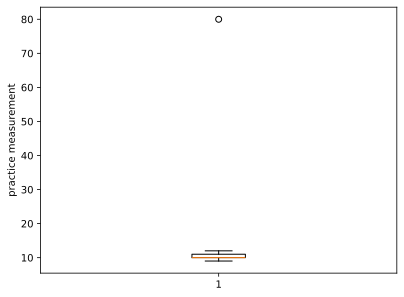

This chart was rendered from the supplied code and input; rerun the cell after changing the data.

IQR uses the middle half's spread. Z-scores can be distorted by extremes and small samples. MAD uses median absolute deviations but needs an explicit policy when MAD is zero; this cell reports unknown scores. Isolation Forest and **Local Outlier Factor (LOF)** inspect multivariate unusualness. LOF's default `fit_predict` is a discovery operation on its fitted observations; use its documented novelty mode for separate new observations. A contamination setting influences a threshold; it is not proof of the true error rate.

The conventional example thresholds `|z| > 3`, `|MAD score| > 3.5`, and 1.5 IQR fences flag different notions of unusualness. They are not universal error definitions. When MAD is zero, this cell's missing score and nullable flag mean “not assessed.” For an online sensor, a past-only rolling median can supply a local comparison; a centered window would use future measurements.

**Choose a treatment:** correct a documented unit/typing error; exclude a confirmed invalid training record; clip using stored training thresholds; replace a confirmed wrong measurement and retain a flag; transform a valid skewed feature; or keep rare valid records and consider robust modeling. RobustScaler changes scaling, not the truth of an observation. Huber regression is a later alternative that reduces the influence of some large residuals. Do not automatically remove the frauds from a fraud task.

**Practice:** replace the 80 with a documented real high reading. Explain how its treatment should differ from a confirmed sensor error. For a simulated detector exercise with known injected-error labels, measure precision and recall; do not assume those labels exist in real data.

#### 4 · How to use it in the real world

A reusable clipping transformer must learn its fences only from training data, including within every validation fold. This example shows the mechanics after a hypothetical review has authorized clipping the measurement. It does not establish that the 100 is wrong or that clipping improves predictions. For a confirmed typo, correction from the source is preferable. `BaseEstimator` and `TransformerMixin` make this class usable as a scikit-learn pipeline step: `fit` stores learned fences and `transform` reuses them. A trailing underscore marks a fitted attribute. Compare with an unclipped recipe on development data before adopting the policy.

**Workflow input and commented code:**

~~~python
import numpy as np
import pandas as pd
from sklearn.base import BaseEstimator, TransformerMixin
from sklearn.pipeline import make_pipeline
from sklearn.linear_model import LinearRegression

class TrainingIQRClipper(BaseEstimator, TransformerMixin):
    def fit(self, X, y=None):
        values = np.asarray(X, dtype=float)
        q1, q3 = np.quantile(values, [0.25, 0.75], axis=0)
        spread = q3-q1
        self.low_ = q1 - 1.5*spread
        self.high_ = q3 + 1.5*spread
        return self
    def transform(self, X):
        return np.clip(np.asarray(X, dtype=float), self.low_, self.high_)

train = pd.DataFrame({"measurement": [1., 2., 3., 4., 5., 6., 100.]})
model = make_pipeline(TrainingIQRClipper(), LinearRegression()).fit(train, [2., 4., 6., 8., 10., 12., 14.])
new = pd.DataFrame({"measurement": [4., 90.]})
print("Raw new measurements:", new["measurement"].tolist())
print("Prepared measurements:", model.named_steps["trainingiqrclipper"].transform(new).ravel().tolist())
print("Predicted target:", model.predict(new).round(2).tolist())
~~~


**Recorded output from this input:**

~~~text
Raw new measurements: [4.0, 90.0]
Prepared measurements: [4.0, 10.0]
Predicted target: [7.41, 15.68]
~~~
<a id="topic-z-score-new-record-review"></a>

### Z-score review · Fit a reference, flag a new reading, preserve its prediction

#### 1 · Problem

A table can calculate z-scores yet hide them behind abbreviated columns. Recomputing the reference from incoming readings also lets an extreme new value move its own review threshold.

#### 2 · How to fix it

Store the training mean and population standard deviation, display the numerical z-score and decision explicitly, and reuse that reference for new records. Choose a review threshold for the task; 3 is an illustrative choice, not a universal error boundary. A zero-spread reference cannot produce a standardized distance. Keep review decisions separate from the model's numerical answer: a flag requests investigation rather than automatic deletion or a diagnosis.

#### 3 · How to use it

Start a fresh notebook for this lesson. Run its cells in order; the literal inputs or explicitly bounded input previews belong to this experiment.

```python
import numpy as np
import pandas as pd
from sklearn.base import BaseEstimator, TransformerMixin
from sklearn.linear_model import LinearRegression
from sklearn.pipeline import make_pipeline

class ReferenceZScore(BaseEstimator, TransformerMixin):
    def fit(self, X, y=None):
        values = np.asarray(X, dtype=float)
        if values.ndim != 2 or not np.isfinite(values).all():
            raise ValueError("Expected a finite two-dimensional measurement table")
        self.mean_ = values.mean(axis=0)
        self.spread_ = values.std(axis=0, ddof=0)  # Population convention, stated explicitly.
        if (self.spread_ == 0).any():
            raise ValueError("A constant reference needs a separate review policy")
        return self

    def transform(self, X):
        values = np.asarray(X, dtype=float)
        if values.ndim != 2 or values.shape[1] != len(self.mean_) or not np.isfinite(values).all():
            raise ValueError("Request must match the finite training measurement schema")
        return (values - self.mean_) / self.spread_

reference_measurements = pd.DataFrame({"reading": [8., 9., 10., 11., 12.]})
reference_answers = [17., 19., 21., 23., 25.]  # Fictional numerical target units.
z_recipe = make_pipeline(ReferenceZScore(), LinearRegression())
z_recipe.fit(reference_measurements, reference_answers)
reference = z_recipe.named_steps["referencezscore"]
print("Training mean:", reference.mean_.tolist(), "population std:", reference.spread_.round(3).tolist())
print("Training z-scores:", reference.transform(reference_measurements).ravel().round(3).tolist())
```


**Recorded output from this input:**

~~~text
Training mean: [10.0] population std: [1.414]
Training z-scores: [-1.414, -0.707, 0.0, 0.707, 1.414]
~~~
**Recorded output from these actual inputs:**

~~~text
Training mean: [10.0] population std: [1.414]
Training z-scores: [-1.414, -0.707, 0.0, 0.707, 1.414]
~~~

#### 4 · How to use it in the real world

Route incoming readings through the stored reference and the same fitted prediction pipeline. The review table retains every row, its visible standardized distance, its decision, and its numerical prediction. This is a complete review handoff for a toy model; flagged extrapolated predictions require investigation before operational use.

```python
z_requests = pd.DataFrame({"reading": [10., 13., 20.]})
z_scores = reference.transform(z_requests).ravel()
z_review = z_requests.copy()
z_review["z"] = z_scores
z_review["z_flag"] = np.abs(z_scores) > 3
z_review["action"] = np.where(z_review["z_flag"], "human review", "ordinary queue")
z_review["predicted_target"] = z_recipe.predict(z_requests)
print(z_review.round(3).to_string(index=False))  # to_string exposes every requested column.
print("Stored mean after requests:", reference.mean_.tolist())
```


**Recorded output from this input:**

~~~text
 reading     z  z_flag         action  predicted_target
    10.0 0.000   False ordinary queue              21.0
    13.0 2.121   False ordinary queue              27.0
    20.0 7.071    True   human review              41.0
Stored mean after requests: [10.0]
~~~
**Recorded output from these actual inputs:**

~~~text
 reading     z  z_flag         action  predicted_target
    10.0 0.000   False ordinary queue              21.0
    13.0 2.121   False ordinary queue              27.0
    20.0 7.071    True   human review              41.0
Stored mean after requests: [10.0]
~~~

**Change and explain:** Change one training reading to 80 and inspect how the mean/std and new-record decisions change. Compare with the earlier robust IQR/MAD reference. Test a constant training reference and explain the explicit error instead of inventing zero z-scores.

<a id="topic-p5-fit-a-ruler-on-training-data-then-reuse-it"></a>

### ⚖️ P5 · Fit a ruler on training data, then reuse it

#### 1 · Problem

Distances and regularization can be dominated by a column merely because it is expressed in larger numerical units.

#### 2 · How to fix it

Choose a ruler appropriate to the model, fit it on training rows, and reuse it during prediction. Inspect transformed values and reversible checks without claiming that scaling fixes wrong measurements.

#### 3 · How to use it

The literal values in the following code are this experiment's input. Run the commented example, inspect the recorded output, then make the stated change.

Min-Max scaling uses training minimum and maximum. Standardization uses training mean and standard deviation; it does **not** require normally distributed input or make a skewed distribution normal. Robust scaling uses training median and IQR; extreme transformed values can remain extreme. Scaling matters particularly when distance or penalties depend on numerical units; tree splits usually do not require it.

**Run this cell:**

~~~python
import numpy as np
import pandas as pd
from sklearn.preprocessing import MinMaxScaler, StandardScaler, RobustScaler
from sklearn.pipeline import make_pipeline
from sklearn.linear_model import Ridge

train = pd.DataFrame({"age": [20., 30., 40., 60.], "income": [20_000., 30_000., 40_000., 100_000.]})
new = pd.DataFrame({"age": [80.], "income": [120_000.]})
for name, scaler in [("Min-Max", MinMaxScaler()), ("Standard", StandardScaler()), ("Robust", RobustScaler())]:
    scaled_train = scaler.fit_transform(train)
    scaled_new = scaler.transform(new)
    print(name, "training:\n", scaled_train.round(2), "\nnew:", scaled_new.round(2))
    assert np.allclose(scaler.inverse_transform(scaled_new), new)

model = make_pipeline(StandardScaler(), Ridge(alpha=1.0))
model.fit(train, [4., 5., 7., 10.])
print("Prediction with reused preparation:", model.predict(new).round(2))
~~~


**Recorded output from this input:**

~~~text
Min-Max training:
 [[0.   0.  ]
 [0.25 0.12]
 [0.5  0.25]
 [1.   1.  ]]
new: [[1.5  1.25]]
Standard training:
 [[-1.18 -0.88]
 [-0.51 -0.56]
 [ 0.17 -0.24]
 [ 1.52  1.69]]
new: [[2.87 2.33]]
Robust training:
 [[-0.86 -0.55]
 [-0.29 -0.18]
 [ 0.29  0.18]
 [ 1.43  2.36]]
new: [[2.57 3.09]]
Prediction with reused preparation: [11.85]
~~~
New Min-Max values can lie outside 0–1 because the new measurement can exceed the training range. `clip=True` can cap them, but hides how far out they were; choose deliberately. Constant columns and tiny training samples deserve inspection. An inverse transform checks a numerical round trip, not whether the new case is supported by the data.

**Practice:** multiply income by 100, representing smaller currency units. Explain why the transformed scale can remain similar while raw distances change. Keep units consistent when fitting and predicting.

#### 4 · How to use it in the real world

A pipeline couples the training-derived ruler to the predictor. This lets validation refit both together and prevents serving from accidentally learning a new ruler on each request. Here a regularized regressor sees age and income; the scaler's stored mean is printed so you can inspect its origin. Change the request, and verify that the stored mean stays fixed.

**Workflow input and commented code:**

~~~python
import pandas as pd
from sklearn.pipeline import make_pipeline
from sklearn.preprocessing import StandardScaler
from sklearn.linear_model import Ridge

train = pd.DataFrame({"age": [20., 30., 40., 50.], "income": [20_000., 40_000., 50_000., 80_000.]})
model = make_pipeline(StandardScaler(), Ridge(alpha=1.)).fit(train, [2., 4., 5., 8.])
new = pd.DataFrame({"age": [35.], "income": [45_000.]})
print("New input:", new.to_dict("records"))
print("Stored training means:", model.named_steps["standardscaler"].mean_.tolist())
print("Prepared row:", model.named_steps["standardscaler"].transform(new).round(3).tolist())
print("Predicted target:", model.predict(new).round(2).tolist())
~~~


**Recorded output from this input:**

~~~text
New input: [{'age': 35.0, 'income': 45000.0}]
Stored training means: [35.0, 47500.0]
Prepared row: [[0.0, -0.115]]
Predicted target: [4.63]
~~~
<a id="topic-p6-encode-categories-and-handle-unfamiliar-values"></a>

### 🏷️ P6 · Encode categories and handle unfamiliar values

#### 1 · Problem

Numbers assigned to unordered labels can create an artificial order; new or rare labels can break an otherwise working predictor.

#### 2 · How to fix it

Separate nominal and ordered columns. Learn one-hot levels, frequencies, or cross-fitted target representations on training data, state an unfamiliar-value policy, and keep the encoder with the model.

#### 3 · How to use it

The literal values in the following code are this experiment's input. Run the commented example, inspect the recorded output, then make the stated change.

**Nominal** categories have no intended order; **ordinal** categories have one. One-hot encoding creates a separate yes/no column per category. Ordinal codes preserve a supplied order but can impose meaningful numeric spacing on a linear model. Frequency encoding records how common a category was in training; distinct categories can receive the same number.

**Run this cell:**

~~~python
import pandas as pd
from sklearn.preprocessing import OneHotEncoder, OrdinalEncoder, LabelEncoder, TargetEncoder
from sklearn.feature_extraction import FeatureHasher

train = pd.DataFrame({"colour": ["red", "blue", "red", "green", "red", "blue"],
                      "size": ["S", "M", "L", "S", "M", "L"]})
new = pd.DataFrame({"colour": ["purple", "red"], "size": ["XL", "M"]})
print("Pandas one-hot display:\n", pd.get_dummies(train[["colour"]], dtype=int))
onehot = OneHotEncoder(handle_unknown="ignore", sparse_output=False).fit(train[["colour"]])
print("Columns:", onehot.get_feature_names_out().tolist())
print("New one-hot:\n", onehot.transform(new[["colour"]]))
rare = OneHotEncoder(min_frequency=2, handle_unknown="infrequent_if_exist", sparse_output=False).fit(train[["colour"]])
print("Grouped rare categories:", rare.get_feature_names_out().tolist())
ordinal = OrdinalEncoder(categories=[["S", "M", "L"]], handle_unknown="use_encoded_value", unknown_value=-1).fit(train[["size"]])
print("Ordinal with unknown sentinel:", ordinal.transform(new[["size"]]).ravel().tolist())
frequencies = train["colour"].value_counts(normalize=True)
print("Training frequencies for new rows:", new["colour"].map(frequencies).fillna(0).tolist())
labels = LabelEncoder().fit(["cat", "dog", "bird"])
print("Answer labels:", labels.transform(["dog", "cat"]).tolist(), labels.inverse_transform([0]).tolist())

# Cross-fit TRAINING encodings: each fold's target averages come from other folds.
target = pd.Series([10., 12., 11., 20., 13., 14.])
encoder = TargetEncoder(target_type="continuous", cv=3, shuffle=True, random_state=0)
cross_fitted = encoder.fit_transform(train[["colour"]], target)
print("Cross-fitted training shape:", cross_fitted.shape)
print("New target encodings:", encoder.transform(new[["colour"]]).round(2).ravel().tolist())

hasher = FeatureHasher(n_features=4, input_type="string", alternate_sign=False)
print("Fixed-width hashing shape:", hasher.transform([["red"], ["purple"]]).shape)
~~~


**Recorded output from this input:**

~~~text
Pandas one-hot display:
    colour_blue  colour_green  colour_red
0            0             0           1
1            1             0           0
2            0             0           1
3            0             1           0
4            0             0           1
5            1             0           0
Columns: ['colour_blue', 'colour_green', 'colour_red']
New one-hot:
 [[0. 0. 0.]
 [0. 0. 1.]]
Grouped rare categories: ['colour_blue', 'colour_red', 'colour_infrequent_sklearn']
Ordinal with unknown sentinel: [-1.0, 1.0]
Training frequencies for new rows: [0.0, 0.5]
Answer labels: [2, 1] ['bird']
Cross-fitted training shape: (6, 1)
New target encodings: [13.33, 11.43]
Fixed-width hashing shape: (2, 4)
~~~
An unknown one-hot category becomes all zeros here: no crash does not guarantee a sensible prediction. Rare-category grouping depends on training counts. LabelEncoder is for target labels, not a way to invent an order for nominal inputs; many classifiers accept string targets directly. Hashing fixes feature width but can collide. Some models support categorical columns natively, so consult the chosen model rather than assuming every model needs one-hot encoding.

**Target encoding needs extra care:** calling `fit(...).transform(the_same_training_rows)` can leak each row's own target into its representation. `fit_transform` cross-fits training rows; keep this encoder inside the model pipeline and inside each validation fold. Never fit on test targets. For mixed tables, a `ColumnTransformer` applies separate numeric, nominal, and ordinal recipes; the full pipeline fits them together on training data.

**Practice:** add a new colour and an unknown size. Explain the different encoders' outputs and document a policy for those inputs. Compare candidate encodings only using training-side validation.

#### 4 · How to use it in the real world

ColumnTransformer sends each named feature to its own recipe; the surrounding pipeline fits encoders and regression together. New nominal colours use the declared all-zero policy, while sizes use the documented order. That policy permits a prediction; it does not establish adequacy for an unfamiliar colour. The second model demonstrates target cross-fitting inside a complete estimator. Choose between such recipes through development validation.

**Workflow input and commented code:**

~~~python
import pandas as pd
from sklearn.compose import ColumnTransformer
from sklearn.preprocessing import OneHotEncoder, OrdinalEncoder, TargetEncoder
from sklearn.pipeline import make_pipeline
from sklearn.linear_model import Ridge

train = pd.DataFrame({"colour": ["red", "blue", "red", "green", "red", "blue"],
                      "size": ["S", "M", "L", "S", "M", "L"]})
prices = [8., 12., 16., 9., 11., 17.]
preparation = ColumnTransformer([
    ("colour", OneHotEncoder(handle_unknown="ignore", sparse_output=False), ["colour"]),
    ("size", OrdinalEncoder(categories=[["S", "M", "L"]]), ["size"]),
])
model = make_pipeline(preparation, Ridge()).fit(train, prices)
new = pd.DataFrame({"colour": ["purple"], "size": ["M"]})
print("New input:", new.to_dict("records"))
print("Prepared row:", model.named_steps["columntransformer"].transform(new).tolist())
print("Estimated price:", model.predict(new).round(2).tolist())
# TargetEncoder.fit_transform is invoked on training rows during pipeline fitting.
encoded_model = make_pipeline(TargetEncoder(target_type="continuous", cv=3, random_state=0), Ridge())
encoded_model.fit(train[["colour"]], prices)
print("Target-encoded model estimate:", encoded_model.predict(new[["colour"]]).round(2).tolist())
~~~


**Recorded output from this input:**

~~~text
New input: [{'colour': 'purple', 'size': 'M'}]
Prepared row: [[0.0, 0.0, 0.0, 1.0]]
Estimated price: [12.23]
Target-encoded model estimate: [13.62]
~~~
<a id="topic-p7-clean-text-without-erasing-its-meaning"></a>

### 📝 P7 · Clean text without erasing its meaning

#### 1 · Problem

Raw text has formatting noise, but deleting punctuation, numbers, or negation can also delete the meaning you need to predict.

#### 2 · How to fix it

Choose task-specific cleaning, inspect the result, and learn count/TF-IDF vocabulary from training documents. Keep negations; treat lemmatization and learned embeddings as deliberate alternatives, not mandatory cleaning stages.

#### 3 · How to use it

The literal values in the following code are this experiment's input. Run the commented example, inspect the recorded output, then make the stated change.

Cleaning choices depend on language and task. “Not good,” prices, names, punctuation, and emoji may contain the signal. A short demonstration cannot safely clean arbitrary HTML, detect every contraction, or understand every language.

**Run this cell:**

~~~python
import html
import re
import unicodedata
import pandas as pd
from sklearn.feature_extraction.text import CountVectorizer, TfidfVectorizer

def clean_review(text):
    text = html.unescape(text)               # &amp; becomes &.
    text = re.sub(r"<[^>]+>", " ", text)    # Tiny controlled HTML fixture; not an HTML parser.
    text = re.sub(r"https?://\S+|www\.\S+", " ", text)
    text = re.sub(r"@\w+", " ", text).replace("#", " ")
    text = unicodedata.normalize("NFKC", text).lower().replace("’", "'")
    text = text.replace("won't", "will not").replace("can't", "cannot").replace("n't", " not")
    text = text.replace("😍", " emoji_positive ").replace("😡", " emoji_negative ")
    text = re.sub(r"\d+(?:\.\d+)?", " number ", text)
    text = re.sub(r"[^\w\s]", " ", text)  # Unicode word characters; inspect the task's needs.
    return " ".join(text.split())            # Collapse repeated spaces.

train = ["<b>LOVE</b> this phone 😍", "Not good, won't buy 😡", "Good camera &amp; battery"]
new = ["@shop battery not good after 2 days www.example.com"]
print("Cleaned training:", [clean_review(text) for text in train])
tokens = clean_review(new[0]).split()
stop_words = {"this", "the", "and", "after"}  # Deliberately tiny, documented stop list.
print("Tokens without selected stop words:", [word for word in tokens if word not in stop_words])

counts = CountVectorizer(preprocessor=clean_review).fit(train)
tfidf = TfidfVectorizer(preprocessor=clean_review, ngram_range=(1, 2)).fit(train)
print("Count vocabulary:", counts.get_feature_names_out().tolist())
print("New counts:\n", counts.transform(new).toarray())
print("TF-IDF shape:", tfidf.transform(new).shape)
assert "not" in clean_review("Don't buy").split()

# Demonstrate the idea of a lemma with an explicit tiny lookup, not a general lemmatizer.
lemma_lookup = {"running": "run", "works": "work", "batteries": "battery"}
print("Known lemma examples:", [lemma_lookup.get(word, word) for word in ["works", "well"]])
~~~


**Recorded output from this input:**

~~~text
Cleaned training: ['love this phone emoji_positive', 'not good will not buy emoji_negative', 'good camera battery']
Tokens without selected stop words: ['battery', 'not', 'good', 'number', 'days']
Count vocabulary: ['battery', 'buy', 'camera', 'emoji_negative', 'emoji_positive', 'good', 'love', 'not', 'phone', 'this', 'will']
New counts:
 [[1 0 0 0 0 1 0 1 0 0 0]]
TF-IDF shape: (1, 21)
Known lemma examples: ['work', 'well']
~~~
**Tokenization** splits text into units. A **lemma** is a dictionary form; real lemmatization depends on language and context. CountVectorizer learns a vocabulary and counts occurrences. TF-IDF also weights terms using frequencies learned from its fitting corpus. **N-grams** include neighboring word sequences, such as “not good.” Unknown words can be ignored by these fitted vocabularies; inspect empty representations.

For a genuine language model lemmatizer, the following **optional specialized cell** requires spaCy and the downloaded `en_core_web_sm` model. It is separate from the beginner install. Follow the library's installation instructions for `spacy`, then download its model with the terminal command `python -m spacy download en_core_web_sm`. These optional tools are not needed for the preceding count/TF-IDF exercise.

~~~python-optional
import spacy

nlp = spacy.load("en_core_web_sm")
doc = nlp("The batteries were running well, but the charger was not working.")
print([(token.text, token.lemma_) for token in doc if not token.is_space])
~~~

**Execution status:** optional-package example; syntax checked, not executed in this verification. No output is claimed for it.

**Practice:** compare “running” in “I am running” and “running shoes.” Inspect actual lemmas and negations before adopting the transformation. Language models and linguistic analyses can make errors; do not assume dictionary-form text always improves classification.

**Optional Word2Vec representation exercise:** this separate cell requires `gensim`, installed in the selected notebook environment. It trains vectors from neighboring words in the supplied training sentences. It downloads no model. The tiny corpus demonstrates an API; it cannot teach reliable word meaning. [Gensim's Word2Vec documentation](https://radimrehurek.com/gensim/models/word2vec.html) describes the training options.

~~~python-optional
from gensim.models import Word2Vec

sentences = [
    ["good", "phone", "battery"], ["good", "camera", "phone"],
    ["bad", "phone", "battery"], ["camera", "takes", "pictures"],
]
embedding = Word2Vec(sentences=sentences, vector_size=8, window=2,
                     min_count=1, workers=1, seed=0, epochs=30)
print("Word vector length:", embedding.wv["phone"].shape)
print("Known vocabulary:", embedding.wv.index_to_key)
print("Unfamiliar word present?", "pizza" in embedding.wv)
~~~

**Execution status:** optional-package example; syntax checked, not executed in this verification. No output is claimed for it.

Each known word has one vector in this Word2Vec model, regardless of the current sentence. `vector_size` chooses vector length; `window` controls nearby context; `min_count` filters rare vocabulary. A different corpus or vocabulary policy changes results. **Practice:** add a training sentence, retrain, and inspect vocabulary. Avoid claiming that a similarity score from these four sentences establishes a semantic relationship. Fit corpus-dependent representations only using the training side of an evaluation.

**Optional BERT mechanics exercise:** this separate cell requires `torch` and `transformers`. It constructs a tiny **untrained** BERT using local configuration, with no pretrained-weight download. Its purpose is to reveal the shape of context-sensitive token representations, not to perform sentiment analysis. [The Transformers BERT documentation](https://huggingface.co/docs/transformers/model_doc/bert) explains the configuration and outputs.

~~~python-optional
import torch
from transformers import BertConfig, BertModel

torch.manual_seed(0)
config = BertConfig(vocab_size=16, hidden_size=16, num_hidden_layers=1,
                    num_attention_heads=2, intermediate_size=32)
model = BertModel(config).eval()  # Randomly initialized; eval turns off training-time dropout.
# Our toy IDs: 1 = bank, 2 = river, 3 = loan. A real model needs its own tokenizer/vocabulary.
ids = torch.tensor([[1, 2], [1, 3]])
with torch.no_grad():
    vectors = model(input_ids=ids, attention_mask=torch.ones_like(ids)).last_hidden_state
print("Batch, tokens, vector dimensions:", tuple(vectors.shape))
print("Same token, different context gives identical vectors?", torch.equal(vectors[0, 0], vectors[1, 0]))
~~~

**Execution status:** optional-package example; syntax checked, not executed in this verification. No output is claimed for it.

BERT lets neighboring tokens affect each representation. This model has not learned language; its vector differences have no demonstrated semantic usefulness. A useful pretrained workflow must use the matching tokenizer, document truncation and pooling choices, and evaluate on the downstream task. A BERT token vector is not automatically a good whole-sentence similarity embedding. **Practice:** change the second context token and inspect the vector difference; explain why that observation alone cannot establish understanding or accuracy. Pretrained language models often expect much of the original wording and punctuation, so do not blindly apply the count-model cleaner to them.

**Practice:** compare the representations of “good” and “not good.” Add an unfamiliar word, a non-English word, and an all-punctuation message; inspect what survives. Fit vocabulary and IDF within each training fold for model comparison, and use the identical cleaner at prediction time.

#### 4 · How to use it in the real world

A text model must reuse the same learned vocabulary and weighting on new documents. This small TF-IDF-plus-logistic pipeline keeps word pairs, including negation, and does not refit its vocabulary on incoming text. Six invented reviews demonstrate a workflow rather than useful sentiment accuracy. Compare a new phrase containing a previously unseen word and inspect which terms the model can represent.

**Workflow input and commented code:**

~~~python
from sklearn.pipeline import make_pipeline
from sklearn.feature_extraction.text import TfidfVectorizer
from sklearn.linear_model import LogisticRegression

train_text = ["good battery", "good camera", "works very well", "not good battery", "not good camera", "does not work"]
train_labels = [1, 1, 1, 0, 0, 0]
model = make_pipeline(TfidfVectorizer(ngram_range=(1, 2)), LogisticRegression()).fit(train_text, train_labels)
new_text = ["good battery", "not good battery"]
print("Input reviews:", new_text)
print("Predicted example labels:", model.predict(new_text).tolist())
print("Probability for label 1:", model.predict_proba(new_text)[:, 1].round(2).tolist())
~~~


**Recorded output from this input:**

~~~text
Input reviews: ['good battery', 'not good battery']
Predicted example labels: [1, 0]
Probability for label 1: [0.55, 0.44]
~~~
<a id="gap-stopword-classifier"></a>

### P7a · Put a deliberate stop-word policy inside the classifier

#### 1 · Problem

Frequent words can use vocabulary columns without helping the task. Removing a word such as not can reverse the meaning of a review.

#### 2 · How to fix it

Choose a task-specific list and preserve negation. Put the list inside CountVectorizer so training and requests share one policy. This example removes a, and, is, the and was while keeping not. Compare with no removal on development data for a real task.

#### 3 · How to use it

**Input and commented code:**

~~~python
from sklearn.feature_extraction.text import CountVectorizer
reviews = ["the service is good", "the service is not good"]
vectorizer = CountVectorizer(stop_words=["a", "and", "is", "the", "was"], ngram_range=(1, 2))
counts = vectorizer.fit_transform(reviews)
print("Input reviews:", reviews)
print("Kept tokens and phrases:", vectorizer.get_feature_names_out().tolist())
print("Count rows:", counts.toarray().tolist())
~~~


**Recorded output from this input:**

~~~text
Input reviews: ['the service is good', 'the service is not good']
Kept tokens and phrases: ['good', 'not', 'not good', 'service', 'service good', 'service not']
Count rows: [[1, 0, 0, 1, 1, 0], [1, 1, 1, 1, 0, 1]]
~~~
#### 4 · How to use it in the real world

A fictional sentiment classifier uses that exact stop-word policy inside its pipeline. Bigrams preserve not good as a separate feature. These few invented reviews demonstrate the mechanism; they cannot establish real review accuracy.

~~~python
from sklearn.feature_extraction.text import CountVectorizer
from sklearn.pipeline import make_pipeline
from sklearn.linear_model import LogisticRegression
reviews = ["the service is good", "the product is good", "the service was great",
           "the service is not good", "the product is not good", "the service was bad"]
model = make_pipeline(CountVectorizer(stop_words=["a", "and", "is", "the", "was"], ngram_range=(1, 2)),
                      LogisticRegression(random_state=0))
model.fit(reviews, [1, 1, 1, 0, 0, 0])  # 1 positive; 0 negative.
request = ["the service is good", "the service is not good"]
print("Request reviews:", request)
print("not remains a feature:", "not" in model[0].vocabulary_)
print("Request token counts:", model[0].transform(request).toarray().tolist())
print("Positive labels:", model.predict(request).tolist())
print("Positive probabilities:", model.predict_proba(request)[:, 1].round(3).tolist())
~~~


**Recorded output from this input:**

~~~text
Request reviews: ['the service is good', 'the service is not good']
not remains a feature: True
Request token counts: [[0, 1, 0, 0, 0, 0, 0, 0, 1, 0, 1, 0, 0], [0, 1, 0, 1, 1, 0, 0, 0, 1, 0, 0, 0, 1]]
Positive labels: [1, 0]
Positive probabilities: [0.672, 0.271]
~~~
**Practice:** Add not to the stop-word list and refit. Inspect changed tokens and probabilities, then restore the original list. Explain the lost meaning.

<a id="gap-lemma-classifier"></a>

### P7b · Use WordNet lemmatization in the actual classifier

**Extra tool:** in your activated terminal run `python -m pip install nltk`. The first run downloads the WordNet lexicon into `my-ml-practice/wordnet-data`; later runs reuse it.

#### 1 · Problem

cats and cat, or running and ran, can create separate model columns even when the task needs their shared base forms.

#### 2 · How to fix it

Lemmatization uses a language lexicon and part of speech to obtain a base form. The code uses actual English WordNet entries. It assigns verb POS only to a documented small activity vocabulary, treating the remaining words as nouns; that is not a general POS tagger. A broader English task needs reviewed contextual POS handling, and other languages need appropriate tools. WordNet data downloads once to the workspace; later runs reuse it. Keep negation: this tokenizer does not discard not.

#### 3 · How to use it

**Input and commented code:**

~~~python
from pathlib import Path
import re
import nltk
from nltk.corpus import wordnet
from nltk.stem import WordNetLemmatizer
corpus_dir = Path("my-ml-practice/wordnet-data").resolve()
corpus_dir.mkdir(parents=True, exist_ok=True)
nltk.data.path.insert(0, str(corpus_dir))
try:
    wordnet.ensure_loaded()
except LookupError:
    # First run needs network access; keep downloaded language data in this workspace.
    nltk.download("wordnet", download_dir=str(corpus_dir), quiet=True, raise_on_error=True)
    wordnet.ensure_loaded()
lemmatizer = WordNetLemmatizer()
def lemma_tokens(text):
    words = re.findall(r"[a-z]+", text.lower())
    # For this small English activity-note domain, these listed forms are verbs.
    verbs = {"runs", "running", "ran", "barks", "barking", "barked"}
    return [lemmatizer.lemmatize(word, pos="v" if word in verbs else "n") for word in words]

from sklearn.feature_extraction.text import CountVectorizer
texts = ["Cats running", "cat ran", "Dogs barked", "not running"]
vectorizer = CountVectorizer(tokenizer=lemma_tokens, token_pattern=None, lowercase=False)
counts = vectorizer.fit_transform(texts)
print("Input text:", texts)
print("WordNet base tokens:", [lemma_tokens(text) for text in texts])
print("Vocabulary:", vectorizer.get_feature_names_out().tolist())
print("Count rows:", counts.toarray().tolist())
~~~


**Recorded output from this input:**

~~~text
Input text: ['Cats running', 'cat ran', 'Dogs barked', 'not running']
WordNet base tokens: [['cat', 'run'], ['cat', 'run'], ['dog', 'bark'], ['not', 'run']]
Vocabulary: ['bark', 'cat', 'dog', 'not', 'run']
Count rows: [[0, 1, 0, 0, 1], [0, 1, 0, 0, 1], [1, 0, 1, 0, 0], [0, 0, 0, 1, 1]]
~~~
#### 4 · How to use it in the real world

Route fictional animal activity notes with those actual lemmatized tokens. CountVectorizer invokes the same tokenizer during training and request prediction. The classification target is the cat/dog routing queue; inflected forms reach shared vocabulary columns.

~~~python
from pathlib import Path
import re
import nltk
from nltk.corpus import wordnet
from nltk.stem import WordNetLemmatizer
corpus_dir = Path("my-ml-practice/wordnet-data").resolve()
corpus_dir.mkdir(parents=True, exist_ok=True)
nltk.data.path.insert(0, str(corpus_dir))
try:
    wordnet.ensure_loaded()
except LookupError:
    # First run needs network access; keep downloaded language data in this workspace.
    nltk.download("wordnet", download_dir=str(corpus_dir), quiet=True, raise_on_error=True)
    wordnet.ensure_loaded()
lemmatizer = WordNetLemmatizer()
def lemma_tokens(text):
    words = re.findall(r"[a-z]+", text.lower())
    # For this small English activity-note domain, these listed forms are verbs.
    verbs = {"runs", "running", "ran", "barks", "barking", "barked"}
    return [lemmatizer.lemmatize(word, pos="v" if word in verbs else "n") for word in words]

from sklearn.feature_extraction.text import CountVectorizer
from sklearn.pipeline import make_pipeline
from sklearn.linear_model import LogisticRegression
notes = ["cat runs", "cats running", "cat ran", "dog barks", "dogs barking", "dog barked"]
model = make_pipeline(CountVectorizer(tokenizer=lemma_tokens, token_pattern=None, lowercase=False),
                      LogisticRegression(random_state=0))
model.fit(notes, ["cat", "cat", "cat", "dog", "dog", "dog"])
request = ["cats ran", "dogs barked"]
print("Request notes:", request)
print("Model WordNet tokens:", [lemma_tokens(text) for text in request])
print("Model input counts:", model[0].transform(request).toarray().tolist())
print("Predicted routes:", model.predict(request).tolist())
~~~


**Recorded output from this input:**

~~~text
Request notes: ['cats ran', 'dogs barked']
Model WordNet tokens: [['cat', 'run'], ['dog', 'bark']]
Model input counts: [[0, 1, 0, 1], [1, 0, 1, 0]]
Predicted routes: ['cat', 'dog']
~~~
**Practice:** Compare lemmatizer.lemmatize("running", pos="n") with pos="v". Explain the POS limitation before trying a new sentence. Restore original requests after experimenting.

<a id="topic-p8-boolean-values-preserve-unknown-and-report-unfamiliar-spellings"></a>

### ✅ P8 · Boolean values: preserve unknown and report unfamiliar spellings

#### 1 · Problem

The string "False" is nonempty and therefore truthy in Python. Unknown answers can be silently treated as false.

#### 2 · How to fix it

Normalize documented spellings through an explicit mapping, preserve a nullable boolean, report unmapped values, and make a separate unknown feature if the modeling policy fills them.

#### 3 · How to use it

The literal values in the following code are this experiment's input. Run the commented example, inspect the recorded output, then make the stated change.

`bool("False")` is `True` because the string is nonempty. Text-to-boolean conversion needs an explicit mapping. Unknown is not automatically false, particularly for consent or eligibility.

**Run this cell:**

~~~python
import pandas as pd

raw = pd.Series(["Yes", "N", "1", "false", "maybe", None, ""], dtype="string")
lookup = {"yes": True, "y": True, "true": True, "t": True, "1": True,
          "no": False, "n": False, "false": False, "f": False, "0": False}
key = raw.str.strip().str.lower()
parsed = key.map(lookup).astype("boolean")
honest_unknown = key.isin(["", "n/a", "unknown"]) | key.isna()
unmapped = raw[parsed.isna() & ~honest_unknown]
print(pd.DataFrame({"raw": raw, "parsed": parsed, "numeric_nullable": parsed.astype("Int8")}))
print("Unfamiliar spellings:", unmapped.tolist())
# This exercise's modeling policy is provisional; preserve an unknown indicator.
model_columns = pd.DataFrame({"flag": parsed.fillna(False).astype(int),
                              "unknown": parsed.isna().astype(int)})
print(model_columns)
print("Three-valued AND:", (pd.Series([True, False], dtype="boolean") & pd.NA).tolist())
assert unmapped.tolist() == ["maybe"]
~~~


**Recorded output from this input:**

~~~text
     raw  parsed  numeric_nullable
0    Yes    True                 1
1      N   False                 0
2      1    True                 1
3  false   False                 0
4  maybe    <NA>              <NA>
5   <NA>    <NA>              <NA>
6           <NA>              <NA>
Unfamiliar spellings: ['maybe']
   flag  unknown
0     1        0
1     0        0
2     1        0
3     0        0
4     0        1
5     0        1
6     0        1
Three-valued AND: [<NA>, False]
~~~
Lowercase pandas `"boolean"` and capitalized `"Int8"` can retain `<NA>`. Ordinary integer conversion cannot retain it. Combining flags uses `&` and `|`; `True & unknown` remains unknown, while `False & unknown` is false. Counting known true values is not the same as proving all unknowns are false. `read_csv` also accepts `true_values` and `false_values` when the source vocabulary is known.

**Practice:** add `"nope"` and confirm that it is reported. Decide whether the task needs rejection, review, a separate unknown category, or a documented filling rule.

#### 4 · How to use it in the real world

The input adapter below maps text to a flag plus a separate unknown indicator before classification. It rejects unfamiliar spellings, while a documented blank can remain unknown. The example is a fictional churn exercise; its policy for missing activity is a modeling convention, not permission to treat missing consent as consent. Try an unfamiliar spelling and verify the adapter rejects it.

**Workflow input and commented code:**

~~~python
import pandas as pd
from sklearn.preprocessing import FunctionTransformer
from sklearn.pipeline import make_pipeline
from sklearn.linear_model import LogisticRegression

def boolean_features(frame):
    key = frame["active"].astype("string").str.strip().str.lower()
    mapping = {"yes": 1., "true": 1., "1": 1., "no": 0., "false": 0., "0": 0.}
    unknown = key.isna() | key.eq("").fillna(False)
    parsed = key.map(mapping)
    if (parsed.isna() & ~unknown).any():
        raise ValueError("Unfamiliar activity spelling")
    return pd.DataFrame({"active": parsed.fillna(0.).astype(float), "active_unknown": unknown.astype(float)})

train = pd.DataFrame({"active": ["yes", "true", "1", "no", "false", "0", None, ""]})
model = make_pipeline(FunctionTransformer(boolean_features), LogisticRegression()).fit(train, [0, 0, 0, 1, 1, 1, 0, 1])
new = pd.DataFrame({"active": ["no", None]})
print("Raw input:", new.to_dict("records"))
print("Prepared input:", boolean_features(new).to_dict("records"))
print("Predicted example churn labels:", model.predict(new).tolist())
~~~


**Recorded output from this input:**

~~~text
Raw input: [{'active': 'no'}, {'active': None}]
Prepared input: [{'active': 0.0, 'active_unknown': 0.0}, {'active': 0.0, 'active_unknown': 1.0}]
Predicted example churn labels: [1, 1]
~~~
<a id="gap-boolean-mode"></a>

### P8a · Fill an unknown Boolean with its training mode

#### 1 · Problem

An unknown yes/no answer is not an observed False. Always filling False invents a negative answer.

#### 2 · How to fix it

Map yes/no to 1/0, retain unknown as NaN, and fit the most frequent observed Boolean on training. Keep an unknown indicator. This example has a unique mode; define a tie policy for other data.

#### 3 · How to use it

**Input and commented code:**

~~~python
import numpy as np
from sklearn.impute import SimpleImputer
training = np.array([[1.], [1.], [1.], [0.], [0.], [np.nan]])
request = np.array([[np.nan], [0.], [1.]])
filler = SimpleImputer(strategy="most_frequent", add_indicator=True).fit(training)
print("Training Boolean codes:", training.ravel().tolist())
print("Request Boolean codes:", request.ravel().tolist())
print("Stored Boolean mode:", filler.statistics_.tolist())
print("Output [value, unknown]:", filler.transform(request).tolist())
~~~


**Recorded output from this input:**

~~~text
Training Boolean codes: [1.0, 1.0, 1.0, 0.0, 0.0, nan]
Request Boolean codes: [nan, 0.0, 1.0]
Stored Boolean mode: [1.0]
Output [value, unknown]: [[1.0, 1.0], [0.0, 0.0], [1.0, 0.0]]
~~~
#### 4 · How to use it in the real world

Use the filled Boolean and its unknown flag together in a fictional human-review classifier. Compare this policy with an explicit Unknown category on development data for a real service.

~~~python
import numpy as np
from sklearn.impute import SimpleImputer
from sklearn.pipeline import make_pipeline
from sklearn.linear_model import LogisticRegression
training = np.array([[1.], [1.], [1.], [0.], [0.], [np.nan]])
model = make_pipeline(SimpleImputer(strategy="most_frequent", add_indicator=True),
                      LogisticRegression(random_state=0))
model.fit(training, [1, 1, 1, 0, 0, 0])  # 1 means human review.
request = np.array([[np.nan], [0.], [1.]])
print("Request Boolean codes:", request.ravel().tolist())
print("Model inputs [value, unknown]:", model[0].transform(request).tolist())
print("Review labels:", model.predict(request).tolist())
print("Review probabilities:", model.predict_proba(request)[:, 1].round(3).tolist())
~~~


**Recorded output from this input:**

~~~text
Request Boolean codes: [nan, 0.0, 1.0]
Model inputs [value, unknown]: [[1.0, 1.0], [0.0, 0.0], [1.0, 0.0]]
Review labels: [0, 0, 1]
Review probabilities: [0.468, 0.391, 0.584]
~~~
**Practice:** Compare the first and third requests: both filled values are 1 but their unknown flags differ. Change a missing training answer to no and refit; restore afterward.

<a id="topic-p9-dates-time-zones-cycles-and-past-only-features"></a>

### 📅 P9 · Dates, time zones, cycles, and past-only features

#### 1 · Problem

Ambiguous formats, time zones, daylight-saving changes, and future-derived features can put the wrong time into a predictor.

#### 2 · How to fix it

Parse using source metadata, distinguish attaching a zone from converting an instant, report unresolved times, and derive only features available at prediction time. Build lags and rolling summaries from earlier observations.

#### 3 · How to use it

The literal values in the following code are this experiment's input. Run the commented example, inspect the recorded output, then make the stated change.

Parsing is interpreting text as a date/time. Specify what ambiguous dates mean. A naive timestamp has no time zone; attaching a documented local zone is different from converting an already known instant to another zone.

**Run this cell:**

~~~python
import numpy as np
import pandas as pd

european = pd.to_datetime("03/04/2026", format="%d/%m/%Y")
american = pd.to_datetime("03/04/2026", format="%m/%d/%Y")
print("Two interpretations:", european, american)
raw = pd.Series(["14/03/2026 09:30", "15/03/2026 18:00", "bad"])
local = pd.to_datetime(raw, format="%d/%m/%Y %H:%M", errors="coerce")
utc = local.dt.tz_localize("Europe/Stockholm", ambiguous="NaT", nonexistent="NaT").dt.tz_convert("UTC")
print("Unparsed or unresolved:", raw[utc.isna()].tolist())
print("Unix seconds:", pd.to_datetime([0, 3600], unit="s", utc=True).tolist())
print("Local hour/year/month/day/weekday:", local.dt.hour.tolist(), local.dt.year.tolist(),
      local.dt.month.tolist(), local.dt.day.tolist(), local.dt.dayofweek.tolist())
print("Elapsed hours:", (utc.iloc[1] - utc.iloc[0]).total_seconds() / 3600)
print("One week later:", utc.iloc[0] + pd.Timedelta(days=7))
hours = np.array([23, 0, 1])
print("Cyclic hour pairs:\n", np.column_stack([np.sin(2 * np.pi * hours / 24), np.cos(2 * np.pi * hours / 24)]).round(3))

daily = pd.Series([10, 12, 11, 15, 14, 13, 16, 18],
                  index=pd.date_range("2026-01-01", periods=8, freq="D"))
features = pd.DataFrame({"actual": daily, "previous_day": daily.shift(1),
                         "previous_week": daily.shift(7),
                         "past_three_day_mean": daily.shift(1).rolling(3, min_periods=3).mean()})
print(features)
print("Two-day summaries:\n", daily.resample("2D").sum())
~~~


**Recorded output from this input:**

~~~text
Two interpretations: 2026-04-03 00:00:00 2026-03-04 00:00:00
Unparsed or unresolved: ['bad']
Unix seconds: [Timestamp('1970-01-01 00:00:00+0000', tz='UTC'), Timestamp('1970-01-01 01:00:00+0000', tz='UTC')]
Local hour/year/month/day/weekday: [9.0, 18.0, nan] [2026.0, 2026.0, nan] [3.0, 3.0, nan] [14.0, 15.0, nan] [5.0, 6.0, nan]
Elapsed hours: 32.5
One week later: 2026-03-21 08:30:00+00:00
Cyclic hour pairs:
 [[-0.259  0.966]
 [ 0.     1.   ]
 [ 0.259  0.966]]
            actual  previous_day  previous_week  past_three_day_mean
2026-01-01      10           NaN            NaN                  NaN
2026-01-02      12          10.0            NaN                  NaN
2026-01-03      11          12.0            NaN                  NaN
2026-01-04      15          11.0            NaN            11.000000
2026-01-05      14          15.0            NaN            12.666667
2026-01-06      13          14.0            NaN            13.333333
2026-01-07      16          13.0            NaN            14.000000
2026-01-08      18          16.0           10.0            14.333333
Two-day summaries:
 2026-01-01    22
2026-01-03    26
2026-01-05    27
2026-01-07    34
Freq: 2D, dtype: int64
~~~
`%d`, `%m`, `%Y`, `%H`, and `%M` mean day, month, four-digit year, hour, and minute. `NaT` is a missing datetime. `format="mixed"` can parse individual mixed formats when appropriate, but cannot discover the intended meaning of an ambiguous date. For mixed sources, use their metadata to choose formats and zones. Daylight-saving ambiguities and nonexistent local times require a documented policy; this exercise marks them unresolved instead of silently shifting events.

The sine/cosine pair places 23:00 beside midnight on a circle. A **lag** uses an earlier observation. `shift(1).rolling(3)` excludes the current day's answer when building its history. A centered rolling window or backward fill can expose future information. Use chronological evaluation for future prediction, and account for how far ahead you predict and when source observations become available. Holidays are a later, location-specific feature, not a universal list.

**Practice:** add a malformed date and a daylight-saving transition time. Keep a review list. Explain why drop-off time cannot be used to predict journey duration at pickup.

#### 4 · How to use it in the real world

This request-time transformer parses documented UTC timestamps, converts to local clock time, and creates a cyclic hour pair. The same fixed conversion runs during fitting and prediction. The model estimates fictional request load from those features; evaluating future demand would additionally require chronological splits and realistic known-at-the-time inputs. Change a timestamp near midnight and inspect the circle coordinates.

**Workflow input and commented code:**

~~~python
import numpy as np
import pandas as pd
from sklearn.preprocessing import FunctionTransformer
from sklearn.pipeline import make_pipeline
from sklearn.linear_model import Ridge

def clock_features(frame):
    local = pd.to_datetime(frame["time_utc"], format="%Y-%m-%dT%H:%M:%SZ", utc=True).dt.tz_convert("Europe/Stockholm")
    hour = local.dt.hour
    return pd.DataFrame({"hour_sin": np.sin(2*np.pi*hour/24), "hour_cos": np.cos(2*np.pi*hour/24)})

train = pd.DataFrame({"time_utc": ["2026-01-01T00:00:00Z", "2026-01-01T06:00:00Z", "2026-01-01T12:00:00Z", "2026-01-01T18:00:00Z"]})
model = make_pipeline(FunctionTransformer(clock_features), Ridge()).fit(train, [3., 8., 6., 12.])
new = pd.DataFrame({"time_utc": ["2026-01-02T18:00:00Z"]})
print("UTC input:", new.to_dict("records"))
print("Local clock features:", clock_features(new).round(3).to_dict("records"))
print("Estimated fictional load:", model.predict(new).round(2).tolist())
~~~


**Recorded output from this input:**

~~~text
UTC input: [{'time_utc': '2026-01-02T18:00:00Z'}]
Local clock features: [{'hour_sin': -0.966, 'hour_cos': 0.259}]
Estimated fictional load: [8.58]
~~~
<a id="gap-datetime-interpolation"></a>

### P9a · Interpolate an interior missing timestamp in a closed batch

#### 1 · Problem

An ordered export has NaT, the missing-timestamp value, between known earlier and later events.

#### 2 · How to fix it

Only in a closed batch with meaningful row order, convert UTC dates to elapsed hours, interpolate interior gaps, then restore timestamps. Row positions represent equal intervals here. This is an assumption about event spacing, not recovered truth. Later endpoints must already be available; reject missing endpoints instead of extrapolating.

#### 3 · How to use it

**Input and commented code:**

~~~python
import pandas as pd
origin = pd.Timestamp("2025-01-01T09:00:00Z")
raw = pd.Series(["2025-01-01T09:00:00Z", None,
                 "2025-01-01T11:00:00Z", "2025-01-01T12:00:00Z"])
parsed = pd.to_datetime(raw, utc=True, errors="coerce")
hours = (parsed - origin).dt.total_seconds() / 3600
filled = hours.interpolate(limit_area="inside")  # No endpoint extrapolation.
restored = origin + pd.to_timedelta(filled, unit="h")
print("Parsed timestamps:", parsed.astype(str).tolist())
print("Was timestamp missing:", parsed.isna().tolist())
print("Interpolated timestamps:", restored.astype(str).tolist())
~~~


**Recorded output from this input:**

~~~text
Parsed timestamps: ['2025-01-01 09:00:00+00:00', 'NaT', '2025-01-01 11:00:00+00:00', '2025-01-01 12:00:00+00:00']
Was timestamp missing: [False, True, False, False]
Interpolated timestamps: ['2025-01-01 09:00:00+00:00', '2025-01-01 10:00:00+00:00', '2025-01-01 11:00:00+00:00', '2025-01-01 12:00:00+00:00']
~~~
#### 4 · How to use it in the real world

A report issued after the final event can use reconstructed elapsed time as a feature. Each closed batch below is processed separately; interpolation never crosses a training/request boundary. This is a retrospective cost report, not a live forecasting recipe.

~~~python
import pandas as pd
from sklearn.preprocessing import FunctionTransformer
from sklearn.pipeline import make_pipeline
from sklearn.linear_model import LinearRegression
def closed_batch_hours(frame):
    parsed = pd.to_datetime(frame["event_time"], utc=True, errors="coerce")
    origin = pd.Timestamp("2025-01-01T09:00:00Z")  # Fixed reference, not a fitted request value.
    hours = (parsed - origin).dt.total_seconds() / 3600
    filled = hours.interpolate(limit_area="inside")
    if filled.isna().any():
        raise ValueError("Closed batch requires known endpoints.")
    return filled.to_numpy().reshape(-1, 1)
training = pd.DataFrame({"event_time": ["2025-01-01T09:00:00Z", None,
                         "2025-01-01T11:00:00Z", "2025-01-01T12:00:00Z"]})
model = make_pipeline(FunctionTransformer(closed_batch_hours), LinearRegression())
model.fit(training, [0., 2., 4., 6.])
request = pd.DataFrame({"event_time": ["2025-01-01T13:00:00Z", None,
                        "2025-01-01T15:00:00Z"]})  # All rows available at report time.
print("Closed request batch:", request["event_time"].tolist())
print("Interpolated elapsed hours:", model[0].transform(request).ravel().tolist())
print("Predicted cost units:", model.predict(request).round(2).tolist())
~~~


**Recorded output from this input:**

~~~text
Closed request batch: ['2025-01-01T13:00:00Z', None, '2025-01-01T15:00:00Z']
Interpolated elapsed hours: [4.0, 5.0, 6.0]
Predicted cost units: [8.0, 10.0, 12.0]
~~~
**Practice:** Replace the first request timestamp with None: the guard must reject the batch. Restore it and explain why filling that edge needs another assumption.

<a id="topic-p10-parse-large-numbers-without-losing-identity-or-precision"></a>

### 🔢 P10 · Parse large numbers without losing identity or precision

#### 1 · Problem

Suffixes and separators arrive as text; large fixed-width sums can overflow, and converting long IDs to floats can change their digits.

#### 2 · How to fix it

Use a documented parser and units, retain identifiers as strings, choose storage deliberately, and test known answers. Keep exact monetary arithmetic in Decimal or integer minor units; a display format is not a scaling transform.

#### 3 · How to use it

The literal values in the following code are this experiment's input. Run the commented example, inspect the recorded output, then make the stated change.

Human-readable suffixes and separators need a documented convention. Scientific notation changes how a number is written, not its scale or the storage capacity. Identifiers are labels: preserve leading zeros and long digits as strings.

**Run this cell:**

~~~python
import io
import re
from decimal import Decimal
import numpy as np
import pandas as pd

def parse_count(value):
    text = str(value).strip().lower().replace(",", "")
    match = re.fullmatch(r"(\d+(?:\.\d+)?(?:e[+-]?\d+)?)\s*(k|m|b|thousand|million|billion)?", text)
    multipliers = {None: 1., "k": 1e3, "thousand": 1e3, "m": 1e6, "million": 1e6, "b": 1e9, "billion": 1e9}
    return float(match.group(1)) * multipliers[match.group(2)] if match else np.nan

raw = pd.Series(["850K", "1.2 million", "3,400", "1e6", "unknown"])
parsed = raw.map(parse_count)
print(pd.DataFrame({"raw": raw, "count": parsed}))
print("Unparsed:", raw[parsed.isna()].tolist())
print("Scientific notation:", 1e6, "| Display with separators:", f"{1e6:,.0f}")
csv = "account_id,count\n000123,4\n9007199254740993,8\n"
table = pd.read_csv(io.StringIO(csv), dtype={"account_id": "string"})
print(table)
print("Float changes this ID:", int(float("9007199254740993")))
print("int32 limit:", np.iinfo(np.int32).max)
values = np.array([2_000_000_000, 1_500_000_000], dtype=np.int64)
print("Safe for these values:", values.sum())
small = pd.to_numeric(pd.Series([1, 2, 200]), downcast="unsigned")
print("Smaller storage:", small.dtype, "| Values preserved:", small.tolist())
print("Exact decimal example:", Decimal("0.1") + Decimal("0.2"))
coin_prices = [Decimal("1.20"), Decimal("2.35")]
integer_cents = [int(price * 100) for price in coin_prices]  # Exactly two decimal places in this fixture.
print("Integer cents total:", sum(integer_cents), "| Coins:", Decimal(sum(integer_cents)) / 100)
print("Log scale for nonnegative counts:", np.log1p(parsed.dropna()).round(2).tolist())
~~~


**Recorded output from this input:**

~~~text
           raw      count
0         850K   850000.0
1  1.2 million  1200000.0
2        3,400     3400.0
3          1e6  1000000.0
4      unknown        NaN
Unparsed: ['unknown']
Scientific notation: 1000000.0 | Display with separators: 1,000,000
         account_id  count
0            000123      4
1  9007199254740993      8
Float changes this ID: 9007199254740992
int32 limit: 2147483647
Safe for these values: 3500000000
Smaller storage: uint8 | Values preserved: [1, 2, 200]
Exact decimal example: 0.3
Integer cents total: 355 | Coins: 3.55
Log scale for nonnegative counts: [13.65, 14.0, 8.13, 13.82]
~~~
This parser assumes English decimal points, comma grouping, and known suffixes; it is not a currency converter. For currency text, retain the currency code separately, parse the amount, and only combine after a documented conversion with appropriate dates. Use integer minor units or Decimal for exact monetary accounting, rather than binary floating-point sums. Fixed-width integers can overflow; choose a suitable type and check arithmetic bounds. Downcasting floats can reduce precision, so compare values at a tolerance appropriate to the task before adopting it.

**Practice:** add an unrecognized suffix and a decimal-comma example. Explain why silently deleting all commas would misread some locales. Test known answers as well as reporting parse failures.

#### 4 · How to use it in the real world

A parser can sit before an imputer/scaler/regressor so raw magnitude strings are treated identically in training and serving. This fixture predicts fictional processing time from record count, whose English suffix convention is documented. It is not currency conversion or a guarantee that arbitrary large counts are numerically safe. Add an invalid suffix and inspect its handling before deciding whether to reject rather than fill.

**Workflow input and commented code:**

~~~python
import re
import numpy as np
import pandas as pd
from sklearn.preprocessing import FunctionTransformer, StandardScaler
from sklearn.impute import SimpleImputer
from sklearn.pipeline import make_pipeline
from sklearn.linear_model import Ridge

def count_features(frame):
    def parse(text):
        match = re.fullmatch(r"(\d+(?:\.\d+)?)\s*([kmb]?)", str(text).strip().lower())
        return float(match.group(1))*{"": 1, "k": 1e3, "m": 1e6, "b": 1e9}[match.group(2)] if match else np.nan
    return frame["records"].map(parse).to_frame("record_count")

train = pd.DataFrame({"records": ["1K", "2K", "3K", "4K"]})
model = make_pipeline(FunctionTransformer(count_features), SimpleImputer(), StandardScaler(), Ridge()).fit(train, [2., 4., 6., 8.])
new = pd.DataFrame({"records": ["2.5K"]})
print("Raw input:", new.to_dict("records"))
print("Parsed input:", count_features(new).to_dict("records"))
print("Estimated seconds:", model.predict(new).round(2).tolist())
~~~


**Recorded output from this input:**

~~~text
Raw input: [{'records': '2.5K'}]
Parsed input: [{'record_count': 2500.0}]
Estimated seconds: [5.0]
~~~
<a id="transformation-workshops"></a>


[↑ Back to the curriculum](#complete-curriculum)

## 📐 Eight transformations: inspect what changes, then validate the choice

<details markdown="1">
<summary>📍 Jump to a step in this workshop</summary>

- [🧪 T1 · Compare the transformed values](#topic-t1-compare-the-transformed-values)
- [🏋️ T2 · Compare a straight line with a curve using training-side validation](#topic-t2-compare-a-straight-line-with-a-curve-using-training-side-validation)
- [🧬 Match preparation to the meaning of the data](#topic-match-preparation-to-the-meaning-of-the-data)

</details>


These tools do different jobs. Some change scale, some change distribution, some discard detail, and polynomial features add columns. None is a universal “make data correct” command. Normal-looking input features are not a general requirement for linear regression. Use model assumptions and training-only validation to decide whether a transformation helps.

| Tool | What it does | A practical limitation |
|---|---|---|
| Min-Max | Subtract training minimum; divide by training range | Extremes set the ruler; new values can exceed 0–1 |
| Standardization | Subtract training mean; divide by training standard deviation | Does not remove skew or outliers |
| Log | Compress multiplicative changes | `log1p` requires values above −1; use nonnegative counts in this exercise |
| Robust | Center by median, scale by IQR | Retains outliers; does not bound their values |
| Power | Fit a Box-Cox or Yeo-Johnson transformation | Box-Cox needs strictly positive values; neither guarantees a normal population |
| Quantile | Map empirical ranks toward uniform or normal margins | Changes distances; extreme unseen values saturate |
| Binning | Replace numeric detail with intervals | Boundary choices lose information; ties complicate equal-count bins |
| Polynomial | Add powers and interactions | Feature counts and overfitting risk grow quickly |

<a id="topic-t1-compare-the-transformed-values"></a>

The following eight experiments replace a single all-tools loop. Each has its own input, visible output, and model integration. Start a fresh namespace for each numbered experiment.

<a id="topic-t1-1-min-max-scaling"></a>

### 📐 T1.1 · Min-Max scaling

#### 1 · Problem

A feature expressed from 1 to 13 can dominate a smaller-scale feature in a distance or penalty calculation. You want a ruler tied to the observed training range.

#### 2 · How to fix it

Fit the training minimum and range, then apply (value − minimum) / range to both training and new rows. An unseen value outside the training range can lie outside 0–1; scaling does not validate it.

#### 3 · How to use it

**Input and commented code:**

~~~python
import numpy as np
import pandas as pd
from sklearn.preprocessing import MinMaxScaler

training = pd.DataFrame({"value": [1., 2., 3., 5., 8., 13.]})
new = pd.DataFrame({"value": [4., 20.]})
transformer = MinMaxScaler()
transformer.fit(training)  # Learn distribution-dependent settings from training only.
print("Training input:", training["value"].tolist())
print("New input:", new["value"].tolist())
print("Training output:", np.asarray(transformer.transform(training)).round(3).tolist())
print("New output:", np.asarray(transformer.transform(new)).round(3).tolist())
print("Stored minimum/range:", transformer.data_min_.tolist(), transformer.data_range_.tolist())
~~~


**Recorded output from this input:**

~~~text
Training input: [1.0, 2.0, 3.0, 5.0, 8.0, 13.0]
New input: [4.0, 20.0]
Training output: [[0.0], [0.083], [0.167], [0.333], [0.583], [1.0]]
New output: [[0.25], [1.583]]
Stored minimum/range: [1.0] [12.0]
~~~
**Practice:** change one new-row value, predict what the transformation will do, rerun, and explain what information it preserves or loses. Restore the original before comparing recorded outputs. The 20 is outside the training range: a returned prediction is not evidence that this extrapolation is reliable.

#### 4 · How to use it in the real world

Use a pipeline so the stored range is reused by a regularized predictor. Inspect requests outside the training range rather than recomputing the ruler from them.

~~~python
import numpy as np
import pandas as pd
from sklearn.preprocessing import MinMaxScaler
from sklearn.pipeline import make_pipeline
from sklearn.linear_model import Ridge

training = pd.DataFrame({"value": [1., 2., 3., 5., 8., 13.]})
answers = [3., 5., 7., 11., 17., 27.]  # Fictional target units; no claim about real prices.
model = make_pipeline(MinMaxScaler(), Ridge(alpha=1.0))
model.fit(training, answers)  # Fit preparation and predictor together.
new = pd.DataFrame({"value": [4., 20.]})
print("Model input:", new.to_dict("records"))
print("Predicted target:", model.predict(new).round(2).tolist())
~~~


**Recorded output from this input:**

~~~text
Model input: [{'value': 4.0}, {'value': 20.0}]
Predicted target: [10.57, 23.78]
~~~
<a id="gap-minmax-signed-range"></a>

### T1.1a · Choose the Min–Max range [-1, 1]

#### 1 · Problem

A feature contract may request a range centered on zero; the default [0, 1] range does not meet it.

#### 2 · How to fix it

Set feature_range=(-1, 1). The formula is 2 × (x − min) / (max − min) − 1 using training min/max. Without clipping, requests outside the training range go outside [-1, 1]; the range describes the observed training endpoints.

#### 3 · How to use it

**Input and commented code:**

~~~python
import numpy as np
from sklearn.preprocessing import MinMaxScaler
training = np.array([[20.], [30.], [50.], [80.], [100.]])
request = np.array([[20.], [60.], [120.]])
scaler = MinMaxScaler(feature_range=(-1, 1)).fit(training)
print("Training input:", training.ravel().tolist())
print("Training scaled to [-1, 1]:", scaler.transform(training).round(3).ravel().tolist())
print("Request input:", request.ravel().tolist())
print("Request scaled without clipping:", scaler.transform(request).round(3).ravel().tolist())
~~~


**Recorded output from this input:**

~~~text
Training input: [20.0, 30.0, 50.0, 80.0, 100.0]
Training scaled to [-1, 1]: [-1.0, -0.75, -0.25, 0.5, 1.0]
Request input: [20.0, 60.0, 120.0]
Request scaled without clipping: [-1.0, 0.0, 1.5]
~~~
#### 4 · How to use it in the real world

A fictional score predictor stores the signed-range scaler inside its pipeline. A returned prediction for 120 is still extrapolation beyond the observed feature maximum.

~~~python
import numpy as np
from sklearn.preprocessing import MinMaxScaler
from sklearn.pipeline import make_pipeline
from sklearn.linear_model import Ridge
training = np.array([[20.], [30.], [50.], [80.], [100.]])
model = make_pipeline(MinMaxScaler(feature_range=(-1, 1)), Ridge(alpha=1.0))
model.fit(training, [2., 3., 5., 8., 10.])
request = np.array([[20.], [60.], [120.]])
print("Request input:", request.ravel().tolist())
print("Signed-range model inputs:", model[0].transform(request).round(3).ravel().tolist())
print("Predicted scores:", model.predict(request).round(2).tolist())
print("Outside training maximum:", (request.ravel() > model[0].data_max_[0]).tolist())
~~~


**Recorded output from this input:**

~~~text
Request input: [20.0, 60.0, 120.0]
Signed-range model inputs: [-1.0, 0.0, 1.5]
Predicted scores: [2.94, 5.9, 10.33]
Outside training maximum: [False, False, True]
~~~
**Practice:** Change the range to (0, 1), refit and compare. Ridge regularization depends on feature scaling, so equivalent information can yield different fitted predictions. Restore (-1, 1).

<a id="topic-t1-2-z-score-standardization"></a>

### 📐 T1.2 · Z-score standardization

#### 1 · Problem

Feature units affect numerical distance and regularization. Centering and rescaling can help the selected model use those features consistently.

#### 2 · How to fix it

Fit the training mean and population standard deviation, then reuse (value − mean) / standard deviation. Standardization does not make a skewed feature normal, and normal input features are not a general prerequisite for regression.

#### 3 · How to use it

**Input and commented code:**

~~~python
import numpy as np
import pandas as pd
from sklearn.preprocessing import StandardScaler

training = pd.DataFrame({"value": [1., 2., 3., 5., 8., 13.]})
new = pd.DataFrame({"value": [4., 20.]})
transformer = StandardScaler()
transformer.fit(training)  # Learn distribution-dependent settings from training only.
print("Training input:", training["value"].tolist())
print("New input:", new["value"].tolist())
print("Training output:", np.asarray(transformer.transform(training)).round(3).tolist())
print("New output:", np.asarray(transformer.transform(new)).round(3).tolist())
print("Stored mean/std:", transformer.mean_.round(3).tolist(), transformer.scale_.round(3).tolist())
~~~


**Recorded output from this input:**

~~~text
Training input: [1.0, 2.0, 3.0, 5.0, 8.0, 13.0]
New input: [4.0, 20.0]
Training output: [[-1.054], [-0.811], [-0.568], [-0.081], [0.649], [1.866]]
New output: [[-0.324], [3.569]]
Stored mean/std: [5.333] [4.11]
~~~
**Practice:** change one new-row value, predict what the transformation will do, rerun, and explain what information it preserves or loses. Restore the original before comparing recorded outputs. The 20 is outside the training range: a returned prediction is not evidence that this extrapolation is reliable.

#### 4 · How to use it in the real world

The scaler and Ridge below fit together. A request uses the training-derived mean and spread. Compare the recipe against a baseline using development validation for an actual project.

~~~python
import numpy as np
import pandas as pd
from sklearn.preprocessing import StandardScaler
from sklearn.pipeline import make_pipeline
from sklearn.linear_model import Ridge

training = pd.DataFrame({"value": [1., 2., 3., 5., 8., 13.]})
answers = [3., 5., 7., 11., 17., 27.]  # Fictional target units; no claim about real prices.
model = make_pipeline(StandardScaler(), Ridge(alpha=1.0))
model.fit(training, answers)  # Fit preparation and predictor together.
new = pd.DataFrame({"value": [4., 20.]})
print("Model input:", new.to_dict("records"))
print("Predicted target:", model.predict(new).round(2).tolist())
~~~


**Recorded output from this input:**

~~~text
Model input: [{'value': 4.0}, {'value': 20.0}]
Predicted target: [9.38, 36.81]
~~~
<a id="topic-t1-3-log-transformation"></a>

### 📐 T1.3 · Log transformation

#### 1 · Problem

Multiplicative changes can create a long right tail, such as counts 1, 10, and 1,000. A straight relationship on the original scale may be inappropriate.

#### 2 · How to fix it

For these nonnegative counts use log1p, the natural logarithm of 1 + value. It permits zero; it does not fix measurement errors. The inverse is expm1. Inputs must remain in the documented domain.

#### 3 · How to use it

**Input and commented code:**

~~~python
import numpy as np
import pandas as pd
from sklearn.preprocessing import FunctionTransformer

training = pd.DataFrame({"value": [1., 2., 3., 5., 8., 13.]})
new = pd.DataFrame({"value": [4., 20.]})
transformer = FunctionTransformer(np.log1p, inverse_func=np.expm1)
transformer.fit(training)  # Learn distribution-dependent settings from training only.
print("Training input:", training["value"].tolist())
print("New input:", new["value"].tolist())
print("Training output:", np.asarray(transformer.transform(training)).round(3).tolist())
print("New output:", np.asarray(transformer.transform(new)).round(3).tolist())
print("Inverse recovers new input:", np.allclose(transformer.inverse_transform(transformer.transform(new)), new))
~~~


**Recorded output from this input:**

~~~text
Training input: [1.0, 2.0, 3.0, 5.0, 8.0, 13.0]
New input: [4.0, 20.0]
Training output: [[0.693], [1.099], [1.386], [1.792], [2.197], [2.639]]
New output: [[1.609], [3.045]]
Inverse recovers new input: True
~~~
**Practice:** change one new-row value, predict what the transformation will do, rerun, and explain what information it preserves or loses. Restore the original before comparing recorded outputs. The 20 is outside the training range: a returned prediction is not evidence that this extrapolation is reliable.

#### 4 · How to use it in the real world

Place the fixed logarithm in a pipeline to keep fit/predict preparation identical. The demonstration keeps targets in original units; transforming the target requires an explicit inverse and original-unit scoring.

~~~python
import numpy as np
import pandas as pd
from sklearn.preprocessing import FunctionTransformer, StandardScaler
from sklearn.pipeline import make_pipeline
from sklearn.linear_model import Ridge

training = pd.DataFrame({"value": [1., 2., 3., 5., 8., 13.]})
answers = [3., 5., 7., 11., 17., 27.]  # Fictional target units; no claim about real prices.
model = make_pipeline(FunctionTransformer(np.log1p, inverse_func=np.expm1), StandardScaler(), Ridge(alpha=1.0))
model.fit(training, answers)  # Fit preparation and predictor together.
new = pd.DataFrame({"value": [4., 20.]})
print("Model input:", new.to_dict("records"))
print("Predicted target:", model.predict(new).round(2).tolist())
~~~


**Recorded output from this input:**

~~~text
Model input: [{'value': 4.0}, {'value': 20.0}]
Predicted target: [11.41, 26.25]
~~~
<a id="topic-t1-4-robust-scaling"></a>

### 📐 T1.4 · Robust scaling

#### 1 · Problem

A few valid extreme values can greatly change a mean and standard deviation. You want a ruler defined by the central portion without declaring those observations wrong.

#### 2 · How to fix it

Fit a training median and IQR, then reuse (value − median) / IQR. This reduces the ruler's sensitivity to some extremes; it does not remove outliers, bound them, or repair contamination.

#### 3 · How to use it

**Input and commented code:**

~~~python
import numpy as np
import pandas as pd
from sklearn.preprocessing import RobustScaler

training = pd.DataFrame({"value": [1., 2., 3., 5., 8., 13.]})
new = pd.DataFrame({"value": [4., 20.]})
transformer = RobustScaler()
transformer.fit(training)  # Learn distribution-dependent settings from training only.
print("Training input:", training["value"].tolist())
print("New input:", new["value"].tolist())
print("Training output:", np.asarray(transformer.transform(training)).round(3).tolist())
print("New output:", np.asarray(transformer.transform(new)).round(3).tolist())
print("Stored median/IQR:", transformer.center_.tolist(), transformer.scale_.tolist())
~~~


**Recorded output from this input:**

~~~text
Training input: [1.0, 2.0, 3.0, 5.0, 8.0, 13.0]
New input: [4.0, 20.0]
Training output: [[-0.6], [-0.4], [-0.2], [0.2], [0.8], [1.8]]
New output: [[0.0], [3.2]]
Stored median/IQR: [4.0] [5.0]
~~~
**Practice:** change one new-row value, predict what the transformation will do, rerun, and explain what information it preserves or loses. Restore the original before comparing recorded outputs. The 20 is outside the training range: a returned prediction is not evidence that this extrapolation is reliable.

#### 4 · How to use it in the real world

Use the fitted median/IQR inside the same pipeline as regression. Assess predictive errors and the influence of extremes on development data; a robust scaler is not itself a robust regression loss.

~~~python
import numpy as np
import pandas as pd
from sklearn.preprocessing import RobustScaler
from sklearn.pipeline import make_pipeline
from sklearn.linear_model import Ridge

training = pd.DataFrame({"value": [1., 2., 3., 5., 8., 13.]})
answers = [3., 5., 7., 11., 17., 27.]  # Fictional target units; no claim about real prices.
model = make_pipeline(RobustScaler(), Ridge(alpha=1.0))
model.fit(training, answers)  # Fit preparation and predictor together.
new = pd.DataFrame({"value": [4., 20.]})
print("Model input:", new.to_dict("records"))
print("Predicted target:", model.predict(new).round(2).tolist())
~~~


**Recorded output from this input:**

~~~text
Model input: [{'value': 4.0}, {'value': 20.0}]
Predicted target: [9.53, 35.2]
~~~
<a id="topic-t1-5-power-transformations"></a>

### 📐 T1.5 · Power transformations: Box-Cox and Yeo-Johnson

#### 1 · Problem

A fixed logarithm may not be the appropriate shape change. You want a training-fitted family that can adapt its power parameter.

#### 2 · How to fix it

Fit Box-Cox only on strictly positive values. Yeo-Johnson also permits zero and negative values. PowerTransformer learns its parameters and standardizes by default. Inspect transformed distributions and validation errors; fitting a power does not guarantee a normal population.

#### 3 · How to use it

**Input and commented code:**

~~~python
import numpy as np
import pandas as pd
from sklearn.preprocessing import PowerTransformer

training = pd.DataFrame({"value": [1., 2., 3., 5., 8., 13.]})
new = pd.DataFrame({"value": [4., 20.]})
transformer = PowerTransformer(method="box-cox")
transformer.fit(training)  # Learn distribution-dependent settings from training only.
print("Training input:", training["value"].tolist())
print("New input:", new["value"].tolist())
print("Training output:", np.asarray(transformer.transform(training)).round(3).tolist())
print("New output:", np.asarray(transformer.transform(new)).round(3).tolist())
signed = pd.DataFrame({"value": [-5., -2., 0., 2., 5., 10.]})
yeo = PowerTransformer(method="yeo-johnson").fit(signed)
print("Yeo-Johnson input:", signed["value"].tolist())
print("Yeo-Johnson output:", yeo.transform(signed).round(3).ravel().tolist())
print("Box-Cox fitted power:", transformer.lambdas_.round(3).tolist())
~~~


**Recorded output from this input:**

~~~text
Training input: [1.0, 2.0, 3.0, 5.0, 8.0, 13.0]
New input: [4.0, 20.0]
Training output: [[-1.522], [-0.774], [-0.317], [0.282], [0.856], [1.474]]
New output: [[0.018], [2.043]]
Yeo-Johnson input: [-5.0, -2.0, 0.0, 2.0, 5.0, 10.0]
Yeo-Johnson output: [-1.567, -0.712, -0.211, 0.199, 0.738, 1.552]
Box-Cox fitted power: [0.083]
~~~
**Practice:** change one new-row value, predict what the transformation will do, rerun, and explain what information it preserves or loses. Restore the original before comparing recorded outputs. The 20 is outside the training range: a returned prediction is not evidence that this extrapolation is reliable.

#### 4 · How to use it in the real world

Keep fitted power parameters inside a model pipeline, and refit them inside validation folds. Use Yeo-Johnson instead when the documented feature domain can include zero or negatives.

~~~python
import numpy as np
import pandas as pd
from sklearn.preprocessing import PowerTransformer
from sklearn.pipeline import make_pipeline
from sklearn.linear_model import Ridge

training = pd.DataFrame({"value": [1., 2., 3., 5., 8., 13.]})
answers = [3., 5., 7., 11., 17., 27.]  # Fictional target units; no claim about real prices.
model = make_pipeline(PowerTransformer(method="box-cox"), Ridge(alpha=1.0))
model.fit(training, answers)  # Fit preparation and predictor together.
new = pd.DataFrame({"value": [4., 20.]})
print("Model input:", new.to_dict("records"))
print("Predicted target:", model.predict(new).round(2).tolist())
~~~


**Recorded output from this input:**

~~~text
Model input: [{'value': 4.0}, {'value': 20.0}]
Predicted target: [11.78, 25.32]
~~~
<a id="gap-yeojohnson-model"></a>

### T1.5a · Use Yeo–Johnson with signed inputs in Ridge

#### 1 · Problem

A skewed feature contains zero and negative values. Box–Cox and an ordinary log cannot directly accept that entire domain.

#### 2 · How to fix it

Yeo–Johnson is a fitted power transformation supporting signed values. Learn its power and scaling from training only, inside each model-validation fold. A changed distribution does not guarantee a useful predictor.

#### 3 · How to use it

**Input and commented code:**

~~~python
import numpy as np
from sklearn.preprocessing import PowerTransformer
training = np.array([[-8.], [-3.], [-1.], [0.], [2.], [9.], [20.]])
request = np.array([[-2.], [5.]])
transformer = PowerTransformer(method="yeo-johnson").fit(training)
print("Signed training values:", training.ravel().tolist())
print("Request values:", request.ravel().tolist())
print("Fitted power:", transformer.lambdas_.round(3).tolist())
print("Transformed request:", transformer.transform(request).round(3).ravel().tolist())
~~~


**Recorded output from this input:**

~~~text
Signed training values: [-8.0, -3.0, -1.0, 0.0, 2.0, 9.0, 20.0]
Request values: [-2.0, 5.0]
Fitted power: [0.756]
Transformed request: [-0.414, 0.482]
~~~
#### 4 · How to use it in the real world

A fictional adjustment predictor fits Yeo–Johnson together with Ridge. Every request reuses the training-fitted power; requesting predictions does not refit it.

~~~python
import numpy as np
from sklearn.preprocessing import PowerTransformer
from sklearn.pipeline import make_pipeline
from sklearn.linear_model import Ridge
training = np.array([[-8.], [-3.], [-1.], [0.], [2.], [9.], [20.]])
model = make_pipeline(PowerTransformer(method="yeo-johnson"), Ridge(alpha=1.0))
model.fit(training, [-5., -2., -1., 0., 2., 5., 8.])
request = np.array([[-2.], [5.]])
print("Request signed values:", request.ravel().tolist())
print("Model-ready values:", model[0].transform(request).round(3).ravel().tolist())
print("Predicted adjustment units:", model.predict(request).round(2).tolist())
~~~


**Recorded output from this input:**

~~~text
Request signed values: [-2.0, 5.0]
Model-ready values: [-0.414, 0.482]
Predicted adjustment units: [-0.45, 2.69]
~~~
**Practice:** Change a request to zero and confirm it is accepted without an arbitrary offset. Restore it; compare to untransformed Ridge on validation data for a larger task.

<a id="topic-t1-6-quantile-transformation"></a>

### 📐 T1.6 · Quantile transformation

#### 1 · Problem

Very different spacings and extreme values make a rank-oriented representation attractive, but the original numerical distances may also contain useful information.

#### 2 · How to fix it

Fit an empirical cumulative-rank map on training rows, then map toward uniform or normal marginal values. It changes distances and can saturate unseen extremes. Ties and small fitting samples limit the learned map.

#### 3 · How to use it

**Input and commented code:**

~~~python
import numpy as np
import pandas as pd
from sklearn.preprocessing import QuantileTransformer

training = pd.DataFrame({"value": [1., 2., 3., 5., 8., 13.]})
new = pd.DataFrame({"value": [4., 20.]})
transformer = QuantileTransformer(n_quantiles=6, output_distribution="uniform", random_state=0)
transformer.fit(training)  # Learn distribution-dependent settings from training only.
print("Training input:", training["value"].tolist())
print("New input:", new["value"].tolist())
print("Training output:", np.asarray(transformer.transform(training)).round(3).tolist())
print("New output:", np.asarray(transformer.transform(new)).round(3).tolist())
normal_map = QuantileTransformer(n_quantiles=6, output_distribution="normal", random_state=0).fit(training)
print("Normal-map new output:", normal_map.transform(new).round(3).tolist())
~~~


**Recorded output from this input:**

~~~text
Training input: [1.0, 2.0, 3.0, 5.0, 8.0, 13.0]
New input: [4.0, 20.0]
Training output: [[0.0], [0.2], [0.4], [0.6], [0.8], [1.0]]
New output: [[0.5], [1.0]]
Normal-map new output: [[0.0], [5.199]]
~~~
**Practice:** change one new-row value, predict what the transformation will do, rerun, and explain what information it preserves or loses. Restore the original before comparing recorded outputs. The 20 is outside the training range: a returned prediction is not evidence that this extrapolation is reliable.

#### 4 · How to use it in the real world

Couple the map to the predictor so incoming records cannot redefine their ranks. Compare the chosen mapping through training-only validation; a normal-looking marginal does not guarantee useful predictions.

~~~python
import numpy as np
import pandas as pd
from sklearn.preprocessing import QuantileTransformer
from sklearn.pipeline import make_pipeline
from sklearn.linear_model import Ridge

training = pd.DataFrame({"value": [1., 2., 3., 5., 8., 13.]})
answers = [3., 5., 7., 11., 17., 27.]  # Fictional target units; no claim about real prices.
model = make_pipeline(QuantileTransformer(n_quantiles=6, output_distribution="uniform", random_state=0), Ridge(alpha=1.0))
model.fit(training, answers)  # Fit preparation and predictor together.
new = pd.DataFrame({"value": [4., 20.]})
print("Model input:", new.to_dict("records"))
print("Predicted target:", model.predict(new).round(2).tolist())
~~~


**Recorded output from this input:**

~~~text
Model input: [{'value': 4.0}, {'value': 20.0}]
Predicted target: [11.67, 16.37]
~~~
<a id="gap-normal-quantile-model"></a>

### T1.6a · Use a normal-output quantile map in Ridge

#### 1 · Problem

A feature has extreme spacing. A uniform rank map is not the only choice: normal output assigns ranks to normal-distribution quantiles.

#### 2 · How to fix it

Fit QuantileTransformer(output_distribution="normal") on training inputs. This changes distances; it does not prove anything about a real population distribution. Values outside the observed range saturate at finite endpoint limits, so the transform cannot preserve their relative distances.

#### 3 · How to use it

**Input and commented code:**

~~~python
import numpy as np
from sklearn.preprocessing import QuantileTransformer
training = np.array([[1.], [2.], [3.], [4.], [8.], [20.], [100.], [1000.]])
request = np.array([[3.], [10.], [2000.]])
transformer = QuantileTransformer(n_quantiles=8, output_distribution="normal", random_state=0).fit(training)
print("Training values:", training.ravel().tolist())
print("Request values:", request.ravel().tolist())
print("Normal-quantile output:", transformer.transform(request).round(3).ravel().tolist())
~~~


**Recorded output from this input:**

~~~text
Training values: [1.0, 2.0, 3.0, 4.0, 8.0, 20.0, 100.0, 1000.0]
Request values: [3.0, 10.0, 2000.0]
Normal-quantile output: [-0.566, 0.241, 5.199]
~~~
#### 4 · How to use it in the real world

A fictional priority-score model uses the normal-output map inside Ridge. The last request demonstrates saturation, not reliable extrapolation above the observed maximum.

~~~python
import numpy as np
from sklearn.preprocessing import QuantileTransformer
from sklearn.pipeline import make_pipeline
from sklearn.linear_model import Ridge
training = np.array([[1.], [2.], [3.], [4.], [8.], [20.], [100.], [1000.]])
model = make_pipeline(QuantileTransformer(n_quantiles=8, output_distribution="normal", random_state=0),
                      Ridge(alpha=1.0))
model.fit(training, [0., 1., 2., 3., 4., 5., 6., 7.])
request = np.array([[3.], [10.], [2000.]])
print("Request values:", request.ravel().tolist())
print("Model inputs:", model[0].transform(request).round(3).ravel().tolist())
print("Predicted priority scores:", model.predict(request).round(2).tolist())
~~~


**Recorded output from this input:**

~~~text
Request values: [3.0, 10.0, 2000.0]
Model inputs: [-0.566, 0.241, 5.199]
Predicted priority scores: [3.07, 3.68, 7.41]
~~~
**Practice:** Compare requests 2000 and 20000. Explain why their mapped values match; restore the original request. Define an out-of-range policy for a real service.

<a id="topic-t1-7-binning-discretization"></a>

### 📐 T1.7 · Binning / discretization

#### 1 · Problem

You want a simple step-like effect or interpretable groups, while accepting that exact values within an interval will be treated alike.

#### 2 · How to fix it

Use fixed documented boundaries with cut, learn equal-count boundaries with qcut, or fit KBinsDiscretizer on training rows. Reuse learned boundaries. Inspect ties, out-of-range cases, and sparsely populated bins.

#### 3 · How to use it

**Input and commented code:**

~~~python
import numpy as np
import pandas as pd
from sklearn.preprocessing import KBinsDiscretizer

training = pd.DataFrame({"value": [1., 2., 3., 5., 8., 13.]})
new = pd.DataFrame({"value": [4., 20.]})
transformer = KBinsDiscretizer(n_bins=3, encode="ordinal", strategy="uniform", subsample=None)
transformer.fit(training)  # Learn distribution-dependent settings from training only.
print("Training input:", training["value"].tolist())
print("New input:", new["value"].tolist())
print("Training output:", np.asarray(transformer.transform(training)).round(3).tolist())
print("New output:", np.asarray(transformer.transform(new)).round(3).tolist())
ages = pd.Series([5, 15, 22, 37, 45, 68, 81])
print("Fixed age groups:", pd.cut(ages, bins=[0, 12, 19, 64, 120], labels=["child", "teen", "adult", "senior"]).tolist())
_, edges = pd.qcut(training["value"], q=3, retbins=True, duplicates="drop")
print("Training quantile edges:", edges.round(3).tolist())
print("New rows using those edges:", pd.cut(new["value"], bins=edges, include_lowest=True).astype("string").tolist())
~~~


**Recorded output from this input:**

~~~text
Training input: [1.0, 2.0, 3.0, 5.0, 8.0, 13.0]
New input: [4.0, 20.0]
Training output: [[0.0], [0.0], [0.0], [1.0], [1.0], [2.0]]
New output: [[0.0], [2.0]]
Fixed age groups: ['child', 'teen', 'adult', 'adult', 'adult', 'senior', 'senior']
Training quantile edges: [1.0, 2.667, 6.0, 13.0]
New rows using those edges: ['(2.667, 6.0]', <NA>]
~~~
**Practice:** change one new-row value, predict what the transformation will do, rerun, and explain what information it preserves or loses. Restore the original before comparing recorded outputs. The 20 is outside the training range: a returned prediction is not evidence that this extrapolation is reliable.

#### 4 · How to use it in the real world

For a linear model, a one-hot bin representation lets each interval have its own fitted effect instead of assuming equally spaced bucket numbers. Freeze its boundaries inside the pipeline.

~~~python
import numpy as np
import pandas as pd
from sklearn.preprocessing import KBinsDiscretizer
from sklearn.pipeline import make_pipeline
from sklearn.linear_model import Ridge

training = pd.DataFrame({"value": [1., 2., 3., 5., 8., 13.]})
answers = [3., 5., 7., 11., 17., 27.]  # Fictional target units; no claim about real prices.
model = make_pipeline(KBinsDiscretizer(n_bins=3, encode="onehot-dense", strategy="uniform", subsample=None), Ridge(alpha=1.0))
model.fit(training, answers)  # Fit preparation and predictor together.
new = pd.DataFrame({"value": [4., 20.]})
print("Model input:", new.to_dict("records"))
print("Predicted target:", model.predict(new).round(2).tolist())
~~~


**Recorded output from this input:**

~~~text
Model input: [{'value': 4.0}, {'value': 20.0}]
Predicted target: [7.22, 20.43]
~~~
<a id="topic-t1-8-polynomial-features"></a>

### 📐 T1.8 · Polynomial features

#### 1 · Problem

A straight line may miss a curve or interaction. You want the model to use powers and products without silently changing the input contract.

#### 2 · How to fix it

PolynomialFeatures creates columns such as x, x², and x×y. It expands features rather than simply rescaling them. Keep the degree small initially, scale for penalized fitting, and select degree using development validation.

#### 3 · How to use it

**Input and commented code:**

~~~python
import numpy as np
import pandas as pd
from sklearn.preprocessing import PolynomialFeatures

training = pd.DataFrame({"value": [1., 2., 3., 5., 8., 13.]})
new = pd.DataFrame({"value": [4., 20.]})
transformer = PolynomialFeatures(degree=2, include_bias=False)
transformer.fit(training)  # Learn distribution-dependent settings from training only.
print("Training input:", training["value"].tolist())
print("New input:", new["value"].tolist())
print("Training output:", np.asarray(transformer.transform(training)).round(3).tolist())
print("New output:", np.asarray(transformer.transform(new)).round(3).tolist())
pair = pd.DataFrame({"x": [1., 2.], "y": [10., 20.]})
pair_expansion = PolynomialFeatures(degree=2, include_bias=False).fit(pair)
print("Pair input:", pair.to_dict("records"))
print("Powers and interactions:", pair_expansion.get_feature_names_out().tolist())
print("Expanded pair:", pair_expansion.transform(pair).tolist())
~~~


**Recorded output from this input:**

~~~text
Training input: [1.0, 2.0, 3.0, 5.0, 8.0, 13.0]
New input: [4.0, 20.0]
Training output: [[1.0, 1.0], [2.0, 4.0], [3.0, 9.0], [5.0, 25.0], [8.0, 64.0], [13.0, 169.0]]
New output: [[4.0, 16.0], [20.0, 400.0]]
Pair input: [{'x': 1.0, 'y': 10.0}, {'x': 2.0, 'y': 20.0}]
Powers and interactions: ['x', 'y', 'x^2', 'x y', 'y^2']
Expanded pair: [[1.0, 10.0, 1.0, 10.0, 100.0], [2.0, 20.0, 4.0, 40.0, 400.0]]
~~~
**Practice:** change one new-row value, predict what the transformation will do, rerun, and explain what information it preserves or loses. Restore the original before comparing recorded outputs. The 20 is outside the training range: a returned prediction is not evidence that this extrapolation is reliable.

#### 4 · How to use it in the real world

The complete recipe expands, scales, and fits Ridge during training, then repeats only transformation and prediction for new rows. Do not increase degree until a final-test score looks good.

~~~python
import numpy as np
import pandas as pd
from sklearn.preprocessing import PolynomialFeatures, StandardScaler
from sklearn.pipeline import make_pipeline
from sklearn.linear_model import Ridge

training = pd.DataFrame({"value": [1., 2., 3., 5., 8., 13.]})
answers = [3., 5., 7., 11., 17., 27.]  # Fictional target units; no claim about real prices.
model = make_pipeline(PolynomialFeatures(degree=2, include_bias=False), StandardScaler(), Ridge(alpha=1.0))
model.fit(training, answers)  # Fit preparation and predictor together.
new = pd.DataFrame({"value": [4., 20.]})
print("Model input:", new.to_dict("records"))
print("Predicted target:", model.predict(new).round(2).tolist())
~~~


**Recorded output from this input:**

~~~text
Model input: [{'value': 4.0}, {'value': 20.0}]
Predicted target: [8.66, 46.44]
~~~
<a id="topic-t2-compare-a-straight-line-with-a-curve-using-training-side-validation"></a>

### 🏋️ T2 · Compare a straight line with a curve using training-side validation

#### 1 · Problem

A straight line can miss a curved relationship, while adding many powers can fit noise and tempt you to choose using final-test results.

#### 2 · How to fix it

Put polynomial expansion and scaling inside a pipeline. Compare a small degree set with training-side validation, freeze the choice, and only then evaluate the chosen process on reserved rows.

#### 3 · How to use it

The literal values in the following code are this experiment's input. Run the commented example, inspect the recorded output, then make the stated change.

Polynomial features let linear regression fit coefficients for powers such as `size²`. They do not change the need for honest evaluation. This fixture is deliberately curved; it is not a claim that quadratic models usually win.

**Run this cell:**

~~~python
import numpy as np
import pandas as pd
from sklearn.linear_model import Ridge
from sklearn.model_selection import train_test_split, KFold, cross_val_score
from sklearn.pipeline import make_pipeline
from sklearn.preprocessing import PolynomialFeatures, StandardScaler
from sklearn.metrics import mean_absolute_error

rng = np.random.default_rng(9)
X = pd.DataFrame({"size": np.linspace(1., 10., 60)})
y = 2 + 0.5 * X["size"] ** 2 + rng.normal(0, 1, len(X))
X_train, X_test, y_train, y_test = train_test_split(X, y, test_size=0.25, random_state=3)
folds = KFold(n_splits=4, shuffle=True, random_state=4)
results = []
for degree in [1, 2, 3]:
    candidate = make_pipeline(PolynomialFeatures(degree, include_bias=False), StandardScaler(), Ridge(alpha=0.1))
    scores = cross_val_score(candidate, X_train, y_train, cv=folds, scoring="neg_mean_absolute_error")
    validation_mae = -scores.mean()        # sklearn's scoring convention negates errors.
    results.append((validation_mae, degree))
    print("Degree:", degree, "| validation MAE:", round(validation_mae, 2))
chosen_degree = min(results)[1]            # Choose using validation evidence only.
chosen = make_pipeline(PolynomialFeatures(chosen_degree, include_bias=False), StandardScaler(), Ridge(alpha=0.1))
chosen.fit(X_train, y_train)
print("Chosen degree:", chosen_degree)
print("Final test MAE:", round(mean_absolute_error(y_test, chosen.predict(X_test)), 2))
~~~


**Recorded output from this input:**

~~~text
Degree: 1 | validation MAE: 2.78
Degree: 2 | validation MAE: 0.74
Degree: 3 | validation MAE: 0.76
Chosen degree: 2
Final test MAE: 1.11
~~~
The pipeline refits scaling inside each validation fold. The final test is used after choosing the degree. If its result prompts another round of choices, it has become development evidence; a new independent evaluation is then needed. Compare a sensible small set of candidates, document choices, and consider simpler models when differences are small or unstable.

**Practice:** predict what stronger noise will do to validation variation; change it in a separate experiment. Explain why trying increasingly high degrees until the final test looks good is misleading.

#### 4 · How to use it in the real world

Continue from Step 3 in this topic: `chosen` is the recipe selected using development folds. A caller supplies a named feature table, and the stored expansion/scaling/model produce answers without new fitting. The metadata records which degree was chosen. Try another input within the supported range; do not reinterpret this synthetic target as a real price or fuel measurement.

**Workflow input and commented code:**

~~~python
import pandas as pd

request_rows = pd.DataFrame({"size": [4., 7.]})
release_metadata = {"chosen_degree": chosen_degree, "target": "synthetic exercise units"}
print("Prediction input:", request_rows.to_dict("records"))
print("Predicted answers:", chosen.predict(request_rows).round(2).tolist())
print("Recipe metadata:", release_metadata)
~~~


**Recorded output from this input:**

~~~text
Prediction input: [{'size': 4.0}, {'size': 7.0}]
Predicted answers: [9.98, 26.36]
Recipe metadata: {'chosen_degree': 2, 'target': 'synthetic exercise units'}
~~~
<a id="topic-match-preparation-to-the-meaning-of-the-data"></a>

### 🧬 Match preparation to the meaning of the data

#### 1 · Problem

A single numeric-table cleaning recipe cannot correctly decode dates, identities, text, images, and nested records.

#### 2 · How to fix it

Identify what each raw field means and its availability, select an appropriate representation, and assemble one validated feature table per prediction record before fitting a model.

#### 3 · How to use it

**Inspect this actual mixed input before choosing a representation:**

~~~python
import pandas as pd

# IDs, measurements, flags, and raw timestamps have different meanings.
raw = pd.DataFrame({"request_id": ["001", "002"], "distance_km": [2.5, 4.0],
                    "express": [True, False], "recorded_utc": ["2026-01-01T12:00:00Z", "2026-01-01T13:00:00Z"]})
print("Actual input records:", raw.to_dict("records"))
print("Stored types:", {name: str(dtype) for name, dtype in raw.dtypes.items()})
~~~


**Recorded output from this input:**

~~~text
Actual input records: [{'request_id': '001', 'distance_km': 2.5, 'express': True, 'recorded_utc': '2026-01-01T12:00:00Z'}, {'request_id': '002', 'distance_km': 4.0, 'express': False, 'recorded_utc': '2026-01-01T13:00:00Z'}]
Stored types: {'request_id': 'object', 'distance_km': 'float64', 'express': 'bool', 'recorded_utc': 'object'}
~~~
The timestamp is still text, not a parsed instant; the ID is a string, not an amount. A dtype reports storage, not the complete meaning or validity of a field.

The literal values in the following code are this experiment's input. Run the commented example, inspect the recorded output, then make the stated change.

| Data | Inspect first | A sensible starting experiment |
|---|---|---|
| Continuous numbers | Units, impossible values, missingness, distribution | Training-only fill; scale if useful for the model |
| Counts | Nonnegative integer meaning, exposure period, many zeros | Inspect count distribution; consider log1p or a count-aware model |
| Nominal categories | Variants, rare levels, unseen inputs | Training-fitted one-hot with an explicit unfamiliar-value policy |
| Ordered categories | Actual order and meaning of intervals | Explicit ordinal order; inspect numeric-spacing assumptions |
| Booleans | Unknown versus false; accepted spellings | Explicit mapping; nullable representation; review unfamiliar entries |
| Dates/times | Source format, time zone, availability | Parse explicitly; historical lags; chronological evaluation |
| Text | Language, task-relevant punctuation, duplicates | Minimal documented cleaning; training-fitted count/TF-IDF pipeline |
| IDs | Leading zeros, identity/group meaning | Preserve as text for joins/grouping; ordinarily exclude from predictors |
| Large magnitudes | Locale, suffix, currency, storage bounds | Parse and check known answers; preserve units and identity |
| Images | Dimensions, channels, pixel range, augmentation | Inspect and resize consistently; normalize by the documented pixel convention |
| Audio/video | Sample rate/frame rate, duration, channels, alignment | Preserve timing and metadata; use task-specific features after basic inspection |
| Geographic values | Coordinate system, latitude/longitude validity | Validate coordinates and units; choose appropriate distance representation |
| JSON/XML/other nested data | Schema, missing keys, repeated records | Parse with the format's parser; inspect before flattening or joining |

For a simple image-scale demonstration, an 8-bit pixel value `255` divided by `255.0` becomes `1.0`; this does not resize an image or normalize every possible image format. Audio spectrograms, MFCCs, video frame extraction, word embeddings, spatial modeling, and nested-data ingestion are later specialized workshops. Do not interpret this map as a requirement to apply every technique to every project.

**Preparation milestone:** given an unfamiliar small table, preserve the raw data, document the row/column meanings and prediction time, report defects, choose a minimal reproducible preparation recipe, fit its learned steps only on training data, handle one unfamiliar input deliberately, and explain at least one assumption the checks do not establish. Reproduce the result after restarting your notebook.

#### 4 · How to use it in the real world

A mixed raw record needs a typed, named feature table before fitting. This workflow uses numeric distance, a categorical transport mode, and an ID kept only for reporting. It routes numeric and category columns separately and creates a prediction report with identity intact. Other modalities need their own validated decoder/representation before this point; Workshop F provides those starts.

**Workflow input and commented code:**

~~~python
import pandas as pd
from sklearn.compose import ColumnTransformer
from sklearn.preprocessing import OneHotEncoder, StandardScaler
from sklearn.pipeline import make_pipeline
from sklearn.linear_model import Ridge

train = pd.DataFrame({"request_id": ["001", "002", "003", "004"], "distance_km": [1., 2., 3., 4.], "mode": ["walk", "bike", "walk", "bike"]})
preparation = ColumnTransformer([("number", StandardScaler(), ["distance_km"]),
                                  ("category", OneHotEncoder(handle_unknown="ignore", sparse_output=False), ["mode"])])
model = make_pipeline(preparation, Ridge()).fit(train[["distance_km", "mode"]], [4., 5., 8., 9.])
new = pd.DataFrame({"request_id": ["005"], "distance_km": [2.5], "mode": ["bike"]})
print("Raw record:", new.to_dict("records"))
report = new[["request_id"]].copy()
report["estimated_minutes"] = model.predict(new[["distance_km", "mode"]]).round(2)
print("Prediction report:", report.to_dict("records"))
~~~


**Recorded output from this input:**

~~~text
Raw record: [{'request_id': '005', 'distance_km': 2.5, 'mode': 'bike'}]
Prediction report: [{'request_id': '005', 'estimated_minutes': 6.34}]
~~~
<!-- Four-step foundation verification: ordinary cells executed with Python 3.12, numpy 2.2.3, pandas 2.2.3, scikit-learn 1.6.1. Optional dependency cells compiled only. Charts executed with Agg; their data/shape are inspectable, but no visual QA is claimed. -->

<a id="gap-compare-eight-transforms"></a>

### T3 · Choose among all eight transformation families with training validation

#### 1 · Problem

A heuristic such as skewed means log cannot establish the best representation for a predictor. Choosing a transformation by final test performance would reuse the final exam for tuning.

#### 2 · How to fix it

Hold out a test set once. On the remaining training rows, compare complete transformation-plus-Ridge pipelines using identical cross-validation folds and mean absolute error (MAE; lower is better). Each fold learns its transformation on that fold's training part only. Compare Min–Max, standardization, log, robust, power, quantile, binning and polynomial. This compares complete fixed recipes, with one representative setting per family. All use `Ridge(alpha=1.0)`, so different feature magnitudes also change effective regularization; the ranking does not isolate transformation merit. It is not an exhaustive search of settings or combinations. Positive inputs make log valid here. Use time/group-aware splits for dependent rows.

#### 3 · How to use it

**Input and commented code:**

~~~python
import numpy as np
from sklearn.model_selection import train_test_split
# Fictional independent rows with a deliberately nonlinear target.
X = np.arange(1., 61.).reshape(-1, 1)
y = 0.03 * X.ravel() ** 2 + 4 * np.log1p(X.ravel()) + 0.2 * np.sin(X.ravel())
X_train, X_test, y_train, y_test = train_test_split(X, y, test_size=0.25, random_state=42)
print("First six raw inputs:", X[:6].ravel().tolist())
print("First six targets:", y[:6].round(3).tolist())
print("Training rows / held-out test rows:", len(X_train), len(X_test))
print("Selection data:", "training folds only; test targets remain unused until selection finishes")
~~~


**Recorded output from this input:**

~~~text
First six raw inputs: [1.0, 2.0, 3.0, 4.0, 5.0, 6.0]
First six targets: [2.971, 4.696, 5.843, 6.766, 7.725, 8.808]
Training rows / held-out test rows: 45 15
Selection data: training folds only; test targets remain unused until selection finishes
~~~
#### 4 · How to use it in the real world

Actually select among the eight candidates using training CV, refit the chosen complete pipeline on all training rows, then evaluate it once on the held-out test set. A training-fitted mean baseline supplies context. Later requests use the selected fitted transformation. Toy rankings do not establish a universal winning family; keep the test result as a final report rather than a signal for repeated redesign.

~~~python
import numpy as np
from sklearn.model_selection import train_test_split, KFold, cross_val_score
from sklearn.preprocessing import (MinMaxScaler, StandardScaler, FunctionTransformer,
    RobustScaler, PowerTransformer, QuantileTransformer, KBinsDiscretizer, PolynomialFeatures)
from sklearn.pipeline import make_pipeline
from sklearn.linear_model import Ridge
from sklearn.dummy import DummyRegressor
from sklearn.metrics import mean_absolute_error
X = np.arange(1., 61.).reshape(-1, 1)
y = 0.03 * X.ravel() ** 2 + 4 * np.log1p(X.ravel()) + 0.2 * np.sin(X.ravel())
X_train, X_test, y_train, y_test = train_test_split(X, y, test_size=0.25, random_state=42)
candidates = {
    "Min-Max": MinMaxScaler(),
    "Standard": StandardScaler(),
    "Log": FunctionTransformer(np.log1p),
    "Robust": RobustScaler(),
    "Power (Yeo-Johnson)": PowerTransformer(method="yeo-johnson"),
    "Quantile (uniform)": QuantileTransformer(n_quantiles=8, output_distribution="uniform", random_state=0),
    "Binning": KBinsDiscretizer(n_bins=5, encode="onehot-dense", strategy="uniform"),
    "Polynomial (degree 2)": PolynomialFeatures(degree=2, include_bias=False),
}
folds = KFold(n_splits=3, shuffle=True, random_state=7)
validation_mae = {}
for name, transformer in candidates.items():
    recipe = make_pipeline(transformer, Ridge(alpha=1.0))
    # CV clones the full pipeline: never fit_transform the complete input before splitting.
    scores = cross_val_score(recipe, X_train, y_train, cv=folds, scoring="neg_mean_absolute_error")
    validation_mae[name] = float(-scores.mean())
    print(name, "training-CV MAE:", round(validation_mae[name], 3))
chosen = min(validation_mae, key=validation_mae.get)  # No test-target inspection.
final_model = make_pipeline(candidates[chosen], Ridge(alpha=1.0)).fit(X_train, y_train)
baseline = DummyRegressor(strategy="mean").fit(X_train, y_train)
print("Selected using training only:", chosen)
print("Selected model held-out test MAE:", round(mean_absolute_error(y_test, final_model.predict(X_test)), 3))
print("Mean baseline held-out test MAE:", round(mean_absolute_error(y_test, baseline.predict(X_test)), 3))
request = np.array([[12.], [40.]])
print("New request inputs:", request.ravel().tolist())
print("Selected pipeline predictions:", final_model.predict(request).round(2).tolist())
~~~


**Recorded output from this input:**

~~~text
Min-Max training-CV MAE: 9.332
Standard training-CV MAE: 6.705
Log training-CV MAE: 17.363
Robust training-CV MAE: 6.709
Power (Yeo-Johnson) training-CV MAE: 10.915
Quantile (uniform) training-CV MAE: 10.397
Binning training-CV MAE: 9.112
Polynomial (degree 2) training-CV MAE: 0.458
Selected using training only: Polynomial (degree 2)
Selected model held-out test MAE: 0.509
Mean baseline held-out test MAE: 35.598
New request inputs: [12.0, 40.0]
Selected pipeline predictions: [14.0, 63.23]
~~~
**Practice:** Change the toy target to a nearly linear rule, keep the split fixed, and compare training-CV rankings. Avoid repeated redesign to chase test scores. Restore the original target rule before comparing recorded outputs.

<a id="workshop-pipeline"></a>


[↑ Back to the curriculum](#complete-curriculum)

## 🔬 Workshop C · The complete data-science pipeline

<details markdown="1">
<summary>📍 Jump to a step in this workshop</summary>

- [C1 · Problem definition — PDF 1.1](#topic-c1-problem-definition-pdf-1-1)
- [C2 · Data collection — PDF 1.2](#topic-c2-data-collection-pdf-1-2)
- [C3 · EDA: ask the data questions — PDF 1.4](#topic-c3-eda-ask-the-data-questions-pdf-1-4)
- [C4 · Engineer and select features — PDF 1.5](#topic-c4-engineer-and-select-features-pdf-1-5)
- [C5 · Split before learning — PDF 1.6](#topic-c5-split-before-learning-pdf-1-6)
- [C6 · Mixed columns, model training, and hyperparameter search — PDF 1.7](#topic-c6-mixed-columns-model-training-and-hyperparameter-search-pdf-1-7)
- [C7 · Evaluate what matters — PDF 1.8](#topic-c7-evaluate-what-matters-pdf-1-8)
- [C2 extension · Join records safely and record their history](#topic-c2-extension-join-records-safely-and-record-their-history)
- [C2 extension · Read an API, scrape a small page, and store tables](#topic-c2-extension-read-an-api-scrape-a-small-page-and-store-tables)
- [C3 extension · Test a stated question, then interpret cautiously](#topic-c3-extension-test-a-stated-question-then-interpret-cautiously)
- [C4 extension · Compare filter and embedded selection within folds](#topic-c4-extension-compare-filter-and-embedded-selection-within-folds)
- [C4 extension · Permutation importance and optional SHAP explanations](#topic-c4-extension-permutation-importance-and-optional-shap-explanations)
- [C5 extension · Stratified groups and nested evaluation](#topic-c5-extension-stratified-groups-and-nested-evaluation)
- [C6 extension · Learning curves and successive halving](#topic-c6-extension-learning-curves-and-successive-halving)
- [C7 extension · Calibration, Brier score, and a chosen threshold](#topic-c7-extension-calibration-brier-score-and-a-chosen-threshold)
- [C7 extension · Percentage/log errors and bootstrap uncertainty](#topic-c7-extension-percentage-log-errors-and-bootstrap-uncertainty)

</details>


Create **pipeline-workshop.ipynb**. These examples use fictional training data generated by scikit-learn. They teach decisions, not conclusions about real people.

<a id="topic-c1-problem-definition-pdf-1-1"></a>

### C1 · Problem definition — PDF 1.1

#### 1 · Problem

A request such as “predict churn” leaves the prediction date, action, and cost of mistakes undefined.

#### 2 · How to fix it

Write a one-row, one-time prediction contract before selecting data or an algorithm.

#### 3 · How to use it

Before writing a model, write a prediction contract:

| Question | Example answer |
|---|---|
| Who needs a decision? | A subscription team planning helpful outreach |
| What is one row? | One customer at a particular prediction date |
| What is the target? | Cancellation during the following 30 days |
| When must inputs be available? | Before outreach, never after cancellation |
| What action follows? | Human review; a prediction is not a command |
| What is a useful baseline? | Current outreach rule and a constant classifier |
| What matters? | Recall subject to an acceptable precision and review capacity |
| What are constraints? | Budget, latency, sample size, lawful data access, and error costs |

**Do:** rewrite the contract for taxi demand. Predict a number of pickups for one location and future hour, using only earlier information. Choose MAE or RMSE in pickup units, a seasonal baseline, and a time-based split. A vague request such as “make a good AI” is not a measurable task.

**Check:** another learner can identify the row, target, prediction time, metric, action, and failure cost without asking you.

#### 4 · How to use it in the real world

Give the contract to the person acting on predictions. For the taxi variation, the service receives a location and future hour, uses only earlier records, and compares its pickup-count MAE with a seasonal baseline. Reject a feature collected after that hour even if it improves a notebook score.


<a id="topic-c2-data-collection-pdf-1-2"></a>

### C2 · Data collection — PDF 1.2

#### 1 · Problem

Files from different sources can have unknown units, permissions, missing pages, or labels unrelated to your intended decision.

#### 2 · How to fix it

Create a provenance record and inspect collection completeness before merging anything into training.

#### 3 · How to use it

Collect the smallest permitted dataset that answers the question. A CSV is a table file; an API returns structured responses; a database answers queries; scraping extracts website content. Images, audio, video, and free text need different decoding and features from a numeric table.

1. Find the owner and collection method. Check permission and reuse terms.
2. Define columns, units, time zone, label meaning, and the time each value became available.
3. Store an unchanged raw copy and a separate working copy.
4. Record provenance: source URL/file, collection date, row count, schema, consent/access basis, and known gaps.
5. Minimize personal data, restrict access, and set retention rules. An anonymous-looking ID can still identify someone through other records.
6. Check missing records, duplicate IDs, time coverage, sampling bias, and whether labels really represent the task.

The PDF names GDPR and HIPAA. They are jurisdiction- and context-dependent legal frameworks; a notebook does not certify compliance. Use your organization's approved process for real personal or health data.

This local metadata example requires no account:

~~~python
import json  # Turn a Python dictionary into readable JSON text.

collection_record = {
    "source": "fictional classroom exercise",
    "collection_method": "generated examples",
    "row_unit": "one fictional customer",
    "personal_data": False,
    "limitation": "does not represent a real population",
}
print(json.dumps(collection_record, indent=2))  # Two spaces make nested text readable.
~~~


**Recorded output from this input:**

~~~text
{
  "source": "fictional classroom exercise",
  "collection_method": "generated examples",
  "row_unit": "one fictional customer",
  "personal_data": false,
  "limitation": "does not represent a real population"
}
~~~
**Try:** add units and a prediction date. For an API, also record pagination, rate limits, status codes, and missing pages. For scraping, confirm access rules and inspect the page structure; a changed selector can silently collect the wrong field. Use retries only for appropriate transient errors, and never put credentials in the notebook.

[Workshop F](#workshop-systems) provides working JSON, XML, SQLite, batch, and stream examples.

#### 4 · How to use it in the real world

Treat the metadata as an ingestion gate: the source owner, row unit, units, label window, and permitted use must be known before a batch reaches a model. The API, scraping, and SQL exercises below show the actual input paths; a model consumes their checked feature table, not the raw network response.

Check the actual metadata before allowing this exercise into the data-preparation queue:

~~~python
required_metadata = {"source", "collection_method", "row_unit", "personal_data"}
missing_metadata = sorted(required_metadata - collection_record.keys())
if missing_metadata:
    raise ValueError(f"Missing provenance fields: {missing_metadata}")
print("Accepted source description:", collection_record["source"])
print("Row unit passed to preparation:", collection_record["row_unit"])
~~~


**Recorded output from this input:**

~~~text
Accepted source description: fictional classroom exercise
Row unit passed to preparation: one fictional customer
~~~
This checks the presence of stated metadata, not the truth of the source or legal permission. Verify those with the owner before real collection.


<a id="topic-c3-eda-ask-the-data-questions-pdf-1-4"></a>

### C3 · EDA: ask the data questions — PDF 1.4

#### 1 · Problem

A summary score will not reveal a duplicated measurement, lopsided distribution, or surprising feature relationship.

#### 2 · How to fix it

Explore training data with the appropriate chart and numerical summary, then translate each finding into a specific data or model decision.

#### 3 · How to use it

**Exploratory data analysis** means inspecting data to discover distributions, relationships, and problems. Use the training portion for decisions influenced by targets. Keep the test portion reserved.

Run this self-contained cell:

~~~python
import pandas as pd
import matplotlib.pyplot as plt
from pandas.plotting import scatter_matrix

eda_training = pd.DataFrame({
    "hours": [1, 2, 3, 4, 5, 6],
    "minutes": [60, 120, 180, 240, 300, 360],
    "score": [42, 48, 51, 65, 67, 73],
})
print(eda_training.describe())  # Count, middle, spread, minimum, and maximum.
print(eda_training.skew())      # Positive values suggest a longer right tail.
print(eda_training.corr())      # Pearson linear associations, not causes.

eda_training.hist()  # Histograms show distributions, one feature at a time.
plt.show()
eda_training.plot.scatter(x="hours", y="score")  # A possible relationship.
plt.show()
eda_training[["score"]].plot.box()  # Median, quartiles, and flagged extremes.
plt.show()

correlations = eda_training.corr()
figure, axes = plt.subplots()
heatmap = axes.imshow(correlations, vmin=-1, vmax=1, cmap="coolwarm")
axes.set_xticks(range(3), correlations.columns)
axes.set_yticks(range(3), correlations.columns)
figure.colorbar(heatmap, ax=axes, label="Pearson correlation")
plt.show()  # This colored correlation table is a heatmap.

scatter_matrix(eda_training, diagonal="hist")  # A pair plot: every pair of columns.
plt.show()
~~~


**Recorded output from this input:**

~~~text
          hours     minutes      score
count  6.000000    6.000000   6.000000
mean   3.500000  210.000000  57.666667
std    1.870829  112.249722  12.323419
min    1.000000   60.000000  42.000000
25%    2.250000  135.000000  48.750000
50%    3.500000  210.000000  58.000000
75%    4.750000  285.000000  66.500000
max    6.000000  360.000000  73.000000
hours      0.00000
minutes    0.00000
score     -0.03726
dtype: float64
            hours   minutes     score
hours    1.000000  1.000000  0.980264
minutes  1.000000  1.000000  0.980264
score    0.980264  0.980264  1.000000
~~~
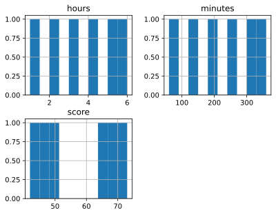

This chart was rendered from the supplied code and input; rerun the cell after changing the data.

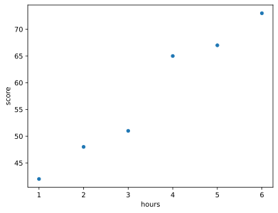

This chart was rendered from the supplied code and input; rerun the cell after changing the data.

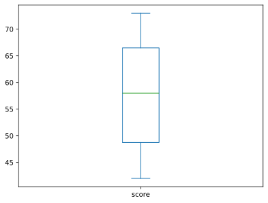

This chart was rendered from the supplied code and input; rerun the cell after changing the data.

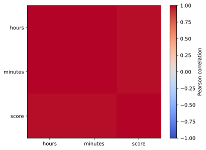

This chart was rendered from the supplied code and input; rerun the cell after changing the data.

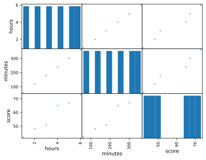

This chart was rendered from the supplied code and input; rerun the cell after changing the data.

**Inspect:** `hours` and `minutes` repeat the same information: their correlation is 1. This is **multicollinearity**. Coefficients can become unstable when inputs repeat each other. Remove one redundant unit conversion or consider regularization. A pair plot helps you inspect relationships; it does not prove a feature will improve unseen predictions.

**Try:** change the final score to 20. Describe which plots change and why. Never remove a difficult row solely because it lowers the model's score.

#### 4 · How to use it in the real world

The hours/minutes correlation below shows a duplicate unit conversion. A real training recipe should retain one or regularize deliberately, then validate its predictions. In this concrete choice, select `eda_training[["hours"]]` as the input and `eda_training["score"]` as the answer; do not include both units merely because they are available.

Here is the concrete model-input choice prompted by that exploration:

~~~python
from sklearn.linear_model import LinearRegression
eda_model = LinearRegression().fit(eda_training[["hours"]], eda_training["score"])
eda_request = pd.DataFrame({"hours": [3.5]})
print("Kept feature:", eda_request.columns.tolist())
print("Illustrative score estimate:", eda_model.predict(eda_request).round(2).tolist())
~~~


**Recorded output from this input:**

~~~text
Kept feature: ['hours']
Illustrative score estimate: [57.67]
~~~
The six-row illustration shows input selection and prediction, not validated educational forecasting. Do not claim quality from fitting the same inspected rows; compare the justified recipe on an appropriate independent evaluation design.


<a id="topic-c4-engineer-and-select-features-pdf-1-5"></a>

### C4 · Feature engineering: turn family counts into model inputs

#### 1 · Problem

Two raw columns describe accompanying relatives, but the model has no explicit “family size” or “traveling alone” input.

- `sibsp` counts siblings and spouses aboard.
- `parch` counts parents and children aboard.
- Neither count includes the passenger.

We want to turn those measurements into useful candidate features, **display what changed**, and test whether the features help a model.

#### 2 · How to fix it

Calculate `family_size = sibsp + parch + 1`. Then calculate `is_alone = 1` when family size is one, otherwise zero.

The sum expresses existing information differently; it does not collect new facts. It is also redundant with the two counts for some models. The alone flag introduces a different relationship. Neither feature is guaranteed to improve prediction.

This calculation uses input counts only, so it can be repeated before survival is known. Using `alive` instead would reveal the answer and cause leakage.

#### 3 · How to use it

**Start with three invented passengers, so every calculation is visible.** This cell is independent of earlier notebooks:

~~~python
import pandas as pd

family_example = pd.DataFrame({
    "Passenger": [
        "Traveling alone",
        "Traveling with a spouse",
        "Traveling with one sibling and two parents",
    ],
    "sibsp": [0, 1, 1],
    "parch": [0, 0, 2],
})
family_example["family_size"] = (
    family_example["sibsp"]       # Siblings and spouses.
    + family_example["parch"]     # Parents and children.
    + 1                          # Include the passenger.
)
print(family_example.to_string(index=False))  # Display values, not just a calculation.
assert family_example["family_size"].tolist() == [1, 2, 4]
~~~


**Recorded output from this input:**

~~~text
                                 Passenger  sibsp  parch  family_size
                           Traveling alone      0      0            1
                   Traveling with a spouse      1      0            2
Traveling with one sibling and two parents      1      2            4
~~~
**Read the resulting rows:**

| Passenger | `sibsp` | `parch` | New `family_size` |
|---|---:|---:|---:|
| Traveling alone | 0 | 0 | 1 |
| Traveling with a spouse | 1 | 0 | 2 |
| Traveling with one sibling and two parents | 1 | 2 | 4 |

For the final row, `1 + 2 + 1 = 4`. The column assignment stores the result; `print` makes it visible. The assertion checks these three known answers.

**Try:** change the last parent's count from two to one. Predict the new family size before running. Restore it afterward.

#### 4 · How to use it in the real world

For a passenger-prediction form, compute these features **inside the model pipeline**. The caller should send the raw counts; it should not have to reproduce a hidden notebook formula.

Run from the handbook folder, where `datasets/titanic.csv` exists. In Colab upload that CSV and change only the file path. Continue in this same notebook:

~~~python
from sklearn.compose import ColumnTransformer
from sklearn.impute import SimpleImputer
from sklearn.linear_model import LogisticRegression
from sklearn.model_selection import train_test_split, StratifiedKFold, cross_val_score
from sklearn.pipeline import Pipeline
from sklearn.preprocessing import FunctionTransformer, OneHotEncoder, StandardScaler
from sklearn.metrics import f1_score

family_source = pd.read_csv("datasets/titanic.csv")
family_raw_numbers = ["age", "fare", "sibsp", "parch"]
family_categories = ["sex", "pclass", "embarked"]
family_X = family_source[family_raw_numbers + family_categories]
family_y = family_source["survived"]
family_train_X, family_test_X, family_train_y, family_test_y = train_test_split(
    family_X, family_y, test_size=0.2, stratify=family_y, random_state=7,
)

def add_family_features(raw_table):
    result = raw_table.copy()  # Preserve the caller's original record.
    # This example requires the two counts; reject a missing count instead of guessing it.
    if result[["sibsp", "parch"]].isna().any().any():
        raise ValueError("Supply both family counts.")
    if (result[["sibsp", "parch"]] < 0).any().any():
        raise ValueError("Family counts cannot be negative.")
    result["family_size"] = result["sibsp"] + result["parch"] + 1
    result["is_alone"] = (result["family_size"] == 1).astype(int)
    return result
~~~


**What you see:** this setup cell prints no text. It defines or fits the objects used by the next cell in this experiment.

`FunctionTransformer` will call that function during both training and prediction. It has no target-dependent settings to fit. Learned medians, scales, category vocabularies, and model weights remain inside training.

~~~python
def make_family_pipeline(engineered):
    number_names = family_raw_numbers + (["family_size", "is_alone"] if engineered else [])
    numeric_steps = Pipeline([
        ("fill", SimpleImputer(strategy="median")),
        ("scale", StandardScaler()),
    ])
    category_steps = Pipeline([
        ("fill", SimpleImputer(strategy="most_frequent")),
        ("encode", OneHotEncoder(handle_unknown="ignore")),
    ])
    prepare = ColumnTransformer([
        ("numbers", numeric_steps, number_names),
        ("categories", category_steps, family_categories),
    ])
    steps = []
    if engineered:
        steps.append(("engineer", FunctionTransformer(add_family_features)))
    steps.extend([("prepare", prepare), ("model", LogisticRegression(max_iter=2000))])
    return Pipeline(steps)

family_folds = StratifiedKFold(3, shuffle=True, random_state=7)
family_candidates = {}
for family_name, use_engineering in [("raw inputs", False), ("engineered inputs", True)]:
    candidate = make_family_pipeline(use_engineering)
    validation_f1 = cross_val_score(
        candidate, family_train_X, family_train_y, cv=family_folds, scoring="f1",
    ).mean()
    family_candidates[family_name] = (float(validation_f1), candidate)
    print(family_name, "validation F1:", round(validation_f1, 3))

selected_family_name = max(family_candidates, key=lambda name: family_candidates[name][0])
family_final_model = family_candidates[selected_family_name][1]
family_final_model.fit(family_train_X, family_train_y)
print("Selected using validation:", selected_family_name)
print("Final test F1:", round(f1_score(
    family_test_y, family_final_model.predict(family_test_X),
), 3))
~~~


**Recorded output from this input:**

~~~text
raw inputs validation F1: 0.723
engineered inputs validation F1: 0.726
Selected using validation: engineered inputs
Final test F1: 0.719
~~~
Both recipes use the same training folds. Select using validation F1, then evaluate the selected procedure on reserved test rows. A small score difference is not proof of a stable improvement. Family/ticket groups would need appropriate grouped evaluation for a stronger claim; this bundled starter does not establish that boundary.

Now send a **newly entered request**:

~~~python
family_request = pd.DataFrame({
    "age": [30], "fare": [20.0], "sibsp": [1], "parch": [2],
    "sex": ["male"], "pclass": [3], "embarked": ["S"],
})
print("Features constructed for the request:")
print(add_family_features(family_request)[
    ["sibsp", "parch", "family_size", "is_alone"]
].to_string(index=False))
# Always illustrate the engineered recipe, even if validation selected the raw recipe.
family_engineered_model = make_family_pipeline(True).fit(family_train_X, family_train_y)
print("Engineered-model class:", family_engineered_model.predict(family_request).tolist())
print("Selected-model class:", family_final_model.predict(family_request).tolist())
print("Selected-model class probabilities:", family_final_model.predict_proba(family_request).round(3))
~~~


**Recorded output from this input:**

~~~text
Features constructed for the request:
 sibsp  parch  family_size  is_alone
     1      2            4         0
Engineered-model class: [0]
Selected-model class: [0]
Selected-model class probabilities: [[0.939 0.061]]
~~~
The constructed request has `family_size=4` and `is_alone=0`. `predict` returns a class; `predict_proba` returns probabilities in the model's `classes_` order. Class 0/1 means the historical dataset's survival label, not a decision about a present-day person. The engineered recipe is fitted only for this explicit interface demonstration if it did not win; do not claim it won validation in that case.

**Other engineering subtopics:** the date workshop calculates historical calendar features; the text workshop makes count/TF-IDF inputs; polynomial features create powers/interactions; database aggregates create one feature row per entity. For each, display the new inputs and place the same transformation in training and prediction. Keep private IDs, future outcomes, and documented redundant columns out of the recipe.

**Checkpoint:** explain the original problem, calculate one row manually, identify where the pipeline constructs the feature, and show one prediction. Then explain how you decide whether to retain the feature.


### C4a · Feature engineering: age at the prediction date

#### 1 · Problem

A date-of-birth string is not a numeric age, and using today's date for an old prediction can introduce information from the wrong time.

For a person born on **2000-06-01**, age at **2026-01-01** is **25**, because the 2026 birthday has not happened.

#### 2 · How to fix it

Use the date when the prediction is made. Subtract birth year, then subtract one more if that year's birthday has not occurred. Keep the date conversion in the prediction recipe.

#### 3 · How to use it

This independent cell uses invented records. It calculates completed calendar years:

~~~python
import pandas as pd

def age_features(raw_records):
    birth = pd.to_datetime(raw_records["birth_date"], errors="raise")
    prediction_date = pd.to_datetime(raw_records["prediction_date"], errors="raise")
    if birth.isna().any() or prediction_date.isna().any() or (birth > prediction_date).any():
        raise ValueError("Supply valid dates with birth no later than prediction.")
    birthday_number = birth.dt.month * 100 + birth.dt.day
    prediction_number = prediction_date.dt.month * 100 + prediction_date.dt.day
    birthday_not_reached = prediction_number < birthday_number
    years = prediction_date.dt.year - birth.dt.year - birthday_not_reached.astype(int)
    return pd.DataFrame({"age_years": years}, index=raw_records.index)

age_input = pd.DataFrame({
    "birth_date": ["2000-06-01", "2000-01-01"],
    "prediction_date": ["2026-01-01", "2026-01-01"],
})
print(age_input.join(age_features(age_input)).to_string(index=False))
assert age_features(age_input)["age_years"].tolist() == [25, 26]
~~~


**Recorded output from this input:**

~~~text
birth_date prediction_date  age_years
2000-06-01      2026-01-01         25
2000-01-01      2026-01-01         26
~~~
The same birth year gives two different ages because birthdays differ. `dt` provides datetime parts; `astype(int)` turns a true “birthday not reached” condition into one to subtract.

#### 4 · How to use it in the real world

A training/serving pipeline can turn raw dates into the same numeric input. This tiny fictional museum-visits example demonstrates the interface; its invented relationship is not evidence about real people's behavior.

~~~python
from sklearn.pipeline import make_pipeline
from sklearn.preprocessing import FunctionTransformer
from sklearn.linear_model import LinearRegression

age_training = pd.DataFrame({
    "birth_date": ["1980-01-01", "1990-01-01", "2000-01-01", "2010-01-01"],
    "prediction_date": ["2026-01-01"] * 4,
})
age_model = make_pipeline(
    FunctionTransformer(age_features),  # Convert dates every time the model is called.
    LinearRegression(),
)
age_model.fit(age_training, [48, 36, 24, 12])  # Invented annual visit counts.
age_request = pd.DataFrame({
    "birth_date": ["2000-06-01"], "prediction_date": ["2026-01-01"],
})
print("Constructed input:", age_features(age_request).to_dict("records"))
print("Illustrative annual visits:", age_model.predict(age_request).round(1).tolist())
~~~


**Recorded output from this input:**

~~~text
Constructed input: [{'age_years': 25}]
Illustrative annual visits: [22.8]
~~~
The caller sends dates; the pipeline constructs `age_years`. Use historical prediction dates in training, not a hardcoded current date. In a real project, justify whether age is necessary/permitted, validate the relationship on appropriate held-out data, and document any leap-day birthday convention.

**Try:** move the request date to 2026-06-01 and explain both the feature change and the prediction change.

<a id="topic-c4b-feature-selection"></a>

### C4b · Select features without leaking answers — PDF 1.5

#### 1 · Problem

Raw columns can hide a useful relationship, while irrelevant or leaking inputs can make the fitted model misleading.

#### 2 · How to fix it

First create a justified input and inspect it. Then compare feature selection methods inside training folds, with the final test reserved.

#### 3 · How to use it

**Engineering** creates information the model can use. **Selection** chooses which existing information to retain.

- Age: subtract birth date from the prediction date, rather than today's date for every historical record.
- Keywords: turn relevant words into counts or TF-IDF features; do not inspect future labels to choose words.
- Interactions: combine features, such as area × neighborhood indicator, when the relationship is plausible.
- Remove private IDs, future answers, constant columns, and documented redundant measurements.
- **Filter selection:** rank features with a statistical test.
- **Wrapper selection:** repeatedly fit models to evaluate feature subsets, such as RFE/RFECV.
- **Embedded selection:** let a penalized model or tree-based model assign weights during fitting.

This cell demonstrates ANOVA selection **inside** each training fold:

~~~python
from sklearn.datasets import make_classification
from sklearn.feature_selection import SelectKBest, f_classif, chi2, RFE, RFECV
from sklearn.linear_model import LogisticRegression
from sklearn.preprocessing import StandardScaler, MinMaxScaler
from sklearn.pipeline import Pipeline
from sklearn.model_selection import train_test_split, cross_val_score, StratifiedKFold

selection_X, selection_y = make_classification(
    n_samples=180, n_features=8, n_informative=4,
    n_redundant=2, random_state=7,
)
select_train_X, select_test_X, select_train_y, select_test_y = train_test_split(
    selection_X, selection_y, test_size=0.2, stratify=selection_y, random_state=7,
)
selection_cv = StratifiedKFold(n_splits=3, shuffle=True, random_state=7)
selection_pipeline = Pipeline([
    ("scale", StandardScaler()),                 # Learn mean/spread within each fold.
    ("select", SelectKBest(f_classif, k=4)),       # ANOVA ranks class mean differences.
    ("model", LogisticRegression(max_iter=1000)),
])
selection_scores = cross_val_score(
    selection_pipeline, select_train_X, select_train_y,
    cv=selection_cv, scoring="f1",
)
print("ANOVA validation F1:", selection_scores.round(3))

chi_pipeline = Pipeline([
    ("nonnegative", MinMaxScaler()),             # chi2 requires nonnegative training inputs.
    ("select", SelectKBest(chi2, k=4)),            # Often used with nonnegative counts.
    ("model", LogisticRegression(max_iter=1000)),
])
print("Chi-square validation F1:", cross_val_score(
    chi_pipeline, select_train_X, select_train_y, cv=selection_cv, scoring="f1",
).round(3))
~~~


**Recorded output from this input:**

~~~text
ANOVA validation F1: [0.894 0.894 0.875]
Chi-square validation F1: [0.826 0.87  0.851]
~~~
**Pause and inspect:** run the preceding step, inspect its values or shapes, and explain its comments. Then continue in the **same notebook**; the next cell uses this experiment's variables.

~~~python
rfe_pipeline = Pipeline([
    ("scale", StandardScaler()),
    ("select", RFE(LogisticRegression(max_iter=1000), n_features_to_select=4)),
    ("model", LogisticRegression(max_iter=1000)),
])
print("RFE validation F1:", cross_val_score(
    rfe_pipeline, select_train_X, select_train_y, cv=selection_cv, scoring="f1",
).round(3))

# RFECV chooses a subset size using its own inner cross-validation.
# Place scaling inside the estimator so even its inner folds learn their own scale.
rfecv_selector = RFECV(
    estimator=Pipeline([
        ("scale", StandardScaler()),
        ("model", LogisticRegression(max_iter=1000)),
    ]),
    importance_getter="named_steps.model.coef_",
    cv=selection_cv, scoring="f1", min_features_to_select=2,
)
print("RFECV outer validation F1:", cross_val_score(
    rfecv_selector, select_train_X, select_train_y,
    cv=selection_cv, scoring="f1",
).round(3))
~~~


**Recorded output from this input:**

~~~text
RFE validation F1: [0.875 0.894 0.857]
RFECV outer validation F1: [0.894 0.913 0.875]
~~~
`SelectKBest` keeps the requested number of ranked features. `RFE` removes weakly weighted inputs repeatedly. `RFECV` also chooses how many to keep. `importance_getter` tells it where the fitted coefficient weights live. The outer folds evaluate the whole selection procedure; the inner folds choose the subset.

ANOVA asks whether feature means differ between classes under statistical assumptions. Chi-square compares observed and expected nonnegative counts; Min-Max scaling here makes the API example runnable but does not turn arbitrary measurements into meaningful count data. For real chi-square inference, check the sampling and expected-count assumptions.

A **p-value** measures how incompatible an observed statistic is with a specified null model. It is not the probability that the null is true or that the result is “just luck.” Statistical significance does not establish practical usefulness. Multiple testing and repeated feature searches can create false discoveries.

**Try:** compare `k=2` and `k=6` using training validation only. Keep the reserved test closed while choosing.

#### 4 · How to use it in the real world

Use the worked family-feature model above as the complete engineering example: construct the feature at prediction time, compare raw versus engineered pipelines on identical training folds, and send raw fields for a new passenger. The transformation belongs in the fitted workflow so the form and training code cannot disagree.

For this application, fix the four-feature ANOVA pipeline from Step 3. This demonstrates how to use that selector; it does not declare it the winner of every comparison:

~~~python
selection_pipeline.fit(select_train_X, select_train_y)
selection_request = [[0.0] * select_train_X.shape[1]]  # Same eight raw fields.
print("Raw request:", selection_request)
print("Retained raw positions:", selection_pipeline.named_steps["select"].get_support(indices=True).tolist())
print("Fields after selection:", selection_pipeline[:-1].transform(selection_request).shape)
print("Predicted synthetic class:", selection_pipeline.predict(selection_request).tolist())
~~~


**Recorded output from this input:**

~~~text
Raw request: [[0.0, 0.0, 0.0, 0.0, 0.0, 0.0, 0.0, 0.0]]
Retained raw positions: [0, 1, 2, 5]
Fields after selection: (1, 4)
Predicted synthetic class: [1]
~~~
The caller sends all eight raw inputs. The fitted scaler and selector apply the stored transformation before the model receives four columns. These synthetic zero values illustrate the interface, not a real customer's measurements or independent model-quality evidence.


<a id="topic-c5-split-before-learning-pdf-1-6"></a>

### C5 · Split before learning — PDF 1.6

#### 1 · Problem

Randomly mixing repeated people or future records can test memorization rather than the generalization you need.

#### 2 · How to fix it

Choose the split boundary to match the claim: independent rows, unseen groups, or future times. Check boundaries before fitting.

#### 3 · How to use it

80/20 train/test is a simple starting split, not a universal law. To make 70/20/10 train/validation/test, first reserve 10%, then reserve `2/9` of the remaining 90% for validation. Fractions refer to the portion being split.

~~~python
from sklearn.model_selection import train_test_split, GroupKFold, TimeSeriesSplit
import numpy as np

row_numbers = np.arange(100)
development_rows, final_rows = train_test_split(
    row_numbers, test_size=0.1, random_state=7,
)
learning_rows, choosing_rows = train_test_split(
    development_rows, test_size=2 / 9, random_state=7,
)
print(len(learning_rows), len(choosing_rows), len(final_rows))  # 70 20 10
assert not set(learning_rows) & set(final_rows)

# Three records from each person: keep a person's records together.
person_groups = np.repeat(np.arange(10), 3)
group_splitter = GroupKFold(n_splits=5)
for group_train, group_valid in group_splitter.split(
    np.zeros((30, 1)), groups=person_groups,
):
    assert not set(person_groups[group_train]) & set(person_groups[group_valid])

# Already time-ordered examples: training must come before validation.
for earlier, later in TimeSeriesSplit(n_splits=3).split(row_numbers):
    assert earlier.max() < later.min()
print("Group and time boundaries checked.")
~~~


**Recorded output from this input:**

~~~text
70 20 10
Group and time boundaries checked.
~~~
For classification, `stratify=y` approximately preserves class proportions; it does not solve imbalance. Use group splits for repeated people/sites and chronological splits for future prediction. Leave a time gap when label windows overlap. Purge duplicate entities before splitting or keep them in one group. Tiny minority classes may not support many folds.

**Check:** explain why randomly mixing tomorrow's records into yesterday's training is misleading.

#### 4 · How to use it in the real world

For repeat patient visits, pass patient IDs as groups and keep all visits together when estimating performance on new patients. For demand forecasting, sort timestamps and train before validation. The assertions below are checks to run before fitting; they do not prove that your chosen grouping matches the business question.

A small future-prediction demonstration uses the last chronological fold constructed above:

~~~python
from sklearn.linear_model import LinearRegression
from sklearn.metrics import mean_absolute_error
traffic_measurement = (20 + row_numbers * 0.5).reshape(-1, 1)
fictional_orders = 2 * traffic_measurement.ravel() + 3
chronological_model = LinearRegression().fit(traffic_measurement[earlier], fictional_orders[earlier])
print("Training ends at record:", int(earlier.max()))
print("Evaluation starts at record:", int(later.min()))
print("Future-window MAE:", round(mean_absolute_error(fictional_orders[later], chronological_model.predict(traffic_measurement[later])), 6))
print("Estimate for measured traffic 72:", chronological_model.predict([[72]]).round(2).tolist())
~~~


**Recorded output from this input:**

~~~text
Training ends at record: 74
Evaluation starts at record: 75
Future-window MAE: 0.0
Estimate for measured traffic 72: [147.0]
~~~
The deliberately exact fictional relationship exposes the training/evaluation boundary; a zero error here is not evidence about actual demand. The model input is a measured-traffic feature, while row numbers are used only to enforce the chronological boundary.


<a id="topic-c6-mixed-columns-model-training-and-hyperparameter-search-pdf-1-7"></a>

### C6 · Mixed columns, model training, and hyperparameter search — PDF 1.7

#### 1 · Problem

One model cannot directly interpret missing numbers and unencoded plan names, and settings chosen on final-test answers give optimistic evidence.

#### 2 · How to fix it

Route numeric and categorical fields through training-fitted recipes, connect a classifier, and search its settings within training validation.

#### 3 · How to use it

A **ColumnTransformer** sends named columns to different preparation steps. A **Pipeline** connects preparation to a model. Together they keep training and prediction consistent.

Run these cells in order in this notebook:

~~~python
import numpy as np
import pandas as pd
from sklearn.compose import ColumnTransformer
from sklearn.impute import SimpleImputer
from sklearn.preprocessing import OneHotEncoder, StandardScaler
from sklearn.pipeline import Pipeline
from sklearn.linear_model import LogisticRegression
from sklearn.dummy import DummyClassifier
from sklearn.datasets import make_classification
from sklearn.model_selection import (
    train_test_split, StratifiedKFold, GridSearchCV, RandomizedSearchCV,
)

mixed_values, mixed_answers = make_classification(
    n_samples=240, n_features=4, n_informative=3, n_redundant=0,
    random_state=12,
)
mixed_table = pd.DataFrame(mixed_values, columns=["usage", "tenure", "cost", "visits"])
mixed_table["plan"] = np.where(np.arange(240) % 2 == 0, "basic", "plus")
mixed_table.loc[::17, "usage"] = np.nan  # Introduce a known practice problem.
mixed_train_X, mixed_test_X, mixed_train_y, mixed_test_y = train_test_split(
    mixed_table, mixed_answers, test_size=0.2,
    stratify=mixed_answers, random_state=12,
)
numeric_columns = ["usage", "tenure", "cost", "visits"]
numeric_recipe = Pipeline([
    ("fill", SimpleImputer(strategy="median")),
    ("scale", StandardScaler()),
])
category_recipe = Pipeline([
    ("fill", SimpleImputer(strategy="most_frequent")),
    ("encode", OneHotEncoder(handle_unknown="ignore")),
])
mixed_preparation = ColumnTransformer([
    ("numbers", numeric_recipe, numeric_columns),
    ("categories", category_recipe, ["plan"]),
])
mixed_pipeline = Pipeline([
    ("prepare", mixed_preparation),
    ("model", LogisticRegression(max_iter=1000)),
])
mixed_cv = StratifiedKFold(n_splits=3, shuffle=True, random_state=12)
grid_search = GridSearchCV(
    mixed_pipeline,
    param_grid={"model__C": [0.1, 1, 10]},  # __ reaches a named step's setting.
    scoring="f1", cv=mixed_cv, n_jobs=1,
)
grid_search.fit(mixed_train_X, mixed_train_y)  # Never pass final test rows here.
print("Selected settings:", grid_search.best_params_)
print("Training-validation F1:", round(grid_search.best_score_, 3))

random_search = RandomizedSearchCV(
    mixed_pipeline, param_distributions={"model__C": [0.01, 0.1, 1, 10, 100]},
    n_iter=3, scoring="f1", cv=mixed_cv, random_state=12, n_jobs=1,
)
random_search.fit(mixed_train_X, mixed_train_y)
print("Random-search settings:", random_search.best_params_)
chosen_mixed_model = grid_search.best_estimator_  # Selection rule fixed for this exercise.
~~~


**Recorded output from this input:**

~~~text
Selected settings: {'model__C': 0.1}
Training-validation F1: 0.869
Random-search settings: {'model__C': 0.1}
~~~
`C` controls inverse regularization strength: smaller values penalize large weights more. **Grid search** tries every listed combination. **Random search** samples a limited number. Both refit preparation within every fold and refit the winning recipe on all development rows.

**Bayesian optimization** uses past trials to propose promising new settings. A small manual trace: try tree depths 2 and 8, observe validation F1 values 0.72 and 0.79, then let a surrogate model balance trying near 8 against exploring untested depths. Use an established optimizer for real experiments; a hand-picked third trial is not itself Bayesian optimization. The optional runnable Optuna exercise below demonstrates sequential search:

~~~python-optional
# Optional extra: install optuna in this notebook's environment first.
# Requires the mixed-data setup cell above.
import optuna

def objective(trial):
    from sklearn.base import clone
    candidate = clone(mixed_pipeline)  # Start with an unfitted independent recipe.
    candidate.set_params(model__C=trial.suggest_float("C", 0.01, 100, log=True))
    return cross_val_score(
        candidate, mixed_train_X, mixed_train_y, cv=mixed_cv, scoring="f1",
    ).mean()

from sklearn.model_selection import cross_val_score
study = optuna.create_study(
    direction="maximize", sampler=optuna.samplers.TPESampler(seed=12),
)
study.optimize(objective, n_trials=5)
print(study.best_params)
~~~

`trial` represents one experiment. `suggest_float` requests a positive value across a logarithmic range. TPE is a sequential model-based optimizer; five trials teach the workflow rather than guaranteeing optimal settings. Record trial count, search space, seed, and compute budget. Search performance is optimistic because it selected the winner; assess the chosen procedure separately.

**Try:** swap the final model for a shallow random forest from Workshop E. Compare validation scores and training time before accessing the final test.

#### 4 · How to use it in the real world

A customer-scoring service receives the same named fields and calls the complete chosen pipeline:

~~~python
mixed_request = pd.DataFrame({"usage": [0.2], "tenure": [1.0], "cost": [-0.3], "visits": [0.5], "plan": ["basic"]})
print("New request probability:", chosen_mixed_model.predict_proba(mixed_request).round(3))
~~~


**Recorded output from this input:**

~~~text
New request probability: [[0.554 0.446]]
~~~
These generated features have no real customer units. Replace the simulation with documented permitted measurements before interpreting the probability as a real risk.


<a id="topic-c7-evaluate-what-matters-pdf-1-8"></a>

### C7 · Evaluate what matters — PDF 1.8

#### 1 · Problem

High accuracy can hide missed positives, excessive alerts, or errors too large for the application.

#### 2 · How to fix it

Fix the target and decision rule, report suitable metrics against a baseline, and inspect confusion/ROC/PR or residual plots.

#### 3 · How to use it

Continue from C6. We chose one model using training folds; now perform one final test.

~~~python
from sklearn.metrics import (
    accuracy_score, precision_score, recall_score, f1_score, roc_auc_score,
    average_precision_score, confusion_matrix, ConfusionMatrixDisplay,
    RocCurveDisplay, PrecisionRecallDisplay,
)
import matplotlib.pyplot as plt

mixed_probabilities = chosen_mixed_model.predict_proba(mixed_test_X)[:, 1]
mixed_predictions = (mixed_probabilities >= 0.5).astype(int)
for metric_name, metric_function in [
    ("accuracy", accuracy_score), ("precision", precision_score),
    ("recall", recall_score), ("F1", f1_score),
]:
    print(metric_name, round(metric_function(mixed_test_y, mixed_predictions), 3))
print("ROC AUC", round(roc_auc_score(mixed_test_y, mixed_probabilities), 3))
print("Average precision", round(average_precision_score(
    mixed_test_y, mixed_probabilities,
), 3))
mixed_baseline = DummyClassifier(strategy="most_frequent").fit(
    mixed_train_X, mixed_train_y,
)
print("Baseline accuracy", accuracy_score(
    mixed_test_y, mixed_baseline.predict(mixed_test_X),
))
print("Confusion matrix:\n", confusion_matrix(mixed_test_y, mixed_predictions))

ConfusionMatrixDisplay.from_predictions(mixed_test_y, mixed_predictions)
plt.show()
RocCurveDisplay.from_predictions(mixed_test_y, mixed_probabilities)
plt.show()
PrecisionRecallDisplay.from_predictions(mixed_test_y, mixed_probabilities)
plt.show()
~~~


**Recorded output from this input:**

~~~text
accuracy 0.833
precision 0.864
recall 0.792
F1 0.826
ROC AUC 0.944
Average precision 0.942
Baseline accuracy 0.5
Confusion matrix:
 [[21  3]
 [ 5 19]]
~~~
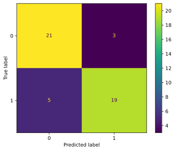

This chart was rendered from the supplied code and input; rerun the cell after changing the data.

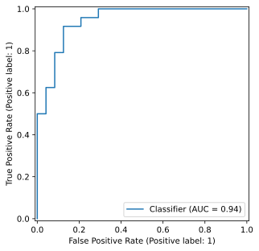

This chart was rendered from the supplied code and input; rerun the cell after changing the data.

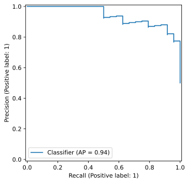

This chart was rendered from the supplied code and input; rerun the cell after changing the data.

| Measure | Read it in plain language | Watch for |
|---|---|---|
| Accuracy | Fraction of all correct labels | A majority-only classifier can look good |
| Precision | Among predicted positives, fraction actually positive | False alerts cost time/resources |
| Recall | Among actual positives, fraction found | Missed cases may be costly |
| F1 | Harmonic mean of precision and recall | Neither calibration nor every business cost |
| ROC AUC | How well positives rank above negatives over thresholds | Can look reassuring with rare positives |
| Average precision / PR curve | Precision-recall performance across thresholds | Interpret against prevalence |
| Confusion matrix | Counts of correct/mistaken labels | Know which class means “positive” |

For multiclass tasks choose an explicit average: **macro** weights classes equally; **weighted** weights by class support; **micro** pools decisions. Report per-class counts too.

A **threshold** converts a probability into an action. Lowering it often raises recall and false alerts together. Choose a threshold on validation data using a cost/capacity rule; do not tune it on these final-test probabilities. Predicting every case positive achieves recall 1 but may be useless. A probability of 0.8 should correspond to about 80% positives among comparable cases if well calibrated; inspect calibration on separate validation data.

For regression, use a separate self-contained example:

~~~python
import numpy as np
import matplotlib.pyplot as plt
from sklearn.metrics import mean_absolute_error, mean_squared_error, r2_score

known_values = np.array([10, 20, 30, 40])
estimated_values = np.array([12, 18, 33, 37])
residuals = known_values - estimated_values  # Actual minus predicted.
print("MAE:", mean_absolute_error(known_values, estimated_values))  # 2.5 units.
print("RMSE:", np.sqrt(mean_squared_error(known_values, estimated_values)))
print("R squared:", r2_score(known_values, estimated_values))

plt.scatter(estimated_values, residuals)
plt.axhline(0, color="black")
plt.xlabel("Predicted value")
plt.ylabel("Actual minus predicted")
plt.show()
~~~


**Recorded output from this input:**

~~~text
MAE: 2.5
RMSE: 2.5495097567963922
R squared: 0.948
~~~
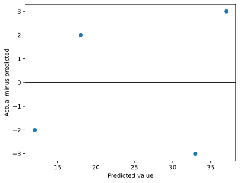

This chart was rendered from the supplied code and input; rerun the cell after changing the data.

MAE weights error sizes equally. RMSE penalizes large errors more. R² compares squared error with predicting the evaluation set's mean; it can be negative. A curved residual pattern can suggest a missing relationship; growing residual spread can suggest changing uncertainty.

**Feature importance:** inspect the fitted model's coefficients or use permutation importance on an appropriate validation set. Shuffle one feature and measure the score drop; correlated features can share importance. Importance is not causation. After using validation interpretation to revise a model, evaluate the revised procedure with reserved data.

**Uncertainty and fairness:** report sample size, repeated-group/time structure, error variation, and subgroup counts. Cross-validation score standard deviation is not automatically a confidence interval. Bootstrap independent sampling units when assumptions fit; do not resample correlated rows as if independent. Small subgroup comparisons are uncertain and do not certify fairness.

**Checkpoint:** explain why a higher accuracy model might be the worse choice, then write a one-paragraph model card: intended use, data, metric, baseline, limitations, and excluded uses.

<!-- Additional Workshop C material. Each code cell below is independent. -->

#### 4 · How to use it in the real world

Turn a model probability into an action only using a policy selected on validation data. For outreach, rank requests and fit within an agreed review budget; for numeric estimates, report errors in the user’s units. The later calibration lesson implements a threshold choice and the monitoring lesson measures quality when delayed answers arrive.

Turn the already-fixed 0.5 policy into a visible review queue; do not tune it using these test outcomes:

~~~python
review_queue = pd.DataFrame({"probability": mixed_probabilities, "send_for_review": mixed_predictions.astype(bool)})
print(review_queue.head(5).round(3).to_string(index=False))
print("Requests flagged under the fixed policy:", int(review_queue["send_for_review"].sum()))
~~~


**Recorded output from this input:**

~~~text
 probability  send_for_review
       0.427            False
       0.257            False
       0.465            False
       0.185            False
       0.658             True
Requests flagged under the fixed policy: 22
~~~
This shows what the evaluated rule would send to a reviewer. A new deployment still needs a threshold chosen with development evidence, capacity constraints, valid inputs, and monitoring.


<a id="topic-c2-extension-join-records-safely-and-record-their-history"></a>

### C2 extension · Join records safely and record their history

#### 1 · Problem

A duplicate customer key or unmatched order can multiply records or attach the wrong attributes before training.

#### 2 · How to fix it

Declare join cardinality, preserve unmatched rows visibly, and verify row counts and key meaning.

#### 3 · How to use it

A **join key** identifies matching records in two tables. Before joining, state the expected relationship: one customer can have many orders, but each order should find at most one customer record. A duplicated key can silently multiply rows.

Run this independent cell:

~~~python
import pandas as pd

orders = pd.DataFrame({"order_id": [101, 102, 103],
                       "customer_id": [1, 1, 3], "amount": [12.0, 8.0, 20.0]})
customers = pd.DataFrame({"customer_id": [1, 2], "region": ["North", "South"]})
joined = orders.merge(customers, on="customer_id", how="left",
                      validate="many_to_one", indicator=True)
print(joined)
print("Orders without customer information:",
      joined.loc[joined["_merge"] == "left_only", "order_id"].tolist())
assert len(joined) == len(orders)  # A correct join did not multiply orders.

# Demonstrate the error instead of allowing a duplicated customer key.
bad_customers = pd.concat([customers, customers.iloc[[0]]], ignore_index=True)
try:
    orders.merge(bad_customers, on="customer_id", validate="many_to_one")
except pd.errors.MergeError:
    print("Rejected a customer table with duplicate keys.")

metadata = {"source": "fictional orders and customer tables",
            "row_unit": "one order", "amount_unit": "fictional coins",
            "loaded_at_utc": pd.Timestamp.now(tz="UTC").isoformat(),
            "raw_rows": len(orders), "joined_rows": len(joined),
            "unmatched_orders": int((joined["_merge"] == "left_only").sum())}
print(metadata)
~~~


**Recorded output from this input:**

~~~text
   order_id  customer_id  amount region     _merge
0       101            1    12.0  North       both
1       102            1     8.0  North       both
2       103            3    20.0    NaN  left_only
Orders without customer information: [103]
Rejected a customer table with duplicate keys.
{'source': 'fictional orders and customer tables', 'row_unit': 'one order', 'amount_unit': 'fictional coins', 'loaded_at_utc': '2026-11-03T18:31:59.900060+00:00', 'raw_rows': 3, 'joined_rows': 3, 'unmatched_orders': 1}
~~~
**Expected relationship:** all three orders remain; order 103 has no matching customer. `indicator=True` explains whether each record matched. `validate="one_to_one"` requires unique keys on both sides; `"many_to_one"` permits repeated left keys. An **inner** join keeps matches, a **left** join keeps every left record, and an **outer** join keeps records from both tables. Missing keys also require inspection: pandas can match null keys to each other, which may not represent a valid identity.

**Try:** deliberately duplicate an order and compare `one_to_one` with `many_to_one`. Explain why row count alone cannot prove the amounts or identities are correct. Extend the metadata with source version, collection time, units, query, and known sampling gaps; keep secrets and unnecessary personal data out of the record.

#### 4 · How to use it in the real world

Use the retained join indicator as a review queue before model preparation. Order 103 below has no customer record: investigate it or encode missing region deliberately; do not invent a customer. Aggregate each repeated child table before joining, as the database lesson demonstrates.

Use the actual join report to separate ready records from records needing investigation:

~~~python
ready_orders = joined.loc[joined["_merge"] == "both", ["order_id", "amount", "region"]]
needs_customer_lookup = joined.loc[joined["_merge"] == "left_only", ["order_id", "customer_id"]]
print("Ready for preparation:"); print(ready_orders.to_string(index=False))
print("Lookup queue:"); print(needs_customer_lookup.to_string(index=False))
~~~


**Recorded output from this input:**

~~~text
Ready for preparation:
 order_id  amount region
      101    12.0  North
      102     8.0  North
Lookup queue:
 order_id  customer_id
      103            3
~~~
This does not automatically discard unmatched records. It makes the missing relationship visible before a documented preparation policy decides how to handle them.


<a id="topic-c2-extension-read-an-api-scrape-a-small-page-and-store-tables"></a>

### C2 extension · Read an API, scrape a small page, and store tables

#### 1 · Problem

A web response is not automatically a complete, clean, reproducible model input.

#### 2 · How to fix it

Separate requesting, parsing, validation, and typed storage; first test extraction on a controlled page.

#### 3 · How to use it

**API exercise:** this optional network cell requests public repository metadata, checks status, parses JSON, and selects named fields. It sends no credentials:

~~~python-optional
import json
from urllib.request import Request, urlopen

metadata_request = Request(
    "https://api.github.com/repos/scikit-learn/scikit-learn",
    headers={"Accept": "application/vnd.github+json", "User-Agent": "ml-learning-exercise"},
)
with urlopen(metadata_request, timeout=10) as response:
    if response.status != 200:
        raise RuntimeError(f"Unexpected response: {response.status}")
    public_metadata = json.load(response)
print({key: public_metadata[key] for key in ["full_name", "language", "license"]})
~~~

`Request` describes the HTTP request; `timeout` limits waiting; `with` closes the response; `json.load` decodes its body. Counts and metadata can change. For a multi-page API, follow its documented pagination and confirm completeness; a single response is not automatically the full dataset. See [GitHub's REST quickstart](https://docs.github.com/en/rest/quickstart).

**Scraping exercise, without visiting a site:** first learn extraction on this known HTML fixture:

~~~python
from html.parser import HTMLParser

class PriceReader(HTMLParser):
    def __init__(self):
        super().__init__()
        self.in_price = False
        self.prices = []
    def handle_starttag(self, tag, attributes):
        self.in_price = tag == "span" and dict(attributes).get("class") == "price"
    def handle_data(self, text):
        if self.in_price:
            self.prices.append(float(text))
    def handle_endtag(self, tag):
        if tag == "span":
            self.in_price = False

price_reader = PriceReader()
price_reader.feed('<span class="price">12.5</span><span class="price">8.0</span>')
print(price_reader.prices)
assert price_reader.prices == [12.5, 8.0]
~~~


**Recorded output from this input:**

~~~text
[12.5, 8.0]
~~~
The parser calls methods when tags/data arrive. This tiny reader assumes simple spans containing plain numbers; nested tags and locale-formatted prices need a more robust parser and tests. **Try:** change the page's class name and see extraction fail its assertion. For a real page, inspect permitted access and structure, preserve source attribution, and report unexpected missing elements rather than silently returning an empty training table.

**Excel and Parquet exercise:** after installing optional `openpyxl` and `pyarrow`, run this standalone local cell:

~~~python-optional
from pathlib import Path
from tempfile import TemporaryDirectory
import pandas as pd

storage_table = pd.DataFrame({"item": ["apple", "pear"], "count": [2, 3]})
with TemporaryDirectory(prefix="ml-storage-") as storage_folder:
    storage_path = Path(storage_folder)
    storage_table.to_excel(storage_path / "practice.xlsx", index=False)
    storage_table.to_parquet(storage_path / "practice.parquet", index=False)
    excel_copy = pd.read_excel(storage_path / "practice.xlsx")
    parquet_copy = pd.read_parquet(storage_path / "practice.parquet")
    pd.testing.assert_frame_equal(storage_table, excel_copy)
    pd.testing.assert_frame_equal(storage_table, parquet_copy)
print("Excel and Parquet table round trips checked.")
~~~

Excel stores spreadsheet cells; Parquet stores typed columnar data and often supports efficient analytical storage. Neither supplies provenance automatically. **Try:** add a missing numeric value, round-trip it, and compare types as well as values. Preserve raw files and a schema record when formats coerce types.

#### 4 · How to use it in the real world

Feed only validated extracted measurements into a feature table. The scraper below produces numeric prices; check both expected prices before writing a training record. For real APIs, persist retrieval/version metadata and validate pagination; for Excel/Parquet, verify types after the round trip instead of assuming file conversion preserved the schema.

Turn the controlled extraction into a typed ingestion result:

~~~python
import pandas as pd
scraped_price_table = pd.DataFrame({"price_coins": price_reader.prices})
if scraped_price_table.empty or (scraped_price_table["price_coins"] < 0).any():
    raise ValueError("Investigate empty or invalid extracted prices.")
print("Numeric feature table for the next preparation step:")
print(scraped_price_table.to_string(index=False))
~~~


**Recorded output from this input:**

~~~text
Numeric feature table for the next preparation step:
 price_coins
        12.5
         8.0
~~~
Retain provenance with these fields. This fixture validates two known values; a live page needs its own schema, permission, completeness, and parser checks.


<a id="topic-c3-extension-test-a-stated-question-then-interpret-cautiously"></a>

### C3 extension · Test a stated question, then interpret cautiously

#### 1 · Problem

An apparent relationship in an exploratory sample may reflect random variation, confounding, or a violated test assumption.

#### 2 · How to fix it

State a question and sampling unit, choose the corresponding statistical test, and interpret its statistic, assumptions, and effect size together.

#### 3 · How to use it

Statistical tests address a specified question under assumptions. They do not automatically certify a useful feature or a causal explanation.

| Test | Question in this exercise | Important restriction |
|---|---|---|
| Mann–Whitney U | Do the two independent groups have the same distribution of delivery times? | A median-only interpretation needs additional shape assumptions |
| Spearman rank correlation | Do larger distances tend to accompany larger times monotonically? | A near-zero value can miss other relationships |
| Chi-square contingency test | Is late delivery associated with the region categories? | Independent counts and sufficiently large expected counts are needed |

~~~python
import numpy as np
import pandas as pd
from scipy.stats import mannwhitneyu, spearmanr, chi2_contingency

rng = np.random.default_rng(31)
normal_day = rng.normal(25, 4, 80)
rainy_day = rng.normal(30, 4, 80)
distance = np.arange(1, 41)
minutes = 8 + 2 * distance + rng.normal(0, 4, len(distance))

print("Median times:", round(np.median(normal_day), 1),
      round(np.median(rainy_day), 1))
print("Mann–Whitney p:", mannwhitneyu(normal_day, rainy_day,
                                      alternative="two-sided").pvalue)
association = spearmanr(distance, minutes)
print("Spearman coefficient:", round(association.statistic, 3),
      "p:", association.pvalue)

# These are counts, not arbitrary measurements converted into positive numbers.
counts = pd.DataFrame([[36, 14], [20, 30]],
                       index=["North", "South"], columns=["on_time", "late"])
chi = chi2_contingency(counts)
print("Chi-square p:", chi.pvalue)
print("Expected counts if independent:\n", chi.expected_freq.round(1))
print("Late fractions:", (counts["late"] / counts.sum(axis=1)).to_dict())
~~~


**Recorded output from this input:**

~~~text
Median times: 24.8 30.4
Mann–Whitney p: 3.609574232146555e-15
Spearman coefficient: 0.986 p: 2.360821986593156e-31
Chi-square p: 0.0025124653378568716
Expected counts if independent:
 [[28. 22.]
 [28. 22.]]
Late fractions: {'North': 0.28, 'South': 0.6}
~~~
**Inspect:** the seeded example gives medians around 24.8 and 30.4, a positive Spearman coefficient around 0.986, and late fractions 0.28 and 0.60. The chi-square expected counts are all above 5. These observed differences come from fictional data, not a finding about actual regions or weather.

A **p-value** describes how extreme the statistic is under the specified null model. It is not the probability that the null is true or that a pattern is just luck. Report the coefficient or group difference, sample sizes, and context alongside it. A small p-value does not make the difference large, establish causality, or show that it will repeat in a new population. A large p-value does not establish equality. Testing many alternatives after exploration needs appropriate multiple-testing control or a new confirmatory sample.

**Try:** reduce each group to five observations and describe the increased uncertainty. Write the question before rerunning. In real repeated-customer data, these independent-observation tests need a different design or analysis. A missingness-versus-age test can reveal association; it cannot establish MAR rather than MNAR.

#### 4 · How to use it in the real world

Use the observed association to propose a feature or a collection check, then test predictive value inside validation. A significant region/late-delivery association does not justify claiming region causes delay or automatically using a sensitive proxy in a model.


<a id="topic-c4-extension-compare-filter-and-embedded-selection-within-folds"></a>

### C4 extension · Compare filter and embedded selection within folds

#### 1 · Problem

Many candidate columns include constants, weak signals, or redundant substitutes; selecting them before evaluation leaks information.

#### 2 · How to fix it

Compare variance and mutual-information filters with model-based selection as parts of a validation pipeline.

#### 3 · How to use it

**VarianceThreshold** removes constant features without using the target. A nonzero variance threshold depends on feature units. **Mutual information (MI)** ranks dependence between a feature and target, including some nonlinear relationships; estimated zero is not proof of no relationship. **L1 regularization**, demonstrated by Lasso, can set fitted coefficients to zero. Features with zero coefficients are excluded under that fitted penalty, not proven universally useless.

This independent classification cell keeps the selector inside the pipeline:

~~~python
import numpy as np
from sklearn.datasets import make_classification
from sklearn.feature_selection import VarianceThreshold, SelectKBest, mutual_info_classif
from sklearn.linear_model import LogisticRegression
from sklearn.model_selection import StratifiedKFold, cross_val_score
from sklearn.pipeline import make_pipeline
from sklearn.preprocessing import StandardScaler

values, labels = make_classification(n_samples=240, n_features=8,
                                     n_informative=4, n_redundant=2, random_state=31)
values = np.column_stack([values, np.ones(len(values))])  # A constant ninth input.

def mi_for_continuous_inputs(X, y):
    return mutual_info_classif(X, y, discrete_features=False, random_state=31)

recipe = make_pipeline(VarianceThreshold(threshold=0), StandardScaler(),
                       SelectKBest(mi_for_continuous_inputs, k=4),
                       LogisticRegression(max_iter=1000))
folds = StratifiedKFold(3, shuffle=True, random_state=31)
scores = cross_val_score(recipe, values, labels, cv=folds, scoring="roc_auc")
print("MI selection validation AUC:", scores.round(3))
~~~


**Recorded output from this input:**

~~~text
MI selection validation AUC: [0.953 0.928 0.917]
~~~
**Inspect:** three validation scores should print, one per fold. In the checked environment they were approximately `[0.953, 0.928, 0.917]`. The constant ninth input is removed before ranking; every fold recomputes its ranking.

For categorical/count inputs, set MI's discrete-feature treatment to match the data rather than copying this continuous-only helper. Do not compute a global ranking from all labels and then describe cross-validation of the selected columns as independent evaluation.

This separate regression cell demonstrates L1 selection:

~~~python
from sklearn.datasets import make_regression
from sklearn.feature_selection import SelectFromModel
from sklearn.linear_model import Lasso, Ridge
from sklearn.model_selection import KFold, cross_val_score
from sklearn.pipeline import make_pipeline
from sklearn.preprocessing import StandardScaler

values, answers = make_regression(n_samples=200, n_features=10,
                                  n_informative=3, noise=10, random_state=31)
recipe = make_pipeline(StandardScaler(),
                       SelectFromModel(Lasso(alpha=1.0, max_iter=5000)), Ridge())
scores = -cross_val_score(recipe, values, answers,
                          cv=KFold(3, shuffle=True, random_state=31),
                          scoring="neg_mean_absolute_error")
recipe.fit(values, answers)  # Inspect after the evaluation procedure was fixed.
print("Validation MAE:", scores.round(2))
print("Retained input positions:",
      recipe.named_steps["selectfrommodel"].get_support(indices=True).tolist())
~~~


**Recorded output from this input:**

~~~text
Validation MAE: [7.79 9.17 7.71]
Retained input positions: [1, 2, 4, 7]
~~~
**Inspect:** the checked run retained positions `[1, 2, 4, 7]` and printed validation MAE values around 7.8, 9.2, and 7.7. A selected list is not a recovery guarantee for the generator's informative features.

**Try:** compare with the same model without selection. Choose the penalty or number of inputs on development validation, and evaluate the whole choice separately. Correlated features can replace one another; inspect selection stability across resamples rather than treating one selected list as a scientific conclusion.

#### 4 · How to use it in the real world

The returned selected-column positions describe the fitted recipe. Incoming requests must still provide the original schema; the pipeline applies the stored mask. Compare that recipe with the same model without selection and promote it only when held-out evidence and simpler operation justify the choice.

The last Step 3 example fitted a Lasso-selection → Ridge pipeline. Use that actual fitted recipe:

~~~python
embedded_request = [[0.0] * values.shape[1]]
print("Raw request field count:", len(embedded_request[0]))
print("Retained positions:", recipe.named_steps["selectfrommodel"].get_support(indices=True).tolist())
print("Numerical model output:", recipe.predict(embedded_request).round(3).tolist())
~~~


**Recorded output from this input:**

~~~text
Raw request field count: 10
Retained positions: [1, 2, 4, 7]
Numerical model output: [-1.389]
~~~
These synthetic inputs demonstrate the saved selection contract. Do not preselect different fields in the caller or refit selection using a prediction request.


<a id="topic-c4-extension-permutation-importance-and-optional-shap-explanations"></a>

### C4 extension · Permutation importance and optional SHAP explanations

#### 1 · Problem

A prediction score alone does not explain which inputs the fitted model relies on or how an individual estimate is assembled.

#### 2 · How to fix it

Shuffle one validation input at a time to measure reliance, and use an explicitly defined explanation method for individual predictions.

#### 3 · How to use it

**Permutation importance** shuffles one validation feature while leaving others fixed and measures how much predictive performance drops. Larger positive drops indicate reliance on that feature under this dataset, model, and metric. Negative values can occur through noise or a harmful feature. Correlation can divide importance between substitutes; unrealistic shuffled combinations can also affect interpretation.

~~~python
import pandas as pd
from sklearn.datasets import make_classification
from sklearn.ensemble import RandomForestClassifier
from sklearn.inspection import permutation_importance
from sklearn.model_selection import train_test_split

values, labels = make_classification(n_samples=240, n_features=6,
                                     n_informative=3, n_redundant=1, random_state=31)
table = pd.DataFrame(values, columns=[f"input_{i}" for i in range(6)])
learn_X, inspect_X, learn_y, inspect_y = train_test_split(
    table, labels, test_size=0.3, stratify=labels, random_state=31)
model = RandomForestClassifier(n_estimators=80, min_samples_leaf=4,
                                random_state=31).fit(learn_X, learn_y)
result = permutation_importance(model, inspect_X, inspect_y,
                                 scoring="roc_auc", n_repeats=5, random_state=31)
importance_table = pd.DataFrame({"mean_AUC_drop": result.importances_mean,
                                "repeat_std": result.importances_std}, index=table.columns)
print(importance_table.sort_values("mean_AUC_drop", ascending=False).round(3))
import matplotlib.pyplot as plt
importance_table["mean_AUC_drop"].sort_values().plot.barh(
    xerr=importance_table.loc[importance_table["mean_AUC_drop"].sort_values().index, "repeat_std"],
)
plt.xlabel("Mean validation ROC-AUC drop after shuffling")
plt.ylabel("Input feature")
plt.tight_layout()
plt.show()  # Horizontal bars display model reliance; error bars show repeat variation.
~~~


**Recorded output from this input:**

~~~text
         mean_AUC_drop  repeat_std
input_5          0.262       0.055
input_2          0.160       0.030
input_3          0.075       0.025
input_4          0.026       0.002
input_1         -0.002       0.005
input_0         -0.008       0.008
~~~
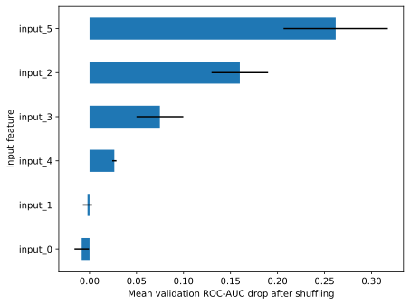

This chart was rendered from the supplied code and input; rerun the cell after changing the data.

**Inspect:** one importance row per input should appear. In this run `input_5` and `input_2` had the largest mean drops; some weak inputs had slightly negative values. Inspect those values rather than hiding them.

This is an **inspection/validation** split. If you change the model based on the importance report, evaluate the revised procedure on other reserved data. The repeat standard deviation describes shuffling variability, not a full confidence interval.

**SHAP** attributes an individual prediction relative to a background reference under a specified explanation approach. Its values explain the fitted model's behavior, not causes in the world. This independent optional cell explains a linear regressor in standardized feature space.

**Optional software:** install `shap` in the notebook environment before running; the core curriculum does not depend on it.

~~~python-optional
import numpy as np
import shap
from sklearn.datasets import make_regression
from sklearn.linear_model import Ridge
from sklearn.model_selection import train_test_split
from sklearn.preprocessing import StandardScaler

values, answers = make_regression(n_samples=160, n_features=4,
                                  n_informative=3, noise=5, random_state=31)
learn_X, inspect_X, learn_y, inspect_y = train_test_split(
    values, answers, test_size=0.25, random_state=31)
scale = StandardScaler().fit(learn_X)  # Learn the scale from training only.
learn_scaled, inspect_scaled = scale.transform(learn_X), scale.transform(inspect_X)
model = Ridge().fit(learn_scaled, learn_y)
explainer = shap.LinearExplainer(model, learn_scaled)
explanation = explainer(inspect_scaled[:3])
reconstructed = explanation.base_values + explanation.values.sum(axis=1)
print("Feature contributions for row 0:", explanation.values[0].round(2))
print("Contributions reconstruct the model:",
      np.allclose(reconstructed, model.predict(inspect_scaled[:3])))
~~~

**Expected relationship:** the contributions plus the reference prediction reconstruct these three predictions within numerical tolerance. This optional example requires SHAP; it is not included in the core execution checks below.

**Try:** compare explanations for two records and state the background data and output units. A successful additive reconstruction checks a calculation, not the truth or fairness of the model.

#### 4 · How to use it in the real world

Display the importance plot in a model-review report alongside the validation sample, metric, and correlated features. An operator can investigate a surprising reliance on an identifier or post-outcome field. SHAP contributions reconstruct model behavior; they are not instructions for changing a person or evidence of causation.


<a id="topic-c5-extension-stratified-groups-and-nested-evaluation"></a>

### C5 extension · Stratified groups and nested evaluation

#### 1 · Problem

Class balancing can conflict with keeping entire people together, and a search’s winning inner score evaluates its own selection.

#### 2 · How to fix it

Use grouped stratification where feasible and nested evaluation to assess the full settings-selection process.

#### 3 · How to use it

**StratifiedGroupKFold** keeps each group on one side of a fold while attempting to balance class proportions. Perfect balance may be impossible when large groups contain only one class. **GroupShuffleSplit** reserves whole groups for a single split; its fraction refers to groups, not necessarily rows.

~~~python
import numpy as np
from sklearn.model_selection import GroupShuffleSplit, StratifiedGroupKFold

groups = np.repeat(np.arange(30), 4)  # Four visits per fictional person.
labels = np.repeat(np.arange(30) % 2, 4)
values = np.zeros((len(groups), 1))
split = GroupShuffleSplit(n_splits=1, test_size=0.2, random_state=31)
learning, testing = next(split.split(values, labels, groups))
assert set(groups[learning]).isdisjoint(groups[testing])
print("Reserved people:", len(set(groups[testing])))

folds = StratifiedGroupKFold(3, shuffle=True, random_state=31)
for number, (learning, validation) in enumerate(folds.split(values, labels, groups), 1):
    assert set(groups[learning]).isdisjoint(groups[validation])
    print("Fold", number, "validation positives:", round(labels[validation].mean(), 2))
~~~


**Recorded output from this input:**

~~~text
Reserved people: 6
Fold 1 validation positives: 0.7
Fold 2 validation positives: 0.3
Fold 3 validation positives: 0.5
~~~
**Inspect:** the first split reserves six people. In the checked version the fold positive fractions were 0.70, 0.30, and 0.50: stratification with group constraints is approximate, even when a more balanced arrangement might exist. The assertions establish no person overlap for these splits.

Choose grouping according to the prediction claim: performance on new people, new sites, or future visits can require different boundaries. Passing an index-overlap check does not guarantee those boundaries match the task.

**Nested cross-validation** uses inner folds to choose settings and outer folds to evaluate the entire choice. The outer score is about the selection procedure; a search's best inner score selected its own winner and can be optimistic.

~~~python
from sklearn.datasets import make_classification
from sklearn.linear_model import LogisticRegression
from sklearn.model_selection import GridSearchCV, StratifiedKFold, cross_val_score
from sklearn.pipeline import make_pipeline
from sklearn.preprocessing import StandardScaler

values, labels = make_classification(n_samples=240, n_features=6,
                                     n_informative=3, n_redundant=1, random_state=31)
recipe = make_pipeline(StandardScaler(), LogisticRegression(max_iter=1000))
inner = StratifiedKFold(3, shuffle=True, random_state=31)
outer = StratifiedKFold(3, shuffle=True, random_state=32)
search = GridSearchCV(recipe, {"logisticregression__C": [0.1, 1, 10]},
                       cv=inner, scoring="roc_auc")
scores = cross_val_score(search, values, labels, cv=outer, scoring="roc_auc")
print("Outer AUC for the selection procedure:", scores.round(3))
~~~


**Recorded output from this input:**

~~~text
Outer AUC for the selection procedure: [0.532 0.514 0.509]
~~~
**Inspect:** three outer scores should print. The checked run was near chance, around `[0.532, 0.514, 0.509]`; nested evaluation does not guarantee a good model. Report that evidence instead of changing seeds until the result looks stronger.

**Try:** explain which rows supply scaling statistics, choose `C`, and supply each outer score. For grouped or temporal data, both levels must preserve the relevant boundaries; the independent-row example above does not handle them automatically.

#### 4 · How to use it in the real world

For hospital generalization, outer folds reserve hospitals and inner folds also respect those boundaries while selecting settings. Save group IDs and fold membership with the experiment. Do not substitute independent-row nested CV for the actual deployment boundary.

After estimating the settings-selection procedure with outer folds, fit its deployment recipe and show its input contract:

~~~python
search.fit(values, labels)
nested_request = [[0.0] * values.shape[1]]
print("Settings chosen for refit:", search.best_params_)
print("Synthetic request class:", search.predict(nested_request).tolist())
~~~


**Recorded output from this input:**

~~~text
Settings chosen for refit: {'logisticregression__C': 0.1}
Synthetic request class: [0]
~~~
The earlier outer scores estimate the selection process; this refitted request is an interface demonstration and is not another unbiased evaluation. Grouped/time data need those boundaries inside both levels.


<a id="topic-c6-extension-learning-curves-and-successive-halving"></a>

### C6 extension · Learning curves and successive halving

#### 1 · Problem

You do not know whether more data may help, or whether a large hyperparameter grid is spending resources effectively.

#### 2 · How to fix it

Inspect learning curves and give surviving candidates larger budgets with a documented successive-halving rule.

#### 3 · How to use it

A **learning curve** compares training and validation scores as the training sample grows. A large gap suggests poor generalization; low scores on both can suggest a limited model, weak signal, or noisy labels. A short, flat curve is evidence under this experiment, not proof that more data can never help.

~~~python
import numpy as np
from sklearn.datasets import make_classification
from sklearn.linear_model import LogisticRegression
from sklearn.model_selection import StratifiedKFold, learning_curve
from sklearn.pipeline import make_pipeline
from sklearn.preprocessing import StandardScaler

values, labels = make_classification(n_samples=320, n_features=8,
                                     n_informative=4, n_redundant=2, random_state=31)
recipe = make_pipeline(StandardScaler(), LogisticRegression(max_iter=1000))
sizes, training, validation = learning_curve(
    recipe, values, labels, cv=StratifiedKFold(3, shuffle=True, random_state=31),
    train_sizes=[0.3, 0.6, 1.0], scoring="roc_auc", shuffle=True, random_state=31)
for size, train_score, valid_score in zip(sizes, training.mean(axis=1), validation.mean(axis=1)):
    print("Rows", size, "training AUC", round(train_score, 3),
          "validation AUC", round(valid_score, 3))
~~~


**Recorded output from this input:**

~~~text
Rows 63 training AUC 0.93 validation AUC 0.913
Rows 127 training AUC 0.932 validation AUC 0.921
Rows 213 training AUC 0.943 validation AUC 0.922
~~~
**Inspect:** the checked run used 63, 127, and 213 training rows within each fold; validation AUC rose from roughly 0.913 to 0.922. Describe both the improvement and the gap without extrapolating certainty beyond these sizes.

**Successive halving** starts many candidate settings with a limited resource budget and gives survivors more resources. An early small sample may eliminate a candidate that would have worked better with more data. It is a resource-allocation strategy, not Bayesian optimization.

~~~python
from sklearn.experimental import enable_halving_search_cv  # Enable the experimental search API.
from sklearn.model_selection import HalvingRandomSearchCV, StratifiedKFold
from sklearn.datasets import make_classification
from sklearn.linear_model import LogisticRegression
from sklearn.pipeline import make_pipeline
from sklearn.preprocessing import StandardScaler

values, labels = make_classification(n_samples=320, n_features=8,
                                     n_informative=4, n_redundant=2, random_state=31)
search = HalvingRandomSearchCV(
    make_pipeline(StandardScaler(), LogisticRegression(max_iter=1000)),
    {"logisticregression__C": [0.01, 0.03, 0.1, 0.3, 1, 3, 10, 30]},
    n_candidates=8, factor=2, min_resources=80, max_resources=320,
    cv=StratifiedKFold(3, shuffle=True, random_state=31),
    scoring="roc_auc", random_state=31)
search.fit(values, labels)
print("Candidates each round:", search.n_candidates_)
print("Resource rows each round:", search.n_resources_)
print("Chosen settings:", search.best_params_)
~~~


**Recorded output from this input:**

~~~text
Candidates each round: [8, 4, 2]
Resource rows each round: [80, 160, 320]
Chosen settings: {'logisticregression__C': 0.1}
~~~
**Inspect:** the checked run printed candidate counts `[8, 4, 2]` and resource sizes `[80, 160, 320]`. This trace shows what was eliminated; winning settings and scores can vary with implementation and data.

No extra package is required for halving; it is an experimental scikit-learn interface and may change. `HalvingGridSearchCV` applies the same elimination idea to a listed grid. **Try:** compare candidate counts and total fits with ordinary grid search. Evaluate the selected process separately; never use final-test rows to decide how long to search.

#### 4 · How to use it in the real world

Before buying data or compute, compare observed training/validation curves and fit counts. Halving is useful when early scores predict later performance; if the sample is too small to represent rare cases, its early elimination can be a bad choice. Evaluate the selected pipeline independently afterward.

Inspect the fitted search's actual resource trace and use the returned predictor:

~~~python
print("Candidate-budget pairs:", list(zip(search.n_candidates_, search.n_resources_)))
halving_request = [[0.0] * values.shape[1]]
print("Selected-pipeline class:", search.best_estimator_.predict(halving_request).tolist())
~~~


**Recorded output from this input:**

~~~text
Candidate-budget pairs: [(8, 80), (4, 160), (2, 320)]
Selected-pipeline class: [1]
~~~
Record those budgets with your experiment so an operational team knows what was compared. This synthetic request does not replace final evaluation after resource-policy selection.


<a id="topic-c7-extension-calibration-brier-score-and-a-chosen-threshold"></a>

### C7 extension · Calibration, Brier score, and a chosen threshold

#### 1 · Problem

A probability that ranks cases well may still overstate risk; an arbitrary threshold may exceed review capacity or miss too many cases.

#### 2 · How to fix it

Calibrate using training folds, choose an action threshold on separate validation rows, and evaluate the fixed decision once on final rows.

#### 3 · How to use it

**Calibration** asks whether predictions near 0.7 correspond to about 70% positives in comparable cases. A model can rank well and have inaccurate probabilities. **Brier score** averages squared differences between probabilities and binary outcomes; smaller is better. It reflects calibration and other predictive properties, so do not label it a pure calibration score.

This independent cell calibrates using training-only folds and chooses a threshold on a separate validation portion. Its untouched final test is used after these decisions.

~~~python
import numpy as np
from sklearn.calibration import CalibratedClassifierCV, calibration_curve
from sklearn.datasets import make_classification
from sklearn.linear_model import LogisticRegression
from sklearn.metrics import brier_score_loss, precision_recall_curve, recall_score
from sklearn.model_selection import train_test_split
from sklearn.pipeline import make_pipeline
from sklearn.preprocessing import StandardScaler

values, labels = make_classification(n_samples=600, n_features=6,
                                     n_informative=3, n_redundant=1,
                                     weights=[0.75, 0.25], random_state=31)
development_X, final_X, development_y, final_y = train_test_split(
    values, labels, test_size=0.2, stratify=labels, random_state=31)
learn_X, choose_X, learn_y, choose_y = train_test_split(
    development_X, development_y, test_size=0.25,
    stratify=development_y, random_state=31)
recipe = make_pipeline(StandardScaler(), LogisticRegression(max_iter=1000))
calibrated = CalibratedClassifierCV(recipe, method="sigmoid", cv=3).fit(learn_X, learn_y)
choose_probability = calibrated.predict_proba(choose_X)[:, 1]
precision, recall, thresholds = precision_recall_curve(choose_y, choose_probability)
eligible = recall[:-1] >= 0.8
threshold = float(thresholds[eligible].max())  # Highest cutoff achieving validation recall >= 0.8.

final_probability = calibrated.predict_proba(final_X)[:, 1]
final_prediction = (final_probability >= threshold).astype(int)
observed, predicted = calibration_curve(final_y, final_probability,
                                        n_bins=5, strategy="quantile")
print("Chosen threshold:", round(threshold, 3))
print("Final recall:", round(recall_score(final_y, final_prediction), 3))
print("Final Brier score:", round(brier_score_loss(final_y, final_probability), 3))
print("Bin predicted / observed fractions:",
      list(zip(predicted.round(2), observed.round(2))))
~~~


**Recorded output from this input:**

~~~text
Chosen threshold: 0.224
Final recall: 1.0
Final Brier score: 0.184
Bin predicted / observed fractions: [(np.float64(0.23), np.float64(0.12)), (np.float64(0.24), np.float64(0.29)), (np.float64(0.25), np.float64(0.17)), (np.float64(0.27), np.float64(0.25)), (np.float64(0.3), np.float64(0.42))]
~~~
**Inspect:** five probability bins should be reported alongside the chosen threshold and final metrics. The checked example gave Brier score about 0.184. One final recall value, even 1.0, is not a guarantee. The uncalibrated model is not scored on this final test: choosing between calibrated and uncalibrated versions would need development evidence first.

Validation recall does not guarantee final or future recall. Small calibration bins are uncertain. `method="sigmoid"` fits a smooth correction; isotonic calibration is more flexible and needs enough data. Compare calibration procedures on development validation, then reserve the final test for the fixed choice.

**Try:** choose a threshold under a review-capacity rule on validation rows instead. Explain the precision/recall trade-off and why it would be wrong to lower the threshold after seeing poor final-test recall.

#### 4 · How to use it in the real world

Apply the stored threshold and calibrated pipeline together to a request:

~~~python
probability_for_request = float(calibrated.predict_proba(choose_X[[0]])[0, 1])
print("Illustrative request probability:", round(probability_for_request, 3))
print("Send for review:", probability_for_request >= threshold)
~~~


**Recorded output from this input:**

~~~text
Illustrative request probability: 0.264
Send for review: True
~~~
This uses one existing validation input only to demonstrate the interface, not an independent accuracy check. Persist the threshold with the model version so the deployed policy matches the evaluated policy.


<a id="topic-c7-extension-percentage-log-errors-and-bootstrap-uncertainty"></a>

### C7 extension · Percentage/log errors and bootstrap uncertainty

#### 1 · Problem

A percentage error can explode near zero, and a single score conceals uncertainty from the evaluation sample.

#### 2 · How to fix it

Match the metric to target units/domains and resample paired independent units when estimating metric variability.

#### 3 · How to use it

**MAPE** averages absolute relative errors. scikit-learn returns a fraction: 0.1 means 10%, so multiply by 100 to display a percentage. Zeros and near-zero targets make it unstable; negative targets can also make percentage interpretation unsuitable. **RMSLE** averages squared differences on `log(1 + value)` and then takes the square root. It requires nonnegative actual values and predictions and emphasizes relative scale; it is not directly a percentage error. Kaggle's house-price competition uses RMSE of log prices, so check the exact metric rather than treating every log-error formula as identical.

~~~python
import numpy as np
from sklearn.metrics import mean_absolute_percentage_error, mean_squared_log_error

actual = np.array([10.0, 20.0, 100.0, 200.0])
predicted = np.array([12.0, 18.0, 110.0, 180.0])
print("MAPE percent:", round(100 * mean_absolute_percentage_error(actual, predicted), 2))
print("RMSLE:", round(np.sqrt(mean_squared_log_error(actual, predicted)), 3))
print("MAPE fraction with a zero target:",
      mean_absolute_percentage_error([0.0, 10.0], [1.0, 10.0]))
~~~


**Recorded output from this input:**

~~~text
MAPE percent: 12.5
RMSLE: 0.12
MAPE fraction with a zero target: 2251799813685248.0
~~~
**Inspect:** MAPE is 12.5% and RMSLE is about 0.120. The zero-target example returns an enormous finite MAPE because the implementation protects division with a tiny numerical value; that number is not a useful percentage summary.

**Bootstrap** samples evaluation units with replacement to show sampling variability. This independent example uses already-fixed predictions on 80 independent fictional cases. It estimates uncertainty conditional on these predictions; it does not include every uncertainty from collecting data, tuning, retraining, or a changed future population.

~~~python
import numpy as np
from sklearn.metrics import mean_absolute_error

rng = np.random.default_rng(31)
actual = rng.normal(100, 20, 80)
predicted = actual + rng.normal(2, 8, 80)  # Fixed example predictions, not a training procedure.
estimates = []
for repeat in range(1000):
    positions = rng.integers(0, len(actual), size=len(actual))
    # Resample paired actual/predicted records together.
    estimates.append(mean_absolute_error(actual[positions], predicted[positions]))
lower, upper = np.percentile(estimates, [2.5, 97.5])
print("Observed MAE:", round(mean_absolute_error(actual, predicted), 2))
print("Approximate 95% percentile interval:", round(lower, 2), round(upper, 2))
~~~


**Recorded output from this input:**

~~~text
Observed MAE: 6.06
Approximate 95% percentile interval: 5.04 7.19
~~~
**Inspect:** the checked example gave MAE about 6.06 and an interval around 5.04–7.19 in target units. The random seed makes the exercise repeatable; it does not establish the assumptions of the interval.

The interval concerns the evaluation metric under this sampling design; it is not a range containing 95% of individual prediction errors or a guarantee about the next dataset. Repeated visits need group resampling; serial data may need time blocks. Percentile intervals can be unreliable in small or irregular samples. Never turn a threshold such as “CV and test differ by less than 0.05” into a universal validity rule.

**Check:** explain the difference between fold-to-fold standard deviation, a confidence interval for a metric, and a prediction interval for one future observation. State the sampling unit before bootstrapping.

References for these extensions: [pandas merge validation](https://pandas.pydata.org/docs/reference/api/pandas.merge.html), [scikit-learn nested cross-validation](https://scikit-learn.org/stable/auto_examples/model_selection/plot_nested_cross_validation_iris.html), [group-stratified folds](https://scikit-learn.org/stable/modules/generated/sklearn.model_selection.StratifiedGroupKFold.html), [probability calibration](https://scikit-learn.org/stable/modules/calibration.html), [MAPE](https://scikit-learn.org/stable/modules/generated/sklearn.metrics.mean_absolute_percentage_error.html), and [SHAP LinearExplainer](https://shap.readthedocs.io/en/latest/generated/shap.LinearExplainer.html).

<!-- Author verification: 2026-11-03. All 13 cells parsed; the 12 ordinary Python
cells executed independently with Python 3.12.10, numpy 2.2.3, pandas 2.2.3,
scikit-learn 1.6.1 and scipy 1.15.1. SHAP was unavailable: its optional cell was
syntax-checked and checked against official documentation, not executed. -->


[↑ Back to the curriculum](#complete-curriculum)

#### 4 · How to use it in the real world

For delivery forecasts containing zero demand, use a metric meaningful at zero instead of presenting enormous MAPE as useful accuracy. For independent-customer MAE, the bootstrap interval below summarizes the sample design’s variability; use group/block resampling for repeat visits/time sequences, and do not present the interval as an individual prediction range.


Create a handoff record from the actual evaluated errors and interval:

~~~python
from sklearn.metrics import mean_absolute_error
metric_report = {
    "metric": "MAE", "value": round(mean_absolute_error(actual, predicted), 2),
    "units": "fictional target units", "sampling_unit": "one independent case",
    "percentile_interval": [round(float(lower), 2), round(float(upper), 2)],
}
print(metric_report)
~~~


**Recorded output from this input:**

~~~text
{'metric': 'MAE', 'value': 6.06, 'units': 'fictional target units', 'sampling_unit': 'one independent case', 'percentile_interval': [5.04, 7.19]}
~~~
Publish the sampling assumptions with the numbers. This is an interval for the metric under this design, not a range for one future prediction.

<a id="workshop-datasets"></a>

## 🗃️ Workshop D · All 13 dataset projects

<details markdown="1">
<summary>📍 Jump to a step in this workshop</summary>

- [D0 · Find, download, inspect, and evaluate data](#topic-d0-find-download-inspect-and-evaluate-data)
- [D1 · Salary & Experience — PDF 2.1](#topic-d1-salary-experience-pdf-2-1)
- [D2 · Titanic — PDF 2.2](#topic-d2-titanic-pdf-2-2)
- [D3 · Ames House Prices — PDF 2.3](#topic-d3-ames-house-prices-pdf-2-3)
- [D4 · Iris — PDF 2.4](#topic-d4-iris-pdf-2-4)
- [D5 · UCI Adult Income — PDF 2.5](#topic-d5-uci-adult-income-pdf-2-5)
- [D6 · Wine Quality — PDF 2.6](#topic-d6-wine-quality-pdf-2-6)
- [D7 · Boston Housing and a safer modern exercise — PDF 2.7](#topic-d7-boston-housing-and-a-safer-modern-exercise-pdf-2-7)
- [D8 · MNIST handwritten digits — PDF 2.8](#topic-d8-mnist-handwritten-digits-pdf-2-8)
- [D9 · Customer Segmentation / Mall Customers — PDF 2.9](#topic-d9-customer-segmentation-mall-customers-pdf-2-9)
- [D10 · Bank Marketing — PDF 2.10](#topic-d10-bank-marketing-pdf-2-10)
- [D11 · Cleveland Heart Disease — PDF 2.11](#topic-d11-cleveland-heart-disease-pdf-2-11)
- [D12 · Fashion-MNIST — PDF 2.12](#topic-d12-fashion-mnist-pdf-2-12)
- [D13 · Google Play Store — PDF 2.13](#topic-d13-google-play-store-pdf-2-13)
- [D14 · Show that you can transfer the workflow](#topic-d14-show-that-you-can-transfer-the-workflow)

</details>


Create one notebook per dataset. Start with the bundled practice files, then use original sources where indicated. Some bundled tables are teaching recreations; a filename does not establish that it is the original research dataset. **`wine.csv` is wine-cultivar classification, not Wine Quality.** The small handwritten `load_digits` dataset is not MNIST. Keep those distinctions in your reports.

<a id="topic-d0-find-download-inspect-and-evaluate-data"></a>

### D0 · Find, download, inspect, and evaluate data

#### 1 · Problem

You cannot reproduce an experiment if files are missing, separators are wrong, or training and prediction treat columns differently.

#### 2 · How to fix it

Verify the chosen path/schema and define one shared preparation-and-model function before running a project.

#### 3 · How to use it

For local practice, start Jupyter from **examples/machine-learning/ml-handbook** so `datasets` is next to your notebook. For Colab, download the required CSV using this guide's [dataset folder](datasets/), upload it through Colab's Files panel, and use `practice_data = Path(".")` instead of `Path("datasets")` in the next cell. An uploaded `salary_experience.csv` is then in the current runtime folder. Repeat uploads after a runtime reset if needed. Never paste a Windows path into a Linux-hosted notebook.

~~~python
from pathlib import Path
import pandas as pd

practice_data = Path("datasets")
assert practice_data.is_dir(), "Open the handbook folder, or upload data and change this path."
~~~


**What you see:** this setup cell prints no text. It defines or fits the objects used by the next cell in this experiment.

**Salary-only inspection:** run this next cell for D1. For D2–D13, skip it and use that project's loading cell instead. Every project still needs the imports/path cell above and shared helper below.

~~~python
salary_practice = pd.read_csv(practice_data / "salary_experience.csv")
print(salary_practice.shape)
print(salary_practice.head())
print(salary_practice.dtypes)
~~~


**Recorded output from this input:**

~~~text
(30, 2)
   years_experience   salary
0               1.1  30640.0
1               1.3  36930.0
2               1.4  38150.0
3               1.4  42000.0
4               1.5  41160.0
years_experience    float64
salary              float64
dtype: object
~~~
`Path / "name"` joins path components. `assert` stops with a useful message when the condition is false. Inspect column names rather than assuming a web download uses the bundled schema.

**External data procedure:**

1. Open the source linked in the project below, read its description, target definition, citation, and license/terms.
2. Download the specified CSV/archive; extract it into a new practice folder. Competition downloads may require an account and accepting rules. Keep any API tokens outside notebooks and source control.
3. Read the data with the correct separator; UCI Wine Quality and some Bank Marketing files use semicolons.
4. Record source, version, retrieval date, checksum if supplied, and schema. A cached fetch can differ from an unversioned future download.
5. Check row counts, ranges, missing sentinels such as `?`, units, duplicates, target values, and official split boundaries.
6. Reserve test data. Fit preparation on training only. Compare against a baseline using the metric appropriate to the target.
7. Write a short error analysis and model card. Do not replace absent labels with guessed answers.

This shared function is a complete starter for mixed numeric/category **classification or regression**. Copy it into each dataset notebook where instructed:

~~~python
import numpy as np
import pandas as pd
from sklearn.compose import ColumnTransformer
from sklearn.impute import SimpleImputer
from sklearn.pipeline import Pipeline
from sklearn.preprocessing import OneHotEncoder, StandardScaler
from sklearn.linear_model import LogisticRegression, Ridge
from sklearn.dummy import DummyClassifier, DummyRegressor
from sklearn.metrics import f1_score, mean_absolute_error
from sklearn.model_selection import train_test_split

def dataset_experiment(table, target, numeric, categorical, task):
    """Run a fixed teaching experiment; use training validation to improve it later."""
    labelled = table.dropna(subset=[target]).copy()  # Unknown answers cannot supervise.
    features = labelled[numeric + categorical]
    answers = labelled[target]
    is_classification = task == "classification"
    train_X, test_X, train_y, test_y = train_test_split(
        features, answers, test_size=0.2, random_state=7,
        stratify=answers if is_classification else None,
    )
    preparation = ColumnTransformer([
        ("numeric", Pipeline([
            ("fill", SimpleImputer(strategy="median")),
            ("scale", StandardScaler()),
        ]), numeric),
        ("categorical", Pipeline([
            ("fill", SimpleImputer(strategy="most_frequent")),
            ("encode", OneHotEncoder(handle_unknown="ignore", sparse_output=False)),
        ]), categorical),
    ])
    learner = LogisticRegression(max_iter=2000) if is_classification else Ridge(alpha=1)
    model = Pipeline([("prepare", preparation), ("model", learner)])
    baseline = DummyClassifier(strategy="most_frequent") if is_classification else DummyRegressor()
    model.fit(train_X, train_y)
    baseline.fit(train_X, train_y)
    metric = f1_score if is_classification else mean_absolute_error
    extra = {"average": "macro", "zero_division": 0} if is_classification else {}
    print("Metric:", "macro F1" if is_classification else "MAE")
    print("Baseline:", round(metric(test_y, baseline.predict(test_X), **extra), 3))
    print("Model:", round(metric(test_y, model.predict(test_X), **extra), 3))
    return model  # Retain the complete fitted preparation-and-model recipe.
~~~


**What you see:** this setup cell prints no text. It defines or fits the objects used by the next cell in this experiment.

The function takes a table, answer-column name, two lists of input-column names, and a task. `**extra` passes additional named metric settings from a dictionary. Empty column lists are allowed. Lower MAE is better; higher F1 is better. This random-split starter is inappropriate when time, repeated entities, or official split rules demand another design. Modify the split before using such a dataset.

**Notebook setup for every project:** copy the D0 imports/path setup and the complete `dataset_experiment` function into its new notebook. Run the helper-definition cell before that project's calls. For D1, also run D0's salary-loading cell; for D2 onward, use the project's own loading cell. D8/D9/D13 have additional imports shown explicitly. Optional-data cells require the named download first; they are not expected to run with the supplied bundle alone.

#### 4 · How to use it in the real world

The helper returns the complete fitted model, rather than only printing a score. Each dataset’s step 4 calls that returned model on a correctly shaped request. It is a teaching random-split helper; replace its split for grouped, chronological, or official benchmark evaluation.


### D0b · Shared download and review utilities for these dataset notebooks

#### 1 · Problem

A reusable project needs explicit source/cache paths and a consistent distinction between an unusual measurement and a proven error.

#### 2 · How to fix it

In **each** D1–D13 notebook, copy D0's imports/path and `dataset_experiment` helper, then the following utility cell. Ordinary practice files remain in `datasets`; external files and bounded image prefixes are written only under the named `my-ml-practice/downloads` folder. Internet is required on a first fetch. IQR fences are learned from training rows and produce review flags, never automatic deletions. A zero flag does not certify a row's correctness.

#### 3 · How to use it

~~~python
from pathlib import Path
from urllib.request import urlopen
from io import BytesIO
import gzip
import struct
import zipfile
import numpy as np
import pandas as pd
from sklearn.datasets import fetch_openml
from sklearn.model_selection import train_test_split

# This named practice folder contains only downloaded source data and generated prefix caches.
dataset_cache = Path("my-ml-practice/downloads")
dataset_cache.mkdir(parents=True, exist_ok=True)

def cached_download(name, url):
    destination = dataset_cache / name
    if not destination.exists():
        with urlopen(url, timeout=60) as response:
            destination.write_bytes(response.read())
    return destination

def iqr_review(training, incoming, columns):
    # Learn descriptive fences on training data only; retain every original row.
    q1 = training[columns].quantile(0.25)
    q3 = training[columns].quantile(0.75)
    spread = q3 - q1
    fences = pd.DataFrame({"low": q1 - 1.5 * spread, "high": q3 + 1.5 * spread})
    flags = incoming[columns].lt(fences["low"]) | incoming[columns].gt(fences["high"])
    return fences, flags

def load_bank_full():
    # UCI's outer archive contains another bank.zip; extract only the needed CSV.
    archive = cached_download("bank.zip", "https://archive.ics.uci.edu/static/public/222/bank+marketing.zip")
    with zipfile.ZipFile(archive) as outer:
        with zipfile.ZipFile(BytesIO(outer.read("bank.zip"))) as inner:
            content = inner.read("bank-full.csv")
    path = dataset_cache / "bank-full.csv"
    if not path.exists():
        path.write_bytes(content)
    return pd.read_csv(path, sep=";", na_values=["unknown"])

def official_adult(split):
    names = ["age","workclass","fnlwgt","education","education-num","marital-status",
             "occupation","relationship","race","sex","capital-gain","capital-loss",
             "hours-per-week","native-country","income"]
    filename = "adult.data" if split == "train" else "adult.test"
    path = cached_download(filename, "https://archive.ics.uci.edu/ml/machine-learning-databases/adult/" + filename)
    table = pd.read_csv(path, names=names, skipinitialspace=True,
                        skiprows=1 if split == "test" else 0, na_values="?")
    table["income"] = table["income"].str.rstrip(".")
    return table

def bounded_images(dataset, split, limit):
    # Cache only a bounded, decoded IDX prefix; never materialize the full image set.
    if dataset not in {"mnist","fashion"} or split not in {"train","t10k"} or not 1 <= limit <= 2000:
        raise ValueError("Use mnist/fashion, train/t10k, and a limit of 1..2000.")
    saved = dataset_cache / f"{dataset}-{split}-{limit}.npz"
    if saved.exists():
        with np.load(saved, allow_pickle=False) as data:
            return data["images"], data["labels"]
    base = ("https://storage.googleapis.com/cvdf-datasets/mnist/" if dataset == "mnist" else
            "https://raw.githubusercontent.com/zalandoresearch/fashion-mnist/master/data/fashion/")
    with urlopen(base + split + "-labels-idx1-ubyte.gz", timeout=60) as response:
        with gzip.GzipFile(fileobj=response) as reader:
            magic, count = struct.unpack(">II", reader.read(8))
            if magic != 2049 or count < limit:
                raise ValueError("Unexpected label header.")
            label_bytes = reader.read(limit)
    with urlopen(base + split + "-images-idx3-ubyte.gz", timeout=60) as response:
        with gzip.GzipFile(fileobj=response) as reader:
            magic, image_count, rows, columns = struct.unpack(">IIII", reader.read(16))
            if magic != 2051 or image_count != count or (rows, columns) != (28,28):
                raise ValueError("Unexpected image header.")
            image_bytes = reader.read(limit * rows * columns)
    if len(label_bytes) != limit or len(image_bytes) != limit * 784:
        raise ValueError("Incomplete prefix.")
    images = np.frombuffer(image_bytes, dtype=np.uint8).reshape(limit,28,28)
    labels = np.frombuffer(label_bytes, dtype=np.uint8)
    if not np.isin(labels, np.arange(10)).all():
        raise ValueError("Unexpected label.")
    np.savez_compressed(saved, images=images, labels=labels)
    return images, labels

print("Cache directory exists:", dataset_cache.is_dir())
print("Declared image bound: at most 2000 images per requested source split.")
~~~


**Recorded output from this input:**

~~~text
Cache directory exists: True
Declared image bound: at most 2000 images per requested source split.
~~~
#### 4 · How to use it in the real world

The review function returns both its learned rule and a per-field queue. This controlled example makes a large value visible without deleting it or claiming it came from a real customer.

~~~python
review_training = pd.DataFrame({"measurement": [1.,2.,3.,4.,5.]})
review_request = pd.DataFrame({"measurement": [3.,100.]})
review_fences, review_flags = iqr_review(review_training, review_request, ["measurement"])
print("Input:",review_request.to_dict("records"))
print("Training-only fences:",review_fences.to_dict("index"))
print("Queue for investigation:",review_request.loc[review_flags.any(axis=1)].to_dict("records"))
print("Rows retained:",len(review_request))
~~~


**Recorded output from this input:**

~~~text
Input: [{'measurement': 3.0}, {'measurement': 100.0}]
Training-only fences: {'measurement': {'low': -1.0, 'high': 7.0}}
Queue for investigation: [{'measurement': 100.0}]
Rows retained: 2
~~~
Use the documented [UCI sources](https://archive.ics.uci.edu/), [OpenML Ames](https://www.openml.org/d/42165), [CVDF MNIST mirror](https://github.com/cvdfoundation/mnist), and [official Fashion-MNIST files](https://github.com/zalandoresearch/fashion-mnist). Each project's model remains a teaching experiment with its stated split and limitations.

<a id="topic-d1-salary-experience-pdf-2-1"></a>

<!-- DATASET-1 -->

### D1 · Salary & Experience — PDF 2.1

#### 1 · Problem

Experience and salary have different units, missing labels cannot supervise, and a single relationship omits important factors.

#### 2 · How to fix it

Inspect the two columns, use training-only preparation, compare with a mean baseline, and keep errors in salary units.

#### 3 · How to use it

**Goal:** predict a number in salary units from experience. Lesson 9 provides the independent version; use this guided version only after attempting it.

~~~python
salary_model = dataset_experiment(
    salary_practice, "salary", ["years_experience"], [], "regression",
)
print(salary_model.predict(pd.DataFrame({"years_experience": [3.5]})))
~~~


**Recorded output from this input:**

~~~text
Metric: MAE
Baseline: 29015.833
Model: 5298.767
[60709.28017277]
~~~
**Source practice addressed by the worked continuations below:** inspect missing salaries and do not impute target answers for supervised scoring; fill missing experience within training folds. Investigate extreme experience/salary values against units and provenance. Scale experience for a penalized model. If job title/department exists, add it to categorical inputs; do not invent observed departments in the two-column supplied file.

Scaling the **target** is a separate choice from scaling inputs. Use `TransformedTargetRegressor` to invert target transformations and score in original units; multiplying all salaries by a constant changes units, not the underlying relationship. Do not infer a fair-pay policy from this small teaching dataset.

**Checkpoint:** draw actual-versus-predicted values, report MAE and test count, and explain why experience alone omits important factors.

#### 4 · How to use it in the real world

Use an experience-only form request:

~~~python
salary_request = pd.DataFrame({"years_experience": [3.5]})
print("Illustrative salary estimate:", round(float(salary_model.predict(salary_request)[0]), 2))
~~~


**Recorded output from this input:**

~~~text
Illustrative salary estimate: 60709.28
~~~
The output uses the dataset’s salary units. This is a learning forecast, not a fair-pay recommendation.


#### D1a · Scale the salary target and invert the answer

##### 1 · Problem

Input scaling does not scale the salary target; returning scaled units to a caller is misleading.

##### 2 · How to fix it

Wrap the complete regression pipeline in TransformedTargetRegressor with StandardScaler. Fit target statistics on training salaries only and invert predictions automatically.

##### 3 · How to use it

~~~python
from sklearn.compose import TransformedTargetRegressor
from sklearn.preprocessing import StandardScaler
from sklearn.pipeline import make_pipeline
from sklearn.impute import SimpleImputer
from sklearn.linear_model import Ridge
from sklearn.metrics import mean_absolute_error
salary_train, salary_test = train_test_split(salary_practice, test_size=0.2, random_state=7)
salary_target_model = TransformedTargetRegressor(
    regressor=make_pipeline(SimpleImputer(strategy="median"), StandardScaler(), Ridge()),
    transformer=StandardScaler(),
)
salary_target_model.fit(salary_train[["years_experience"]],salary_train.salary)
print("Raw training salaries:",salary_train.salary.head(3).tolist())
print("Training-scaled salaries:",salary_target_model.transformer_.transform(salary_train[["salary"]].to_numpy())[:3].round(3).ravel().tolist())
print("Original-unit test MAE:",round(mean_absolute_error(salary_test.salary,salary_target_model.predict(salary_test[["years_experience"]])),2))
~~~


**Recorded output from this input:**

~~~text
Raw training salaries: [105640.0, 105650.0, 123180.0]
Training-scaled salaries: [0.574, 0.574, 1.212]
Original-unit test MAE: 5298.77
~~~
##### 4 · How to use it in the real world

An experience form receives an answer in salary units, despite the internally scaled training target. This does not establish a fair-pay policy.

~~~python
salary_scaled_request=pd.DataFrame({"years_experience":[3.5]})
print("Form input:",salary_scaled_request.to_dict("records"))
print("Salary in original units:",salary_target_model.predict(salary_scaled_request).round(2).tolist())
~~~


**Recorded output from this input:**

~~~text
Form input: [{'years_experience': 3.5}]
Salary in original units: [60709.28]
~~~
#### D1b · Review experience/salary extremes without deleting rare observations

##### 1 · Problem

A very large salary may be real; an invalid experience value is a different problem.

##### 2 · How to fix it

Learn IQR review fences from the training partition. Inspect actual rows and preserve them. Add a clearly controlled bad-input copy only to test the form validator.

##### 3 · How to use it

~~~python
salary_fences,salary_flags=iqr_review(salary_train,salary_test,["years_experience","salary"])
print("Training fences:\n",salary_fences.round(2).to_string())
print("Actual held-out inputs/answers:\n",salary_test.head(3).to_string(index=False))
print("Held-out review counts:",salary_flags.sum().to_dict())
controlled_bad_salary={"years_experience":-3.0} # Fictional form error, not a modified source row.
print("Controlled input error:",controlled_bad_salary,"accepted:",controlled_bad_salary["years_experience"]>=0)
~~~


**Recorded output from this input:**

~~~text
Training fences:
                       low       high
years_experience    -1.35      15.05
salary            3910.00  172270.00
Actual held-out inputs/answers:
  years_experience   salary
              1.4  38150.0
              7.2 104620.0
              1.3  36930.0
Held-out review counts: {'years_experience': 0, 'salary': 0}
Controlled input error: {'years_experience': -3.0} accepted: False
~~~
##### 4 · How to use it in the real world

The review queue remains separate from scoring. Unknown salaries are not invented as training answers; missing experience is prepared inside the fitted input recipe.

~~~python
salary_review=salary_test.loc[salary_flags.any(axis=1)].copy()
print("Actual review queue rows:",len(salary_review),"held-out rows retained:",len(salary_test))
print("Retained-row predictions:",salary_target_model.predict(salary_test[["years_experience"]].head(2)).round(2).tolist())
missing_experience_request=pd.DataFrame({"years_experience":[np.nan]})
print("Missing-input prediction:",salary_target_model.predict(missing_experience_request).round(2).tolist())
~~~


**Recorded output from this input:**

~~~text
Actual review queue rows: 0 held-out rows retained: 6
Retained-row predictions: [41567.64, 94435.03]
Missing-input prediction: [95346.54]
~~~
#### D1c · Explicitly fictional job-title/department extension

##### 1 · Problem

The two-column salary fixture has no observed job title or department. Inventing them without disclosure would misrepresent the data.

##### 2 · How to fix it

Create a separate, clearly fictional extension to practice categorical encoding. Keep source salary values intact and never interpret resulting coefficients as employment evidence.

##### 3 · How to use it

~~~python
fictional_salary=salary_practice.copy()
fictional_salary["fictional_job_title"]=np.resize(["Analyst","Developer","Designer"],len(fictional_salary))
fictional_salary["fictional_department"]=np.resize(["Research","Operations"],len(fictional_salary))
print("FICTIONAL additional inputs:\n",fictional_salary.head(3).to_string(index=False))
fictional_salary_model=dataset_experiment(fictional_salary,"salary",["years_experience"],["fictional_job_title","fictional_department"],"regression")
~~~


**Recorded output from this input:**

~~~text
FICTIONAL additional inputs:
  years_experience  salary fictional_job_title fictional_department
              1.1 30640.0             Analyst             Research
              1.3 36930.0           Developer           Operations
              1.4 38150.0            Designer             Research
Metric: MAE
Baseline: 29015.833
Model: 5581.03
~~~
##### 4 · How to use it in the real world

The form demonstrates that nominal input labels enter a fitted one-hot vocabulary. It is a schema exercise, not a discovered pay relationship.

~~~python
fictional_salary_request=pd.DataFrame({"years_experience":[3.5],"fictional_job_title":["Analyst"],"fictional_department":["Research"]})
print("Fictional extension request:",fictional_salary_request.to_dict("records"))
print("Illustrative salary:",fictional_salary_model.predict(fictional_salary_request).round(2).tolist())
print("Encoded category columns:",fictional_salary_model.named_steps["prepare"].named_transformers_["categorical"].named_steps["encode"].get_feature_names_out().tolist())
~~~


**Recorded output from this input:**

~~~text
Fictional extension request: [{'years_experience': 3.5, 'fictional_job_title': 'Analyst', 'fictional_department': 'Research'}]
Illustrative salary: [59539.45]
Encoded category columns: ['x0_Analyst', 'x0_Designer', 'x0_Developer', 'x1_Operations', 'x1_Research']
~~~
<a id="topic-d2-titanic-pdf-2-2"></a>

<!-- DATASET-2 -->

### D2 · Titanic — PDF 2.2

#### 1 · Problem

A passenger table contains mixed inputs, missing values, and a survival-answer column that must never become a feature.

#### 2 · How to fix it

Create and display family size, prepare numbers/categories inside the training pipeline, and evaluate the survival classifier.

#### 3 · How to use it

**Goal:** classify survival. The bundled file supports an offline exercise. Original source: [Kaggle Titanic](https://www.kaggle.com/competitions/titanic).

~~~python
titanic_practice = pd.read_csv(practice_data / "titanic.csv")
titanic_practice["family_size"] = (
    titanic_practice["sibsp"] + titanic_practice["parch"] + 1
)
print("Family features from the loaded dataset:")
print(titanic_practice[["sibsp", "parch", "family_size"]].head(5).to_string(index=False))
titanic_model = dataset_experiment(
    titanic_practice, "survived",
    ["age", "fare", "sibsp", "parch", "family_size"],
    ["sex", "embarked", "pclass"], "classification",
)
~~~


**Recorded output from this input:**

~~~text
Family features from the loaded dataset:
 sibsp  parch  family_size
     1      0            2
     1      0            2
     0      0            1
     1      0            2
     0      0            1
Metric: macro F1
Baseline: 0.381
Model: 0.771
~~~
`+ 1` includes the passenger. Missing age/fare use training medians; embarked uses training mode; categorical columns use one-hot encoding. Treat `pclass` as a category here rather than assuming equal numeric spacing.

**Further inspection checklist (worked source requirements follow below):** inspect fare and age distributions; verify extreme fares instead of deleting wealthy passengers. Compare an explicit “unknown cabin” feature with omitting mostly missing cabin/deck. **Never include `alive`:** it restates survival. Avoid redundant `class`/`pclass` and `embarked`/`embark_town` pairs without a reason. Families sharing tickets may need a group-aware split, unavailable from this starter's limited columns.

**Capstone:** reserve evaluation data, choose features using training validation, compare logistic regression and a shallow tree, inspect per-class recall and errors, then freeze and test the chosen recipe. Add a deliberately unseen embarkation category and verify prediction succeeds. Explain the historical sampling limits.

#### 4 · How to use it in the real world

A form supplies pre-outcome measurements and family counts. Calculate family size from those inputs and send the same feature names used during training; the worked request below shows the exact path. Do not include `alive` or survival in the request.

~~~python
titanic_request = pd.DataFrame({
    "age": [30], "fare": [20.0], "sibsp": [1], "parch": [2],
    "sex": ["male"], "embarked": ["S"], "pclass": [3],
})
titanic_request["family_size"] = titanic_request["sibsp"] + titanic_request["parch"] + 1
print(titanic_request[["sibsp", "parch", "family_size"]].to_string(index=False))
print("Historical-dataset class prediction:", titanic_model.predict(titanic_request).tolist())
~~~


**Recorded output from this input:**

~~~text
 sibsp  parch  family_size
     1      2            4
Historical-dataset class prediction: [0]
~~~
For this starter helper the caller constructs family size explicitly. The full C4 engineering lesson improves that interface by placing construction inside the pipeline and compares raw versus engineered inputs on the same validation folds. A prediction for one entered passenger is an interface demonstration, not independent evidence of accuracy.


#### D2a · Missing cabin/deck information in a passenger model

##### 1 · Problem

Most deck values are missing; replacing them with the most common observed deck hides that uncertainty.

##### 2 · How to fix it

Use an explicit Unknown cabin/deck category. This bundled representation provides deck rather than a full cabin number; do not claim the exact cabin is known.

##### 3 · How to use it

~~~python
cabin_training=titanic_practice.copy()
cabin_training["deck_known_or_unknown"]=cabin_training["deck"].fillna("Unknown")
print("Before/after deck:\n",cabin_training[["deck","deck_known_or_unknown"]].head(5).to_string(index=False))
print("Unknown deck count:",int((cabin_training.deck_known_or_unknown=="Unknown").sum()))
cabin_model=dataset_experiment(cabin_training,"survived",["age","fare","family_size"],["sex","embarked","pclass","deck_known_or_unknown"],"classification")
~~~


**Recorded output from this input:**

~~~text
Before/after deck:
 deck deck_known_or_unknown
 NaN               Unknown
   C                     C
 NaN               Unknown
   C                     C
 NaN               Unknown
Unknown deck count: 688
Metric: macro F1
Baseline: 0.381
Model: 0.771
~~~
##### 4 · How to use it in the real world

A new passenger with unknown deck keeps that state explicit while numeric age and embarked remain training-imputed by the same recipe.

~~~python
cabin_request=pd.DataFrame({"age":[np.nan],"fare":[20.],"family_size":[1],"sex":["male"],"embarked":[np.nan],"pclass":[3],"deck_known_or_unknown":["Unknown"]})
print("Missing-input request:",cabin_request.to_dict("records"))
print("Historical survival-class output:",cabin_model.predict(cabin_request).tolist())
~~~


**Recorded output from this input:**

~~~text
Missing-input request: [{'age': nan, 'fare': 20.0, 'family_size': 1, 'sex': 'male', 'embarked': nan, 'pclass': 3, 'deck_known_or_unknown': 'Unknown'}]
Historical survival-class output: [0]
~~~
#### D2b · Fare/age review with training-only statistical fences

##### 1 · Problem

A high fare may reflect travel class rather than an error; unusual ages need source verification.

##### 2 · How to fix it

Fit descriptive IQR fences on training passengers, report which held-out fields are flagged, and retain every passenger for this fixed model evaluation.

##### 3 · How to use it

~~~python
titanic_learn,titanic_holdout=train_test_split(titanic_practice,test_size=0.2,random_state=7,stratify=titanic_practice.survived)
titanic_fences,titanic_flags=iqr_review(titanic_learn,titanic_holdout,["fare","age"])
print("Training fences:\n",titanic_fences.round(2).to_string())
print("Held-out flag counts:",titanic_flags.sum().to_dict())
titanic_review=titanic_holdout.loc[titanic_flags.any(axis=1)]
print("Actual review rows:\n",titanic_review[["age","fare","pclass"]].head(3).to_string(index=False))
~~~


**Recorded output from this input:**

~~~text
Training fences:
         low   high
fare -27.34  66.63
age   -4.81  63.69
Held-out flag counts: {'fare': 19, 'age': 2}
Actual review rows:
  age     fare  pclass
32.0  76.2917       1
18.0 262.3750       1
40.0 134.5000       1
~~~
##### 4 · How to use it in the real world

The review workflow displays predictions alongside source measurements. A flag creates an investigation item, not an instruction to remove a passenger or change an answer.

~~~python
review_passengers=titanic_review.head(3)
review_predictions=titanic_model.predict(review_passengers[["age","fare","sibsp","parch","family_size","sex","embarked","pclass"]])
print("Review queue model outputs:",review_predictions.tolist())
print("Passengers retained:",len(titanic_holdout))
print("Fare scale learned on training:",titanic_model.named_steps["prepare"].named_transformers_["numeric"].named_steps["scale"].scale_.round(3).tolist())
~~~


**Recorded output from this input:**

~~~text
Review queue model outputs: [1, 1, 1]
Passengers retained: 179
Fare scale learned on training: [12.999, 47.024, 1.078, 0.806, 1.581]
~~~
<a id="topic-d3-ames-house-prices-pdf-2-3"></a>

<!-- DATASET-3 -->

### D3 · Ames House Prices — PDF 2.3

#### 1 · Problem

Housing inputs have many categories, different meanings of missingness, and a skewed price target.

#### 2 · How to fix it

Read absence meanings, encode inputs, and compare raw versus log-target recipes with training validation before final evaluation.

#### 3 · How to use it

**Goal:** predict `SalePrice`. Source: [House Prices competition](https://www.kaggle.com/competitions/house-prices-advanced-regression-techniques) or [OpenML Ames dataset](https://www.openml.org/d/42165).

This worked route fetches the labelled OpenML Ames table and caches it in the D0b practice folder. Run D0 and D0b first, then:

~~~python-optional
# Requires internet on the first fetch, plus the D0 and D0b helpers.
ames_download = fetch_openml(data_id=42165, as_frame=True, data_home=dataset_cache)
ames_table = ames_download.data.copy()
ames_table["SalePrice"] = pd.to_numeric(ames_download.target)
ames_model = dataset_experiment(
    ames_table, "SalePrice", ["GrLivArea", "OverallQual", "YearBuilt"],
    ["Neighborhood", "Exterior1st"], "regression",
)
~~~


**Recorded output from this input:**

~~~text
Metric: MAE
Baseline: 61409.781
Model: 25383.262
~~~
The alternative competition route requires downloading its labelled `train.csv` and reading that file yourself; it is not needed for the OpenML route above. Competition `test.csv` has no sale-price answers, so you cannot compute labelled-test MAE from it.

**The worked continuations below implement these source requirements:**

1. Check units and skew in area and price. Investigate large-area low-price records.
2. Read the data dictionary: missing `PoolQC` or garage fields can mean **no pool/garage**, which differs from an unknown measurement. Encode documented absence explicitly.
3. One-hot encode neighborhood, street type, and exterior finish. Use ordered quality codes only where the dictionary establishes their order.
4. Compare raw target with log-target regression using the complete worked cell below. `expm1` reverses `log1p`; the wrapper handles inversion automatically.
5. Report final errors in original currency; minimizing squared log error is not identical to minimizing currency MAE.

**Checkpoint:** explain one missing-value meaning, one leakage risk, and where target inversion happens.

**Worked target-transform comparison:** after the Ames setup, run this optional-data cell before using the helper's held-out result to revise choices. It creates a new explicit development/test split for this target-transform experiment; if previous test feedback already influenced choices, obtain a genuinely fresh final evaluation cohort for your report.

~~~python-optional
import numpy as np
from sklearn.base import clone
from sklearn.compose import TransformedTargetRegressor
from sklearn.model_selection import train_test_split, KFold, cross_val_score
from sklearn.metrics import mean_absolute_error

ames_inputs = ames_table[["GrLivArea", "OverallQual", "YearBuilt", "Neighborhood", "Exterior1st"]]
ames_answers = ames_table["SalePrice"]
ames_valid_rows = ames_answers.notna() & (ames_answers > 0)
ames_train_X, ames_test_X, ames_train_y, ames_test_y = train_test_split(
    ames_inputs.loc[ames_valid_rows], ames_answers.loc[ames_valid_rows],
    test_size=0.2, random_state=19,
)
ames_raw_recipe = clone(ames_model)  # Copy settings, discarding the previous fitted state.
ames_log_recipe = TransformedTargetRegressor(
    regressor=clone(ames_model), func=np.log1p, inverse_func=np.expm1,
)
ames_folds = KFold(3, shuffle=True, random_state=19)
ames_choices = []
for ames_name, ames_recipe in [("raw", ames_raw_recipe), ("log target", ames_log_recipe)]:
    validation_mae = -cross_val_score(
        ames_recipe, ames_train_X, ames_train_y,
        cv=ames_folds, scoring="neg_mean_absolute_error",
    ).mean()
    ames_choices.append((validation_mae, ames_name, ames_recipe))
    print(ames_name, "validation currency MAE:", validation_mae)
_, selected_name, selected_recipe = min(ames_choices, key=lambda item: item[0])
selected_recipe.fit(ames_train_X, ames_train_y)
print(selected_name, "held-out currency MAE:", mean_absolute_error(
    ames_test_y, selected_recipe.predict(ames_test_X),
))
~~~


**Recorded output from this input:**

~~~text
raw validation currency MAE: 25154.919145728436
log target validation currency MAE: 22085.79077035859
log target held-out currency MAE: 20297.498607295387
~~~
`clone` creates an unfitted copy. The target wrapper transforms training answers and automatically reverses predictions before currency-unit scoring. **Try:** compare the two residual distributions and explain why the log recipe can favor relative errors without necessarily winning currency MAE.

#### 4 · How to use it in the real world

Use the chosen complete recipe for an appraisal-style interface request; this shows shape and target inversion, not a validated appraisal product:

~~~python-optional
ames_request = pd.DataFrame({"GrLivArea": [1500], "OverallQual": [6], "YearBuilt": [2000], "Neighborhood": ["CollgCr"], "Exterior1st": ["VinylSd"]})
print("Price in original target units:", selected_recipe.predict(ames_request).round(2))
~~~


**Recorded output from this input:**

~~~text
Price in original target units: [181723.5]
~~~
#### D3a · Distinguish NoPool/NoGarage from unknown quality and encode Street

##### 1 · Problem

A missing quality code can describe absent equipment; a missing measurement for equipment that exists remains unknown.

##### 2 · How to fix it

Use PoolArea/GarageArea/GarageCars as structural evidence. Add explicit absence/unknown categories inside the prediction pipeline. Include Street, neighborhood and exterior as nominal inputs. Source meanings follow the Ames data dictionary, not a blanket fill rule.

##### 3 · How to use it

~~~python
from sklearn.preprocessing import FunctionTransformer, OneHotEncoder, StandardScaler
from sklearn.compose import ColumnTransformer
from sklearn.pipeline import Pipeline
from sklearn.impute import SimpleImputer
from sklearn.linear_model import Ridge

def ames_absence_features(raw):
    result=raw.copy()
    no_pool=result["PoolArea"].eq(0)
    result["PoolQC"]=result["PoolQC"].astype(object).where(result["PoolQC"].notna(),np.where(no_pool,"NoPool","UnknownPoolQuality"))
    no_garage=result["GarageArea"].eq(0)&result["GarageCars"].eq(0)
    for name in ["GarageType","GarageQual","GarageFinish"]:
        result[name]=result[name].astype(object).where(result[name].notna(),np.where(no_garage,"NoGarage","UnknownGarage"))
    return result
ames_numbers=["GrLivArea","OverallQual","YearBuilt","GarageArea","GarageCars","PoolArea"]
ames_categories=["Neighborhood","Street","Exterior1st","PoolQC","GarageType","GarageQual","GarageFinish"]
ames_complete_X=ames_table[ames_numbers+ames_categories]
ames_complete_train,ames_complete_test=train_test_split(ames_table,test_size=0.2,random_state=29)
ames_complete_prep=ColumnTransformer([
    ("numeric",Pipeline([("fill",SimpleImputer(strategy="median")),("scale",StandardScaler())]),ames_numbers),
    ("category",Pipeline([("fill",SimpleImputer(strategy="most_frequent")),("onehot",OneHotEncoder(handle_unknown="ignore"))]),ames_categories),
])
ames_absence_model=Pipeline([("absence",FunctionTransformer(ames_absence_features)),("prepare",ames_complete_prep),("model",Ridge(solver="lsqr"))])
ames_absence_model.fit(ames_complete_train[ames_numbers+ames_categories],ames_complete_train.SalePrice)
absence_rows=ames_complete_train.loc[(ames_complete_train.PoolArea==0)&(ames_complete_train.GarageArea==0)].head(2)
print("Actual source inputs before:\n",absence_rows[["PoolArea","PoolQC","GarageArea","GarageCars","GarageType"]].to_string(index=False))
print("After documented absence mapping:\n",ames_absence_features(absence_rows)[["PoolQC","GarageType","GarageQual","Street"]].to_string(index=False))
print("Held-out currency MAE:",round(mean_absolute_error(ames_complete_test.SalePrice,ames_absence_model.predict(ames_complete_test[ames_numbers+ames_categories])),2))
~~~


**Recorded output from this input:**

~~~text
Actual source inputs before:
  PoolArea PoolQC  GarageArea  GarageCars GarageType
        0    NaN           0           0        NaN
        0    NaN           0           0        NaN
After documented absence mapping:
 PoolQC GarageType GarageQual Street
NoPool   NoGarage   NoGarage   Pave
NoPool   NoGarage   NoGarage   Pave
Held-out currency MAE: 25227.81
~~~
##### 4 · How to use it in the real world

The form uses the same structural conversion. This controlled request explicitly has a pool and garage but unknown quality/type; those fields must not be called NoPool/NoGarage.

~~~python
ames_unknown_request=ames_complete_X.iloc[[0]].copy()
ames_unknown_request.loc[:,"PoolArea"]=20
ames_unknown_request.loc[:,"PoolQC"]=np.nan
ames_unknown_request.loc[:,"GarageArea"]=200
ames_unknown_request.loc[:,"GarageCars"]=1
ames_unknown_request.loc[:,"GarageType"]=np.nan
print("Controlled request before:\n",ames_unknown_request[["PoolArea","PoolQC","GarageArea","GarageType","Street"]].to_string(index=False))
print("After conversion:\n",ames_absence_features(ames_unknown_request)[["PoolQC","GarageType","Street"]].to_string(index=False))
print("Price estimate in original units:",ames_absence_model.predict(ames_unknown_request).round(2).tolist())
~~~


**Recorded output from this input:**

~~~text
Controlled request before:
  PoolArea PoolQC  GarageArea GarageType Street
       20    NaN         200        NaN   Pave
After conversion:
             PoolQC    GarageType Street
UnknownPoolQuality UnknownGarage   Pave
Price estimate in original units: [189545.18]
~~~
#### D3b · Inspect area/price extremes and skew before using a log target

##### 1 · Problem

Large houses and expensive sales may be genuine. A target transformation does not justify deleting them.

##### 2 · How to fix it

Fit IQR review fences on the complete model training split, retain all rows, and compare raw versus log target using training validation. The earlier worked target-transform comparison already performs the selection and inversion.

##### 3 · How to use it

~~~python
ames_fences,ames_flags=iqr_review(ames_complete_train,ames_complete_test,["GrLivArea","SalePrice"])
print("Training-only fences:\n",ames_fences.round(2).to_string())
print("Raw training skew:",ames_complete_train[["GrLivArea","SalePrice"]].skew().round(3).to_dict())
print("log1p training skew:",np.log1p(ames_complete_train[["GrLivArea","SalePrice"]]).skew().round(3).to_dict())
ames_extremes=ames_complete_test.loc[ames_flags.any(axis=1)]
print("Actual review rows:\n",ames_extremes[["GrLivArea","SalePrice","Neighborhood"]].head(3).to_string(index=False))
print("Flag counts:",ames_flags.sum().to_dict(),"held-out rows retained:",len(ames_complete_test))
~~~


**Recorded output from this input:**

~~~text
Training-only fences:
                low       high
GrLivArea   157.12    2754.12
SalePrice  5000.00  341000.00
Raw training skew: {'GrLivArea': 1.176, 'SalePrice': 1.94}
log1p training skew: {'GrLivArea': 0.006, 'SalePrice': 0.203}
Actual review rows:
  GrLivArea  SalePrice Neighborhood
      3112     235000        NAmes
      3279     538000      StoneBr
      5642     160000      Edwards
Flag counts: {'GrLivArea': 6, 'SalePrice': 7} held-out rows retained: 292
~~~
##### 4 · How to use it in the real world

The same model produces estimates for reviewed records; the operator sees measured area, observed price and model error rather than a silently shortened dataset.

~~~python
ames_review_output=ames_extremes.head(3)[["GrLivArea","SalePrice"]].copy()
ames_review_output["prediction"]=ames_absence_model.predict(ames_extremes.head(3)[ames_numbers+ames_categories])
ames_review_output["absolute_error"]=(ames_review_output.prediction-ames_review_output.SalePrice).abs()
print("Review workflow output:\n",ames_review_output.round(2).to_string(index=False))
~~~


**Recorded output from this input:**

~~~text
Review workflow output:
  GrLivArea  SalePrice  prediction  absolute_error
      3112     235000   465780.69       230780.69
      3279     538000   402939.13       135060.87
      5642     160000   595491.87       435491.87
~~~
<a id="topic-d4-iris-pdf-2-4"></a>

<!-- DATASET-4 -->

### D4 · Iris — PDF 2.4

#### 1 · Problem

A two-feature example does not teach using the full flower-measurement schema or understanding per-class mistakes.

#### 2 · How to fix it

Prepare all four centimeter measurements, fit a classification baseline and model, and inspect class errors.

#### 3 · How to use it

Lesson 8 used two features and a tree. Now use all four measurements and a scaled linear classifier:

~~~python
from sklearn.datasets import load_iris
iris_practice = load_iris(as_frame=True)
iris_full_model = dataset_experiment(
    iris_practice.frame, "target", iris_practice.feature_names, [], "classification",
)
~~~


**Recorded output from this input:**

~~~text
Metric: macro F1
Baseline: 0.167
Model: 1.0
~~~
**Further inspection checklist (worked source requirements follow below):** create pair plots and histograms using training data, inspect unusual measurements, and compare scaled KNN with logistic regression using training cross-validation. Species labels are already integers; target label encoding is unnecessary. If loaded as strings, a `LabelEncoder` can encode **target classes**, not invent an order for nominal input colors.

**Checkpoint:** produce a three-class confusion matrix and identify any confused species pair, or state that none occurred on this particular split. A low-dimensional classroom dataset does not establish plant-identification reliability from photographs.

#### 4 · How to use it in the real world

A measurement form provides exactly four inputs:

~~~python
iris_request = pd.DataFrame([[5.1, 3.5, 1.4, 0.2]], columns=iris_practice.feature_names)
iris_class = int(iris_full_model.predict(iris_request)[0])
print("Predicted species:", iris_practice.target_names[iris_class])
~~~


**Recorded output from this input:**

~~~text
Predicted species: setosa
~~~
This demonstrates class-name translation. It does not identify arbitrary plants from photographs.


#### D4a · Training plots and statistical outlier review for all four measurements

##### 1 · Problem

A label or unusual measurement alone does not tell whether a flower record is wrong.

##### 2 · How to fix it

Use training-only histograms, a pair plot and IQR fences. Review held-out measurements without deleting them based on species or a flag.

##### 3 · How to use it

~~~python
from pandas.plotting import scatter_matrix
import matplotlib.pyplot as plt
iris_all=iris_practice.frame.copy()
iris_learn,iris_check=train_test_split(iris_all,test_size=0.2,random_state=7,stratify=iris_all.target)
iris_fences,iris_flags=iqr_review(iris_learn,iris_check,iris_practice.feature_names)
print("Training first measurements:\n",iris_learn[iris_practice.feature_names].head(3).to_string(index=False))
print("Training-only fences:\n",iris_fences.round(3).to_string())
print("Held-out review counts:",iris_flags.sum().to_dict())
iris_learn[iris_practice.feature_names].hist(figsize=(8,6))
plt.tight_layout();plt.savefig(dataset_cache/"iris-training-histograms.svg");plt.show();plt.close("all")
scatter_matrix(iris_learn[iris_practice.feature_names],diagonal="hist",figsize=(8,8))
plt.savefig(dataset_cache/"iris-training-pairs.svg");plt.show();plt.close("all")
print("Saved actual training plots: iris-training-histograms.svg, iris-training-pairs.svg")
~~~


**Recorded output from this input:**

~~~text
Training first measurements:
  sepal length (cm)  sepal width (cm)  petal length (cm)  petal width (cm)
               7.4               2.8                6.1               1.9
               5.1               3.7                1.5               0.4
               7.7               3.8                6.7               2.2
Training-only fences:
                      low    high
sepal length (cm)  3.337   8.238
sepal width (cm)   2.013   4.112
petal length (cm) -3.712  10.388
petal width (cm)  -1.950   4.050
Held-out review counts: {'sepal length (cm)': 0, 'sepal width (cm)': 1, 'petal length (cm)': 0, 'petal width (cm)': 0}
Saved actual training plots: iris-training-histograms.svg, iris-training-pairs.svg
~~~
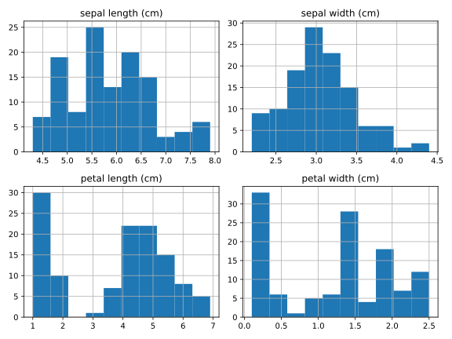

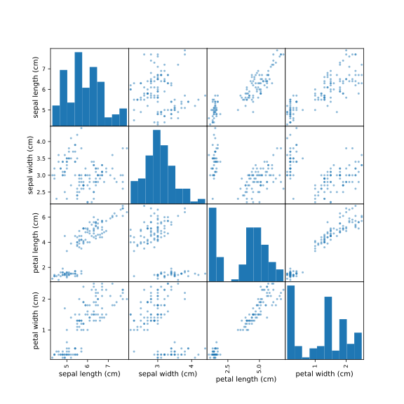
##### 4 · How to use it in the real world

The review queue keeps feature names/units and the model output. If this split has no flagged row, the code states that and uses the longest-petal held-out flower only as an interface example.

~~~python
iris_review=iris_check.loc[iris_flags.any(axis=1)]
if iris_review.empty:
    iris_review=iris_check.nlargest(1,"petal length (cm)")
    print("No IQR flag on this split; displaying a largest-petal example, not a flagged error.")
print("Review inputs:\n",iris_review[iris_practice.feature_names].head(2).to_string(index=False))
print("Predicted species labels:",iris_full_model.predict(iris_review[iris_practice.feature_names].head(2)).tolist())
print("All held-out flowers retained:",len(iris_check))
~~~


**Recorded output from this input:**

~~~text
Review inputs:
  sepal length (cm)  sepal width (cm)  petal length (cm)  petal width (cm)
               5.0               2.0                3.5               1.0
Predicted species labels: [1]
All held-out flowers retained: 30
~~~
#### D4b · Encode actual species strings and decode the result

##### 1 · Problem

Integer target positions and human-readable species names are different representations.

##### 2 · How to fix it

Translate the dataset targets into its documented species strings, fit LabelEncoder on training classes, and train a scaled classifier on the encoded target.

##### 3 · How to use it

~~~python
from sklearn.preprocessing import LabelEncoder
from sklearn.linear_model import LogisticRegression
from sklearn.pipeline import make_pipeline
iris_string_train=iris_practice.target_names[iris_learn.target.to_numpy()]
iris_target_encoder=LabelEncoder().fit(iris_string_train)
iris_encoded_train=iris_target_encoder.transform(iris_string_train)
iris_string_model=make_pipeline(SimpleImputer(strategy="median"),StandardScaler(),LogisticRegression(max_iter=1000)).fit(iris_learn[iris_practice.feature_names],iris_encoded_train)
print("Actual species strings:",iris_string_train[:4].tolist())
print("Encoded targets:",iris_encoded_train[:4].tolist(),"class vocabulary:",iris_target_encoder.classes_.tolist())
~~~


**Recorded output from this input:**

~~~text
Actual species strings: ['virginica', 'setosa', 'virginica', 'virginica']
Encoded targets: [2, 0, 2, 2] class vocabulary: ['setosa', 'versicolor', 'virginica']
~~~
##### 4 · How to use it in the real world

A measurement form returns a species name by reversing the stored target encoding. It does not encode an artificial order into nominal input features.

~~~python
iris_string_request=pd.DataFrame([[5.1,3.5,1.4,0.2]],columns=iris_practice.feature_names)
encoded_species=iris_string_model.predict(iris_string_request)
print("Four-centimeter-measurement input:",iris_string_request.to_dict("records"))
print("Encoded output:",encoded_species.tolist(),"decoded species:",iris_target_encoder.inverse_transform(encoded_species).tolist())
~~~


**Recorded output from this input:**

~~~text
Four-centimeter-measurement input: [{'sepal length (cm)': 5.1, 'sepal width (cm)': 3.5, 'petal length (cm)': 1.4, 'petal width (cm)': 0.2}]
Encoded output: [0] decoded species: ['setosa']
~~~
#### D4c · Use the training plots to propose features, then validate the choice

##### 1 · Problem

A pair plot may suggest that petal measurements carry useful structure, but looking at a plot does not establish which inputs predict species best.

##### 2 · How to fix it

Compare two declared candidates—four measurements and two petal measurements—using the same training-only folds. Keep scaling inside the candidate pipeline. Use fewer fields to break an exact validation tie, then inspect the fixed choice on the reserved check partition.

##### 3 · How to use it

Continue from D4a; `iris_learn` and `iris_check` are its training/check partitions.

~~~python
from sklearn.compose import ColumnTransformer
from sklearn.linear_model import LogisticRegression
from sklearn.model_selection import StratifiedKFold, cross_val_score
from sklearn.pipeline import make_pipeline
from sklearn.preprocessing import StandardScaler
from sklearn.metrics import accuracy_score

iris_candidate_fields = {
    "four measurements": iris_practice.feature_names,
    "petal measurements": ["petal length (cm)", "petal width (cm)"],
}
iris_feature_candidates = {}
iris_feature_folds = StratifiedKFold(3, shuffle=True, random_state=7)
for label, names in iris_candidate_fields.items():
    selector = ColumnTransformer([("measurements", StandardScaler(), names)])
    candidate = make_pipeline(selector, LogisticRegression(max_iter=2000))
    validation_accuracy = cross_val_score(
        candidate, iris_learn[iris_practice.feature_names], iris_learn.target,
        cv=iris_feature_folds, scoring="accuracy",
    ).mean()
    iris_feature_candidates[label] = (float(validation_accuracy), names, candidate)
    print(label, "fields:", names, "validation accuracy:", round(validation_accuracy, 3))

iris_feature_choice = max(
    iris_feature_candidates,
    key=lambda label: (iris_feature_candidates[label][0], -len(iris_feature_candidates[label][1])),
)
iris_selected_model = iris_feature_candidates[iris_feature_choice][2]
iris_selected_model.fit(iris_learn[iris_practice.feature_names], iris_learn.target)
print("Fixed feature choice:", iris_feature_choice)
print("Check-partition accuracy:", round(accuracy_score(
    iris_check.target, iris_selected_model.predict(iris_check[iris_practice.feature_names]),
), 3))
~~~


**Recorded output from this input:**

~~~text
four measurements fields: ['sepal length (cm)', 'sepal width (cm)', 'petal length (cm)', 'petal width (cm)'] validation accuracy: 0.95
petal measurements fields: ['petal length (cm)', 'petal width (cm)'] validation accuracy: 0.95
Fixed feature choice: petal measurements
Check-partition accuracy: 1.0
~~~
These are observed results for a predeclared teaching comparison. Earlier examples already displayed scores from this small dataset; do not treat repeated experimentation on it as fresh independent evidence or revise candidates until its check score looks best.

##### 4 · How to use it in the real world

The caller sends the original four-field schema. The fitted selector retains the chosen columns and applies the stored scaling before prediction.

~~~python
iris_feature_request = pd.DataFrame(
    [[5.1, 3.5, 1.4, 0.2]], columns=iris_practice.feature_names,
)
print("Raw request:", iris_feature_request.to_dict("records"))
print("Fields supplied to classifier:", iris_selected_model[0].get_feature_names_out().tolist())
print("Prepared request:", iris_selected_model[0].transform(iris_feature_request).round(3).tolist())
iris_feature_class = int(iris_selected_model.predict(iris_feature_request)[0])
print("Predicted species:", iris_practice.target_names[iris_feature_class])
~~~


**Recorded output from this input:**

~~~text
Raw request: [{'sepal length (cm)': 5.1, 'sepal width (cm)': 3.5, 'petal length (cm)': 1.4, 'petal width (cm)': 0.2}]
Fields supplied to classifier: ['measurements__petal length (cm)', 'measurements__petal width (cm)']
Prepared request: [[-1.336, -1.311]]
Predicted species: setosa
~~~
A production study would justify its sampling boundary, compare with a baseline, and assess the complete selected procedure on appropriate new data. The plot proposes a question; validation evaluates the candidate.

<a id="topic-d5-uci-adult-income-pdf-2-5"></a>

<!-- DATASET-5 -->

### D5 · UCI Adult Income — PDF 2.5

#### 1 · Problem

Historical income data contains missing markers, categorical variables, imbalance, and social biases.

#### 2 · How to fix it

Inspect the source schema, preserve official evaluation boundaries for benchmark reporting, and use training-only mixed-column preparation.

#### 3 · How to use it

**Goal:** classify the dataset's historical income bracket. Source: [UCI Adult](https://archive.ics.uci.edu/dataset/2/adult). The original official train/test files should remain separate when reporting their benchmark.

This first-fetch download inspects the official UCI training representation before a practice experiment:

~~~python-optional
from sklearn.datasets import fetch_openml
adult_table = official_adult("train")
print(adult_table.columns.tolist())
print(adult_table.isna().sum())
adult_model = dataset_experiment(
    adult_table, "income", ["age", "hours-per-week"],
    ["workclass", "education", "marital-status", "occupation"], "classification",
)
~~~


**Recorded output from this input:**

~~~text
['age', 'workclass', 'fnlwgt', 'education', 'education-num', 'marital-status', 'occupation', 'relationship', 'race', 'sex', 'capital-gain', 'capital-loss', 'hours-per-week', 'native-country', 'income']
age                  0
workclass         1836
fnlwgt               0
education            0
education-num        0
marital-status       0
occupation        1843
relationship         0
race                 0
sex                  0
capital-gain         0
capital-loss         0
hours-per-week       0
native-country     583
income               0
dtype: int64
Metric: macro F1
Baseline: 0.432
Model: 0.757
~~~
Needs internet on first fetch; scikit-learn caches fetched data locally. Schema differs across sources, so verify names and missing-value markers.

**Further inspection checklist (worked source requirements follow below):** replace `?` with missing values where the loader has not done so. Fill occupation/workclass using training-only rules; scale age/hours; inspect impossible hours rather than clipping valid long weeks automatically. Group duplicates before splitting. Compare precision/recall by bracket and audit subgroup sample sizes/errors. Sensitive attributes and their proxies require careful governance; historical labels encode social conditions, not intrinsic merit.

**Checkpoint:** describe why this dataset should not become an automated employment or compensation decision system.

#### 4 · How to use it in the real world

A permitted research interface could score the documented fields, but the result is not a hiring/pay decision:

~~~python-optional
adult_request = pd.DataFrame({"age": [35], "hours-per-week": [40], "workclass": ["Private"], "education": ["HS-grad"], "marital-status": ["Never-married"], "occupation": ["Sales"]})
print("Dataset income-bracket prediction:", adult_model.predict(adult_request))
~~~


**Recorded output from this input:**

~~~text
Dataset income-bracket prediction: ['<=50K']
~~~
Audit context, sensitive proxies, subgroup errors, and whether the historical task should be used at all.


#### D5a · Inspect literal ? markers and preserve official train/test boundaries

##### 1 · Problem

A raw question mark is text, not a known job category or a numeric value. A random benchmark split also differs from the supplied official split.

##### 2 · How to fix it

Read the original UCI train/test files, display raw markers, convert them to missing values, normalize the test target period, and refit preparation using official training rows only.

##### 3 · How to use it

~~~python
from sklearn.base import clone
from sklearn.metrics import f1_score
adult_official_train=official_adult("train")
adult_official_test=official_adult("test")
adult_raw=pd.read_csv(dataset_cache/"adult.data",names=adult_official_train.columns,skipinitialspace=True)
print("Before parsing ? counts:",adult_raw[["workclass","occupation","native-country"]].eq("?").sum().to_dict())
print("After parsing missing counts:",adult_official_train[["workclass","occupation","native-country"]].isna().sum().to_dict())
print("Official row counts:",len(adult_official_train),len(adult_official_test))
adult_number_names=["age","hours-per-week"]
adult_category_names=["workclass","education","marital-status","occupation"]
adult_official_model=clone(adult_model).fit(adult_official_train[adult_number_names+adult_category_names],adult_official_train.income)
print("Official-test macro F1:",round(f1_score(adult_official_test.income,adult_official_model.predict(adult_official_test[adult_number_names+adult_category_names]),average="macro"),3))
~~~


**Recorded output from this input:**

~~~text
Before parsing ? counts: {'workclass': 1836, 'occupation': 1843, 'native-country': 583}
After parsing missing counts: {'workclass': 1836, 'occupation': 1843, 'native-country': 583}
Official row counts: 32561 16281
Official-test macro F1: 0.749
~~~
##### 4 · How to use it in the real world

The same pipeline accepts an unknown occupation. This is a historical research-label interface, not a recommendation about hiring, compensation or merit.

~~~python
adult_missing_request=adult_official_test[adult_number_names+adult_category_names].iloc[[0]].copy()
adult_missing_request.loc[:,"occupation"]=np.nan
print("Request with unknown occupation:",adult_missing_request.to_dict("records"))
print("Research-label output:",adult_official_model.predict(adult_missing_request).tolist())
~~~


**Recorded output from this input:**

~~~text
Request with unknown occupation: [{'age': 25, 'hours-per-week': 40, 'workclass': 'Private', 'education': '11th', 'marital-status': 'Never-married', 'occupation': nan}]
Research-label output: ['<=50K']
~~~
#### D5b · Review age/hours extremes without declaring long workweeks invalid

##### 1 · Problem

A statistically rare age or workweek needs interpretation rather than automatic clipping.

##### 2 · How to fix it

Learn descriptive fences on official training rows. Report real held-out flags and review measurements; statistical fences are not universal domain limits.

##### 3 · How to use it

~~~python
adult_fences,adult_flags=iqr_review(adult_official_train,adult_official_test,adult_number_names)
print("Official-training fences:\n",adult_fences.round(2).to_string())
print("Official-test flag counts:",adult_flags.sum().to_dict())
adult_review=adult_official_test.loc[adult_flags.any(axis=1)]
print("Actual review measurements:\n",adult_review[adult_number_names].head(3).to_string(index=False))
~~~


**Recorded output from this input:**

~~~text
Official-training fences:
                  low  high
age             -2.0  78.0
hours-per-week  32.5  52.5
Official-test flag counts: {'age': 73, 'hours-per-week': 4488}
Actual review measurements:
  age  hours-per-week
  18              30
  34              30
  63              32
~~~
##### 4 · How to use it in the real world

The queue reports a prediction alongside each unusual record while retaining every official test row for the declared evaluation.

~~~python
adult_review_inputs=adult_review[adult_number_names+adult_category_names].head(3)
print("Review research-label outputs:",adult_official_model.predict(adult_review_inputs).tolist())
print("Official-test rows retained:",len(adult_official_test))
print("Learned numeric scales:",adult_official_model.named_steps["prepare"].named_transformers_["numeric"].named_steps["scale"].scale_.round(3).tolist())
~~~


**Recorded output from this input:**

~~~text
Review research-label outputs: ['<=50K', '<=50K', '>50K']
Official-test rows retained: 16281
Learned numeric scales: [13.64, 12.347]
~~~
<a id="topic-d6-wine-quality-pdf-2-6"></a>

<!-- DATASET-6 -->

### D6 · Wine Quality — PDF 2.6

#### 1 · Problem

Wine chemistry measures use different scales and quality scores are not the cultivar labels in the bundled Wine dataset.

#### 2 · How to fix it

Load the actual Wine Quality file, inspect duplicates/chemistry, choose regression or a declared rating-class task, and validate preparation.

#### 3 · How to use it

**Goal:** predict expert quality ratings from chemical measurements. Source: [UCI Wine Quality](https://archive.ics.uci.edu/dataset/186/wine+quality). This differs from `datasets/wine.csv`, which predicts wine cultivar.

~~~python-optional
wine_quality = pd.read_csv(cached_download("winequality-red.csv", "https://archive.ics.uci.edu/ml/machine-learning-databases/wine-quality/winequality-red.csv"), sep=";")
wine_quality_model = dataset_experiment(
    wine_quality, "quality", ["alcohol", "citric acid", "sulphates"],
    [], "regression",
)
~~~


**Recorded output from this input:**

~~~text
Metric: MAE
Baseline: 0.651
Model: 0.499
~~~
`sep=";"` tells pandas what separates fields. Download the CSV from UCI first.

**Further inspection checklist (worked source requirements follow below):** inspect missing chemistry values; impute within training folds if present. Investigate sulphate/alcohol outliers and measurement units. Standardize chemical inputs for regularized/distance-based models. Group exact duplicate measurements when evaluating generalization. Compare rating regression with an explicitly defined classification task; rare quality classes make stratification and macro metrics difficult. Do not choose a “good wine” cutoff by whichever makes the score look best.

**Wine supervised lab:** train one regressor for numeric rating and one classifier for a predeclared rating band. Report MAE versus macro F1 and explain that they answer different questions.

#### 4 · How to use it in the real world

A laboratory-style request uses the same chemical units as training:

~~~python-optional
wine_request = pd.DataFrame({"alcohol": [10.0], "citric acid": [0.3], "sulphates": [0.6]})
print("Estimated quality rating:", wine_quality_model.predict(wine_request).round(2))
~~~


**Recorded output from this input:**

~~~text
Estimated quality rating: [5.46]
~~~
Keep regression ratings distinct from probabilities or categorical wine types.


#### D6a · All eleven chemistry inputs, missing-value preparation and quality classes

##### 1 · Problem

A three-input regressor does not cover the full chemistry schema or classification of quality ratings.

##### 2 · How to fix it

Use all eleven numeric chemistry columns. Keep duplicate measurements in one group across the split, fit median/scale preparation on training only, and fit distinct regression and multiclass-quality models.

##### 3 · How to use it

~~~python
from sklearn.model_selection import GroupShuffleSplit
from sklearn.preprocessing import LabelEncoder, StandardScaler
from sklearn.pipeline import make_pipeline
from sklearn.impute import SimpleImputer
from sklearn.linear_model import Ridge, LogisticRegression
from sklearn.metrics import mean_absolute_error, f1_score
wine_chemistry=[name for name in wine_quality.columns if name!="quality"]
assert len(wine_chemistry)==11
wine_groups=pd.util.hash_pandas_object(wine_quality[wine_chemistry],index=False)
wine_learn_ids,wine_check_ids=next(GroupShuffleSplit(n_splits=1,test_size=0.2,random_state=7).split(wine_quality,groups=wine_groups))
wine_learn=wine_quality.iloc[wine_learn_ids];wine_check=wine_quality.iloc[wine_check_ids]
assert not set(wine_groups.iloc[wine_learn_ids])&set(wine_groups.iloc[wine_check_ids])
wine_all_regressor=make_pipeline(SimpleImputer(strategy="median"),StandardScaler(),Ridge()).fit(wine_learn[wine_chemistry],wine_learn.quality)
wine_quality_encoder=LabelEncoder().fit(wine_learn.quality)
wine_all_classifier=make_pipeline(SimpleImputer(strategy="median"),StandardScaler(),LogisticRegression(max_iter=3000)).fit(wine_learn[wine_chemistry],wine_quality_encoder.transform(wine_learn.quality))
print("All chemistry input names:",wine_chemistry)
print("Actual missing counts:",wine_quality[wine_chemistry].isna().sum().to_dict())
print("Raw first chemistry row:",wine_learn[wine_chemistry].iloc[0].round(3).to_dict())
print("Prepared first row:",np.round(wine_all_regressor[:-1].transform(wine_learn[wine_chemistry].head(1))[0],3).tolist())
print("Quality vocabulary:",wine_quality_encoder.classes_.tolist(),"encoded:",wine_quality_encoder.transform(wine_quality_encoder.classes_).tolist())
print("Grouped-holdout regression MAE:",round(mean_absolute_error(wine_check.quality,wine_all_regressor.predict(wine_check[wine_chemistry])),3))
print("Grouped-holdout quality macro F1:",round(f1_score(wine_check.quality,wine_quality_encoder.inverse_transform(wine_all_classifier.predict(wine_check[wine_chemistry])),average="macro"),3))
~~~


**Recorded output from this input:**

~~~text
All chemistry input names: ['fixed acidity', 'volatile acidity', 'citric acid', 'residual sugar', 'chlorides', 'free sulfur dioxide', 'total sulfur dioxide', 'density', 'pH', 'sulphates', 'alcohol']
Actual missing counts: {'fixed acidity': 0, 'volatile acidity': 0, 'citric acid': 0, 'residual sugar': 0, 'chlorides': 0, 'free sulfur dioxide': 0, 'total sulfur dioxide': 0, 'density': 0, 'pH': 0, 'sulphates': 0, 'alcohol': 0}
Raw first chemistry row: {'fixed acidity': 7.4, 'volatile acidity': 0.7, 'citric acid': 0.0, 'residual sugar': 1.9, 'chlorides': 0.076, 'free sulfur dioxide': 11.0, 'total sulfur dioxide': 34.0, 'density': 0.998, 'pH': 3.51, 'sulphates': 0.56, 'alcohol': 9.4}
Prepared first row: [-0.525, 0.958, -1.389, -0.457, -0.242, -0.465, -0.362, 0.563, 1.28, -0.582, -0.944]
Quality vocabulary: [3, 4, 5, 6, 7, 8] encoded: [0, 1, 2, 3, 4, 5]
Grouped-holdout regression MAE: 0.498
Grouped-holdout quality macro F1: 0.308
~~~
##### 4 · How to use it in the real world

A laboratory request can return either an estimated rating or a class with an explicit rating vocabulary. A controlled missing-input request demonstrates trained imputation; the source file itself is not falsely described as containing missing chemistry.

~~~python
wine_full_request=wine_check[wine_chemistry].head(1).copy()
wine_full_request.loc[:,"alcohol"]=np.nan # Controlled missing lab measurement.
print("Controlled eleven-field request:",wine_full_request.to_dict("records"))
print("Estimated numeric rating:",wine_all_regressor.predict(wine_full_request).round(3).tolist())
encoded_quality=wine_all_classifier.predict(wine_full_request)
print("Encoded quality class:",encoded_quality.tolist(),"decoded rating:",wine_quality_encoder.inverse_transform(encoded_quality).tolist())
~~~


**Recorded output from this input:**

~~~text
Controlled eleven-field request: [{'fixed acidity': 8.9, 'volatile acidity': 0.62, 'citric acid': 0.19, 'residual sugar': 3.9, 'chlorides': 0.17, 'free sulfur dioxide': 51.0, 'total sulfur dioxide': 148.0, 'density': 0.9986, 'pH': 3.17, 'sulphates': 0.93, 'alcohol': nan}]
Estimated numeric rating: [5.427]
Encoded quality class: [2] decoded rating: [5]
~~~
#### D6b · Sulphate/alcohol outlier review with all-input predictions

##### 1 · Problem

Unusual chemistry may describe an unusual real wine rather than a data-entry error.

##### 2 · How to fix it

Use training-only fences on alcohol and sulphates, retain all measurements, and put flagged source rows into a documented review queue.

##### 3 · How to use it

~~~python
wine_fences,wine_flags=iqr_review(wine_learn,wine_check,["alcohol","sulphates"])
print("Training-only fences:\n",wine_fences.round(3).to_string())
print("Review counts:",wine_flags.sum().to_dict())
wine_review=wine_check.loc[wine_flags.any(axis=1)]
print("Actual unusual measurements:\n",wine_review[["alcohol","sulphates","quality"]].head(3).to_string(index=False))
~~~


**Recorded output from this input:**

~~~text
Training-only fences:
             low  high
alcohol    7.10  13.5
sulphates  0.28   1.0
Review counts: {'alcohol': 2, 'sulphates': 9}
Actual unusual measurements:
  alcohol  sulphates  quality
     9.2       1.08        6
     9.4       1.14        5
    11.5       1.00        6
~~~
##### 4 · How to use it in the real world

The queue obtains predictions from the same eleven-feature models while preserving every held-out wine. Neither the flag nor a predicted rating certifies safety or quality.

~~~python
wine_review_inputs=wine_review[wine_chemistry].head(3)
print("Review rating estimates:",wine_all_regressor.predict(wine_review_inputs).round(3).tolist())
print("Review quality classes:",wine_quality_encoder.inverse_transform(wine_all_classifier.predict(wine_review_inputs)).tolist())
print("Held-out wines retained:",len(wine_check))
~~~


**Recorded output from this input:**

~~~text
Review rating estimates: [5.448, 5.004, 6.198]
Review quality classes: [5, 5, 6]
Held-out wines retained: 332
~~~
<a id="topic-d7-boston-housing-and-a-safer-modern-exercise-pdf-2-7"></a>

<!-- DATASET-7 -->

### D7 · Boston Housing and a safer modern exercise — PDF 2.7

#### 1 · Problem

A familiar benchmark can encode a harmful design assumption, and a removed loader should not be restored blindly.

#### 2 · How to fix it

Study the Boston dataset’s documented problem, then use a separately justified housing dataset for prediction practice.

#### 3 · How to use it

The PDF names Boston Housing. Its dataset design includes a problematic racial variable and the scikit-learn loader was removed. This historical topic remains here as an **ethics and dataset-selection exercise**, rather than instructions to restore a removed loader. Read the maintainers' [explanation](https://scikit-learn.org/1.2/modules/generated/sklearn.datasets.load_boston.html).

**Further inspection checklist (worked source requirements follow below):** identify why a historical feature definition can encode a harmful assumption. Removing one column does not erase the dataset's provenance or all proxies.

For a housing-regression exercise, use [California Housing](https://scikit-learn.org/stable/modules/generated/sklearn.datasets.fetch_california_housing.html):

~~~python-optional
from sklearn.datasets import fetch_california_housing
california = fetch_california_housing(as_frame=True, data_home=dataset_cache)  # First call needs internet.
california_table = california.frame.copy()
california_model = dataset_experiment(
    california_table, "MedHouseVal",
    ["MedInc", "HouseAge", "AveRooms", "AveOccup"], [], "regression",
)
~~~


**Recorded output from this input:**

~~~text
Metric: MAE
Baseline: 0.915
Model: 0.604
~~~
**Practice:** inspect missingness, household-income/room extremes, scaling, and geographic dependence. Its target is a regional median in documented units, not an individual home's appraisal. Use geographic holdouts for new-area prediction. Numeric latitude/longitude are coordinates, not nominal neighborhood IDs; encode a categorical neighborhood only if that field actually exists.

**Checkpoint:** justify a dataset choice before optimizing its score.

#### 4 · How to use it in the real world

For California, show a regional-median interface using documented units:

~~~python-optional
california_request = pd.DataFrame({"MedInc": [4.0], "HouseAge": [20], "AveRooms": [5.0], "AveOccup": [3.0]})
print("Regional target estimate (100,000 USD units):", california_model.predict(california_request).round(3))
~~~


**Recorded output from this input:**

~~~text
Regional target estimate (100,000 USD units): [1.991]
~~~
The regional target is not an individual sale price. Test new-area generalization geographically.


#### D7a · Historical Boston audit using the actual archived data

##### 1 · Problem

Replacing Boston with California teaches another dataset, not the named historical source. Reusing the removed loader also hides a serious provenance issue.

##### 2 · How to fix it

Fetch the archived OpenML531 copy explicitly for a historical audit. Exclude the problematic B variable and LSTAT from this teaching feature set; this does not remove social proxies or make the dataset ethically suitable. Select actual CRIM/RM/AGE/DIS/PTRATIO measurements and CHAS as the real river-adjacency category; there is no invented neighborhood or income column.

##### 3 · How to use it

~~~python
from sklearn.datasets import fetch_openml
boston_archive=fetch_openml(data_id=531,as_frame=True,data_home=dataset_cache)
boston_audit=boston_archive.data.copy()
boston_audit["MEDV"]=pd.to_numeric(boston_archive.target)
boston_numbers=["CRIM","RM","AGE","DIS","PTRATIO"]
boston_categories=["CHAS"]
print("Archive ID:",boston_archive.details["id"],"rows:",len(boston_audit))
print("Excluded from fitted inputs:",["B","LSTAT"])
print("Actual numeric missing counts:",boston_audit[boston_numbers].isna().sum().to_dict())
print("Actual archived inputs:\n",boston_audit[boston_numbers+boston_categories].head(2).to_string(index=False))
boston_audit_model=dataset_experiment(boston_audit,"MEDV",boston_numbers,boston_categories,"regression")
print("Actual CHAS vocabulary:",boston_audit.CHAS.unique().tolist())
~~~


**Recorded output from this input:**

~~~text
Archive ID: 531 rows: 506
Excluded from fitted inputs: ['B', 'LSTAT']
Actual numeric missing counts: {'CRIM': 0, 'RM': 0, 'AGE': 0, 'DIS': 0, 'PTRATIO': 0}
Actual archived inputs:
    CRIM    RM  AGE    DIS  PTRATIO CHAS
0.00632 6.575 65.2 4.0900     15.3    0
0.02731 6.421 78.9 4.9671     17.8    0
Metric: MAE
Baseline: 6.219
Model: 4.319
Actual CHAS vocabulary: ['0', '1']
~~~
##### 4 · How to use it in the real world

The historical model only demonstrates preparation and an audited schema. Its regional median-value target is in thousands of dollars in the historical dataset, not a contemporary individual-home appraisal or an endorsed deployment.

~~~python
boston_request=boston_audit[boston_numbers+boston_categories].head(1).copy()
boston_request.loc[:,"RM"]=np.nan # Controlled missing room measurement; training median handles it.
print("Historical audit request:",boston_request.to_dict("records"))
print("Historical target estimate (thousand-dollar units):",boston_audit_model.predict(boston_request).round(3).tolist())
print("Model feature schema:",boston_audit_model.feature_names_in_.tolist())
print("Excluded B present in model:","B" in boston_audit_model.feature_names_in_)
~~~


**Recorded output from this input:**

~~~text
Historical audit request: [{'CRIM': 0.00632, 'RM': nan, 'AGE': 65.2, 'DIS': 4.09, 'PTRATIO': 15.3, 'CHAS': '0'}]
Historical target estimate (thousand-dollar units): [24.967]
Model feature schema: ['CRIM', 'RM', 'AGE', 'DIS', 'PTRATIO', 'CHAS']
Excluded B present in model: False
~~~
#### D7b · Review actual historical crime/room extremes and preserve provenance

##### 1 · Problem

The source asks about income, rooms and categorical neighborhoods, but this archive has no household-income or neighborhood-name feature. Substituting a proxy silently would be misleading.

##### 2 · How to fix it

Review real CRIM/RM measurements with training-only fences; report absent source fields explicitly. Keep flagged rows and retain the source’s provenance limitations. California remains a separate alternative exercise, not a replacement claim.

##### 3 · How to use it

~~~python
boston_learn,boston_check=train_test_split(boston_audit,test_size=0.2,random_state=7)
boston_fences,boston_flags=iqr_review(boston_learn,boston_check,["CRIM","RM"])
print("Training-only fences:\n",boston_fences.round(3).to_string())
print("Historical feature audit:",{"household_income_column":False,"neighborhood_name_column":False,"real_categorical_CHAS":True})
print("Review counts:",boston_flags.sum().to_dict())
boston_review=boston_check.loc[boston_flags.any(axis=1)]
print("Actual review rows:\n",boston_review[["CRIM","RM","MEDV"]].head(3).to_string(index=False))
~~~


**Recorded output from this input:**

~~~text
Training-only fences:
         low   high
CRIM -3.790  6.530
RM    4.772  7.723
Historical feature audit: {'household_income_column': False, 'neighborhood_name_column': False, 'real_categorical_CHAS': True}
Review counts: {'CRIM': 20, 'RM': 3}
Actual review rows:
    CRIM    RM  MEDV
73.5341 5.957   8.8
24.8017 5.349   8.3
14.3337 6.229  21.4
~~~
##### 4 · How to use it in the real world

A historical review report pairs flagged measurements with the fitted audited model output. Excluding B is a documented boundary, not a certificate that the remaining variables are harmless or causally valid.

~~~python
print("Review historical estimates:",boston_audit_model.predict(boston_review[boston_numbers+boston_categories].head(3)).round(3).tolist())
print("Historical holdout rows retained:",len(boston_check))
print("Learned numeric scales:",boston_audit_model.named_steps["prepare"].named_transformers_["numeric"].named_steps["scale"].scale_.round(3).tolist())
~~~


**Recorded output from this input:**

~~~text
Review historical estimates: [2.645, 8.25, 17.853]
Historical holdout rows retained: 102
Learned numeric scales: [8.204, 0.706, 28.286, 2.131, 2.167]
~~~
#### D7c · Review actual California income and room features as a separate exercise

##### 1 · Problem

The Boston archive does not contain a household-income column. Renaming a social proxy as income would be incorrect. California Housing does contain `MedInc` and `AveRooms`, which can be investigated directly without pretending they belong to Boston.

##### 2 · How to fix it

Keep this modern-data exercise separate from the historical audit. Fit the existing California recipe and IQR fences on training rows only. Retain unusual check rows and show their original measurements alongside model estimates.

##### 3 · How to use it

Continue from the D7 California loader and D0b review helper:

~~~python
from sklearn.base import clone

california_learn, california_check = train_test_split(
    california_table, test_size=0.2, random_state=7,
)
california_input_names = ["MedInc", "HouseAge", "AveRooms", "AveOccup"]
california_review_model = clone(california_model).fit(
    california_learn[california_input_names], california_learn.MedHouseVal,
)
california_fences, california_flags = iqr_review(
    california_learn, california_check, ["MedInc", "AveRooms"],
)
california_review = california_check.loc[california_flags.any(axis=1)]
print("Training-only income/room fences:")
print(california_fences.round(3).to_string())
print("Check-row review counts:", california_flags.sum().to_dict())
print("Actual reviewed measurements:")
print(california_review[["MedInc", "AveRooms", "MedHouseVal"]].head(3).round(3).to_string(index=False))
print("Check rows retained:", len(california_check))
~~~


**Recorded output from this input:**

~~~text
Training-only income/room fences:
            low   high
MedInc   -0.723  7.999
AveRooms  1.999  8.474
Check-row review counts: {'MedInc': 147, 'AveRooms': 87}
Actual reviewed measurements:
 MedInc  AveRooms  MedHouseVal
  9.197     8.076        5.000
  4.406    16.057        1.526
  2.589    28.615        0.830
Check rows retained: 4128
~~~
`MedInc` uses the source's documented median-income units; it is not a raw individual salary. `AveRooms` is a regional average, so a very unusual value needs source/context investigation rather than automatic deletion.

##### 4 · How to use it in the real world

Use the same model for the actual review queue and a named four-field request. The target remains a regional median in 100,000-dollar units.

~~~python
print("Reviewed regional estimates:", california_review_model.predict(
    california_review[california_input_names].head(3),
).round(3).tolist())
california_review_request = pd.DataFrame({
    "MedInc": [4.0], "HouseAge": [20.0], "AveRooms": [5.0], "AveOccup": [3.0],
})
print("Raw regional request:", california_review_request.to_dict("records"))
print("Regional-median estimate:", california_review_model.predict(
    california_review_request,
).round(3).tolist())
~~~


**Recorded output from this input:**

~~~text
Reviewed regional estimates: [4.262, 1.778, 0.584]
Raw regional request: [{'MedInc': 4.0, 'HouseAge': 20.0, 'AveRooms': 5.0, 'AveOccup': 3.0}]
Regional-median estimate: [1.991]
~~~
This random holdout demonstrates the preparation/review interface. A new-region application needs a geographic evaluation design; neither this example nor the historical Boston audit is an individual-home appraisal service.

<a id="topic-d8-mnist-handwritten-digits-pdf-2-8"></a>

<!-- DATASET-8 -->

### D8 · MNIST handwritten digits — PDF 2.8

#### 1 · Problem

An image is an array, and using the wrong dimensions or pixel divisor can silently give a classifier meaningless inputs.

#### 2 · How to fix it

Inspect the image, use its documented pixel range, flatten consistently, and keep MNIST distinct from the smaller offline digits dataset.

#### 3 · How to use it

Start offline with **digits**, which contains 8×8 images with values 0–16. MNIST contains 28×28 images with values commonly represented 0–255. Do not divide both by the same constant.

~~~python
from sklearn.datasets import load_digits
import matplotlib.pyplot as plt

digits_practice = load_digits()
print(digits_practice.images.shape, digits_practice.data.shape)
plt.imshow(digits_practice.images[0], cmap="gray")
plt.title(f"Answer: {digits_practice.target[0]}")
plt.axis("off")
plt.show()
digits_table = pd.DataFrame(digits_practice.data / 16.0)
digits_table.columns = [f"pixel_{number}" for number in range(64)]
digits_table["digit"] = digits_practice.target
digits_model = dataset_experiment(
    digits_table, "digit", list(digits_table.columns[:-1]), [], "classification",
)
~~~


**Recorded output from this input:**

~~~text
(1797, 8, 8) (1797, 64)
Metric: macro F1
Baseline: 0.019
Model: 0.981
~~~
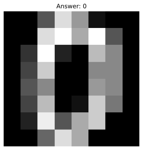

This chart was rendered from the supplied code and input; rerun the cell after changing the data.

`images` retains the two image dimensions; `data` flattens each image into 64 columns. Flattening changes shape, not image resolution. Resizing requires interpolation and can distort strokes.

To load full MNIST, use the optional `fetch_openml(name="mnist_784", version=1, as_frame=False)`; it requires a download. Respect its documented official train/test ordering. Use `reshape(-1, 28, 28)` only after checking there are 784 pixels per row; `-1` asks NumPy to infer the number of images.

**Further inspection checklist (worked source requirements follow below):** check pixel ranges and corrupt/all-empty records, display errors, compare per-digit recall, and investigate unusual pixels in image context. Bright pixels are not automatically outliers. Keep writer groups separate when writer metadata is available.

#### 4 · How to use it in the real world

A digit interface must produce the exact 64-column representation for this offline model:

~~~python
digit_request = digits_table.drop(columns=["digit"]).iloc[[0]].copy()
print("Input shape:", digit_request.shape)
print("Predicted digit:", digits_model.predict(digit_request))
~~~


**Recorded output from this input:**

~~~text
Input shape: (1, 64)
Predicted digit: [0]
~~~
This reuses a known dataset image to demonstrate the interface, not new accuracy evidence. A camera image needs separately tested decoding, resizing, polarity, and alignment; do not send 784 MNIST pixels to this 64-input model.


#### D8a · Actual MNIST: bounded official image prefixes, normalization and a classifier

##### 1 · Problem

The 8×8 digits dataset is useful offline but does not complete the named 28×28 MNIST exercise.

##### 2 · How to fix it

Use the documented CVDF mirror of the official IDX sources. Read only 2000 training and 500 official-test images, verify shapes/ranges, divide 8-bit pixels by255, and flatten consistently. Prefix scores are not full-benchmark scores or guaranteed representative samples.

##### 3 · How to use it

~~~python
from sklearn.linear_model import SGDClassifier
from sklearn.metrics import accuracy_score,classification_report
mnist_train_images,mnist_train_labels=bounded_images("mnist","train",2000)
mnist_test_images,mnist_test_labels=bounded_images("mnist","t10k",500)
mnist_train_pixels=mnist_train_images.reshape(len(mnist_train_images),-1).astype("float32")/255.0
mnist_test_pixels=mnist_test_images.reshape(len(mnist_test_images),-1).astype("float32")/255.0
mnist_model=SGDClassifier(loss="log_loss",max_iter=1000,random_state=7).fit(mnist_train_pixels,mnist_train_labels)
print("Actual MNIST training/test image shapes:",mnist_train_images.shape,mnist_test_images.shape)
print("Raw uint8 range:",int(mnist_train_images.min()),int(mnist_train_images.max()))
print("Before matrix shape:",mnist_train_images[0].shape,"after model-row shape:",mnist_train_pixels[:1].shape)
print("Prepared pixel range:",float(mnist_train_pixels.min()),float(mnist_train_pixels.max()))
print("Official-test-prefix accuracy:",round(accuracy_score(mnist_test_labels,mnist_model.predict(mnist_test_pixels)),3))
print(classification_report(mnist_test_labels,mnist_model.predict(mnist_test_pixels),zero_division=0))
~~~


**Recorded output from this input:**

~~~text
Actual MNIST training/test image shapes: (2000, 28, 28) (500, 28, 28)
Raw uint8 range: 0 255
Before matrix shape: (28, 28) after model-row shape: (1, 784)
Prepared pixel range: 0.0 1.0
Official-test-prefix accuracy: 0.822
              precision    recall  f1-score   support

           0       0.90      0.90      0.90        42
           1       0.94      0.96      0.95        67
           2       0.83      0.80      0.81        55
           3       0.91      0.64      0.75        45
           4       0.85      0.85      0.85        55
           5       0.59      0.84      0.69        50
           6       0.95      0.86      0.90        43
           7       0.72      0.86      0.79        49
           8       0.85      0.70      0.77        40
           9       0.82      0.74      0.78        54

    accuracy                           0.82       500
   macro avg       0.84      0.82      0.82       500
weighted avg       0.84      0.82      0.82       500
~~~
##### 4 · How to use it in the real world

An actual official-test-prefix image passes through the stored preprocessing convention. This is an interface demonstration after a fixed experiment, not an unseen camera-photo validation.

~~~python
mnist_request_image=mnist_test_images[0]
mnist_request_pixels=mnist_request_image.reshape(1,-1).astype("float32")/255.0
print("Actual image input shape:",mnist_request_image.shape,"known label:",int(mnist_test_labels[0]))
print("Model request shape:",mnist_request_pixels.shape,"predicted digit:",mnist_model.predict(mnist_request_pixels).tolist())
~~~


**Recorded output from this input:**

~~~text
Actual image input shape: (28, 28) known label: 7
Model request shape: (1, 784) predicted digit: [7]
~~~
#### D8b · Resizing and corrupt/empty-pixel checks before scoring

##### 1 · Problem

Flattening is not resizing, and bright ink pixels are not statistical outliers to delete. Wrong shapes, nonfinite values or values outside the declared pixel range violate the image contract.

##### 2 · How to fix it

Check decoded image batches before scoring; quarantine an all-empty image for review. Resize a real MNIST image with an explicit interpolation only when the receiving model requires another shape, and train that model on the same resized representation.

##### 3 · How to use it

~~~python
from PIL import Image

def mnist_image_status(image):
    values=np.asarray(image)
    if values.shape!=(28,28):return "reject_shape"
    if not np.isfinite(values).all() or values.min()<0 or values.max()>255:return "reject_pixel_contract"
    if not values.any():return "review_empty"
    return "scoreable"
controlled_bad_image=mnist_test_images[0].astype(float).copy()
controlled_bad_image[0,0]=300 # Deliberate synthetic corruption, not a changed source record.
controlled_empty_image=np.zeros((28,28),dtype=np.uint8)
print("Actual source image status:",mnist_image_status(mnist_test_images[0]))
print("Controlled corrupted-pixel status:",mnist_image_status(controlled_bad_image))
print("Controlled all-empty status:",mnist_image_status(controlled_empty_image))
print("Actual all-empty counts:",int((mnist_train_images.reshape(len(mnist_train_images),-1).sum(axis=1)==0).sum()),int((mnist_test_images.reshape(len(mnist_test_images),-1).sum(axis=1)==0).sum()))
def resize_digits(images):
    return np.stack([np.asarray(Image.fromarray(image).resize((14,14),Image.Resampling.BILINEAR)) for image in images])
mnist_small_train=resize_digits(mnist_train_images)
mnist_small_test=resize_digits(mnist_test_images)
mnist_resized_model=SGDClassifier(loss="log_loss",max_iter=1000,random_state=7).fit(mnist_small_train.reshape(len(mnist_small_train),-1).astype("float32")/255.0,mnist_train_labels)
print("Actual before/after dimensions:",mnist_train_images[:1].shape,mnist_small_train[:1].shape)
print("Resized-model official-test-prefix accuracy:",round(accuracy_score(mnist_test_labels,mnist_resized_model.predict(mnist_small_test.reshape(len(mnist_small_test),-1).astype("float32")/255.0)),3))
~~~


**Recorded output from this input:**

~~~text
Actual source image status: scoreable
Controlled corrupted-pixel status: reject_pixel_contract
Controlled all-empty status: review_empty
Actual all-empty counts: 0 0
Actual before/after dimensions: (1, 28, 28) (1, 14, 14)
Resized-model official-test-prefix accuracy: 0.884
~~~
##### 4 · How to use it in the real world

The adapter rejects the synthetic corruption and routes empty input for review. A valid real image is resized to the alternate model’s exact training schema before prediction; resizing may lose stroke detail.

~~~python
valid_real_image=mnist_test_images[0]
if mnist_image_status(valid_real_image)=="scoreable":
    small_request=resize_digits(valid_real_image[None,...]).reshape(1,-1).astype("float32")/255.0
    print("Resized request fields:",small_request.shape[1],"digit prediction:",mnist_resized_model.predict(small_request).tolist())
print("Synthetic corrupted image scored:",mnist_image_status(controlled_bad_image)=="scoreable")
~~~


**Recorded output from this input:**

~~~text
Resized request fields: 196 digit prediction: [7]
Synthetic corrupted image scored: False
~~~
<a id="topic-d9-customer-segmentation-mall-customers-pdf-2-9"></a>

<!-- DATASET-9 -->

### D9 · Customer Segmentation / Mall Customers — PDF 2.9

#### 1 · Problem

Customer IDs and arbitrary cluster numbers do not explain useful behavioral groups.

#### 2 · How to fix it

Scale meaningful spending/income measurements, compare several group counts, and inspect profiles in original units.

#### 3 · How to use it

**Goal:** explore groups, without invented answer labels. Source: [Mall Customers](https://www.kaggle.com/datasets/vjchoudhary7/customer-segmentation-tutorial-in-python). The bundled file enables local practice.

~~~python
from sklearn.impute import SimpleImputer
from sklearn.preprocessing import StandardScaler
from sklearn.pipeline import make_pipeline
from sklearn.cluster import KMeans
from sklearn.metrics import silhouette_score

mall_table = pd.read_csv(practice_data / "mall_customers.csv")
mall_inputs = mall_table[["Annual Income (k$)", "Spending Score (1-100)"]]
mall_preparation = make_pipeline(SimpleImputer(strategy="median"), StandardScaler())
mall_scaled = mall_preparation.fit_transform(mall_inputs)
for cluster_count in [2, 3, 4]:
    mall_model = KMeans(n_clusters=cluster_count, n_init=10, random_state=7)
    mall_labels = mall_model.fit_predict(mall_scaled)
    print(cluster_count, "inertia", round(mall_model.inertia_, 1),
          "silhouette", round(silhouette_score(mall_scaled, mall_labels), 3))
~~~


**Recorded output from this input:**

~~~text
2 inertia 257.3 silhouette 0.385
3 inertia 139.3 silhouette 0.516
4 inertia 81.9 silhouette 0.583
~~~
**Further inspection checklist (worked source requirements follow below):** graph inertia against cluster count (**elbow plot**) and silhouette against count. These scores reward geometric properties, not business usefulness. Inspect income/spending outliers, impute missing inputs, scale age/income, and one-hot encode actual region categories if available. Avoid treating customer ID as a feature or a claimed segment as an input to discover that segment.

**Coffee lab:** repeat with `coffee_customers.csv`, inputs `visits_per_month` and `avg_spend_eur`. Profile cluster averages in original units; detect unusual customers using Workshop E. The supplied `segment_truth` is a simulation label for optional **adjusted Rand index (ARI)** comparisons, not an input feature or proof of meaningful real segments.

**Checkpoint:** name groups descriptively and explain one reason their boundaries might be unstable.

#### 4 · How to use it in the real world

Apply the fitted preparation and final example K-Means model to a request:

~~~python
mall_request = pd.DataFrame({"Annual Income (k$)": [50], "Spending Score (1-100)": [60]})
print("Assigned example group:", mall_model.predict(mall_preparation.transform(mall_request)))
~~~


**Recorded output from this input:**

~~~text
Assigned example group: [3]
~~~
The loop’s last model has four groups; a real choice needs validation of stability and usefulness. A group number is a routing label, not a customer-quality score.


#### D9a · Age, missing inputs, training-only extremes, elbow plot and cluster profiles

##### 1 · Problem

The two-input loop omits age and does not display the elbow or group profiles. Rare customers must not simply disappear.

##### 2 · How to fix it

Reserve customer rows, fit imputation/scaling on training only, use actual Age/income/spending, and compare declared group counts descriptively. Retain outliers and report profiles in original units. These exploratory scores do not establish business usefulness.

##### 3 · How to use it

~~~python
from sklearn.model_selection import train_test_split
from sklearn.cluster import KMeans
from sklearn.metrics import silhouette_score
from sklearn.pipeline import make_pipeline
import matplotlib.pyplot as plt
mall_numeric_names=["Age","Annual Income (k$)","Spending Score (1-100)"]
mall_learn,mall_check=train_test_split(mall_table,test_size=0.2,random_state=7)
mall_all_preparation=make_pipeline(SimpleImputer(strategy="median"),StandardScaler()).fit(mall_learn[mall_numeric_names])
mall_train_scaled=mall_all_preparation.transform(mall_learn[mall_numeric_names])
mall_check_scaled=mall_all_preparation.transform(mall_check[mall_numeric_names])
mall_fences,mall_flags=iqr_review(mall_learn,mall_check,mall_numeric_names)
print("Raw actual customer inputs:\n",mall_learn[mall_numeric_names].head(3).to_string(index=False))
print("Prepared first rows:\n",np.round(mall_train_scaled[:3],3))
print("Training-only fences:\n",mall_fences.round(3).to_string())
print("Held-out review counts:",mall_flags.sum().to_dict(),"rows retained:",len(mall_check))
mall_curve=[]
for k in [2,3,4,5]:
    candidate=KMeans(n_clusters=k,n_init=10,random_state=7).fit(mall_train_scaled)
    mall_curve.append({"k":k,"training_inertia":candidate.inertia_,"training_silhouette":silhouette_score(mall_train_scaled,candidate.labels_)})
mall_curve=pd.DataFrame(mall_curve)
print("Descriptive group-count comparison:\n",mall_curve.round(3).to_string(index=False))
fig,axes=plt.subplots(1,2,figsize=(8,3))
axes[0].plot(mall_curve.k,mall_curve.training_inertia,marker="o");axes[0].set(xlabel="Groups",ylabel="Training inertia")
axes[1].plot(mall_curve.k,mall_curve.training_silhouette,marker="o");axes[1].set(xlabel="Groups",ylabel="Training silhouette")
plt.tight_layout();plt.savefig(dataset_cache/"mall-elbow-silhouette.svg");plt.show();plt.close(fig)
mall_age_model=KMeans(n_clusters=3,n_init=10,random_state=7).fit(mall_train_scaled) # Fixed demonstration choice, not an optimality claim.
mall_profile=mall_learn[mall_numeric_names].copy();mall_profile["group"]=mall_age_model.labels_
print("Actual training group means in original units:\n",mall_profile.groupby("group")[mall_numeric_names].mean().round(2).to_string())
~~~


**Recorded output from this input:**

~~~text
Raw actual customer inputs:
  Age  Annual Income (k$)  Spending Score (1-100)
34.0               100.0                    16.0
22.0                80.0                    73.0
34.0                78.0                    78.0
Prepared first rows:
 [[-0.404  1.573 -1.41 ]
 [-1.694  0.76   0.827]
 [-0.404  0.679  1.023]]
Training-only fences:
                            low     high
Age                     11.875   64.875
Annual Income (k$)     -14.875  142.125
Spending Score (1-100) -46.375  148.625
Held-out review counts: {'Age': 0, 'Annual Income (k$)': 0, 'Spending Score (1-100)': 0} rows retained: 40
Descriptive group-count comparison:
  k  training_inertia  training_silhouette
 2           283.163                0.391
 3           205.707                0.408
 4           132.892                0.481
 5            94.971                0.504
Actual training group means in original units:
          Age  Annual Income (k$)  Spending Score (1-100)
group
0      29.25               64.06                   77.98
1      44.86               48.00                   41.29
2      39.19               89.37                   18.74
~~~
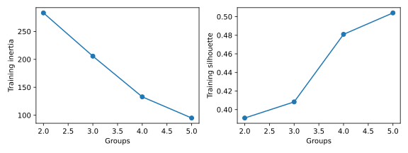
##### 4 · How to use it in the real world

The same trained preparation accepts an age/income/spending form, including a missing income measurement. Group numbers remain descriptive routing labels. Investigate real usefulness and stability before an operational decision.

~~~python
mall_age_request=pd.DataFrame({"Age":[35.],"Annual Income (k$)":[np.nan],"Spending Score (1-100)":[60.]})
print("Raw request:",mall_age_request.to_dict("records"))
print("Prepared request:",mall_all_preparation.transform(mall_age_request).round(3).tolist())
print("Assigned example group:",mall_age_model.predict(mall_all_preparation.transform(mall_age_request)).tolist())
mall_review=mall_check.loc[mall_flags.any(axis=1)]
print("Actual customer review queue size:",len(mall_review))
if len(mall_review):print("Review group outputs:",mall_age_model.predict(mall_all_preparation.transform(mall_review[mall_numeric_names])).tolist())
# Exercise the review branch with an explicitly fictional request, not an altered source row.
mall_controlled_request = pd.DataFrame({
    "Age": [35.0], "Annual Income (k$)": [10000.0], "Spending Score (1-100)": [60.0],
})
_, mall_controlled_flags = iqr_review(mall_learn, mall_controlled_request, mall_numeric_names)
print("Controlled extreme request:", mall_controlled_request.to_dict("records"))
print("Send for review before automatic routing:", bool(mall_controlled_flags.any(axis=1).iloc[0]))

~~~


**Recorded output from this input:**

~~~text
Raw request: [{'Age': 35.0, 'Annual Income (k$)': nan, 'Spending Score (1-100)': 60.0}]
Prepared request: [[-0.296, -0.094, 0.317]]
Assigned example group: [0]
Actual customer review queue size: 0
Controlled extreme request: [{'Age': 35.0, 'Annual Income (k$)': 10000.0, 'Spending Score (1-100)': 60.0}]
Send for review before automatic routing: True
~~~
#### D9b · A separate explicitly fictional region extension

##### 1 · Problem

The supplied customers have no observed region field. Fabricated regions cannot be presented as discovered geographic data.

##### 2 · How to fix it

Create a separate declared fictional region column solely to practice nominal encoding. Fit numeric imputation/scaling and one-hot vocabulary on the training portion, then fit a distinct clustering model.

##### 3 · How to use it

~~~python
from sklearn.compose import ColumnTransformer
from sklearn.preprocessing import OneHotEncoder
from sklearn.pipeline import Pipeline
fictional_mall=mall_table.copy()
fictional_mall["fictional_region"]=np.resize(["North","South","East","West"],len(fictional_mall))
fictional_mall_train,fictional_mall_test=train_test_split(fictional_mall,test_size=0.2,random_state=7)
fictional_region_preparation=ColumnTransformer([
    ("numeric",make_pipeline(SimpleImputer(strategy="median"),StandardScaler()),mall_numeric_names),
    ("region",OneHotEncoder(handle_unknown="ignore",sparse_output=False),["fictional_region"]),
])
fictional_region_model=Pipeline([("prepare",fictional_region_preparation),("cluster",KMeans(n_clusters=3,n_init=10,random_state=7))]).fit(fictional_mall_train[mall_numeric_names+["fictional_region"]])
print("FICTIONAL region extension:\n",fictional_mall_train[mall_numeric_names+["fictional_region"]].head(3).to_string(index=False))
print("Encoded region columns:",fictional_region_model.named_steps["prepare"].named_transformers_["region"].get_feature_names_out().tolist())
~~~


**Recorded output from this input:**

~~~text
FICTIONAL region extension:
  Age  Annual Income (k$)  Spending Score (1-100) fictional_region
34.0               100.0                    16.0            South
22.0                80.0                    73.0            North
34.0                78.0                    78.0            North
Encoded region columns: ['fictional_region_East', 'fictional_region_North', 'fictional_region_South', 'fictional_region_West']
~~~
##### 4 · How to use it in the real world

A regional field, if genuinely collected in a permitted project, would follow this schema path. These invented regions establish no geographic segmentation fact and their inclusion changes distance geometry.

~~~python
fictional_region_request=pd.DataFrame({"Age":[35.],"Annual Income (k$)":[50.],"Spending Score (1-100)":[60.],"fictional_region":["North"]})
print("Fictional-region request:",fictional_region_request.to_dict("records"))
print("Distinct extension-model group:",fictional_region_model.predict(fictional_region_request).tolist())
~~~


**Recorded output from this input:**

~~~text
Fictional-region request: [{'Age': 35.0, 'Annual Income (k$)': 50.0, 'Spending Score (1-100)': 60.0, 'fictional_region': 'North'}]
Distinct extension-model group: [0]
~~~
<a id="topic-d10-bank-marketing-pdf-2-10"></a>

<!-- DATASET-10 -->

### D10 · Bank Marketing — PDF 2.10

#### 1 · Problem

A pre-call campaign model can leak the future through call duration and hide weak minority performance behind accuracy.

#### 2 · How to fix it

Exclude post-call fields, prepare mixed inputs, use appropriate validation for future campaigns, and assess ranking/capacity.

#### 3 · How to use it

**Goal:** predict term-deposit subscription before a call. Source: [UCI Bank Marketing](https://archive.ics.uci.edu/dataset/222/bank+marketing). Different releases have different fields; inspect the downloaded version.

~~~python-optional
bank_table = load_bank_full()
bank_model = dataset_experiment(
    bank_table, "y", ["age", "balance", "campaign"],
    ["job", "marital", "education"], "classification",
)
~~~


**Recorded output from this input:**

~~~text
Metric: macro F1
Baseline: 0.469
Model: 0.469
~~~
**Further inspection checklist (worked source requirements follow below):** impute missing job/marital/education values inside training, one-hot encode them, scale numeric inputs where needed, and investigate extreme balances. **Exclude `duration` for pre-call prediction:** call duration is unavailable until after the call. Its presence can make an unrealistic model look excellent. For a post-call task, explicitly change prediction time and explain the changed decision.

Handle imbalance with appropriate metrics and training-only class weights/sampling. Evaluate chronological generalization for future campaigns; the random-split helper is only a first mechanical exercise. Rank validation cases and calculate **lift**: selected-group positive rate divided by overall positive rate. Choose the review capacity before testing.

**Checkpoint:** explain why available-at-prediction-time matters more than a high correlation.

#### 4 · How to use it in the real world

An outreach request contains information known before calling:

~~~python-optional
bank_request = pd.DataFrame({"age": [40], "balance": [1000], "campaign": [1], "job": ["technician"], "marital": ["married"], "education": ["secondary"]})
print("Dataset subscription prediction:", bank_model.predict(bank_request))
~~~


**Recorded output from this input:**

~~~text
Dataset subscription prediction: ['no']
~~~
Duration is deliberately absent. Select a ranking threshold on validation data and apply human review under the agreed capacity.


#### D10a · Date-ordered pre-call evaluation, fixed capacity and lift

##### 1 · Problem

A random split and an unbounded list of positives do not test a future campaign or an actual review budget.

##### 2 · How to fix it

UCI documents bank-full.csv as date-ordered. Keep the original row order; use the first 60% for training, next 20% for validation, final 20% for testing. The available file has no full unique timestamp/customer-ID contract; this row-order exercise is not an exact calendar or new-customer guarantee. Predeclare a top 10% review capacity and keep duration excluded.

##### 3 · How to use it

~~~python
from sklearn.base import clone
from sklearn.metrics import average_precision_score
import math
bank_num_names=["age","balance","campaign"]
bank_cat_names=["job","marital","education"]
bank_feature_names=bank_num_names+bank_cat_names
boundary1=int(0.6*len(bank_table));boundary2=int(0.8*len(bank_table))
bank_time_train=bank_table.iloc[:boundary1].copy()
bank_time_valid=bank_table.iloc[boundary1:boundary2].copy()
bank_time_test=bank_table.iloc[boundary2:].copy()
bank_time_model=clone(bank_model).fit(bank_time_train[bank_feature_names],bank_time_train.y)
positive_position=list(bank_time_model.classes_).index("yes")
review_fraction=0.10

def capacity_report(model,frame,positive_column):
    probabilities=model.predict_proba(frame[bank_feature_names])[:,positive_column]
    ranked=pd.DataFrame({"source_row":frame.index,"probability":probabilities,"positive":frame.y.eq("yes").to_numpy()})
    capacity=math.ceil(review_fraction*len(frame))
    selected=ranked.sort_values("probability",ascending=False).head(capacity)
    prevalence=ranked.positive.mean()
    lift=selected.positive.mean()/prevalence if prevalence else np.nan
    return selected, {"rows":len(frame),"capacity":capacity,"overall_positive_rate":round(float(prevalence),3),"selected_positive_rate":round(float(selected.positive.mean()),3),"lift":round(float(lift),3)}
bank_valid_queue,bank_valid_report=capacity_report(bank_time_model,bank_time_valid,positive_position)
print("Source-order ranges:",[(int(part.index.min()),int(part.index.max())) for part in [bank_time_train,bank_time_valid,bank_time_test]])
print("Pre-call features:",bank_feature_names)
print("Fixed-capacity validation report:",bank_valid_report)
print("Validation queue input preview:\n",bank_valid_queue[["source_row","probability"]].head(3).round(3).to_string(index=False))
~~~


**Recorded output from this input:**

~~~text
Source-order ranges: [(0, 27125), (27126, 36167), (36168, 45210)]
Pre-call features: ['age', 'balance', 'campaign', 'job', 'marital', 'education']
Fixed-capacity validation report: {'rows': 9042, 'capacity': 905, 'overall_positive_rate': 0.118, 'selected_positive_rate': 0.167, 'lift': 1.415}
Validation queue input preview:
  source_row  probability
      29512        0.169
      29521        0.146
      34170        0.141
~~~
##### 4 · How to use it in the real world

After freezing the schema, model and capacity rule, evaluate the final window and create the actual bounded outreach queue. Labels measure lift after ranking; they are not used to choose which rows enter the queue.

~~~python
bank_test_queue,bank_test_report=capacity_report(bank_time_model,bank_time_test,positive_position)
print("Untuned final-window capacity/lift:",bank_test_report)
print("Final-window average precision:",round(average_precision_score(bank_time_test.y.eq("yes"),bank_time_model.predict_proba(bank_time_test[bank_feature_names])[:,positive_position]),3))
print("First queued request inputs:\n",bank_time_test.loc[bank_test_queue.source_row.head(1),bank_feature_names].to_string(index=False))
print("First queued class output:",bank_time_model.predict(bank_time_test.loc[bank_test_queue.source_row.head(1),bank_feature_names]).tolist())
print("Duration in pre-call schema:","duration" in bank_feature_names)
~~~


**Recorded output from this input:**

~~~text
Untuned final-window capacity/lift: {'rows': 9043, 'capacity': 905, 'overall_positive_rate': 0.316, 'selected_positive_rate': 0.403, 'lift': 1.277}
Final-window average precision: 0.351
First queued request inputs:
  age  balance  campaign        job marital education
  51   102127         1 management  single  tertiary
First queued class output: ['no']
Duration in pre-call schema: False
~~~
#### D10b · Balance extremes and missing categorical inputs in the pre-call workflow

##### 1 · Problem

A negative balance may be an overdraft, and a very large balance is not automatically a recording error.

##### 2 · How to fix it

Learn balance fences on the earlier training window, review actual later rows, and retain them. Continue to impute missing categories and scale numeric measurements inside the fitted pre-call pipeline.

##### 3 · How to use it

~~~python
bank_balance_fences,bank_balance_flags=iqr_review(bank_time_train,bank_time_test,["balance"])
bank_balance_review=bank_time_test.loc[bank_balance_flags.any(axis=1)]
print("Earlier-window balance fences:\n",bank_balance_fences.round(2).to_string())
print("Later-window flagged balances:\n",bank_balance_review[["age","balance","job"]].head(3).to_string(index=False))
print("Later-window rows retained:",len(bank_time_test),"review rows:",len(bank_balance_review))
~~~


**Recorded output from this input:**

~~~text
Earlier-window balance fences:
             low    high
balance -1906.5  3273.5
Later-window flagged balances:
  age  balance          job
  46     5130 entrepreneur
  57     5486     services
  58     3867   unemployed
Later-window rows retained: 9043 review rows: 1235
~~~
##### 4 · How to use it in the real world

A request with unknown job/education is scored through training-fitted preparation. The review queue can show model probabilities without treating a balance flag as a subscription label.

~~~python
bank_missing_request=bank_time_test[bank_feature_names].head(1).copy()
bank_missing_request.loc[:,"job"]=np.nan;bank_missing_request.loc[:,"education"]=np.nan
print("Controlled missing-category input:",bank_missing_request.to_dict("records"))
print("Pre-call subscription probability:",bank_time_model.predict_proba(bank_missing_request)[:,positive_position].round(3).tolist())
print("Reviewed-balance probabilities:",bank_time_model.predict_proba(bank_balance_review[bank_feature_names].head(3))[:,positive_position].round(3).tolist())
~~~


**Recorded output from this input:**

~~~text
Controlled missing-category input: [{'age': 35, 'balance': 41, 'campaign': 5, 'job': nan, 'marital': 'single', 'education': nan}]
Pre-call subscription probability: [0.058]
Reviewed-balance probabilities: [0.048, 0.032, 0.048]
~~~
#### D10c · Duration scaling and extremes as a separate post-call analysis

##### 1 · Problem

Call duration is a future input for the pre-call task, although the PDF asks to scale and inspect it.

##### 2 · How to fix it

Create a separate retrospective post-call analysis with duration explicitly in its schema. Learn its scale and IQR fence on earlier rows. This does not make duration available before a call, and a practical post-call prediction requires verification that the target is not already known.

##### 3 · How to use it

~~~python
from sklearn.pipeline import make_pipeline
postcall_numbers=bank_num_names+["duration"]
postcall_features=postcall_numbers+bank_cat_names
postcall_preparation=ColumnTransformer([
    ("numeric",make_pipeline(SimpleImputer(strategy="median"),StandardScaler()),postcall_numbers),
    ("category",make_pipeline(SimpleImputer(strategy="most_frequent"),OneHotEncoder(handle_unknown="ignore",sparse_output=False)),bank_cat_names),
])
postcall_model=Pipeline([("prepare",postcall_preparation),("model",LogisticRegression(max_iter=2000))]).fit(bank_time_train[postcall_features],bank_time_train.y)
duration_fences,duration_flags=iqr_review(bank_time_train,bank_time_test,["duration"])
duration_review=bank_time_test.loc[duration_flags.any(axis=1)]
print("Actual duration seconds before scaling:",bank_time_train.duration.head(3).tolist())
print("Numeric training scales:",postcall_model.named_steps["prepare"].named_transformers_["numeric"].named_steps["standardscaler"].scale_.round(3).tolist())
print("Training duration fences:\n",duration_fences.round(2).to_string())
print("Actual duration-review rows:\n",duration_review[["duration","age","y"]].head(3).to_string(index=False))
~~~


**Recorded output from this input:**

~~~text
Actual duration seconds before scaling: [261, 151, 76]
Numeric training scales: [9.415, 2955.821, 3.696, 260.586]
Training duration fences:
             low   high
duration -211.5  616.5
Actual duration-review rows:
  duration  age   y
      701   49 yes
      666   40 yes
      712   41  no
~~~
##### 4 · How to use it in the real world

The retrospective interface supplies measured duration and returns a dataset label. This is a separate analysis contract, not evidence that a pre-call campaign can use call duration.

~~~python
postcall_request=duration_review[postcall_features].head(1)
print("Retrospective input:",postcall_request.to_dict("records"))
print("Post-call analysis class:",postcall_model.predict(postcall_request).tolist())
print("Duration in post-call schema:","duration" in postcall_features,"in pre-call schema:","duration" in bank_feature_names)
print("Later-window rows retained:",len(bank_time_test))
~~~


**Recorded output from this input:**

~~~text
Retrospective input: [{'age': 49, 'balance': 24, 'campaign': 1, 'duration': 701, 'job': 'blue-collar', 'marital': 'divorced', 'education': 'primary'}]
Post-call analysis class: ['no']
Duration in post-call schema: True in pre-call schema: False
Later-window rows retained: 9043
~~~
<a id="topic-d11-cleveland-heart-disease-pdf-2-11"></a>

<!-- DATASET-11 -->

### D11 · Cleveland Heart Disease — PDF 2.11

#### 1 · Problem

A small medical benchmark has coded categories, missing sentinels, and serious limits on what a score establishes.

#### 2 · How to fix it

Parse the dictionary, remove unknown target labels, prepare valid inputs within training, and inspect recall/calibration/uncertainty.

#### 3 · How to use it

**Goal:** study a labelled medical benchmark, not diagnose anyone. Source: [UCI Heart Disease](https://archive.ics.uci.edu/dataset/45/heart+disease). Download `processed.cleveland.data` and supply its documented column names:

~~~python-optional
heart_columns = [
    "age", "sex", "cp", "trestbps", "chol", "fbs", "restecg",
    "thalach", "exang", "oldpeak", "slope", "ca", "thal", "num",
]
heart_table = pd.read_csv(
    cached_download("processed.cleveland.data", "https://archive.ics.uci.edu/ml/machine-learning-databases/heart-disease/processed.cleveland.data"), header=None, names=heart_columns, na_values="?",
)
heart_table = heart_table.dropna(subset=["num"]).copy()  # Never turn an unknown answer into no disease.
heart_table["disease_present"] = (heart_table["num"] > 0).astype(int)
heart_model = dataset_experiment(
    heart_table, "disease_present", ["age", "trestbps", "chol", "thalach", "oldpeak"],
    ["sex", "cp", "fbs", "restecg", "exang", "slope", "ca", "thal"],
    "classification",
)
~~~


**Recorded output from this input:**

~~~text
Metric: macro F1
Baseline: 0.351
Model: 0.917
~~~
`header=None` means the file has no heading row. The target definition here maps `num>0` to a binary benchmark label; document that choice.

**Further inspection checklist (worked source requirements follow below):** handle `?` missing values, standardize blood pressure/cholesterol/age within training folds, one-hot categorical codes, and investigate clinical ranges with domain expertise. Use repeated stratified training validation when sample size permits; count minority examples per fold. Report recall, precision, calibration, subgroup sample sizes, and uncertainty. External clinical validation is a different task.

**Checkpoint:** distinguish a classroom benchmark score from evidence of medical safety.

#### 4 · How to use it in the real world

Demonstrate the research interface with an existing labelled row’s inputs:

~~~python-optional
heart_feature_names = ["age", "trestbps", "chol", "thalach", "oldpeak", "sex", "cp", "fbs", "restecg", "exang", "slope", "ca", "thal"]
heart_request = heart_table[heart_feature_names].iloc[[0]].copy()
print("Benchmark class output, not a diagnosis:", heart_model.predict(heart_request))
~~~


**Recorded output from this input:**

~~~text
Benchmark class output, not a diagnosis: [0]
~~~
This known-row interface check supplies no new clinical evidence. External validation and domain review are separate requirements.


#### D11a · Statistical review of cholesterol/blood pressure without invented clinical cutoffs

##### 1 · Problem

A statistical fence does not establish medical abnormality, diagnosis, or a measurement error.

##### 2 · How to fix it

Use training-only IQR flags for a research review queue. Preserve actual rows, consult the source units, and require domain review before interpreting clinical plausibility. No clinically unsupported normal range is asserted.

##### 3 · How to use it

~~~python
heart_labelled_train,heart_labelled_check=train_test_split(heart_table,test_size=0.2,random_state=7,stratify=heart_table.disease_present)
heart_review_names=["age","trestbps","chol"]
heart_fences,heart_flags=iqr_review(heart_labelled_train,heart_labelled_check,heart_review_names)
heart_review=heart_labelled_check.loc[heart_flags.any(axis=1)]
print("Training-only descriptive fences (not clinical cutoffs):\n",heart_fences.round(2).to_string())
print("Held-out flag counts:",heart_flags.sum().to_dict())
print("Actual review measurements:\n",heart_review[heart_review_names].head(3).to_string(index=False))
print("Source missing values parsed:",heart_table[["ca","thal"]].isna().sum().to_dict())
~~~


**Recorded output from this input:**

~~~text
Training-only descriptive fences (not clinical cutoffs):
              low    high
age        30.00   78.00
trestbps   90.00  170.00
chol      116.88  367.88
Held-out flag counts: {'age': 1, 'trestbps': 3, 'chol': 0}
Actual review measurements:
  age  trestbps  chol
66.0     178.0 228.0
56.0     200.0 288.0
64.0     180.0 325.0
Source missing values parsed: {'ca': 4, 'thal': 2}
~~~
##### 4 · How to use it in the real world

The research interface pairs unusual measurements with the existing benchmark model output while retaining the entire holdout. This supplies no clinical recommendation or safety validation.

~~~python
heart_review_inputs=heart_review[heart_feature_names].head(3)
if heart_review_inputs.empty:
    heart_review_inputs=heart_labelled_check.nlargest(1,"chol")[heart_feature_names]
    print("No IQR flag on this split: displaying a high-cholesterol source row for interface review only.")
print("Review research-class outputs:",heart_model.predict(heart_review_inputs).tolist())
print("Held-out rows retained:",len(heart_labelled_check))
print("Numeric scale learned on training:",heart_model.named_steps["prepare"].named_transformers_["numeric"].named_steps["scale"].scale_.round(3).tolist())
~~~


**Recorded output from this input:**

~~~text
Review research-class outputs: [1, 1, 0]
Held-out rows retained: 61
Numeric scale learned on training: [8.83, 16.938, 53.518, 22.371, 1.171]
~~~
<a id="topic-d12-fashion-mnist-pdf-2-12"></a>

<!-- DATASET-12 -->

### D12 · Fashion-MNIST — PDF 2.12

#### 1 · Problem

Clothing images must retain correct labels, separate training/test sources, pixel scale, and a representation accepted by the classifier. Loading a full image benchmark can also overwhelm a beginner's available memory.

#### 2 · How to fix it

Read a bounded prefix from each official gzip-compressed IDX file: 2,000 training images and 1,000 test images. Check the file headers and image dimensions, keep the two sources separate, divide 8-bit pixels by 255, and flatten only for the chosen traditional classifier. This subset is a small practice experiment, not a report of full-benchmark performance.

#### 3 · How to use it

**Goal:** classify 28×28 grayscale clothing images. Source and label meanings: [official Fashion-MNIST repository](https://github.com/zalandoresearch/fashion-mnist). The official files contain 60,000 training and 10,000 test images; this lesson uses only their first 2,000 and 1,000 respectively. Prefixes are not guaranteed representative samples.

**Cell 1 — load only the bounded image/label prefixes.** This optional-data cell needs internet but no new package. A gzip reader decompresses only the requested prefix before the connection closes. `struct.unpack` interprets the IDX header's big-endian integers; `frombuffer` interprets the returned bytes as unsigned 8-bit values.

~~~python-optional
from urllib.request import urlopen
import gzip
import struct
import numpy as np

fashion_source = "https://raw.githubusercontent.com/zalandoresearch/fashion-mnist/master/data/fashion/"

def fashion_prefix(split, limit):
    return bounded_images("fashion", split, limit)

fashion_train_images, fashion_train_answers = fashion_prefix("train", 2000)
fashion_test_images, fashion_test_answers = fashion_prefix("t10k", 1000)
print("Training images/labels:", fashion_train_images.shape, fashion_train_answers.shape)
print("Test images/labels:", fashion_test_images.shape, fashion_test_answers.shape)
print("Raw pixel type/range:", fashion_train_images.dtype,
      int(fashion_train_images.min()), int(fashion_train_images.max()))
~~~


**Recorded output from this input:**

~~~text
Training images/labels: (2000, 28, 28) (2000,)
Test images/labels: (1000, 28, 28) (1000,)
Raw pixel type/range: uint8 0 255
~~~
**Cell 2 — scale, flatten, fit, and evaluate.** Continue in this notebook. `reshape(number_of_images, -1)` preserves one row per image and infers the 784 columns. Converting to float32 keeps the bounded arrays small. The model never fits on the official-test prefix.

~~~python-optional
from sklearn.linear_model import SGDClassifier
from sklearn.metrics import classification_report

fashion_train_pixels = fashion_train_images.reshape(len(fashion_train_images), -1).astype("float32") / 255.0
fashion_test_pixels = fashion_test_images.reshape(len(fashion_test_images), -1).astype("float32") / 255.0
fashion_classifier = SGDClassifier(loss="log_loss", max_iter=200, random_state=7)
fashion_classifier.fit(fashion_train_pixels, fashion_train_answers)
print("Model input shape:", fashion_train_pixels.shape)
print(classification_report(
    fashion_test_answers, fashion_classifier.predict(fashion_test_pixels), zero_division=0,
))
~~~


**Recorded output from this input:**

~~~text
Model input shape: (2000, 784)
              precision    recall  f1-score   support

           0       0.85      0.78      0.81       107
           1       0.89      0.96      0.92       105
           2       0.53      0.77      0.63       111
           3       0.95      0.61      0.75        93
           4       0.72      0.79      0.75       115
           5       0.85      0.80      0.83        87
           6       0.65      0.46      0.54        97
           7       0.85      0.87      0.86        95
           8       0.93      0.93      0.93        95
           9       0.90      0.91      0.90        95

    accuracy                           0.79      1000
   macro avg       0.81      0.79      0.79      1000
weighted avg       0.80      0.79      0.79      1000
~~~
**Further inspection checklist (worked source requirements follow below):** first run `import matplotlib.pyplot as plt` in this notebook, then display an image with `plt.imshow(fashion_test_images[0], cmap="gray")` followed by `plt.show()`, check range/shape, and inspect shirt/coat/T-shirt confusions. Flattening changes shape, not resolution. Keep height/width/channel dimensions for a CNN. Resize with a stated method only when an architecture requires it; resizing can distort garment detail. Integer targets work for this classifier; one-hot targets are required only for losses/APIs expecting a vector per class.

**Practice one-hot encoding:** this independent small cell converts labels 0 and 2 into three-class indicator vectors. Those three labels are a toy example, not the full ten-class Fashion-MNIST schema.

~~~python
import numpy as np

example_labels = np.array([0, 2])
print("Input label positions:", example_labels.tolist())
print("Three-class one-hot output:", np.eye(3, dtype=int)[example_labels].tolist())
~~~


**Recorded output from this input:**

~~~text
Input label positions: [0, 2]
Three-class one-hot output: [[1, 0, 0], [0, 0, 1]]
~~~
Inspect which column represents which garment before interpreting probabilities. **Checkpoint:** explain pixel scaling, flattening, resizing, target encoding, and why a small prefix score is not the full official benchmark result. If you choose settings after inspecting this test, use new independent evaluation before making a generalization claim.

#### 4 · How to use it in the real world

An image interface must reproduce the same grayscale, shape, and pixel convention. Use one official-test-prefix input to demonstrate the interface after the fixed evaluation; this is a familiar interface check, not new evidence of accuracy:

~~~python-optional
fashion_label_names = ["T-shirt/top", "Trouser", "Pullover", "Dress", "Coat", "Sandal", "Shirt", "Sneaker", "Bag", "Ankle boot"]
fashion_request = fashion_test_pixels[:1]  # Already grayscale, flattened, and scaled identically.
fashion_request_label = int(fashion_classifier.predict(fashion_request)[0])
print("Request shape/range:", fashion_request.shape,
      float(fashion_request.min()), float(fashion_request.max()))
print("Predicted garment:", fashion_label_names[fashion_request_label])
~~~


**Recorded output from this input:**

~~~text
Request shape/range: (1, 784) 0.0 1.0
Predicted garment: Sneaker
~~~
An actual uploaded photo needs a separately tested conversion adapter and source-separated evaluation. Do not assume a photograph has the same background, framing, or distribution as these benchmark images. Compare per-class errors and sample counts, not just one displayed garment.


#### D12a · Resize actual Fashion-MNIST images and retrain the matching model

##### 1 · Problem

Flattening preserves resolution; resizing changes it and may discard clothing detail. A14×14 request cannot be sent to a784-input model.

##### 2 · How to fix it

Bilinearly resize the same official train/test prefixes to14×14, divide by255, flatten to196 inputs, and fit a separate classifier. The original28×28 model remains a distinct schema.

##### 3 · How to use it

~~~python
from PIL import Image
from sklearn.linear_model import SGDClassifier
from sklearn.metrics import accuracy_score

def resize_garments(images):
    return np.stack([np.asarray(Image.fromarray(image).resize((14,14),Image.Resampling.BILINEAR)) for image in images])
fashion_small_train=resize_garments(fashion_train_images)
fashion_small_test=resize_garments(fashion_test_images)
fashion_small_train_X=fashion_small_train.reshape(len(fashion_small_train),-1).astype("float32")/255.0
fashion_small_test_X=fashion_small_test.reshape(len(fashion_small_test),-1).astype("float32")/255.0
fashion_resized_model=SGDClassifier(loss="log_loss",max_iter=1000,random_state=7).fit(fashion_small_train_X,fashion_train_answers)
print("Actual image shapes before/after:",fashion_train_images[:1].shape,fashion_small_train[:1].shape)
print("Model rows before/after:",fashion_train_pixels[:1].shape,fashion_small_train_X[:1].shape)
print("First resized image top-left pixels:",fashion_small_train[0,:3,:3].tolist())
print("Resized-model official-test-prefix accuracy:",round(accuracy_score(fashion_test_answers,fashion_resized_model.predict(fashion_small_test_X)),3))
~~~


**Recorded output from this input:**

~~~text
Actual image shapes before/after: (1, 28, 28) (1, 14, 14)
Model rows before/after: (1, 784) (1, 196)
First resized image top-left pixels: [[0, 0, 0], [0, 0, 0], [0, 0, 0]]
Resized-model official-test-prefix accuracy: 0.805
~~~
##### 4 · How to use it in the real world

The upload adapter must resize to the receiving model’s required shape and return a documented garment class. This known benchmark image tests the interface, not photographs from a different distribution.

~~~python
fashion_resize_request=resize_garments(fashion_test_images[:1]).reshape(1,-1).astype("float32")/255.0
fashion_resize_class=int(fashion_resized_model.predict(fashion_resize_request)[0])
print("Actual request shape:",fashion_resize_request.shape)
print("Resized-model garment:",fashion_label_names[fashion_resize_class])
~~~


**Recorded output from this input:**

~~~text
Actual request shape: (1, 196)
Resized-model garment: Ankle boot
~~~
#### D12b · Ten-class one-hot targets used in an actual softmax loss and weight update

##### 1 · Problem

A toy three-class indicator array does not show how the ten real Fashion-MNIST targets enter a training loss.

##### 2 · How to fix it

Use np.eye(10) on the actual official training labels. Train a small NumPy linear softmax model with cross-entropy and gradients; no Torch dependency is needed. Learn pixel centering from the training prefix only, keep test images out of all updates, and predeclare 80 gradient steps.

##### 3 · How to use it

~~~python
# Use the actual 2000-image Fashion training prefix and the resized196-pixel representation.
fashion_onehot=np.eye(10,dtype=np.float32)[fashion_train_answers]
fashion_pixel_center=fashion_small_train_X.mean(axis=0)
fashion_design=np.column_stack([fashion_small_train_X-fashion_pixel_center,np.ones(len(fashion_small_train_X),dtype=np.float32)]).astype("float32")
fashion_test_design=np.column_stack([fashion_small_test_X-fashion_pixel_center,np.ones(len(fashion_small_test_X),dtype=np.float32)]).astype("float32")
fashion_softmax_weights=np.zeros((fashion_design.shape[1],10),dtype=np.float32)

def garment_probabilities(design,weights):
    logits=design@weights
    logits=logits-logits.max(axis=1,keepdims=True) # Stable exponentials.
    exponentials=np.exp(logits)
    return exponentials/exponentials.sum(axis=1,keepdims=True)

print("Actual training label positions:",fashion_train_answers[:3].tolist())
print("Ten-class one-hot targets:",fashion_onehot[:3].astype(int).tolist())
print("Target matrix shape:",fashion_onehot.shape)
for step in range(80):
    probabilities=garment_probabilities(fashion_design,fashion_softmax_weights)
    loss=-np.sum(fashion_onehot*np.log(np.clip(probabilities,1e-12,1)))/len(fashion_design)
    gradient=fashion_design.T@(probabilities-fashion_onehot)/len(fashion_design)
    fashion_softmax_weights-=0.5*gradient
    if step in [0,39,79]:print("Actual gradient step/loss:",step,round(float(loss),4))
fashion_softmax_test_predictions=garment_probabilities(fashion_test_design,fashion_softmax_weights).argmax(axis=1)
print("Fixed-training official-test-prefix accuracy:",round(accuracy_score(fashion_test_answers,fashion_softmax_test_predictions),3))
~~~


**Recorded output from this input:**

~~~text
Actual training label positions: [9, 0, 0]
Ten-class one-hot targets: [[0, 0, 0, 0, 0, 0, 0, 0, 0, 1], [1, 0, 0, 0, 0, 0, 0, 0, 0, 0], [1, 0, 0, 0, 0, 0, 0, 0, 0, 0]]
Target matrix shape: (2000, 10)
Actual gradient step/loss: 0 2.3026
Actual gradient step/loss: 39 0.8472
Actual gradient step/loss: 79 0.7211
Fixed-training official-test-prefix accuracy: 0.746
~~~
Read the training calculation one operation at a time:

- Each target row has ten entries, with one 1 at the recorded garment class.
- `garment_probabilities` turns class scores into probabilities summing to one; subtracting the maximum keeps exponentials numerically stable.
- Cross-entropy uses the one-hot row to select the negative log-probability assigned to the actual class.
- `probabilities - fashion_onehot` is the per-class training error. Multiplying by `fashion_design.T` accumulates the feature contributions to that error.
- Dividing by the number of images gives a mean-loss gradient. The fixed 0.5 step changes weights; the separate test prefix never supplies a weight update.

##### 4 · How to use it in the real world

The model returns ten probabilities and decodes argmax using the same garment vocabulary. The real known target can then be converted to one-hot for evaluation loss; prediction itself never receives that answer.

~~~python
fashion_onehot_request=fashion_test_design[:1]
fashion_onehot_probabilities=garment_probabilities(fashion_onehot_request,fashion_softmax_weights)[0]
fashion_onehot_class=int(fashion_onehot_probabilities.argmax())
actual_onehot=np.eye(10,dtype=np.float32)[fashion_test_answers[0]]
request_loss=-float(np.sum(actual_onehot*np.log(np.clip(fashion_onehot_probabilities,1e-12,1))))
print("Input centered-pixels-plus-bias shape:",fashion_onehot_request.shape)
print("Ten output probabilities:",fashion_onehot_probabilities.astype(float).round(3).tolist())
print("Decoded garment:",fashion_label_names[fashion_onehot_class])
print("Actual-target one-hot vector:",actual_onehot.astype(int).tolist(),"evaluation cross-entropy:",round(request_loss,4))
~~~


**Recorded output from this input:**

~~~text
Input centered-pixels-plus-bias shape: (1, 197)
Ten output probabilities: [0.002, 0.002, 0.004, 0.003, 0.003, 0.348, 0.003, 0.198, 0.081, 0.356]
Decoded garment: Ankle boot
Actual-target one-hot vector: [0, 0, 0, 0, 0, 0, 0, 0, 0, 1] evaluation cross-entropy: 1.0327
~~~
<a id="topic-d13-google-play-store-pdf-2-13"></a>

<!-- DATASET-13 -->

### D13 · Google Play Store — PDF 2.13

#### 1 · Problem

Human-formatted installs/prices and missing ratings cannot be passed directly into a numerical rating predictor.

#### 2 · How to fix it

Parse the numeric fields, report failed conversions, distinguish unknown targets, and encode category inside a regression pipeline.

#### 3 · How to use it

**Goal:** clean an app catalog, then predict rating or analyze categories. Source: [Google Play Store Apps](https://www.kaggle.com/datasets/lava18/google-play-store-apps). The supplied `googleplaystore_messy.csv` is practice material.

~~~python
play_table = pd.read_csv(practice_data / "googleplaystore_messy.csv")
play_table["numeric_installs"] = pd.to_numeric(
    play_table["Installs"].astype("string").str.replace(r"[+,]", "", regex=True),
    errors="coerce",
)
play_table["numeric_price"] = pd.to_numeric(
    play_table["Price"].astype("string").str.replace("$", "", regex=False),
    errors="coerce",
)
play_table["numeric_rating"] = pd.to_numeric(play_table["Rating"], errors="coerce")
invalid_rating = play_table["numeric_rating"].notna() & ~play_table["numeric_rating"].between(0, 5)
print("Source ratings outside the documented 0–5 range:")
print(play_table.loc[invalid_rating, ["App", "Rating"]].to_string(index=False))
# Keep the raw Rating field for investigation; do not train on an impossible target.
play_table.loc[invalid_rating, "numeric_rating"] = np.nan

print(play_table[["Installs", "numeric_installs", "Price", "numeric_price"]].head())
print(play_table[["numeric_installs", "numeric_price", "numeric_rating"]].isna().sum())
~~~


**Recorded output from this input:**

~~~text
Source ratings outside the documented 0–5 range:
                                    App  Rating
Life Made WI-Fi Touchscreen Photo Frame    19.0
       Installs  numeric_installs  Price  numeric_price
0      100,000+            100000      0            0.0
1       10,000+             10000      0            0.0
2   10,000,000+          10000000      0            0.0
3  100,000,000+         100000000  $9.99           9.99
4        1,000+              1000  $0.99           0.99
numeric_installs      1
numeric_price         1
numeric_rating      172
dtype: int64
~~~
`errors="coerce"` turns unparseable values into missing values so you can report and investigate them. It does not establish that the remaining values are valid.

**Further inspection checklist (worked source requirements follow below):** inspect duplicates by app/version/date, missing category/rating, ratings outside 0–5, size suffixes, and “Varies with device.” Separate currency units from numeric price. Parse last-updated dates with an explicit format or audited mixed-format strategy. Investigate extreme install counts/prices; apply log features where justified. Encode **category**, while price/rating remain numeric unless deliberately binned. Missing target ratings cannot be evaluated as if labelled.

**Independent exercise:** predict `numeric_rating` with training-only preparation from category, price, and selected pre-rating inputs. Exclude post-outcome information if the intended prediction time is app launch. Compare with a mean-rating baseline and inspect errors by category.

#### 4 · How to use it in the real world

For a rating estimate after observing an app’s installs and price, fit the complete recipe and score the same schema:

~~~python
play_model = dataset_experiment(play_table, "numeric_rating", ["numeric_installs", "numeric_price"], ["Category"], "regression")
play_request = pd.DataFrame({"numeric_installs": [5000], "numeric_price": [0.0], "Category": ["GAME"]})
print("Illustrative rating estimate:", play_model.predict(play_request).round(2))
~~~


**Recorded output from this input:**

~~~text
Metric: MAE
Baseline: 0.354
Model: 0.356
Illustrative rating estimate: [4.32]
~~~
This task is after those inputs are observed, not prediction before app launch. Investigate whether outputs stay within the rating range and validate an explicit bounded-model policy rather than silently clipping for nicer scores.


#### D13a · Review actual install/price extremes and use stored log-feature preparation

##### 1 · Problem

A catalog dominated by free apps can produce a zero-IQR price fence; paid apps are then flagged without being errors. Human-formatted counts also need units and conversion checks.

##### 2 · How to fix it

Use training-only fences in original units and retain every statistically unusual app. Restrict supervised labels to documented0–5 ratings, keeping unknown/invalid targets in the source audit. Use log1p inside the fitted input pipeline for nonnegative installs/prices, not as a silent one-off notebook edit.

##### 3 · How to use it

~~~python
from sklearn.base import clone
from sklearn.preprocessing import FunctionTransformer
from sklearn.pipeline import Pipeline
valid_play_labels=play_table.numeric_rating.between(0,5)
print("Source target audit:",{"labelled_0_to_5":int(valid_play_labels.sum()),"unknown_or_invalid_target":int((~valid_play_labels).sum())})
play_labelled=play_table.loc[valid_play_labels].copy()
play_learn,play_check=train_test_split(play_labelled,test_size=0.2,random_state=7)
play_fences,play_flags=iqr_review(play_learn,play_check,["numeric_installs","numeric_price"])
print("Training-only original-unit fences:\n",play_fences.round(2).to_string())
print("Review counts:",play_flags.sum().to_dict())
play_review=play_check.loc[play_flags.any(axis=1)]
print("Actual reviewed catalog rows:\n",play_review[["App","Installs","numeric_installs","Price","numeric_price"]].head(3).to_string(index=False))

def play_log_features(raw):
    result=raw.copy()
    for name in ["numeric_installs","numeric_price"]:
        if (result[name].dropna()<0).any():raise ValueError("Supply nonnegative installs and price in the declared units.")
        result[name]=np.log1p(result[name])
    return result
play_log_model=Pipeline([("log_inputs",FunctionTransformer(play_log_features)),("learn",clone(play_model))]).fit(play_learn[["numeric_installs","numeric_price","Category"]],play_learn.numeric_rating)
print("Before log-feature preparation:",play_learn[["numeric_installs","numeric_price"]].head(2).to_dict("records"))
print("After stored transformation:",play_log_features(play_learn[["numeric_installs","numeric_price","Category"]].head(2))[["numeric_installs","numeric_price"]].round(3).to_dict("records"))
print("Fixed log-input model held-out rating MAE:",round(mean_absolute_error(play_check.numeric_rating,play_log_model.predict(play_check[["numeric_installs","numeric_price","Category"]])),3))
~~~


**Recorded output from this input:**

~~~text
Source target audit: {'labelled_0_to_5': 1389, 'unknown_or_invalid_target': 172}
Training-only original-unit fences:
                         low       high
numeric_installs -1475000.0  2485000.0
numeric_price           0.0        0.0
Review counts: {'numeric_installs': 35, 'numeric_price': 20}
Actual reviewed catalog rows:
      App     Installs  numeric_installs Price  numeric_price
App 0127 100,000,000+         100000000     0            0.0
App 1241 100,000,000+         100000000     0            0.0
App 1432      10,000+             10000 $9.99           9.99
Before log-feature preparation: [{'numeric_installs': 100000, 'numeric_price': 0.0}, {'numeric_installs': 100000, 'numeric_price': 1.99}]
After stored transformation: [{'numeric_installs': 11.513, 'numeric_price': 0.0}, {'numeric_installs': 11.513, 'numeric_price': 1.095}]
Fixed log-input model held-out rating MAE: 0.348
~~~
##### 4 · How to use it in the real world

The review output keeps original numeric units beside the prediction, while a new catalog request gets exactly the trained log conversion and category encoding. No paid app is automatically removed because the price fence is zero.

~~~python
play_review_inputs=play_review[["numeric_installs","numeric_price","Category"]].head(3)
print("Review predicted ratings:",play_log_model.predict(play_review_inputs).round(3).tolist())
print("Statistical-review holdout rows retained:",len(play_check))
new_play_request=pd.DataFrame({"numeric_installs":[5000.],"numeric_price":[0.99],"Category":["GAME"]})
print("Raw catalog request:",new_play_request.to_dict("records"))
print("Stored log-pipeline rating estimate:",play_log_model.predict(new_play_request).round(3).tolist())
try:play_log_model.predict(pd.DataFrame({"numeric_installs":[100.],"numeric_price":[-2.],"Category":["GAME"]}))
except ValueError as error:print("Controlled negative-price request rejected:",str(error))
~~~


**Recorded output from this input:**

~~~text
Review predicted ratings: [4.543, 4.475, 4.338]
Statistical-review holdout rows retained: 278
Raw catalog request: [{'numeric_installs': 5000.0, 'numeric_price': 0.99, 'Category': 'GAME'}]
Stored log-pipeline rating estimate: [4.267]
Controlled negative-price request rejected: Supply nonnegative installs and price in the declared units.
~~~
<a id="topic-d14-show-that-you-can-transfer-the-workflow"></a>

### D14 · Hand off a model: valid requests, invalid requests, and reproducibility

#### 1 · Problem

A notebook that runs for its author may fail for the next person. The caller may send a misspelled field, an impossible value, or a request format different from training.

We need to demonstrate the handoff, not just ask another learner to try it.

#### 2 · How to fix it

Keep the whole fitted recipe together, state the input name and units, reserve a test sample, and put explicit validation before prediction. Return the model version with each answer. Test one valid request and several invalid ones.

This exercise uses the bundled salary data for a teaching forecast. Its currency is unspecified, so answers are **salary units**, not a compensation recommendation.

#### 3 · How to use it

Create **handoff-practice.ipynb** in the handbook folder, with `datasets/salary_experience.csv` available. These cells are independent of earlier dataset notebooks; run them in order.

~~~python
from pathlib import Path
import math
from numbers import Real
import pandas as pd
from sklearn.dummy import DummyRegressor
from sklearn.impute import SimpleImputer
from sklearn.linear_model import LinearRegression
from sklearn.metrics import mean_absolute_error
from sklearn.model_selection import train_test_split
from sklearn.pipeline import make_pipeline

handoff_data = pd.read_csv(Path("datasets") / "salary_experience.csv")
handoff_data = handoff_data.dropna(subset=["salary"])
handoff_X = handoff_data[["years_experience"]]
handoff_y = handoff_data["salary"]
handoff_train_X, handoff_test_X, handoff_train_y, handoff_test_y = train_test_split(
    handoff_X, handoff_y, test_size=0.2, random_state=7,
)
handoff_model = make_pipeline(SimpleImputer(strategy="median"), LinearRegression())
handoff_model.fit(handoff_train_X, handoff_train_y)
handoff_baseline = DummyRegressor().fit(handoff_train_X, handoff_train_y)
handoff_metadata = {
    "version": "salary-handoff-v1",
    "features": ["years_experience"],
    "target_units": "salary units",
    "training_rows": len(handoff_train_X),
    "test_rows": len(handoff_test_X),
    "baseline_MAE": round(mean_absolute_error(
        handoff_test_y, handoff_baseline.predict(handoff_test_X),
    ), 2),
    "model_MAE": round(mean_absolute_error(
        handoff_test_y, handoff_model.predict(handoff_test_X),
    ), 2),
}
print("Handoff metadata:", handoff_metadata)
~~~


**Recorded output from this input:**

~~~text
Handoff metadata: {'version': 'salary-handoff-v1', 'features': ['years_experience'], 'target_units': 'salary units', 'training_rows': 24, 'test_rows': 6, 'baseline_MAE': 29015.83, 'model_MAE': 4932.85}
~~~
The input table has one named feature. The fitted pipeline retains its training median and regression weights. The MAE report uses reserved rows; the following requests test the interface, not another estimate of model accuracy.

~~~python
def handoff_predict(record):
    if not isinstance(record, dict) or set(record) != {"years_experience"}:
        raise ValueError("Supply exactly the field years_experience.")
    experience = record["years_experience"]
    if isinstance(experience, bool) or not isinstance(experience, Real):
        raise ValueError("years_experience must be a number.")
    if not math.isfinite(float(experience)) or not 0 <= experience <= 60:
        raise ValueError("Use a finite experience value from 0 to 60 years.")
    request = pd.DataFrame({"years_experience": [float(experience)]})
    return {
        "estimate": round(float(handoff_model.predict(request)[0]), 2),
        "units": handoff_metadata["target_units"],
        "model_version": handoff_metadata["version"],
    }

print("Valid input:", {"years_experience": 3.5})
print("Model response:", handoff_predict({"years_experience": 3.5}))
~~~


**Recorded output from this input:**

~~~text
Valid input: {'years_experience': 3.5}
Model response: {'estimate': 59493.94, 'units': 'salary units', 'model_version': 'salary-handoff-v1'}
~~~
The 0–60 bound is this teaching interface's explicit input policy, not a rule about every employment dataset. Even a value inside that bound can be outside the training experience range; investigate extrapolation before real use.

#### 4 · How to use it in the real world

A form or API can call the same validation function. A rejection should identify the input problem rather than produce a guessed salary.

~~~python
import json

handoff_requests = [
    {"years_experience": 3.5},       # Valid named number.
    {"experience": 3.5},            # Wrong field name.
    {"years_experience": -1},       # Outside this interface's range.
    {"years_experience": "many"},   # Wrong value type.
]
for record in handoff_requests:
    try:
        print("Accepted:", record, "->", handoff_predict(record))
    except ValueError as error:
        print("Rejected:", record, "->", str(error))

transported_request = json.loads(json.dumps({"years_experience": 3.5}))
transported_response = handoff_predict(transported_request)
direct_prediction = round(float(handoff_model.predict(
    pd.DataFrame({"years_experience": [3.5]})
)[0]), 2)
assert transported_response["estimate"] == direct_prediction
assert transported_response["model_version"] == handoff_metadata["version"]
print("JSON and direct-model estimates agree:", direct_prediction)
~~~


**Recorded output from this input:**

~~~text
Accepted: {'years_experience': 3.5} -> {'estimate': 59493.94, 'units': 'salary units', 'model_version': 'salary-handoff-v1'}
Rejected: {'experience': 3.5} -> Supply exactly the field years_experience.
Rejected: {'years_experience': -1} -> Use a finite experience value from 0 to 60 years.
Rejected: {'years_experience': 'many'} -> years_experience must be a number.
JSON and direct-model estimates agree: 59493.94
~~~
`json.dumps` serializes the request and `json.loads` decodes it. The comparison checks prediction parity through that transport path. For an actual service, persist the trusted artifact, schema, dependency versions, decision policy, and evaluation evidence; the later packaging and API lessons show that handoff.

**Independent checkpoint:** restart this notebook and run all cells. Change the valid experience value, explain the new result in the stated units, and introduce one different invalid schema. Retain a prediction contract, data provenance, split, baseline, error analysis, limitations, and reproducible environment with your project.

[↑ Back to the curriculum](#complete-curriculum)

<a id="workshop-algorithms"></a>

[↑ Back to the curriculum](#complete-curriculum)

## 🧰 Algorithm workshops: solve, run, apply, explain

Each named lesson follows the same four steps: **Problem → How to fix it → How to use it → How to use it in a real workflow**. Complete the beginner project first, then choose one lesson. Each lesson starts a fresh notebook/namespace; its Step 4 cell continues from its Step 3 cell. Never mix unrelated lessons' state.

The visible input previews and output blocks below come from actual runs in the checked environment. Previews explicitly show only a few rows where appropriate. Synthetic units and fixtures are labeled; small examples demonstrate mechanisms, not production reliability. Formatting and some numerical results may vary across versions.

Training-only cross-validation fits preparation separately in each fold. When its results guide selection, evaluate the selected process later using an untouched final test or appropriate outer evaluation. Fold standard deviation is not automatically a confidence interval. Descriptive unsupervised fits make no held-out performance claim.

### Find a lesson

- [Choose the learning setting](#topic-first-choose-the-learning-setting)
- [📈 1 · Linear regression](#topic-1-linear-regression-fit-a-straight-relationship)
- [1b · Multiple versus multivariate regression](#topic-multiple-and-multivariate-regression)
- [🪢 2 · Ridge regularization](#topic-2-ridge-and-lasso-restrain-large-weights)
- [🪢 2 · Lasso regularization](#topic-lasso-feature-shrinkage)
- [➗ 3 · Logistic regression](#topic-3-logistic-regression-a-classification-baseline)
- [🌳 4 · Decision trees](#topic-4-decision-trees-inspect-learned-questions)
- [🌲 5 · Random forests](#topic-5-random-forests-combine-varied-trees)
- [🚀 6 · Histogram gradient boosting](#topic-6-gradient-boosting-improve-a-sequence-of-small-trees)
- [⚔️ 7 · Support vector machines](#topic-7-support-vector-machines-compare-straight-and-curved-boundaries)
- [👥 8 · K-nearest neighbors](#topic-8-k-nearest-neighbors-ask-similar-examples)
- [🎲 9 · Naive Bayes](#topic-9-naive-bayes-a-tiny-text-classifier)
- [9b · Gaussian Naive Bayes for measurements](#topic-gaussian-naive-bayes)
- [🧠 10 · Neural networks / MLP](#topic-10-neural-networks-learn-several-layers-of-transformations)
- [🎯 11 · K-Means and customer segmentation](#topic-11-k-means-choose-centers-for-compact-groups)
- [🌌 12 · DBSCAN](#topic-12-dbscan-find-dense-regions-and-mark-noise)
- [🌿 13 · Hierarchical clustering and dendrograms](#topic-13-hierarchical-clustering-merge-groups-step-by-step)
- [🫧 14 · Gaussian mixtures](#topic-14-gaussian-mixtures-model-overlapping-distributions)
- [🗜️ 15 · PCA](#topic-15-pca-compress-and-reconstruct)
- [15b · Independent Component Analysis / ICA](#topic-ica-independent-components)
- [15c · Linear Discriminant Analysis / LDA](#topic-lda-supervised-dimension-reduction)
- [🗺️ 16 · t-SNE](#topic-16-t-sne-investigate-neighborhoods-in-a-map)
- [🌲🚨 17 · Isolation Forest](#topic-17-isolation-forest-rank-unusual-records)
- [17b · LOF novelty detection](#topic-lof-novelty-detection)
- [17c · One-Class SVM novelty detection](#topic-one-class-svm)
- [🛒 18 · Association rules](#topic-18-association-rules-calculate-support-confidence-and-lift)
- [🧩 Label propagation: a few answers and many inputs](#semi-supervised-workshop)
- [🧩 Label spreading: a few answers and many inputs](#topic-label-spreading)
- [🧩 Self-training: a few answers and many inputs](#topic-self-training)
- [🎰 Epsilon-greedy bandit](#topic-experiment-a-a-bandit-chooses-between-three-offers)
- [🤖 Q-learning and SARSA grid policies](#topic-experiment-b-q-learning-and-sarsa-in-a-tiny-grid)
- [A · Tiny S3VM assignment search](#topic-a-a-tiny-semi-supervised-svm-search-unknown-label-assignments)
- [B · Co-training](#topic-b-co-training-exchange-confident-guesses-between-two-views)
- [C · Model-based value iteration](#topic-c-model-based-planning-a-given-model-and-a-learned-model)
- [D · Policy gradients / REINFORCE](#topic-d-policy-gradients-optimize-a-softmax-bandit-policy)
- [E · NumPy DQN with replay and a target network](#topic-e-a-miniature-numpy-dqn-replay-and-a-target-network)
- [F · Actor–critic](#topic-f-actor-critic-an-action-policy-plus-a-learned-value-baseline)
- [G · Monte Carlo Tree Search / UCT](#topic-g-monte-carlo-tree-search-plan-using-simulated-futures)
- [H · Optional Gymnasium / FrozenLake](#topic-h-optional-gymnasium-train-and-evaluate-frozenlake)
- [I · Optional XGBoost and LightGBM](#topic-i-optional-xgboost-and-lightgbm-use-real-estimators)
- [J · Optional Apriori and FP-Growth](#topic-j-optional-mlxtend-execute-apriori-and-fp-growth)
- [K · SVR, tree, forest, and boosting regressors](#topic-k-regression-variants-compare-the-same-numerical-task)
- [Later RL methods: connect mechanisms to applications](#topic-later-rl-environments-and-methods)
- [🏁 Independent workshop challenge](#topic-independent-workshop-challenge)
- [Workshop verification and optional dependencies](#topic-workshop-verification-limits)

<a id="topic-first-choose-the-learning-setting"></a>

### Choose the learning setting

#### 1 · Problem

A shop has prices, another has unlabeled customer visits, and a robot receives rewards. Treating every problem as classification gives the wrong training inputs and evaluation.

#### 2 · How to fix it

Choose the setting from the available feedback: supervised learning uses recorded targets; unsupervised learning investigates structure; semi-supervised learning combines a few labels with unlabeled inputs; reinforcement learning learns an action policy from outcomes. Clustering group numbers are not supplied answer labels.

#### 3 · How to use it

Start a fresh notebook for this lesson; run the following cells in order.

**Learning cell 1 of 1:**

```python
learning_cases = {
    "pizza prices": {"feedback": "a number for each training row", "setting": "supervised regression"},
    "flower species": {"feedback": "a category for each training row", "setting": "supervised classification"},
    "customer visits": {"feedback": "inputs without answer labels", "setting": "unsupervised clustering"},
    "partly labeled photos": {"feedback": "some labels plus unlabeled inputs", "setting": "semi-supervised"},
    "warehouse route": {"feedback": "actions followed by rewards", "setting": "reinforcement"},
}
for case, description in learning_cases.items():  # Inspect the input contract before selecting an estimator.
    print(case, "->", description["setting"])
```


**Recorded output from this input:**

~~~text
pizza prices -> supervised regression
flower species -> supervised classification
customer visits -> unsupervised clustering
partly labeled photos -> semi-supervised
warehouse route -> reinforcement
~~~
#### 4 · How to use it in the real world

Use the contract as an intake record: the following workflow takes the shop request and produces a measurable numerical prediction brief. This record determines which later model and metric are appropriate; it does not train a model by itself.

**Continue in this lesson's notebook:**

```python
project_request = {"input": "diameter_cm", "known_answer": "price_coins", "answer_kind": "number"}
project_brief = {"task": "regression", "feature": project_request["input"],
                 "target": project_request["known_answer"], "metric": "MAE in coins"}
print(project_brief)  # The next model experiment must satisfy this contract.
```


**Recorded output from this input:**

~~~text
{'task': 'regression', 'feature': 'diameter_cm', 'target': 'price_coins', 'metric': 'MAE in coins'}
~~~
🎯 **Change and explain:** Replace the request with repeated patient visits. Explain why keeping patient groups together changes the evaluation split, even though the task remains supervised.

<a id="topic-1-linear-regression-fit-a-straight-relationship"></a>

### 📈 1 · Linear regression

#### 1 · Problem

A mean-price rule ignores informative numerical inputs. We need to learn a straight relationship and check whether it reduces numerical errors.

#### 2 · How to fix it

Fit LinearRegression and a mean baseline on identical validation folds. MAE is the average absolute mistake in synthetic target units. Cross-validation scores describe this comparison; selecting a method using them requires a separate final assessment later.

#### 3 · How to use it

Start a fresh notebook for this lesson; run the following cells in order.

**Learning cell 1 of 1:**

```python
from sklearn.datasets import make_regression
from sklearn.dummy import DummyRegressor
from sklearn.linear_model import LinearRegression
from sklearn.model_selection import KFold, cross_val_score

line_X, line_y = make_regression(n_samples=150, n_features=4, noise=20, random_state=4)
line_cv = KFold(3, shuffle=True, random_state=7)  # Use the same splits for both rules.
for line_name, line_model in [("mean baseline", DummyRegressor()), ("straight model", LinearRegression())]:
    line_scores = -cross_val_score(line_model, line_X, line_y, cv=line_cv,
                                  scoring="neg_mean_absolute_error")  # Minus turns negative errors positive.
    print(line_name, "MAE:", round(line_scores.mean(), 1))

# Inspect actual inputs used above; these are previews, not the complete dataset.
print("First two input rows:", line_X[:2].round(2).tolist())
print("Their target values:", line_y[:2].round(2).tolist())
```


**Recorded output from this input:**

~~~text
mean baseline MAE: 94.1
straight model MAE: 15.7
First two input rows: [[-0.54, -0.78, 0.79, 1.34], [-0.35, 0.41, -1.23, 1.73]]
Their target values: [61.16, 93.67]
~~~
#### 4 · How to use it in the real world

After the validation experiment, fit the chosen straight model on the available training fixture and expose a one-record prediction call. The four values below must follow the same feature order; they are a new synthetic record, not measured business attributes.

**Continue in this lesson's notebook:**

```python
line_deployed = LinearRegression().fit(line_X, line_y)
line_new_record = [[0.2, -0.5, 0.3, 1.0]]  # Four inputs, no target value supplied.
print("New inputs:", line_new_record)
print("Predicted target:", line_deployed.predict(line_new_record).round(2).tolist())
```


**Recorded output from this input:**

~~~text
New inputs: [[0.2, -0.5, 0.3, 1.0]]
Predicted target: [81.6]
~~~
🎯 **Change and explain:** Increase noise from 20 to 80 in a separate run. Explain why the mean baseline is still useful and why a fitted model cannot recover arbitrary noise.

<a id="topic-multiple-and-multivariate-regression"></a>

### 1b · Multiple versus multivariate regression

#### 1 · Problem

Several input columns and several output columns are different requirements. A one-target interface cannot silently return two quantities with different units.

#### 2 · How to fix it

Multiple regression means several inputs predict one number. Multivariate regression means several numerical targets. Keep their columns and errors distinct instead of silently averaging incompatible units.

#### 3 · How to use it

Start a fresh notebook for this lesson; run the following cells in order.

**Learning cell 1 of 1:**

```python
from sklearn.datasets import make_regression
from sklearn.linear_model import LinearRegression
from sklearn.model_selection import train_test_split

multi_X, multi_y = make_regression(n_samples=100, n_features=4, n_targets=2, noise=10, random_state=7)
multi_X_train, multi_X_test, multi_y_train, multi_y_test = train_test_split(multi_X, multi_y, random_state=7)
multi_model = LinearRegression().fit(multi_X_train, multi_y_train)
print("Two answers for each test row:", multi_model.predict(multi_X_test).shape)

# Inspect actual inputs used above; these are previews, not the complete dataset.
print("Training inputs shape:", multi_X_train.shape, "training targets shape:", multi_y_train.shape)
```


**Recorded output from this input:**

~~~text
Two answers for each test row: (25, 2)
Training inputs shape: (75, 4) training targets shape: (75, 2)
~~~
#### 4 · How to use it in the real world

The fitted estimator now serves a new four-feature record and returns two separately named quantities. An application would retain each target's documented name and unit; our synthetic fixture supplies no business units.

**Continue in this lesson's notebook:**

```python
multi_new_record = [[0.2, -0.5, 0.3, 1.0]]
multi_prediction = multi_model.predict(multi_new_record)[0]
print("New inputs:", multi_new_record)
print("Output target_1:", round(float(multi_prediction[0]), 2))
print("Output target_2:", round(float(multi_prediction[1]), 2))
```


**Recorded output from this input:**

~~~text
New inputs: [[0.2, -0.5, 0.3, 1.0]]
Output target_1: 54.06
Output target_2: 68.71
~~~
🎯 **Change and explain:** Calculate held-out MAE separately for each target using multi_y_test and the corresponding prediction column.

<a id="topic-2-ridge-and-lasso-restrain-large-weights"></a>

### 🪢 2 · Ridge regularization

#### 1 · Problem

Many numerical clues include weak or redundant signals. Unrestrained fitted weights can react strongly to sampling noise.

#### 2 · How to fix it

Ridge adds a squared-weight penalty, shrinking weights together. Scale inside each validation fold so units do not determine the penalty. The alpha setting controls penalty strength; validation must decide whether its tradeoff helps.

#### 3 · How to use it

Start a fresh notebook for this lesson; run the following cells in order.

**Learning cell 1 of 1:**

```python
from sklearn.datasets import make_regression
from sklearn.linear_model import Lasso, Ridge
from sklearn.model_selection import KFold, cross_val_score
from sklearn.pipeline import make_pipeline
from sklearn.preprocessing import StandardScaler

penalty_X, penalty_y = make_regression(n_samples=150, n_features=12, n_informative=3, noise=20, random_state=4)
penalty_cv = KFold(3, shuffle=True, random_state=7)
penalty_model = make_pipeline(StandardScaler(), Ridge(alpha=10))
penalty_errors = -cross_val_score(penalty_model, penalty_X, penalty_y, cv=penalty_cv, scoring="neg_mean_absolute_error")
penalty_model.fit(penalty_X, penalty_y)  # Fit a reusable pipeline after this validation experiment.
print("Ridge MAE:", round(penalty_errors.mean(), 1))
print("Zero weights:", int((penalty_model[-1].coef_ == 0).sum()))

# Inspect actual inputs used above; these are previews, not the complete dataset.
print("Input shape:", penalty_X.shape, "first target:", round(float(penalty_y[0]), 2))
```


**Recorded output from this input:**

~~~text
Ridge MAE: 17.0
Zero weights: 0
Input shape: (150, 12) first target: 48.07
~~~
#### 4 · How to use it in the real world

Use the fitted scaling-and-regression pipeline for a new twelve-measurement record. New inputs receive the training scaler; the application never fits a fresh scaler per request.

**Continue in this lesson's notebook:**

```python
penalty_new_record = [[0.0] * 12]  # Explicit twelve-value input in the original feature order.
print("New inputs:", penalty_new_record)
print("Predicted target:", penalty_model.predict(penalty_new_record).round(2).tolist())
```


**Recorded output from this input:**

~~~text
New inputs: [[0.0, 0.0, 0.0, 0.0, 0.0, 0.0, 0.0, 0.0, 0.0, 0.0, 0.0, 0.0]]
Predicted target: [2.9]
~~~
🎯 **Change and explain:** Try alpha 0.1 and 20 using training validation. A zero coefficient is specific to this fitted model, not proof that an attribute is universally useless.

<a id="topic-lasso-feature-shrinkage"></a>

### 🪢 2 · Lasso regularization

#### 1 · Problem

Many numerical clues include weak or redundant signals. Unrestrained fitted weights can react strongly to sampling noise.

#### 2 · How to fix it

Lasso adds an absolute-weight penalty and can make fitted weights exactly zero. Scale inside each validation fold so units do not determine the penalty. The alpha setting controls penalty strength; validation must decide whether its tradeoff helps.

#### 3 · How to use it

Start a fresh notebook for this lesson; run the following cells in order.

**Learning cell 1 of 1:**

```python
from sklearn.datasets import make_regression
from sklearn.linear_model import Lasso, Ridge
from sklearn.model_selection import KFold, cross_val_score
from sklearn.pipeline import make_pipeline
from sklearn.preprocessing import StandardScaler

penalty_X, penalty_y = make_regression(n_samples=150, n_features=12, n_informative=3, noise=20, random_state=4)
penalty_cv = KFold(3, shuffle=True, random_state=7)
penalty_model = make_pipeline(StandardScaler(), Lasso(alpha=2))
penalty_errors = -cross_val_score(penalty_model, penalty_X, penalty_y, cv=penalty_cv, scoring="neg_mean_absolute_error")
penalty_model.fit(penalty_X, penalty_y)  # Fit a reusable pipeline after this validation experiment.
print("Lasso MAE:", round(penalty_errors.mean(), 1))
print("Zero weights:", int((penalty_model[-1].coef_ == 0).sum()))

# Inspect actual inputs used above; these are previews, not the complete dataset.
print("Input shape:", penalty_X.shape, "first target:", round(float(penalty_y[0]), 2))
```


**Recorded output from this input:**

~~~text
Lasso MAE: 13.1
Zero weights: 8
Input shape: (150, 12) first target: 48.07
~~~
#### 4 · How to use it in the real world

Use the fitted scaling-and-regression pipeline for a new twelve-measurement record. New inputs receive the training scaler; the application never fits a fresh scaler per request.

**Continue in this lesson's notebook:**

```python
penalty_new_record = [[0.0] * 12]  # Explicit twelve-value input in the original feature order.
print("New inputs:", penalty_new_record)
print("Predicted target:", penalty_model.predict(penalty_new_record).round(2).tolist())
```


**Recorded output from this input:**

~~~text
New inputs: [[0.0, 0.0, 0.0, 0.0, 0.0, 0.0, 0.0, 0.0, 0.0, 0.0, 0.0, 0.0]]
Predicted target: [2.52]
~~~
🎯 **Change and explain:** Try alpha 0.1 and 20 using training validation. A zero coefficient is specific to this fitted model, not proof that an attribute is universally useless.

<a id="topic-3-logistic-regression-a-classification-baseline"></a>

### ➗ 3 · Logistic regression

#### 1 · Problem

We need a simple classifier before considering more flexible flower models.

#### 2 · How to fix it

Use a scaled logistic classifier on fixed stratified folds. Despite its name, this is classification: labels 0, 1, 2 identify species, not quantities.

#### 3 · How to use it

Start a fresh notebook for this lesson; run the following cells in order.

**Learning cell 1 of 1:**

```python
from sklearn.datasets import load_iris
from sklearn.linear_model import LogisticRegression
from sklearn.model_selection import StratifiedKFold, cross_val_score
from sklearn.pipeline import make_pipeline
from sklearn.preprocessing import StandardScaler

log_X, log_y = load_iris(return_X_y=True)
log_model = make_pipeline(StandardScaler(), LogisticRegression(max_iter=1000))
log_cv = StratifiedKFold(3, shuffle=True, random_state=7)  # Preserve class proportions approximately.
log_scores = cross_val_score(log_model, log_X, log_y, cv=log_cv)
print("Validation accuracy:", round(log_scores.mean(), 3))  # Fraction of correct classifications.

# Inspect actual inputs used above; these are previews, not the complete dataset.
print("First input:", log_X[0].round(2).tolist())
print("First target:", int(log_y[0]))
```


**Recorded output from this input:**

~~~text
Validation accuracy: 0.967
First input: [5.1, 3.5, 1.4, 0.2]
First target: 0
~~~
#### 4 · How to use it in the real world

The trained pipeline classifies a new measured flower. The application maps the numeric label back to the dataset's species name.

**Continue in this lesson's notebook:**

```python
log_model.fit(log_X, log_y)
flower_new_record = [[5.1, 3.5, 1.4, 0.2]]  # Sepal length/width, petal length/width, all cm.
flower_names = ["setosa", "versicolor", "virginica"]
flower_answer = int(log_model.predict(flower_new_record)[0])
print("New measurements (cm):", flower_new_record)
print("Predicted species:", flower_names[flower_answer])
```


**Recorded output from this input:**

~~~text
New measurements (cm): [[5.1, 3.5, 1.4, 0.2]]
Predicted species: setosa
~~~
🎯 **Change and explain:** Change one input or one training hyperparameter in a separate experiment. Describe the result and keep an untouched final assessment for any selected procedure.

<a id="topic-4-decision-trees-inspect-learned-questions"></a>

### 🌳 4 · Decision trees

#### 1 · Problem

A prediction without understandable questions can be difficult to inspect. A deep tree can also memorize training rows.

#### 2 · How to fix it

Compare depths using the same validation folds, inspect training versus validation, and print a small tree's rules. Depth counts splits along a path, not the number of leaves.

#### 3 · How to use it

Start a fresh notebook for this lesson; run the following cells in order.

**Learning cell 1 of 1:**

```python
from sklearn.datasets import load_iris
from sklearn.model_selection import StratifiedKFold, cross_val_score
from sklearn.tree import DecisionTreeClassifier, export_text

tree_data = load_iris()
tree_cv = StratifiedKFold(3, shuffle=True, random_state=7)
for tree_depth in [1, 3, None]:  # None permits growth until other stopping rules apply.
    tree_model = DecisionTreeClassifier(max_depth=tree_depth, random_state=7)
    tree_score = cross_val_score(tree_model, tree_data.data, tree_data.target, cv=tree_cv).mean()
    tree_model.fit(tree_data.data, tree_data.target)
    print("Depth:", tree_depth, "training:", round(tree_model.score(tree_data.data, tree_data.target), 3),
          "validation:", round(tree_score, 3))
print(export_text(DecisionTreeClassifier(max_depth=2, random_state=7).fit(tree_data.data, tree_data.target),
                  feature_names=tree_data.feature_names))

# Inspect actual inputs used above; these are previews, not the complete dataset.
print("First input:", tree_data.data[0].round(2).tolist())
print("First target:", int(tree_data.target[0]))
```


**Recorded output from this input:**

~~~text
Depth: 1 training: 0.667 validation: 0.66
Depth: 3 training: 0.973 validation: 0.94
Depth: None training: 1.0 validation: 0.96
|--- petal length (cm) <= 2.45
|   |--- class: 0
|--- petal length (cm) >  2.45
|   |--- petal width (cm) <= 1.75
|   |   |--- class: 1
|   |--- petal width (cm) >  1.75
|   |   |--- class: 2

First input: [5.1, 3.5, 1.4, 0.2]
First target: 0
~~~
#### 4 · How to use it in the real world

Use a deliberately specified depth-three classifier to answer a new flower request. A printed branch can explain its route, but is not evidence of accuracy on future populations.

**Continue in this lesson's notebook:**

```python
tree_model = DecisionTreeClassifier(max_depth=3, random_state=7).fit(tree_data.data, tree_data.target)
flower_new_record = [[5.1, 3.5, 1.4, 0.2]]  # Sepal length/width, petal length/width, all cm.
flower_names = ["setosa", "versicolor", "virginica"]
flower_answer = int(tree_model.predict(flower_new_record)[0])
print("New measurements (cm):", flower_new_record)
print("Predicted species:", flower_names[flower_answer])
```


**Recorded output from this input:**

~~~text
New measurements (cm): [[5.1, 3.5, 1.4, 0.2]]
Predicted species: setosa
~~~
🎯 **Change and explain:** Change one input or one training hyperparameter in a separate experiment. Describe the result and keep an untouched final assessment for any selected procedure.

<a id="topic-5-random-forests-combine-varied-trees"></a>

### 🌲 5 · Random forests

#### 1 · Problem

One tree can change substantially when training observations change.

#### 2 · How to fix it

Combine varied trees and constrain leaves. Compare leaf sizes on fixed folds; the number of trees is a different control from tree depth.

#### 3 · How to use it

Start a fresh notebook for this lesson; run the following cells in order.

**Learning cell 1 of 1:**

```python
from sklearn.datasets import load_iris
from sklearn.ensemble import RandomForestClassifier
from sklearn.model_selection import StratifiedKFold, cross_val_score

forest_X, forest_y = load_iris(return_X_y=True)
forest_cv = StratifiedKFold(3, shuffle=True, random_state=7)
for forest_leaf_size in [1, 8]:
    forest_model = RandomForestClassifier(n_estimators=60, min_samples_leaf=forest_leaf_size, random_state=7)
    forest_accuracy = cross_val_score(forest_model, forest_X, forest_y, cv=forest_cv).mean()
    print("Minimum leaf size:", forest_leaf_size, "accuracy:", round(forest_accuracy, 3))

# Inspect actual inputs used above; these are previews, not the complete dataset.
print("First input:", forest_X[0].round(2).tolist())
print("First target:", int(forest_y[0]))
```


**Recorded output from this input:**

~~~text
Minimum leaf size: 1 accuracy: 0.953
Minimum leaf size: 8 accuracy: 0.96
First input: [5.1, 3.5, 1.4, 0.2]
First target: 0
~~~
#### 4 · How to use it in the real world

A reusable forest receives a new flower and returns a species. The application retains the fitted forest rather than refitting on the single request.

**Continue in this lesson's notebook:**

```python
forest_model.fit(forest_X, forest_y)
flower_new_record = [[5.1, 3.5, 1.4, 0.2]]  # Sepal length/width, petal length/width, all cm.
flower_names = ["setosa", "versicolor", "virginica"]
flower_answer = int(forest_model.predict(flower_new_record)[0])
print("New measurements (cm):", flower_new_record)
print("Predicted species:", flower_names[flower_answer])
```


**Recorded output from this input:**

~~~text
New measurements (cm): [[5.1, 3.5, 1.4, 0.2]]
Predicted species: setosa
~~~
🎯 **Change and explain:** Change one input or one training hyperparameter in a separate experiment. Describe the result and keep an untouched final assessment for any selected procedure.

<a id="topic-6-gradient-boosting-improve-a-sequence-of-small-trees"></a>

### 🚀 6 · Histogram gradient boosting

#### 1 · Problem

A single simple tree can miss patterns, while blindly increasing complexity can overfit.

#### 2 · How to fix it

Build successive small trees to improve an objective. Compare learning rates under a fixed iteration budget; the settings interact.

#### 3 · How to use it

Start a fresh notebook for this lesson; run the following cells in order.

**Learning cell 1 of 1:**

```python
from sklearn.datasets import load_iris
from sklearn.ensemble import HistGradientBoostingClassifier
from sklearn.model_selection import StratifiedKFold, cross_val_score

boost_X, boost_y = load_iris(return_X_y=True)
boost_cv = StratifiedKFold(3, shuffle=True, random_state=7)
for boost_rate in [0.03, 0.2]:
    boost_model = HistGradientBoostingClassifier(learning_rate=boost_rate, max_iter=60, random_state=7)
    boost_score = cross_val_score(boost_model, boost_X, boost_y, cv=boost_cv).mean()
    print("Learning rate:", boost_rate, "accuracy:", round(boost_score, 3))

# Inspect actual inputs used above; these are previews, not the complete dataset.
print("First input:", boost_X[0].round(2).tolist())
print("First target:", int(boost_y[0]))
```


**Recorded output from this input:**

~~~text
Learning rate: 0.03 accuracy: 0.96
Learning rate: 0.2 accuracy: 0.947
First input: [5.1, 3.5, 1.4, 0.2]
First target: 0
~~~
#### 4 · How to use it in the real world

Fit the explicitly specified boosting model after the comparison and classify a new flower. This exercises the serving interface; it is not a final evaluation of the selection process.

**Continue in this lesson's notebook:**

```python
boost_model.fit(boost_X, boost_y)
flower_new_record = [[5.1, 3.5, 1.4, 0.2]]  # Sepal length/width, petal length/width, all cm.
flower_names = ["setosa", "versicolor", "virginica"]
flower_answer = int(boost_model.predict(flower_new_record)[0])
print("New measurements (cm):", flower_new_record)
print("Predicted species:", flower_names[flower_answer])
```


**Recorded output from this input:**

~~~text
New measurements (cm): [[5.1, 3.5, 1.4, 0.2]]
Predicted species: setosa
~~~
🎯 **Change and explain:** Change one input or one training hyperparameter in a separate experiment. Describe the result and keep an untouched final assessment for any selected procedure.

<a id="topic-7-support-vector-machines-compare-straight-and-curved-boundaries"></a>

### ⚔️ 7 · Support vector machines

#### 1 · Problem

A straight classification boundary misses the curved structure of a two-moon fixture.

#### 2 · How to fix it

Compare linear and RBF support vector classifiers on identical folds. RBF allows curved boundaries; scaling affects distances. C controls the cost of margin violations.

#### 3 · How to use it

Start a fresh notebook for this lesson; run the following cells in order.

**Learning cell 1 of 1:**

```python
from sklearn.datasets import make_moons
from sklearn.model_selection import StratifiedKFold, cross_val_score
from sklearn.pipeline import make_pipeline
from sklearn.preprocessing import StandardScaler
from sklearn.svm import SVC

svm_X, svm_y = make_moons(n_samples=200, noise=0.15, random_state=7)
svm_cv = StratifiedKFold(3, shuffle=True, random_state=7)
for svm_kernel in ["linear", "rbf"]:
    svm_model = make_pipeline(StandardScaler(), SVC(kernel=svm_kernel, C=1))
    print(svm_kernel, "accuracy:", round(cross_val_score(svm_model, svm_X, svm_y, cv=svm_cv).mean(), 3))

# Inspect actual inputs used above; these are previews, not the complete dataset.
print("First two inputs:", svm_X[:2].round(2).tolist(), "targets:", svm_y[:2].tolist())
```


**Recorded output from this input:**

~~~text
linear accuracy: 0.85
rbf accuracy: 0.97
First two inputs: [[-0.63, 0.44], [0.04, -0.12]] targets: [0, 1]
~~~
#### 4 · How to use it in the real world

The selected, fitted RBF pipeline classifies new two-coordinate records. This is the same request pattern a measured two-feature application would use; these coordinates have only synthetic units.

**Continue in this lesson's notebook:**

```python
svm_model.fit(svm_X, svm_y)
svm_requests = [[0.0, 0.5], [1.0, -0.5]]
print("New coordinates:", svm_requests)
print("Predicted classes:", svm_model.predict(svm_requests).tolist())
```


**Recorded output from this input:**

~~~text
New coordinates: [[0.0, 0.5], [1.0, -0.5]]
Predicted classes: [0, 1]
~~~
🎯 **Change and explain:** Increase noise and explain why a curved boundary cannot eliminate uncertainty in the observations. Numerical prediction uses SVR, exercised in the regression-family lesson.

<a id="topic-8-k-nearest-neighbors-ask-similar-examples"></a>

### 👥 8 · K-nearest neighbors

#### 1 · Problem

We want predictions based on similar examples, but units can distort which records look near.

#### 2 · How to fix it

Use StandardScaler inside the KNN pipeline and compare neighbor counts. Few neighbors react more locally; many neighbors smooth decisions.

#### 3 · How to use it

Start a fresh notebook for this lesson; run the following cells in order.

**Learning cell 1 of 1:**

```python
from sklearn.datasets import load_iris
from sklearn.model_selection import StratifiedKFold, cross_val_score
from sklearn.neighbors import KNeighborsClassifier
from sklearn.pipeline import make_pipeline
from sklearn.preprocessing import StandardScaler

neighbor_X, neighbor_y = load_iris(return_X_y=True)
neighbor_cv = StratifiedKFold(3, shuffle=True, random_state=7)
for neighbor_count in [1, 5, 21]:
    neighbor_model = make_pipeline(StandardScaler(), KNeighborsClassifier(n_neighbors=neighbor_count))
    print("Neighbors:", neighbor_count,
          "accuracy:", round(cross_val_score(neighbor_model, neighbor_X, neighbor_y, cv=neighbor_cv).mean(), 3))

# Inspect actual inputs used above; these are previews, not the complete dataset.
print("First input:", neighbor_X[0].round(2).tolist())
print("First target:", int(neighbor_y[0]))
```


**Recorded output from this input:**

~~~text
Neighbors: 1 accuracy: 0.94
Neighbors: 5 accuracy: 0.96
Neighbors: 21 accuracy: 0.927
First input: [5.1, 3.5, 1.4, 0.2]
First target: 0
~~~
#### 4 · How to use it in the real world

Classify a new measurement using the stored training examples and training scaler. No target or new fitting is needed for the request.

**Continue in this lesson's notebook:**

```python
neighbor_model.fit(neighbor_X, neighbor_y)
flower_new_record = [[5.1, 3.5, 1.4, 0.2]]  # Sepal length/width, petal length/width, all cm.
flower_names = ["setosa", "versicolor", "virginica"]
flower_answer = int(neighbor_model.predict(flower_new_record)[0])
print("New measurements (cm):", flower_new_record)
print("Predicted species:", flower_names[flower_answer])
```


**Recorded output from this input:**

~~~text
New measurements (cm): [[5.1, 3.5, 1.4, 0.2]]
Predicted species: setosa
~~~
🎯 **Change and explain:** Change one input or one training hyperparameter in a separate experiment. Describe the result and keep an untouched final assessment for any selected procedure.

<a id="topic-9-naive-bayes-a-tiny-text-classifier"></a>

### 🎲 9 · Naive Bayes

#### 1 · Problem

A text application cannot feed raw strings directly into a numerical probability rule.

#### 2 · How to fix it

Learn a word-count vocabulary and MultinomialNB together. It combines evidence under conditional-independence assumptions. Six invented messages illustrate mechanics and cannot establish spam-filter quality.

#### 3 · How to use it

Start a fresh notebook for this lesson; run the following cells in order.

**Learning cell 1 of 1:**

```python
from sklearn.feature_extraction.text import CountVectorizer
from sklearn.naive_bayes import MultinomialNB
from sklearn.pipeline import make_pipeline

mail_texts = ["free prize win", "free cash reward", "win cash now",
              "team meeting today", "project meeting notes", "team project report"]
mail_labels = [1, 1, 1, 0, 0, 0]  # 1 = example spam; 0 = example ordinary mail.
mail_model = make_pipeline(CountVectorizer(), MultinomialNB())
mail_model.fit(mail_texts, mail_labels)  # The vocabulary is learned from training messages.
print(mail_model.predict(["free prize", "team report"]).tolist())

# Inspect actual inputs used above; these are previews, not the complete dataset.
print("Training message:", mail_texts[0], "label:", mail_labels[0])
```


**Recorded output from this input:**

~~~text
[1, 0]
Training message: free prize win label: 1
~~~
#### 4 · How to use it in the real world

Use the fitted vocabulary and classifier as a request function. The function returns a review label for two new messages; it does not train on their words or automatically delete mail.

**Continue in this lesson's notebook:**

```python
mail_requests = ["free team meeting", "project report today"]
mail_predictions = mail_model.predict(mail_requests)
print(list(zip(mail_requests, ["review as spam" if label == 1 else "ordinary example" for label in mail_predictions])))
```


**Recorded output from this input:**

~~~text
[('free team meeting', 'ordinary example'), ('project report today', 'ordinary example')]
~~~
🎯 **Change and explain:** Try an unseen word and inspect the vocabulary. GaussianNB is a different variant for continuous numeric features; negative standardized values are unsuitable for MultinomialNB.

<a id="topic-gaussian-naive-bayes"></a>

### 9b · Gaussian Naive Bayes for measurements

#### 1 · Problem

A word-count likelihood is inappropriate for arbitrary continuous measurements; Naive Bayes variants make different feature-distribution assumptions.

#### 2 · How to fix it

GaussianNB models each continuous feature with a class-conditional Gaussian distribution and combines evidence with a conditional-independence assumption. Compare its accuracy on fixed folds before relying on it.

#### 3 · How to use it

Start a fresh notebook for this lesson; run the following cells in order.

**Learning cell 1 of 1:**

```python
from sklearn.datasets import load_iris
from sklearn.naive_bayes import GaussianNB
from sklearn.model_selection import StratifiedKFold, cross_val_score

gaussian_X, gaussian_y = load_iris(return_X_y=True)
gaussian_model = GaussianNB()
gaussian_cv = StratifiedKFold(3, shuffle=True, random_state=7)
print("GaussianNB validation accuracy:", round(cross_val_score(gaussian_model, gaussian_X, gaussian_y, cv=gaussian_cv).mean(), 3))
print("First measurement row:", gaussian_X[0].tolist(), "class:", int(gaussian_y[0]))
```


**Recorded output from this input:**

~~~text
GaussianNB validation accuracy: 0.967
First measurement row: [5.1, 3.5, 1.4, 0.2] class: 0
~~~
#### 4 · How to use it in the real world

Fit the numerical model on the training fixture and route a new measured flower through the same feature order. This uses measurement likelihoods, not the text vocabulary from the separate message lesson.

**Continue in this lesson's notebook:**

```python
gaussian_model.fit(gaussian_X, gaussian_y)
gaussian_request = [[5.1, 3.5, 1.4, 0.2]]
print("New measurements (cm):", gaussian_request)
print("Predicted species:", load_iris().target_names[gaussian_model.predict(gaussian_request)].tolist())
```


**Recorded output from this input:**

~~~text
New measurements (cm): [[5.1, 3.5, 1.4, 0.2]]
Predicted species: ['setosa']
~~~
🎯 **Change and explain:** Compare this result with the scaled logistic classifier on identical folds. High training accuracy would not verify the feature-independence assumption.

<a id="topic-10-neural-networks-learn-several-layers-of-transformations"></a>

### 🧠 10 · Neural networks / MLP

#### 1 · Problem

Some relationships require learned nonlinear transformations, but a larger network may add complexity without useful evidence.

#### 2 · How to fix it

Fit a small scaled MLP, with one hidden layer of twelve units, using fixed validation folds. This network does not have millions of parameters; max_iter is an optimization budget.

#### 3 · How to use it

Start a fresh notebook for this lesson; run the following cells in order.

**Learning cell 1 of 1:**

```python
from sklearn.datasets import load_iris
from sklearn.model_selection import StratifiedKFold, cross_val_score
from sklearn.neural_network import MLPClassifier
from sklearn.pipeline import make_pipeline
from sklearn.preprocessing import StandardScaler

network_X, network_y = load_iris(return_X_y=True)
network_model = make_pipeline(StandardScaler(),
                             MLPClassifier(hidden_layer_sizes=(12,), solver="lbfgs", max_iter=1000, random_state=7))
network_cv = StratifiedKFold(3, shuffle=True, random_state=7)
print("MLP accuracy:", round(cross_val_score(network_model, network_X, network_y, cv=network_cv).mean(), 3))

# Inspect actual inputs used above; these are previews, not the complete dataset.
print("First input:", network_X[0].round(2).tolist())
print("First target:", int(network_y[0]))
```


**Recorded output from this input:**

~~~text
MLP accuracy: 0.96
First input: [5.1, 3.5, 1.4, 0.2]
First target: 0
~~~
#### 4 · How to use it in the real world

The fitted neural pipeline predicts a species for a new flower. Compare its validation evidence with simpler classifiers before adding layers.

**Continue in this lesson's notebook:**

```python
network_model.fit(network_X, network_y)
flower_new_record = [[5.1, 3.5, 1.4, 0.2]]  # Sepal length/width, petal length/width, all cm.
flower_names = ["setosa", "versicolor", "virginica"]
flower_answer = int(network_model.predict(flower_new_record)[0])
print("New measurements (cm):", flower_new_record)
print("Predicted species:", flower_names[flower_answer])
```


**Recorded output from this input:**

~~~text
New measurements (cm): [[5.1, 3.5, 1.4, 0.2]]
Predicted species: setosa
~~~
🎯 **Change and explain:** Change one input or one training hyperparameter in a separate experiment. Describe the result and keep an untouched final assessment for any selected procedure.

<a id="topic-11-k-means-choose-centers-for-compact-groups"></a>

### 🎯 11 · K-Means and customer segmentation

#### 1 · Problem

Unlabeled observations need useful group descriptions; inventing correct class labels would misrepresent the task.

#### 2 · How to fix it

Compare group counts with inertia, silhouette, and inspection. Inertia decreases as extra groups are allowed, so it cannot select k alone. Scaling defines geometry, and group identifiers have no inherent rank.

#### 3 · How to use it

Start a fresh notebook for this lesson; run the following cells in order.

**Learning cell 1 of 1:**

```python
from sklearn.cluster import KMeans
from sklearn.datasets import make_blobs
from sklearn.metrics import silhouette_score
from sklearn.preprocessing import StandardScaler

means_X, _ = make_blobs(n_samples=120, centers=3, cluster_std=0.6, random_state=7)
means_scaled = StandardScaler().fit_transform(means_X)  # This descriptive exercise uses all inputs, with no held-out claim.
for means_k in [2, 3, 4]:
    means_model = KMeans(n_clusters=means_k, n_init=10, random_state=7).fit(means_scaled)
    print("Groups:", means_k, "inertia:", round(means_model.inertia_, 1),
          "silhouette:", round(silhouette_score(means_scaled, means_model.labels_), 3))

# Inspect actual inputs used above; these are previews, not the complete dataset.
print("First two synthetic coordinates:", means_X[:2].round(2).tolist())
```


**Recorded output from this input:**

~~~text
Groups: 2 inertia: 34.8 silhouette: 0.77
Groups: 3 inertia: 10.3 silhouette: 0.742
Groups: 4 inertia: 7.5 silhouette: 0.677
First two synthetic coordinates: [[-8.41, 6.46], [-8.92, 6.24]]
~~~
#### 4 · How to use it in the real world

Apply the method to an explicit coffee-chain fixture, print group profiles, and assign a new customer using the fitted scaler and centers. For the larger transfer task, copy datasets/coffee_customers.csv, exclude segment_truth from training, investigate unusual rows, and compare stability before consulting generated truth with Adjusted Rand Index.

**Continue in this lesson's notebook:**

```python
import numpy as np
coffee_inputs = np.array([[22, 4.5, 8], [20, 5, 8.5], [5, 18, 13],
                          [6, 17, 13.5], [12, 3.5, 17], [11, 4, 18]])
coffee_scaler = StandardScaler().fit(coffee_inputs)  # Columns: visits/month, euros/visit, usual hour.
coffee_model = KMeans(n_clusters=3, n_init=10, random_state=7).fit(coffee_scaler.transform(coffee_inputs))
for coffee_group in sorted(set(coffee_model.labels_)):
    print("Group profile:", coffee_inputs[coffee_model.labels_ == coffee_group].mean(axis=0).round(2).tolist())
coffee_request = [[21, 4.8, 8.2]]
coffee_group = int(coffee_model.predict(coffee_scaler.transform(coffee_request))[0])
coffee_profile = coffee_inputs[coffee_model.labels_ == coffee_group].mean(axis=0)
print("New customer:", coffee_request, "matched profile:", coffee_profile.round(2).tolist())
```


**Recorded output from this input:**

~~~text
Group profile: [21.0, 4.75, 8.25]
Group profile: [5.5, 17.5, 13.25]
Group profile: [11.5, 3.75, 17.5]
New customer: [[21, 4.8, 8.2]] matched profile: [21.0, 4.75, 8.25]
~~~
🎯 **Change and explain:** Describe each profile in plain language. Check whether the measurements support a useful decision before attaching business labels; an unusual customer may be valuable.

<a id="topic-12-dbscan-find-dense-regions-and-mark-noise"></a>

### 🌌 12 · DBSCAN

#### 1 · Problem

Compact-center clustering can cut curved groups apart and forces every point into a group.

#### 2 · How to fix it

Use density neighborhoods. eps sets a radius and min_samples counts required neighbors including the point itself. Label −1 means noise under those settings, not an erroneous record.

#### 3 · How to use it

Start a fresh notebook for this lesson; run the following cells in order.

**Learning cell 1 of 1:**

```python
from sklearn.cluster import DBSCAN
from sklearn.datasets import make_moons

density_X, _ = make_moons(n_samples=200, noise=0.05, random_state=7)
for density_radius in [0.08, 0.2, 0.5]:
    density_labels = DBSCAN(eps=density_radius, min_samples=5).fit_predict(density_X)
    density_groups = set(density_labels) - {-1}  # Exclude the noise label when counting groups.
    print("Radius:", density_radius, "groups:", len(density_groups),
          "noise rows:", int((density_labels == -1).sum()))

# Inspect actual inputs used above; these are previews, not the complete dataset.
print("Coordinate preview:", density_X[:2].round(2).tolist())
```


**Recorded output from this input:**

~~~text
Radius: 0.08 groups: 19 noise rows: 61
Radius: 0.2 groups: 2 noise rows: 0
Radius: 0.5 groups: 1 noise rows: 0
Coordinate preview: [[-0.82, 0.41], [0.14, -0.1]]
~~~
#### 4 · How to use it in the real world

Cluster measured delivery coordinates using haversine distance in radians and a 0.3 km neighborhood. The output is a grouping of this batch. DBSCAN has no general predict method for new records; an operational workflow must specify batch reclustering or a separately justified assignment rule.

**Continue in this lesson's notebook:**

```python
import numpy as np
from sklearn.cluster import DBSCAN
from sklearn.datasets import make_moons
from sklearn.neighbors import NearestNeighbors

radius_X, _ = make_moons(n_samples=100, noise=0.05, random_state=7)
radius_distances = NearestNeighbors(n_neighbors=5).fit(radius_X).kneighbors(radius_X)[0][:, -1]
print("Fifth entry distances at 50/90/99 percentiles:", np.quantile(radius_distances, [0.5, 0.9, 0.99]).round(3))
# With explicit training queries, self is the first neighbor; this matches DBSCAN counting self.
gps_degrees = np.array([[52.520, 13.405], [52.521, 13.405], [52.500, 13.300], [52.501, 13.300]])
gps_labels = DBSCAN(eps=0.3 / 6371, min_samples=2, metric="haversine").fit_predict(np.radians(gps_degrees))
print("GPS group labels:", gps_labels.tolist())  # 0.3 km divided by Earth radius gives angular radius.
print("Delivery GPS inputs (degrees):", gps_degrees.tolist())
```


**Recorded output from this input:**

~~~text
Fifth entry distances at 50/90/99 percentiles: [0.159 0.224 0.325]
GPS group labels: [0, 0, 1, 1]
Delivery GPS inputs (degrees): [[52.52, 13.405], [52.521, 13.405], [52.5, 13.3], [52.501, 13.3]]
~~~
🎯 **Change and explain:** Plot sorted neighbor distances to inspect a candidate radius. Their fifth returned entry includes self for explicit training queries. Compare radius choices, excluded noise, and the resulting groups; a high silhouette after discarding most rows is weak evidence.

<a id="topic-13-hierarchical-clustering-merge-groups-step-by-step"></a>

### 🌿 13 · Hierarchical clustering and dendrograms

#### 1 · Problem

Different ideas of group-to-group distance can create different partitions, including tiny or giant groups.

#### 2 · How to fix it

Agglomerative clustering repeatedly merges groups. Compare Ward, complete, average, and single linkage. Ward minimizes increased within-group variation in Euclidean geometry.

#### 3 · How to use it

Start a fresh notebook for this lesson; run the following cells in order.

**Learning cell 1 of 1:**

```python
import numpy as np
from sklearn.cluster import AgglomerativeClustering
from sklearn.datasets import load_iris
from sklearn.preprocessing import StandardScaler

hierarchy_X = StandardScaler().fit_transform(load_iris().data)  # Describe these inputs; do not claim future prediction accuracy.
for hierarchy_linkage in ["ward", "complete", "average", "single"]:
    hierarchy_labels = AgglomerativeClustering(n_clusters=3, linkage=hierarchy_linkage).fit_predict(hierarchy_X)
    print(hierarchy_linkage, "group sizes:", np.bincount(hierarchy_labels).tolist())

# Inspect actual inputs used above; these are previews, not the complete dataset.
print("Standardized input preview:", hierarchy_X[:2].round(2).tolist())
```


**Recorded output from this input:**

~~~text
ward group sizes: [71, 49, 30]
complete group sizes: [77, 49, 24]
average group sizes: [50, 97, 3]
single group sizes: [100, 1, 49]
Standardized input preview: [[-0.9, 1.02, -1.34, -1.32], [-1.14, -0.13, -1.34, -1.32]]
~~~
#### 4 · How to use it in the real world

Build an explicit four-location linkage table, inspect its merge distances, and cut it into two operational batches. A dendrogram visualizes this table; its tree shape does not establish biological ancestry. AgglomerativeClustering has no general new-record predict interface.

**Continue in this lesson's notebook:**

```python
import numpy as np
from scipy.cluster.hierarchy import linkage

merge_points = np.array([[0, 0], [0, 1], [5, 5], [5, 6]])
merge_table = linkage(merge_points, method="ward")  # Columns identify merged groups, distance, and new group size.
print("Merge distances:", merge_table[:, 2].round(2).tolist())
from scipy.cluster.hierarchy import fcluster
print("Input locations:", merge_points.tolist())
print("Two batch assignments:", fcluster(merge_table, t=2, criterion="maxclust").tolist())
```


**Recorded output from this input:**

~~~text
Merge distances: [1.0, 1.0, 10.0]
Input locations: [[0, 0], [0, 1], [5, 5], [5, 6]]
Two batch assignments: [1, 1, 2, 2]
~~~
🎯 **Change and explain:** Draw the merge distances, then use SciPy dendrogram with Matplotlib if desired. Explain why the two within-pair joins happen before the between-pair join.

<a id="topic-14-gaussian-mixtures-model-overlapping-distributions"></a>

### 🫧 14 · Gaussian mixtures

#### 1 · Problem

Overlapping measurements should not always be forced into a confident hard customer identity.

#### 2 · How to fix it

Fit a mixture density model and inspect membership probabilities. BIC balances fit and complexity under model assumptions; lower is preferred in this comparison. Component numbers/order are not business meanings.

#### 3 · How to use it

Start a fresh notebook for this lesson; run the following cells in order.

**Learning cell 1 of 1:**

```python
import numpy as np
from sklearn.mixture import GaussianMixture

mixture_rng = np.random.default_rng(7)
mixture_X = np.r_[mixture_rng.normal(160, 6, 100), mixture_rng.normal(178, 7, 100)].reshape(-1, 1)
for mixture_k in [1, 2, 3]:
    mixture_model = GaussianMixture(n_components=mixture_k, n_init=5, random_state=7).fit(mixture_X)
    print("Components:", mixture_k, "BIC:", round(mixture_model.bic(mixture_X), 1))  # Lower balances fit and complexity.
mixture_two = GaussianMixture(n_components=2, n_init=5, random_state=7).fit(mixture_X)
print("Membership rows:", mixture_two.predict_proba([[155], [169], [185]]).round(2).tolist())

# Inspect actual inputs used above; these are previews, not the complete dataset.
print("Training-height preview (cm):", mixture_X[:3].round(1).ravel().tolist())
```


**Recorded output from this input:**

~~~text
Components: 1 BIC: 1530.4
Components: 2 BIC: 1515.3
Components: 3 BIC: 1532.2
Membership rows: [[1.0, 0.0], [0.44, 0.56], [0.0, 1.0]]
Training-height preview (cm): [160.0, 161.8, 158.4]
~~~
#### 4 · How to use it in the real world

Use the fitted two-component model to route new heights for review when membership is ambiguous. The application uses a stated confidence rule, rather than presenting uncertain memberships as verified identities.

**Continue in this lesson's notebook:**

```python
mixture_requests = [[155], [169], [185]]
mixture_confidence = mixture_two.predict_proba(mixture_requests).max(axis=1)
print("Height requests:", mixture_requests)
print("Routing:", ["inspect overlap" if value < 0.8 else "confident under model" for value in mixture_confidence])
```


**Recorded output from this input:**

~~~text
Height requests: [[155], [169], [185]]
Routing: ['confident under model', 'inspect overlap', 'confident under model']
~~~
🎯 **Change and explain:** Increase overlap and inspect membership uncertainty. Each probability row should sum to approximately one; that does not prove the components are meaningful real populations.

<a id="topic-15-pca-compress-and-reconstruct"></a>

### 🗜️ 15 · PCA

#### 1 · Problem

Many related measurements make storage or modeling cumbersome, but compression can discard useful information.

#### 2 · How to fix it

Learn linear directions retaining variance, then reconstruct and quantify the loss. Retaining 95% of variance does not mean retaining 95% of predictive accuracy. The descriptive example uses all inputs without a held-out performance claim.

#### 3 · How to use it

Start a fresh notebook for this lesson; run the following cells in order.

**Learning cell 1 of 1:**

```python
import numpy as np
from sklearn.datasets import load_iris
from sklearn.decomposition import PCA
from sklearn.preprocessing import StandardScaler

compress_X = StandardScaler().fit_transform(load_iris().data)  # Descriptive compression of this table.
for compress_count in [1, 2, 4]:
    compress_model = PCA(n_components=compress_count).fit(compress_X)
    compress_small = compress_model.transform(compress_X)
    compress_back = compress_model.inverse_transform(compress_small)
    print("Components:", compress_count,
          "variance retained:", round(compress_model.explained_variance_ratio_.sum(), 3),
          "reconstruction error:", round(np.mean((compress_X - compress_back) ** 2), 4))

# Inspect actual inputs used above; these are previews, not the complete dataset.
print("Standardized input preview:", compress_X[:2].round(2).tolist())
```


**Recorded output from this input:**

~~~text
Components: 1 variance retained: 0.73 reconstruction error: 0.2704
Components: 2 variance retained: 0.958 reconstruction error: 0.0419
Components: 4 variance retained: 1.0 reconstruction error: 0.0
Standardized input preview: [[-0.9, 1.02, -1.34, -1.32], [-1.14, -0.13, -1.34, -1.32]]
~~~
#### 4 · How to use it in the real world

Train a scaler-and-PCA transformer once, then compress a new flower using those fitted parameters. In supervised use, put both inside the fold-local modeling pipeline; this request is a transformation, not a species prediction.

**Continue in this lesson's notebook:**

```python
from sklearn.pipeline import make_pipeline  # Keep fitted scaling and compression together.
compress_pipeline = make_pipeline(StandardScaler(), PCA(n_components=2))
compress_pipeline.fit(load_iris().data)
compress_request = [[5.1, 3.5, 1.4, 0.2]]
print("New flower measurements (cm):", compress_request)
print("Two stored components:", compress_pipeline.transform(compress_request).round(3).tolist())
```


**Recorded output from this input:**

~~~text
New flower measurements (cm): [[5.1, 3.5, 1.4, 0.2]]
Two stored components: [[-2.265, 0.48]]
~~~
🎯 **Change and explain:** Explain the reconstruction error with four components. Add PCA inside a classifier pipeline and compare validation evidence before assuming compression helps prediction.

<a id="topic-ica-independent-components"></a>

### 15b · Independent Component Analysis / ICA

#### 1 · Problem

Two recorded channels can each contain mixtures of underlying signals, so neither original channel represents one source.

#### 2 · How to fix it

FastICA seeks approximately independent components under its assumptions. Simulated non-Gaussian independent sources make the mechanism inspectable. Unlike PCA, the goal is not ordering directions by retained variance.

#### 3 · How to use it

Start a fresh notebook for this lesson; run the following cells in order.

**Learning cell 1 of 1:**

```python
import numpy as np
from sklearn.decomposition import FastICA

source_rng = np.random.default_rng(7)
source_signals = np.column_stack([source_rng.laplace(size=500), source_rng.uniform(-1, 1, size=500)])
source_mixed = source_signals @ np.array([[1, 0.5], [0.4, 1]])  # Mix two simulated independent sources.
source_recovered = FastICA(n_components=2, whiten="unit-variance", random_state=7).fit_transform(source_mixed)
print("Absolute source/recovery correlations:", np.abs(np.corrcoef(source_signals.T, source_recovered.T)[:2, 2:]).round(2))

# Inspect actual inputs used above; these are previews, not the complete dataset.
print("Two mixed-channel input rows:", source_mixed[:2].round(2).tolist())
```


**Recorded output from this input:**

~~~text
Absolute source/recovery correlations: [[0.99 0.11]
 [0.07 1.  ]]
Two mixed-channel input rows: [[0.22, -0.02], [1.84, 1.45]]
~~~
#### 4 · How to use it in the real world

Retain the fitted unmixing transformer and apply it to a newly recorded two-channel sample using the same channel order. Its component order and signs remain arbitrary, so the interface returns components rather than falsely named source identities.

**Continue in this lesson's notebook:**

```python
source_transformer = FastICA(n_components=2, whiten="unit-variance", random_state=7).fit(source_mixed)
source_new_channels = [[0.2, -0.1]]
print("New mixed channels:", source_new_channels)
print("Separated components:", source_transformer.transform(source_new_channels).round(3).tolist())
```


**Recorded output from this input:**

~~~text
New mixed channels: [[0.2, -0.1]]
Separated components: [[0.234, 0.337]]
~~~
🎯 **Change and explain:** Match recovered components to known simulated sources using absolute correlation. Change the mixing matrix and explain why a singular mixture can lose recoverable information.

<a id="topic-lda-supervised-dimension-reduction"></a>

### 15c · Linear Discriminant Analysis / LDA

#### 1 · Problem

We want a compact representation that separates known classes, rather than one that merely retains input variance.

#### 2 · How to fix it

LDA uses target labels, so its dimension reduction is supervised. Fit it inside each training fold with the scaler and classifier; fitting it to all labels before evaluation leaks held-out answers.

#### 3 · How to use it

Start a fresh notebook for this lesson; run the following cells in order.

**Learning cell 1 of 1:**

```python
from sklearn.datasets import load_iris
from sklearn.discriminant_analysis import LinearDiscriminantAnalysis
from sklearn.linear_model import LogisticRegression
from sklearn.model_selection import StratifiedKFold, cross_val_score
from sklearn.pipeline import make_pipeline
from sklearn.preprocessing import StandardScaler

lda_X, lda_y = load_iris(return_X_y=True)
lda_model = make_pipeline(StandardScaler(), LinearDiscriminantAnalysis(n_components=2), LogisticRegression())
print("LDA pipeline accuracy:", round(cross_val_score(lda_model, lda_X, lda_y,
      cv=StratifiedKFold(3, shuffle=True, random_state=7)).mean(), 3))

# Inspect actual inputs used above; these are previews, not the complete dataset.
print("First flower input:", lda_X[0].tolist(), "class:", int(lda_y[0]))
```


**Recorded output from this input:**

~~~text
LDA pipeline accuracy: 0.973
First flower input: [5.1, 3.5, 1.4, 0.2] class: 0
~~~
#### 4 · How to use it in the real world

Serve a new flower through the complete fitted scaler → LDA → classifier pipeline. The reduction learned from training labels is reused; no request label is supplied.

**Continue in this lesson's notebook:**

```python
lda_model.fit(lda_X, lda_y)
lda_request = [[5.1, 3.5, 1.4, 0.2]]
print("New measurements (cm):", lda_request)
print("Predicted species:", load_iris().target_names[lda_model.predict(lda_request)].tolist())
```


**Recorded output from this input:**

~~~text
New measurements (cm): [[5.1, 3.5, 1.4, 0.2]]
Predicted species: ['setosa']
~~~
🎯 **Change and explain:** Compare this pipeline with logistic regression alone on the same folds. Explain why an unsupervised label for LDA would be incorrect.

<a id="topic-16-t-sne-investigate-neighborhoods-in-a-map"></a>

### 🗺️ 16 · t-SNE: draw the map and inspect its least-faithful neighborhoods

#### 1 · Problem

A high-dimensional table is difficult to inspect, but an attractive embedding can create misleading islands. Printing only its shape is not a visual exploration, and a review queue chosen independently of the map does not apply the embedding.

#### 2 · How to fix it

Fit a neighborhood-focused layout without labels, draw its actual coordinates, and quantify neighborhood trustworthiness. Compare each row's neighbors in original standardized feature space with its neighbors on the map, then use that disagreement to select review records. Axes have no physical units; island size and gaps are not reliable global distances. The map organizes inspection of this table, not validated class predictions or a general transform for arbitrary future records.

#### 3 · How to use it

Start a fresh notebook for this lesson. Run its cells in order; the literal inputs or explicitly bounded input previews belong to this experiment.

```python
import numpy as np
import matplotlib.pyplot as plt
from sklearn.datasets import load_iris
from sklearn.manifold import TSNE, trustworthiness
from sklearn.neighbors import NearestNeighbors
from sklearn.preprocessing import StandardScaler

map_original = load_iris()
map_X = StandardScaler().fit_transform(map_original.data)
map_points = TSNE(n_components=2, perplexity=20, init="pca", random_state=7).fit_transform(map_X)
print("Map shape:", map_points.shape)
print("Neighborhood trustworthiness:", round(trustworthiness(map_X, map_points, n_neighbors=5), 3))
print("Original measurement preview (cm):", map_original.data[:2].tolist())
print("First map coordinate:", map_points[0].astype(float).round(2).tolist())
plt.figure(figsize=(7, 4))
plt.scatter(map_points[:, 0], map_points[:, 1], s=24, color="slateblue")
plt.xlabel("t-SNE coordinate 1 (no physical units)")
plt.ylabel("t-SNE coordinate 2 (no physical units)")
plt.title("Actual fitted map; labels were not supplied to t-SNE")
plt.tight_layout()
plt.show()
```


**Recorded output from this input:**

~~~text
Map shape: (150, 2)
Neighborhood trustworthiness: 0.994
Original measurement preview (cm): [[5.1, 3.5, 1.4, 0.2], [4.9, 3.0, 1.4, 0.2]]
First map coordinate: [-24.07, 17.34]
~~~
**Recorded output from these actual inputs:**

~~~text
Map shape: (150, 2)
Neighborhood trustworthiness: 0.994
Original measurement preview (cm): [[5.1, 3.5, 1.4, 0.2], [4.9, 3.0, 1.4, 0.2]]
First map coordinate: [-24.07, 17.34]
~~~

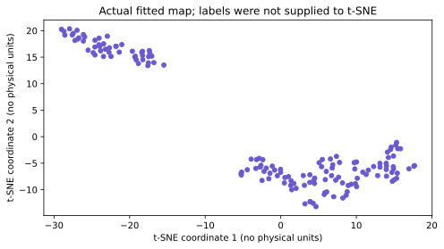

#### 4 · How to use it in the real world

Create a concrete review queue from the fitted map's neighborhood distortions. The least-overlapping rows are selected from measured agreement, not fixed IDs. Draw their positions on the same embedding and hand their original measurements to a reviewer; recorded species are revealed only after selection to aid inspection. This is an application of an exploratory representation, not evidence that unusual-looking rows are errors.

```python
# With no query argument, kneighbors excludes each training row from its own neighbors.
source_neighbors = NearestNeighbors(n_neighbors=5).fit(map_X).kneighbors(return_distance=False)
layout_neighbors = NearestNeighbors(n_neighbors=5).fit(map_points).kneighbors(return_distance=False)
retained_neighbors = np.array([len(set(a) & set(b))
                               for a, b in zip(source_neighbors, layout_neighbors)])
map_review_rows = np.argsort(retained_neighbors, kind="stable")[:3]
print("Map-selected review rows:", map_review_rows.tolist())
for row in map_review_rows:
    print("Row:", int(row), "shared neighbors:", int(retained_neighbors[row]), "/ 5",
          "map position:", map_points[row].astype(float).round(2).tolist(),
          "measurements:", map_original.data[row].tolist(),
          "recorded species:", str(map_original.target_names[map_original.target[row]]))
plt.figure(figsize=(7, 4))
plt.scatter(map_points[:, 0], map_points[:, 1], color="lightgray", s=24)
plt.scatter(map_points[map_review_rows, 0], map_points[map_review_rows, 1],
            facecolors="none", edgecolors="crimson", s=120, label="Neighborhood review")
for row, offset in zip(map_review_rows, [(24, 18), (28, -14), (-36, 20)]):
    plt.annotate(str(int(row)), map_points[row], xytext=offset, textcoords="offset points",
                 arrowprops={"arrowstyle": "-", "color": "crimson"})
plt.xlabel("t-SNE coordinate 1 (no physical units)")
plt.ylabel("t-SNE coordinate 2 (no physical units)")
plt.title("Review queue selected by original/map neighbor disagreement")
plt.legend()
plt.tight_layout()
plt.show()
```


**Recorded output from this input:**

~~~text
Map-selected review rows: [49, 7, 39]
Row: 49 shared neighbors: 1 / 5 map position: [-21.37, 15.94] measurements: [5.0, 3.3, 1.4, 0.2] recorded species: setosa
Row: 7 shared neighbors: 2 / 5 map position: [-22.67, 16.76] measurements: [5.0, 3.4, 1.5, 0.2] recorded species: setosa
Row: 39 shared neighbors: 2 / 5 map position: [-23.21, 16.49] measurements: [5.1, 3.4, 1.5, 0.2] recorded species: setosa
~~~
**Recorded output from these actual inputs:**

~~~text
Map-selected review rows: [49, 7, 39]
Row: 49 shared neighbors: 1 / 5 map position: [-21.37, 15.94] measurements: [5.0, 3.3, 1.4, 0.2] recorded species: setosa
Row: 7 shared neighbors: 2 / 5 map position: [-22.67, 16.76] measurements: [5.0, 3.4, 1.5, 0.2] recorded species: setosa
Row: 39 shared neighbors: 2 / 5 map position: [-23.21, 16.49] measurements: [5.1, 3.4, 1.5, 0.2] recorded species: setosa
~~~

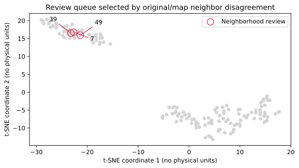

**Change and explain:** Compare perplexity 5, 20 and 40 in separately recorded experiments. Inspect whether the review queue is stable and investigate selected original measurements. Neighborhood overlap/trustworthiness are checks on the representation, not guarantees of correct scientific interpretation.

<a id="topic-17-isolation-forest-rank-unusual-records"></a>

### 🌲🚨 17 · Isolation Forest

#### 1 · Problem

A review system must prioritize unusual observations without assuming every unusual event is fraud or an error.

#### 2 · How to fix it

Fit random partition trees and rank records by negated score_samples, where larger means more unusual under this fitted model. Contamination controls a threshold, not the true fraud prevalence.

#### 3 · How to use it

Start a fresh notebook for this lesson; run the following cells in order.

**Learning cell 1 of 1:**

```python
import numpy as np
from sklearn.ensemble import IsolationForest

unusual_rng = np.random.default_rng(7)
unusual_X = np.vstack([unusual_rng.normal(0, 1, (100, 2)), [[8, 8], [-8, 8]]])
unusual_model = IsolationForest(contamination=0.03, random_state=7).fit(unusual_X)
unusual_scores = -unusual_model.score_samples(unusual_X)  # Larger means more unusual under this model.
print("Five highest-ranked row positions:", np.argsort(unusual_scores)[-5:][::-1].tolist())
print("Flagged rows:", int((unusual_model.predict(unusual_X) == -1).sum()))

# Inspect actual inputs used above; these are previews, not the complete dataset.
print("Injected input rows:", unusual_X[-2:].tolist())
```


**Recorded output from this input:**

~~~text
Five highest-ranked row positions: [100, 101, 49, 51, 13]
Flagged rows: 4
Injected input rows: [[8.0, 8.0], [-8.0, 8.0]]
~~~
#### 4 · How to use it in the real world

Score new two-measurement requests and send model outliers to a human-review queue. Preserve the input rather than deleting it or labeling it as confirmed fraud.

**Continue in this lesson's notebook:**

```python
unusual_requests = np.array([[0, 0], [9, 9]])
unusual_labels = unusual_model.predict(unusual_requests)
print("New inputs:", unusual_requests.tolist())
print("Review decisions:", ["human review" if label == -1 else "within fitted pattern" for label in unusual_labels])
```


**Recorded output from this input:**

~~~text
New inputs: [[0, 0], [9, 9]]
Review decisions: ['within fitted pattern', 'human review']
~~~
🎯 **Change and explain:** Inspect ordinary training rows near the alert threshold. Compare alerts with domain evidence, not only with the injected extremes.

<a id="topic-lof-novelty-detection"></a>

### 17b · LOF novelty detection

#### 1 · Problem

We have mostly normal training inputs and need to flag unfamiliar future records without known fraud labels.

#### 2 · How to fix it

LOF compares local density with nearby records. novelty=True enables prediction on new records; the ordinary training-outlier workflow uses fit_predict instead. Returned 1/−1 labels mean inlier/outlier under the fitted rule.

#### 3 · How to use it

Start a fresh notebook for this lesson; run the following cells in order.

**Learning cell 1 of 1:**

```python
import numpy as np
from sklearn.neighbors import LocalOutlierFactor

novel_rng = np.random.default_rng(7)
novel_normal = novel_rng.normal(0, 1, (100, 2))  # Training inputs assumed mostly normal.
novel_checks = np.array([[0, 0], [8, 8]])
novel_model = LocalOutlierFactor(n_neighbors=15, novelty=True).fit(novel_normal)
print("LOF new-record labels:", novel_model.predict(novel_checks).tolist())

# Inspect actual inputs used above; these are previews, not the complete dataset.
print("Training preview:", novel_normal[:2].round(2).tolist(), "new inputs:", novel_checks.tolist())
```


**Recorded output from this input:**

~~~text
LOF new-record labels: [1, -1]
Training preview: [[0.0, 0.3], [-0.27, -0.89]] new inputs: [[0, 0], [8, 8]]
~~~
#### 4 · How to use it in the real world

Turn the fitted detector into a bounded review action on new measurements. Review decisions are provisional model outputs, not confirmed incidents.

**Continue in this lesson's notebook:**

```python
novel_request = [[6, 6]]
novel_label = int(novel_model.predict(novel_request)[0])
print("New measurements:", novel_request)
print("Action:", "human review" if novel_label == -1 else "within fitted pattern")
```


**Recorded output from this input:**

~~~text
New measurements: [[6, 6]]
Action: human review
~~~
🎯 **Change and explain:** Move the request gradually toward the normal cloud. Explain why different detectors can disagree and why normal-training assumptions need inspection.

<a id="topic-one-class-svm"></a>

### 17c · One-Class SVM novelty detection

#### 1 · Problem

We have mostly normal training inputs and need to flag unfamiliar future records without known fraud labels.

#### 2 · How to fix it

One-Class SVM estimates support of a mostly normal distribution. Fit a training scaler and kernel boundary together; nu is a fitting control, not a verified anomaly frequency. Returned 1/−1 labels mean inlier/outlier under the fitted rule.

#### 3 · How to use it

Start a fresh notebook for this lesson; run the following cells in order.

**Learning cell 1 of 1:**

```python
import numpy as np
from sklearn.pipeline import make_pipeline
from sklearn.preprocessing import StandardScaler
from sklearn.svm import OneClassSVM

novel_rng = np.random.default_rng(7)
novel_normal = novel_rng.normal(0, 1, (100, 2))  # Training inputs assumed mostly normal.
novel_checks = np.array([[0, 0], [8, 8]])
novel_model = make_pipeline(StandardScaler(), OneClassSVM(nu=0.05, gamma="scale")).fit(novel_normal)
print("One-Class SVM new-record labels:", novel_model.predict(novel_checks).tolist())

# Inspect actual inputs used above; these are previews, not the complete dataset.
print("Training preview:", novel_normal[:2].round(2).tolist(), "new inputs:", novel_checks.tolist())
```


**Recorded output from this input:**

~~~text
One-Class SVM new-record labels: [1, -1]
Training preview: [[0.0, 0.3], [-0.27, -0.89]] new inputs: [[0, 0], [8, 8]]
~~~
#### 4 · How to use it in the real world

Turn the fitted detector into a bounded review action on new measurements. Review decisions are provisional model outputs, not confirmed incidents.

**Continue in this lesson's notebook:**

```python
novel_request = [[6, 6]]
novel_label = int(novel_model.predict(novel_request)[0])
print("New measurements:", novel_request)
print("Action:", "human review" if novel_label == -1 else "within fitted pattern")
```


**Recorded output from this input:**

~~~text
New measurements: [[6, 6]]
Action: human review
~~~
🎯 **Change and explain:** Move the request gradually toward the normal cloud. Explain why different detectors can disagree and why normal-training assumptions need inspection.

<a id="topic-18-association-rules-calculate-support-confidence-and-lift"></a>

### 🛒 18 · Association rules

#### 1 · Problem

A shop wants a useful basket suggestion, but popular items can co-occur frequently without a special association.

#### 2 · How to fix it

Calculate support, conditional confidence, and lift. Lift compares the conditional frequency with the consequent's overall frequency; this is association, not evidence of causation.

#### 3 · How to use it

Start a fresh notebook for this lesson; run the following cells in order.

**Learning cell 1 of 1:**

```python
rule_baskets = [{"bread", "butter"}, {"bread", "butter", "milk"}, {"milk"},
                {"bread", "jam"}, {"bread", "butter"}, {"milk", "jam"}]
rule_a = sum("bread" in basket for basket in rule_baskets) / len(rule_baskets)
rule_b = sum("butter" in basket for basket in rule_baskets) / len(rule_baskets)
rule_both = sum({"bread", "butter"} <= basket for basket in rule_baskets) / len(rule_baskets)
rule_confidence = rule_both / rule_a  # Both denominator frequencies are nonzero in this fixture.
rule_lift = rule_confidence / rule_b
print("Support:", rule_both, "confidence:", rule_confidence, "lift:", rule_lift)

# Inspect actual inputs used above; these are previews, not the complete dataset.
print("First two training baskets:", [sorted(basket) for basket in rule_baskets[:2]])
```


**Recorded output from this input:**

~~~text
Support: 0.5 confidence: 0.75 lift: 1.5
First two training baskets: [['bread', 'butter'], ['bread', 'butter', 'milk']]
~~~
#### 4 · How to use it in the real world

Apply a stated rule to a new basket only when the antecedent is present and the consequent is missing. The executable workflow makes an optional butter suggestion; it does not claim the suggestion will cause a purchase.

**Continue in this lesson's notebook:**

```python
rule_current_basket = {"bread", "milk"}
rule_suggestions = ["butter"] if "bread" in rule_current_basket and "butter" not in rule_current_basket and rule_lift > 1 else []
print("New basket:", sorted(rule_current_basket))
print("Optional suggestions:", rule_suggestions)
```


**Recorded output from this input:**

~~~text
New basket: ['bread', 'milk']
Optional suggestions: ['butter']
~~~
🎯 **Change and explain:** Reverse bread → butter and recompute confidence. Mine frequent itemsets with the later Apriori/FP-Growth lesson, then check candidate rules in another period.

<a id="semi-supervised-workshop"></a>

### 🧩 Label propagation: a few answers and many inputs

#### 1 · Problem

Only three digit examples per class have revealed training answers; ordinary supervised fitting discards the other available training inputs.

#### 2 · How to fix it

Propagate known labels through RBF similarities. gamma controls similarity falloff; tol is the convergence tolerance. First reserve joint test rows, then mark hidden training labels −1. Compare with the same labels-only baseline without exposing hidden answers to fitting. Unlabeled structure may help, hurt, or do nothing.

#### 3 · How to use it

Start a fresh notebook for this lesson; run the following cells in order.

**Learning cell 1 of 1:**

```python
import numpy as np
from sklearn.datasets import load_digits
from sklearn.linear_model import LogisticRegression
from sklearn.model_selection import train_test_split
from sklearn.semi_supervised import LabelPropagation, LabelSpreading, SelfTrainingClassifier

semi_X, semi_y = load_digits(return_X_y=True)  # Bundled 8x8 digit images; no download.
semi_X = semi_X / 16  # A known pixel bound, not a statistic learned using test rows.
semi_X_train, semi_X_test, semi_y_train, semi_y_test = train_test_split(
    semi_X, semi_y, test_size=0.3, stratify=semi_y, random_state=7)
semi_rng = np.random.default_rng(7)
semi_known = np.zeros(len(semi_y_train), dtype=bool)
for semi_class in range(10):  # Reveal three examples of every digit.
    semi_known[semi_rng.choice(np.flatnonzero(semi_y_train == semi_class), 3, replace=False)] = True
semi_partial = np.where(semi_known, semi_y_train, -1)
semi_base = LogisticRegression(max_iter=1000).fit(semi_X_train[semi_known], semi_y_train[semi_known])
print("Labels-only accuracy:", round(semi_base.score(semi_X_test, semi_y_test), 3))
semi_model = LabelPropagation(kernel="rbf", gamma=1, tol=0.01)
semi_model.fit(semi_X_train, semi_partial)
print("Label propagation test accuracy:", round(semi_model.score(semi_X_test, semi_y_test), 3))

# Inspect actual inputs used above; these are previews, not the complete dataset.
print("Labeled training rows:", int(semi_known.sum()), "unlabeled rows:", int((~semi_known).sum()))
print("First input pixel row preview:", semi_X_train[0, :8].round(2).tolist())
```


**Recorded output from this input:**

~~~text
Labels-only accuracy: 0.802
Label propagation test accuracy: 0.596
Labeled training rows: 30 unlabeled rows: 1227
First input pixel row preview: [0.0, 0.0, 0.25, 0.75, 0.75, 0.44, 0.0, 0.0]
~~~
#### 4 · How to use it in the real world

Use the fitted model to classify one reserved digit input, then reveal its recorded answer for inspection. The application receives 64 pixels scaled by the known bound 16; no target is passed to predict. This single case is an interface demonstration, not a quality guarantee.

**Continue in this lesson's notebook:**

```python
semi_request = semi_X_test[:1]
print("Request pixel count:", semi_request.shape[1])
print("Predicted digit:", semi_model.predict(semi_request).tolist())
print("Recorded digit, revealed afterward:", semi_y_test[:1].tolist())
```


**Recorded output from this input:**

~~~text
Request pixel count: 64
Predicted digit: [0]
Recorded digit, revealed afterward: [0]
~~~
🎯 **Change and explain:** Increase the revealed label count in a new experiment. Choose settings with training-side validation rather than repeatedly optimizing the final test comparison.

<a id="topic-label-spreading"></a>

### 🧩 Label spreading: a few answers and many inputs

#### 1 · Problem

Only three digit examples per class have revealed training answers; ordinary supervised fitting discards the other available training inputs.

#### 2 · How to fix it

Diffuse label information over a seven-neighbor graph with soft clamping. First reserve joint test rows, then mark hidden training labels −1. Compare with the same labels-only baseline without exposing hidden answers to fitting. Unlabeled structure may help, hurt, or do nothing.

#### 3 · How to use it

Start a fresh notebook for this lesson; run the following cells in order.

**Learning cell 1 of 1:**

```python
import numpy as np
from sklearn.datasets import load_digits
from sklearn.linear_model import LogisticRegression
from sklearn.model_selection import train_test_split
from sklearn.semi_supervised import LabelPropagation, LabelSpreading, SelfTrainingClassifier

semi_X, semi_y = load_digits(return_X_y=True)  # Bundled 8x8 digit images; no download.
semi_X = semi_X / 16  # A known pixel bound, not a statistic learned using test rows.
semi_X_train, semi_X_test, semi_y_train, semi_y_test = train_test_split(
    semi_X, semi_y, test_size=0.3, stratify=semi_y, random_state=7)
semi_rng = np.random.default_rng(7)
semi_known = np.zeros(len(semi_y_train), dtype=bool)
for semi_class in range(10):  # Reveal three examples of every digit.
    semi_known[semi_rng.choice(np.flatnonzero(semi_y_train == semi_class), 3, replace=False)] = True
semi_partial = np.where(semi_known, semi_y_train, -1)
semi_base = LogisticRegression(max_iter=1000).fit(semi_X_train[semi_known], semi_y_train[semi_known])
print("Labels-only accuracy:", round(semi_base.score(semi_X_test, semi_y_test), 3))
semi_model = LabelSpreading(kernel="knn", n_neighbors=7)
semi_model.fit(semi_X_train, semi_partial)
print("Label spreading test accuracy:", round(semi_model.score(semi_X_test, semi_y_test), 3))

# Inspect actual inputs used above; these are previews, not the complete dataset.
print("Labeled training rows:", int(semi_known.sum()), "unlabeled rows:", int((~semi_known).sum()))
print("First input pixel row preview:", semi_X_train[0, :8].round(2).tolist())
```


**Recorded output from this input:**

~~~text
Labels-only accuracy: 0.802
Label spreading test accuracy: 0.894
Labeled training rows: 30 unlabeled rows: 1227
First input pixel row preview: [0.0, 0.0, 0.25, 0.75, 0.75, 0.44, 0.0, 0.0]
~~~
#### 4 · How to use it in the real world

Use the fitted model to classify one reserved digit input, then reveal its recorded answer for inspection. The application receives 64 pixels scaled by the known bound 16; no target is passed to predict. This single case is an interface demonstration, not a quality guarantee.

**Continue in this lesson's notebook:**

```python
semi_request = semi_X_test[:1]
print("Request pixel count:", semi_request.shape[1])
print("Predicted digit:", semi_model.predict(semi_request).tolist())
print("Recorded digit, revealed afterward:", semi_y_test[:1].tolist())
```


**Recorded output from this input:**

~~~text
Request pixel count: 64
Predicted digit: [0]
Recorded digit, revealed afterward: [0]
~~~
🎯 **Change and explain:** Increase the revealed label count in a new experiment. Choose settings with training-side validation rather than repeatedly optimizing the final test comparison.

<a id="topic-self-training"></a>

### 🧩 Self-training: a few answers and many inputs

#### 1 · Problem

Only three digit examples per class have revealed training answers; ordinary supervised fitting discards the other available training inputs.

#### 2 · How to fix it

Repeatedly add sufficiently confident pseudo-labels and refit a supervised estimator. The 0.8 acceptance threshold is a choice, not proof that guesses are correct. First reserve joint test rows, then mark hidden training labels −1. Compare with the same labels-only baseline without exposing hidden answers to fitting. Unlabeled structure may help, hurt, or do nothing.

#### 3 · How to use it

Start a fresh notebook for this lesson; run the following cells in order.

**Learning cell 1 of 1:**

```python
import numpy as np
from sklearn.datasets import load_digits
from sklearn.linear_model import LogisticRegression
from sklearn.model_selection import train_test_split
from sklearn.semi_supervised import LabelPropagation, LabelSpreading, SelfTrainingClassifier

semi_X, semi_y = load_digits(return_X_y=True)  # Bundled 8x8 digit images; no download.
semi_X = semi_X / 16  # A known pixel bound, not a statistic learned using test rows.
semi_X_train, semi_X_test, semi_y_train, semi_y_test = train_test_split(
    semi_X, semi_y, test_size=0.3, stratify=semi_y, random_state=7)
semi_rng = np.random.default_rng(7)
semi_known = np.zeros(len(semi_y_train), dtype=bool)
for semi_class in range(10):  # Reveal three examples of every digit.
    semi_known[semi_rng.choice(np.flatnonzero(semi_y_train == semi_class), 3, replace=False)] = True
semi_partial = np.where(semi_known, semi_y_train, -1)
semi_base = LogisticRegression(max_iter=1000).fit(semi_X_train[semi_known], semi_y_train[semi_known])
print("Labels-only accuracy:", round(semi_base.score(semi_X_test, semi_y_test), 3))
semi_model = SelfTrainingClassifier(LogisticRegression(max_iter=1000), threshold=0.8)
semi_model.fit(semi_X_train, semi_partial)
print("Self-training test accuracy:", round(semi_model.score(semi_X_test, semi_y_test), 3))

# Inspect actual inputs used above; these are previews, not the complete dataset.
print("Labeled training rows:", int(semi_known.sum()), "unlabeled rows:", int((~semi_known).sum()))
print("First input pixel row preview:", semi_X_train[0, :8].round(2).tolist())
```


**Recorded output from this input:**

~~~text
Labels-only accuracy: 0.802
Self-training test accuracy: 0.802
Labeled training rows: 30 unlabeled rows: 1227
First input pixel row preview: [0.0, 0.0, 0.25, 0.75, 0.75, 0.44, 0.0, 0.0]
~~~
#### 4 · How to use it in the real world

Use the fitted model to classify one reserved digit input, then reveal its recorded answer for inspection. The application receives 64 pixels scaled by the known bound 16; no target is passed to predict. This single case is an interface demonstration, not a quality guarantee.

**Continue in this lesson's notebook:**

```python
semi_request = semi_X_test[:1]
print("Request pixel count:", semi_request.shape[1])
print("Predicted digit:", semi_model.predict(semi_request).tolist())
print("Recorded digit, revealed afterward:", semi_y_test[:1].tolist())
```


**Recorded output from this input:**

~~~text
Request pixel count: 64
Predicted digit: [0]
Recorded digit, revealed afterward: [0]
~~~
🎯 **Change and explain:** Increase the revealed label count in a new experiment. Choose settings with training-side validation rather than repeatedly optimizing the final test comparison.

<a id="topic-self-training-regression"></a>

### Semi-supervised regression A · Continuous pseudo-labels

#### 1 · Problem

A sensor has many input records but only a few measured numerical answers. A classifier's class probabilities cannot supply confidence for a numerical target.

#### 2 · How to fix it

Reserve joint validation and final-test records before hiding training answers. Fit a labels-only forest, measure disagreement between its trees on unlabeled training inputs, and try adding only its most stable numerical guesses at lower weight. Tree disagreement is a selection heuristic, not a calibrated error bound. Compare on validation, freeze the choice, and evaluate that choice once on the reserved test. Pseudo-labels can reinforce errors and need not improve anything.

#### 3 · How to use it

Start a fresh notebook for this lesson. Run its cells in order; the literal inputs or explicitly bounded input previews belong to this experiment.

```python
import numpy as np
from sklearn.ensemble import RandomForestRegressor
from sklearn.metrics import mean_absolute_error
from sklearn.model_selection import train_test_split

reg_rng = np.random.default_rng(19)
reg_inputs = reg_rng.uniform(-2, 2, (240, 2))
reg_answers = (3 * reg_inputs[:, 0] + np.sin(2 * reg_inputs[:, 1])
               + reg_rng.normal(0, 0.35, 240))  # Continuous synthetic units.
development, test_ids = train_test_split(np.arange(240), test_size=0.2, random_state=19)
train_ids, validation_ids = train_test_split(development, test_size=0.25, random_state=19)
known_ids = reg_rng.choice(train_ids, 24, replace=False)
unknown_ids = np.setdiff1d(train_ids, known_ids)
# Only known_ids' answers are supplied to either training procedure.
reg_base = RandomForestRegressor(n_estimators=60, min_samples_leaf=2,
                                 random_state=19).fit(reg_inputs[known_ids], reg_answers[known_ids])
print("Rows: labeled, unlabeled, validation, test:",
      [len(known_ids), len(unknown_ids), len(validation_ids), len(test_ids)])
print("Two labeled input/answer examples:", reg_inputs[known_ids[:2]].round(2).tolist(),
      reg_answers[known_ids[:2]].round(2).tolist())
```


**Recorded output from this input:**

~~~text
Rows: labeled, unlabeled, validation, test: [24, 120, 48, 48]
Two labeled input/answer examples: [[0.84, -1.06], [-0.07, -1.96]] [2.3, 0.89]
~~~
**Recorded output from these actual inputs:**

~~~text
Rows: labeled, unlabeled, validation, test: [24, 120, 48, 48]
Two labeled input/answer examples: [[0.84, -1.06], [-0.07, -1.96]] [2.3, 0.89]
~~~

**Pause and inspect:** explain the displayed values, then continue in the same notebook.

```python
# Each fitted tree supplies a numerical estimate; std measures disagreement, not truth.
tree_guesses = np.array([tree.predict(reg_inputs[unknown_ids]) for tree in reg_base.estimators_])
guess_spread = tree_guesses.std(axis=0)
accepted_positions = np.argsort(guess_spread, kind="stable")[:20]
pseudo_ids = unknown_ids[accepted_positions]
pseudo_answers = reg_base.predict(reg_inputs[pseudo_ids])
reg_pseudo = RandomForestRegressor(n_estimators=60, min_samples_leaf=2, random_state=19)
reg_pseudo.fit(np.vstack([reg_inputs[known_ids], reg_inputs[pseudo_ids]]),
               np.r_[reg_answers[known_ids], pseudo_answers],
               sample_weight=np.r_[np.ones(len(known_ids)), np.full(len(pseudo_ids), 0.2)])
reg_candidates = {"labels only": reg_base, "weighted pseudo-labels": reg_pseudo}
validation_errors = {}
for name, estimator in reg_candidates.items():
    validation_errors[name] = mean_absolute_error(
        reg_answers[validation_ids], estimator.predict(reg_inputs[validation_ids]))
    print(name, "validation MAE:", round(validation_errors[name], 3))
selected_name = min(validation_errors, key=validation_errors.get)
selected_regressor = reg_candidates[selected_name]  # Freeze before opening the test.
print("Accepted pseudo-labels:", len(pseudo_ids), "first three:", pseudo_answers[:3].round(2).tolist())
print("Selected using validation:", selected_name)
print("Selected procedure final-test MAE:", round(mean_absolute_error(
    reg_answers[test_ids], selected_regressor.predict(reg_inputs[test_ids])), 3))
```


**Recorded output from this input:**

~~~text
labels only validation MAE: 0.849
weighted pseudo-labels validation MAE: 0.876
Accepted pseudo-labels: 20 first three: [2.1, 2.02, 2.06]
Selected using validation: labels only
Selected procedure final-test MAE: 0.68
~~~
**Recorded output from these actual inputs:**

~~~text
labels only validation MAE: 0.849
weighted pseudo-labels validation MAE: 0.876
Accepted pseudo-labels: 20 first three: [2.1, 2.02, 2.06]
Selected using validation: labels only
Selected procedure final-test MAE: 0.68
~~~

#### 4 · How to use it in the real world

Serve a new two-measurement request through the frozen regressor selected above. The service returns a continuous quantity; it neither treats a guessed target as a measured label nor searches again using the final-test error. This synthetic result demonstrates the input/output contract, not sensor reliability.

```python
reg_request = np.array([[0.4, -0.2]])  # Same two-input schema, no answer supplied.
print("New sensor measurements:", reg_request.tolist())
print("Both fitted candidate predictions:", {name: model.predict(reg_request).round(3).tolist()
                                             for name, model in reg_candidates.items()})
print("Selected deployed procedure:", selected_name)
print("Predicted numerical target:", selected_regressor.predict(reg_request).round(3).tolist())
```


**Recorded output from this input:**

~~~text
New sensor measurements: [[0.4, -0.2]]
Both fitted candidate predictions: {'labels only': [1.404], 'weighted pseudo-labels': [1.301]}
Selected deployed procedure: labels only
Predicted numerical target: [1.404]
~~~
**Recorded output from these actual inputs:**

~~~text
New sensor measurements: [[0.4, -0.2]]
Both fitted candidate predictions: {'labels only': [1.404], 'weighted pseudo-labels': [1.301]}
Selected deployed procedure: labels only
Predicted numerical target: [1.404]
~~~

**Change and explain:** Change the pseudo-label weight from 0.2 to 1.0 in a separate experiment. Record the hypothesis before running it, compare validation evidence, and obtain new independent evaluation data if final-test results influence your next choices.

<a id="topic-co-training-regression"></a>

### Semi-supervised regression B · Two views exchange numerical guesses

#### 1 · Problem

Two sensors observe the same continuous quantity, but few paired records have a measured answer. Combining every confident-looking guess can transmit one sensor's mistakes to the other.

#### 2 · How to fix it

Reserve paired validation/test rows together. Fit one scaled Ridge regressor per view. Bootstrap each teacher's available labels to estimate prediction instability, send a few stable numerical guesses to the other view, and refit after each exchange. A small bootstrap spread is not proof of correctness. Compare the resulting average prediction with the two labels-only regressors on validation before choosing. Both views in this fixture contain signal with independently generated measurement noise; that assumption needs evidence in real data.

#### 3 · How to use it

Start a fresh notebook for this lesson. Run its cells in order; the literal inputs or explicitly bounded input previews belong to this experiment.

```python
import numpy as np
from sklearn.linear_model import Ridge
from sklearn.metrics import mean_absolute_error
from sklearn.model_selection import train_test_split
from sklearn.pipeline import make_pipeline
from sklearn.preprocessing import StandardScaler

view_rng = np.random.default_rng(23)
latent = view_rng.uniform(-2, 2, 240)
view_a = np.column_stack([latent + view_rng.normal(0, 0.35, 240), view_rng.normal(size=240)])
view_b = np.column_stack([latent + view_rng.normal(0, 0.35, 240), view_rng.normal(size=240)])
view_answer = 2.5 * latent + view_rng.normal(0, 0.2, 240)  # Numerical target, not class IDs.
dev_ids, view_test_ids = train_test_split(np.arange(240), test_size=0.2, random_state=23)
view_train_ids, view_val_ids = train_test_split(dev_ids, test_size=0.25, random_state=23)
known = view_rng.choice(len(view_train_ids), 24, replace=False)
train_a, train_b = view_a[view_train_ids], view_b[view_train_ids]
targets_a = np.full(len(view_train_ids), np.nan)
targets_b = np.full(len(view_train_ids), np.nan)
targets_a[known] = targets_b[known] = view_answer[view_train_ids[known]]

def view_recipe():
    return make_pipeline(StandardScaler(), Ridge(alpha=1.0))

base_a = view_recipe().fit(train_a[known], targets_a[known])
base_b = view_recipe().fit(train_b[known], targets_b[known])
print("Rows: paired training, labeled, validation, test:",
      [len(view_train_ids), len(known), len(view_val_ids), len(view_test_ids)])
print("First paired input:", train_a[0].round(2).tolist(), train_b[0].round(2).tolist())
print("Two measured continuous targets:", view_answer[view_train_ids[known[:2]]].round(3).tolist())
```


**Recorded output from this input:**

~~~text
Rows: paired training, labeled, validation, test: [144, 24, 48, 48]
First paired input: [1.96, -0.57] [1.83, 3.69]
Two measured continuous targets: [-4.793, 1.481]
~~~
**Recorded output from these actual inputs:**

~~~text
Rows: paired training, labeled, validation, test: [144, 24, 48, 48]
First paired input: [1.96, -0.57] [1.83, 3.69]
Two measured continuous targets: [-4.793, 1.481]
~~~

**Pause and inspect:** explain the displayed values, then continue in the same notebook.

```python
def teacher_guesses(inputs, available_targets):
    available = np.flatnonzero(np.isfinite(available_targets))
    predictions = []
    for repetition in range(12):  # Resample only this teacher's available training labels.
        sampled = view_rng.choice(available, len(available), replace=True)
        teacher = view_recipe().fit(inputs[sampled], available_targets[sampled])
        predictions.append(teacher.predict(inputs))
    return np.mean(predictions, axis=0), np.std(predictions, axis=0)

for round_number in range(2):
    guess_a, spread_a = teacher_guesses(train_a, targets_a)
    guess_b, spread_b = teacher_guesses(train_b, targets_b)
    # Compute both exchanges before changing either target array.
    pool_b = np.flatnonzero(~np.isfinite(targets_b))
    pool_a = np.flatnonzero(~np.isfinite(targets_a))
    send_to_b = pool_b[np.argsort(spread_a[pool_b], kind="stable")[:6]]
    send_to_a = pool_a[np.argsort(spread_b[pool_a], kind="stable")[:6]]
    targets_b[send_to_b] = guess_a[send_to_b]
    targets_a[send_to_a] = guess_b[send_to_a]
known_a, known_b = np.isfinite(targets_a), np.isfinite(targets_b)
trained_a = view_recipe().fit(train_a[known_a], targets_a[known_a])
trained_b = view_recipe().fit(train_b[known_b], targets_b[known_b])
view_pairs = {"labels only": (base_a, base_b), "co-training": (trained_a, trained_b)}
view_errors = {}
for name, (first, second) in view_pairs.items():
    prediction = (first.predict(view_a[view_val_ids]) + second.predict(view_b[view_val_ids])) / 2
    view_errors[name] = mean_absolute_error(view_answer[view_val_ids], prediction)
    print(name, "validation MAE:", round(view_errors[name], 3))
view_choice = min(view_errors, key=view_errors.get)
deployed_a, deployed_b = view_pairs[view_choice]
view_test_prediction = (deployed_a.predict(view_a[view_test_ids])
                        + deployed_b.predict(view_b[view_test_ids])) / 2
print("Available targets per view:", int(known_a.sum()), int(known_b.sum()))
print("Selected using validation:", view_choice)
print("Selected procedure final-test MAE:", round(mean_absolute_error(
    view_answer[view_test_ids], view_test_prediction), 3))
```


**Recorded output from this input:**

~~~text
labels only validation MAE: 0.809
co-training validation MAE: 0.948
Available targets per view: 36 36
Selected using validation: labels only
Selected procedure final-test MAE: 0.596
~~~
**Recorded output from these actual inputs:**

~~~text
labels only validation MAE: 0.809
co-training validation MAE: 0.948
Available targets per view: 36 36
Selected using validation: labels only
Selected procedure final-test MAE: 0.596
~~~

#### 4 · How to use it in the real world

A deployed request contains both views of the same event. Apply each frozen model to its own measurement columns and average their numerical predictions. Reject an incomplete pair or design and evaluate a separate single-view fallback; silently substituting one sensor changes the validated procedure.

```python
request_a = np.array([[0.8, -0.1]])
request_b = np.array([[1.0, 0.2]])
paired_prediction = (deployed_a.predict(request_a) + deployed_b.predict(request_b)) / 2
print("Paired sensor request:", request_a.tolist(), request_b.tolist())
for name, (first, second) in view_pairs.items():
    candidate_prediction = (first.predict(request_a) + second.predict(request_b)) / 2
    print(name, "numerical prediction:", candidate_prediction.round(3).tolist())
print("Selected deployed procedure:", view_choice)
print("Predicted numerical target:", paired_prediction.round(3).tolist())
```


**Recorded output from this input:**

~~~text
Paired sensor request: [[0.8, -0.1]] [[1.0, 0.2]]
labels only numerical prediction: [1.699]
co-training numerical prediction: [1.632]
Selected deployed procedure: labels only
Predicted numerical target: [1.699]
~~~
**Recorded output from these actual inputs:**

~~~text
Paired sensor request: [[0.8, -0.1]] [[1.0, 0.2]]
labels only numerical prediction: [1.699]
co-training numerical prediction: [1.632]
Selected deployed procedure: labels only
Predicted numerical target: [1.699]
~~~

**Change and explain:** Increase the noise of the first sensor in a new experiment. Compare each labels-only view, their average, and co-training. Explain why a second view without independent signal is unlikely to rescue incorrect guesses.

<a id="reinforcement-workshop"></a>

<a id="topic-experiment-a-a-bandit-chooses-between-three-offers"></a>

### 🎰 Epsilon-greedy bandit

#### 1 · Problem

Repeatedly choosing an offer requires learning from outcomes while still trying alternatives; always choosing randomly wastes good evidence.

#### 2 · How to fix it

Observe every action once, then exploit the highest estimated mean most of the time and explore with probability 0.1. Hidden reward rates belong to the simulator, not the action-selection rule.

#### 3 · How to use it

Start a fresh notebook for this lesson; run the following cells in order.

**Learning cell 1 of 1:**

```python
import numpy as np

bandit_rng = np.random.default_rng(7)
bandit_rates = np.array([0.2, 0.5, 0.75])  # Environment truth; the choice rule does not read it.
bandit_counts = np.zeros(3, dtype=int)
bandit_estimates = np.zeros(3)
bandit_rewards = 0
for bandit_round in range(3000):
    if bandit_round < 3:  # Observe every option once before comparing means.
        bandit_action = bandit_round
    elif bandit_rng.random() < 0.1:  # Explore on about 10% of later rounds.
        bandit_action = int(bandit_rng.integers(3))
    else:
        bandit_action = int(np.argmax(bandit_estimates))  # Exploit the best estimate.
    bandit_reward = int(bandit_rng.random() < bandit_rates[bandit_action])
    bandit_counts[bandit_action] += 1
    bandit_estimates[bandit_action] += (bandit_reward - bandit_estimates[bandit_action]) / bandit_counts[bandit_action]
    bandit_rewards += bandit_reward
print("Uses:", bandit_counts.tolist(), "estimated rates:", bandit_estimates.round(2).tolist())
print("Total rewards:", bandit_rewards)

# Inspect actual inputs used above; these are previews, not the complete dataset.
print("Simulator reward rates:", bandit_rates.tolist())
```


**Recorded output from this input:**

~~~text
Uses: [199, 213, 2588] estimated rates: [0.22, 0.49, 0.75]
Total rewards: 2089
Simulator reward rates: [0.2, 0.5, 0.75]
~~~
#### 4 · How to use it in the real world

Freeze the learned estimates, choose the greedy action, and evaluate it on fresh simulated outcomes with a separate random-action baseline. No estimates update during this evaluation.

**Continue in this lesson's notebook:**

```python
bandit_eval_rng = np.random.default_rng(123)
bandit_frozen_action = int(np.argmax(bandit_estimates))
bandit_eval_uniforms = bandit_eval_rng.random(1000)
bandit_random_actions = bandit_eval_rng.integers(3, size=1000)
print("Frozen offer:", bandit_frozen_action)
print("Evaluation reward:", round(float(np.mean(bandit_eval_uniforms < bandit_rates[bandit_frozen_action])), 3))
print("Random-action reward:", round(float(np.mean(bandit_eval_uniforms < bandit_rates[bandit_random_actions])), 3))
```


**Recorded output from this input:**

~~~text
Frozen offer: 2
Evaluation reward: 0.756
Random-action reward: 0.49
~~~
🎯 **Change and explain:** Compare exploration probabilities across several complete independent training runs. A single lucky run is weak evidence about expected return.

<a id="topic-experiment-b-q-learning-and-sarsa-in-a-tiny-grid"></a>

### 🤖 Q-learning and SARSA grid policies

#### 1 · Problem

An agent must choose a sequence of moves, where an immediate cost can lead to a later goal reward.

#### 2 · How to fix it

Store one value per state/action pair. Q-learning bootstraps toward the best next estimated action; SARSA uses the next action selected by the exploration policy. Both stop future return at termination and use random tie-breaking during learning. The grid has twelve numbered cells, obstacles 5/6, start 0, and goal 11.

#### 3 · How to use it

Start a fresh notebook for this lesson; run the following cells in order.

**Learning cell 1 of 3:**

```python
import numpy as np
```


**What you see:** this setup cell prints no text. It defines or fits the objects used by the next cell in this experiment.

**Observed:** this cell prints no text; it prepares values used by the next cell.

**Learning cell 2 of 3:**

```python
def grid_experiment(method, seed=7):
    grid_rng = np.random.default_rng(seed)
    grid_q = np.zeros((12, 4))  # Three rows, four columns; actions: up, down, left, right.
    grid_moves = [(-1, 0), (1, 0), (0, -1), (0, 1)]

    def grid_step(state, action):
        row, column = divmod(state, 4)
        delta_row, delta_column = grid_moves[action]
        new_row, new_column = row + delta_row, column + delta_column
        if not (0 <= new_row < 3 and 0 <= new_column < 4):
            return state, -1, False  # A wall leaves the agent in place.
        next_state = new_row * 4 + new_column
        if next_state in {5, 6}:
            return state, -1, False  # Blocked floor positions also leave it in place.
        return next_state, (10 if next_state == 11 else -1), next_state == 11

    def grid_choose(state, epsilon):
        if grid_rng.random() < epsilon:
            return int(grid_rng.integers(4))
        tied = np.flatnonzero(grid_q[state] == grid_q[state].max())
        return int(grid_rng.choice(tied))  # Randomly break equally valued action ties.

    for episode in range(800):
        state = 0
        action = grid_choose(state, 0.15)
        for move_number in range(80):
            next_state, reward, done = grid_step(state, action)
            next_action = grid_choose(next_state, 0.15)
            future = grid_q[next_state].max() if method == "q-learning" else grid_q[next_state, next_action]
            target = reward if done else reward + 0.95 * future  # No future reward after termination.
            grid_q[state, action] += 0.2 * (target - grid_q[state, action])
            state, action = next_state, next_action
            if done:
                break

    state, path = 0, [0]  # Evaluate with a greedy policy, without learning updates.
    for move_number in range(30):
        state, reward, done = grid_step(state, int(np.argmax(grid_q[state])))
        path.append(state)
        if done:
            break
    return path, state == 11
```


**What you see:** this setup cell prints no text. It defines or fits the objects used by the next cell in this experiment.

**Observed:** this cell prints no text; it prepares values used by the next cell.

**Learning cell 3 of 3:**

```python
for grid_method in ["q-learning", "sarsa"]:
    grid_path, grid_success = grid_experiment(grid_method)
    print(grid_method, "path:", grid_path, "reached goal:", grid_success)

# Inspect actual inputs used above; these are previews, not the complete dataset.
print("Floor rows:", [[0,1,2,3],[4,"blocked","blocked",7],[8,9,10,11]])
```


**Recorded output from this input:**

~~~text
q-learning path: [0, 1, 2, 3, 7, 11] reached goal: True
sarsa path: [0, 4, 8, 9, 10, 11] reached goal: True
Floor rows: [[0, 1, 2, 3], [4, 'blocked', 'blocked', 7], [8, 9, 10, 11]]
~~~
#### 4 · How to use it in the real world

Deploy each learned experiment's greedy route and verify it reaches the goal using legal moves. Its final route is evaluated without further learning. This grid has no dangerous cliff and cannot establish SARSA being safer than Q-learning.

**Continue in this lesson's notebook:**

```python
for route_method in ["q-learning", "sarsa"]:
    route_path, route_reached = grid_experiment(route_method)
    route_legal = all(abs(a // 4 - b // 4) + abs(a % 4 - b % 4) == 1 for a, b in zip(route_path, route_path[1:]))
    print(route_method, "route steps:", len(route_path) - 1, "legal:", route_legal, "delivered:", route_reached)
```


**Recorded output from this input:**

~~~text
q-learning route steps: 5 legal: True delivered: True
sarsa route steps: 5 legal: True delivered: True
~~~
🎯 **Change and explain:** Draw the route, check each move, and compare with a shortest route found by hand. Repeat full training across seeds. Inspect training-time returns in a cliff environment before making a safety comparison.

<a id="algorithm-mechanisms"></a>

<a id="topic-a-a-tiny-semi-supervised-svm-search-unknown-label-assignments"></a>

### A · Tiny S3VM assignment search

#### 1 · Problem

Two binary labels and four unlabeled positions do not supply a complete supervised training target.

#### 2 · How to fix it

Enumerate the six assignments having two positive unknown labels. Fit a no-intercept linear SVM for each and minimize half the squared weight norm plus weighted hinge loss max(0, 1 − y×score). Unknown labels receive lower weight. This solves a tiny transductive formulation exhaustively, not a scalable S3VM method.

#### 3 · How to use it

Start a fresh notebook for this lesson; run the following cells in order.

**Learning cell 1 of 2:**

```python
import itertools
import numpy as np
from sklearn.svm import LinearSVC

# 1. Known labels and unlabeled inputs; no unknown answer is supplied to the search.
ssvm_known_X = np.array([[-2.0], [2.0]])
ssvm_known_y = np.array([-1, 1])
ssvm_unknown_X = np.array([[-1.5], [-0.5], [0.5], [1.5]])
ssvm_X = np.vstack([ssvm_known_X, ssvm_unknown_X])
ssvm_weights = np.array([2.0, 2.0, 0.2, 0.2, 0.2, 0.2])
ssvm_candidates = []

# 2. Enumerate six balanced assignments rather than pretending their labels are known.
for ssvm_assignment in itertools.product([-1, 1], repeat=4):
    if ssvm_assignment.count(1) != 2:
        continue
    ssvm_y = np.r_[ssvm_known_y, ssvm_assignment]
    ssvm_model = LinearSVC(C=1.0, loss="hinge", fit_intercept=False,
                         dual=True, random_state=7, max_iter=10000)
    ssvm_model.fit(ssvm_X, ssvm_y, sample_weight=ssvm_weights)
    # 3. The loss uses the candidate labels; lower objective selects an assignment.
    ssvm_hinge = np.maximum(0, 1 - ssvm_y * ssvm_model.decision_function(ssvm_X))
    ssvm_objective = 0.5 * np.sum(ssvm_model.coef_ ** 2) + np.sum(ssvm_weights * ssvm_hinge)
    ssvm_candidates.append((float(ssvm_objective), ssvm_assignment, ssvm_model))

# 4. Inspect the chosen labels and a prediction from the fitted decision function.
ssvm_best = min(ssvm_candidates, key=lambda item: item[0])
print("Assignments tried:", len(ssvm_candidates))
print("Chosen unknown labels:", ssvm_best[1], "objective:", round(ssvm_best[0], 3))
print("Predictions at -1 and +1:", ssvm_best[2].predict([[-1], [1]]).tolist())

# Inspect actual inputs used above; these are previews, not the complete dataset.
```


**Recorded output from this input:**

~~~text
Assignments tried: 6
Chosen unknown labels: (-1, -1, 1, 1) objective: 0.489
Predictions at -1 and +1: [-1, 1]
~~~
**Learning cell 2 of 2:**

```python
print("Known inputs/labels:", ssvm_known_X.ravel().tolist(), ssvm_known_y.tolist())
print("Unknown inputs:", ssvm_unknown_X.ravel().tolist())
```


**Recorded output from this input:**

~~~text
Known inputs/labels: [-2.0, 2.0] [-1, 1]
Unknown inputs: [-1.5, -0.5, 0.5, 1.5]
~~~
#### 4 · How to use it in the real world

Retain the model belonging to the minimum objective, then classify a new unlabeled batch without searching again.

**Continue in this lesson's notebook:**

```python
ssvm_requests = [[-0.75], [0.75]]
print("New positions:", ssvm_requests)
print("Application classes:", ssvm_best[2].predict(ssvm_requests).tolist())
```


**Recorded output from this input:**

~~~text
New positions: [[-0.75], [0.75]]
Application classes: [-1, 1]
~~~
🎯 **Change and explain:** Change unknown-label weights. Explain the class-balance assumption and exponential assignment growth.

<a id="topic-b-co-training-exchange-confident-guesses-between-two-views"></a>

### B · Co-training

#### 1 · Problem

Only a few labels are available, but two distinct views may each contain useful class information.

#### 2 · How to fix it

Reserve joint test rows, fit one classifier per view, and send a few confident predictions to the other view's labels. Refit after each exchange. The simulated view noise is independent conditional on class; real data require checking whether the views are separately informative. Confident errors can propagate.

#### 3 · How to use it

Start a fresh notebook for this lesson; run the following cells in order.

**Learning cell 1 of 3:**

```python
import numpy as np
from sklearn.linear_model import LogisticRegression
from sklearn.model_selection import train_test_split

# 1. Generate two informative views, then reserve joint test rows before learning.
co_rng = np.random.default_rng(7)
co_truth = co_rng.integers(0, 2, 400)
co_signal = 2 * co_truth - 1
co_view_a = np.column_stack([co_signal + co_rng.normal(0, 0.9, 400), co_rng.normal(size=400)])
co_view_b = np.column_stack([co_signal + co_rng.normal(0, 0.9, 400), co_rng.normal(size=400)])
co_train, co_test = train_test_split(np.arange(400), test_size=0.25, stratify=co_truth, random_state=7)
co_a, co_b, co_y = co_view_a[co_train], co_view_b[co_train], co_truth[co_train]
co_labels_a = np.full(len(co_train), -1)
for co_class in [0, 1]:
    co_seed_rows = co_rng.choice(np.flatnonzero(co_y == co_class), 5, replace=False)
    co_labels_a[co_seed_rows] = co_class
co_labels_b = co_labels_a.copy()
co_pool = set(np.flatnonzero(co_labels_a == -1).tolist())

def co_fit(view, labels):
    known = labels != -1
    return LogisticRegression().fit(view[known], labels[known])

def co_accuracy(model_a, model_b):
    # Test answers are used only to report this completed experiment.
    probability = (model_a.predict_proba(co_view_a[co_test])[:, 1]
                   + model_b.predict_proba(co_view_b[co_test])[:, 1]) / 2
    return np.mean((probability >= 0.5) == co_truth[co_test])

# 2. Baseline: the same two-view combination, using only original known labels.
co_initial_a, co_initial_b = co_fit(co_a, co_labels_a), co_fit(co_b, co_labels_b)
print("Labels-only two-view accuracy:", round(co_accuracy(co_initial_a, co_initial_b), 3))
```


**Recorded output from this input:**

~~~text
Labels-only two-view accuracy: 0.92
~~~
**Learning cell 2 of 3:**

```python
def co_proposals(model, view, pool):
    rows = np.array(sorted(pool), dtype=int)
    probabilities = model.predict_proba(view[rows])
    predictions = model.classes_[probabilities.argmax(axis=1)]
    confidence = probabilities.max(axis=1)
    proposals = []
    for label in [0, 1]:  # Send at most two confident guesses per class.
        choices = np.flatnonzero((predictions == label) & (confidence >= 0.9))
        selected = choices[np.argsort(confidence[choices])[-2:]]
        proposals.extend((int(rows[i]), int(label)) for i in selected)
    return proposals

# 3. Each view teaches the OTHER classifier, not itself.
for co_round in range(6):
    co_model_a, co_model_b = co_fit(co_a, co_labels_a), co_fit(co_b, co_labels_b)
    co_from_a = co_proposals(co_model_a, co_a, co_pool)
    co_from_b = co_proposals(co_model_b, co_b, co_pool)
    for co_row, co_label in co_from_a:
        co_labels_b[co_row] = co_label
    for co_row, co_label in co_from_b:
        co_labels_a[co_row] = co_label
    co_used = {row for row, label in co_from_a + co_from_b}
    co_pool.difference_update(co_used)
    if not co_used:
        break

# 4. Refit after the final exchange; original hidden training labels were never used to fit.
co_final_a, co_final_b = co_fit(co_a, co_labels_a), co_fit(co_b, co_labels_b)
print("Training labels now available per view:", int((co_labels_a != -1).sum()), int((co_labels_b != -1).sum()))
print("After exchange accuracy:", round(co_accuracy(co_final_a, co_final_b), 3))

# Inspect actual inputs used above; these are previews, not the complete dataset.
```


**Recorded output from this input:**

~~~text
Training labels now available per view: 34 34
After exchange accuracy: 0.92
~~~
**Learning cell 3 of 3:**

```python
print("One paired input:", co_a[0].round(2).tolist(), co_b[0].round(2).tolist())
```


**Recorded output from this input:**

~~~text
One paired input: [-0.66, -0.28] [-0.7, 0.15]
~~~
#### 4 · How to use it in the real world

The application combines the two fitted view-specific probabilities for one reserved record. Neither model fits on its request or its answer.

**Continue in this lesson's notebook:**

```python
co_request_a, co_request_b = co_view_a[co_test[:1]], co_view_b[co_test[:1]]
co_request_probability = float((co_final_a.predict_proba(co_request_a)[0, 1] + co_final_b.predict_proba(co_request_b)[0, 1]) / 2)
print("Two-view request:", co_request_a.round(2).tolist(), co_request_b.round(2).tolist())
print("Combined probability:", round(co_request_probability, 3), "class:", int(co_request_probability >= 0.5))
```


**Recorded output from this input:**

~~~text
Two-view request: [[0.69, -1.7]] [[-0.67, 0.09]]
Combined probability: 0.47 class: 0
~~~
🎯 **Change and explain:** Replace one view's signal with noise in an independent experiment; compare with the labels-only two-view baseline.

<a id="topic-c-model-based-planning-a-given-model-and-a-learned-model"></a>

### C · Model-based value iteration

#### 1 · Problem

Planning requires consequences of actions. A given simulator and a model estimated from observed transitions have different evidence behind them.

#### 2 · How to fix it

Value iteration chooses the action with maximum expected reward plus discounted next-state value. First plan with specified transition/reward tables; then estimate those tables by counts and means and plan again. The fixture deliberately observes every active state/action pair; missing coverage must not be silently treated as known dynamics.

#### 3 · How to use it

Start a fresh notebook for this lesson; run the following cells in order.

**Learning cell 1 of 2:**

```python
import numpy as np

# 1. A specified simulator: shape is (state, action, next_state).
plan_P = np.zeros((3, 2, 3))
plan_P[0, 0, 1] = 1
plan_P[1, 0, 2] = 1
plan_P[0, 1, 0] = plan_P[1, 1, 0] = 1
plan_P[2, :, 2] = 1  # Terminal state is absorbing.
plan_R = np.array([[0.0, -0.1], [1.0, -0.1], [0.0, 0.0]])

def plan_values(transition, reward):
    value = np.zeros(3)
    for iteration in range(200):
        action_value = reward + 0.9 * (transition @ value)
        action_value[2] = 0  # No reward is collected after terminal state 2.
        updated = action_value.max(axis=1)
        if np.max(np.abs(updated - value)) < 1e-9:
            value = updated
            break
        value = updated
    return value, action_value.argmax(axis=1)

plan_given_value, plan_given_policy = plan_values(plan_P, plan_R)
print("Given-model values:", plan_given_value.round(3).tolist(), "active-state actions:", plan_given_policy[:2].tolist())

# 2. Learn a model from observed transitions instead of giving the planner the simulator tables.
plan_rng = np.random.default_rng(7)
plan_counts = np.zeros((3, 2, 3))
plan_reward_sums = np.zeros((3, 2))
```


**Recorded output from this input:**

~~~text
Given-model values: [0.9, 1.0, 0.0] active-state actions: [0, 0]
~~~
**Learning cell 2 of 2:**

```python
for plan_state in [0, 1]:
    for plan_action in [0, 1]:
        for plan_trial in range(20):
            plan_next = int(plan_rng.choice(3, p=plan_P[plan_state, plan_action]))
            plan_reward = plan_R[plan_state, plan_action]
            plan_counts[plan_state, plan_action, plan_next] += 1
            plan_reward_sums[plan_state, plan_action] += plan_reward
plan_samples = plan_counts.sum(axis=2)
plan_samples[2] = 1  # Set the terminal convention explicitly; it is not an observed active decision.
plan_learned_P = plan_counts / plan_samples[:, :, None]
plan_learned_P[2, :, 2] = 1
plan_learned_R = plan_reward_sums / plan_samples
plan_learned_value, plan_learned_policy = plan_values(plan_learned_P, plan_learned_R)
print("Learned-model values:", plan_learned_value.round(3).tolist(), "active-state actions:", plan_learned_policy[:2].tolist())

# Inspect actual inputs used above; these are previews, not the complete dataset.
print("Given advance transitions:", plan_P[:, 0, :].tolist())
print("Given reward table:", plan_R.tolist())
```


**Recorded output from this input:**

~~~text
Learned-model values: [0.9, 1.0, 0.0] active-state actions: [0, 0]
Given advance transitions: [[0.0, 1.0, 0.0], [0.0, 0.0, 1.0], [0.0, 0.0, 1.0]]
Given reward table: [[0.0, -0.1], [1.0, -0.1], [0.0, 0.0]]
~~~
#### 4 · How to use it in the real world

Use the learned-model policy to control the chain from state zero. Record its route and accumulated reward under the simulator, rather than only printing an abstract value table.

**Continue in this lesson's notebook:**

```python
deploy_state, deploy_route, deploy_return = 0, [0], 0.0
for deploy_move in range(10):
    deploy_action = int(plan_learned_policy[deploy_state])
    deploy_return += float(plan_R[deploy_state, deploy_action])
    deploy_state = int(np.argmax(plan_P[deploy_state, deploy_action]))  # Deterministic fixture only.
    deploy_route.append(deploy_state)
    if deploy_state == 2:
        break
print("Policy route:", deploy_route, "undiscounted return:", deploy_return)
```


**Recorded output from this input:**

~~~text
Policy route: [0, 1, 2] undiscounted return: 1.0
~~~
🎯 **Change and explain:** Make advancement stochastic and compare a learned model's policy with the given-model policy across many fresh episodes.

<a id="topic-d-policy-gradients-optimize-a-softmax-bandit-policy"></a>

### D · Policy gradients / REINFORCE

#### 1 · Problem

We want to optimize action probabilities directly from rewards rather than storing an epsilon-greedy value rule.

#### 2 · How to fix it

Softmax turns preferences into probabilities. Reward minus a moving baseline scales the selected action's log-policy gradient, one_hot(action) − probabilities. Use the previous baseline for the update, then update the baseline. This implements REINFORCE for a bandit.

#### 3 · How to use it

Start a fresh notebook for this lesson; run the following cells in order.

**Learning cell 1 of 1:**

```python
import numpy as np

# 1. Start with equal action preferences and a simulated reward process.
pg_rng = np.random.default_rng(7)
pg_rates = np.array([0.2, 0.5, 0.75])
pg_preferences = np.zeros(3)
pg_baseline = 0.0
pg_counts = np.zeros(3, dtype=int)

def pg_softmax(values):
    weights = np.exp(values - values.max())  # Subtraction avoids needlessly large exponentials.
    return weights / weights.sum()

print("Initial action probabilities:", pg_softmax(pg_preferences).round(3).tolist())
for pg_round in range(6000):
    # 2. Sample an action from the current policy, then observe its reward.
    pg_probabilities = pg_softmax(pg_preferences)
    pg_action = int(pg_rng.choice(3, p=pg_probabilities))
    pg_reward = float(pg_rng.random() < pg_rates[pg_action])
    # 3. Gradient of log softmax for the selected action: one-hot(action) minus policy.
    pg_gradient = -pg_probabilities.copy()
    pg_gradient[pg_action] += 1
    pg_preferences += 0.03 * (pg_reward - pg_baseline) * pg_gradient
    pg_baseline += 0.02 * (pg_reward - pg_baseline)  # Update baseline after using its previous value.
    pg_counts[pg_action] += 1
print("Final action probabilities:", pg_softmax(pg_preferences).round(3).tolist())
print("Actions sampled:", pg_counts.tolist())

# Inspect actual inputs used above; these are previews, not the complete dataset.
print("Simulated offer reward rates:", pg_rates.tolist())
```


**Recorded output from this input:**

~~~text
Initial action probabilities: [0.333, 0.333, 0.333]
Final action probabilities: [0.004, 0.009, 0.987]
Actions sampled: [164, 262, 5574]
Simulated offer reward rates: [0.2, 0.5, 0.75]
~~~
#### 4 · How to use it in the real world

Freeze the learned probability vector and sample new actions from it using a new evaluation seed. No preferences or baseline update during evaluation.

**Continue in this lesson's notebook:**

```python
pg_eval_rng = np.random.default_rng(123)
pg_frozen_policy = pg_softmax(pg_preferences)
pg_eval_actions = pg_eval_rng.choice(3, size=1000, p=pg_frozen_policy)
pg_eval_rewards = pg_eval_rng.random(1000) < pg_rates[pg_eval_actions]
print("Deployed action probabilities:", pg_frozen_policy.round(3).tolist())
print("Fresh evaluation reward:", round(float(pg_eval_rewards.mean()), 3))
```


**Recorded output from this input:**

~~~text
Deployed action probabilities: [0.004, 0.009, 0.987]
Fresh evaluation reward: 0.761
~~~
🎯 **Change and explain:** Check that the log-policy gradient sums approximately to zero; compare learning rates across independent training seeds.

<a id="topic-e-a-miniature-numpy-dqn-replay-and-a-target-network"></a>

### E · NumPy DQN with replay and a target network

#### 1 · Problem

A Q table cannot share learned representations across a larger input space; unstable bootstrapped targets also complicate neural fitting.

#### 2 · How to fix it

Represent three chain states as one-hot inputs to a network with two hidden layers. Collect transitions, sample replay minibatches, construct terminal-aware Bellman targets using a separate target network, backpropagate squared error through the online network, and copy weights every twenty steps. This tiny fixture demonstrates the mechanisms, not their benefit on difficult RL.

#### 3 · How to use it

Start a fresh notebook for this lesson; run the following cells in order.

**Learning cell 1 of 3:**

```python
from collections import deque
import numpy as np

dqn_rng = np.random.default_rng(7)
dqn_online = {"w1": dqn_rng.normal(0, 0.2, (3, 8)), "b1": np.zeros(8),
              "w2": dqn_rng.normal(0, 0.2, (8, 8)), "b2": np.zeros(8),
              "w3": dqn_rng.normal(0, 0.2, (8, 2)), "b3": np.zeros(2)}
dqn_target = {name: value.copy() for name, value in dqn_online.items()}
dqn_memory = deque(maxlen=300)
dqn_steps, dqn_losses = 0, []

def dqn_forward(state_vectors, weights):
    first = np.tanh(state_vectors @ weights["w1"] + weights["b1"])
    second = np.tanh(first @ weights["w2"] + weights["b2"])
    q_values = second @ weights["w3"] + weights["b3"]
    return first, second, q_values

def dqn_step(state, action):
    next_state = state + 1 if action == 0 else 0
    reward = 1.0 if next_state == 2 else (-0.1 if action == 1 else 0.0)
    return next_state, reward, next_state == 2
```


**What you see:** this setup cell prints no text. It defines or fits the objects used by the next cell in this experiment.

**Observed:** this cell prints no text; it prepares values used by the next cell.

**Learning cell 2 of 3:**

```python
for dqn_episode in range(300):
    dqn_state = 0
    for dqn_move in range(20):
        # 2. Epsilon-greedy experience collection; the model does not read the next outcome.
        dqn_q = dqn_forward(np.eye(3)[[dqn_state]], dqn_online)[2][0]
        dqn_action = int(dqn_rng.integers(2)) if dqn_rng.random() < 0.2 else int(np.argmax(dqn_q))
        dqn_next, dqn_reward, dqn_done = dqn_step(dqn_state, dqn_action)
        dqn_memory.append((dqn_state, dqn_action, dqn_reward, dqn_next, dqn_done))
        dqn_steps += 1
        if len(dqn_memory) >= 16:
            # 3. Sample a replay minibatch, separately from its original temporal order.
            dqn_indices = dqn_rng.choice(len(dqn_memory), 16, replace=False)
            dqn_batch = [dqn_memory[int(index)] for index in dqn_indices]
            dqn_states, dqn_actions, dqn_rewards, dqn_nexts, dqn_dones = map(np.array, zip(*dqn_batch))
            dqn_inputs = np.eye(3)[dqn_states]
            dqn_next_q = dqn_forward(np.eye(3)[dqn_nexts], dqn_target)[2]
            dqn_answers = dqn_rewards + 0.9 * (~dqn_dones) * dqn_next_q.max(axis=1)
            dqn_h1, dqn_h2, dqn_predictions = dqn_forward(dqn_inputs, dqn_online)
            dqn_error = dqn_predictions[np.arange(16), dqn_actions] - dqn_answers
            dqn_losses.append(float(np.mean(dqn_error ** 2)))
            dqn_grad_q = np.zeros((16, 2))
            dqn_grad_q[np.arange(16), dqn_actions] = 2 * dqn_error / 16
            # Backpropagate before changing any weights; targets receive no gradient.
            dqn_grad_h2 = (dqn_grad_q @ dqn_online["w3"].T) * (1 - dqn_h2 ** 2)
            dqn_grad_h1 = (dqn_grad_h2 @ dqn_online["w2"].T) * (1 - dqn_h1 ** 2)
            dqn_gradients = {"w3": dqn_h2.T @ dqn_grad_q, "b3": dqn_grad_q.sum(axis=0),
                             "w2": dqn_h1.T @ dqn_grad_h2, "b2": dqn_grad_h2.sum(axis=0),
                             "w1": dqn_inputs.T @ dqn_grad_h1, "b1": dqn_grad_h1.sum(axis=0)}
            for dqn_name in dqn_online:
                dqn_online[dqn_name] -= 0.03 * dqn_gradients[dqn_name]
        # 4. The target stays fixed between copies; .copy() prevents shared array storage.
        if dqn_steps % 20 == 0:
            dqn_target = {name: value.copy() for name, value in dqn_online.items()}
        dqn_state = dqn_next
        if dqn_done:
            break

# 5. Evaluate a greedy route without replay, exploration, or weight updates.
```


**What you see:** this setup cell prints no text. It defines or fits the objects used by the next cell in this experiment.

**Observed:** this cell prints no text; it prepares values used by the next cell.

**Learning cell 3 of 3:**

```python
dqn_state, dqn_path = 0, [0]
for dqn_move in range(10):
    dqn_action = int(np.argmax(dqn_forward(np.eye(3)[[dqn_state]], dqn_online)[2][0]))
    dqn_state, dqn_reward, dqn_done = dqn_step(dqn_state, dqn_action)
    dqn_path.append(dqn_state)
    if dqn_done:
        break
print("Greedy path:", dqn_path, "reached goal:", dqn_state == 2)
print("Replay transitions stored:", len(dqn_memory), "last minibatch loss:", round(dqn_losses[-1], 6))

# Inspect actual inputs used above; these are previews, not the complete dataset.
print("State-zero input vector:", np.eye(3)[0].tolist(), "actions:", [0,1])
```


**Recorded output from this input:**

~~~text
Greedy path: [0, 1, 2] reached goal: True
Replay transitions stored: 300 last minibatch loss: 3.6e-05
State-zero input vector: [1.0, 0.0, 0.0] actions: [0, 1]
~~~
#### 4 · How to use it in the real world

Freeze the trained network and control a new episode starting at state one, which differs from the usual start. Evaluate greedily with no exploration, replay, or updates.

**Continue in this lesson's notebook:**

```python
dqn_deploy_state, dqn_deploy_route = 1, [1]
for dqn_deploy_move in range(10):
    dqn_deploy_q = dqn_forward(np.eye(3)[[dqn_deploy_state]], dqn_online)[2][0]
    dqn_deploy_action = int(np.argmax(dqn_deploy_q))
    dqn_deploy_state, dqn_deploy_reward, dqn_deploy_done = dqn_step(dqn_deploy_state, dqn_deploy_action)
    dqn_deploy_route.append(dqn_deploy_state)
    if dqn_deploy_done:
        break
print("New-episode deployed route:", dqn_deploy_route, "reached goal:", dqn_deploy_state == 2)
```


**Recorded output from this input:**

~~~text
New-episode deployed route: [1, 2] reached goal: True
~~~
🎯 **Change and explain:** Identify the terminal mask and .copy() calls. Compare target-copy intervals across independent training runs; the final sampled minibatch loss alone is not a stability assessment.

<a id="topic-f-actor-critic-an-action-policy-plus-a-learned-value-baseline"></a>

### F · Actor–critic

#### 1 · Problem

A policy update needs a useful learning signal, while raw delayed rewards can be noisy.

#### 2 · How to fix it

The actor stores softmax preferences; the critic stores state values. One-step TD error reward + gamma×next_value − current_value updates the critic and scales the actor's log-policy gradient. Stop future value after termination. This is tabular actor–critic, not PPO or SAC.

#### 3 · How to use it

Start a fresh notebook for this lesson; run the following cells in order.

**Learning cell 1 of 2:**

```python
import numpy as np

ac_rng = np.random.default_rng(7)
ac_preferences = np.zeros((3, 2))
ac_values = np.zeros(3)

def ac_policy(state):
    weights = np.exp(ac_preferences[state] - ac_preferences[state].max())
    return weights / weights.sum()

for ac_episode in range(600):
    ac_state, ac_discount = 0, 1.0
    for ac_move in range(30):
        # 1. Choose from the actor; observe the chain transition and reward.
        ac_probabilities = ac_policy(ac_state)
        ac_action = int(ac_rng.choice(2, p=ac_probabilities))
        ac_next = ac_state + 1 if ac_action == 0 else 0
        ac_done = ac_next == 2
        ac_reward = 1.0 if ac_done else (-0.1 if ac_action == 1 else 0.0)
        # 2. The critic's TD target includes no future value after termination.
        ac_td = ac_reward + (0 if ac_done else 0.9 * ac_values[ac_next]) - ac_values[ac_state]
        ac_values[ac_state] += 0.1 * ac_td
        # 3. Improve the actor using the same pre-update TD error and log-policy gradient.
        ac_gradient = -ac_probabilities.copy()
        ac_gradient[ac_action] += 1
        ac_preferences[ac_state] += 0.05 * ac_discount * ac_td * ac_gradient
        ac_discount *= 0.9
        ac_state = ac_next
        if ac_done:
            break

print("Probability of advancing at states 0 and 1:", [round(ac_policy(state)[0], 3) for state in [0, 1]])
```


**Recorded output from this input:**

~~~text
Probability of advancing at states 0 and 1: [np.float64(0.935), np.float64(0.947)]
~~~
**Learning cell 2 of 2:**

```python
print("Critic values:", ac_values.round(3).tolist())
ac_state, ac_path = 0, [0]
for ac_move in range(10):  # Evaluate greedily without changing actor or critic.
    ac_action = int(np.argmax(ac_policy(ac_state)))
    ac_state = ac_state + 1 if ac_action == 0 else 0
    ac_path.append(ac_state)
    if ac_state == 2:
        break
print("Greedy route:", ac_path)

# Inspect actual inputs used above; these are previews, not the complete dataset.
print("Actor shape:", ac_preferences.shape, "critic shape:", ac_values.shape)
```


**Recorded output from this input:**

~~~text
Critic values: [0.872, 0.997, 0.0]
Greedy route: [0, 1, 2]
Actor shape: (3, 2) critic shape: (3,)
~~~
#### 4 · How to use it in the real world

Freeze actor and critic and evaluate one fresh episode from state one. The action policy is used for control; critic values are not mistaken for actions.

**Continue in this lesson's notebook:**

```python
ac_deploy_state, ac_deploy_path = 1, [1]
for ac_deploy_move in range(10):
    ac_deploy_action = int(np.argmax(ac_policy(ac_deploy_state)))
    ac_deploy_state = ac_deploy_state + 1 if ac_deploy_action == 0 else 0
    ac_deploy_path.append(ac_deploy_state)
    if ac_deploy_state == 2:
        break
print("Deployed actor route from state 1:", ac_deploy_path)
```


**Recorded output from this input:**

~~~text
Deployed actor route from state 1: [1, 2]
~~~
🎯 **Change and explain:** Locate the actor, critic, and shared pre-update TD error. Compare independent seeds and an untrained actor before drawing conclusions about learning.

<a id="topic-g-monte-carlo-tree-search-plan-using-simulated-futures"></a>

### G · Monte Carlo Tree Search / UCT

#### 1 · Problem

A planner cannot inspect every long future, and choosing an early apparently good branch can miss better continuations.

#### 2 · How to fix it

Repeat selection, expansion, random rollout, and return backpropagation. UCT combines mean simulated return and an exploration bonus. Normalize rewards from 0–5 to 0–1 for that bonus. Backpropagation updates counts here, not neural gradients; the simulator must be trustworthy.

#### 3 · How to use it

Start a fresh notebook for this lesson; run the following cells in order.

**Learning cell 1 of 2:**

```python
import numpy as np

mcts_rng = np.random.default_rng(7)
mcts_tree = {"start": ["left", "right"], "left": ["left-a", "left-b"],
             "right": ["right-a", "right-b"]}
mcts_rewards = {"left-a": 2.0, "left-b": 0.0, "right-a": 1.0, "right-b": 5.0}
mcts_nodes = ["start", "left", "right"] + list(mcts_rewards)
mcts_visits = {node: 0 for node in mcts_nodes}
mcts_totals = {node: 0.0 for node in mcts_nodes}
```


**What you see:** this setup cell prints no text. It defines or fits the objects used by the next cell in this experiment.

**Observed:** this cell prints no text; it prepares values used by the next cell.

**Learning cell 2 of 2:**

```python
for mcts_simulation in range(300):
    mcts_node, mcts_path = "start", ["start"]
    # 1/2. Select by UCT until an unvisited child can be expanded.
    while mcts_node in mcts_tree:
        mcts_children = mcts_tree[mcts_node]
        mcts_unvisited = [child for child in mcts_children if mcts_visits[child] == 0]
        if mcts_unvisited:
            mcts_node = str(mcts_rng.choice(mcts_unvisited))
            mcts_path.append(mcts_node)
            break
        mcts_parent_visits = mcts_visits[mcts_node]
        mcts_node = max(mcts_children, key=lambda child: mcts_totals[child] / mcts_visits[child]
                        + np.sqrt(2 * np.log(mcts_parent_visits) / mcts_visits[child]))
        mcts_path.append(mcts_node)
    # 3. The simulator rolls out remaining decisions randomly to a terminal result.
    mcts_rollout = mcts_node
    while mcts_rollout in mcts_tree:
        mcts_rollout = str(mcts_rng.choice(mcts_tree[mcts_rollout]))
    mcts_reward = mcts_rewards[mcts_rollout] / 5  # Normalize to match the exploration bonus's scale.
    # 4. Backpropagate the simulated return through selected/expanded nodes.
    for mcts_visited in mcts_path:
        mcts_visits[mcts_visited] += 1
        mcts_totals[mcts_visited] += mcts_reward

for mcts_choice in mcts_tree["start"]:
    print(mcts_choice, "visits:", mcts_visits[mcts_choice],
          "mean simulated return:", round(5 * mcts_totals[mcts_choice] / mcts_visits[mcts_choice], 2))
print("Chosen first action:", max(mcts_tree["start"], key=lambda child: mcts_visits[child]))

# Inspect actual inputs used above; these are previews, not the complete dataset.
print("Simulator terminal rewards:", mcts_rewards)
```


**Recorded output from this input:**

~~~text
left visits: 14 mean simulated return: 1.29
right visits: 286 mean simulated return: 4.83
Chosen first action: right
Simulator terminal rewards: {'left-a': 2.0, 'left-b': 0.0, 'right-a': 1.0, 'right-b': 5.0}
~~~
#### 4 · How to use it in the real world

Commit to the most-visited first action, then choose a searched continuation and execute that route in the supplied simulator. This is a concrete planning decision from accumulated search statistics.

**Continue in this lesson's notebook:**

```python
mcts_first_action = max(mcts_tree["start"], key=lambda node: mcts_visits[node])
mcts_final_action = max(mcts_tree[mcts_first_action], key=lambda node: mcts_visits[node])
print("Executed route:", ["start", mcts_first_action, mcts_final_action])
print("Simulator return:", mcts_rewards[mcts_final_action])
```


**Recorded output from this input:**

~~~text
Executed route: ['start', 'right', 'right-b']
Simulator return: 5.0
~~~
🎯 **Change and explain:** Compare four versus three hundred simulations across seeds. This is a single-agent decision tree; adversarial games need turn-aware rewards and updates.

<a id="topic-h-optional-gymnasium-train-and-evaluate-frozenlake"></a>

### H · Optional Gymnasium / FrozenLake

#### 1 · Problem

A standard environment separates observations, actions, rewards, task termination, and external time limits; confusing those flags gives incorrect targets.

#### 2 · How to fix it

Train a Q table using Gymnasium's FrozenLake interface, then evaluate fixed learned and random-action policies without updates. End interaction on termination or truncation, but remove bootstrapping only on task termination in this time-limit treatment. The complete guarded cell does not install or render anything.

#### 3 · How to use it

Start a fresh notebook for this lesson; run the following cells in order.

**Learning cell 1 of 2:**

```python
import importlib.util
import numpy as np
```


**What you see:** this setup cell prints no text. It defines or fits the objects used by the next cell in this experiment.

**Observed:** this cell prints no text; it prepares values used by the next cell.

**Learning cell 2 of 2:**

```python
if importlib.util.find_spec("gymnasium") is None:
    print("Optional exercise skipped: prepare Gymnasium first; no packages were installed.")
else:
    import gymnasium as gym

    lake_rng = np.random.default_rng(7)
    lake_env = gym.make("FrozenLake-v1", is_slippery=False)  # A text-only 4x4 world; no rendering requested.
    lake_Q = np.zeros((lake_env.observation_space.n, lake_env.action_space.n))
    lake_epsilon = 1.0
    # 1. Train only: sample exploration actions from our seeded NumPy generator.
    for lake_episode in range(3000):
        lake_state, lake_info = lake_env.reset(seed=int(lake_rng.integers(1000000)))
        while True:
            if lake_rng.random() < lake_epsilon:
                lake_action = int(lake_rng.integers(lake_env.action_space.n))
            else:
                lake_ties = np.flatnonzero(lake_Q[lake_state] == lake_Q[lake_state].max())
                lake_action = int(lake_rng.choice(lake_ties))
            lake_next, lake_reward, lake_terminated, lake_truncated, lake_info = lake_env.step(lake_action)
            lake_target = lake_reward + (0 if lake_terminated else 0.99 * lake_Q[lake_next].max())
            lake_Q[lake_state, lake_action] += 0.1 * (lake_target - lake_Q[lake_state, lake_action])
            lake_state = lake_next
            if lake_terminated or lake_truncated:
                break
        lake_epsilon = max(0.05, lake_epsilon * 0.998)

    # 2. Evaluate fixed policies; no Q-table updates and no exploration in the learned policy.
    def lake_evaluate(random_actions, episodes=200):
        wins = 0
        action_rng = np.random.default_rng(123)
        for episode in range(episodes):
            state, info = lake_env.reset(seed=10000 + episode)
            while True:
                action = int(action_rng.integers(lake_env.action_space.n)) if random_actions else int(np.argmax(lake_Q[state]))
                state, reward, terminated, truncated, info = lake_env.step(action)
                if terminated or truncated:
                    wins += int(reward > 0)
                    break
        return wins / episodes

    print("Learned-policy success:", lake_evaluate(False), "random-action success:", lake_evaluate(True))
    lake_env.close()
```


**Recorded output from this input:**

~~~text
Optional exercise skipped: prepare Gymnasium first; no packages were installed.
~~~
#### 4 · How to use it in the real world

In a prepared environment, the existing lake_evaluate function is the deployed-policy evaluation workflow: call it on fresh evaluation episodes after training, without changing Q. When Gymnasium is absent, the following request is explicitly unavailable; its model score must not be fabricated.

**Continue in this lesson's notebook:**

```python
if importlib.util.find_spec("gymnasium") is None:
    print("Policy evaluation unavailable: Gymnasium is not installed.")
else:
    lake_env = gym.make("FrozenLake-v1", is_slippery=False)
    print("Frozen policy, new evaluation request:", lake_evaluate(False, episodes=100))
    lake_env.close()
```


**Recorded output from this input:**

~~~text
Policy evaluation unavailable: Gymnasium is not installed.
~~~
🎯 **Change and explain:** Change to slippery dynamics, increase training budget if needed, and evaluate multiple independent training seeds. A random-action baseline draws an action at every step; it is different from a fixed random policy.

<a id="topic-i-optional-xgboost-and-lightgbm-use-real-estimators"></a>

### I · Optional XGBoost and LightGBM

#### 1 · Problem

Alternative boosting libraries should be compared under the same data and folds, not assumed superior because they are more elaborate.

#### 2 · How to fix it

Construct real optional estimators only when their packages are installed, then run identical folds. XGBoost max_depth and LightGBM num_leaves control tree complexity; n_estimators and learning_rate interact. No automatic package installation occurs.

#### 3 · How to use it

Start a fresh notebook for this lesson; run the following cells in order.

**Learning cell 1 of 1:**

```python
import importlib.util
from sklearn.datasets import load_iris
from sklearn.model_selection import StratifiedKFold, cross_val_score

extra_boost_X, extra_boost_y = load_iris(return_X_y=True)
extra_boost_cv = StratifiedKFold(3, shuffle=True, random_state=7)
extra_boost_models = {}
if importlib.util.find_spec("xgboost") is not None:
    from xgboost import XGBClassifier
    extra_boost_models["XGBoost"] = XGBClassifier(n_estimators=30, max_depth=2, learning_rate=0.1,
                                                 tree_method="hist", eval_metric="mlogloss", n_jobs=1, random_state=7)
else:
    print("XGBoost unavailable: no install or training attempted.")
if importlib.util.find_spec("lightgbm") is not None:
    from lightgbm import LGBMClassifier
    extra_boost_models["LightGBM"] = LGBMClassifier(n_estimators=30, num_leaves=7, learning_rate=0.1,
                                                  n_jobs=1, random_state=7, verbosity=-1)
else:
    print("LightGBM unavailable: no install or training attempted.")
for extra_boost_name, extra_boost_model in extra_boost_models.items():
    extra_boost_scores = cross_val_score(extra_boost_model, extra_boost_X, extra_boost_y, cv=extra_boost_cv)
    print(extra_boost_name, "fold accuracies:", extra_boost_scores.round(3).tolist())

# Inspect actual inputs used above; these are previews, not the complete dataset.
print("First flower input:", extra_boost_X[0].tolist(), "target:", int(extra_boost_y[0]))
```


**Recorded output from this input:**

~~~text
XGBoost unavailable: no install or training attempted.
LightGBM unavailable: no install or training attempted.
First flower input: [5.1, 3.5, 1.4, 0.2] target: 0
~~~
#### 4 · How to use it in the real world

Fit each available estimator on the training fixture after the validation experiment and classify a new flower request. A missing library yields an honest unavailable message rather than a pretend prediction.

**Continue in this lesson's notebook:**

```python
extra_boost_request = [[5.1, 3.5, 1.4, 0.2]]
print("New measurements (cm):", extra_boost_request)
if not extra_boost_models:
    print("No optional boosting model available for this request.")
for extra_boost_name, extra_boost_model in extra_boost_models.items():
    extra_boost_model.fit(extra_boost_X, extra_boost_y)
    print(extra_boost_name, "predicted species:", load_iris().target_names[extra_boost_model.predict(extra_boost_request)].tolist())
```


**Recorded output from this input:**

~~~text
New measurements (cm): [[5.1, 3.5, 1.4, 0.2]]
No optional boosting model available for this request.
~~~
🎯 **Change and explain:** Compare with histogram gradient boosting on the same folds and assess any chosen procedure on an untouched final test. Optional-library training branches are not verified in an environment lacking those packages.

<a id="topic-j-optional-mlxtend-execute-apriori-and-fp-growth"></a>

### J · Optional Apriori and FP-Growth

#### 1 · Problem

Manually choosing one item pair can miss useful frequent itemsets; discovery and rule generation are separate operations.

#### 2 · How to fix it

Encode basket presence as Boolean columns, discover frequent itemsets with both algorithms at the same support threshold, compare their itemset/support maps, then generate rules using lift. FP-Growth uses a compressed tree representation; Apriori expands frequent candidate sets.

#### 3 · How to use it

Start a fresh notebook for this lesson; run the following cells in order.

**Learning cell 1 of 1:**

```python
import importlib.util
import pandas as pd

if importlib.util.find_spec("mlxtend") is None:
    print("Optional exercise skipped: prepare mlxtend first; no packages were installed.")
else:
    from mlxtend.frequent_patterns import apriori, association_rules, fpgrowth

    basket_records = [{"bread", "butter"}, {"bread", "butter", "milk"}, {"milk"},
                      {"bread", "jam"}, {"bread", "butter"}, {"milk", "jam"}]
    basket_items = sorted(set().union(*basket_records))
    # 1. A Boolean table records item presence in each basket.
    basket_table = pd.DataFrame([{item: item in record for item in basket_items} for record in basket_records])
    basket_apriori = apriori(basket_table, min_support=1 / 3, use_colnames=True)
    basket_fp = fpgrowth(basket_table, min_support=1 / 3, use_colnames=True)
    # 2. Normalize output order before comparing itemsets and support values.
    basket_a_map = dict(zip(basket_apriori["itemsets"], basket_apriori["support"]))
    basket_f_map = dict(zip(basket_fp["itemsets"], basket_fp["support"]))
    print("Same frequent itemsets/support:", basket_a_map == basket_f_map)
    # 3. Generate rules from the discovered itemsets; num_itemsets is the basket count.
    basket_rules = association_rules(basket_fp, num_itemsets=len(basket_table), metric="lift", min_threshold=1.2)
    print(basket_rules[["antecedents", "consequents", "support", "confidence", "lift"]].to_string(index=False))
```


**Recorded output from this input:**

~~~text
Optional exercise skipped: prepare mlxtend first; no packages were installed.
~~~
#### 4 · How to use it in the real world

When the package is installed, filter generated rules against an explicit new basket and propose only missing consequents. This applies actual mined rules rather than a manually written slogan. When it is absent, the application reports its unavailable state.

**Continue in this lesson's notebook:**

```python
if importlib.util.find_spec("mlxtend") is None:
    print("Mined-rule recommendations unavailable: mlxtend is not installed.")
else:
    basket_request = {"bread", "milk"}
    basket_suggestions = set()
    for basket_rule in basket_rules.itertuples():
        if basket_rule.antecedents <= basket_request:
            basket_suggestions.update(basket_rule.consequents - basket_request)
    print("New basket:", sorted(basket_request), "mined suggestions:", sorted(basket_suggestions))
```


**Recorded output from this input:**

~~~text
Mined-rule recommendations unavailable: mlxtend is not installed.
~~~
🎯 **Change and explain:** Verify bread → butter by hand, reverse it, and inspect how the rule count changes with support. Validate recommendations in another period; co-occurrence does not establish a causal purchase effect.

<a id="topic-k-regression-variants-compare-the-same-numerical-task"></a>

### K · SVR, tree, forest, and boosting regressors

#### 1 · Problem

A family's classification estimator does not predict numerical quantities merely because its class labels are numbers.

#### 2 · How to fix it

Use actual regressor variants and compare MAE on identical folds against a mean baseline. SVR requires its training scaler; tree depth/leaves constrain rules; forest tree count and boosting iteration budget control different things. Optional boosting regressors join only if installed.

#### 3 · How to use it

Start a fresh notebook for this lesson; run the following cells in order.

**Learning cell 1 of 2:**

```python
import importlib.util
import numpy as np
from sklearn.datasets import make_friedman1
from sklearn.dummy import DummyRegressor
from sklearn.ensemble import HistGradientBoostingRegressor, RandomForestRegressor
from sklearn.model_selection import KFold, cross_val_score
from sklearn.pipeline import make_pipeline
from sklearn.preprocessing import StandardScaler
from sklearn.svm import SVR
from sklearn.tree import DecisionTreeRegressor

# 1. This synthetic task has one numerical target; no downloads or target labels for prediction.
reg_X, reg_y = make_friedman1(n_samples=240, n_features=5, noise=1.0, random_state=7)
reg_cv = KFold(3, shuffle=True, random_state=7)
reg_models = {
    "mean baseline": DummyRegressor(strategy="mean"),
    "SVR": make_pipeline(StandardScaler(), SVR(C=10, epsilon=0.1)),
    "decision tree": DecisionTreeRegressor(max_depth=4, min_samples_leaf=3, random_state=7),
    "random forest": RandomForestRegressor(n_estimators=60, min_samples_leaf=3, random_state=7),
    "histogram boosting": HistGradientBoostingRegressor(max_iter=80, max_leaf_nodes=7, random_state=7),
}
# Optional installed variants join the SAME comparison; nothing is installed automatically.
if importlib.util.find_spec("xgboost") is not None:
    from xgboost import XGBRegressor
    reg_models["XGBoost"] = XGBRegressor(n_estimators=80, max_depth=3, learning_rate=0.1,
                                        tree_method="hist", n_jobs=1, random_state=7)
if importlib.util.find_spec("lightgbm") is not None:
    from lightgbm import LGBMRegressor
    reg_models["LightGBM"] = LGBMRegressor(n_estimators=80, num_leaves=7, learning_rate=0.1,
                                         n_jobs=1, random_state=7, verbosity=-1)

# 2/3. All models see the same folds; a pipeline fits its scaler separately per fold.
```


**What you see:** this setup cell prints no text. It defines or fits the objects used by the next cell in this experiment.

**Observed:** this cell prints no text; it prepares values used by the next cell.

**Learning cell 2 of 2:**

```python
reg_results = {}
for reg_name, reg_model in reg_models.items():
    reg_errors = -cross_val_score(reg_model, reg_X, reg_y, cv=reg_cv, scoring="neg_mean_absolute_error")
    reg_results[reg_name] = float(reg_errors.mean())
    print(reg_name, "MAE:", round(reg_errors.mean(), 3), "fold standard deviation:", round(reg_errors.std(), 3))
    assert np.isfinite(reg_errors).all() and (reg_errors >= 0).all()  # Check valid measured errors, not a promised score.
print("Methods below baseline MAE:", [name for name, error in reg_results.items()
                                      if error < reg_results["mean baseline"]])

# Inspect actual inputs used above; these are previews, not the complete dataset.
print("Two synthetic input rows:", reg_X[:2].round(2).tolist(), "targets:", reg_y[:2].round(2).tolist())
```


**Recorded output from this input:**

~~~text
mean baseline MAE: 4.011 fold standard deviation: 0.101
SVR MAE: 1.241 fold standard deviation: 0.126
decision tree MAE: 2.722 fold standard deviation: 0.321
random forest MAE: 1.915 fold standard deviation: 0.113
histogram boosting MAE: 1.503 fold standard deviation: 0.031
Methods below baseline MAE: ['SVR', 'decision tree', 'random forest', 'histogram boosting']
Two synthetic input rows: [[0.08, 0.78, 0.44, 0.72, 0.98], [0.54, 0.5, 0.07, 0.27, 0.5]] targets: [15.17, 17.08]
~~~
#### 4 · How to use it in the real world

Fit the compared numerical estimators and serve a new five-feature record. This exercises each regressor's prediction contract. The validation comparison is not an untouched final evaluation of the selected winner.

**Continue in this lesson's notebook:**

```python
reg_request = [[0.2, 0.4, 0.6, 0.8, 0.5]]
print("New five-feature input:", reg_request)
for reg_name, reg_model in reg_models.items():
    reg_model.fit(reg_X, reg_y)
    print(reg_name, "predicted target:", reg_model.predict(reg_request).round(3).tolist())
```


**Recorded output from this input:**

~~~text
New five-feature input: [[0.2, 0.4, 0.6, 0.8, 0.5]]
mean baseline predicted target: [14.296]
SVR predicted target: [13.16]
decision tree predicted target: [13.787]
random forest predicted target: [15.457]
histogram boosting predicted target: [14.37]
~~~
🎯 **Change and explain:** Increase noise in a separate experiment. Add a scaled KNeighborsRegressor and compare on the same folds; keep target units explicit and reserve a final assessment.

<a id="topic-later-rl-environments-and-methods"></a>

### Later RL methods: connect mechanisms to applications

#### 1 · Problem

Names such as DQN, policy gradients, actor–critic, model-based planning, and MCTS describe different decision mechanisms; a list of names does not identify what an application needs.

#### 2 · How to fix it

Match each mechanism to its required inputs and deployed output. Earlier and later lessons implement their actual updates. PPO and SAC remain optional later extensions: PPO adds a particular constrained/clipped policy objective; SAC adds entropy-regularized actor/critic machinery. Do not claim either was implemented by the tabular actor–critic cell.

#### 3 · How to use it

Start a fresh notebook for this lesson; run the following cells in order.

**Learning cell 1 of 1:**

```python
method_contracts = {
    "DQN": ("state vector", "Q values -> action"),
    "policy gradient": ("policy inputs", "action probabilities"),
    "actor-critic": ("state", "actor action with a critic learning signal"),
    "model-based": ("transition/reward model", "planned action"),
    "MCTS": ("current state and simulator", "searched action"),
}
for method_name, contract in method_contracts.items():
    print(method_name, "input:", contract[0], "output:", contract[1])
```


**Recorded output from this input:**

~~~text
DQN input: state vector output: Q values -> action
policy gradient input: policy inputs output: action probabilities
actor-critic input: state output: actor action with a critic learning signal
model-based input: transition/reward model output: planned action
MCTS input: current state and simulator output: searched action
~~~
#### 4 · How to use it in the real world

Exercise an explicit policy-interface contract on a tiny simulator: feed the current state to the frozen action rule, execute its action, and record the observed route and return. This hand-specified policy is a baseline, not a claim that DQN was trained in this lesson. The preceding mechanism lessons replace the rule with an actually learned or searched policy.

**Continue in this lesson's notebook:**

```python
def deployed_baseline_action(state):
    return 0  # The specified chain baseline always advances.
route_state, route_observations, route_return = 0, [0], 0.0
for route_step in range(5):
    route_action = deployed_baseline_action(route_state)
    route_state = route_state + 1 if route_action == 0 else 0
    route_reward = 1.0 if route_state == 2 else 0.0
    route_return += route_reward
    route_observations.append(route_state)
    if route_state == 2:
        break
print("Observed baseline route:", route_observations, "return:", route_return)
```


**Recorded output from this input:**

~~~text
Observed baseline route: [0, 1, 2] return: 1.0
~~~
🎯 **Change and explain:** Explain why this toy simulation gate is insufficient for a real robot: input validity, environment mismatch, repeated outcomes, and operating safeguards remain required.

<a id="topic-independent-workshop-challenge"></a>

### 🏁 Independent workshop challenge

#### 1 · Problem

Repeating a supplied score does not show that you can transfer a workflow to unfamiliar inputs.

#### 2 · How to fix it

Choose a dataset, write its input/target contract, inspect data, reserve appropriate evaluation rows, and compare a baseline with two reasonable methods. For clustering, justify stability and usefulness rather than inventing class labels; for RL, freeze learning during evaluation.

#### 3 · How to use it

Start a fresh notebook for this lesson; run the following cells in order.

**Learning cell 1 of 1:**

```python
independent_brief = {
    "question": "predict an unfamiliar numerical target",
    "inputs_and_units_recorded": False,
    "baseline_compared": False,
    "fresh_run_completed": False,
    "limits_explained": False,
}
print(independent_brief)  # This is a starter record, not a completed project.
```


**Recorded output from this input:**

~~~text
{'question': 'predict an unfamiliar numerical target', 'inputs_and_units_recorded': False, 'baseline_compared': False, 'fresh_run_completed': False, 'limits_explained': False}
~~~
#### 4 · How to use it in the real world

Use the starter record to control a concrete model handoff: fit a small explicitly labeled practice model, serve a new request, and keep the independent project marked unfinished because baseline/evaluation evidence has not been supplied. A prediction is usable interface evidence, not completed assessment evidence.

**Continue in this lesson's notebook:**

```python
from sklearn.linear_model import LinearRegression
transfer_training_sizes = [[15], [20], [25], [30]]  # Pizza diameter in cm.
transfer_training_prices = [5, 7, 9, 11]  # Fictional coins.
transfer_model = LinearRegression().fit(transfer_training_sizes, transfer_training_prices)
transfer_request = [[22]]
print("New request (cm):", transfer_request, "predicted coins:", transfer_model.predict(transfer_request).round(2).tolist())
def project_evidence_ready(record):
    fields = ["inputs_and_units_recorded", "baseline_compared", "fresh_run_completed", "limits_explained"]
    return all(record[field] for field in fields)
print("Independent project completed:", project_evidence_ready(independent_brief))
```


**Recorded output from this input:**

~~~text
New request (cm): [[22]] predicted coins: [7.8]
Independent project completed: False
~~~
🎯 **Change and explain:** Complete the project without a finished answer, then ask for an unseen variation. A true field or passing assertion alone does not prove understanding.

<a id="topic-workshop-verification-limits"></a>

### Workshop verification and optional dependencies

#### 1 · Problem

An optional cell that prints a missing-package message has not trained or verified the absent estimator.

#### 2 · How to fix it

Record environment versions, complete executed branches, inputs, outputs, and limitations separately. Ordinary core code and availability guards can be checked without installers; optional packages need their own real branch execution when prepared.

#### 3 · How to use it

Start a fresh notebook for this lesson; run the following cells in order.

**Learning cell 1 of 1:**

```python
import importlib.util
optional_status = {package: importlib.util.find_spec(package) is not None
                   for package in ["gymnasium", "xgboost", "lightgbm", "mlxtend"]}
print("Optional packages installed:", optional_status)
```


**Recorded output from this input:**

~~~text
Optional packages installed: {'gymnasium': False, 'xgboost': False, 'lightgbm': False, 'mlxtend': False}
~~~
#### 4 · How to use it in the real world

Use availability in the run manifest to distinguish an unavailable workflow from a successful model run. The manifest does not grant permission to invent results or substitute a skipped guard for execution.

**Continue in this lesson's notebook:**

```python
run_manifest = {"core_examples": "executed separately", "optional_training_branches":
                {package: "requires actual branch check" if installed else "unavailable; not executed"
                 for package, installed in optional_status.items()}}
print(run_manifest)
```


**Recorded output from this input:**

~~~text
{'core_examples': 'executed separately', 'optional_training_branches': {'gymnasium': 'unavailable; not executed', 'xgboost': 'unavailable; not executed', 'lightgbm': 'unavailable; not executed', 'mlxtend': 'unavailable; not executed'}}
~~~
🎯 **Change and explain:** When optional packages become available, execute the complete branches and record their versions and real outputs; do not claim those future checks already occurred.

<a id="workshop-systems"></a>


[↑ Back to the curriculum](#complete-curriculum)

## 🛠️ Workshop F · Different data, deployment, monitoring, and applications

<details markdown="1">
<summary>📍 Jump to a step in this workshop</summary>

- [F1 · Data types beyond a flat table — PDF page 5](#topic-f1-data-types-beyond-a-flat-table-pdf-page-5)
- [F2 · Package a model and validate every input — PDF 1.9](#topic-f2-package-a-model-and-validate-every-input-pdf-1-9)
- [F3 · REST APIs, web apps, containers, and cloud options](#topic-f3-rest-apis-web-apps-containers-and-cloud-options)
- [F4 · Monitoring and maintenance — PDF 1.10](#topic-f4-monitoring-and-maintenance-pdf-1-10)
- [F5 · Retrain, compare, promote, and roll back](#topic-f5-retrain-compare-promote-and-roll-back)
- [F6 · Desktop project — original Part 4, sections 4.1–4.7](#topic-f6-desktop-project-original-part-4-sections-4-1-4-7)
- [F7 · SQLite: from many tables to one feature table — original 5.1–5.3](#topic-f7-sqlite-from-many-tables-to-one-feature-table-original-5-1-5-3)
- [F8 · One prediction service, many inputs — original 5.4](#topic-f8-one-prediction-service-many-inputs-original-5-4)
- [F9 · Real-data update and JSONL/database capstone — original 5.5](#topic-f9-real-data-update-and-jsonl-database-capstone-original-5-5)
- [F10 · Portfolio and final readiness — original Part 6](#topic-f10-portfolio-and-final-readiness-original-part-6)

</details>


Work through one subsection at a time. Use separate notebooks for **data-types.ipynb**, **serving.ipynb**, **monitoring.ipynb**, and **database.ipynb**. The desktop exercises need a local graphical environment.


Run ordinary cells from the **ml-handbook folder**, in order within this workshop. F2 supplies the serving artifact used in F3; other cross-cell state is stated explicitly. Generated examples demonstrate mechanisms and must not be reported as evidence about real populations. Recorded outputs below are captured from the accompanying code. Optional interactive/cloud branches have no claimed run result.

<a id="topic-f1-data-types-beyond-a-flat-table-pdf-page-5"></a>

## F1 · Data types beyond a flat table — PDF page 5

The same prediction workflow still applies: define a question, inspect raw inputs, split by the correct independent unit, learn representation on training data, then evaluate.

| Raw type | First practical task | Common trap |
|---|---|---|
| Numeric | Parse units, inspect range, choose scaling | Treating a postal code as a measured quantity |
| Categorical | Map synonyms; decide nominal versus ordered | Inventing order with arbitrary integers |
| Text | Inspect language; vectorize words | Removing “not” from “not good” |
| Boolean | Map explicit yes/no/unknown | Converting every nonempty string to True |
| Date/time | Parse format/time zone; make historical features | Using future events in past predictions |
| Large numbers | Parse suffixes and units; inspect precision | Confusing scientific notation with scaling |
| Geospatial | Validate coordinates; calculate useful distances | Assuming degrees are meters |
| Nested JSON/XML | Normalize one row per entity; inspect missing keys | Multiplying rows through repeated lists |
| Image | Decode dimensions/channels; resize deliberately | Splitting near-identical photos across train/test |
| Audio | Decode sample rate; inspect waveform/spectrogram | Mixing speakers across evaluation folds |
| Video | Sample frames and preserve sequence timestamps | Treating neighboring frames as independent examples |

The first six are developed further in Workshop B; the short four-step refreshers below make their model input paths explicit before media and spatial inputs.


### F1 prerequisite · Numeric units

#### 1 · Problem

A value without units can be silently wrong.

#### 2 · How to fix it

Declare centimeters at the boundary and convert meters before prediction.

#### 3 · How to use it

~~~python
raw_numeric={"length_m":0.3}
feature_value=100*raw_numeric["length_m"]
print("Input:",raw_numeric,"feature cm:",feature_value)
~~~


**Recorded output from this input:**

~~~text
Input: {'length_m': 0.3} feature cm: 30.0
~~~
#### 4 · How to use it in the real world

This executes a representation-to-model path; generated answers demonstrate mechanics. Workshop B develops the full training-only preprocessing and holdout evaluation.

~~~python
# A fitted toy cost/priority model consumes the converted feature.
from sklearn.linear_model import LinearRegression
raw_type_model=LinearRegression().fit([[v] for v in [10, 20, 30]],[4, 6, 8])
print("Model input feature:",feature_value,"toy output:",round(float(raw_type_model.predict([[feature_value]])[0]),3))
~~~


**Recorded output from this input:**

~~~text
Model input feature: 30.0 toy output: 8.0
~~~
### F1 prerequisite · Categorical labels

#### 1 · Problem

Arbitrary integer labels invent a distance or order.

#### 2 · How to fix it

Use an explicit domain mapping for this two-level example; use training-fitted one-hot encoding for nominal categories in larger projects.

#### 3 · How to use it

~~~python
raw_category="PLUS"
plan_map={"basic":0,"plus":1}
feature_value=plan_map[raw_category.strip().lower()]
print("Input:",raw_category,"encoded premium flag:",feature_value)
~~~


**Recorded output from this input:**

~~~text
Input: PLUS encoded premium flag: 1
~~~
#### 4 · How to use it in the real world

This executes a representation-to-model path; generated answers demonstrate mechanics. Workshop B develops the full training-only preprocessing and holdout evaluation.

~~~python
# A fitted toy cost/priority model consumes the converted feature.
from sklearn.linear_model import LinearRegression
raw_type_model=LinearRegression().fit([[v] for v in [0, 0, 1, 1]],[5, 6, 9, 10])
print("Model input feature:",feature_value,"toy output:",round(float(raw_type_model.predict([[feature_value]])[0]),3))
~~~


**Recorded output from this input:**

~~~text
Model input feature: 1 toy output: 9.5
~~~
### F1 prerequisite · Text meaning

#### 1 · Problem

Removing negation can reverse the meaning of a review.

#### 2 · How to fix it

Fit a text vectorizer on training messages and retain words such as not.

#### 3 · How to use it

~~~python
from sklearn.feature_extraction.text import CountVectorizer
from sklearn.linear_model import LogisticRegression
text_train=["good service","very good","not good","bad service"]
text_vectorizer=CountVectorizer().fit(text_train)
print("Input training text:",text_train)
print("Vocabulary:",text_vectorizer.get_feature_names_out().tolist())
~~~


**Recorded output from this input:**

~~~text
Input training text: ['good service', 'very good', 'not good', 'bad service']
Vocabulary: ['bad', 'good', 'not', 'service', 'very']
~~~
#### 4 · How to use it in the real world

This executes a representation-to-model path; generated answers demonstrate mechanics. Workshop B develops the full training-only preprocessing and holdout evaluation.

~~~python
text_model=LogisticRegression(C=10).fit(text_vectorizer.transform(text_train),[1,1,0,0])
text_request=["not good"]
print("Review input:",text_request,"predicted positive class:",text_model.predict(text_vectorizer.transform(text_request)).tolist())
~~~


**Recorded output from this input:**

~~~text
Review input: ['not good'] predicted positive class: [0]
~~~
### F1 prerequisite · Boolean and unknown values

#### 1 · Problem

bool("no") is True because the string is nonempty.

#### 2 · How to fix it

Map explicit tokens and keep an unknown value distinct from False.

#### 3 · How to use it

~~~python
raw_boolean="no"
boolean_map={"yes":True,"no":False,"unknown":None}
parsed_boolean=boolean_map[raw_boolean]
feature_value=int(parsed_boolean)
print("Input:",raw_boolean,"parsed:",parsed_boolean,"unknown:",boolean_map["unknown"])
~~~


**Recorded output from this input:**

~~~text
Input: no parsed: False unknown: None
~~~
#### 4 · How to use it in the real world

This executes a representation-to-model path; generated answers demonstrate mechanics. Workshop B develops the full training-only preprocessing and holdout evaluation.

~~~python
# A fitted toy cost/priority model consumes the converted feature.
from sklearn.linear_model import LinearRegression
raw_type_model=LinearRegression().fit([[v] for v in [0, 0, 1, 1]],[4, 5, 7, 8])
print("Model input feature:",feature_value,"toy output:",round(float(raw_type_model.predict([[feature_value]])[0]),3))
~~~


**Recorded output from this input:**

~~~text
Model input feature: 0 toy output: 4.5
~~~
### F1 prerequisite · Date, time and historical availability

#### 1 · Problem

A future event can leak into a feature for an earlier prediction.

#### 2 · How to fix it

Parse a timezone-aware timestamp and calculate elapsed time only from events already observed.

#### 3 · How to use it

~~~python
import pandas as pd
observed=pd.Timestamp("2026-01-01T08:00:00Z")
prediction_at=pd.Timestamp("2026-01-01T11:00:00Z")
assert observed<=prediction_at
feature_value=(prediction_at-observed).total_seconds()/3600
print("Input observed:",observed,"prediction timestamp:",prediction_at,"elapsed hours:",feature_value)
~~~


**Recorded output from this input:**

~~~text
Input observed: 2026-01-01 08:00:00+00:00 prediction timestamp: 2026-01-01 11:00:00+00:00 elapsed hours: 3.0
~~~
#### 4 · How to use it in the real world

This executes a representation-to-model path; generated answers demonstrate mechanics. Workshop B develops the full training-only preprocessing and holdout evaluation.

~~~python
# A fitted toy cost/priority model consumes the converted feature.
from sklearn.linear_model import LinearRegression
raw_type_model=LinearRegression().fit([[v] for v in [1, 2, 3]],[9, 8, 7])
print("Model input feature:",feature_value,"toy output:",round(float(raw_type_model.predict([[feature_value]])[0]),3))
~~~


**Recorded output from this input:**

~~~text
Model input feature: 3.0 toy output: 7.0
~~~
### F1 prerequisite · Large numbers, suffixes and precision

#### 1 · Problem

Scientific notation changes display; it does not scale a feature.

#### 2 · How to fix it

Parse the documented K suffix, preserve units and use appropriate numeric precision.

#### 3 · How to use it

~~~python
raw_large="12.5K"
feature_value=float(raw_large[:-1])*1000
print("Input:",raw_large,"parsed:",feature_value,"scientific display:",format(feature_value,".2e"))
~~~


**Recorded output from this input:**

~~~text
Input: 12.5K parsed: 12500.0 scientific display: 1.25e+04
~~~
#### 4 · How to use it in the real world

This executes a representation-to-model path; generated answers demonstrate mechanics. Workshop B develops the full training-only preprocessing and holdout evaluation.

~~~python
# A fitted toy cost/priority model consumes the converted feature.
from sklearn.linear_model import LinearRegression
raw_type_model=LinearRegression().fit([[v] for v in [5000, 10000, 15000]],[5, 10, 15])
print("Model input feature:",feature_value,"toy output:",round(float(raw_type_model.predict([[feature_value]])[0]),3))
~~~


**Recorded output from this input:**

~~~text
Model input feature: 12500.0 toy output: 12.5
~~~
<a id="systems-f1-1"></a>

### F1a · Geospatial coordinates and geocoding

#### 1 · Problem

Coordinate degrees are not distances, and an address may be ambiguous.

#### 2 · How to fix it

Validate latitude/longitude, geocode only permitted addresses with reviewed provider terms, then calculate a meaningful spatial feature.

#### 3 · How to use it

~~~python
import numpy as np

def distance_km(first_lat, first_lon, second_lat, second_lon):
    # Haversine distance: approximate great-circle distance on a spherical Earth.
    lat1, lon1, lat2, lon2 = np.radians([first_lat, first_lon, second_lat, second_lon])
    change_lat, change_lon = lat2 - lat1, lon2 - lon1
    inside = np.sin(change_lat / 2) ** 2 + (
        np.cos(lat1) * np.cos(lat2) * np.sin(change_lon / 2) ** 2
    )
    return 6371.0 * 2 * np.arcsin(np.sqrt(np.clip(inside, 0, 1)))

assert distance_km(51.5, -0.1, 51.5, -0.1) == 0
print(round(distance_km(51.5, -0.1, 48.9, 2.35)), "km")
~~~


**Recorded output from this input:**

~~~text
338 km
~~~
Angles become radians; `6371` is an approximate Earth radius in kilometers; `clip` protects against tiny numerical errors outside the valid range. Check latitude −90…90 and longitude −180…180 before calculating. The approximation is not a road-route distance.

An address can be **geocoded** into coordinates by an external provider. Before using an API: review permitted use, privacy, cost, rate limits, ambiguity, and attribution; send a permitted address, inspect match confidence, cache only as allowed, and handle no/multiple matches. Do not send private addresses casually. Practice by manually verifying a public landmark and its coordinates first. Geographic cross-validation tests generalization to new regions.

#### 4 · How to use it in the real world

This worked workflow uses generated data to make the representation enter an actual fitted predictor. For an independent project, replace the generated examples with labelled, permitted sources and evaluate a source-separated holdout.
~~~python
# A courier model consumes distance, rather than raw coordinate degrees.
from sklearn.linear_model import LinearRegression
geo_model = LinearRegression().fit(np.array([[0],[5],[10],[15]]), [5,15,25,35])
geo_input = {"origin": (51.5,-0.1), "destination": (51.51,-0.1)}
for lat, lon in geo_input.values():
    assert -90 <= lat <= 90 and -180 <= lon <= 180
km = distance_km(*geo_input["origin"], *geo_input["destination"])
print("Input:", geo_input)
print("Distance km:", round(km,3), "toy ETA minutes:", round(float(geo_model.predict([[km]])[0]),2))
~~~


**Recorded output from this input:**

~~~text
Input: {'origin': (51.5, -0.1), 'destination': (51.51, -0.1)}
Distance km: 1.112 toy ETA minutes: 7.22
~~~
<a id="topic-public-landmark-geocoding"></a>

### Public landmark geocoding · Address response to distance to a model


**Extra tool:** in your activated terminal run `python -m pip install requests`. This lesson writes only its named cache below `my-ml-practice`; subsequent runs reuse the actual provider responses.

#### 1 · Problem

A distance formula with hand-entered coordinates does not demonstrate address-to-coordinate conversion. A provider may return no match, several candidates, an unexpected country, or a service error; none supplies permission to invent coordinates.

#### 2 · How to fix it

This laboratory requests two named public Berlin landmarks, verifies the returned candidates, caches the actual responses, and derives a distance feature. Follow the [public Nominatim usage policy](https://operations.osmfoundation.org/policies/nominatim/): identify the application, serialize this fixed exercise below one request per second, cache responses, and display OpenStreetMap attribution. Use only the two public landmark queries shown here; the exercise is not a general address-search, autocomplete, or tracking service. The code stops on a failed or ambiguous response instead of substituting coordinates. See the [Search API documentation](https://nominatim.org/release-docs/latest/api/Search/) for its response format.

#### 3 · How to use it

Start a fresh notebook for this lesson. Run its cells in order; the literal inputs or explicitly bounded input previews belong to this experiment.

```python
import json
import time
from pathlib import Path
import requests

landmark_queries = ["Brandenburger Tor, Pariser Platz, Berlin, Germany",
                    "Reichstagsgebaeude, Platz der Republik, Berlin, Germany"]
cache_path = Path("my-ml-practice") / "public-landmark-cache.json"
cache_path.parent.mkdir(parents=True, exist_ok=True)
landmark_cache = json.loads(cache_path.read_text(encoding="utf-8")) if cache_path.exists() else {}
landmark_session = requests.Session()
landmark_session.headers["User-Agent"] = (
    "DeveloperResources-ML-Landmark-Lab/1.0 "
    "(+https://github.com/gcfernando/developer-guides-and-tools)")
landmarks = []
for query in landmark_queries:  # Fixed allowlist: never replace with a personal address feed.
    if query not in landmark_cache:
        time.sleep(1.1)  # Serialize requests; cached reruns make no repeated API request.
        response = landmark_session.get("https://nominatim.openstreetmap.org/search",
            params={"q": query, "format": "jsonv2", "limit": 3, "accept-language": "en"}, timeout=25)
        response.raise_for_status()  # A failed API call stops this exercise.
        candidates = response.json()
        if not isinstance(candidates, list) or len(candidates) != 1:
            raise ValueError("Inspect no/multiple geocoder candidates before proceeding")
        landmark_cache[query] = candidates
        cache_path.write_text(json.dumps(landmark_cache, indent=2), encoding="utf-8")
    candidates = landmark_cache[query]
    if len(candidates) != 1:
        raise ValueError("Cached query needs candidate review")
    match = candidates[0]
    latitude, longitude = float(match["lat"]), float(match["lon"])
    if not (52 <= latitude <= 53 and 13 <= longitude <= 14) or "Berlin" not in match["display_name"]:
        raise ValueError("Unexpected match: inspect it rather than silently choosing")
    landmarks.append((latitude, longitude))
    print("Matched:", match["display_name"])
    print("Coordinates:", [latitude, longitude], "OSM object:", match["osm_type"], match["osm_id"])
print("Attribution: OpenStreetMap contributors, ODbL; https://www.openstreetmap.org/copyright")
```


**Recorded output from this input:**

~~~text
Matched: Brandenburg Gate, 1, Pariser Platz, Friedrich-Wilhelm-Stadt, Mitte, Berlin, 10117, Germany
Coordinates: [52.5162699, 13.3777034] OSM object: way 518071791
Matched: Reichstag Building, 1, Platz der Republik, Tiergarten, Mitte, Berlin, 11011, Germany
Coordinates: [52.5186538, 13.3761015] OSM object: relation 2201742
Attribution: OpenStreetMap contributors, ODbL; https://www.openstreetmap.org/copyright
~~~
**Recorded output from these actual inputs:**

~~~text
Matched: Brandenburg Gate, 1, Pariser Platz, Friedrich-Wilhelm-Stadt, Mitte, Berlin, 10117, Germany
Coordinates: [52.5162699, 13.3777034] OSM object: way 518071791
Matched: Reichstag Building, 1, Platz der Republik, Tiergarten, Mitte, Berlin, 11011, Germany
Coordinates: [52.5186538, 13.3761015] OSM object: relation 2201742
Attribution: OpenStreetMap contributors, ODbL; https://www.openstreetmap.org/copyright
~~~

#### 4 · How to use it in the real world

Treat the inspected API matches as the feature inputs for this one-time model demonstration. Calculate their great-circle distance and pass that exact result to a fitted model of fictional walking minutes. Coordinates are actual API responses; model labels are deliberately synthetic. The model is neither routing nor a real journey-time service. A unique result and a geographic check do not establish an address confidence probability; inspect the printed landmark identities before relying on them. Keep retrieval provenance and evaluate real labeled journeys separately before any operational application.

```python
import numpy as np
from sklearn.linear_model import LinearRegression

def landmark_distance(first, second):
    lat1, lon1 = np.radians(first)
    lat2, lon2 = np.radians(second)
    inside = (np.sin((lat2 - lat1) / 2) ** 2
              + np.cos(lat1) * np.cos(lat2) * np.sin((lon2 - lon1) / 2) ** 2)
    return float(6371 * 2 * np.arcsin(np.sqrt(np.clip(inside, 0, 1))))

walking_model = LinearRegression().fit([[0], [0.5], [1], [2], [3]], [0, 6, 12, 24, 36])
api_distance = landmark_distance(landmarks[0], landmarks[1])
print("Feature from the two API matches, km:", round(api_distance, 3))
print("Fictional walking minutes:", round(float(walking_model.predict([[api_distance]])[0]), 2))
```


**Recorded output from this input:**

~~~text
Feature from the two API matches, km: 0.286
Fictional walking minutes: 3.44
~~~
**Recorded output from these actual inputs:**

~~~text
Feature from the two API matches, km: 0.286
Fictional walking minutes: 3.44
~~~

**Change and explain:** Inspect the actual cached response and its OSM object IDs. Explain why road routing, entrances, accessibility and service availability can invalidate a straight-line-time approximation. If a request fails, record that failure; do not paste remembered coordinates and call it successful geocoding.

<a id="systems-f1-2"></a>

### F1b · Nested JSON, dictionaries and XML

#### 1 · Problem

Nested fields and repeated children do not automatically form one example per entity.

#### 2 · How to fix it

Normalize dictionaries, preserve missingness, and aggregate child rows before a validated parent join. Parse only trusted local XML here.

#### 3 · How to use it

~~~python
import json
import pandas as pd
import xml.etree.ElementTree as ET

nested_records = json.loads(
    '[{"id":1,"profile":{"city":"Oslo"}},{"id":2,"profile":{}}]'
)
flat_records = pd.json_normalize(nested_records)
print(flat_records)  # profile.city is missing for id 2, rather than invented.
assert flat_records["id"].is_unique

xml_root = ET.fromstring("<orders><order id='1'><amount>12.5</amount></order></orders>")
xml_rows = []
for order in xml_root.findall("order"):
    xml_rows.append({
        "id": int(order.attrib["id"]),
        "amount": float(order.findtext("amount")),
    })
print(pd.DataFrame(xml_rows))
~~~


**Recorded output from this input:**

~~~text
   id profile.city
0   1         Oslo
1   2          NaN
   id  amount
0   1    12.5
~~~
`loads` parses JSON text; `json_normalize` flattens nested keys using dot-separated names. XML uses elements and attributes; `findtext` reads an element's text. Check absent keys/elements before numeric conversion in real feeds. Expand nested lists into a separate child table, then aggregate before joining to keep one prediction row per entity. Only this known local XML string is parsed; use a hardened XML parser for untrusted external documents.

#### 4 · How to use it in the real world

This worked workflow uses generated data to make the representation enter an actual fitted predictor. For an independent project, replace the generated examples with labelled, permitted sources and evaluate a source-separated holdout.
~~~python
# An order feed becomes a numeric row before it reaches a fitted model.
from sklearn.linear_model import LinearRegression
order_model = LinearRegression().fit(pd.DataFrame({"amount":[5.,10.,15.]}), [1.,2.,3.])
for wire in ['{"id":1,"amount":12.5}', "<order id='1'><amount>12.5</amount></order>"]:
    if wire.startswith("{"):
        amount = json.loads(wire)["amount"]
    else:
        amount = float(ET.fromstring(wire).findtext("amount"))
    print("Input:", wire, "toy handling minutes:", round(float(order_model.predict(pd.DataFrame({"amount":[amount]}))[0]),2))
~~~


**Recorded output from this input:**

~~~text
Input: {"id":1,"amount":12.5} toy handling minutes: 2.5
Input: <order id='1'><amount>12.5</amount></order> toy handling minutes: 2.5
~~~
<a id="topic-nested-json-model-flow"></a>

### Nested JSON · Keep the flattened schema in the prediction recipe

#### 1 · Problem

Flattening an example JSON document does not show that a model actually consumes its nested fields. Missing required amounts and optional profile keys need different handling.

#### 2 · How to fix it

Define one flattening function for training and serving. Require a unique entity ID and a finite nonnegative order amount; map an absent/null optional city to an explicit unknown token. Select fixed columns even when every record lacks an optional field. The pipeline calls that same function before encoding and fitting, so a nested request cannot silently take a different preprocessing path. IDs remain for audit and are excluded from model inputs.

#### 3 · How to use it

Start a fresh notebook for this lesson. Run its cells in order; the literal inputs or explicitly bounded input previews belong to this experiment.

```python
import json
import numpy as np
import pandas as pd
from sklearn.compose import ColumnTransformer
from sklearn.linear_model import Ridge
from sklearn.pipeline import make_pipeline
from sklearn.preprocessing import FunctionTransformer, OneHotEncoder, StandardScaler

def flatten_orders(records):
    flat = pd.json_normalize(records).reindex(columns=["id", "order.amount", "profile.city"])
    if flat.empty or flat["id"].isna().any() or not flat["id"].is_unique:
        raise ValueError("Each batch needs nonmissing unique entity IDs")
    amounts = pd.to_numeric(flat["order.amount"], errors="coerce")
    if not np.isfinite(amounts).all() or (amounts < 0).any():
        raise ValueError("order.amount is required, finite, and nonnegative")
    city = flat["profile.city"].fillna("__unknown__")
    if not city.map(lambda value: isinstance(value, str)).all():
        raise ValueError("profile.city must be a string or missing")
    flat["order.amount"], flat["profile.city"] = amounts.astype(float), city
    return flat

nested_training = json.loads('''[
  {"id":1,"order":{"amount":10},"profile":{"city":"Oslo"}},
  {"id":2,"order":{"amount":20},"profile":{}},
  {"id":3,"order":{"amount":30},"profile":{"city":"Stockholm"}},
  {"id":4,"order":{"amount":40},"profile":{"city":"Oslo"}},
  {"id":5,"order":{"amount":50}},
  {"id":6,"order":{"amount":60},"profile":{"city":"Stockholm"}}
]''')
flattened_training = flatten_orders(nested_training)
print(flattened_training.to_string(index=False))
try:
    flatten_orders([{"id":7,"profile":{}}])
except ValueError as error:
    print("Rejected missing required field:", error)
```


**Recorded output from this input:**

~~~text
 id  order.amount profile.city
  1          10.0         Oslo
  2          20.0  __unknown__
  3          30.0    Stockholm
  4          40.0         Oslo
  5          50.0  __unknown__
  6          60.0    Stockholm
Rejected missing required field: order.amount is required, finite, and nonnegative
~~~
**Recorded output from these actual inputs:**

~~~text
 id  order.amount profile.city
  1          10.0         Oslo
  2          20.0  __unknown__
  3          30.0    Stockholm
  4          40.0         Oslo
  5          50.0  __unknown__
  6          60.0    Stockholm
Rejected missing required field: order.amount is required, finite, and nonnegative
~~~

#### 4 · How to use it in the real world

Fit a recipe whose first step accepts those original nested records. Feed another nested JSON batch through the same flattening/encoding/model path, display the exact flattened fields, and return one prediction per original ID. The six synthetic handling-time labels illustrate data flow, not a validated production relationship.

```python
order_columns = ColumnTransformer([
    ("amount", StandardScaler(), ["order.amount"]),
    ("city", OneHotEncoder(handle_unknown="ignore"), ["profile.city"]),
])  # ID is deliberately excluded.
nested_recipe = make_pipeline(FunctionTransformer(flatten_orders, validate=False),
                              order_columns, Ridge(alpha=1.0))
nested_recipe.fit(nested_training, [2., 4., 6., 8., 10., 12.])
nested_request = json.loads('[{"id":101,"order":{"amount":35}},'
                            '{"id":102,"order":{"amount":45},"profile":{"city":"Oslo"}}]')
served_flat = nested_recipe[0].transform(nested_request)
print("Nested request:", nested_request)
print("Actual flattened model rows:\n" + served_flat.to_string(index=False))
print("Fictional handling minutes:", nested_recipe.predict(nested_request).round(3).tolist())
```


**Recorded output from this input:**

~~~text
Nested request: [{'id': 101, 'order': {'amount': 35}}, {'id': 102, 'order': {'amount': 45}, 'profile': {'city': 'Oslo'}}]
Actual flattened model rows:
 id  order.amount profile.city
101          35.0  __unknown__
102          45.0         Oslo
Fictional handling minutes: [7.0, 8.452]
~~~
**Recorded output from these actual inputs:**

~~~text
Nested request: [{'id': 101, 'order': {'amount': 35}}, {'id': 102, 'order': {'amount': 45}, 'profile': {'city': 'Oslo'}}]
Actual flattened model rows:
 id  order.amount profile.city
101          35.0  __unknown__
102          45.0         Oslo
Fictional handling minutes: [7.0, 8.452]
~~~

**Change and explain:** Send a new city and inspect the encoded result; handle_unknown preserves the trained schema rather than learning from the request. Then send a negative/missing amount and verify rejection. If orders acquire item lists, aggregate those children before creating one parent row.

<a id="systems-f1-3"></a>

### F1c · Image decoding, resizing and baseline prediction

#### 1 · Problem

Raw image channels, shape and intensity must match the model contract.

#### 2 · How to fix it

Decode, choose color channels, resize and normalize consistently; split entire sources before learning.

#### 3 · How to use it

~~~python
from PIL import Image
import numpy as np

image_values = np.arange(64, dtype=np.uint8).reshape(8, 8) * 4
original_image = Image.fromarray(image_values)
gray_image = original_image.convert("L")  # L means one grayscale intensity channel.
small_image = gray_image.resize((4, 4), resample=Image.Resampling.BILINEAR)
normalized_pixels = np.asarray(small_image, dtype=np.float32) / 255.0
print(normalized_pixels.shape, normalized_pixels.min(), normalized_pixels.max())
assert normalized_pixels.shape == (4, 4)
~~~


**Recorded output from this input:**

~~~text
(4, 4) 0.101960786 0.8862745
~~~
Pillow is installed with typical Matplotlib setups; install `pillow` explicitly if absent. This generated image teaches shape, not recognition. Color images usually have RGB channels; grayscale conversion discards color. Bilinear resizing interpolates neighboring pixel values and may remove detail.

A **CNN** learns reusable local visual patterns. An **embedding** is a vector describing an image from a learned network. For a transfer-learning project: choose a documented pretrained model, apply its required resize/channel/normalization, freeze it initially, extract training embeddings, fit a simple classifier, then evaluate on source-separated images. Do not assume a pretrained model is appropriate or unbiased for your domain. **Try:** compare flattened pixels with CNN embeddings on a properly split permitted image collection.

#### 4 · How to use it in the real world

This worked workflow uses generated data to make the representation enter an actual fitted predictor. For an independent project, replace the generated examples with labelled, permitted sources and evaluate a source-separated holdout.
~~~python
# A simple brightness classifier is a baseline before a CNN.
from sklearn.linear_model import LogisticRegression
train_images = np.array([np.full((4,4),v) for v in [0.1,0.2,0.8,0.9]])
brightness_model = LogisticRegression(C=100).fit(train_images.reshape(4,-1), [0,0,1,1])
image_row = normalized_pixels.reshape(1,-1)
print("Input pixels:", np.round(normalized_pixels,2).tolist())
print("Toy bright class:", int(brightness_model.predict(image_row)[0]))
~~~


**Recorded output from this input:**

~~~text
Input pixels: [[0.10000000149011612, 0.12999999523162842, 0.1599999964237213, 0.1899999976158142], [0.33000001311302185, 0.3499999940395355, 0.3799999952316284, 0.4099999964237213], [0.5799999833106995, 0.6000000238418579, 0.6399999856948853, 0.6600000262260437], [0.800000011920929, 0.8299999833106995, 0.8600000143051147, 0.8899999856948853]]
Toy bright class: 0
~~~
<a id="systems-f1-4"></a>

### F1d · Audio waveform, WAV/MP3 and spectrogram

#### 1 · Problem

Waveforms with different rates or durations cannot be compared blindly.

#### 2 · How to fix it

Inspect rate, channels, duration and clipping; derive frequency features with the same settings at serving.

#### 3 · How to use it

~~~python
import numpy as np
import matplotlib.pyplot as plt
from scipy.signal import spectrogram
from scipy.io import wavfile
from tempfile import TemporaryDirectory
from pathlib import Path

sample_rate = 8000  # Samples per second.
sample_times = np.arange(sample_rate) / sample_rate  # One second.
waveform = np.sin(2 * np.pi * 440 * sample_times)     # A generated 440 Hz tone.
frequencies, times, power = spectrogram(waveform, fs=sample_rate)
plt.pcolormesh(times, frequencies, 10 * np.log10(power + 1e-12), shading="auto")
plt.xlabel("Seconds")
plt.ylabel("Hertz")
plt.colorbar(label="Relative power in dB")
plt.show()
with TemporaryDirectory(prefix="ml-audio-") as audio_folder:
    audio_path = Path(audio_folder) / "tone.wav"
    wavfile.write(audio_path, sample_rate, waveform.astype("float32"))
    loaded_rate, loaded_wave = wavfile.read(audio_path)
    assert loaded_rate == sample_rate and len(loaded_wave) == len(waveform)
print("Generated WAV round trip checked.")
~~~


**Recorded output from this input:**

~~~text
Generated WAV round trip checked.
~~~
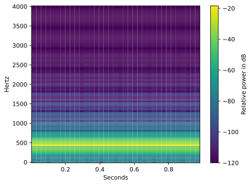

This chart was rendered from the supplied code and input; rerun the cell after changing the data.

A waveform stores changing amplitude; the spectrogram shows frequency energy over time. `1e-12` prevents taking log of zero. WAV commonly stores decoded samples; MP3 is compressed and needs a compatible decoder. Check sample rate, channels, duration, clipping, and licensing before modeling.

**MFCC** features summarize a perceptually spaced frequency spectrum. Optional `librosa.feature.mfcc(y=waveform, sr=sample_rate, n_mfcc=13)` creates 13 coefficient sequences; average and spread per coefficient give a simple fixed-length baseline. Install `librosa` to try it; inspect shape and compare speech/music/noise carefully. MFCCs discard information and are not universal features for every sound task. Split by speaker/recording source, not random adjacent windows.

#### 4 · How to use it in the real world

This worked workflow uses generated data to make the representation enter an actual fitted predictor. For an independent project, replace the generated examples with labelled, permitted sources and evaluate a source-separated holdout.
~~~python
# A frequency feature feeds an actual toy tone classifier.
from sklearn.linear_model import LogisticRegression
def peak_hz(values, rate):
    spectrum = abs(np.fft.rfft(values))
    return np.fft.rfftfreq(len(values),1/rate)[spectrum.argmax()]
tone_features = np.array([[peak_hz(np.sin(2*np.pi*f*sample_times),sample_rate)] for f in [220,240,800,820]])
tone_model = LogisticRegression().fit(tone_features,[0,0,1,1])
print("Input: generated 440 Hz, one second, 8000 samples")
print("Measured peak Hz:", peak_hz(waveform,sample_rate))
print("Toy high-tone class:", int(tone_model.predict([[peak_hz(waveform,sample_rate)]])[0]))
~~~


**Recorded output from this input:**

~~~text
Input: generated 440 Hz, one second, 8000 samples
Measured peak Hz: 440.0
Toy high-tone class: 0
~~~
<a id="topic-mp3-decode-model-flow"></a>

### MP3 · Encode known sounds, decode bytes, and classify the decoded features


**Extra tool:** in your activated terminal run `python -m pip install soundfile`. These outputs were checked with soundfile 0.13.1 and libsndfile 1.2.2, including actual MP3 encoding and decoding.

#### 1 · Problem

A classifier trained directly on sine arrays has not demonstrated MP3 decoding. A filename ending in .mp3 does not prove that compressed bytes were decoded before feature extraction.

#### 2 · How to fix it

Use the installed soundfile/libsndfile codec to encode generated sounds as real MPEG Layer III bytes, then inspect and decode those bytes before every feature extraction. The checked environment has soundfile 0.13.1 and libsndfile 1.2.2; no FFmpeg or global installation is needed. [The soundfile documentation](https://python-soundfile.readthedocs.io/en/latest/) describes its read/write API and MP3 compression support. Other installations must provide working MP3 codec support; an explicit missing-codec error is not a successful classification. Split by independent generated recordings, keep the sample-rate contract fixed, and use the identical decoder/feature extractor for serving. These tones are a controlled codec exercise, not speech or music recognition.

#### 3 · How to use it

Start a fresh notebook for this lesson. Run its cells in order; the literal inputs or explicitly bounded input previews belong to this experiment.

```python
import io
import numpy as np
import soundfile as sf
from sklearn.linear_model import LogisticRegression
from sklearn.metrics import accuracy_score
from sklearn.model_selection import train_test_split
from sklearn.pipeline import make_pipeline
from sklearn.preprocessing import StandardScaler

mp3_rate = 16000
mp3_times = np.arange(mp3_rate // 2) / mp3_rate  # Each recording lasts 0.5 seconds.

def encode_tone(frequency, phase=0.0, amplitude=0.4):
    samples = amplitude * np.sin(2 * np.pi * frequency * mp3_times + phase)
    buffer = io.BytesIO()
    sf.write(buffer, samples, mp3_rate, format="MP3", subtype="MPEG_LAYER_III")
    return buffer.getvalue()  # Compressed bytes, not the original NumPy array.

def decoded_features(payload):
    metadata = sf.info(io.BytesIO(payload))
    if metadata.format != "MP3":
        raise ValueError("Expected an actual MP3 file")
    samples, rate = sf.read(io.BytesIO(payload), dtype="float32", always_2d=True)
    if rate != mp3_rate or samples.shape[1] != 1 or len(samples) < rate // 4:
        raise ValueError("Expected mono 16000 Hz audio of at least 0.25 seconds")
    mono = samples[:, 0].astype(float)
    if not np.isfinite(mono).all() or np.max(np.abs(mono)) >= 1:
        raise ValueError("Nonfinite or clipped audio needs investigation")
    spectrum = np.abs(np.fft.rfft(mono * np.hanning(len(mono))))
    frequencies = np.fft.rfftfreq(len(mono), 1 / rate)
    if spectrum.sum() == 0:
        raise ValueError("Silence needs a separate policy")
    peak = frequencies[spectrum.argmax()]
    centroid = float(np.sum(frequencies * spectrum) / spectrum.sum())
    rms = float(np.sqrt(np.mean(mono ** 2)))
    return np.array([peak, centroid, rms]), (metadata.format, rate, samples.shape)

example_mp3 = encode_tone(440)
example_features, example_metadata = decoded_features(example_mp3)
print("Encoded bytes:", len(example_mp3), "decoded format/rate/shape:", example_metadata)
print("Decoded peak Hz, centroid Hz, RMS:", example_features.round(3).tolist())
```


**Recorded output from this input:**

~~~text
Encoded bytes: 1836 decoded format/rate/shape: ('MP3', 16000, (8000, 1))
Decoded peak Hz, centroid Hz, RMS: [440.0, 440.486, 0.282]
~~~
**Recorded output from these actual inputs:**

~~~text
Encoded bytes: 1836 decoded format/rate/shape: ('MP3', 16000, (8000, 1))
Decoded peak Hz, centroid Hz, RMS: [440.0, 440.486, 0.282]
~~~

**Pause and inspect:** explain the displayed values, then continue in the same notebook.

```python
# A row is an independently generated/encoded recording; no windows cross the split.
audio_rng = np.random.default_rng(31)
training_frequencies = np.r_[np.linspace(220, 370, 12), np.linspace(780, 990, 12)]
audio_labels = np.r_[np.zeros(12, dtype=int), np.ones(12, dtype=int)]
audio_rows = []
for frequency in training_frequencies:
    payload = encode_tone(frequency, phase=float(audio_rng.uniform(0, 2 * np.pi)),
                          amplitude=float(audio_rng.uniform(0.2, 0.6)))
    features, metadata = decoded_features(payload)  # Every training row passes the decoder.
    audio_rows.append(features)
audio_rows = np.array(audio_rows)
audio_train, audio_test, labels_train, labels_test = train_test_split(
    audio_rows, audio_labels, test_size=0.25, stratify=audio_labels, random_state=31)
mp3_model = make_pipeline(StandardScaler(), LogisticRegression()).fit(audio_train, labels_train)
print("Decoded recording feature table:", audio_rows.shape, "train/test:", len(audio_train), len(audio_test))
print("Held-out generated-recording accuracy:", round(accuracy_score(labels_test, mp3_model.predict(audio_test)), 3))
```


**Recorded output from this input:**

~~~text
Decoded recording feature table: (24, 3) train/test: 18 6
Held-out generated-recording accuracy: 1.0
~~~
**Recorded output from these actual inputs:**

~~~text
Decoded recording feature table: (24, 3) train/test: 18 6
Held-out generated-recording accuracy: 1.0
~~~

#### 4 · How to use it in the real world

Accept a new compressed MP3 payload and pass it through the same validation, decoding, frequency extraction and fitted classifier. Class 0 means the generated low-tone family and class 1 the high-tone family. A correct generated-tone answer establishes this end-to-end contract, not performance on unfamiliar real recordings. MP3 is lossy, so decoded samples need not equal the original waveform exactly.

```python
incoming_mp3 = encode_tone(900, phase=0.7, amplitude=0.3)  # A new generated recording.
incoming_features, incoming_metadata = decoded_features(incoming_mp3)
print("New MP3 decoded format/rate/shape:", incoming_metadata)
print("Features actually supplied to model:", incoming_features.round(3).tolist())
print("Predicted tone family:", mp3_model.predict(incoming_features.reshape(1, -1)).tolist())
```


**Recorded output from this input:**

~~~text
New MP3 decoded format/rate/shape: ('MP3', 16000, (8000, 1))
Features actually supplied to model: [900.0, 898.758, 0.212]
Predicted tone family: [1]
~~~
**Recorded output from these actual inputs:**

~~~text
New MP3 decoded format/rate/shape: ('MP3', 16000, (8000, 1))
Features actually supplied to model: [900.0, 898.758, 0.212]
Predicted tone family: [1]
~~~

**Change and explain:** Generate an intermediate 550 Hz tone and inspect what the two-class model does outside its labeled bands. Explain why a confident class is not proof of a familiar sound. In a real project split by speaker/device/recording session and evaluate those shifts.

<a id="systems-f1-5"></a>

### F1e · Video frames, timestamps and sequence baseline

#### 1 · Problem

Neighboring frames leak information if split as separate examples.

#### 2 · How to fix it

Decode a permitted file, preserve timestamps and split whole videos/persons/sessions. Compare a frame-average baseline with an ordered representation.

#### 3 · How to use it

A video contains timestamped image frames, often with audio. Use a permitted local video file for this optional decoder example:

~~~python-optional
import cv2  # Optional installation: opencv-python.
video_reader = cv2.VideoCapture("practice_video.mp4")
if not video_reader.isOpened():
    raise ValueError("Choose an existing permitted video file.")
sampled_frames = []
frame_number = 0
try:
    while True:
        success, bgr_frame = video_reader.read()
        if not success:
            break
        if frame_number % 30 == 0:  # Sample every 30 frames, not necessarily every second.
            rgb_frame = cv2.cvtColor(bgr_frame, cv2.COLOR_BGR2RGB)
            sampled_frames.append(cv2.resize(rgb_frame, (64, 64)))
        frame_number += 1
finally:
    video_reader.release()  # Release the file even if a decoding error occurs.
print("Sampled frames:", len(sampled_frames))
~~~

**Run status:** Optional branch not executed in this review. No output is claimed; supply its documented dependency, real media file or local graphical session first.


Record actual timestamps when frame rates vary. A CNN can encode each frame; an LSTM or another sequence model can use their order. Begin with a simpler frame-feature average baseline, compare it with an order-aware approach, and split by whole original video/person/session. **Try:** reverse a frame sequence; explain which task should change and why. A model that sees shuffled independent frames cannot learn motion order.

#### 4 · How to use it in the real world

This worked workflow uses generated data to make the representation enter an actual fitted predictor. For an independent project, replace the generated examples with labelled, permitted sources and evaluate a source-separated holdout. The original video decoder above is optional; the following stand-in tests the model path without claiming a file was decoded.
~~~python
# A decoded-frame stand-in makes an order-sensitive workflow executable without a codec.
import numpy as np
from sklearn.linear_model import LogisticRegression
training_sequences = np.array([[0.1,0.4,0.8],[0.2,0.5,0.9],[0.9,0.5,0.2],[0.8,0.4,0.1]])
def motion_features(sequences):
    return (sequences[:,-1]-sequences[:,0]).reshape(-1,1)
motion_model = LogisticRegression(C=100).fit(motion_features(training_sequences),[1,1,0,0])
sequence = np.array([[0.1,0.4,0.8]])
print("Input frame brightness:", sequence.tolist())
print("Increasing class:", motion_model.predict(motion_features(sequence)).tolist())
print("Reversed class:", motion_model.predict(motion_features(sequence[:,::-1])).tolist())
~~~


**Recorded output from this input:**

~~~text
Input frame brightness: [[0.1, 0.4, 0.8]]
Increasing class: [1]
Reversed class: [0]
~~~
<a id="systems-f1-6"></a>

### F1f · MFCC audio features

#### 1 · Problem

A variable-duration sound needs a deliberate fixed-length representation.

#### 2 · How to fix it

Calculate MFCC sequences and aggregate training/serving sound with identical settings. Compare with a simpler spectral baseline.

#### 3 · How to use it

install `librosa` into your practice environment first.

~~~python-optional
import numpy as np
import librosa

mfcc_sample_rate = 16000
mfcc_time = np.arange(mfcc_sample_rate) / mfcc_sample_rate
mfcc_tone = np.sin(2 * np.pi * 440 * mfcc_time)
mfcc_values = librosa.feature.mfcc(y=mfcc_tone, sr=mfcc_sample_rate, n_mfcc=13)
mfcc_summary = np.concatenate([mfcc_values.mean(axis=1), mfcc_values.std(axis=1)])
print("Coefficients by time frames:", mfcc_values.shape)
print("Fixed-length summary:", mfcc_summary.shape)  # (26,)
assert mfcc_summary.shape == (26,)
~~~

**Run status:** Optional branch not executed in this review. No output is claimed; supply its documented dependency, real media file or local graphical session first.


`axis=1` summarizes time within each coefficient. `concatenate` joins 13 means with 13 spreads. **Try:** use an 880 Hz tone; inspect which features change, then explain why this does not establish a speech recognizer.

#### 4 · How to use it in the real world

This worked workflow uses generated data to make the representation enter an actual fitted predictor. For an independent project, replace the generated examples with labelled, permitted sources and evaluate a source-separated holdout.
~~~python-optional
# Run only with librosa: train the same MFCC adapter used for a request.
from sklearn.linear_model import LogisticRegression
def summarize_tone(hz):
    wave = np.sin(2*np.pi*hz*mfcc_time)
    values = librosa.feature.mfcc(y=wave,sr=mfcc_sample_rate,n_mfcc=13)
    return np.r_[values.mean(axis=1),values.std(axis=1)]
mfcc_model = LogisticRegression(max_iter=1000).fit(np.array([summarize_tone(f) for f in [200,220,800,820]]),[0,0,1,1])
print("Input tone Hz:",440,"feature count:",len(summarize_tone(440)))
print("Toy class:", mfcc_model.predict([summarize_tone(440)]).tolist())
~~~

**Run status:** Optional branch not executed in this review. No output is claimed; supply its documented dependency, real media file or local graphical session first.


<a id="systems-f1-7"></a>

### F1g · CNN spatial filters and image embeddings

#### 1 · Problem

Image filters and ordered video state require different tensor dimensions.

#### 2 · How to fix it

Use a CNN for spatial features and an LSTM for ordered frame embeddings; one gradient update demonstrates mechanics only.

#### 3 · How to use it

install `torch` first. This cell generates all inputs locally; its labels are fictional. It demonstrates tensors, a forward pass, loss, gradients, and an update, not trained image/video recognition.

~~~python-optional
import torch
from torch import nn

torch.manual_seed(7)
cnn = nn.Sequential(
    nn.Conv2d(1, 4, kernel_size=3, padding=1),  # One grayscale channel → four learned filters.
    nn.ReLU(),                                # Keep positive activations.
    nn.AdaptiveAvgPool2d((1, 1)),              # Average each feature map spatially.
    nn.Flatten(),                             # Four features for each image.
)
image_batch = torch.rand(2, 1, 8, 8)  # Batch, channels, height, width.
image_embeddings = cnn(image_batch)
assert tuple(image_embeddings.shape) == (2, 4)
image_head = nn.Linear(4, 2)          # Turn four features into two class scores.
image_logits = image_head(image_embeddings)
image_loss = nn.CrossEntropyLoss()(image_logits, torch.tensor([0, 1]))
image_optimizer = torch.optim.SGD(
    list(cnn.parameters()) + list(image_head.parameters()), lr=0.01,
)
image_optimizer.zero_grad()
image_loss.backward()                # Compute how each learned weight affects loss.
image_optimizer.step()               # Make one small weight update.
print("Image embedding shape:", tuple(image_embeddings.shape))

# Treat three frames per video as a sequence of four-dimensional frame embeddings.
video_frames = torch.rand(2, 3, 1, 8, 8)
frame_embeddings = cnn(video_frames.reshape(6, 1, 8, 8)).reshape(2, 3, 4)
sequence_model = nn.LSTM(input_size=4, hidden_size=5, batch_first=True)
sequence_outputs, (last_hidden, last_cell) = sequence_model(frame_embeddings)
print("Video, time steps, sequence features:", tuple(sequence_outputs.shape))
assert tuple(sequence_outputs.shape) == (2, 3, 5)
~~~

**Run status:** Optional branch not executed in this review. No output is claimed; supply its documented dependency, real media file or local graphical session first.


A **tensor** is a multidimensional array. The CNN learns spatial filters; the LSTM carries hidden/cell state across ordered frames. `CrossEntropyLoss` compares unnormalized class scores with integer class answers. `zero_grad` clears old gradients, `backward` calculates new ones, and `step` updates weights. One step on two generated images has no demonstrated predictive value.

**Try:** change sequence length from three to four and update the reshape counts. Compare the last-frame sequence representation with the mean of frame embeddings. For a genuine video project, train a head on properly labelled whole-video splits and compare with a frame-average baseline. For pretrained CNN embeddings, use the corresponding documented preprocessing and evaluate transfer rather than assuming these random weights contain useful visual knowledge.

#### 4 · How to use it in the real world

This worked workflow uses generated data to make the representation enter an actual fitted predictor. For an independent project, replace the generated examples with labelled, permitted sources and evaluate a source-separated holdout.
~~~python-optional
# Run only with torch: attach a task head to the last video representation.
video_head = nn.Linear(5,2)
video_scores = video_head(sequence_outputs[:,-1,:])
video_answers = torch.tensor([0,1])
video_loss = nn.CrossEntropyLoss()(video_scores,video_answers)
video_optimizer = torch.optim.SGD(list(cnn.parameters())+list(sequence_model.parameters())+list(video_head.parameters()),lr=0.01)
video_optimizer.zero_grad()
video_loss.backward()
video_optimizer.step()
print("Input video tensor:",tuple(video_frames.shape))
print("Output class scores:",tuple(video_scores.shape),"loss:",round(float(video_loss.detach()),4))
~~~

**Run status:** Optional branch not executed in this review. No output is claimed; supply its documented dependency, real media file or local graphical session first.


### F1h · LSTM order-aware video head

#### 1 · Problem

Averaging frame embeddings discards order, which matters for actions such as entering versus leaving.

#### 2 · How to fix it

Pass ordered CNN embeddings through a sequence model and attach a task head. Keep whole recordings together in evaluation. This optional cell reuses the complete CNN/LSTM cell in F1g and requires `torch`.

#### 3 · How to use it

~~~python-optional
# F1g supplies sequence_outputs and the three-frame video input.
print("Input tensor:",tuple(video_frames.shape))
last_frame_state=sequence_outputs[:,-1,:]
order_head=nn.Linear(5,2)
order_logits=order_head(last_frame_state)
print("Class-score shape:",tuple(order_logits.shape))
~~~

**Run status:** Optional branch not executed in this review. No output is claimed; supply its documented dependency, real media file or local graphical session first.

#### 4 · How to use it in the real world

A video request would be decoded, timestamped, transformed using the model's required image settings and scored by the same ordered head. The cell below completes that head's inference path for the generated tensor; the random weights have no demonstrated recognition value.

~~~python-optional
# Use the actual head output, not an invented video-recognition answer.
predicted_action=order_logits.argmax(dim=1)
print("Generated request count:",len(video_frames))
print("Untrained action indices:",predicted_action.tolist())
~~~

**Run status:** Optional branch not executed in this review. No output is claimed; supply its documented dependency, real media file or local graphical session first.

<a id="topic-f2-package-a-model-and-validate-every-input-pdf-1-9"></a>

### F2 · Package a model and validate every input — PDF 1.9

**State:** Start a fresh serving notebook; run all F2 cells in order. F3 reuses this exact loaded artifact and `predict_record`.

#### 1 · Problem

A bare estimator cannot safely interpret arbitrary incoming records.

#### 2 · How to fix it

Package preparation, schema, units, version and environment together; validate before prediction.

#### 3 · How to use it

A usable artifact contains the **complete preparation + model**, input schema, target meaning/units, version, dependency versions, training provenance, validation evidence, and chosen decision threshold where relevant. Load only trusted artifacts; joblib/pickle can execute code.

Start a fresh **serving.ipynb**. This complete local demonstration makes its own model and keeps file writes in a temporary directory:

~~~python
import json
import time
import joblib
import numpy as np
import pandas as pd
import sklearn
from tempfile import TemporaryDirectory
from pathlib import Path
from sklearn.pipeline import make_pipeline
from sklearn.impute import SimpleImputer
from sklearn.linear_model import LinearRegression

serving_training = pd.DataFrame({"size_cm": [15, 20, 25, 30, 35, 40]})
serving_answers = np.array([5, 7, 8, 10, 12, 13])
serving_model = make_pipeline(SimpleImputer(strategy="median"), LinearRegression())
serving_model.fit(serving_training, serving_answers)
serving_bundle = {
    "pipeline": serving_model,
    "features": ["size_cm"],
    "version": "pizza-demo-v1",
    "target_units": "fictional coins",
    "sklearn_version": sklearn.__version__,
}
with TemporaryDirectory(prefix="ml-serving-") as serving_folder:
    model_path = Path(serving_folder) / "pizza.joblib"
    joblib.dump(serving_bundle, model_path)
    loaded_bundle = joblib.load(model_path)  # We just created this trusted file.
assert loaded_bundle["version"] == "pizza-demo-v1"
~~~


**What you see:** this setup cell prints no text. It defines or fits the objects used by the next cell in this experiment.

**Pause and inspect:** run the preceding step, inspect its values or shapes, and explain its comments. Then continue in the **same notebook**; the next cell uses this experiment's variables.

~~~python
def predict_record(record):
    if set(record) != {"size_cm"}:
        raise ValueError("Supply exactly size_cm.")
    value = record["size_cm"]
    if isinstance(value, bool) or not isinstance(value, (int, float)):
        raise ValueError("size_cm must be a number, not text or a boolean.")
    if not np.isfinite(value) or not 10 <= value <= 60:
        raise ValueError("size_cm must be finite and between 10 and 60.")
    prediction_row = pd.DataFrame({"size_cm": [value]})
    prediction = loaded_bundle["pipeline"].predict(prediction_row)[0]
    return {"price": float(prediction), "model_version": loaded_bundle["version"]}

started = time.perf_counter()
single_response = predict_record({"size_cm": 30})
print(single_response)
print("Seconds:", time.perf_counter() - started)
assert single_response == predict_record(json.loads('{"size_cm":30}'))

for invalid_record in [{}, {"size_cm": -2}, {"size_cm": "large"}, {"size_cm": float("nan")}]:
    try:
        predict_record(invalid_record)
    except ValueError:
        print("Rejected:", invalid_record)
    else:
        raise AssertionError("Invalid input was accepted.")
~~~


**Recorded output from this input:**

~~~text
{'price': 9.980952380952381, 'model_version': 'pizza-demo-v1'}
Seconds: 0.001926200002344558
Rejected: {}
Rejected: {'size_cm': -2}
Rejected: {'size_cm': 'large'}
Rejected: {'size_cm': nan}
~~~
The wrapper enforces field names, type, finiteness, range, feature order, and response version. JSON parsing changes transport, not the model's features. `perf_counter` measures elapsed time; one request is not a reliable latency benchmark. Test a representative batch and report percentiles after warm-up.

**Try:** compare direct pipeline predictions with wrapper predictions on the same valid rows. Then add an extra field and verify it is rejected. Version compatibility matters: keep the training environment specification and test loading before releasing a new environment.

#### 4 · How to use it in the real world

A batch adapter uses the same serving function; invalid requests become explicit rejections rather than guesses.
~~~python
batch_requests=[{"size_cm":20},{"size_cm":35},{"size_cm":-1}]
print("Input:",batch_requests)
for record in batch_requests:
    try:
        result=predict_record(record)
        print("Accepted:",record, {**result,"price":round(result["price"],3)})
    except ValueError as error:
        print("Rejected:",record,str(error))
~~~


**Recorded output from this input:**

~~~text
Input: [{'size_cm': 20}, {'size_cm': 35}, {'size_cm': -1}]
Accepted: {'size_cm': 20} {'price': 6.724, 'model_version': 'pizza-demo-v1'}
Accepted: {'size_cm': 35} {'price': 11.61, 'model_version': 'pizza-demo-v1'}
Rejected: {'size_cm': -1} size_cm must be finite and between 10 and 60.
~~~
<a id="topic-f3-rest-apis-web-apps-containers-and-cloud-options"></a>

### F3 · REST APIs, web apps, containers, and cloud options


#### F3a · FastAPI REST service

##### 1 · Problem

A delivery interface must preserve the trained input contract and report errors clearly.

##### 2 · How to fix it

Keep model logic in F2, adapt the transport, then test a valid request and a failure before exposing the service.

##### 3 · How to use it

A **REST API** lets another program send an HTTP request and receive a response. A **web app** gives people a form. Neither changes model validity.

For a local FastAPI exercise, install optional `fastapi`, `uvicorn`, and `httpx` in your practice environment. Save the F2 setup and this code as **practice_api.py**, excluding its invalid-input exercise if you prefer a quiet startup:

~~~python-optional
from fastapi import FastAPI
from pydantic import BaseModel, Field, ConfigDict
from fastapi.testclient import TestClient

app = FastAPI()

class PizzaRequest(BaseModel):
    model_config = ConfigDict(extra="forbid")  # Reject misspelled/unexpected fields.
    size_cm: float = Field(ge=10, le=60, allow_inf_nan=False)

@app.get("/health")
def health():
    return {"ready": True, "model_version": loaded_bundle["version"]}

@app.post("/predict")
def predict(request: PizzaRequest):
    return predict_record(request.model_dump())

client = TestClient(app)  # Exercise HTTP behavior without exposing a public server.
assert client.get("/health").status_code == 200
assert client.post("/predict", json={"size_cm": 30}).status_code == 200
assert client.post("/predict", json={"size_cm": -1}).status_code == 422
print(client.post("/predict", json={"size_cm": 30}).json())
~~~

**Recorded output — executed locally:**

~~~text
{'price': 9.980952380952381, 'model_version': 'pizza-demo-v1'}
~~~


`@app.post` registers a request handler; `BaseModel` describes the body; `Field` constrains its values; 422 reports invalid request content. This Pydantic schema accepts numeric text by coercion; the F2 wrapper receives the validated float. Use strict fields if the application requires strict transport types, and test that decision explicitly.

From a terminal in the same folder:

~~~sh
python -m uvicorn practice_api:app --host 127.0.0.1 --port 8000
~~~

`practice_api:app` means “the object named app in practice_api.py.” `127.0.0.1` keeps this demonstration on your computer. Open `http://127.0.0.1:8000/docs` to try the request body. Stop with Ctrl+C.


##### 4 · How to use it in the real world

This runs the application boundary against the fitted F2 artifact. Local contract checks do not claim an internet deployment, Docker build, or browser session.
~~~python-optional
# Exercise the real HTTP adapter in process; F2 setup is shared.
print("Input HTTP body:",{"size_cm":30})
response=client.post("/predict",json={"size_cm":30})
print("HTTP status:",response.status_code,"output:",response.json())
print("Invalid HTTP status:",client.post("/predict",json={"size_cm":-1}).status_code)
~~~

**Recorded output — executed locally:**

~~~text
Input HTTP body: {'size_cm': 30}
HTTP status: 200 output: {'price': 9.980952380952381, 'model_version': 'pizza-demo-v1'}
Invalid HTTP status: 422
~~~


#### F3b · Flask REST service

##### 1 · Problem

A delivery interface must preserve the trained input contract and report errors clearly.

##### 2 · How to fix it

Keep model logic in F2, adapt the transport, then test a valid request and a failure before exposing the service.

##### 3 · How to use it

 install optional `flask`; put the same validated prediction wrapper behind a route, then test its valid and invalid responses:

~~~python-optional
from flask import Flask, request, jsonify
flask_app = Flask(__name__)

@flask_app.post("/predict")
def flask_prediction():
    try:
        payload = request.get_json()
        if not isinstance(payload, dict):
            return jsonify({"error": "Expected a JSON object."}), 400
        return jsonify(predict_record(payload))
    except ValueError as error:
        return jsonify({"error": str(error)}), 400

flask_client = flask_app.test_client()
assert flask_client.post("/predict", json={"size_cm": 30}).status_code == 200
assert flask_client.post("/predict", json={"size_cm": -1}).status_code == 400
~~~

**Recorded output — executed locally:**

~~~text
(Cell completed without printed output; inspect the assertion or stored object named above.)
~~~


##### 4 · How to use it in the real world

This runs the application boundary against the fitted F2 artifact. Local contract checks do not claim an internet deployment, Docker build, or browser session.
~~~python-optional
# Exercise the Flask app without starting an external server.
with flask_app.test_client() as workflow_client:
    result=workflow_client.post("/predict",json={"size_cm":30})
    print("Input:",{"size_cm":30},"status:",result.status_code,"output:",result.get_json())
~~~

**Recorded output — executed locally:**

~~~text
Input: {'size_cm': 30} status: 200 output: {'model_version': 'pizza-demo-v1', 'price': 9.980952380952381}
~~~


#### F3c · Streamlit web form

##### 1 · Problem

A delivery interface must preserve the trained input contract and report errors clearly.

##### 2 · How to fix it

Keep model logic in F2, adapt the transport, then test a valid request and a failure before exposing the service.

##### 3 · How to use it

 install optional `streamlit`; save F2 setup plus this cell as **practice_form.py**, then run `python -m streamlit run practice_form.py`:

~~~python-optional
import streamlit as st
st.title("Practice pizza estimator")
chosen_size = st.number_input("Size in centimeters", min_value=10.0, max_value=60.0, value=30.0)
if st.button("Estimate price"):
    st.json(predict_record({"size_cm": chosen_size}))
~~~

**Run status:** Optional branch not executed in this review. No output is claimed; supply its documented dependency, real media file or local graphical session first.


The number input constrains the form; server-side validation remains necessary for other callers. **Try:** send the same size through the wrapper, API, and form and compare results.


##### 4 · How to use it in the real world

This runs the application boundary against the fitted F2 artifact. Local contract checks do not claim an internet deployment, Docker build, or browser session.
~~~python
# The form callback can be tested without opening Streamlit.
form_values={"size_cm":30}
print("Form input:",form_values)
print("Callback result:",predict_record(form_values))
~~~


**Recorded output from this input:**

~~~text
Form input: {'size_cm': 30}
Callback result: {'price': 9.980952380952381, 'model_version': 'pizza-demo-v1'}
~~~
#### F3d · Docker container

##### 1 · Problem

A delivery interface must preserve the trained input contract and report errors clearly.

##### 2 · How to fix it

Keep model logic in F2, adapt the transport, then test a valid request and a failure before exposing the service.

##### 3 · How to use it

 Docker packages runtime dependencies. In a separate practice folder, save the API file and a `requirements.txt` with the versions you actually tested. A minimal teaching container:

~~~dockerfile
FROM python:3.12-slim
WORKDIR /app
COPY requirements.txt .
RUN python -m pip install --no-cache-dir -r requirements.txt
COPY practice_api.py .
EXPOSE 8000
CMD ["python", "-m", "uvicorn", "practice_api:app", "--host", "0.0.0.0", "--port", "8000"]
~~~

`FROM` chooses the runtime; `WORKDIR` sets the folder; `COPY` adds files; `RUN` installs dependencies; `EXPOSE` documents a port; `CMD` starts the API. For this toy file the model trains at startup; a real release should load a separately validated, versioned artifact rather than retrain per worker.

Build with `docker build -t pizza-practice .` and run with `docker run --rm -p 127.0.0.1:8000:8000 pizza-practice`. The final dot is the build folder. The host port is local-only; `--rm` removes that stopped practice container. Use a dedicated non-root container user, pinned image digest, and tested dependency lock for a deployed service.


##### 4 · How to use it in the real world

This runs the application boundary against the fitted F2 artifact. Local contract checks do not claim an internet deployment, Docker build, or browser session.
~~~python
# A local pre-release smoke check precedes any container build.
release={"artifact_version":loaded_bundle["version"],"request":{"size_cm":30}}
smoke=predict_record(release["request"])
assert smoke["model_version"]==release["artifact_version"]
print("Release input:",release,"smoke output:",smoke)
print("Container build executed:",False)
~~~


**Recorded output from this input:**

~~~text
Release input: {'artifact_version': 'pizza-demo-v1', 'request': {'size_cm': 30}} smoke output: {'price': 9.980952380952381, 'model_version': 'pizza-demo-v1'}
Container build executed: False
~~~
#### F3e · AWS, Google Cloud, Heroku and mobile integration

##### 1 · Problem

A delivery interface must preserve the trained input contract and report errors clearly.

##### 2 · How to fix it

Keep model logic in F2, adapt the transport, then test a valid request and a failure before exposing the service.

##### 3 · How to use it

 AWS, Google Cloud, and Heroku can host applications; cloud products, prices, and supported runtimes change. The common workflow is: choose a permitted service, estimate cost and data location, publish a tested image/artifact, configure secrets outside code, restrict access, health-check, run a small smoke request, monitor, and retain rollback. A mobile/web app should call an authenticated service or use a compatible on-device representation with parity tests. This guide's local exercises do not create a cloud resource or incur hosting charges.

**Checkpoint:** explain which checks concern model quality, input handling, and service reliability. Test malformed JSON, unavailable model, oversized batch, unknown categories, and prediction parity before a real release.

##### 4 · How to use it in the real world

This runs the application boundary against the fitted F2 artifact. Local contract checks do not claim an internet deployment, Docker build, or browser session.
~~~python
# Check the proposed remote/mobile JSON contract locally before deployment.
requests=[{"size_cm":20},{"size_cm":30},{"size_cm":40}]
responses=[predict_record(json.loads(json.dumps(row))) for row in requests]
assert responses==[predict_record(row) for row in requests]
print("Mobile/web JSON inputs:",requests)
print("Local contract outputs:",responses)
print("Cloud deployment executed:",False)
~~~


**Recorded output from this input:**

~~~text
Mobile/web JSON inputs: [{'size_cm': 20}, {'size_cm': 30}, {'size_cm': 40}]
Local contract outputs: [{'price': 6.723809523809523, 'model_version': 'pizza-demo-v1'}, {'price': 9.980952380952381, 'model_version': 'pizza-demo-v1'}, {'price': 13.238095238095237, 'model_version': 'pizza-demo-v1'}]
Cloud deployment executed: False
~~~
<a id="topic-f4-monitoring-and-maintenance-pdf-1-10"></a>

### F4 · Monitoring and maintenance — PDF 1.10

#### 1 · Problem

A running service can become slow, receive unfamiliar inputs, or lose predictive quality.

#### 2 · How to fix it

Monitor service, input quality, distributions and labelled outcomes separately. Record versions and time windows; an input shift alone does not establish concept drift.

#### 3 · How to use it

A deployed model can fail without crashing. Monitor four layers:

| Layer | Measure | Example response |
|---|---|---|
| Service | Latency, errors, throughput, model version | Investigate failed/slow requests |
| Input quality | Missingness, types, ranges, unseen categories | Reject or quarantine malformed inputs |
| Distribution | Feature, prediction, and subgroup drift | Investigate collection/population changes |
| Outcome quality | MAE, precision/recall, calibration when labels arrive | Evaluate a candidate or adjust policy |

**Data drift** changes input distributions. **Prediction drift** changes outputs. **Concept drift** changes the input–outcome relationship. Input drift alone proves neither performance loss nor its absence. Delayed labels mean real-time accuracy is often unavailable.

Run this fresh notebook cell:

~~~python
import numpy as np
import pandas as pd
import matplotlib.pyplot as plt
from scipy.stats import ks_2samp

reference_numeric = np.array([1, 2, 3, 4, 5, 6, 7, 8, 9, 10], dtype=float)
recent_numeric = np.array([4, 5, 6, 7, 8, 9, 10, 11, 12, np.nan])
reference_categories = pd.Series(["basic"] * 8 + ["plus"] * 2)
recent_categories = pd.Series(["basic"] * 3 + ["plus"] * 6 + [None]).fillna("<missing>")

category_names = sorted(set(reference_categories) | set(recent_categories))
reference_rates = reference_categories.value_counts(normalize=True).reindex(
    category_names, fill_value=0,
)
recent_rates = recent_categories.value_counts(normalize=True).reindex(
    category_names, fill_value=0,
)
category_drift = pd.DataFrame({"reference": reference_rates, "recent": recent_rates})
print(category_drift)
category_drift.plot.bar()
plt.ylabel("Fraction of records")
plt.show()
print("Recent missing fraction:", np.isnan(recent_numeric).mean())

# KS compares empirical numeric distributions, excluding missing values explicitly.
ks_result = ks_2samp(reference_numeric, recent_numeric[np.isfinite(recent_numeric)])
print("KS statistic:", round(ks_result.statistic, 3))

# PSI uses fixed bins chosen for this reference exercise, with a dedicated missing bucket.
bin_edges = [-np.inf, 3, 6, 9, np.inf]
def fixed_bin_rates(values):
    finite_values = values[np.isfinite(values)]
    counts = np.histogram(finite_values, bins=bin_edges)[0]
    counts = np.append(counts, np.isnan(values).sum())
    return (counts + 0.5) / (counts.sum() + 0.5 * len(counts))  # Explicit smoothing.
~~~


**Recorded output from this input:**

~~~text
           reference  recent
<missing>        0.0     0.1
basic            0.8     0.3
plus             0.2     0.6
Recent missing fraction: 0.1
KS statistic: 0.3
~~~
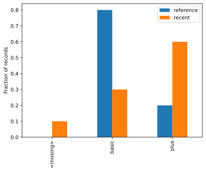

This chart was rendered from the supplied code and input; rerun the cell after changing the data.

**Pause and inspect:** run the preceding step, inspect its values or shapes, and explain its comments. Then continue in the **same notebook**; the next cell uses this experiment's variables.

~~~python
reference_bins = fixed_bin_rates(reference_numeric)
recent_bins = fixed_bin_rates(recent_numeric)
psi = np.sum((recent_bins - reference_bins) * np.log(recent_bins / reference_bins))
print("Illustrative numeric PSI:", round(psi, 3))

# Use category proportions, not collapsed quantile bins, for binary/category features.
alert_reasons = []
if np.isnan(recent_numeric).mean() > 0.05:
    alert_reasons.append("Missing inputs exceed our illustrative 5% rule.")
if (recent_rates - reference_rates).abs().max() > 0.25:
    alert_reasons.append("A category proportion moved by over 25 percentage points.")
print("Investigate:", alert_reasons)
~~~


**Recorded output from this input:**

~~~text
Illustrative numeric PSI: 0.466
Investigate: ['Missing inputs exceed our illustrative 5% rule.', 'A category proportion moved by over 25 percentage points.']
~~~
**PSI** summarizes changes in binned proportions; smoothing and bin choices matter. Common PSI thresholds are heuristics, not universal guarantees. Binary features need category proportions; quantile edges can collapse and hide changes. **KS** measures the largest gap between empirical distributions; p-values depend on sample size and assumptions. Monitor missingness separately.

**Do:** add a batch with the same feature distribution but reversed outcome relationships. Show that input-only monitoring cannot detect all concept drift. When labels arrive, join them to immutable prediction IDs and versions, then calculate windowed metrics and subgroup counts.

A dashboard in **Matplotlib/Seaborn**, **Tableau**, or **Power BI** can show date, volume, missing fraction, prediction rate, error metric, and model version. Make a table with one row per monitoring window, plot each measure over time, add an agreed threshold line, and assign an owner to alerts. Tools display evidence; they do not choose an appropriate threshold or fix drift automatically.

#### 4 · How to use it in the real world

The outcome monitor below joins delayed labels to versioned predictions and triggers a measured error alert.
~~~python
from sklearn.linear_model import LinearRegression
eta_model=LinearRegression().fit(pd.DataFrame({"km":[1,2,3,4,5]}),[6,8,10,12,14])
live=pd.DataFrame({"event_id":[101,102,103,104],"window":["day1","day1","day2","day2"],"km":[2,3,2,3]})
live["prediction"]=eta_model.predict(live[["km"]]); live["model_version"]="eta-v1"
labels=pd.DataFrame({"event_id":[101,102,103,104],"actual_minutes":[8,10,14,16]})
joined=live.merge(labels,on="event_id",validate="one_to_one")
joined["absolute_error"]=(joined.prediction-joined.actual_minutes).abs()
mae_by_window=joined.groupby("window").absolute_error.mean()
print("Input labelled events:");print(joined.to_string(index=False))
print("MAE minutes:",mae_by_window.round(3).to_dict())
print("Investigate windows above 3 minutes:",mae_by_window[mae_by_window>3].index.tolist())
~~~


**Recorded output from this input:**

~~~text
Input labelled events:
 event_id window  km  prediction model_version  actual_minutes  absolute_error
      101   day1   2         8.0        eta-v1               8             0.0
      102   day1   3        10.0        eta-v1              10             0.0
      103   day2   2         8.0        eta-v1              14             6.0
      104   day2   3        10.0        eta-v1              16             6.0
MAE minutes: {'day1': 0.0, 'day2': 6.0}
Investigate windows above 3 minutes: ['day2']
~~~
#### F4a · Service availability, latency and error rate

##### 1 · Problem

A statistically accurate model can still fail requests or respond too slowly.

##### 2 · How to fix it

Measure completed requests, failures and latency; use a representative warmed workload before claiming a service-level target.

##### 3 · How to use it

~~~python
import numpy as np
import pandas as pd
from sklearn.linear_model import LinearRegression
monitored_model=LinearRegression().fit(pd.DataFrame({"km":[1,2,3,4]}),[6,8,10,12])
import time
requests=[{"km":2},{"km":3}]
latencies=[];answers=[]
for row in requests:
    started=time.perf_counter()
    answers.append(float(monitored_model.predict(pd.DataFrame([row]))[0]))
    latencies.append((time.perf_counter()-started)*1000)
print("Input requests:",requests)
print("Observed latency ms:",[round(v,3) for v in latencies])
~~~


**Recorded output from this input:**

~~~text
Input requests: [{'km': 2}, {'km': 3}]
Observed latency ms: [1.425, 0.988]
~~~
##### 4 · How to use it in the real world

The application records versioned predictions and observed service telemetry. Two local requests demonstrate instrumentation; they do not establish production latency.
~~~python
print("Outputs minutes:",[round(v,3) for v in answers])
print("Telemetry:",{"model_version":"eta-v1","completed":len(answers),"failed":0,"p95_ms":round(float(np.percentile(latencies,95)),3)})
~~~


**Recorded output from this input:**

~~~text
Outputs minutes: [8.0, 10.0]
Telemetry: {'model_version': 'eta-v1', 'completed': 2, 'failed': 0, 'p95_ms': 1.403}
~~~
#### F4b · Input schema, missingness and unseen categories

##### 1 · Problem

A feed can arrive with valid JSON but unusable values.

##### 2 · How to fix it

Track failures and unknowns separately; quarantine invalid records before a model call.

##### 3 · How to use it

~~~python
import numpy as np
import pandas as pd
from sklearn.linear_model import LinearRegression
monitored_model=LinearRegression().fit(pd.DataFrame({"km":[1,2,3,4]}),[6,8,10,12])
incoming=[{"km":3},{"km":None},{"distance":4}]
valid=[];rejected=[]
for record in incoming:
    value=record.get("km")
    if set(record)!={"km"} or isinstance(value,bool) or not isinstance(value,(int,float)) or not np.isfinite(value) or not 0<=value<=100:
        rejected.append(record)
    else:valid.append(record)
print("Input:",incoming,"valid:",valid,"rejected:",rejected)
~~~


**Recorded output from this input:**

~~~text
Input: [{'km': 3}, {'km': None}, {'distance': 4}] valid: [{'km': 3}] rejected: [{'km': None}, {'distance': 4}]
~~~
##### 4 · How to use it in the real world

Only accepted input reaches the ETA model. This boundary preserves model behavior when the source schema changes.
~~~python
print("Accepted predictions minutes:",monitored_model.predict(pd.DataFrame(valid)).round(3).tolist())
print("Schema/quality rejection rate:",round(len(rejected)/len(incoming),3))
~~~


**Recorded output from this input:**

~~~text
Accepted predictions minutes: [10.0]
Schema/quality rejection rate: 0.667
~~~
#### F4c · Distribution drift, KS and PSI interpretation

##### 1 · Problem

A changed input distribution is an investigation signal, not proof that accuracy fell.

##### 2 · How to fix it

Use stable reference windows, fixed bins, missingness and sample sizes. KS is a test statistic/p-value; PSI is a binned descriptive comparison with no universal alert cutoff.

##### 3 · How to use it

~~~python
import numpy as np
import pandas as pd
from sklearn.linear_model import LinearRegression
monitored_model=LinearRegression().fit(pd.DataFrame({"km":[1,2,3,4]}),[6,8,10,12])
from scipy.stats import ks_2samp
reference=np.arange(1,11,dtype=float);recent=np.arange(4,14,dtype=float)
ks_result=ks_2samp(reference,recent)
print("Reference input:",reference.tolist(),"recent input:",recent.tolist())
print("KS statistic:",round(float(ks_result.statistic),3),"p-value:",round(float(ks_result.pvalue),3))
~~~


**Recorded output from this input:**

~~~text
Reference input: [1.0, 2.0, 3.0, 4.0, 5.0, 6.0, 7.0, 8.0, 9.0, 10.0] recent input: [4.0, 5.0, 6.0, 7.0, 8.0, 9.0, 10.0, 11.0, 12.0, 13.0]
KS statistic: 0.3 p-value: 0.787
~~~
##### 4 · How to use it in the real world

Score a common input with the retained model and open an investigation rather than auto-retraining from a drift statistic alone.
~~~python
print("Common request:",{"km":3},"retained-model ETA:",round(float(monitored_model.predict(pd.DataFrame({"km":[3]}))[0]),3))
print("Action: inspect source changes and delayed labelled errors before promotion.")
~~~


**Recorded output from this input:**

~~~text
Common request: {'km': 3} retained-model ETA: 10.0
Action: inspect source changes and delayed labelled errors before promotion.
~~~
#### F4d · Prediction drift and delayed outcome monitoring

##### 1 · Problem

Output changes and true error changes need different evidence.

##### 2 · How to fix it

Log prediction IDs, timestamps and versions; join labels one-to-one when they arrive and compute metrics on a defined cohort.

##### 3 · How to use it

~~~python
import numpy as np
import pandas as pd
from sklearn.linear_model import LinearRegression
monitored_model=LinearRegression().fit(pd.DataFrame({"km":[1,2,3,4]}),[6,8,10,12])
events=pd.DataFrame({"event_id":[1,2],"km":[2,3]})
events["prediction"]=monitored_model.predict(events[["km"]]);events["version"]="eta-v1"
labels=pd.DataFrame({"event_id":[1,2],"minutes":[14,16]})
labelled=events.merge(labels,on="event_id",validate="one_to_one")
print("Versioned labelled input:",labelled.to_dict("records"))
~~~


**Recorded output from this input:**

~~~text
Versioned labelled input: [{'event_id': 1, 'km': 2, 'prediction': 8.0, 'version': 'eta-v1', 'minutes': 14}, {'event_id': 2, 'km': 3, 'prediction': 10.0, 'version': 'eta-v1', 'minutes': 16}]
~~~
##### 4 · How to use it in the real world

This simulated outcome shift produces a measured error alert. In observed data, distinguish sampling variation, source changes and relationship changes before claiming concept drift.
~~~python
mae=float((labelled.prediction-labelled.minutes).abs().mean())
print("MAE minutes:",round(mae,3),"investigate:",mae>3)
print("Missing delayed labels:",len(events)-len(labelled))
~~~


**Recorded output from this input:**

~~~text
MAE minutes: 6.0 investigate: True
Missing delayed labels: 0
~~~
#### F4e · Dashboards, ownership and maintenance

##### 1 · Problem

A plot without a metric definition, owner or response can hide service failures.

##### 2 · How to fix it

Build a version/window summary; connect alerts to an owner and investigation/rollback workflow. Matplotlib/Seaborn can plot it; Tableau/Power BI can consume the same governed aggregate.

##### 3 · How to use it

~~~python
import numpy as np
import pandas as pd
from sklearn.linear_model import LinearRegression
monitored_model=LinearRegression().fit(pd.DataFrame({"km":[1,2,3,4]}),[6,8,10,12])
dashboard_events=pd.DataFrame({"km":[2,3],"actual":[14,16]})
dashboard_events["prediction"]=monitored_model.predict(dashboard_events[["km"]])
dashboard_events["absolute_error"]=(dashboard_events.actual-dashboard_events.prediction).abs()
dashboard=pd.DataFrame([{"window":"practice-day","model_version":"eta-v1","labelled_rows":len(dashboard_events),"mae_minutes":round(float(dashboard_events.absolute_error.mean()),3),"owner":"practice operator"}])
print("Dashboard aggregate input:")
print(dashboard.to_string(index=False))
~~~


**Recorded output from this input:**

~~~text
Dashboard aggregate input:
      window model_version  labelled_rows  mae_minutes             owner
practice-day        eta-v1              2          6.0 practice operator
~~~
##### 4 · How to use it in the real world

The aggregate drives an actual decision based on the fitted model outcomes. A production dashboard also controls access, freshness and missing-label coverage.
~~~python
alert=dashboard.loc[dashboard.mae_minutes>3]
print("Actionable alert:",alert[["model_version","owner","mae_minutes"]].to_dict("records"))
print("Response: investigate data/labels, compare candidate on fresh data, retain rollback artifact.")
~~~


**Recorded output from this input:**

~~~text
Actionable alert: [{'model_version': 'eta-v1', 'owner': 'practice operator', 'mae_minutes': 6.0}]
Response: investigate data/labels, compare candidate on fresh data, retain rollback artifact.
~~~
<a id="topic-f5-retrain-compare-promote-and-roll-back"></a>

### F5 · Retrain, compare, promote, and roll back

#### 1 · Problem

New data does not guarantee a better model, and a bad release needs a reversible selection.

#### 2 · How to fix it

Separate training, promotion comparison and final audit. Compare the same fresh cohort, apply a declared improvement gate, then update a version pointer.

#### 3 · How to use it

Do not automatically replace a model because new data arrived. Freeze a **promotion validation cohort** unseen by both champion and candidate. Keep a separate future/final audit cohort if you want an unbiased assessment after repeated selection.

This self-contained exercise uses synthetic housing-like numbers:

~~~python
import numpy as np
from sklearn.linear_model import LinearRegression, Ridge
from sklearn.metrics import mean_absolute_error
from sklearn.model_selection import train_test_split

update_rng = np.random.default_rng(9)
update_X = update_rng.normal(size=(200, 2))
update_y = 4 * update_X[:, 0] - update_X[:, 1] + update_rng.normal(size=200)
development_X, audit_X, development_y, audit_y = train_test_split(
    update_X, update_y, test_size=0.2, random_state=9,
)
learning_X, promotion_X, learning_y, promotion_y = train_test_split(
    development_X, development_y, test_size=0.25, random_state=9,
)
champion_model = Ridge(alpha=10).fit(learning_X, learning_y)
candidate_model = LinearRegression().fit(learning_X, learning_y)
champion_mae = mean_absolute_error(promotion_y, champion_model.predict(promotion_X))
candidate_mae = mean_absolute_error(promotion_y, candidate_model.predict(promotion_X))
registry = {"v1": champion_model, "v2": candidate_model}
current_version = "v1"
previous_version = current_version
if candidate_mae < champion_mae - 0.01:  # Predeclared illustrative minimum improvement.
    current_version = "v2"
print("Promotion MAEs:", champion_mae, candidate_mae)
print("Selected:", current_version)
print("Final audit MAE:", mean_absolute_error(
    audit_y, registry[current_version].predict(audit_X),
))
current_version = previous_version  # Demonstrate rollback by changing the pointer.
assert registry[current_version] is champion_model
print("Rollback shift_active_version:", current_version)
~~~


**Recorded output from this input:**

~~~text
Promotion MAEs: 0.9572000994365428 0.8633102812435915
Selected: v2
Final audit MAE: 0.962132223878139
Rollback shift_active_version: v1
~~~
The **registry** stores distinct versions; a pointer selects the active one. A **shadow deployment** scores the candidate alongside the champion without using it for user decisions. Add operational, subgroup, stability, and cost gates before real promotion. Registry metadata should record training IDs/time ranges, schema, code/dependencies, metrics, decision, and artifact checksum.

**Try:** make the candidate deliberately worse; verify the rule retains v1. For real updates, deduplicate incoming entity/time keys against history before creating holdouts. A row already used by the champion is not an unseen comparison row. A recent-window model may adapt faster but forget rare older patterns; compare it with all-history training on the same appropriate validation cohort.

#### 4 · How to use it in the real world

A simulated market shift supplies genuinely new learning, comparison and audit rows. The audit is used only after the choice.
~~~python
from sklearn.linear_model import LinearRegression
from sklearn.metrics import mean_absolute_error
old_x=np.arange(80).reshape(-1,1);old_y=2*old_x.ravel()+5
new_x=np.arange(80,160).reshape(-1,1);new_y=2*new_x.ravel()+9
old=LinearRegression().fit(old_x,old_y)
new=LinearRegression().fit(new_x[:40],new_y[:40])
old_error=mean_absolute_error(new_y[40:60],old.predict(new_x[40:60]))
new_error=mean_absolute_error(new_y[40:60],new.predict(new_x[40:60]))
versions={"v1":old,"v2":new};shift_active_version="v2" if old_error-new_error>=0.1 else "v1"
print("Input: 80 old rows, 40 new learning rows, 20 promotion rows, 20 untouched audit rows")
print("Promotion MAE:",round(old_error,3),round(new_error,3),"shift_active_version:",shift_active_version)
print("Selected audit MAE:",round(mean_absolute_error(new_y[60:],versions[shift_active_version].predict(new_x[60:])),3))
shift_active_version="v1" # Simulate an operational rollback, retaining both artifacts.
print("Rollback version:",shift_active_version,"prediction at input 3:",round(float(versions[shift_active_version].predict([[3]])[0]),3))
~~~


**Recorded output from this input:**

~~~text
Input: 80 old rows, 40 new learning rows, 20 promotion rows, 20 untouched audit rows
Promotion MAE: 4.0 0.0 shift_active_version: v2
Selected audit MAE: 0.0
Rollback version: v1 prediction at input 3: 11.0
~~~
<a id="topic-f6-desktop-project-original-part-4-sections-4-1-4-7"></a>

### F6 · Desktop project — original Part 4, sections 4.1–4.7

**State:** F6a and F6b start independently. F6c creates `house_service`, `desktop_source`, `desktop_work`, `practice_house` and `initial_prediction`; F6e reuses those definitions and creates a new isolated temporary store. GUI scripts run separately.

The supplied [desktop application](tkinter_app/house_price_app.py) separates **interface** from [model service](tkinter_app/model_service.py). Learn the engine first, then add windows.


#### F6a · 4.1 CSV data contract

##### 1 · Problem

A working desktop application also needs a traceable data, model and file-state workflow.

##### 2 · How to fix it

Inspect the service boundary and isolate practice writes. Preserve the documented evaluation limitations.

##### 3 · How to use it

 inspect `houses_2025.csv`, `houses_2026_new.csv`, and `houses_2027_new.csv`. Use `tkinter_app/houses_2025.csv` and `tkinter_app/houses_2026_new.csv`; the later-year fixture is `datasets/houses_2027_new.csv`. Their columns are area_m2, bedrooms, age_years, distance_km, has_garden, price, and sold_year. These are practice data, not an appraisal dataset. Generate another tiny record by copying one row and changing documented units/ranges; do not copy a target into an input.


##### 4 · How to use it in the real world

This application exercise uses the real house service or a concrete packaging boundary. Training-row predictions demonstrate integration only; optional GUI/build actions have no claimed run result.
~~~python
# Inspect actual supplied training records before accepting a desktop CSV.
import pandas as pd
from pathlib import Path
house_data=pd.read_csv(Path("tkinter_app/houses_2025.csv"))
print("Input file: tkinter_app/houses_2025.csv")
print(house_data.head(2).to_string(index=False))
print("Rows:",len(house_data),"missing price:",int(house_data.price.isna().sum()))
~~~


**Recorded output from this input:**

~~~text
Input file: tkinter_app/houses_2025.csv
 area_m2  bedrooms  age_years  distance_km  has_garden    price  sold_year
   105.0         4         14          2.4           0 360500.0       2025
   120.0         4         18         19.2           1 314600.0       2025
Rows: 500 missing price: 0
~~~
#### F6b · 4.2 Model engine

##### 1 · Problem

A working desktop application also needs a traceable data, model and file-state workflow.

##### 2 · How to fix it

Inspect the service boundary and isolate practice writes. Preserve the documented evaluation limitations.

##### 3 · How to use it

 trace this call chain:

| Call | What it does | What to inspect |
|---|---|---|
| `load_data` | Read CSV; check required columns; remove exact duplicates/missing targets | Row counts and rejected inputs |
| `build_model` | Connect median imputation to histogram gradient boosting | Complete preparation in artifact |
| `evaluate` | Calculate MAE and R² | Evaluation cohort and target units |
| `train_first_model` | Fit/evaluate then refit/store an initial version | Evaluation score is for the pre-refit estimator |
| `save_model / load_model` | Persist versioned artifacts | Trusted source, dependency compatibility |
| `check_inputs / predict_price` | Check ranges; predict with a chosen/current version | Range checks do not prove data representativeness |
| `history / current_version` | Report stored versions and active pointer | Reproducible version identifiers |
| `update_with_new_data` | Compare and store an update | Overlap, validation independence, promotion |
| `rollback` | Restore the earlier active pointer | Prediction result and active history |


##### 4 · How to use it in the real world

This application exercise uses the real house service or a concrete packaging boundary. Training-row predictions demonstrate integration only; optional GUI/build actions have no claimed run result.
~~~python
# The same engine can fit/evaluate a model without a graphical interface.
import importlib.util
from pathlib import Path
engine_path=Path("tkinter_app/model_service.py").resolve()
engine_spec=importlib.util.spec_from_file_location("engine_reading",engine_path)
engine=importlib.util.module_from_spec(engine_spec);engine_spec.loader.exec_module(engine)
engine_data=engine.load_data(engine_path.parent/"houses_2025.csv")
engine_model=engine.build_model();engine_model.fit(engine_data[engine.FEATURES],engine_data.price)
print("Input feature order:",engine.FEATURES)
print("First-row prediction:",round(float(engine_model.predict(engine_data[engine.FEATURES].head(1))[0]),2))
print("This is a path test on a training row, not a generalization score.")
~~~


**Recorded output from this input:**

~~~text
Input feature order: ['area_m2', 'bedrooms', 'age_years', 'distance_km', 'has_garden']
First-row prediction: 362308.36
This is a path test on a training row, not a generalization score.
~~~
#### F6c · 4.3 Isolated train/update/history/rollback

##### 1 · Problem

A working desktop application also needs a traceable data, model and file-state workflow.

##### 2 · How to fix it

Inspect the service boundary and isolate practice writes. Preserve the documented evaluation limitations.

##### 3 · How to use it

 this local cell imports the real module, uses absolute source paths, and directs all model/history writes to a new temporary practice folder:

~~~python
import importlib.util
from pathlib import Path
from tempfile import TemporaryDirectory

desktop_source = Path("tkinter_app/model_service.py").resolve()
assert desktop_source.is_file(), "Start in the ml-handbook folder."
desktop_spec = importlib.util.spec_from_file_location("practice_house_service", desktop_source)
house_service = importlib.util.module_from_spec(desktop_spec)
desktop_spec.loader.exec_module(house_service)

with TemporaryDirectory(prefix="ml-house-practice-") as desktop_folder:
    desktop_work = Path(desktop_folder)
    house_service.MODEL_DIR = desktop_work / "models"
    house_service.DATA_STORE = desktop_work / "data" / "all_training_data.csv"
    house_service.HISTORY = house_service.MODEL_DIR / "history.csv"
    initial_version, initial_metrics = house_service.train_first_model(
        desktop_source.parent / "houses_2025.csv",
    )
    practice_house = {
        "area_m2": 100, "bedrooms": 3, "age_years": 20,
        "distance_km": 5, "has_garden": 1,
    }
    initial_prediction = house_service.predict_price(practice_house)
    print("Initial:", initial_version, initial_metrics, initial_prediction)
    update_result = house_service.update_with_new_data(
        desktop_source.parent / "houses_2026_new.csv",
    )
    print("Update:", update_result)
    print(house_service.history())
    house_service.rollback(initial_version)
    assert house_service.current_version() == initial_version
    assert house_service.predict_price(practice_house) == initial_prediction
print("Isolated train/update/rollback exercise finished.")
~~~


**Recorded output from this input:**

~~~text
Initial: 1 {'mae': 18944, 'r2': 0.906} (325398.9312606569, 1)
Update: {'old_version': 1, 'old_mae_on_new_data': 35921, 'new_version': 2, 'new_mae_on_new_data': 28863, 'promoted': True}
   version  ... current
0        1  ...   False
1        2  ...    True

[2 rows x 7 columns]
Isolated train/update/rollback exercise finished.
~~~
`spec_from_file_location` locates a Python file; `module_from_spec` creates a separate module; `exec_module` executes its definitions. The three path assignments isolate practice writes. The temporary directory removes only the files this exercise creates when it exits.

**Important engine limitation:** its duplicate-update check rejects fully repeated files, but partial overlaps can contaminate the champion comparison. Its refit/history scores also describe the pre-refit candidate, not independent evidence for the final refit artifact. The `keep_years` option limits candidate comparison training, while final refitting can re-add held check rows. Treat this as an engine-reading exercise; use the explicit independent-cohort and window rules in F5 before relying on an update claim.


##### 4 · How to use it in the real world

This application exercise uses the real house service or a concrete packaging boundary. Training-row predictions demonstrate integration only; optional GUI/build actions have no claimed run result.
~~~python
# No permanent model directory is touched by the preceding real-engine workflow.
print("Engine source:",desktop_source.name)
print("Prediction input:",practice_house)
print("Rollback prediction:",initial_prediction)
print("Temporary practice directory still exists:",desktop_work.exists())
~~~


**Recorded output from this input:**

~~~text
Engine source: model_service.py
Prediction input: {'area_m2': 100, 'bedrooms': 3, 'age_years': 20, 'distance_km': 5, 'has_garden': 1}
Rollback prediction: (325398.9312606569, 1)
Temporary practice directory still exists: False
~~~
#### F6d1 · Window and event loop

##### 1 · Problem

Desktop widgets wait for user events; invalid input must leave the interface usable.

##### 2 · How to fix it

Separate callbacks from widgets, validate data and show a recoverable error.

##### 3 · How to use it

~~~python-optional
import tkinter as tk

hello_window = tk.Tk()  # Create a desktop window.
hello_window.title("Hello ML")
tk.Label(hello_window, text="I can build a window!").pack(padx=16, pady=16)
tk.Button(hello_window, text="Close", command=hello_window.destroy).pack(pady=8)
hello_window.mainloop()  # Wait for clicks and other window events.
~~~

**Run status:** Optional branch not executed in this review. No output is claimed; supply its documented dependency, real media file or local graphical session first.


`Label` shows text; `Button` triggers a callback; `command` receives the function itself without parentheses. `pack` lays out widgets; padding adds space. **Try:** change text and make a second label.


##### 4 · How to use it in the real world

The headless workflow below is executed; the actual Tkinter window is optional and was not launched.
~~~python
print("Window requested: Hello ML; Close callback: destroy")
print("GUI executed:",False)
~~~


**Recorded output from this input:**

~~~text
Window requested: Hello ML; Close callback: destroy
GUI executed: False
~~~
#### F6d2 · Entry, StringVar and error feedback

##### 1 · Problem

Desktop widgets wait for user events; invalid input must leave the interface usable.

##### 2 · How to fix it

Separate callbacks from widgets, validate data and show a recoverable error.

##### 3 · How to use it

~~~python-optional
import tkinter as tk
from tkinter import messagebox

square_window = tk.Tk()
number_text = tk.StringVar(value="3")  # Connect a text value to the entry widget.
result_text = tk.StringVar(value="Enter a number.")
tk.Entry(square_window, textvariable=number_text).pack(padx=16, pady=8)

def calculate_square():
    try:
        number = float(number_text.get())
        result_text.set(f"Square: {number ** 2}")
    except ValueError:
        messagebox.showerror("Input problem", "Please enter a number.")

tk.Button(square_window, text="Square", command=calculate_square).pack()
tk.Label(square_window, textvariable=result_text).pack(pady=8)
square_window.mainloop()
~~~

**Run status:** Optional branch not executed in this review. No output is claimed; supply its documented dependency, real media file or local graphical session first.


`StringVar.get/set` reads/changes a widget-linked value. The callback catches a known conversion error and shows feedback. **Try:** enter `abc` and verify the window stays usable.


##### 4 · How to use it in the real world

The headless workflow below is executed; the actual Tkinter window is optional and was not launched.
~~~python
# This pure callback performs the calculation before a widget displays it.
def square_callback(text):
    try:return {"result":float(text)**2}
    except ValueError:return {"error":"Please enter a number."}
for text in ["3","abc"]:print("Input:",text,"callback output:",square_callback(text))
~~~


**Recorded output from this input:**

~~~text
Input: 3 callback output: {'result': 9.0}
Input: abc callback output: {'error': 'Please enter a number.'}
~~~
#### F6d3 · Tabs and CSV file picker

##### 1 · Problem

Desktop widgets wait for user events; invalid input must leave the interface usable.

##### 2 · How to fix it

Separate callbacks from widgets, validate data and show a recoverable error.

##### 3 · How to use it

~~~python-optional
import tkinter as tk
from tkinter import ttk, filedialog

tabs_window = tk.Tk()
notebook_tabs = ttk.Notebook(tabs_window)
notebook_tabs.pack(fill="both", expand=True)
train_tab, predict_tab = ttk.Frame(notebook_tabs), ttk.Frame(notebook_tabs)
notebook_tabs.add(train_tab, text="Train")
notebook_tabs.add(predict_tab, text="Predict")

def choose_csv():
    selected_file = filedialog.askopenfilename(filetypes=[("CSV files", "*.csv")])
    if selected_file:  # Cancel returns an empty string.
        chosen_file_label.config(text=selected_file)

ttk.Button(train_tab, text="Choose CSV", command=choose_csv).pack(padx=12, pady=8)
chosen_file_label = ttk.Label(train_tab, text="No file selected.")
chosen_file_label.pack()
ttk.Label(predict_tab, text="Your validated inputs belong here.").pack(padx=12, pady=8)
tabs_window.mainloop()
~~~

**Run status:** Optional branch not executed in this review. No output is claimed; supply its documented dependency, real media file or local graphical session first.


`ttk` provides themed widgets; a Notebook contains tab frames. `filedialog` asks the user for a path; it does not train or validate the chosen file.


##### 4 · How to use it in the real world

The headless workflow below is executed; the actual Tkinter window is optional and was not launched.
~~~python
# Treat Cancel as no input; a chosen path still needs schema validation.
for selected in ["", "tkinter_app/houses_2025.csv"]:
    action="cancelled" if not selected else "validate CSV before training"
    print("Selected:",repr(selected),"workflow action:",action)
~~~


**Recorded output from this input:**

~~~text
Selected: '' workflow action: cancelled
Selected: 'tkinter_app/houses_2025.csv' workflow action: validate CSV before training
~~~
#### F6e · 4.5–4.6 Full app and annual update

##### 1 · Problem

A working desktop application also needs a traceable data, model and file-state workflow.

##### 2 · How to fix it

Inspect the service boundary and isolate practice writes. Preserve the documented evaluation limitations.

##### 3 · How to use it

 follow the [desktop launch instructions](#guide-run-the-desktop-example). Explore its four tabs: **Predict, Train, Update, History**. Trace a button callback into the corresponding service function. Enter a valid house, an invalid range, and an empty field. Train on 2025, update with 2026, inspect the active version, then roll back and compare the original prediction.

**Annual-update lab:** compare 2027 predictions with earlier versions in a separate practice copy. Report market-shift assumptions, overlapping-row risks, time-window policy, and which version each metric evaluated. Do not reset generic `models` or `data` directories.


##### 4 · How to use it in the real world

This application exercise uses the real house service or a concrete packaging boundary. Training-row predictions demonstrate integration only; optional GUI/build actions have no claimed run result.
~~~python
# Test form-to-service validation headlessly before operating GUI tabs.
from tempfile import TemporaryDirectory
with TemporaryDirectory(prefix="ml-desktop-form-") as form_folder:
    house_service.MODEL_DIR=Path(form_folder)/"models"
    house_service.DATA_STORE=Path(form_folder)/"data"/"all_training_data.csv"
    house_service.HISTORY=house_service.MODEL_DIR/"history.csv"
    house_service.train_first_model(desktop_source.parent/"houses_2025.csv")
    print("Input valid form:",practice_house)
    print("Prediction:",house_service.predict_price(practice_house))
    bad_house={**practice_house,"area_m2":-1}
    try:house_service.predict_price(bad_house)
    except ValueError as error:print("Invalid form rejected:",str(error))
~~~


**Recorded output from this input:**

~~~text
Input valid form: {'area_m2': 100, 'bedrooms': 3, 'age_years': 20, 'distance_km': 5, 'has_garden': 1}
Prediction: (325398.9312606569, 1)
Invalid form rejected: 'area_m2' must be between 20 and 400.
~~~
#### F6f · 4.7 PyInstaller distribution

##### 1 · Problem

A working desktop application also needs a traceable data, model and file-state workflow.

##### 2 · How to fix it

Inspect the service boundary and isolate practice writes. Preserve the documented evaluation limitations.

##### 3 · How to use it

 optional `pyinstaller` can package a tested local app. Start with `python -m PyInstaller --onedir house_price_app.py` from a practice copy. `--onedir` creates a folder distribution; it does not automatically include your CSVs or make relative paths writable. Bundle required read-only resources deliberately, store mutable models/history in a writable user-data location, test on a clean target machine, and check the packager's platform/runtime requirements. An executable built for one OS is not a universal binary.

**Checkpoint:** explain why working GUI buttons do not establish predictive quality.

##### 4 · How to use it in the real world

This application exercise uses the real house service or a concrete packaging boundary. Training-row predictions demonstrate integration only; optional GUI/build actions have no claimed run result.
~~~python
# A packaged app needs separate read-only resources and mutable user state.
from tempfile import TemporaryDirectory
with TemporaryDirectory(prefix="ml-package-layout-") as layout_folder:
    resource_root=Path(layout_folder)/"app";state_root=Path(layout_folder)/"user_state"
    resource_root.mkdir();state_root.mkdir()
    manifest={"resource_root":resource_root.name,"model_directory":state_root.name,"version":"house-demo-v1"}
    print("Packaging manifest:",manifest)
    print("Distinct writable state path:",resource_root!=state_root)
print("PyInstaller build executed:",False)
~~~


**Recorded output from this input:**

~~~text
Packaging manifest: {'resource_root': 'app', 'model_directory': 'user_state', 'version': 'house-demo-v1'}
Distinct writable state path: True
PyInstaller build executed: False
~~~
<a id="topic-f7-sqlite-from-many-tables-to-one-feature-table-original-5-1-5-3"></a>

### F7 · SQLite: from many tables to one feature table — original 5.1–5.3

**State:** Start a fresh database notebook and run F7a–F7c in order. Each SQLite connection is explicitly closed; fitted model/bundle objects remain in memory after temporary files disappear.


#### F7a · 5.1 Tables, keys and SQL joins

##### 1 · Problem

Joining raw child tables can multiply records or include future events.

##### 2 · How to fix it

Aggregate each child before joining, parameterize the cutoff, preserve entities with LEFT JOIN, and validate row cardinality.

##### 3 · How to use it

Create **database.ipynb**. This self-contained exercise uses an in-memory database so it cannot overwrite the bundled `shop.db`.

~~~python
import sqlite3
from contextlib import closing
import pandas as pd

with closing(sqlite3.connect(":memory:")) as database:
    database.executescript("""
        CREATE TABLE customers(customer_id INTEGER PRIMARY KEY, plan TEXT);
        CREATE TABLE orders(customer_id INTEGER, ordered_at TEXT, amount REAL);
        CREATE TABLE labels(customer_id INTEGER PRIMARY KEY, cancelled INTEGER);
        INSERT INTO customers VALUES (1,'basic'),(2,'plus'),(3,'basic');
        INSERT INTO orders VALUES
            (1,'2026-01-01',10),(1,'2026-01-03',20),
            (2,'2026-01-04',15),(1,'2026-02-10',999);
        INSERT INTO labels VALUES (1,0),(2,1),(3,0);
    """)
    feature_query = """
        SELECT c.customer_id, c.plan,
               COALESCE(o.order_count, 0) AS order_count,
               COALESCE(o.total_spend, 0) AS total_spend
        FROM customers AS c
        LEFT JOIN (
            SELECT customer_id, COUNT(*) AS order_count, SUM(amount) AS total_spend
            FROM orders
            WHERE ordered_at < :prediction_date
            GROUP BY customer_id
        ) AS o ON c.customer_id = o.customer_id
    """
    feature_table = pd.read_sql_query(
        feature_query, database, params={"prediction_date": "2026-02-01"},
    )
    label_table = pd.read_sql_query("SELECT * FROM labels", database)
    labelled_features = feature_table.merge(
        label_table, on="customer_id", how="inner", validate="one_to_one",
    )
print(labelled_features)
assert labelled_features["customer_id"].is_unique
assert labelled_features.loc[labelled_features.customer_id == 1, "total_spend"].iloc[0] == 30
assert len(labelled_features) == 3
~~~


**Recorded output from this input:**

~~~text
   customer_id   plan  order_count  total_spend  cancelled
0            1  basic            2         30.0          0
1            2   plus            1         15.0          1
2            3  basic            0          0.0          0
~~~
Read the query from inside out:

1. `WHERE` excludes orders unavailable at prediction time.
2. `GROUP BY` creates one summary per customer; `COUNT` counts orders and `SUM` adds their amounts.
3. `LEFT JOIN` preserves customers with no orders.
4. `COALESCE(value,0)` makes absence of orders an explicit zero.
5. The labels join adds the known future answer; features must not include that answer.
6. `validate="one_to_one"` rejects accidental duplicate join keys.

The `:prediction_date` parameter separates data values from SQL code. Do not build SQL by concatenating user text. Aggregate orders and tickets **separately before joining**; joining two child tables directly can multiply rows and inflate both counts.

Three rows are enough to inspect SQL, not train/evaluate a useful classifier. For a complete project, build a permitted larger feature table, define label windows, preserve entity/time boundaries, then use C6's training-only pipeline. Save the model and metadata from F2 with an explicit version. A `LATEST` file or registry pointer should change only after F5's promotion checks, never merely because an artifact was written.

**Try:** add an order after the cutoff and verify the features do not change. Add a customer with no orders and confirm they remain.

##### 4 · How to use it in the real world

This snapshot becomes the model contract: no post-cutoff order can influence the input below.
~~~python
print("Model input snapshot:",labelled_features[["customer_id","order_count","total_spend"]].to_dict("records"))
print("Excluded future order amount:",999,"customer 1 usable spend:",float(labelled_features.loc[labelled_features.customer_id==1,"total_spend"].iloc[0]))
~~~


**Recorded output from this input:**

~~~text
Model input snapshot: [{'customer_id': 1, 'order_count': 2, 'total_spend': 30.0}, {'customer_id': 2, 'order_count': 1, 'total_spend': 15.0}, {'customer_id': 3, 'order_count': 0, 'total_spend': 0.0}]
Excluded future order amount: 999 customer 1 usable spend: 30.0
~~~
#### F7b · 5.2 Database snapshot to a trained classifier

##### 1 · Problem

A correct three-row SQL query is not meaningful predictive evaluation.

##### 2 · How to fix it

Make a larger labelled teaching snapshot, split before fitting, compare a dummy baseline, then evaluate the untouched holdout.

##### 3 · How to use it


~~~python
import numpy as np
from sklearn.model_selection import train_test_split
from sklearn.pipeline import make_pipeline
from sklearn.preprocessing import StandardScaler
from sklearn.linear_model import LogisticRegression
from sklearn.dummy import DummyClassifier
from sklearn.metrics import accuracy_score
rng_sql=np.random.default_rng(7)
synthetic_snapshot=pd.DataFrame({"customer_id":np.arange(120),"recent_orders":rng_sql.integers(0,12,120)})
synthetic_snapshot["cancelled"]=(synthetic_snapshot.recent_orders<4).astype(int)
with closing(sqlite3.connect(":memory:")) as training_db:
    synthetic_snapshot.to_sql("customer_snapshot",training_db,index=False)
    model_table=pd.read_sql_query("SELECT * FROM customer_snapshot",training_db)
sql_train,sql_test=train_test_split(model_table,test_size=0.25,random_state=7,stratify=model_table.cancelled)
sql_model=make_pipeline(StandardScaler(),LogisticRegression()).fit(sql_train[["recent_orders"]],sql_train.cancelled)
sql_baseline=DummyClassifier(strategy="most_frequent").fit(sql_train[["recent_orders"]],sql_train.cancelled)
print("Input: 120 generated customers; training:",len(sql_train),"holdout:",len(sql_test))
print("Baseline accuracy:",round(accuracy_score(sql_test.cancelled,sql_baseline.predict(sql_test[["recent_orders"]])),3))
print("Model accuracy:",round(accuracy_score(sql_test.cancelled,sql_model.predict(sql_test[["recent_orders"]])),3))
~~~


**Recorded output from this input:**

~~~text
Input: 120 generated customers; training: 90 holdout: 30
Baseline accuracy: 0.7
Model accuracy: 1.0
~~~
##### 4 · How to use it in the real world

A support-workflow triage adapter calls this fitted pipeline. Generated labels encode a deliberate rule; this result establishes no real customer policy.
~~~python
support_request={"recent_orders":2}
print("Support input:",support_request)
print("Toy cancellation class:",int(sql_model.predict(pd.DataFrame([support_request]))[0]))
~~~


**Recorded output from this input:**

~~~text
Support input: {'recent_orders': 2}
Toy cancellation class: 1
~~~
#### F7c · 5.3 Versioned database-trained artifact

##### 1 · Problem

A newly written model file must not silently become the active model.

##### 2 · How to fix it

Store schema and version with the complete pipeline; keep the active pointer separate and change it after declared gates.

##### 3 · How to use it


~~~python
import joblib
from tempfile import TemporaryDirectory
from pathlib import Path
sql_bundle={"pipeline":sql_model,"features":["recent_orders"],"version":"sql-demo-v1","target":"generated cancellation class"}
with TemporaryDirectory(prefix="ml-sql-artifact-") as artifact_folder:
    artifact=Path(artifact_folder)/"sql-v1.joblib"
    joblib.dump(sql_bundle,artifact)
    selected_sql_bundle=joblib.load(artifact) # This trusted artifact was created here.
print("Artifact metadata:",{k:v for k,v in selected_sql_bundle.items() if k!="pipeline"})
~~~


**Recorded output from this input:**

~~~text
Artifact metadata: {'features': ['recent_orders'], 'version': 'sql-demo-v1', 'target': 'generated cancellation class'}
~~~
##### 4 · How to use it in the real world

The service loads the selected artifact once, constructs exactly its feature order and labels the returned answer.
~~~python
row=pd.DataFrame([support_request])[selected_sql_bundle["features"]]
print("Input:",support_request)
print("Versioned output:",{"class":int(selected_sql_bundle["pipeline"].predict(row)[0]),"model_version":selected_sql_bundle["version"]})
~~~


**Recorded output from this input:**

~~~text
Input: {'recent_orders': 2}
Versioned output: {'class': 1, 'model_version': 'sql-demo-v1'}
~~~
<a id="topic-f8-one-prediction-service-many-inputs-original-5-4"></a>

### F8 · One prediction service, many inputs — original 5.4

**State:** Start a fresh adapter notebook. F8a defines the model, validator and reference tables used by F8b–F8g. Optional Excel requires `openpyxl`; it is installed in the recorded review environment.


#### F8a · Shared validation, form, JSON, JSONL and database adapters

##### 1 · Problem

Transport-specific preparation can make identical records produce different predictions.

##### 2 · How to fix it

Normalize every adapter into one validated feature table, use the same loaded artifact, and assert prediction parity.

##### 3 · How to use it

Each input adapter should end in the same **validated feature table**, in the same units and feature order. Load the selected artifact once per worker; reload only after a validated version change. Tag every output with its model version.

This self-contained transport exercise uses a small fitted model:

~~~python
import json
import sqlite3
from contextlib import closing
import pandas as pd
from io import StringIO
from sklearn.linear_model import LinearRegression

adapter_model = LinearRegression().fit(
    pd.DataFrame({"distance_km": [1, 2, 3, 4]}), [4, 6, 8, 10],
)
adapter_version = "transport-demo-v1"

def score_transport_table(table):
    if list(table.columns) != ["distance_km"]:
        raise ValueError("Expected exactly distance_km.")
    numeric = pd.to_numeric(table["distance_km"], errors="raise")
    if numeric.isna().any() or not numeric.between(0, 100).all():
        raise ValueError("Distance must be a finite number between 0 and 100 km.")
    clean_table = numeric.to_frame()
    return pd.DataFrame({
        "estimated_cost": adapter_model.predict(clean_table),
        "model_version": adapter_version,
    })

form_table = pd.DataFrame([{"distance_km": 3}])  # Form adapter.
json_table = pd.DataFrame([json.loads('{"distance_km":3}')])  # JSON adapter.
json_lines = StringIO('{"distance_km":3}\n{"distance_km":4}\n')
batch_table = pd.read_json(json_lines, lines=True)  # JSONL batch adapter.
with closing(sqlite3.connect(":memory:")) as source_database:
    form_table.to_sql("requests", source_database, index=False)
    database_table = pd.read_sql_query("SELECT distance_km FROM requests", source_database)

form_output = score_transport_table(form_table)
pd.testing.assert_frame_equal(form_output, score_transport_table(json_table))
pd.testing.assert_frame_equal(form_output, score_transport_table(database_table))
print(score_transport_table(batch_table))

for arriving_record in [{"distance_km": 3}, {"distance_km": 4}]:  # A toy stream.
    print(score_transport_table(pd.DataFrame([arriving_record])))
~~~


**Recorded output from this input:**

~~~text
   estimated_cost      model_version
0             8.0  transport-demo-v1
1            10.0  transport-demo-v1
   estimated_cost      model_version
0             8.0  transport-demo-v1
   estimated_cost      model_version
0            10.0  transport-demo-v1
~~~
JSONL has one JSON object per line. A real stream needs event IDs, timestamps, duplicate/retry handling, bounded batches, and failure recovery; this loop teaches the input path only. Avoid reloading the model for each record.


##### 4 · How to use it in the real world

A form request, JSON body and database row below reach the same live fitted model.
~~~python
print("Input form:",form_table.to_dict("records"))
print("Form output:",form_output.to_dict("records"))
print("JSON output:",score_transport_table(json_table).to_dict("records"))
print("Database output:",score_transport_table(database_table).to_dict("records"))
~~~


**Recorded output from this input:**

~~~text
Input form: [{'distance_km': 3}]
Form output: [{'estimated_cost': 8.0, 'model_version': 'transport-demo-v1'}]
JSON output: [{'estimated_cost': 8.0, 'model_version': 'transport-demo-v1'}]
Database output: [{'estimated_cost': 8.0, 'model_version': 'transport-demo-v1'}]
~~~
#### F8b · Form input

##### 1 · Problem

An external input format can bypass validation if it calls an estimator directly.

##### 2 · How to fix it

Convert the transport into the shared table and call score_transport_table; preserve its failure behavior.

##### 3 · How to use it

A form must convert selected fields into the documented table.
~~~python
request_from_form=pd.DataFrame([{"distance_km":3}])
print("Form input:",request_from_form.to_dict("records"))
print("Prediction:",score_transport_table(request_from_form).to_dict("records"))
~~~


**Recorded output from this input:**

~~~text
Form input: [{'distance_km': 3}]
Prediction: [{'estimated_cost': 8.0, 'model_version': 'transport-demo-v1'}]
~~~
##### 4 · How to use it in the real world

This is an actual adapter-to-model call. Verify parity against the F8a output rather than maintaining a second scoring implementation.
~~~python
assert score_transport_table(form_table).iloc[0]["estimated_cost"]==form_output.iloc[0]["estimated_cost"]
print("Reference adapter parity:",True)
~~~


**Recorded output from this input:**

~~~text
Reference adapter parity: True
~~~
#### F8c · JSON request

##### 1 · Problem

An external input format can bypass validation if it calls an estimator directly.

##### 2 · How to fix it

Convert the transport into the shared table and call score_transport_table; preserve its failure behavior.

##### 3 · How to use it

Parse JSON then apply the same validator; successful parsing alone proves no schema validity.
~~~python
wire_request='{"distance_km":3}'
print("JSON input:",wire_request)
print("Prediction:",score_transport_table(pd.DataFrame([json.loads(wire_request)] )).to_dict("records"))
~~~


**Recorded output from this input:**

~~~text
JSON input: {"distance_km":3}
Prediction: [{'estimated_cost': 8.0, 'model_version': 'transport-demo-v1'}]
~~~
##### 4 · How to use it in the real world

This is an actual adapter-to-model call. Verify parity against the F8a output rather than maintaining a second scoring implementation.
~~~python
assert score_transport_table(form_table).iloc[0]["estimated_cost"]==form_output.iloc[0]["estimated_cost"]
print("Reference adapter parity:",True)
~~~


**Recorded output from this input:**

~~~text
Reference adapter parity: True
~~~
#### F8d · JSONL batch

##### 1 · Problem

An external input format can bypass validation if it calls an estimator directly.

##### 2 · How to fix it

Convert the transport into the shared table and call score_transport_table; preserve its failure behavior.

##### 3 · How to use it

One JSON object per line is a batch of requests, not one nested object.
~~~python
wire_batch='{"distance_km":3}\n{"distance_km":4}\n'
parsed_batch=pd.read_json(StringIO(wire_batch),lines=True)
print("Batch input:",parsed_batch.to_dict("records"))
print("Predictions:",score_transport_table(parsed_batch).to_dict("records"))
~~~


**Recorded output from this input:**

~~~text
Batch input: [{'distance_km': 3}, {'distance_km': 4}]
Predictions: [{'estimated_cost': 8.0, 'model_version': 'transport-demo-v1'}, {'estimated_cost': 10.0, 'model_version': 'transport-demo-v1'}]
~~~
##### 4 · How to use it in the real world

This is an actual adapter-to-model call. Verify parity against the F8a output rather than maintaining a second scoring implementation.
~~~python
assert score_transport_table(form_table).iloc[0]["estimated_cost"]==form_output.iloc[0]["estimated_cost"]
print("Reference adapter parity:",True)
~~~


**Recorded output from this input:**

~~~text
Reference adapter parity: True
~~~
#### F8e · Database requests

##### 1 · Problem

An external input format can bypass validation if it calls an estimator directly.

##### 2 · How to fix it

Convert the transport into the shared table and call score_transport_table; preserve its failure behavior.

##### 3 · How to use it

Use read-only access for existing sources and select only the needed columns.
~~~python
print("SQL-derived input:",database_table.to_dict("records"))
print("Predictions:",score_transport_table(database_table).to_dict("records"))
~~~


**Recorded output from this input:**

~~~text
SQL-derived input: [{'distance_km': 3}]
Predictions: [{'estimated_cost': 8.0, 'model_version': 'transport-demo-v1'}]
~~~
##### 4 · How to use it in the real world

This is an actual adapter-to-model call. Verify parity against the F8a output rather than maintaining a second scoring implementation.
~~~python
assert score_transport_table(form_table).iloc[0]["estimated_cost"]==form_output.iloc[0]["estimated_cost"]
print("Reference adapter parity:",True)
~~~


**Recorded output from this input:**

~~~text
Reference adapter parity: True
~~~
#### F8f · Excel worksheet

##### 1 · Problem

An external input format can bypass validation if it calls an estimator directly.

##### 2 · How to fix it

Convert the transport into the shared table and call score_transport_table; preserve its failure behavior.

##### 3 · How to use it

Workbook cells must satisfy exactly the same units, columns and ranges.
~~~python
# Optional openpyxl is needed for this real local workbook round trip.
from tempfile import TemporaryDirectory
from pathlib import Path
with TemporaryDirectory(prefix="ml-excel-adapter-") as excel_folder:
    workbook=Path(excel_folder)/"requests.xlsx"
    form_table.to_excel(workbook,sheet_name="requests",index=False)
    excel_table=pd.read_excel(workbook,sheet_name="requests",usecols=["distance_km"])
print("Excel input:",excel_table.to_dict("records"))
print("Prediction:",score_transport_table(excel_table).to_dict("records"))
~~~


**Recorded output from this input:**

~~~text
Excel input: [{'distance_km': 3}]
Prediction: [{'estimated_cost': 8.0, 'model_version': 'transport-demo-v1'}]
~~~
##### 4 · How to use it in the real world

This is an actual adapter-to-model call. Verify parity against the F8a output rather than maintaining a second scoring implementation.
~~~python
assert score_transport_table(form_table).iloc[0]["estimated_cost"]==form_output.iloc[0]["estimated_cost"]
print("Reference adapter parity:",True)
~~~


**Recorded output from this input:**

~~~text
Reference adapter parity: True
~~~
#### F8g · Streaming retries and quarantine

##### 1 · Problem

A retried event can be scored twice, and an invalid event must not stop unrelated requests.

##### 2 · How to fix it

Use event identifiers, duplicate checks and a quarantine path; a real service also needs durable state and transactional recovery.

##### 3 · How to use it


~~~python
events=[{"event_id":"e1","distance_km":3},{"event_id":"e1","distance_km":3},{"event_id":"e2","distance_km":-1}]
seen=set();accepted=[];quarantine=[]
for event in events:
    if event["event_id"] in seen:
        print("Duplicate skipped:",event["event_id"]);continue
    try:
        answer=score_transport_table(pd.DataFrame([{"distance_km":event["distance_km"]}])).to_dict("records")[0]
        accepted.append({"event_id":event["event_id"],**answer});seen.add(event["event_id"])
    except ValueError as error:quarantine.append({"event_id":event["event_id"],"reason":str(error)})
print("Input events:",events)
print("Accepted:",accepted)
print("Quarantined:",quarantine)
~~~


**Recorded output from this input:**

~~~text
Duplicate skipped: e1
Input events: [{'event_id': 'e1', 'distance_km': 3}, {'event_id': 'e1', 'distance_km': 3}, {'event_id': 'e2', 'distance_km': -1}]
Accepted: [{'event_id': 'e1', 'estimated_cost': 8.0, 'model_version': 'transport-demo-v1'}]
Quarantined: [{'event_id': 'e2', 'reason': 'Distance must be a finite number between 0 and 100 km.'}]
~~~
##### 4 · How to use it in the real world

The accepted answers are versioned model outputs and the rejected record is retained for investigation. This in-memory set loses state at process exit; it is not durable exactly-once processing.
~~~python
print("Processed unique valid events:",len(accepted),"failed events:",len(quarantine))
~~~


**Recorded output from this input:**

~~~text
Processed unique valid events: 1 failed events: 1
~~~
<a id="topic-f9-real-data-update-and-jsonl-database-capstone-original-5-5"></a>

### F9 · Real-data update and JSONL/database capstone — original 5.5

**State:** Start a fresh trip notebook and run its three cells in order. F10 intentionally consumes its evidence, and F10 portfolio callbacks also identify the earlier F2/F5/F7/F8 projects they inspect.


#### F9 · 5.5 Trip JSONL + driver database capstone

##### 1 · Problem

A source-reading checklist alone does not establish a working database-to-model-to-service workflow.

##### 2 · How to fix it

Inspect the actual schemas, validate a many-to-one join, keep whole drivers in separate evaluation groups, compare a baseline and package the complete model.

##### 3 · How to use it

1. Inspect bundled `trips.jsonl` and `drivers.db` in read-only mode; list keys and database schemas first.
2. Define one row per trip, the observed minutes target, and a prediction timestamp.
3. Join driver information using documented keys/cardinality; exclude information unavailable before the trip.
4. Reserve appropriate driver/time-separated evaluation data, compare a baseline with a pipeline, and report MAE in minutes.
5. Save version v1 and expose a validated form input.
6. Introduce a new labelled batch; reject duplicate IDs, evaluate candidate v2 on genuinely unseen promotion data, and record the selection decision.
7. Reload the selected version in the service, compare input adapters, simulate a worse candidate, and demonstrate rollback.
8. Audit input ranges and schema changes before combining batches.

The independently completed F9 project supplies the full database-to-training-to-serving exercise; running the three-row F7 query and F8 adapters alone does not complete that project. Read the actual schemas safely:

~~~python
from pathlib import Path
import sqlite3
from contextlib import closing
import pandas as pd

trips_path = Path("datasets/trips.jsonl")
print(pd.read_json(trips_path, lines=True).head())
drivers_path = Path("datasets/drivers.db").resolve()
with closing(sqlite3.connect(drivers_path.as_uri() + "?mode=ro", uri=True)) as drivers_database:
    print(pd.read_sql_query(
        "SELECT name, sql FROM sqlite_master WHERE type='table'", drivers_database,
    ))
~~~


**Recorded output from this input:**

~~~text
   trip_id  driver_id    km  rain  minutes
0        0          3  28.3     1     93.5
1        1          4   3.3     0     20.3
2        2          1  24.3     1     76.4
3        3          5  16.8     0     53.7
4        4          4  13.5     0     36.7
      name                                                sql
0  drivers  CREATE TABLE "drivers" (\n"driver_id" INTEGER,...
~~~
`mode=ro` opens the SQLite file read-only; a missing/wrong path fails instead of silently creating a new database. Decide your SQL only after inspecting the real schema. The goal is an independently reasoned project, not a copied query for guessed column names.
~~~python
from sklearn.model_selection import GroupShuffleSplit
from sklearn.pipeline import make_pipeline
from sklearn.impute import SimpleImputer
from sklearn.linear_model import LinearRegression
from sklearn.dummy import DummyRegressor
from sklearn.metrics import mean_absolute_error
import joblib
from tempfile import TemporaryDirectory
trips=pd.read_json(trips_path,lines=True)
with closing(sqlite3.connect(drivers_path.as_uri()+"?mode=ro",uri=True)) as db:
    drivers=pd.read_sql_query("SELECT driver_id,years_experience FROM drivers",db)
trip_table=trips.merge(drivers,on="driver_id",how="left",validate="many_to_one")
assert len(trip_table)==len(trips) and trip_table.years_experience.notna().all()
trip_table=trip_table.dropna(subset=["minutes"])
trip_features=["km","rain","years_experience"]
train_ids,test_ids=next(GroupShuffleSplit(n_splits=1,test_size=0.4,random_state=7).split(trip_table,groups=trip_table.driver_id))
trip_train,trip_test=trip_table.iloc[train_ids],trip_table.iloc[test_ids]
assert not set(trip_train.driver_id)&set(trip_test.driver_id)
trip_model=make_pipeline(SimpleImputer(strategy="median"),LinearRegression()).fit(trip_train[trip_features],trip_train.minutes)
trip_baseline=DummyRegressor(strategy="median").fit(trip_train[trip_features],trip_train.minutes)
trip_baseline_mae=mean_absolute_error(trip_test.minutes,trip_baseline.predict(trip_test[trip_features]))
trip_model_mae=mean_absolute_error(trip_test.minutes,trip_model.predict(trip_test[trip_features]))
print("Input rows:",len(trip_table),"feature columns:",trip_features)
print("Training drivers:",sorted(trip_train.driver_id.unique().tolist()),"holdout drivers:",sorted(trip_test.driver_id.unique().tolist()))
print("Baseline MAE minutes:",round(trip_baseline_mae,3),"model MAE minutes:",round(trip_model_mae,3))
~~~


**Recorded output from this input:**

~~~text
Input rows: 600 feature columns: ['km', 'rain', 'years_experience']
Training drivers: [2, 3, 5] holdout drivers: [1, 4]
Baseline MAE minutes: 16.275 model MAE minutes: 3.393
~~~
##### 4 · How to use it in the real world

A new trip is scored through a versioned minutes contract. Only five drivers exist in this teaching fixture; this group holdout is a demonstration with substantial uncertainty. A claim about future trips also requires a time-based evaluation and known feature availability.
~~~python
trip_request={"km":12.0,"rain":1,"years_experience":7}
trip_bundle={"pipeline":trip_model,"features":trip_features,"version":"trip-v1","target_units":"minutes"}
with TemporaryDirectory(prefix="ml-trip-bundle-") as trip_folder:
    trip_artifact=Path(trip_folder)/"trip.joblib";joblib.dump(trip_bundle,trip_artifact)
    live_trip_bundle=joblib.load(trip_artifact)
    trip_prediction=float(live_trip_bundle["pipeline"].predict(pd.DataFrame([trip_request])[live_trip_bundle["features"]])[0])
print("Input:",trip_request)
print("Service output:",{"minutes":round(trip_prediction,3),"model_version":live_trip_bundle["version"]})
print("Next independent task: apply F5 fresh-cohort promotion and rollback to a genuinely new labelled batch.")
~~~


**Recorded output from this input:**

~~~text
Input: {'km': 12.0, 'rain': 1, 'years_experience': 7}
Service output: {'minutes': 48.891, 'model_version': 'trip-v1'}
Next independent task: apply F5 fresh-cohort promotion and rollback to a genuinely new labelled batch.
~~~
<a id="topic-f10-portfolio-and-final-readiness-original-part-6"></a>

### F10 · Portfolio and final readiness — original Part 6


#### F10 · Evidence portfolio and unfamiliar variation

##### 1 · Problem

Copied cells and a Lab passed message cannot show independent judgment.

##### 2 · How to fix it

Retain outputs, explain decisions, reproduce the run and change an unfamiliar requirement without following the answer.

##### 3 · How to use it

Build these five projects in order:

1. **A simple numeric predictor:** salary or pizza, baseline and interpretable errors.
2. **A mixed-table classifier:** Titanic, with categorical/missing inputs and leakage checks.
3. **An unsupervised investigation:** coffee/mall groups, profiles, stability, and anomalies.
4. **A reusable local service:** validated inputs, versioned artifact, batch/API parity tests.
5. **An updateable data product:** SQL/JSONL ingestion, monitoring, independent promotion data, and rollback.

Before calling a project complete, demonstrate:

- A concrete prediction contract, documented data rights/provenance, and realistic limits.
- Reproducible setup, fresh-run notebooks, known schemas/units, and explicit file writes.
- Entity/time-safe splits; training-only preparation and selection; an untouched audit.
- A baseline, suitable metrics, error/subgroup analysis, sample sizes, and uncertainty.
- Input validation, artifact compatibility, output versions, latency/error checks, and tests for invalid input.
- Monitoring ownership, label delays, retraining criteria, candidate gates, and rollback.
- An explanation in your own words plus a successful unfamiliar variation.

These are observable skills to keep practicing. Finishing a page is not a guarantee of expert judgment in every application.

[↑ Back to the curriculum](#complete-curriculum)

##### 4 · How to use it in the real world

The evidence record below is derived from the actual F9 workflow. It records results and limitations, rather than awarding mastery for execution.
~~~python
evidence={"project":"trip JSONL/database predictor","rows":len(trip_table),"baseline_mae_minutes":round(trip_baseline_mae,3),"model_mae_minutes":round(trip_model_mae,3),"driver_overlap":len(set(trip_train.driver_id)&set(trip_test.driver_id)),"artifact_version":live_trip_bundle["version"],"limitation":"only five drivers; no future-time performance claim"}
print("Observed project evidence:",evidence)
assert evidence["driver_overlap"]==0
# Unfamiliar valid variation: another request goes through the saved schema.
variation={"km":5.0,"rain":0,"years_experience":2}
print("Variation input:",variation)
print("Variation minutes:",round(float(live_trip_bundle["pipeline"].predict(pd.DataFrame([variation])[live_trip_bundle["features"]])[0]),3))
print("Independent review still required: justify split, inspect failures, and implement a new safe update.")
~~~


**Recorded output from this input:**

~~~text
Observed project evidence: {'project': 'trip JSONL/database predictor', 'rows': 600, 'baseline_mae_minutes': 16.275, 'model_mae_minutes': 3.393, 'driver_overlap': 0, 'artifact_version': 'trip-v1', 'limitation': 'only five drivers; no future-time performance claim'}
Variation input: {'km': 5.0, 'rain': 0, 'years_experience': 2}
Variation minutes: 29.085
Independent review still required: justify split, inspect failures, and implement a new safe update.
~~~
### F10a · Numeric predictor

#### 1 · Problem

An attractive prediction can still lose to a baseline.

#### 2 · How to fix it

Show units, a holdout baseline and interpretable errors; use the numeric C project for independent work.

#### 3 · How to use it

~~~python
print("Numeric request:",{"size_cm":30},"actual fitted-service result:",predict_record({"size_cm":30}))
~~~


**Recorded output from this input:**

~~~text
Numeric request: {'size_cm': 30} actual fitted-service result: {'price': 9.980952380952381, 'model_version': 'pizza-demo-v1'}
~~~
#### 4 · How to use it in the real world

This is a concrete model/workflow checkpoint. To demonstrate independent skill, change the data or requirement, justify the resulting choices and reproduce the result without copying this answer.

~~~python
# A new validated request must use the packaged version.
new_numeric_request={"size_cm":25}
new_numeric_result=predict_record(new_numeric_request)
assert new_numeric_result["model_version"]==loaded_bundle["version"]
print("Unfamiliar numeric input:",new_numeric_request,"versioned prediction:",new_numeric_result)
~~~


**Recorded output from this input:**

~~~text
Unfamiliar numeric input: {'size_cm': 25} versioned prediction: {'price': 8.352380952380953, 'model_version': 'pizza-demo-v1'}
~~~
### F10b · Mixed-table classifier

#### 1 · Problem

Mixed inputs need missing/category preparation inside the model pipeline.

#### 2 · How to fix it

Complete the Titanic C project with unseen rows and training-only preparation. The worked callback below handles a numeric feature and a nominal plan in one complete fitted pipeline.

#### 3 · How to use it

~~~python
# A real mixed-feature pipeline handles numeric missingness and nominal plans.
from sklearn.compose import ColumnTransformer
from sklearn.preprocessing import OneHotEncoder
from sklearn.impute import SimpleImputer
from sklearn.pipeline import make_pipeline
from sklearn.linear_model import LogisticRegression
mixed_inputs=pd.DataFrame({"orders":[1,2,3,4,8,9,10,11],"plan":["basic","plus","basic","plus","basic","plus","basic","plus"]})
mixed_answers=[1,1,1,1,0,0,0,0]
mixed_prep=ColumnTransformer([("number",SimpleImputer(strategy="median"),["orders"]),("plan",OneHotEncoder(handle_unknown="ignore"),["plan"])])
mixed_model=make_pipeline(mixed_prep,LogisticRegression()).fit(mixed_inputs,mixed_answers)
mixed_request=pd.DataFrame({"orders":[None],"plan":["new"]})
print("Mixed input:",mixed_request.to_dict("records"))
print("Toy cancellation prediction:",mixed_model.predict(mixed_request).tolist())
print("Integration only: this tiny teaching model has no independent accuracy estimate.")
~~~


**Recorded output from this input:**

~~~text
Mixed input: [{'orders': None, 'plan': 'new'}]
Toy cancellation prediction: [1]
Integration only: this tiny teaching model has no independent accuracy estimate.
~~~
#### 4 · How to use it in the real world

This is a concrete model/workflow checkpoint. To demonstrate independent skill, change the data or requirement, justify the resulting choices and reproduce the result without copying this answer.

~~~python
# Score an unfamiliar mixed record through exactly the trained preparation.
new_mixed_request=pd.DataFrame({"orders":[3],"plan":["basic"]})
print("Unfamiliar mixed input:",new_mixed_request.to_dict("records"))
print("Pipeline class:",mixed_model.predict(new_mixed_request).tolist())
~~~


**Recorded output from this input:**

~~~text
Unfamiliar mixed input: [{'orders': 3, 'plan': 'basic'}]
Pipeline class: [1]
~~~
### F10c · Unsupervised investigation

#### 1 · Problem

A clustering label is not a known ground-truth class.

#### 2 · How to fix it

Profile groups and assess stability rather than interpreting cluster number as quality.

#### 3 · How to use it

~~~python
from sklearn.cluster import KMeans
cluster_inputs=np.array([[1.,1.],[1.1,1.],[8.,8.],[8.1,8.]])
portfolio_clusters=KMeans(n_clusters=2,random_state=7,n_init=10).fit(cluster_inputs)
print("Input activity features:",cluster_inputs.tolist())
print("Group labels:",portfolio_clusters.labels_.tolist(),"centers:",np.round(portfolio_clusters.cluster_centers_,2).tolist())
~~~


**Recorded output from this input:**

~~~text
Input activity features: [[1.0, 1.0], [1.1, 1.0], [8.0, 8.0], [8.1, 8.0]]
Group labels: [0, 0, 1, 1] centers: [[1.05, 1.0], [8.05, 8.0]]
~~~
#### 4 · How to use it in the real world

This is a concrete model/workflow checkpoint. To demonstrate independent skill, change the data or requirement, justify the resulting choices and reproduce the result without copying this answer.

~~~python
# Place a new observation, then inspect the assigned profile rather than its number alone.
new_cluster_request=np.array([[1.05,1.0]])
assigned=int(portfolio_clusters.predict(new_cluster_request)[0])
print("New observation:",new_cluster_request.tolist(),"cluster:",assigned)
print("Assigned cluster profile:",np.round(portfolio_clusters.cluster_centers_[assigned],2).tolist())
~~~


**Recorded output from this input:**

~~~text
New observation: [[1.05, 1.0]] cluster: 0
Assigned cluster profile: [1.05, 1.0]
~~~
### F10d · Reusable local service

#### 1 · Problem

Different interfaces must not maintain divergent scoring logic.

#### 2 · How to fix it

Package the fitted pipeline and prove same-record parity plus invalid-input behavior.

#### 3 · How to use it

~~~python
print("Form result:",score_transport_table(form_table).to_dict("records"))
print("JSON result:",score_transport_table(json_table).to_dict("records"))
pd.testing.assert_frame_equal(score_transport_table(form_table),score_transport_table(json_table))
~~~


**Recorded output from this input:**

~~~text
Form result: [{'estimated_cost': 8.0, 'model_version': 'transport-demo-v1'}]
JSON result: [{'estimated_cost': 8.0, 'model_version': 'transport-demo-v1'}]
~~~
#### 4 · How to use it in the real world

This is a concrete model/workflow checkpoint. To demonstrate independent skill, change the data or requirement, justify the resulting choices and reproduce the result without copying this answer.

~~~python
# A new request must have identical results through two actual adapters.
new_form=pd.DataFrame([{"distance_km":5}])
new_json=pd.DataFrame([json.loads('{"distance_km":5}')])
new_form_result=score_transport_table(new_form)
new_json_result=score_transport_table(new_json)
pd.testing.assert_frame_equal(new_form_result,new_json_result)
print("New input:",new_form.to_dict("records"))
print("Form output:",new_form_result.to_dict("records"),"JSON output:",new_json_result.to_dict("records"))
~~~


**Recorded output from this input:**

~~~text
New input: [{'distance_km': 5}]
Form output: [{'estimated_cost': 12.0, 'model_version': 'transport-demo-v1'}] JSON output: [{'estimated_cost': 12.0, 'model_version': 'transport-demo-v1'}]
~~~
### F10e · Updateable data product

#### 1 · Problem

Promoting a candidate just because training completed hides regressions.

#### 2 · How to fix it

Use fresh promotion data, audit after choosing, retain history and demonstrate rollback.

#### 3 · How to use it

~~~python
print("Actual trip artifact version:",live_trip_bundle["version"])
print("Separate-driver holdout MAE minutes:",round(trip_model_mae,3))
print("F5 rollback retained versions:",sorted(versions),"active after rollback:",shift_active_version)
~~~


**Recorded output from this input:**

~~~text
Actual trip artifact version: trip-v1
Separate-driver holdout MAE minutes: 3.393
F5 rollback retained versions: ['v1', 'v2'] active after rollback: v1
~~~
#### 4 · How to use it in the real world

This is a concrete model/workflow checkpoint. To demonstrate independent skill, change the data or requirement, justify the resulting choices and reproduce the result without copying this answer.

~~~python
# Inspect the retained champion and candidate on a new input after rollback.
release_probe=np.array([[161]])
candidate_evidence={version:round(float(estimator.predict(release_probe)[0]),3) for version,estimator in versions.items()}
assert shift_active_version in versions
print("New release probe:",release_probe.tolist(),"version predictions:",candidate_evidence)
print("Active artifact after rollback:",shift_active_version,"actual answer:",candidate_evidence[shift_active_version])
# Keep a new valid request in an explicit processing queue until it is scored.
request_queue=[{"size_cm":25}]
queued_request=request_queue.pop(0)
queued_answer=predict_record(queued_request)
assert queued_answer["model_version"]==loaded_bundle["version"]
print("Processed queued request:",queued_request,"versioned answer:",queued_answer,"remaining queue:",len(request_queue))
~~~


**Recorded output from this input:**

~~~text
New release probe: [[161]] version predictions: {'v1': 327.0, 'v2': 331.0}
Active artifact after rollback: v1 actual answer: 327.0
Processed queued request: {'size_cm': 25} versioned answer: {'price': 8.352380952380953, 'model_version': 'pizza-demo-v1'} remaining queue: 0
~~~
[↑ Back to the curriculum](#complete-curriculum)


<a id="troubleshooting"></a>

## 🛟 When something goes wrong

### 1 · Problem

A missing package, wrong folder, or stale notebook variable stops an otherwise valid example.

### 2 · How to fix it

Read the last error line, inspect the actual Python/folder, then repair that specific cause. Restart and rerun the experiment when hidden state is the issue.

### 3 · How to use it

Errors are information, not evidence that you cannot learn. Read the **last line** of the error first, then find its cell.

#### First, inspect the environment

**Run this diagnostic cell in any notebook:**

~~~python
import sys
from pathlib import Path

print("Python version:", sys.version.split()[0])
print("Python executable:", sys.executable)
print("Working directory:", Path.cwd())
~~~


**Recorded output from this input:**

~~~text
Python version: 3.12.10
Python executable: C:\Program Files\Python312\python.exe
Working directory: <your practice folder>
~~~
- `sys` provides information about the running Python process.
- `sys.version` is a version description; `split()[0]` takes its first space-separated part.
- `sys.executable` identifies this kernel's Python executable.
- `Path.cwd()` reports the working directory.

Version and paths depend on your machine/runtime; they should not match someone else's paths. The recorded working-directory output above uses `<your practice folder>` in place of the temporary verification path.

| What you see | Likely meaning | Next action |
|---|---|---|
| `NameError` | A name has not been defined in this session | Check spelling; run the earlier defining cell |
| `ModuleNotFoundError` | This kernel cannot import a package | Check the environment and install into this kernel |
| `FileNotFoundError` | A file is not at the path used | Check its name, upload, and `Path.cwd()` |
| `KeyError` | A requested column or key is absent | Inspect column names and the correct project's object |
| `SyntaxError` | Python cannot parse an instruction | Check quotes, brackets, commas, and copied text |
| `IndentationError` | Leading spaces do not fit a block | Keep indentation consistent; check where you pasted commands |
| Feature-related `ValueError` | Prediction inputs differ from training | Check names, order, units, and preparation |
| `AssertionError` | A stated check was false | Inspect actual values; do not remove the check to force a pass |

#### If a package is missing

In a notebook, use this **only if an import failed**:

~~~ipython
%pip install pandas scikit-learn matplotlib joblib
~~~

`%pip` is an **IPython notebook command**, not ordinary Python syntax for a `.py` file. It installs into the current notebook's environment. If prompted afterward, restart the kernel and rerun cells in order.

In an activated **terminal**, use this instead:

~~~sh
python -m pip install pandas scikit-learn matplotlib joblib
~~~

| Where | Example | Purpose |
|---|---|---|
| Terminal | `python -m pip install pandas` | Manage the local environment |
| Notebook code cell | `import pandas as pd` | Use pandas in Python |
| Notebook code cell, if needed | `%pip install pandas` | Install for this kernel |
| Reference output | `Baseline MAE: 3.17 coins` | Read and compare; do not execute |

#### If remembered variables cause confusion

Save, restart the kernel/runtime, then run **the relevant notebook from this guide** from the beginning.

- Restarting clears variables. Rerunning some cells does not clear every old name.
- Restore experimental changes, or place experiments after the completed guided sequence.
- Rerunning this guide can replace its explicitly named practice files; use new filenames to retain alternatives.
- Do not treat every cell of an unrelated reference chapter as a reset operation. Advanced examples can have file/database side effects.
- Keep pizza, flowers, customer groups, and salary in separate notebooks with project-specific names.

<details markdown="1">
<summary>🐍 Optional Python practice: write a reusable instruction</summary>

A **function** is a named set of instructions. A **parameter** names an input inside the function; an **argument** is the value supplied when calling it.

This cell is self-contained:

~~~python
def delivery_total(pizza_price, delivery_fee):  # Define two inputs.
    total_price = pizza_price + delivery_fee  # Four leading spaces mark the function body.
    return total_price                       # Hand the result back to the caller.

assert delivery_total(8, 2) == 10  # First order.
assert delivery_total(12, 0) == 12  # Free delivery.
assert delivery_total(0, 0) == 0    # Zero-valued inputs.
print("Three delivery calculation checks passed.")
~~~


**Recorded output from this input:**

~~~text
Three delivery calculation checks passed.
~~~
- `def` defines the function; its name describes the operation.
- Commas separate parameters and arguments.
- `:` starts its indented body.
- `+` adds the numbers.
- `return` sends the result back; it does not print it.
- Each assertion checks a different input rather than one hard-coded answer.

🎯 **Try it:** write a function that returns the price of two identical pizzas plus one delivery fee. Give it at least three different checks. Passing these checks establishes those cases, not every possible input or business rule.

</details>


### 4 · How to use it in the real world

When handing off a model, include a minimal environment/import check and a valid request. A service should distinguish invalid input from an unavailable artifact and return a clear error rather than silently guessing. Save the traceback without credentials or private records, reproduce the failure on a safe fixture, then rerun the corresponding model/interface check after fixing it.

<a id="glossary"></a>

## 📖 Vocabulary: return here when a word is unfamiliar

| Word | Plain-language meaning | Return to |
|---|---|---|
| **Accuracy** | share of correct answers | [Practice](#workshop-pipeline) |
| **Agent** | the learner in reinforcement learning | [Practice](#workshop-algorithms) |
| **Aggregation** | a group summary like "average per department" | [Practice](#workshop-pipeline) |
| **Anomaly** | a strange, rare row | [Practice](#workshop-algorithms) |
| **API** | An interface through which programs exchange requests and results; a web API commonly uses HTTP. | [Practice](#workshop-pipeline) |
| **Array** | A multidimensional collection of values; NumPy arrays normally have one common element type. | [Practice](#workshop-foundations) |
| **AUC (ROC-AUC)** | Probability that a randomly chosen positive ranks above a randomly chosen negative, with ties handled by convention. | [Practice](#workshop-pipeline) |
| **Baseline** | A deliberately simple reference approach against which to compare a model. | [Practice](#workshop-pipeline) |
| **Binning** | turning numbers into groups (age bands) | [Practice](#workshop-pipeline) |
| **Bootstrap** | Resampling units with replacement to investigate sampling variability under stated assumptions. | [Practice](#workshop-pipeline) |
| **Boolean** | True or False | [Practice](#workshop-foundations) |
| **Box-Cox / Yeo-Johnson** | Fitted power transformations; Box-Cox requires positive inputs, and neither guarantees normality. | [Practice](#workshop-pipeline) |
| **Boxplot** | A chart of median, quartiles, whiskers, and values flagged beyond a chosen whisker convention. | [Practice](#workshop-foundations) |
| **Calibration** | do predicted chances match reality? | [Practice](#workshop-pipeline) |
| **Cardinality** | number of different categories | [Practice](#workshop-preprocessing) |
| **Categorical** | a column of labels/groups | [Practice](#workshop-preprocessing) |
| **Classification** | predicting a category | [Practice](#workshop-foundations) |
| **Clustering** | finding groups without labels | [Practice](#workshop-algorithms) |
| **Column / feature** | A named table field / an input supplied to a model; not every column should be a feature. | [Practice](#workshop-foundations) |
| **Concept drift** | the relationship between features and target changes | [Practice](#workshop-pipeline) |
| **Confusion matrix** | table of right/wrong answers | [Practice](#workshop-pipeline) |
| **Correlation** | A measure of association; specify Pearson, Spearman, or another measure. Association is not causation. | [Practice](#workshop-foundations) |
| **Cross-validation (K-fold)** | Repeatedly fit on training folds and evaluate on held-out folds; preparation must be fitted within each training fold. | [Practice](#workshop-pipeline) |
| **CSV** | comma-separated text table | [Practice](#workshop-pipeline) |
| **DataFrame** | a pandas table | [Practice](#workshop-foundations) |
| **Data drift** | input data changes over time | [Practice](#workshop-pipeline) |
| **Data leakage** | test/future information sneaking into training | [Practice](#workshop-preprocessing) |
| **Datetime** | A representation of date/time; time-zone-aware values also identify their offset or zone. | [Practice](#workshop-preprocessing) |
| **DBSCAN** | clustering by crowded areas | [Practice](#workshop-algorithms) |
| **Decision tree** | model made of yes/no questions | [Practice](#workshop-foundations) |
| **Deployment** | making a model usable by others | [Practice](#workshop-pipeline) |
| **Dimensionality reduction** | squeezing many columns into few | [Practice](#workshop-algorithms) |
| **dtype** | the kind of values in a column (int64, float64, str …) | [Practice](#workshop-foundations) |
| **Duplicate** | the same record more than once | [Practice](#workshop-preprocessing) |
| **EDA** | exploring data before modelling | [Practice](#workshop-pipeline) |
| **Encoding** | turning categories into numbers | [Practice](#workshop-preprocessing) |
| **Endpoint** | one address of an API (`/predict`) | [Practice](#workshop-pipeline) |
| **Epsilon (ε)** | In epsilon-greedy exploration, the probability of choosing a random action. | [Practice](#workshop-algorithms) |
| **F1 score** | combines precision and recall | [Practice](#workshop-pipeline) |
| **Feature engineering** | creating better input columns | [Practice](#workshop-pipeline) |
| **Feature selection** | keeping only useful columns | [Practice](#workshop-pipeline) |
| **fit / transform / predict** | Learn settings / apply a representation rule / estimate outputs. | [Practice](#workshop-foundations) |
| **Float / Integer** | decimal number / whole number | [Practice](#workshop-foundations) |
| **Function** | a reusable recipe of code (`def`) | [Practice](#workshop-foundations) |
| **Gradient boosting** | Sequentially add weak learners to improve a specified objective using gradient information. | [Practice](#workshop-pipeline) |
| **Grid / random search** | trying many settings to find the best | [Practice](#workshop-pipeline) |
| **Histogram** | chart of how values are spread | [Practice](#workshop-foundations) |
| **Hyperparameter** | a setting you choose before training | [Practice](#workshop-pipeline) |
| **Imbalanced** | one class is much rarer | [Practice](#workshop-pipeline) |
| **Imputation** | filling missing values | [Practice](#workshop-preprocessing) |
| **Index** | row labels of a table | [Practice](#workshop-foundations) |
| **IQR** | Q3 − Q1, width of the middle half | [Practice](#workshop-foundations) |
| **Isolation Forest** | anomaly detector using random cuts | [Practice](#workshop-preprocessing) |
| **JSON** | text format like Python dictionaries | [Practice](#workshop-pipeline) |
| **K-Means** | clustering around k centres | [Practice](#workshop-algorithms) |
| **KNN** | predict from the k most similar rows | [Practice](#workshop-preprocessing) |
| **Label / target** | the answer we predict | [Practice](#workshop-foundations) |
| **Lag feature** | a value from an earlier time (last week's sales) | [Practice](#workshop-preprocessing) |
| **Lasso / Ridge** | linear models with a penalty | [Practice](#workshop-algorithms) |
| **Learning curve** | score vs amount of training data | [Practice](#workshop-pipeline) |
| **Lift** | how much better than random a group is | [Practice](#workshop-datasets) |
| **Linear regression** | Fit a linear combination of inputs to estimate numerical outputs. | [Practice](#workshop-foundations) |
| **Log transform** | A logarithm compresses multiplicative ranges; its base and input domain must be explicit. | [Practice](#workshop-foundations) |
| **Logistic regression** | A linear-score classification model linked to class probabilities; despite its name it is a classifier. | [Practice](#workshop-algorithms) |
| **MAE / RMSE** | average size of mistakes (RMSE punishes big ones more) | [Practice](#workshop-pipeline) |
| **MAD** | median distance from the median (robust spread) | [Practice](#workshop-preprocessing) |
| **Mask** | a True/False column used to pick rows | [Practice](#workshop-foundations) |
| **Mean / median / mode** | average / middle / most common | [Practice](#workshop-foundations) |
| **Merge / join** | combine tables on a shared column | [Practice](#workshop-pipeline) |
| **Min-Max scaling** | Subtract the fitted minimum and divide by the fitted range; unseen values can exceed the training range. | [Practice](#workshop-preprocessing) |
| **Missing value (NaN)** | An unobserved or unavailable value; not automatically zero, false, or absence. | [Practice](#workshop-preprocessing) |
| **Model** | the thing that learns rules from data | [Practice](#workshop-foundations) |
| **Monitoring** | checking a deployed model over time | [Practice](#workshop-pipeline) |
| **Mutual information** | how much a feature tells about the target | [Practice](#workshop-pipeline) |
| **Neural network** | layers of tiny calculators | [Practice](#workshop-algorithms) |
| **Normalization** | An overloaded term; here Min-Max scaling changes ranges, while vector normalization changes each vector’s norm. | [Practice](#workshop-preprocessing) |
| **Notebook** | Jupyter/Colab document of code cells | [Practice](#workshop-foundations) |
| **One-hot encoding** | one 0/1 column per category | [Practice](#workshop-preprocessing) |
| **Ordinal** | categories with an order | [Practice](#workshop-preprocessing) |
| **Outlier** | a value far from the others | [Practice](#workshop-preprocessing) |
| **Overfitting / underfitting** | memorising / too simple | [Practice](#workshop-pipeline) |
| **p-value** | Probability under a specified null model of a statistic at least as incompatible as the observed one; not probability the null is true. | [Practice](#workshop-preprocessing) |
| **PCA** | Find orthogonal linear directions retaining variance; high retained variance does not guarantee useful prediction. | [Practice](#workshop-algorithms) |
| **Permutation importance** | score drop when a column is shuffled | [Practice](#workshop-pipeline) |
| **Pipeline** | preprocessing + model glued together | [Practice](#workshop-preprocessing) |
| **Policy** | what an RL agent does in each state | [Practice](#workshop-algorithms) |
| **Polynomial features** | adding x², x·y so lines can bend | [Practice](#workshop-pipeline) |
| **Precision / recall** | how many YES answers were right / how many real YES we found | [Practice](#workshop-pipeline) |
| **PSI** | A summary of changes in fixed-bin proportions; binning, smoothing, sample size, and context affect interpretation. | [Practice](#workshop-pipeline) |
| **Q-learning** | RL method that learns action values | [Practice](#workshop-algorithms) |
| **Quantile transform** | Map fitted empirical ranks toward a chosen distribution; distances and extreme values can change substantially. | [Practice](#workshop-pipeline) |
| **R²** | One minus squared prediction error divided by evaluation-set variation around its mean; can be negative. | [Practice](#workshop-pipeline) |
| **Random forest** | An ensemble of varied decision trees that votes for classes or averages numerical predictions. | [Practice](#workshop-pipeline) |
| **random_state / seed** | A setting for repeatable pseudorandom choices under a specified implementation/environment. | [Practice](#workshop-foundations) |
| **Regex** | mini-language for text patterns | [Practice](#workshop-preprocessing) |
| **Regression** | predicting a number | [Practice](#workshop-foundations) |
| **Reinforcement learning** | learning from rewards | [Practice](#workshop-algorithms) |
| **Residual** | real − predicted | [Practice](#workshop-pipeline) |
| **Robust scaling** | scaling with median and IQR | [Practice](#workshop-pipeline) |
| **Row** | one record (one customer) | [Practice](#workshop-foundations) |
| **Scaling** | putting columns on the same ruler | [Practice](#workshop-preprocessing) |
| **Semi-supervised** | few labels + many unlabelled rows | [Practice](#workshop-algorithms) |
| **Series** | one pandas column | [Practice](#workshop-foundations) |
| **Silhouette** | Compare within-cluster closeness with separation from other clusters; a geometric score, not proof of useful groups. | [Practice](#workshop-datasets) |
| **Skew** | lopsidedness of a distribution | [Practice](#workshop-foundations) |
| **Standard deviation (std)** | Square root of variance, in the original units; state the population/sample convention. | [Practice](#workshop-foundations) |
| **Stop words** | very common words ("the", "is") | [Practice](#workshop-preprocessing) |
| **Stratify** | Attempt to preserve class proportions across splits, subject to sample-size and grouping constraints. | [Practice](#workshop-pipeline) |
| **String** | text | [Practice](#workshop-foundations) |
| **Supervised** | learning from examples with answers | [Practice](#workshop-algorithms) |
| **SVM** | A margin-based learning family; kernels allow nonlinear boundaries and SVR handles numerical prediction. | [Practice](#workshop-algorithms) |
| **Target encoding** | Encode categories using target statistics; cross-fitting is needed to limit training-target leakage. | [Practice](#workshop-preprocessing) |
| **Test / train / validation set** | final exam / study material / practice exam | [Practice](#workshop-pipeline) |
| **TF-IDF** | text → numbers, rare-but-present words count more | [Practice](#workshop-preprocessing) |
| **Threshold** | probability above which we say YES | [Practice](#workshop-pipeline) |
| **Time zone / UTC** | A rule for interpreting local clock time / the common reference time standard. | [Practice](#workshop-preprocessing) |
| **t-SNE** | A nonlinear neighborhood-oriented visualization; layout distances and gaps need cautious interpretation. | [Practice](#workshop-algorithms) |
| **Unsupervised** | learning without answers | [Practice](#workshop-algorithms) |
| **Variance** | std² – how spread out values are | [Practice](#workshop-foundations) |
| **z-score** | distance from the mean in std units | [Practice](#workshop-foundations) |

You do not need to memorize this table. Return when a word becomes useful.

<a id="guide-files"></a>

## 📦 Files and practice data

Original paths are retained. The bundle includes 91 supplied figures, CSV/JSONL datasets, SQLite databases, and a desktop example.

| Location | When to use it |
|---|---|
| [Data_Science_Handbook.md](Data_Science_Handbook.md) | Detailed reference for a specific question |
| [datasets/salary_experience.csv](datasets/salary_experience.csv) | Lesson 9's independent project |
| [datasets/iris.csv](datasets/iris.csv) | Later CSV-loading practice |
| [datasets/](datasets/) | Additional exercises; choose one at a time |
| [images/](images/) | Supplied diagrams, charts, and screenshots |
| [requirements.txt](requirements.txt) | Broader packages for the detailed reference; not an additional required install for this route |
| [tkinter_app/](tkinter_app/) | Optional desktop project after the beginner milestone |
| [tkinter_app/requirements.txt](tkinter_app/requirements.txt) | Packages for that desktop project |

CSV is comma-separated table text. JSONL contains one JSON record per line. SQLite is a database stored in a file. The latter formats are later topics, not prerequisites.

Practice on copies. Consult each dataset's original attribution and reuse terms before redistributing or applying it. A file being included here does not establish its reuse license.

<a id="guide-run-the-desktop-example"></a>

<details markdown="1">
<summary>🖥️ Optional later project: the house-price desktop application</summary>

Do this after you can train, evaluate, and reload a pipeline in a notebook.

Download the repository using GitHub's **Code → Download ZIP**, extract it, and find **examples → machine-learning → ml-handbook**. Open a terminal there. Use a separate practice copy of the desktop folder if you want the supplied bundle unchanged.

With your environment activated, run:

~~~sh
python -m pip install -r tkinter_app/requirements.txt
cd tkinter_app
python house_price_app.py
~~~

- `-r` tells pip to read requirements from the named text file.
- `cd tkinter_app` enters the application folder.
- `python house_price_app.py` runs that Python file.
- Run from that folder because its CSV and artifact paths are relative to the working directory.

This needs a graphical desktop and Python with Tk support; the hosted Colab runtime is not the route for this windowed app. Some Linux installations need Tk installed separately.

**Practice:**

1. Train on `houses_2025.csv`.
2. Predict one price and identify the input units.
3. Try one invalid input and inspect feedback.
4. Update with `houses_2026_new.csv`.
5. Inspect history, roll back to an earlier version, and check a prediction.

The engine is [model_service.py](tkinter_app/model_service.py); the interface is [house_price_app.py](tkinter_app/house_price_app.py). Understand validation and evaluation assumptions before treating the interface as evidence of model quality.

This is a teaching app, not a validated property-pricing service. It writes data, models, and history beneath its working directory. Start another exercise in a separate practice copy rather than deleting generic folders.

</details>

<a id="guide-validation"></a>

<details markdown="1">
<summary>🛠️ Maintainers: repository checks and verification limits</summary>

These are repository-development commands, not beginner setup. From the repository root, with Node development dependencies installed:

~~~sh
npm test
python -B scripts/validate-ml-handbook.py --smoke
~~~

- `npm test` runs the defined generated-file, JavaScript, migration, and link checks.
- The Python script checks supplied CSV/JSONL/SQLite data and images, parses application Python, and exercises the model service in isolation with `--smoke`.
- `-B` prevents Python bytecode-cache writes.
- These checks do not execute every reference block, open the GUI, or establish a learner's understanding.

Keep recorded examples distinct from new verification. When editing this guide, run its complete notebook sequences from fresh kernels, test learner variations, and check graphs and saved files as well as numeric results.

**Four-step revision verification, 3 November 2026:** 474 Python cells parsed; 435 ordinary cells and 16 additional external-data cells executed in isolated practice workspaces. The remaining 23 optional cells received syntax checks; FastAPI/Flask HTTP integration cells were additionally exercised. All 13 dataset notebooks were also checked with fresh D0/D0b setup per dataset. Recorded results are teaching fixtures, not performance guarantees. 22 rendered charts are included beside their examples. Availability guards do not verify missing-library training branches. Unavailable optional packages, live GUI sessions, installers, containers, and cloud deployments were not executed. Paths, timestamps, timing measurements, and some numerical results can vary. Repository tests and model train/update/rollback checks passed; these checks do not establish a learner’s understanding or certify a production system. A local Markdown preview with the shared documentation CSS was checked at 360, 768, and 1280 pixels: all 22 charts loaded and there was no horizontal page overflow. This was not a full Jekyll build or a screen-reader test.

</details>

<a id="references"></a>

## 🔗 Official references for your next question

These links need internet. Use a reference for a specific question rather than reading every API before practicing.

- [Python beginner tutorial](https://docs.python.org/3/tutorial/) — language fundamentals.
- [Python virtual environments](https://docs.python.org/3/library/venv.html) — environment creation and activation.
- [Google Colab FAQ](https://research.google.com/colaboratory/faq.html) — hosted notebooks, saving, and runtimes.
- [JupyterLab starting guide](https://jupyterlab.readthedocs.io/en/stable/getting_started/starting.html) — notebook workspace.
- [pandas tutorials](https://pandas.pydata.org/docs/getting_started/intro_tutorials/) — table operations.
- [scikit-learn common pitfalls](https://scikit-learn.org/stable/common_pitfalls.html) — leakage and consistent preparation.
- [scikit-learn model evaluation](https://scikit-learn.org/stable/modules/model_evaluation.html) — metrics.
- [Matplotlib quick start](https://matplotlib.org/stable/users/explain/quick_start.html) — graphs.

---

🌱 **Your next action:** [open your notebook and run Lesson 1](#lesson-1). Explore the larger reference when your project gives you a reason to learn more.
