# Machine learning, one small step at a time

**New to this subject? Open [Start here](START-HERE.md) first.** It explains tables, files and a prediction by hand. No Python is needed for the paper route.

Use [Your learning path](LEARNING-PATH.md) for the required order. This workbook is a library of examples. Do not read all 447 numbered entries as a single first lesson. Some numbers name different questions about the same script.

[Setup](SETUP.md) · [Python basics](PYTHON-BASICS.md) · [Practice and answers](PRACTICE.md) · [Project choices](PROJECT-CHOICES.md) · [Extra topics](ELECTIVES.md) · [Word list](GLOSSARY.md)

<a id="beginner-path"></a>

## Start with the learning path

1. Read Start here. Calculate the 4 km prediction on paper.
2. Choose the ideas route or the Python route.
3. For Python, follow Setup and activate the course environment. Every `python` command below assumes that environment is active. Use the same Python for installation and execution.
4. Follow the modules in Your learning path. Use the check question before moving on.

<a id="core-course"></a>

## Core lesson library

Core means required somewhere in the main learning path. The table below follows that path. Practice means extra work. Reference means a topic to look up later. The path also uses the separate train-and-test example and the independent project.

| Lesson | Your small task | Download |
| --- | --- | --- |
| 002 - Your first prediction **Core** | Predict how long a 4 km delivery will take, then check the model against two trips with known times. | [Lesson ZIP](sample_code_folder/002-your-first-prediction.zip) |
| 004 - 1.1 Problem Definition **Core** | Decide what question the model should answer and how you will judge its answers. | [Lesson ZIP](sample_code_folder/004-1-1-problem-definition.zip) |
| 009 - Set constraints & assumptions **Core** | Record the time, hardware and accuracy limits that affect your project. | [Lesson ZIP](sample_code_folder/009-set-constraints-assumptions.zip) |
| 179 - 1.6. Data Splitting **Core** | Give training, validation and test rows different jobs. | [Lesson ZIP](sample_code_folder/179-1-6-data-splitting.zip) |
| 442 - Choose the right data split **Core** | Compare random, customer-grouped, and chronological splits on the same delivery data. | [Lesson ZIP](sample_code_folder/442-choose-the-right-split.zip) |
| 032 - Identify missing values **Core** | Find which weights or delivery zones are missing and read the affected rows. | [Lesson ZIP](sample_code_folder/032-identify-missing-values.zip) |
| 048 - When missing values change the answer **Core** | See how losing the slower trips can make the average delivery time look too low. | [Lesson ZIP](sample_code_folder/048-when-missing-values-change-the-answer.zip) |
| 050 - Detect & Remove Exact Duplicates **Core** | Keep one copy of each exact row before training on distance and time. | [Lesson ZIP](sample_code_folder/050-detect-remove-exact-duplicates.zip) |
| 055 - Standardize formats **Core** | Turn dates, pounds and uneven zone names into consistent model inputs, then predict a new delivery. | [Lesson ZIP](sample_code_folder/055-standardize-formats.zip) |
| 069 - Spot, check, and handle an outlier **Core** | Investigate the recorded 90 kg parcel using its source slip; choose KEEP, CORRECT or FLAG and compare the same kept-back trip. | [Lesson ZIP](sample_code_folder/069-spot-check-and-handle-an-outlier.zip) |
| 035 - Remove **Core** | Drop a spare note column and remove rows missing a required distance or known time. | [Lesson ZIP](sample_code_folder/035-remove.zip) |
| 039 - Median **Core** | Fill an empty weight with the middle training weight after sorting. | [Lesson ZIP](sample_code_folder/039-median.zip) |
| 044 - Unknown placeholder **Core** | Keep a blank zone visible to the model by using Unknown as its own category. | [Lesson ZIP](sample_code_folder/044-unknown-placeholder.zip) |
| 071 - Normalization (Min-Max Scaling) **Core** | Scale known distances, then see what happens when training covers 1–50 km and someone enters 90 km. | [Lesson ZIP](sample_code_folder/071-normalization-min-max-scaling.zip) |
| 075 - One-Hot Encoding (For Unordered Categories) **Core** | Give each known color its own 0-or-1 column and try a new color. | [Lesson ZIP](sample_code_folder/075-one-hot-encoding-for-unordered-categories.zip) |
| 443 - Spot overfitting with a validation curve **Core** | Vary model complexity, read the training and validation errors, and test the selected setting once. | [Lesson ZIP](sample_code_folder/443-learn-to-spot-overfitting.zip) |
| 194 - Cross-validation **Core** | Take turns holding different deliveries back and compare the error on each group. | [Lesson ZIP](sample_code_folder/194-cross-validation.zip) |
| 208 - Regression Metrics **Core** | Read prediction errors in minutes and compare them with a simple baseline. Worked calculation using two test trips. | [Lesson ZIP](sample_code_folder/208-regression-metrics.zip) |
| 446 - Evaluate delivery errors by route, weight and zone **Core** | Compare a delivery model to a median baseline on a larger batch of future deliveries. | [Lesson ZIP](sample_code_folder/446-larger-regression-evaluation.zip) |
| 205 - Confusion Matrix **Core** | Locate missed urgent orders and false alarms in a labeled matrix. | [Lesson ZIP](sample_code_folder/205-confusion-matrix.zip) |
| 444 - Choose a cutoff for rare urgent orders **Core** | Compare precision and recall and pick an alert cutoff on validation orders before testing. | [Lesson ZIP](sample_code_folder/444-rare-event-threshold.zip) |
| 207 - Feature Importance Plot **Core** | Shuffle an input to see how much worse the model performs without its original values. | [Lesson ZIP](sample_code_folder/207-feature-importance-plot.zip) |
| 232 - First API call from a web page **Core** | Send a distance to a local model from a web page and read the response. | [Lesson ZIP](sample_code_folder/232-first-api-call-from-a-web-page.zip) |
| 447 - Capstone: From delivery CSV to local model service **Core** | Train, validate, test, and save a model. Send local requests and monitor later labeled deliveries. | [Lesson ZIP](sample_code_folder/447-delivery-model-capstone.zip) |

<a id="contents"></a>

## 🧭 Contents

- [Beginner path](#beginner-path)
- [Core course](#core-course)
- [New applied labs and capstone](#applied-labs)
- [Setup](SETUP.md)
- [Glossary](GLOSSARY.md)
- [Lesson downloads](#lesson-downloads)
- [Start here](#start-here)
  - [Your first prediction](#your-first-prediction)
- [1. Data Science Pipeline](#1-data-science-pipeline)
  - [1.1 Problem Definition](#1-1-problem-definition)
  - [1.2 Data Collection](#1-2-data-collection)
  - [1.3 Data Cleaning & Preprocessing](#1-3-data-cleaning-preprocessing)
  - [1.4. Exploratory Data Analysis (EDA)](#1-4-exploratory-data-analysis-eda)
  - [1.5. Feature Engineering & Feature Selection](#1-5-feature-engineering-feature-selection)
  - [1.6. Data Splitting](#1-6-data-splitting)
  - [1.7. Model Selection & Training](#1-7-model-selection-training)
  - [1.8. Model Evaluation](#1-8-model-evaluation)
  - [1.9. Model Deployment](#1-9-model-deployment)
  - [1.10. Model Monitoring & Maintenance](#1-10-model-monitoring-maintenance)
- [2. Data Sets](#2-data-sets)
  - [2.1. Invented salary records](#2-1-salary-experience-dataset)
  - [2.2. Invented ferry boarding records](#2-2-titanic-dataset)
  - [2.3. Invented house listings](#2-3-house-prices-dataset)
  - [2.4. Invented flower measurements](#2-4-iris-dataset)
  - [2.5. Invented income records](#2-5-uci-adult-income-dataset)
  - [2.6. Invented drink measurements](#2-6-wine-quality-dataset)
  - [2.7. Invented neighbourhood prices](#2-7-boston-housing-dataset)
  - [2.8. Hand-drawn digit shapes](#2-8-mnist-dataset)
  - [2.9. Invented shopper groups](#2-9-customer-segmentation-dataset)
  - [2.10. Invented bank campaign records](#2-10-bank-marketing-dataset)
  - [2.11. Invented health-related rows](#2-11-heart-disease-dataset)
  - [2.12. Hand-drawn clothing shapes](#2-12-fashion-mnist)
  - [2.13. Invented app listings](#2-13-google-play-store-dataset)
- [3. Machine Learning Categories](#3-machine-learning-categories)
  - [3.1. Supervised Learning](#3-1-supervised-learning)
  - [3.2. Unsupervised Learning](#3-2-unsupervised-learning)
  - [3.3. Semi-Supervised Learning](#3-3-semi-supervised-learning)
  - [3.4. Reinforcement Learning](#3-4-reinforcement-learning)
- [Complete train and test scripts](#train-save-test)
- [PDF page map](#pdf-page-map)

<a id="start-here"></a>

## 🌱 Start here

| Lesson name | What you’ll do | Download |
| --- | --- | --- |
| 001 - Start here **Practice** | Read a delivery table, teach a model with three rows, and ask it for a new delivery time. | [Lesson ZIP](sample_code_folder/001-start-here.zip) |

<!-- workbook-teaching:1:start -->
<details>
<summary>Learn, trace and apply this idea</summary>

### Learn and apply: Start here

**Your decision.** Read a delivery table, teach a model with three rows, and ask it for a new delivery time.

**Ready check.** Read one row and multiply a small number by two. Use [the learning path](LEARNING-PATH.md) and [the word list](GLOSSARY.md) for the earlier skill. Trace the small example on paper before code.

**What it means.** A prediction is an estimate made from inputs. Training learns the rule from completed examples.

**Why and when.** Use a prediction when the answer is not yet known. A fixed rule is enough when the rule is already agreed.

**A worked example to follow.** A trip of 4 km has no measured time yet. The tiny training table follows 10 + 2 × distance, so the estimate is 18 minutes. Compare a completed trip with its recorded time before trusting a rule.

**Input → steps → output.** Open the supplied table. Its fields are `distance_km`, `minutes`. One original row is shown below in that same field order; `(missing)` marks a blank rather than zero.

```text
1 | 12
```

1. Name the particular field or object involved in this lesson’s decision above. Keep its meaning and units with it.
2. Open the [complete runnable Python example](lessons/001-start-here/lesson.py). Its numbered comments connect reading, preparation and the resulting calculation. Install only the [declared requirements](lessons/001-start-here/requirements.txt) using the same course Python, as shown in Setup.
3. Trace the worked example above through the script. Keep inputs apart from measured answers. Follow this script’s split and fit, then trace the saved preparation into the held-back result and any new request. A request must not supply its own training answer.
4. Read the result by its headings. Compare with [full recorded output](lessons/001-start-here/expected-output.txt); the excerpt below belongs to the original supplied files. Your edits can change it.

```text
One completed delivery
 distance_km  minutes
           1       12

Compare the recorded and predicted minutes
 distance_km  minutes  predicted_minutes
```

**How to interpret it.** Trace the worked case into the result above. Tell a calculated estimate from a measured answer.

**Common mistakes and limits.** These exact made-up numbers show the calculation. They do not show how traffic or a new town will affect a real trip.

**Use it yourself.** Without running Python, predict 8 km. Which field must stay unknown until that trip finishes?

<details>
<summary>Check your choice and reason</summary>

The estimate is 26 minutes. The actual time remains unknown. Editing a request does not create a measured answer.

</details>

**A second check later.** Close the notes and explain the same decision using a different row from the supplied table. State one condition that would make this method unsuitable. If you cannot explain the reason, repeat the small worked example before adding more code.

</details>
<!-- workbook-teaching:1:end -->


**Before this lesson.** Read a table and add small numbers.

**In simple words.** Distance is known before the trip. The measured time is the answer. Training learns a rule; prediction uses it.

**Guess first.** What happens to the guess when distance rises from 4 to 8? Write your answer before running the example.

<details>
<summary>Read the reason after trying</summary>

It rises from 18 to 26 minutes in this made-up example. Real times can vary.

</details>


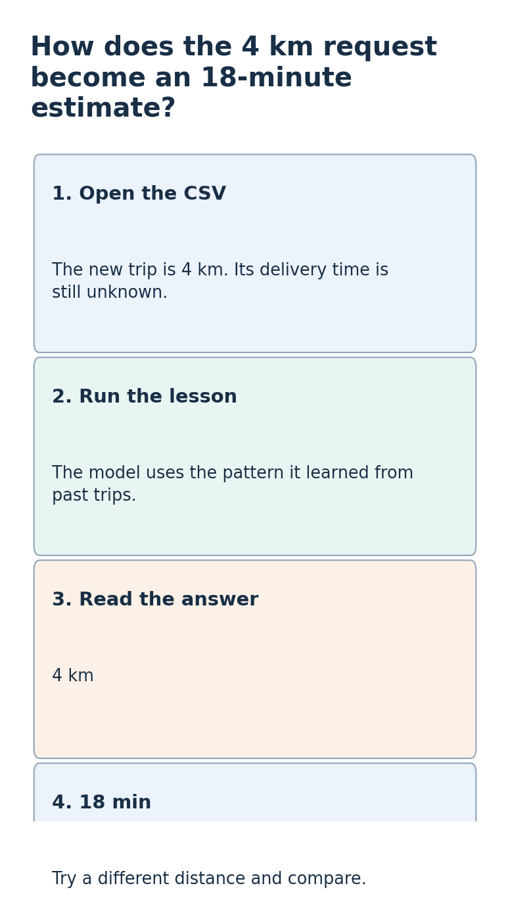

**👀 Read the visual.** Follow a delivery request from the CSV to the result.

**👉 Use what you see.** Edit **one input first**. Compare the new estimate with the original so you can trace what changed.

Each lesson has its own package list and CSVs. Run the commands from its folder. The sample rows were made for this workbook, including the exercises listed under the PDF’s public dataset headings.

| If you see | Check this first |
| --- | --- |
| Python cannot find `lesson.py` | Open the extracted lesson folder before running the command. |
| `ModuleNotFoundError` | Run `python -m pip install -r requirements.txt` from that folder. Use the same Python to install and run. |
| Python cannot find a CSV | Keep the CSV files next to `lesson.py` and keep their original names. |

<a id="your-first-prediction"></a>

### 🚚 Your first prediction

| Lesson name | What you’ll do | Download |
| --- | --- | --- |
| 002 - Your first prediction **Core** | Predict how long a 4 km delivery will take, then check the model against two trips with known times. | [Lesson ZIP](sample_code_folder/002-your-first-prediction.zip) |

<!-- workbook-teaching:2:start -->
<details>
<summary>Learn, trace and apply this idea</summary>

### Learn and apply: Your first prediction

**Your decision.** Predict how long a 4 km delivery will take, then check the model against two trips with known times.

**Ready check.** Read one row and multiply a small number by two. Use [the learning path](LEARNING-PATH.md) and [the word list](GLOSSARY.md) for the earlier skill. Trace the small example on paper before code.

**What it means.** A prediction is an estimate made from inputs. Training learns the rule from completed examples.

**Why and when.** Use a prediction when the answer is not yet known. A fixed rule is enough when the rule is already agreed.

**A worked example to follow.** A trip of 4 km has no measured time yet. The tiny training table follows 10 + 2 × distance, so the estimate is 18 minutes. Compare a completed trip with its recorded time before trusting a rule.

**Input → steps → output.** Open the supplied table. Its fields are `distance_km`, `minutes`. One original row is shown below in that same field order; `(missing)` marks a blank rather than zero.

```text
1 | 12
```

1. Name the particular field or object involved in this lesson’s decision above. Keep its meaning and units with it.
2. Open the [complete runnable Python example](lessons/002-your-first-prediction/lesson.py). Its numbered comments connect reading, preparation and the resulting calculation. Install only the [declared requirements](lessons/002-your-first-prediction/requirements.txt) using the same course Python, as shown in Setup.
3. Trace the worked example above through the script. Keep inputs apart from measured answers. Follow this script’s split and fit, then trace the saved preparation into the held-back result and any new request. A request must not supply its own training answer.
4. Read the result by its headings. Compare with [full recorded output](lessons/002-your-first-prediction/expected-output.txt); the excerpt below belongs to the original supplied files. Your edits can change it.

```text
One completed delivery
 distance_km  minutes
           1       12

Compare the recorded and predicted minutes
 distance_km  minutes  predicted_minutes
```

**How to interpret it.** Trace the worked case into the result above. Tell a calculated estimate from a measured answer.

**Common mistakes and limits.** These exact made-up numbers show the calculation. They do not show how traffic or a new town will affect a real trip.

**Use it yourself.** Without running Python, predict 8 km. Which field must stay unknown until that trip finishes?

<details>
<summary>Check your choice and reason</summary>

The estimate is 26 minutes. The actual time remains unknown. Editing a request does not create a measured answer.

</details>

**A second check later.** Close the notes and explain the same decision using a different row from the supplied table. State one condition that would make this method unsuitable. If you cannot explain the reason, repeat the small worked example before adding more code.

</details>
<!-- workbook-teaching:2:end -->


**Before this lesson.** Read a table and add small numbers.

**In simple words.** Distance is known before the trip. The measured time is the answer. Training learns a rule; prediction uses it.

**Guess first.** What happens to the guess when distance rises from 4 to 8? Write your answer before running the example.

<details>
<summary>Read the reason after trying</summary>

It rises from 18 to 26 minutes in this made-up example. Real times can vary.

</details>


**Next step.** Return to [Your learning path](LEARNING-PATH.md) and open the next unfinished module.

**🎯 Goal.** How long might a 4 km delivery take? Each **row** is one delivery. Each **column** is one type of fact. Distance is the input. The known time is the answer the model learns from.

**📋 Sample data**

| distance_km | minutes |
| --- | --- |
| 1 | 12 |
| 2 | 14 |
| 3 | 16 |
| 5 | 20 |
| 6 | 22 |

**▶️ Run.** Unzip the [lesson files](sample_code_folder/002-your-first-prediction.zip) and open a terminal in that folder. Install the lesson’s packages with `python -m pip install -r requirements.txt`, then run `python lesson.py`.

**🐍 Complete script from the ZIP**

```python
"""
Your first prediction

Predict how long a 4 km delivery will take, then check the model against two trips with known times.

Run: python lesson.py
Change 4 to 8 in new_inputs.csv, then run this script again.
"""

from pathlib import Path
import pandas as pd
from sklearn.linear_model import LinearRegression

input_path = Path(__file__).resolve().with_name("sample.csv")
new_path = Path(__file__).resolve().with_name("new_inputs.csv")


# 1. Read the CSV and check its inputs, including distance_km, minutes.
deliveries = pd.read_csv(input_path)
# 2. Print the result next to the input values so you can compare them.
print("One completed delivery")
print(deliveries.head(1).to_string(index=False))


# 3. Set aside the check rows before the model learns.
training = deliveries.iloc[:3]
model = LinearRegression()
# 4. Teach the model from the training inputs and delivery time in minutes.
model.fit(training[["distance_km"]], training["minutes"])


checking = deliveries.iloc[3:]
# 5. Compare predictions with the measured answers in the check rows.
check_minutes = model.predict(checking[["distance_km"]])
checking_results = checking.copy()
checking_results["predicted_minutes"] = check_minutes.round(1)
print("\nCompare the recorded and predicted minutes")
print(checking_results.to_string(index=False))

# 6. Apply the fitted model to the new CSV rows and print a result for each row.
new_delivery = pd.read_csv(new_path)
new_minutes = model.predict(new_delivery[["distance_km"]])
results = new_delivery.copy()
results["Predicted time (min)"] = new_minutes.round(1)
print("\nNew delivery estimates")
print(results.to_string(index=False))
```

**✅ Check.** See 18.0 minutes next to 4 km under New delivery estimates.

| Distance (km) | Predicted minutes |
| --- | --- |
| 4 | 18.0 |
| 7 | 24.0 |
| 9 | 28.0 |

**Your small change.** In new_inputs.csv change 4 to 8. After rerunning, the first estimate should be 26.0 minutes. Save the named CSV before running again.

**📩 CSV used for the estimates**

| distance_km |
| --- |
| 4 |
| 7 |
| 9 |


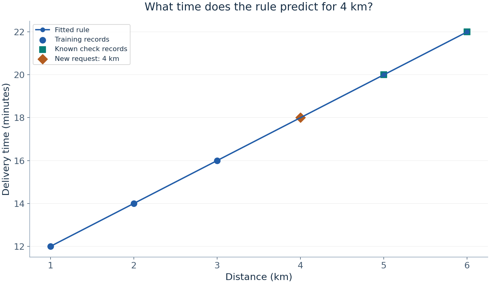

**👀 Read the visual.** Find the diamond at 4 km and read 18 minutes on the vertical scale. The squares show observed times that were held out of fitting.

**👉 Use what you see.** Compare the 18-minute estimate with the known times nearby. Try a different distance and read its point the same way.

**💡 What happened?** In these made-up rows, each additional kilometre takes two more minutes. The model guesses **18 minutes** for 4 km. The other two rows show how to check a prediction when you know what actually happened.

| Workbook term | Meaning in the delivery example |
| --- | --- |
| Input or feature | Something you know before predicting, such as distance. |
| Target, answer, or label | What you are trying to predict. For a category, you’ll often hear label. |
| Training rows | Rows that teach the model. |
| Validation rows | Extra rows used to choose a method or setting. |
| Test rows | Rows saved for the final check after the choices are made. |
| `import` | Make code from an installed package available. |
| `DataFrame` | A Python table with rows and named columns. |
| `.iloc[0]` and `.iloc[:3]` | The first row and the first three rows. Python starts counting at zero. |
| `read_csv` and `StringIO` | Read comma-separated data. `StringIO` lets text inside an example act like a small file. |
| `fit`, `transform`, and `predict` | Learn from training data, apply a learned change, and give an answer for a new row. |
| `make_pipeline` | Keep steps such as filling blanks, scaling numbers, and fitting a model together so they also run in order on a new row. |

**Read in stages.** Start with [Missing Values](#1-3-1-handle-missing-values), [Outliers](#1-3-4-handle-outliers), [Min-Max Scaling](#normalization-min-max-scaling), and [Data Splitting](#1-6-data-splitting). Once you can explain the input, answer, and prediction in a lesson, try changing one row.

<a id="1-data-science-pipeline"></a>

## 🟩 1. Data Science Pipeline

| Lesson name | What you’ll do | Download |
| --- | --- | --- |
| 003 - 1. Data Science Pipeline **Practice** | Turn a business question into something you can measure before you choose a model. | [Lesson ZIP](sample_code_folder/003-1-data-science-pipeline.zip) |

<!-- workbook-teaching:3:start -->
<details>
<summary>Learn, trace and apply this idea</summary>

### Learn and apply: 1. Data Science Pipeline

**Your decision.** Turn a business question into something you can measure before you choose a model.

**Ready check.** Name a person who needs to make a decision. Use [the learning path](LEARNING-PATH.md) and [the word list](GLOSSARY.md) for the earlier skill. Trace the small example on paper before code.

**What it means.** A project brief states the decision, wanted answer, available inputs, useful score and practical limits.

**Why and when.** Write the brief before choosing an algorithm. It can reveal that a report or ordinary rule is enough.

**A worked example to follow.** A shop wants a delivery estimate before dispatch. Distance is available then; the finished delivery time is not. Minutes of error answer this question more directly than a percentage of correct category names.

**Input → steps → output.** Open the supplied table. Its fields are `use_case`, `objective`, `metric`, `domain_check`, `constraint`. One original row is shown below in that same field order; `(missing)` marks a blank rather than zero.

```text
Estimate delivery time | regression | RMSE | Distance is in km | One laptop
```

1. Name the particular field or object involved in this lesson’s decision above. Keep its meaning and units with it.
2. Open the [complete runnable Python example](lessons/003-1-data-science-pipeline/lesson.py). Its numbered comments connect reading, preparation and the resulting calculation. Install only the [declared requirements](lessons/003-1-data-science-pipeline/requirements.txt) using the same course Python, as shown in Setup.
3. Trace the worked example above through the script. Trace the named source fields into the printed table, file or request result. Check names and counts before interpreting what the program reports.
4. Read the result by its headings. Compare with [full recorded output](lessons/003-1-data-science-pipeline/expected-output.txt); the excerpt below belongs to the original supplied files. Your edits can change it.

```text
              use_case
Estimate delivery time
Route support messages
        Group shoppers
First decision: Estimate delivery time
```

**How to interpret it.** Trace the worked case into the result above. Tell a calculated estimate from a measured answer.

**Common mistakes and limits.** A convenient score is not automatically a useful business goal. State units, when fields arrive, and who acts on the result.

**Use it yourself.** For a rule giving free delivery above 50 currency units, write the decision and decide whether training is needed. Then change the question to estimated arrival time.

<details>
<summary>Check your choice and reason</summary>

Free delivery follows an agreed threshold, so no learned model is needed. Arrival time may need examples; compare it with a simple existing estimate and choose an acceptable error in minutes.

</details>

**A second check later.** Close the notes and explain the same decision using a different row from the supplied table. State one condition that would make this method unsuitable. If you cannot explain the reason, repeat the small worked example before adding more code.

</details>
<!-- workbook-teaching:3:end -->


**Before this lesson.** Name the person and decision the result should help.

**In simple words.** A project needs a useful question before it needs a model. A fixed rule may be enough. A score must match the decision.

**Guess first.** Do we always need machine learning? Write your answer before running the example.

<details>
<summary>Read the reason after trying</summary>

No. Use a known rule or report if it answers the question well enough.

</details>


**👀 Read the visual.** Follow the delivery-time example through the whole pipeline.

**👉 Use what you see.** Write down the **answer** the model must predict and the **inputs** the app will know when someone requests it.

<a id="1-1-problem-definition"></a>

### 🎯 1.1 Problem Definition

| Lesson name | What you’ll do | Download |
| --- | --- | --- |
| 004 - 1.1 Problem Definition **Core** | Decide what question the model should answer and how you will judge its answers. | [Lesson ZIP](sample_code_folder/004-1-1-problem-definition.zip) |

<!-- workbook-teaching:4:start -->
<details>
<summary>Learn, trace and apply this idea</summary>

### Learn and apply: 1.1 Problem Definition

**Your decision.** Decide what question the model should answer and how you will judge its answers.

**Ready check.** Name a person who needs to make a decision. Use [the learning path](LEARNING-PATH.md) and [the word list](GLOSSARY.md) for the earlier skill. Trace the small example on paper before code.

**What it means.** A project brief states the decision, wanted answer, available inputs, useful score and practical limits.

**Why and when.** Write the brief before choosing an algorithm. It can reveal that a report or ordinary rule is enough.

**A worked example to follow.** A shop wants a delivery estimate before dispatch. Distance is available then; the finished delivery time is not. Minutes of error answer this question more directly than a percentage of correct category names.

**Input → steps → output.** Open the supplied table. Its fields are `use_case`, `objective`, `metric`, `domain_check`, `constraint`. One original row is shown below in that same field order; `(missing)` marks a blank rather than zero.

```text
Estimate delivery time | regression | RMSE | Distance is in km | One laptop
```

1. Name the particular field or object involved in this lesson’s decision above. Keep its meaning and units with it.
2. Open the [complete runnable Python example](lessons/004-1-1-problem-definition/lesson.py). Its numbered comments connect reading, preparation and the resulting calculation. Install only the [declared requirements](lessons/004-1-1-problem-definition/requirements.txt) using the same course Python, as shown in Setup.
3. Trace the worked example above through the script. Trace the named source fields into the printed table, file or request result. Check names and counts before interpreting what the program reports.
4. Read the result by its headings. Compare with [full recorded output](lessons/004-1-1-problem-definition/expected-output.txt); the excerpt below belongs to the original supplied files. Your edits can change it.

```text
              use_case      objective
Estimate delivery time     regression
Route support messages classification
        Group shoppers     clustering
First decision: Estimate delivery time
```

**How to interpret it.** Trace the worked case into the result above. Tell a calculated estimate from a measured answer.

**Common mistakes and limits.** A convenient score is not automatically a useful business goal. State units, when fields arrive, and who acts on the result.

**Use it yourself.** For a rule giving free delivery above 50 currency units, write the decision and decide whether training is needed. Then change the question to estimated arrival time.

<details>
<summary>Check your choice and reason</summary>

Free delivery follows an agreed threshold, so no learned model is needed. Arrival time may need examples; compare it with a simple existing estimate and choose an acceptable error in minutes.

</details>

**A second check later.** Close the notes and explain the same decision using a different row from the supplied table. State one condition that would make this method unsuitable. If you cannot explain the reason, repeat the small worked example before adding more code.

</details>
<!-- workbook-teaching:4:end -->


**Before this lesson.** Name the person and decision the result should help.

**In simple words.** A project needs a useful question before it needs a model. A fixed rule may be enough. A score must match the decision.

**Guess first.** Do we always need machine learning? Write your answer before running the example.

<details>
<summary>Read the reason after trying</summary>

No. Use a known rule or report if it answers the question well enough.

</details>


**📌 Before you start.** Pick one result you want the app to produce.

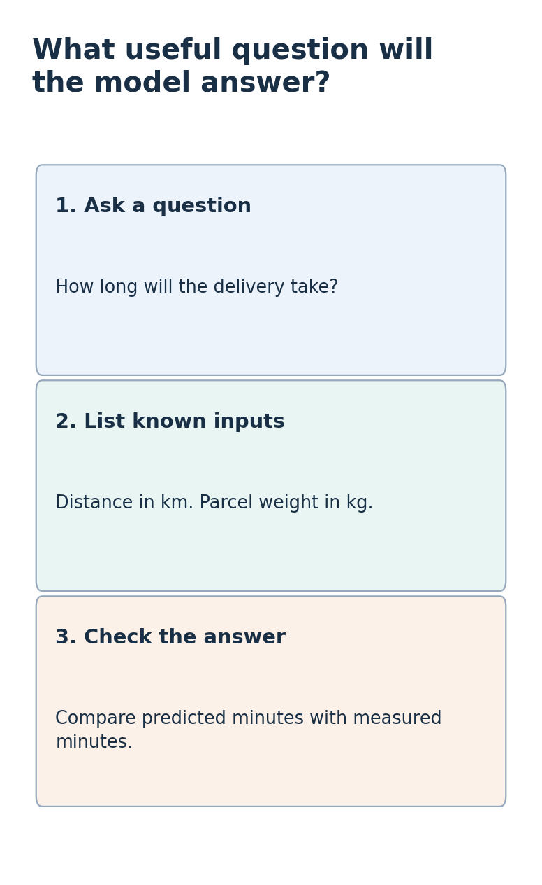

**👀 Read the visual.** Decide what a useful result looks like before picking an algorithm.

**👉 Use what you see.** If the app predicts **minutes**, start with an error measured in minutes, such as MAE.

<a id="understand-the-business-problem-or-use-case"></a>

#### 🗣️ Understand the business problem or use case

| Lesson name | What you’ll do | Download |
| --- | --- | --- |
| 005 - Understand the business problem or use case **Practice** | Name the decision you want to make for a delivery, a support message, or a shopper. | [Lesson ZIP](sample_code_folder/005-understand-the-business-problem-or-use-case.zip) |

<!-- workbook-teaching:5:start -->
<details>
<summary>Learn, trace and apply this idea</summary>

### Learn and apply: Understand the business problem or use case

**Your decision.** Name the decision you want to make for a delivery, a support message, or a shopper.

**Ready check.** Name a person who needs to make a decision. Use [the learning path](LEARNING-PATH.md) and [the word list](GLOSSARY.md) for the earlier skill. Trace the small example on paper before code.

**What it means.** A project brief states the decision, wanted answer, available inputs, useful score and practical limits.

**Why and when.** Write the brief before choosing an algorithm. It can reveal that a report or ordinary rule is enough.

**A worked example to follow.** A shop wants a delivery estimate before dispatch. Distance is available then; the finished delivery time is not. Minutes of error answer this question more directly than a percentage of correct category names.

**Input → steps → output.** Open the supplied table. Its fields are `use_case`, `objective`, `metric`, `domain_check`, `constraint`. One original row is shown below in that same field order; `(missing)` marks a blank rather than zero.

```text
Estimate delivery time | regression | RMSE | Distance is in km | One laptop
```

1. Name the particular field or object involved in this lesson’s decision above. Keep its meaning and units with it.
2. Open the [complete runnable Python example](lessons/005-understand-the-business-problem-or-use-case/lesson.py). Its numbered comments connect reading, preparation and the resulting calculation. Install only the [declared requirements](lessons/005-understand-the-business-problem-or-use-case/requirements.txt) using the same course Python, as shown in Setup.
3. Trace the worked example above through the script. Trace the named source fields into the printed table, file or request result. Check names and counts before interpreting what the program reports.
4. Read the result by its headings. Compare with [full recorded output](lessons/005-understand-the-business-problem-or-use-case/expected-output.txt); the excerpt below belongs to the original supplied files. Your edits can change it.

```text
              use_case
Estimate delivery time
Route support messages
        Group shoppers
First decision: Estimate delivery time
```

**How to interpret it.** Trace the worked case into the result above. Tell a calculated estimate from a measured answer.

**Common mistakes and limits.** A convenient score is not automatically a useful business goal. State units, when fields arrive, and who acts on the result.

**Use it yourself.** For a rule giving free delivery above 50 currency units, write the decision and decide whether training is needed. Then change the question to estimated arrival time.

<details>
<summary>Check your choice and reason</summary>

Free delivery follows an agreed threshold, so no learned model is needed. Arrival time may need examples; compare it with a simple existing estimate and choose an acceptable error in minutes.

</details>

**A second check later.** Close the notes and explain the same decision using a different row from the supplied table. State one condition that would make this method unsuitable. If you cannot explain the reason, repeat the small worked example before adding more code.

</details>
<!-- workbook-teaching:5:end -->


**Before this lesson.** Name the person and decision the result should help.

**In simple words.** A project needs a useful question before it needs a model. A fixed rule may be enough. A score must match the decision.

**Guess first.** Do we always need machine learning? Write your answer before running the example.

<details>
<summary>Read the reason after trying</summary>

No. Use a known rule or report if it answers the question well enough.

</details>


In the worksheet below, write the decision or action the result should support.

<a id="define-the-objective"></a>

#### 🎯 Define the objective

| Lesson name | What you’ll do | Download |
| --- | --- | --- |
| 006 - Define the objective **Practice** | Decide whether the task needs a number, a category, or groups of similar rows. | [Lesson ZIP](sample_code_folder/006-define-the-objective.zip) |

<!-- workbook-teaching:6:start -->
<details>
<summary>Learn, trace and apply this idea</summary>

### Learn and apply: Define the objective

**Your decision.** Decide whether the task needs a number, a category, or groups of similar rows.

**Ready check.** Name a person who needs to make a decision. Use [the learning path](LEARNING-PATH.md) and [the word list](GLOSSARY.md) for the earlier skill. Trace the small example on paper before code.

**What it means.** A project brief states the decision, wanted answer, available inputs, useful score and practical limits.

**Why and when.** Write the brief before choosing an algorithm. It can reveal that a report or ordinary rule is enough.

**A worked example to follow.** A shop wants a delivery estimate before dispatch. Distance is available then; the finished delivery time is not. Minutes of error answer this question more directly than a percentage of correct category names.

**Input → steps → output.** Open the supplied table. Its fields are `use_case`, `objective`, `metric`, `domain_check`, `constraint`. One original row is shown below in that same field order; `(missing)` marks a blank rather than zero.

```text
Estimate delivery time | regression | RMSE | Distance is in km | One laptop
```

1. Name the particular field or object involved in this lesson’s decision above. Keep its meaning and units with it.
2. Open the [complete runnable Python example](lessons/006-define-the-objective/lesson.py). Its numbered comments connect reading, preparation and the resulting calculation. Install only the [declared requirements](lessons/006-define-the-objective/requirements.txt) using the same course Python, as shown in Setup.
3. Trace the worked example above through the script. Trace the named source fields into the printed table, file or request result. Check names and counts before interpreting what the program reports.
4. Read the result by its headings. Compare with [full recorded output](lessons/006-define-the-objective/expected-output.txt); the excerpt below belongs to the original supplied files. Your edits can change it.

```text
              use_case      objective
Estimate delivery time     regression
Route support messages classification
        Group shoppers     clustering
First decision: Estimate delivery time
```

**How to interpret it.** Trace the worked case into the result above. Tell a calculated estimate from a measured answer.

**Common mistakes and limits.** A convenient score is not automatically a useful business goal. State units, when fields arrive, and who acts on the result.

**Use it yourself.** For a rule giving free delivery above 50 currency units, write the decision and decide whether training is needed. Then change the question to estimated arrival time.

<details>
<summary>Check your choice and reason</summary>

Free delivery follows an agreed threshold, so no learned model is needed. Arrival time may need examples; compare it with a simple existing estimate and choose an acceptable error in minutes.

</details>

**A second check later.** Close the notes and explain the same decision using a different row from the supplied table. State one condition that would make this method unsuitable. If you cannot explain the reason, repeat the small worked example before adding more code.

</details>
<!-- workbook-teaching:6:end -->


**Before this lesson.** Name the person and decision the result should help.

**In simple words.** A project needs a useful question before it needs a model. A fixed rule may be enough. A score must match the decision.

**Guess first.** Do we always need machine learning? Write your answer before running the example.

<details>
<summary>Read the reason after trying</summary>

No. Use a known rule or report if it answers the question well enough.

</details>


Choose what the output should look like. The sample worksheet distinguishes a number, a category, and a group.

<a id="identify-key-performance-metrics"></a>

#### 📏 Identify key performance metrics

| Lesson name | What you’ll do | Download |
| --- | --- | --- |
| 007 - Identify key performance metrics **Practice** | Pick a score that fits the question, such as minutes of error or how many urgent cases the model catches. | [Lesson ZIP](sample_code_folder/007-identify-key-performance-metrics.zip) |

<!-- workbook-teaching:7:start -->
<details>
<summary>Learn, trace and apply this idea</summary>

### Learn and apply: Identify key performance metrics

**Your decision.** Pick a score that fits the question, such as minutes of error or how many urgent cases the model catches.

**Ready check.** Name a person who needs to make a decision. Use [the learning path](LEARNING-PATH.md) and [the word list](GLOSSARY.md) for the earlier skill. Trace the small example on paper before code.

**What it means.** A project brief states the decision, wanted answer, available inputs, useful score and practical limits.

**Why and when.** Write the brief before choosing an algorithm. It can reveal that a report or ordinary rule is enough.

**A worked example to follow.** A shop wants a delivery estimate before dispatch. Distance is available then; the finished delivery time is not. Minutes of error answer this question more directly than a percentage of correct category names.

**Input → steps → output.** Open the supplied table. Its fields are `use_case`, `objective`, `metric`, `domain_check`, `constraint`. One original row is shown below in that same field order; `(missing)` marks a blank rather than zero.

```text
Estimate delivery time | regression | RMSE | Distance is in km | One laptop
```

1. Name the particular field or object involved in this lesson’s decision above. Keep its meaning and units with it.
2. Open the [complete runnable Python example](lessons/007-identify-key-performance-metrics/lesson.py). Its numbered comments connect reading, preparation and the resulting calculation. Install only the [declared requirements](lessons/007-identify-key-performance-metrics/requirements.txt) using the same course Python, as shown in Setup.
3. Trace the worked example above through the script. Trace the named source fields into the printed table, file or request result. Check names and counts before interpreting what the program reports.
4. Read the result by its headings. Compare with [full recorded output](lessons/007-identify-key-performance-metrics/expected-output.txt); the excerpt below belongs to the original supplied files. Your edits can change it.

```text
              use_case     metric
Estimate delivery time       RMSE
Route support messages         F1
        Group shoppers Silhouette
First decision: Estimate delivery time
```

**How to interpret it.** Trace the worked case into the result above. Tell a calculated estimate from a measured answer.

**Common mistakes and limits.** A convenient score is not automatically a useful business goal. State units, when fields arrive, and who acts on the result.

**Use it yourself.** For a rule giving free delivery above 50 currency units, write the decision and decide whether training is needed. Then change the question to estimated arrival time.

<details>
<summary>Check your choice and reason</summary>

Free delivery follows an agreed threshold, so no learned model is needed. Arrival time may need examples; compare it with a simple existing estimate and choose an acceptable error in minutes.

</details>

**A second check later.** Close the notes and explain the same decision using a different row from the supplied table. State one condition that would make this method unsuitable. If you cannot explain the reason, repeat the small worked example before adding more code.

</details>
<!-- workbook-teaching:7:end -->


**Before this lesson.** Name the person and decision the result should help.

**In simple words.** A project needs a useful question before it needs a model. A fixed rule may be enough. A score must match the decision.

**Guess first.** Do we always need machine learning? Write your answer before running the example.

<details>
<summary>Read the reason after trying</summary>

No. Use a known rule or report if it answers the question well enough.

</details>


Use the worksheet to select a first check. The evaluation section shows how to compute accuracy, RMSE, and F1-score.

<a id="understand-the-domain-knowledge-related-to-the-data"></a>

#### 🧭 Understand the domain knowledge related to the data

| Lesson name | What you’ll do | Download |
| --- | --- | --- |
| 008 - Understand the domain knowledge related to the data **Practice** | Write down what the data means, including its units and what you know before predicting. | [Lesson ZIP](sample_code_folder/008-understand-the-domain-knowledge-related-to-the-data.zip) |

<!-- workbook-teaching:8:start -->
<details>
<summary>Learn, trace and apply this idea</summary>

### Learn and apply: Understand the domain knowledge related to the data

**Your decision.** Write down what the data means, including its units and what you know before predicting.

**Ready check.** Name a person who needs to make a decision. Use [the learning path](LEARNING-PATH.md) and [the word list](GLOSSARY.md) for the earlier skill. Trace the small example on paper before code.

**What it means.** A project brief states the decision, wanted answer, available inputs, useful score and practical limits.

**Why and when.** Write the brief before choosing an algorithm. It can reveal that a report or ordinary rule is enough.

**A worked example to follow.** A shop wants a delivery estimate before dispatch. Distance is available then; the finished delivery time is not. Minutes of error answer this question more directly than a percentage of correct category names.

**Input → steps → output.** Open the supplied table. Its fields are `use_case`, `objective`, `metric`, `domain_check`, `constraint`. One original row is shown below in that same field order; `(missing)` marks a blank rather than zero.

```text
Estimate delivery time | regression | RMSE | Distance is in km | One laptop
```

1. Name the particular field or object involved in this lesson’s decision above. Keep its meaning and units with it.
2. Open the [complete runnable Python example](lessons/008-understand-the-domain-knowledge-related-to-the-data/lesson.py). Its numbered comments connect reading, preparation and the resulting calculation. Install only the [declared requirements](lessons/008-understand-the-domain-knowledge-related-to-the-data/requirements.txt) using the same course Python, as shown in Setup.
3. Trace the worked example above through the script. Trace the named source fields into the printed table, file or request result. Check names and counts before interpreting what the program reports.
4. Read the result by its headings. Compare with [full recorded output](lessons/008-understand-the-domain-knowledge-related-to-the-data/expected-output.txt); the excerpt below belongs to the original supplied files. Your edits can change it.

```text
              use_case                          domain_check
Estimate delivery time                     Distance is in km
Route support messages              Negation changes meaning
        Group shoppers Income and scores use different units
First decision: Estimate delivery time
```

**How to interpret it.** Trace the worked case into the result above. Tell a calculated estimate from a measured answer.

**Common mistakes and limits.** A convenient score is not automatically a useful business goal. State units, when fields arrive, and who acts on the result.

**Use it yourself.** For a rule giving free delivery above 50 currency units, write the decision and decide whether training is needed. Then change the question to estimated arrival time.

<details>
<summary>Check your choice and reason</summary>

Free delivery follows an agreed threshold, so no learned model is needed. Arrival time may need examples; compare it with a simple existing estimate and choose an acceptable error in minutes.

</details>

**A second check later.** Close the notes and explain the same decision using a different row from the supplied table. State one condition that would make this method unsuitable. If you cannot explain the reason, repeat the small worked example before adding more code.

</details>
<!-- workbook-teaching:8:end -->


**Before this lesson.** Name the person and decision the result should help.

**In simple words.** A project needs a useful question before it needs a model. A fixed rule may be enough. A score must match the decision.

**Guess first.** Do we always need machine learning? Write your answer before running the example.

<details>
<summary>Read the reason after trying</summary>

No. Use a known rule or report if it answers the question well enough.

</details>


Add a units or timing check for each input you plan to use.

<a id="set-constraints-assumptions"></a>

#### 📋 Set constraints & assumptions

| Lesson name | What you’ll do | Download |
| --- | --- | --- |
| 009 - Set constraints & assumptions **Core** | Record the time, hardware and accuracy limits that affect your project. | [Lesson ZIP](sample_code_folder/009-set-constraints-assumptions.zip) |

<!-- workbook-teaching:9:start -->
<details>
<summary>Learn, trace and apply this idea</summary>

### Learn and apply: Set constraints & assumptions

**Your decision.** Record the time, hardware and accuracy limits that affect your project.

**Ready check.** Name a person who needs to make a decision. Use [the learning path](LEARNING-PATH.md) and [the word list](GLOSSARY.md) for the earlier skill. Trace the small example on paper before code.

**What it means.** A project brief states the decision, wanted answer, available inputs, useful score and practical limits.

**Why and when.** Write the brief before choosing an algorithm. It can reveal that a report or ordinary rule is enough.

**A worked example to follow.** A shop wants a delivery estimate before dispatch. Distance is available then; the finished delivery time is not. Minutes of error answer this question more directly than a percentage of correct category names.

**Input → steps → output.** Open the supplied table. Its fields are `use_case`, `objective`, `metric`, `domain_check`, `constraint`. One original row is shown below in that same field order; `(missing)` marks a blank rather than zero.

```text
Estimate delivery time | regression | RMSE | Distance is in km | One laptop
```

1. Name the particular field or object involved in this lesson’s decision above. Keep its meaning and units with it.
2. Open the [complete runnable Python example](lessons/009-set-constraints-assumptions/lesson.py). Its numbered comments connect reading, preparation and the resulting calculation. Install only the [declared requirements](lessons/009-set-constraints-assumptions/requirements.txt) using the same course Python, as shown in Setup.
3. Trace the worked example above through the script. Trace the named source fields into the printed table, file or request result. Check names and counts before interpreting what the program reports.
4. Read the result by its headings. Compare with [full recorded output](lessons/009-set-constraints-assumptions/expected-output.txt); the excerpt below belongs to the original supplied files. Your edits can change it.

```text
              use_case                   constraint
Estimate delivery time                   One laptop
Route support messages          Review missed items
        Group shoppers Groups must be interpretable
First decision: Estimate delivery time
```

**How to interpret it.** Trace the worked case into the result above. Tell a calculated estimate from a measured answer.

**Common mistakes and limits.** A convenient score is not automatically a useful business goal. State units, when fields arrive, and who acts on the result.

**Use it yourself.** For a rule giving free delivery above 50 currency units, write the decision and decide whether training is needed. Then change the question to estimated arrival time.

<details>
<summary>Check your choice and reason</summary>

Free delivery follows an agreed threshold, so no learned model is needed. Arrival time may need examples; compare it with a simple existing estimate and choose an acceptable error in minutes.

</details>

**A second check later.** Close the notes and explain the same decision using a different row from the supplied table. State one condition that would make this method unsuitable. If you cannot explain the reason, repeat the small worked example before adding more code.

</details>
<!-- workbook-teaching:9:end -->


**Before this lesson.** Name the person and decision the result should help.

**In simple words.** A project needs a useful question before it needs a model. A fixed rule may be enough. A score must match the decision.

**Guess first.** Do we always need machine learning? Write your answer before running the example.

<details>
<summary>Read the reason after trying</summary>

No. Use a known rule or report if it answers the question well enough.

</details>


Write one row for each practical choice before you train. Change the goal and choose a different metric or check.

**📋 Sample data**

| use_case | objective | metric | domain_check | constraint |
| --- | --- | --- | --- | --- |
| Estimate delivery time | regression | RMSE | Distance is in km | One laptop |
| Route support messages | classification | F1 | Negation changes meaning | Review missed items |
| Group shoppers | clustering | Silhouette | Income and scores use different units | Groups must be interpretable |

**▶️ Run.** Unzip the [lesson files](sample_code_folder/009-set-constraints-assumptions.zip) and open a terminal in that folder. Install the lesson’s packages with `python -m pip install -r requirements.txt`, then run `python lesson.py`.

**🔹 Steps in the script**

1. Read the project brief. Each row lists one example project.
2. Print the result next to the input values so you can compare them.

**✅ Check.** Look for Route support messages          Review missed items in the output excerpt below.

```text
Route support messages          Review missed items
Group shoppers Groups must be interpretable
First decision: Estimate delivery time
```

**Your small change.** Add one task to sample.csv with a decision, objective, metric, domain check and constraint. Look for it in the printed table. Save the named CSV before running again.


**💡 Takeaway.** Record the domain assumption, available computing power, and the error you can tolerate. Accuracy is another option for classification. Revisit the brief after evaluation.

<a id="1-2-data-collection"></a>

### 📥 1.2 Data Collection

| Lesson name | What you’ll do | Download |
| --- | --- | --- |
| 010 - 1.2 Data Collection **Practice** | Read orders from a CSV, a small database, a local API, and a sample web page. | [Lesson ZIP](sample_code_folder/010-1-2-data-collection.zip) |

<!-- workbook-teaching:10:start -->
<details>
<summary>Learn, trace and apply this idea</summary>

### Learn and apply: 1.2 Data Collection

**Your decision.** Read orders from a CSV, a small database, a local API, and a sample web page.

**Ready check.** Read a CSV header and count rows. Use [the learning path](LEARNING-PATH.md) and [the word list](GLOSSARY.md) for the earlier skill. Trace the small example on paper before code.

**What it means.** Collection brings recorded facts into a table. A database query, API request and web-page parser are different ways to obtain rows.

**Why and when.** Use a source whose fields, permissions and update times fit the question. Keep the original source identifiable.

**A worked example to follow.** The three order IDs in sample.csv are copied into an in-memory SQLite table and returned by a local API. The HTML example extracts the same zones from supplied tags. Count IDs at each step: a successful request alone does not prove every row arrived.

**Input → steps → output.** Open the supplied table. Its fields are `order_id`, `zone`. One original row is shown below in that same field order; `(missing)` marks a blank rather than zero.

```text
1 | north
```

1. Name the particular field or object involved in this lesson’s decision above. Keep its meaning and units with it.
2. Open the [complete runnable Python example](lessons/010-1-2-data-collection/lesson.py). Its numbered comments connect reading, preparation and the resulting calculation. Install only the [declared requirements](lessons/010-1-2-data-collection/requirements.txt) using the same course Python, as shown in Setup.
3. Trace the worked example above through the script. Trace the named source fields into the printed table, file or request result. Check names and counts before interpreting what the program reports.
4. Read the result by its headings. Compare with [full recorded output](lessons/010-1-2-data-collection/expected-output.txt); the excerpt below belongs to the original supplied files. Your edits can change it.

```text
Rows from the CSV and database: 3 3

Orders returned by the local API
 order_id  zone
        1 north
        2 south
```

**How to interpret it.** Trace the worked case into the result above. Tell a calculated estimate from a measured answer.

**Common mistakes and limits.** The script uses local fixtures, not a live public API or web scraper. Real APIs may paginate, fail or change their schema. An HTML page can change its tags.

**Use it yourself.** Add one invented order with a unique ID. Before running, predict the CSV, database and local API row counts. Which source would you inspect if they disagree?

<details>
<summary>Check your choice and reason</summary>

Every complete copy should contain the extra order once. Trace its ID from the original CSV through each result. Investigate filtering, paging or parsing rather than silently accepting fewer rows.

</details>

**A second check later.** Close the notes and explain the same decision using a different row from the supplied table. State one condition that would make this method unsuitable. If you cannot explain the reason, repeat the small worked example before adding more code.

</details>
<!-- workbook-teaching:10:end -->


**Before this lesson.** Read a CSV table. A request asks another program for data.

**In simple words.** A CSV, database, API and web page can hold similar facts. This practice stays on your computer. It does not ask a public website for data.

**Guess first.** How will you know that all required rows arrived? Write your answer before running the example.

<details>
<summary>Read the reason after trying</summary>

Compare row counts, IDs and required fields. A live source may return rows in several pages.

</details>


**📌 Before you start.** Know which fields you need and what each row should represent.

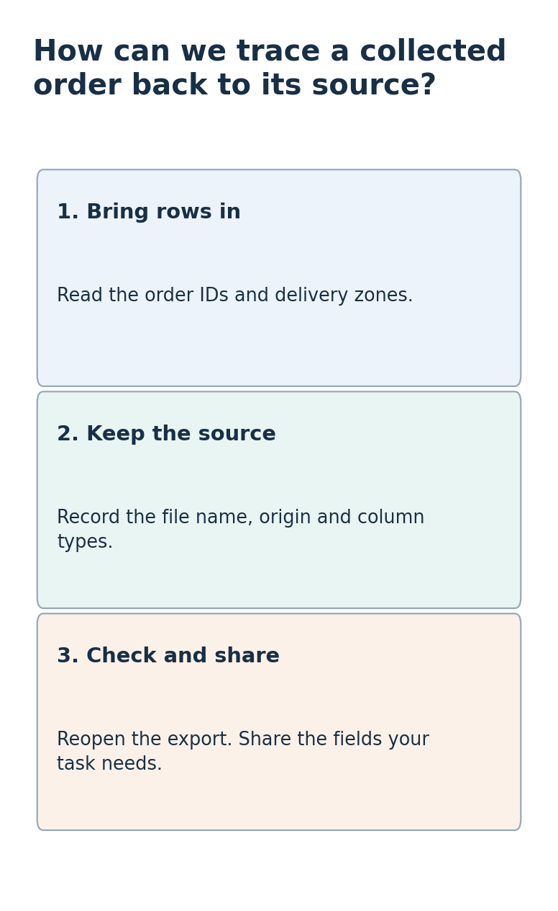

**👀 Read the visual.** The same order rows can come from a CSV, a database, or an API.

**👉 Use what you see.** If a column disappears after export, check what was collected and which columns were selected.

<a id="identify-data-sources"></a>

#### 🔎 Identify data sources

| Lesson name | What you’ll do | Download |
| --- | --- | --- |
| 011 - Identify data sources **Practice** | Compare four ways to bring order data into Python. | [Lesson ZIP](sample_code_folder/011-identify-data-sources.zip) |

<!-- workbook-teaching:11:start -->
<details>
<summary>Learn, trace and apply this idea</summary>

### Learn and apply: Identify data sources

**Your decision.** Compare four ways to bring order data into Python.

**Ready check.** Read a CSV header and count rows. Use [the learning path](LEARNING-PATH.md) and [the word list](GLOSSARY.md) for the earlier skill. Trace the small example on paper before code.

**What it means.** Collection brings recorded facts into a table. A database query, API request and web-page parser are different ways to obtain rows.

**Why and when.** Use a source whose fields, permissions and update times fit the question. Keep the original source identifiable.

**A worked example to follow.** The three order IDs in sample.csv are copied into an in-memory SQLite table and returned by a local API. The HTML example extracts the same zones from supplied tags. Count IDs at each step: a successful request alone does not prove every row arrived.

**Input → steps → output.** Open the supplied table. Its fields are `order_id`, `zone`. One original row is shown below in that same field order; `(missing)` marks a blank rather than zero.

```text
1 | north
```

1. Name the particular field or object involved in this lesson’s decision above. Keep its meaning and units with it.
2. Open the [complete runnable Python example](lessons/011-identify-data-sources/lesson.py). Its numbered comments connect reading, preparation and the resulting calculation. Install only the [declared requirements](lessons/011-identify-data-sources/requirements.txt) using the same course Python, as shown in Setup.
3. Trace the worked example above through the script. Trace the named source fields into the printed table, file or request result. Check names and counts before interpreting what the program reports.
4. Read the result by its headings. Compare with [full recorded output](lessons/011-identify-data-sources/expected-output.txt); the excerpt below belongs to the original supplied files. Your edits can change it.

```text
Rows from the CSV and database: 3 3

Orders returned by the local API
 order_id  zone
        1 north
        2 south
```

**How to interpret it.** Trace the worked case into the result above. Tell a calculated estimate from a measured answer.

**Common mistakes and limits.** The script uses local fixtures, not a live public API or web scraper. Real APIs may paginate, fail or change their schema. An HTML page can change its tags.

**Use it yourself.** Add one invented order with a unique ID. Before running, predict the CSV, database and local API row counts. Which source would you inspect if they disagree?

<details>
<summary>Check your choice and reason</summary>

Every complete copy should contain the extra order once. Trace its ID from the original CSV through each result. Investigate filtering, paging or parsing rather than silently accepting fewer rows.

</details>

**A second check later.** Close the notes and explain the same decision using a different row from the supplied table. State one condition that would make this method unsuitable. If you cannot explain the reason, repeat the small worked example before adding more code.

</details>
<!-- workbook-teaching:11:end -->


**Before this lesson.** Read a CSV table. A request asks another program for data.

**In simple words.** A CSV, database, API and web page can hold similar facts. This practice stays on your computer. It does not ask a public website for data.

**Guess first.** How will you know that all required rows arrived? Write your answer before running the example.

<details>
<summary>Read the reason after trying</summary>

Compare row counts, IDs and required fields. A live source may return rows in several pages.

</details>


Create four sources in Python. Use a local test API and a sample HTML page so you can practise without sending a request over the network.

**📋 Sample data**

| order_id | zone |
| --- | --- |
| 1 | north |
| 2 | south |
| 3 | west |

**▶️ Run.** Unzip the [lesson files](sample_code_folder/011-identify-data-sources.zip) and open a terminal in that folder. Install the lesson’s packages with `python -m pip install -r requirements.txt`, then run `python lesson.py`.

**🔹 Steps in the script**

1. Read the order IDs and the zone for each order.
2. Send a practice request and read the response code and body.

**✅ Check.** Look for Rows from the CSV and database: 3 3 in the output excerpt below.

```text
Rows from the CSV and database: 3 3
Orders returned by the local API
order_id  zone
```

**Your small change.** Add order_id 4 with zone west in sample.csv. Look for it in the database, API or page output. Save the named CSV before running again.


**💡 Takeaway.** The test client makes a GET request and checks the response before reading its rows. The HTML parser extracts the zone from the supplied page. For a live API, check pagination as well as status. For web scraping, check permitted access and the site’s terms first.

<a id="gather-structured-and-unstructured-data"></a>

#### 📦 Gather structured and unstructured data

| Lesson name | What you’ll do | Download |
| --- | --- | --- |
| 016 - Gather structured and unstructured data **Practice** | Collect a delivery table, a text file, an image, and a short video into one folder. | [Lesson ZIP](sample_code_folder/016-gather-structured-and-unstructured-data.zip) |

<!-- workbook-teaching:16:start -->
<details>
<summary>Learn, trace and apply this idea</summary>

### Learn and apply: Gather structured and unstructured data

**Your decision.** Collect a delivery table, a text file, an image, and a short video into one folder.

**Ready check.** Tell a file name, folder and CSV field apart. Use [the learning path](LEARNING-PATH.md) and [the word list](GLOSSARY.md) for the earlier skill. Trace the small example on paper before code.

**What it means.** A file list records where items are. Metadata records how they were obtained and what they mean.

**Why and when.** Use these notes whenever someone else must find, reproduce or safely share the data. Keep only fields needed for the agreed purpose.

**A worked example to follow.** The exercise writes deliveries.csv without the fictional contact field. A manifest lists text, picture and video files. File size is measured in bytes; it does not tell you whether the facts are correct.

**Input → steps → output.** Open the supplied table. Its fields are `order_id`, `minutes`, `contact`. One original row is shown below in that same field order; `(missing)` marks a blank rather than zero.

```text
1 | 22 | sample1@example.invalid
```

1. Name the particular field or object involved in this lesson’s decision above. Keep its meaning and units with it.
2. Open the [complete runnable Python example](lessons/016-gather-structured-and-unstructured-data/lesson.py). Its numbered comments connect reading, preparation and the resulting calculation. Install only the [declared requirements](lessons/016-gather-structured-and-unstructured-data/requirements.txt) using the same course Python, as shown in Setup.
3. Trace the worked example above through the script. Trace the named source fields into the printed table, file or request result. Check names and counts before interpreting what the program reports.
4. Read the result by its headings. Compare with [full recorded output](lessons/016-gather-structured-and-unstructured-data/expected-output.txt); the excerpt below belongs to the original supplied files. Your edits can change it.

```text
{'source': 'original sample', 'method': 'created in Python', 'bytes': 27, 'types': {'order_id': 'int64', 'minutes': 'int64'}}
file_type  collected
     text       True
    image       True
    video       True
Image width and height: (16, 16)
```

**How to interpret it.** Trace the worked case into the result above. Tell a calculated estimate from a measured answer.

**Common mistakes and limits.** A local folder is not a cloud upload. Removing one contact field does not establish legal compliance, consent, access control or a retention policy. The named legal topics illustrate only this small data-sharing step.

**Use it yourself.** Imagine the image file has a name but cannot be opened. Which checks should supplement its entry in the manifest? What should accompany a shared table?

<details>
<summary>Check your choice and reason</summary>

Check that the file exists, can be decoded and has the expected content and dimensions. Share the needed table fields plus source, collection method, meanings, access permission and retention notes. Use the optional service walkthrough for actual cloud practice.

</details>

**A second check later.** Close the notes and explain the same decision using a different row from the supplied table. State one condition that would make this method unsuitable. If you cannot explain the reason, repeat the small worked example before adding more code.

</details>
<!-- workbook-teaching:16:end -->


**Before this lesson.** Know what a file and folder are.

**In simple words.** A file list records where each item is. Share only needed fields. Removing a contact field is one small sharing step, not proof of legal compliance.

**Guess first.** Should a shared export include a contact field the task does not need? Write your answer before running the example.

<details>
<summary>Read the reason after trying</summary>

No. Also check purpose, permission, access and retention with the data owner.

</details>


The collection exercise below creates a CSV for structured records and a manifest for text, images, and video.

<a id="store-data-in-a-centralized-location"></a>

#### 🗄️ Store data in a centralized location

| Lesson name | What you’ll do | Download |
| --- | --- | --- |
| 019 - Store data in a centralized location **Practice** | Save the collected records, media and file list in one location. | [Lesson ZIP](sample_code_folder/019-store-data-in-a-centralized-location.zip) |

<!-- workbook-teaching:19:start -->
<details>
<summary>Learn, trace and apply this idea</summary>

### Learn and apply: Store data in a centralized location

**Your decision.** Save the collected records, media and file list in one location.

**Ready check.** Tell a file name, folder and CSV field apart. Use [the learning path](LEARNING-PATH.md) and [the word list](GLOSSARY.md) for the earlier skill. Trace the small example on paper before code.

**What it means.** A file list records where items are. Metadata records how they were obtained and what they mean.

**Why and when.** Use these notes whenever someone else must find, reproduce or safely share the data. Keep only fields needed for the agreed purpose.

**A worked example to follow.** The exercise writes deliveries.csv without the fictional contact field. A manifest lists text, picture and video files. File size is measured in bytes; it does not tell you whether the facts are correct.

**Input → steps → output.** Open the supplied table. Its fields are `order_id`, `minutes`, `contact`. One original row is shown below in that same field order; `(missing)` marks a blank rather than zero.

```text
1 | 22 | sample1@example.invalid
```

1. Name the particular field or object involved in this lesson’s decision above. Keep its meaning and units with it.
2. Open the [complete runnable Python example](lessons/019-store-data-in-a-centralized-location/lesson.py). Its numbered comments connect reading, preparation and the resulting calculation. Install only the [declared requirements](lessons/019-store-data-in-a-centralized-location/requirements.txt) using the same course Python, as shown in Setup.
3. Trace the worked example above through the script. Trace the named source fields into the printed table, file or request result. Check names and counts before interpreting what the program reports.
4. Read the result by its headings. Compare with [full recorded output](lessons/019-store-data-in-a-centralized-location/expected-output.txt); the excerpt below belongs to the original supplied files. Your edits can change it.

```text
{'source': 'original sample', 'method': 'created in Python', 'bytes': 27, 'types': {'order_id': 'int64', 'minutes': 'int64'}}
file_type  collected
     text       True
    image       True
    video       True
Image width and height: (16, 16)
```

**How to interpret it.** Trace the worked case into the result above. Tell a calculated estimate from a measured answer.

**Common mistakes and limits.** A local folder is not a cloud upload. Removing one contact field does not establish legal compliance, consent, access control or a retention policy. The named legal topics illustrate only this small data-sharing step.

**Use it yourself.** Imagine the image file has a name but cannot be opened. Which checks should supplement its entry in the manifest? What should accompany a shared table?

<details>
<summary>Check your choice and reason</summary>

Check that the file exists, can be decoded and has the expected content and dimensions. Share the needed table fields plus source, collection method, meanings, access permission and retention notes. Use the optional service walkthrough for actual cloud practice.

</details>

**A second check later.** Close the notes and explain the same decision using a different row from the supplied table. State one condition that would make this method unsuitable. If you cannot explain the reason, repeat the small worked example before adding more code.

</details>
<!-- workbook-teaching:19:end -->


**Before this lesson.** Know what a file and folder are.

**In simple words.** A file list records where each item is. Share only needed fields. Removing a contact field is one small sharing step, not proof of legal compliance.

**Guess first.** Should a shared export include a contact field the task does not need? Write your answer before running the example.

<details>
<summary>Read the reason after trying</summary>

No. Also check purpose, permission, access and retention with the data owner.

</details>


Run the collection exercise and inspect the files in `collection_demo/`.

<a id="track-metadata"></a>

#### 🏷️ Track metadata

| Lesson name | What you’ll do | Download |
| --- | --- | --- |
| 023 - Track notes about the data **Practice** | Record where a file came from, how large it is and what its columns contain. | [Lesson ZIP](sample_code_folder/023-track-metadata.zip) |

<!-- workbook-teaching:23:start -->
<details>
<summary>Learn, trace and apply this idea</summary>

### Learn and apply: Track notes about the data

**Your decision.** Record where a file came from, how large it is and what its columns contain.

**Ready check.** Tell a file name, folder and CSV field apart. Use [the learning path](LEARNING-PATH.md) and [the word list](GLOSSARY.md) for the earlier skill. Trace the small example on paper before code.

**What it means.** A file list records where items are. Metadata records how they were obtained and what they mean.

**Why and when.** Use these notes whenever someone else must find, reproduce or safely share the data. Keep only fields needed for the agreed purpose.

**A worked example to follow.** The exercise writes deliveries.csv without the fictional contact field. A manifest lists text, picture and video files. File size is measured in bytes; it does not tell you whether the facts are correct.

**Input → steps → output.** Open the supplied table. Its fields are `order_id`, `minutes`, `contact`. One original row is shown below in that same field order; `(missing)` marks a blank rather than zero.

```text
1 | 22 | sample1@example.invalid
```

1. Name the particular field or object involved in this lesson’s decision above. Keep its meaning and units with it.
2. Open the [complete runnable Python example](lessons/023-track-metadata/lesson.py). Its numbered comments connect reading, preparation and the resulting calculation. Install only the [declared requirements](lessons/023-track-metadata/requirements.txt) using the same course Python, as shown in Setup.
3. Trace the worked example above through the script. Trace the named source fields into the printed table, file or request result. Check names and counts before interpreting what the program reports.
4. Read the result by its headings. Compare with [full recorded output](lessons/023-track-metadata/expected-output.txt); the excerpt below belongs to the original supplied files. Your edits can change it.

```text
{'source': 'original sample', 'method': 'created in Python', 'bytes': 27, 'types': {'order_id': 'int64', 'minutes': 'int64'}}
file_type  collected
     text       True
    image       True
    video       True
Image width and height: (16, 16)
```

**How to interpret it.** Trace the worked case into the result above. Tell a calculated estimate from a measured answer.

**Common mistakes and limits.** A local folder is not a cloud upload. Removing one contact field does not establish legal compliance, consent, access control or a retention policy. The named legal topics illustrate only this small data-sharing step.

**Use it yourself.** Imagine the image file has a name but cannot be opened. Which checks should supplement its entry in the manifest? What should accompany a shared table?

<details>
<summary>Check your choice and reason</summary>

Check that the file exists, can be decoded and has the expected content and dimensions. Share the needed table fields plus source, collection method, meanings, access permission and retention notes. Use the optional service walkthrough for actual cloud practice.

</details>

**A second check later.** Close the notes and explain the same decision using a different row from the supplied table. State one condition that would make this method unsuitable. If you cannot explain the reason, repeat the small worked example before adding more code.

</details>
<!-- workbook-teaching:23:end -->


**Before this lesson.** Know what a file and folder are.

**In simple words.** A file list records where each item is. Share only needed fields. Removing a contact field is one small sharing step, not proof of legal compliance.

**Guess first.** Should a shared export include a contact field the task does not need? Write your answer before running the example.

<details>
<summary>Read the reason after trying</summary>

No. Also check purpose, permission, access and retention with the data owner.

</details>


After the collection exercise runs, inspect its printed source, file size, collection method, and field types.

<a id="handle-data-privacy-security-concerns"></a>

#### 🔒 Handle data privacy & security concerns

| Lesson name | What you’ll do | Download |
| --- | --- | --- |
| 027 - Handle data privacy & security concerns **Practice** | Export a delivery table with order IDs and times while keeping contact details out of the shared file. | [Lesson ZIP](sample_code_folder/027-handle-data-privacy-security-concerns.zip) |

<!-- workbook-teaching:27:start -->
<details>
<summary>Learn, trace and apply this idea</summary>

### Learn and apply: Handle data privacy & security concerns

**Your decision.** Export a delivery table with order IDs and times while keeping contact details out of the shared file.

**Ready check.** Tell a file name, folder and CSV field apart. Use [the learning path](LEARNING-PATH.md) and [the word list](GLOSSARY.md) for the earlier skill. Trace the small example on paper before code.

**What it means.** A file list records where items are. Metadata records how they were obtained and what they mean.

**Why and when.** Use these notes whenever someone else must find, reproduce or safely share the data. Keep only fields needed for the agreed purpose.

**A worked example to follow.** The exercise writes deliveries.csv without the fictional contact field. A manifest lists text, picture and video files. File size is measured in bytes; it does not tell you whether the facts are correct.

**Input → steps → output.** Open the supplied table. Its fields are `order_id`, `minutes`, `contact`. One original row is shown below in that same field order; `(missing)` marks a blank rather than zero.

```text
1 | 22 | sample1@example.invalid
```

1. Name the particular field or object involved in this lesson’s decision above. Keep its meaning and units with it.
2. Open the [complete runnable Python example](lessons/027-handle-data-privacy-security-concerns/lesson.py). Its numbered comments connect reading, preparation and the resulting calculation. Install only the [declared requirements](lessons/027-handle-data-privacy-security-concerns/requirements.txt) using the same course Python, as shown in Setup.
3. Trace the worked example above through the script. Trace the named source fields into the printed table, file or request result. Check names and counts before interpreting what the program reports.
4. Read the result by its headings. Compare with [full recorded output](lessons/027-handle-data-privacy-security-concerns/expected-output.txt); the excerpt below belongs to the original supplied files. Your edits can change it.

```text
{'source': 'original sample', 'method': 'created in Python', 'bytes': 27, 'types': {'order_id': 'int64', 'minutes': 'int64'}}
file_type  collected
     text       True
    image       True
    video       True
Image width and height: (16, 16)
```

**How to interpret it.** Trace the worked case into the result above. Tell a calculated estimate from a measured answer.

**Common mistakes and limits.** A local folder is not a cloud upload. Removing one contact field does not establish legal compliance, consent, access control or a retention policy. The named legal topics illustrate only this small data-sharing step.

**Use it yourself.** Imagine the image file has a name but cannot be opened. Which checks should supplement its entry in the manifest? What should accompany a shared table?

<details>
<summary>Check your choice and reason</summary>

Check that the file exists, can be decoded and has the expected content and dimensions. Share the needed table fields plus source, collection method, meanings, access permission and retention notes. Use the optional service walkthrough for actual cloud practice.

</details>

**A second check later.** Close the notes and explain the same decision using a different row from the supplied table. State one condition that would make this method unsuitable. If you cannot explain the reason, repeat the small worked example before adding more code.

</details>
<!-- workbook-teaching:27:end -->


**Before this lesson.** Know what a file and folder are.

**In simple words.** A file list records where each item is. Share only needed fields. Removing a contact field is one small sharing step, not proof of legal compliance.

**Guess first.** Should a shared export include a contact field the task does not need? Write your answer before running the example.

<details>
<summary>Read the reason after trying</summary>

No. Also check purpose, permission, access and retention with the data owner.

</details>


Keep a list of fields you actually need. The example removes a fictional contact field before sharing. Access controls, retention, and permission to collect data are separate checks.

Create a structured CSV and a manifest for unstructured text, images, and video. Keep the raw files and manifest in one project folder.

**📋 Sample data**

| order_id | minutes | contact |
| --- | --- | --- |
| 1 | 22 | sample1@example.invalid |
| 2 | 31 | sample2@example.invalid |

**▶️ Run.** Unzip the [lesson files](sample_code_folder/027-handle-data-privacy-security-concerns.zip) and open a terminal in that folder. Install the lesson’s packages with `python -m pip install -r requirements.txt`, then run `python lesson.py`.

**🔹 Steps in the script**

1. Read the CSV and check its inputs, including order_id, minutes, contact.
2. Print the result next to the input values so you can compare them.

**✅ Check.** Look for {'source': 'original sample', 'method': 'created in Python', 'bytes': 27, 'types': {'order_id': 'int64', … in the output excerpt below.

```text
{'source': 'original sample', 'method': 'created in Python', 'bytes': 27, 'types': {'order_id': 'int64', 'minutes': 'int64'}}
file_type  collected
text       True
```

**Your small change.** Change a fictional contact in sample.csv. Rerun. Open collection_demo/deliveries.csv and check that contact is still absent. Save the named CSV before running again.


**💡 Takeaway.** The manifest lists the three sample files. Open the image and count the video frames to confirm they can be read. This exercise uses Pillow and imageio with FFmpeg from the setup commands. For real data, choose a controlled local directory, cloud store, or database and review applicable requirements such as GDPR or HIPAA with the data owner.

<a id="1-3-data-cleaning-preprocessing"></a>

### 🧼 1.3 Data Cleaning & Preprocessing

| Lesson name | What you’ll do | Download |
| --- | --- | --- |
| 030 - 1.3 Data Cleaning & Preprocessing **Practice** | Start by finding blanks and question marks in your delivery data. | [Lesson ZIP](sample_code_folder/030-1-3-data-cleaning-preprocessing.zip) |

<!-- workbook-teaching:30:start -->
<details>
<summary>Learn, trace and apply this idea</summary>

### Learn and apply: 1.3 Data Cleaning & Preprocessing

**Your decision.** Start by finding blanks and question marks in your delivery data.

**Ready check.** Explain why a blank weight differs from a weight of zero. Use [the learning path](LEARNING-PATH.md) and [the word list](GLOSSARY.md) for the earlier skill. Trace the small example on paper before code.

**What it means.** A missing value means a fact was not recorded. NaN is one marker Python uses for a missing number.

**Why and when.** Count missing cells and inspect their rows before deciding whether to recover, fill or remove them.

**A worked example to follow.** In sample.csv one weight is blank and two zones are missing after treating ? as a missing marker. A row can have a measured time even when one input is missing.

**Input → steps → output.** Open the supplied table. Its fields are `distance_km`, `weight_kg`, `zone`, `delivery_minutes`. One original row is shown below in that same field order; `(missing)` marks a blank rather than zero.

```text
2 | 1 | north | 19
```

1. Name the particular field or object involved in this lesson’s decision above. Keep its meaning and units with it.
2. Open the [complete runnable Python example](lessons/030-1-3-data-cleaning-preprocessing/lesson.py). Its numbered comments connect reading, preparation and the resulting calculation. Install only the [declared requirements](lessons/030-1-3-data-cleaning-preprocessing/requirements.txt) using the same course Python, as shown in Setup.
3. Trace the worked example above through the script. Keep the original field beside the inspected or changed value. Trace the named preparation or review step, and check whether it uses a fixed rule or a value learned from training.
4. Read the result by its headings. Compare with [full recorded output](lessons/030-1-3-data-cleaning-preprocessing/expected-output.txt); the excerpt below belongs to the original supplied files. Your edits can change it.

```text
          Column  Missing cells
     distance_km              0
       weight_kg              1
            zone              2
delivery_minutes              0

```

**How to interpret it.** Trace the worked case into the result above. Tell a calculated estimate from a measured answer.

**Common mistakes and limits.** Zero is a known quantity. Replacing every blank with zero can invent measurements. A question mark becomes missing only because the reader was told to interpret it that way.

**Use it yourself.** Turn the blank weight into a source-confirmed 2 kg. Predict the weight missing-count change. Would writing a guess of 2 recover the fact?

<details>
<summary>Check your choice and reason</summary>

The count falls by one. A confirmed measurement recovers the fact; an invented fill does not. Keep that distinction in the project notes.

</details>

**A second check later.** Close the notes and explain the same decision using a different row from the supplied table. State one condition that would make this method unsuitable. If you cannot explain the reason, repeat the small worked example before adding more code.

</details>
<!-- workbook-teaching:30:end -->


**Before this lesson.** Read rows and columns. A blank and zero mean different things.

**In simple words.** First find the gaps. A question mark can mean missing. Count gaps before choosing what to do with them.

**Guess first.** If a blank becomes 2, what happens to the missing count? Write your answer before running the example.

<details>
<summary>Read the reason after trying</summary>

The count falls by one. The new value is a supplied measurement only if you have a source for it.

</details>


**📌 Before you start.** Open an extracted lesson, find sample.csv, and identify its inputs and known answer.

<a id="1-3-1-handle-missing-values"></a>

#### 🕳️ 1.3.1 Handle Missing Values

| Lesson name | What you’ll do | Download |
| --- | --- | --- |
| 031 - 1.3.1 Handle Missing Values **Practice** | Count missing entries and locate the delivery rows you need to review. | [Lesson ZIP](sample_code_folder/031-1-3-1-handle-missing-values.zip) |

<!-- workbook-teaching:31:start -->
<details>
<summary>Learn, trace and apply this idea</summary>

### Learn and apply: 1.3.1 Handle Missing Values

**Your decision.** Count missing entries and locate the delivery rows you need to review.

**Ready check.** Explain why a blank weight differs from a weight of zero. Use [the learning path](LEARNING-PATH.md) and [the word list](GLOSSARY.md) for the earlier skill. Trace the small example on paper before code.

**What it means.** A missing value means a fact was not recorded. NaN is one marker Python uses for a missing number.

**Why and when.** Count missing cells and inspect their rows before deciding whether to recover, fill or remove them.

**A worked example to follow.** In sample.csv one weight is blank and two zones are missing after treating ? as a missing marker. A row can have a measured time even when one input is missing.

**Input → steps → output.** Open the supplied table. Its fields are `distance_km`, `weight_kg`, `zone`, `delivery_minutes`. One original row is shown below in that same field order; `(missing)` marks a blank rather than zero.

```text
2 | 1 | north | 19
```

1. Name the particular field or object involved in this lesson’s decision above. Keep its meaning and units with it.
2. Open the [complete runnable Python example](lessons/031-1-3-1-handle-missing-values/lesson.py). Its numbered comments connect reading, preparation and the resulting calculation. Install only the [declared requirements](lessons/031-1-3-1-handle-missing-values/requirements.txt) using the same course Python, as shown in Setup.
3. Trace the worked example above through the script. Keep the original field beside the inspected or changed value. Trace the named preparation or review step, and check whether it uses a fixed rule or a value learned from training.
4. Read the result by its headings. Compare with [full recorded output](lessons/031-1-3-1-handle-missing-values/expected-output.txt); the excerpt below belongs to the original supplied files. Your edits can change it.

```text
          Column  Missing cells
     distance_km              0
       weight_kg              1
            zone              2
delivery_minutes              0

```

**How to interpret it.** Trace the worked case into the result above. Tell a calculated estimate from a measured answer.

**Common mistakes and limits.** Zero is a known quantity. Replacing every blank with zero can invent measurements. A question mark becomes missing only because the reader was told to interpret it that way.

**Use it yourself.** Turn the blank weight into a source-confirmed 2 kg. Predict the weight missing-count change. Would writing a guess of 2 recover the fact?

<details>
<summary>Check your choice and reason</summary>

The count falls by one. A confirmed measurement recovers the fact; an invented fill does not. Keep that distinction in the project notes.

</details>

**A second check later.** Close the notes and explain the same decision using a different row from the supplied table. State one condition that would make this method unsuitable. If you cannot explain the reason, repeat the small worked example before adding more code.

</details>
<!-- workbook-teaching:31:end -->


**Before this lesson.** Read rows and columns. A blank and zero mean different things.

**In simple words.** First find the gaps. A question mark can mean missing. Count gaps before choosing what to do with them.

**Guess first.** If a blank becomes 2, what happens to the missing count? Write your answer before running the example.

<details>
<summary>Read the reason after trying</summary>

The count falls by one. The new value is a supplied measurement only if you have a source for it.

</details>


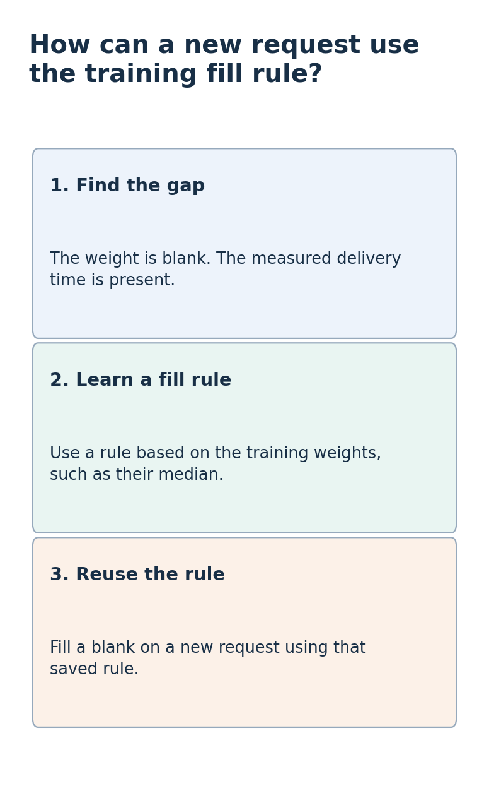

**👀 Read the visual.** This example follows one completed delivery whose weight is missing.

**👉 Use what you see.** If the **actual delivery time** is missing, hold that row out of supervised training. You can still ask the model to estimate its time.

<a id="identify-missing-values"></a>

##### 🔎 Identify missing values

| Lesson name | What you’ll do | Download |
| --- | --- | --- |
| 032 - Identify missing values **Core** | Find which weights or delivery zones are missing and read the affected rows. | [Lesson ZIP](sample_code_folder/032-identify-missing-values.zip) |

<!-- workbook-teaching:32:start -->
<details>
<summary>Learn, trace and apply this idea</summary>

### Learn and apply: Identify missing values

**Your decision.** Find which weights or delivery zones are missing and read the affected rows.

**Ready check.** Explain why a blank weight differs from a weight of zero. Use [the learning path](LEARNING-PATH.md) and [the word list](GLOSSARY.md) for the earlier skill. Trace the small example on paper before code.

**What it means.** A missing value means a fact was not recorded. NaN is one marker Python uses for a missing number.

**Why and when.** Count missing cells and inspect their rows before deciding whether to recover, fill or remove them.

**A worked example to follow.** In sample.csv one weight is blank and two zones are missing after treating ? as a missing marker. A row can have a measured time even when one input is missing.

**Input → steps → output.** Open the supplied table. Its fields are `distance_km`, `weight_kg`, `zone`, `delivery_minutes`. One original row is shown below in that same field order; `(missing)` marks a blank rather than zero.

```text
2 | 1 | north | 19
```

1. Name the particular field or object involved in this lesson’s decision above. Keep its meaning and units with it.
2. Open the [complete runnable Python example](lessons/032-identify-missing-values/lesson.py). Its numbered comments connect reading, preparation and the resulting calculation. Install only the [declared requirements](lessons/032-identify-missing-values/requirements.txt) using the same course Python, as shown in Setup.
3. Trace the worked example above through the script. Keep the original field beside the inspected or changed value. Trace the named preparation or review step, and check whether it uses a fixed rule or a value learned from training.
4. Read the result by its headings. Compare with [full recorded output](lessons/032-identify-missing-values/expected-output.txt); the excerpt below belongs to the original supplied files. Your edits can change it.

```text
          Column  Missing cells
     distance_km              0
       weight_kg              1
            zone              2
delivery_minutes              0

```

**How to interpret it.** Trace the worked case into the result above. Tell a calculated estimate from a measured answer.

**Common mistakes and limits.** Zero is a known quantity. Replacing every blank with zero can invent measurements. A question mark becomes missing only because the reader was told to interpret it that way.

**Use it yourself.** Turn the blank weight into a source-confirmed 2 kg. Predict the weight missing-count change. Would writing a guess of 2 recover the fact?

<details>
<summary>Check your choice and reason</summary>

The count falls by one. A confirmed measurement recovers the fact; an invented fill does not. Keep that distinction in the project notes.

</details>

**A second check later.** Close the notes and explain the same decision using a different row from the supplied table. State one condition that would make this method unsuitable. If you cannot explain the reason, repeat the small worked example before adding more code.

</details>
<!-- workbook-teaching:32:end -->


**Before this lesson.** Read rows and columns. A blank and zero mean different things.

**In simple words.** First find the gaps. A question mark can mean missing. Count gaps before choosing what to do with them.

**Guess first.** If a blank becomes 2, what happens to the missing count? Write your answer before running the example.

<details>
<summary>Read the reason after trying</summary>

The count falls by one. The new value is a supplied measurement only if you have a source for it.

</details>


**Next step.** Return to [Your learning path](LEARNING-PATH.md) and open the next unfinished module.

Read a CSV with blank numeric and categorical cells and a custom missing marker. Find the affected columns and rows before choosing a treatment.

**📋 Sample data**

| distance_km | weight_kg | zone | delivery_minutes |
| --- | --- | --- | --- |
| 2 | 1 | north | 19 |
| 4 | — | north | 30 |
| 6 | 2 | — | 29 |
| 8 | 4 | south | 40 |
| 10 | 1 | ? | 33 |
| 12 | 3 | south | 44 |

**▶️ Run.** Unzip the [lesson files](sample_code_folder/032-identify-missing-values.zip) and open a terminal in that folder. Install the lesson’s packages with `python -m pip install -r requirements.txt`, then run `python lesson.py`.

**🔹 Steps in the script**

1. Read the CSV. Treat a question mark like a blank cell.
2. Count missing values by column. Then print the rows you need to review.

**✅ Check.** Find one blank weight and two missing zones, then see the affected rows.

| Column | Missing cells |
| --- | --- |
| distance_km | 0 |
| weight_kg | 1 |

**Your small change.** Fill the blank weight with 2 in sample.csv. The missing weight count should fall by one. Save the named CSV before running again.

**🐍 Complete script from the ZIP**

```python
"""
Identify missing values

Find which weights or delivery zones are missing and read the affected rows.

Run: python lesson.py
Leave one weight_kg cell blank or put ? in zone in sample.csv. See which column’s count changes.
"""

from pathlib import Path
import pandas as pd

input_path = Path(__file__).resolve().with_name("sample.csv")


# 1. Read the CSV. Treat a question mark like a blank cell.
data = pd.read_csv(input_path, na_values=["?"])


# 2. Count missing values by column. Then print the rows you need to review.
missing = data.isna()
counts = missing.sum().rename("Missing cells").rename_axis("Column").reset_index()
print(counts.to_string(index=False))
print("\nRows to review")
print(
    data.loc[missing.any(axis=1), ["distance_km", "weight_kg", "zone"]].to_string(
        index=False
    )
)
```


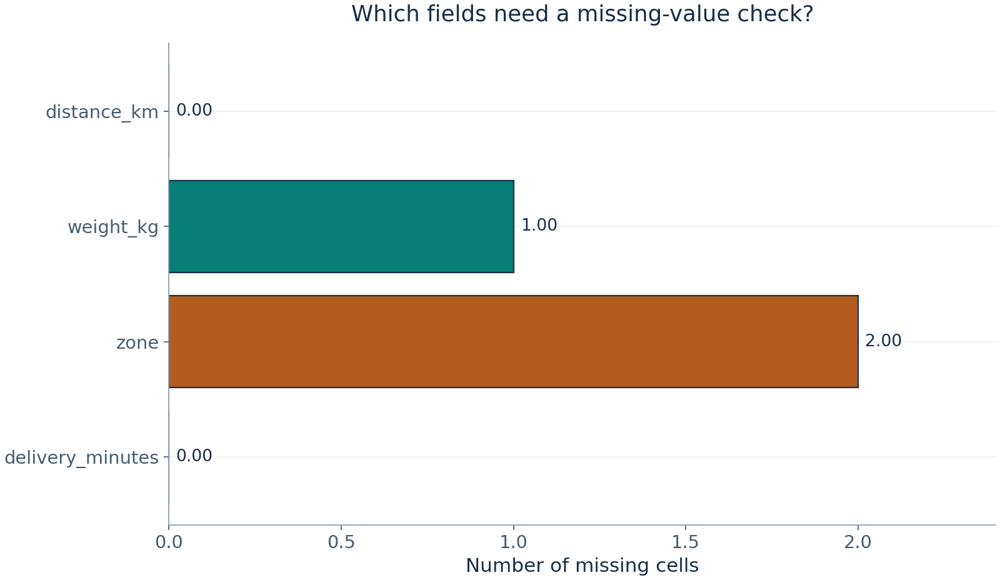

**👀 Read the visual.** Zone has two missing entries. Weight has one. Check those columns before fitting a model.

**👉 Use what you see.** Start with **Zone**, which has the most blanks. Open the marked rows and decide whether a source check or a fill rule makes sense.

**💡 Takeaway.** The blank weight is numeric. The blank zone and `?` become missing categories. The next examples decide how to handle them before fitting a model.

<a id="handle-missing-values"></a>

##### 🩹 Handle missing values

| Lesson name | What you’ll do | Download |
| --- | --- | --- |
| 034 - Handle missing values **Practice** | Decide which incomplete delivery rows you can still use to train a model. | [Lesson ZIP](sample_code_folder/034-handle-missing-values.zip) |

<!-- workbook-teaching:34:start -->
<details>
<summary>Learn, trace and apply this idea</summary>

### Learn and apply: Handle missing values

**Your decision.** Decide which incomplete delivery rows you can still use to train a model.

**Ready check.** Identify inputs and the measured answer. Use [the learning path](LEARNING-PATH.md) and [the word list](GLOSSARY.md) for the earlier skill. Trace the small example on paper before code.

**What it means.** Removing a row or column means deliberately leaving information out of a fit.

**Why and when.** Remove an unavailable training answer from supervised training. Drop a spare note only when its meaning and purpose justify doing so.

**A worked example to follow.** The lesson drops the spare note column and rows without distance or minutes. The retained rows train a distance-to-time model; the held-back completed trip checks it.

**Input → steps → output.** Open the supplied table. Its fields are `distance_km`, `note`, `minutes`. One original row is shown below in that same field order; `(missing)` marks a blank rather than zero.

```text
2 | (missing) | 19
```

1. Name the particular field or object involved in this lesson’s decision above. Keep its meaning and units with it.
2. Open the [complete runnable Python example](lessons/034-handle-missing-values/lesson.py). Its numbered comments connect reading, preparation and the resulting calculation. Install only the [declared requirements](lessons/034-handle-missing-values/requirements.txt) using the same course Python, as shown in Setup.
3. Trace the worked example above through the script. Keep inputs apart from measured answers. Follow this script’s split and fit, then trace the saved preparation into the held-back result and any new request. A request must not supply its own training answer.
4. Read the result by its headings. Compare with [full recorded output](lessons/034-handle-missing-values/expected-output.txt); the excerpt below belongs to the original supplied files. Your edits can change it.

```text
Rows retained: 4
Held-out prediction: [35.0]
[25. 41.]
```

**How to interpret it.** Trace the worked case into the result above. Tell a calculated estimate from a measured answer.

**Common mistakes and limits.** Removing all incomplete rows can remove a particular kind of delivery. Missing inputs can sometimes be filled; missing target values are not recovered by ordinary input imputation.

**Use it yourself.** A row has a known distance but no time because the trip starts tomorrow. Can it teach supervised regression? Can the trained model receive it?

<details>
<summary>Check your choice and reason</summary>

It cannot teach that model without a confirmed answer. It can be a new prediction request. Keep it separate from completed training/check rows.

</details>

**A second check later.** Close the notes and explain the same decision using a different row from the supplied table. State one condition that would make this method unsuitable. If you cannot explain the reason, repeat the small worked example before adding more code.

</details>
<!-- workbook-teaching:34:end -->


**Before this lesson.** Find a missing input and a missing answer. Keep training and checks separate.

**In simple words.** A fill is an estimate, not a recovered fact. Learn a fill rule on training rows. Reuse it on new rows. Do not invent training answers.

**Guess first.** May a new request change the saved training median? Write your answer before running the example.

<details>
<summary>Read the reason after trying</summary>

No. Apply the saved rule. A deliberate retraining step is a separate action.

</details>


<a id="remove"></a>

###### 🧽 Remove

| Lesson name | What you’ll do | Download |
| --- | --- | --- |
| 035 - Remove **Core** | Drop a spare note column and remove rows missing a required distance or known time. | [Lesson ZIP](sample_code_folder/035-remove.zip) |

<!-- workbook-teaching:35:start -->
<details>
<summary>Learn, trace and apply this idea</summary>

### Learn and apply: Remove

**Your decision.** Drop a spare note column and remove rows missing a required distance or known time.

**Ready check.** Identify inputs and the measured answer. Use [the learning path](LEARNING-PATH.md) and [the word list](GLOSSARY.md) for the earlier skill. Trace the small example on paper before code.

**What it means.** Removing a row or column means deliberately leaving information out of a fit.

**Why and when.** Remove an unavailable training answer from supervised training. Drop a spare note only when its meaning and purpose justify doing so.

**A worked example to follow.** The lesson drops the spare note column and rows without distance or minutes. The retained rows train a distance-to-time model; the held-back completed trip checks it.

**Input → steps → output.** Open the supplied table. Its fields are `distance_km`, `note`, `minutes`. One original row is shown below in that same field order; `(missing)` marks a blank rather than zero.

```text
2 | (missing) | 19
```

1. Name the particular field or object involved in this lesson’s decision above. Keep its meaning and units with it.
2. Open the [complete runnable Python example](lessons/035-remove/lesson.py). Its numbered comments connect reading, preparation and the resulting calculation. Install only the [declared requirements](lessons/035-remove/requirements.txt) using the same course Python, as shown in Setup.
3. Trace the worked example above through the script. Keep inputs apart from measured answers. Follow this script’s split and fit, then trace the saved preparation into the held-back result and any new request. A request must not supply its own training answer.
4. Read the result by its headings. Compare with [full recorded output](lessons/035-remove/expected-output.txt); the excerpt below belongs to the original supplied files. Your edits can change it.

```text
Rows retained: 4
Held-out prediction: [35.0]
[25. 41.]
```

**How to interpret it.** Trace the worked case into the result above. Tell a calculated estimate from a measured answer.

**Common mistakes and limits.** Removing all incomplete rows can remove a particular kind of delivery. Missing inputs can sometimes be filled; missing target values are not recovered by ordinary input imputation.

**Use it yourself.** A row has a known distance but no time because the trip starts tomorrow. Can it teach supervised regression? Can the trained model receive it?

<details>
<summary>Check your choice and reason</summary>

It cannot teach that model without a confirmed answer. It can be a new prediction request. Keep it separate from completed training/check rows.

</details>

**A second check later.** Close the notes and explain the same decision using a different row from the supplied table. State one condition that would make this method unsuitable. If you cannot explain the reason, repeat the small worked example before adding more code.

</details>
<!-- workbook-teaching:35:end -->


**Before this lesson.** Find a missing input and a missing answer. Keep training and checks separate.

**In simple words.** A fill is an estimate, not a recovered fact. Learn a fill rule on training rows. Reuse it on new rows. Do not invent training answers.

**Guess first.** May a new request change the saved training median? Write your answer before running the example.

<details>
<summary>Read the reason after trying</summary>

No. Apply the saved rule. A deliberate retraining step is a separate action.

</details>


Inspect a tiny table. Drop an unhelpful note column, drop training rows missing an input you cannot recover, and use the remaining rows for a regression fit.

**📋 Sample data**

| distance_km | note | minutes |
| --- | --- | --- |
| 2 | — | 19 |
| 4 | left at desk | 23 |
| — | — | 27 |
| 8 | — | 31 |
| 10 | — | 35 |

**▶️ Run.** Unzip the [lesson files](sample_code_folder/035-remove.zip) and open a terminal in that folder. Install the lesson’s packages with `python -m pip install -r requirements.txt`, then run `python lesson.py`.

**🔹 Steps in the script**

1. Read the CSV and check its inputs, including distance_km, note, minutes.
2. Keep rows with both a usable input and a known answer.
3. Set aside the check rows before the model learns.
4. Teach the model from the training inputs and delivery time in minutes.
5. Apply the fitted model to the new CSV rows and print a result for each row.

**✅ Check.** Look for Rows retained: 4 in the output excerpt below.

```text
Rows retained: 4
Held-out prediction: [35.0]
[25. 41.]
```

**Your small change.** Leave distance_km blank on a practice row. Compare the number of usable rows and enter a new distance to predict. Save the named CSV before running again.


**💡 Takeaway.** Choose what to drop after reviewing why a value is missing. A required label is a different case from a missing input.

<a id="impute"></a>

###### 🩺 Impute

| Lesson name | What you’ll do | Download |
| --- | --- | --- |
| 036 - Fill a blank **Practice** | Fill a missing parcel weight before estimating the delivery time. | [Lesson ZIP](sample_code_folder/036-impute.zip) |

<!-- workbook-teaching:36:start -->
<details>
<summary>Learn, trace and apply this idea</summary>

### Learn and apply: Fill a blank

**Your decision.** Fill a missing parcel weight before estimating the delivery time.

**Ready check.** Sort 1, 2 and 4; calculate their average and identify their middle. Use [the learning path](LEARNING-PATH.md) and [the word list](GLOSSARY.md) for the earlier skill. Trace the small example on paper before code.

**What it means.** Imputation supplies an estimate for a missing input. Mean, median and mode use training summaries; KNN uses similar training rows.

**Why and when.** Use a fill when an input is unavailable but a justified prediction is still possible. Learn the rule on training data and reuse it.

**A worked example to follow.** The observed training weights are 1, 2 and 4 kg. Their mean is about 2.33; median is 2. All occur once, so the most-frequent imputer breaks this tie by taking the smallest value, 1. KNN uses distance and scaled input differences to find two neighbours.

**Input → steps → output.** Open the supplied table. Its fields are `distance_km`, `weight_kg`, `zone`, `delivery_minutes`. One original row is shown below in that same field order; `(missing)` marks a blank rather than zero.

```text
2 | 1 | north | 19
```

1. Name the particular field or object involved in this lesson’s decision above. Keep its meaning and units with it.
2. Open the [complete runnable Python example](lessons/036-impute/lesson.py). Its numbered comments connect reading, preparation and the resulting calculation. Install only the [declared requirements](lessons/036-impute/requirements.txt) using the same course Python, as shown in Setup.
3. Trace the worked example above through the script. Keep inputs apart from measured answers. Follow this script’s split and fit, then trace the saved preparation into the held-back result and any new request. A request must not supply its own training answer.
4. Read the result by its headings. Compare with [full recorded output](lessons/036-impute/expected-output.txt); the excerpt below belongs to the original supplied files. Your edits can change it.

```text
 New row               Method  Filled kg  Prediction in minutes  Actual minutes
       1                 Mean       2.33                  33.59            33.0
       2                 Mean       2.00                  28.56            29.0
       3                 Mean       2.33                  36.85               —
       1               Median       2.00                  32.14            33.0
       2               Median       2.00                  29.00            29.0
```

**How to interpret it.** Trace the worked case into the result above. Tell a calculated estimate from a measured answer.

**Common mistakes and limits.** A fill is not a recovered measurement. Nearest neighbours depend on scaling. Comparing methods on one case does not establish the best method for future deliveries.

**Use it yourself.** Training weights are 1, 2, 4, 5 and 8 kg. Fill a new blank by median. Does a new 90 kg request change that saved median?

<details>
<summary>Check your choice and reason</summary>

The median is 4 kg. Apply 4 to the blank and keep the saved rule unchanged for the 90 kg request. Only an explicit new training procedure learns a new median.

</details>

**A second check later.** Close the notes and explain the same decision using a different row from the supplied table. State one condition that would make this method unsuitable. If you cannot explain the reason, repeat the small worked example before adding more code.

</details>
<!-- workbook-teaching:36:end -->


**Before this lesson.** Find a missing input and a missing answer. Keep training and checks separate.

**In simple words.** A fill is an estimate, not a recovered fact. Learn a fill rule on training rows. Reuse it on new rows. Do not invent training answers.

**Guess first.** May a new request change the saved training median? Write your answer before running the example.

<details>
<summary>Read the reason after trying</summary>

No. Apply the saved rule. A deliberate retraining step is a separate action.

</details>


Run the numeric and categorical examples below on training rows, then inspect what the fitted imputer returns on later rows.

<a id="numerical-data-mean-median-mode-knn-imputer"></a>

###### 🔢 Numerical Data: Mean, Median, Mode, KNN Imputer

| Lesson name | What you’ll do | Download |
| --- | --- | --- |
| 037 - Numerical Data: Mean, Median, Mode, KNN Imputer **Practice** | Compare four ways of filling the same missing weight and see how each changes the prediction. | [Lesson ZIP](sample_code_folder/037-numerical-data-mean-median-mode-knn-imputer.zip) |

<!-- workbook-teaching:37:start -->
<details>
<summary>Learn, trace and apply this idea</summary>

### Learn and apply: Numerical Data: Mean, Median, Mode, KNN Imputer

**Your decision.** Compare four ways of filling the same missing weight and see how each changes the prediction.

**Ready check.** Sort 1, 2 and 4; calculate their average and identify their middle. Use [the learning path](LEARNING-PATH.md) and [the word list](GLOSSARY.md) for the earlier skill. Trace the small example on paper before code.

**What it means.** Imputation supplies an estimate for a missing input. Mean, median and mode use training summaries; KNN uses similar training rows.

**Why and when.** Use a fill when an input is unavailable but a justified prediction is still possible. Learn the rule on training data and reuse it.

**A worked example to follow.** The observed training weights are 1, 2 and 4 kg. Their mean is about 2.33; median is 2. All occur once, so the most-frequent imputer breaks this tie by taking the smallest value, 1. KNN uses distance and scaled input differences to find two neighbours.

**Input → steps → output.** Open the supplied table. Its fields are `distance_km`, `weight_kg`, `zone`, `delivery_minutes`. One original row is shown below in that same field order; `(missing)` marks a blank rather than zero.

```text
2 | 1 | north | 19
```

1. Name the particular field or object involved in this lesson’s decision above. Keep its meaning and units with it.
2. Open the [complete runnable Python example](lessons/037-numerical-data-mean-median-mode-knn-imputer/lesson.py). Its numbered comments connect reading, preparation and the resulting calculation. Install only the [declared requirements](lessons/037-numerical-data-mean-median-mode-knn-imputer/requirements.txt) using the same course Python, as shown in Setup.
3. Trace the worked example above through the script. Keep inputs apart from measured answers. Follow this script’s split and fit, then trace the saved preparation into the held-back result and any new request. A request must not supply its own training answer.
4. Read the result by its headings. Compare with [full recorded output](lessons/037-numerical-data-mean-median-mode-knn-imputer/expected-output.txt); the excerpt below belongs to the original supplied files. Your edits can change it.

```text
 New row               Method  Filled kg  Prediction in minutes  Actual minutes
       1                 Mean       2.33                  33.59            33.0
       2                 Mean       2.00                  28.56            29.0
       3                 Mean       2.33                  36.85               —
       1               Median       2.00                  32.14            33.0
       2               Median       2.00                  29.00            29.0
```

**How to interpret it.** Trace the worked case into the result above. Tell a calculated estimate from a measured answer.

**Common mistakes and limits.** A fill is not a recovered measurement. Nearest neighbours depend on scaling. Comparing methods on one case does not establish the best method for future deliveries.

**Use it yourself.** Training weights are 1, 2, 4, 5 and 8 kg. Fill a new blank by median. Does a new 90 kg request change that saved median?

<details>
<summary>Check your choice and reason</summary>

The median is 4 kg. Apply 4 to the blank and keep the saved rule unchanged for the 90 kg request. Only an explicit new training procedure learns a new median.

</details>

**A second check later.** Close the notes and explain the same decision using a different row from the supplied table. State one condition that would make this method unsuitable. If you cannot explain the reason, repeat the small worked example before adding more code.

</details>
<!-- workbook-teaching:37:end -->


**Before this lesson.** Find a missing input and a missing answer. Keep training and checks separate.

**In simple words.** A fill is an estimate, not a recovered fact. Learn a fill rule on training rows. Reuse it on new rows. Do not invent training answers.

**Guess first.** May a new request change the saved training median? Write your answer before running the example.

<details>
<summary>Read the reason after trying</summary>

No. Apply the saved rule. A deliberate retraining step is a separate action.

</details>


**🎯 Goal.** How long would a 10 km delivery take if the parcel weight had not been recorded? Use the first four deliveries to learn. For the fifth delivery, deliberately hide the known 1 kg weight, and keep its actual time, 33 minutes, for comparison.

**Model inputs:** distance and weight. **Known answer:** delivery time. **One row to follow:** the 10 km delivery.

**📋 Sample data**

| distance_km | weight_kg | zone | delivery_minutes |
| --- | --- | --- | --- |
| 2 | 1 | north | 19 |
| 4 | — | north | 30 |
| 6 | 2 | — | 29 |
| 8 | 4 | south | 40 |
| 10 | 1 | ? | 33 |
| 12 | 3 | south | 44 |

**▶️ Run.** Unzip the [lesson files](sample_code_folder/037-numerical-data-mean-median-mode-knn-imputer.zip) and open a terminal in that folder. Install the lesson’s packages with `python -m pip install -r requirements.txt`, then run `python lesson.py`.

**🔹 Steps in the script**

1. Read the delivery table. Distance is in km, and weight is in kg.
2. Set aside the check rows before the model learns.
3. Read the new CSV rows, then apply the rules from the sample.
4. Give each method the same practice data so you can compare the results.
5. Learn the conversion on the training inputs before applying it to a new row.

**✅ Check.** Look for New row               Method  Filled kg  Prediction in minutes  Actual minutes in the output excerpt below.

| New row | Method | Filled kg | Prediction in minutes | Actual minutes |
| --- | --- | --- | --- | --- |
| 1 | Mean | 2.33 | 33.59 | 33.0 |
| 2 | Mean | 2.00 | 28.56 | 29.0 |

**Your small change.** Change a distance in new_inputs.csv. Clear actual_minutes on that row: the old measured time does not describe your invented request. Compare the new guess. Save the named CSV before running again.


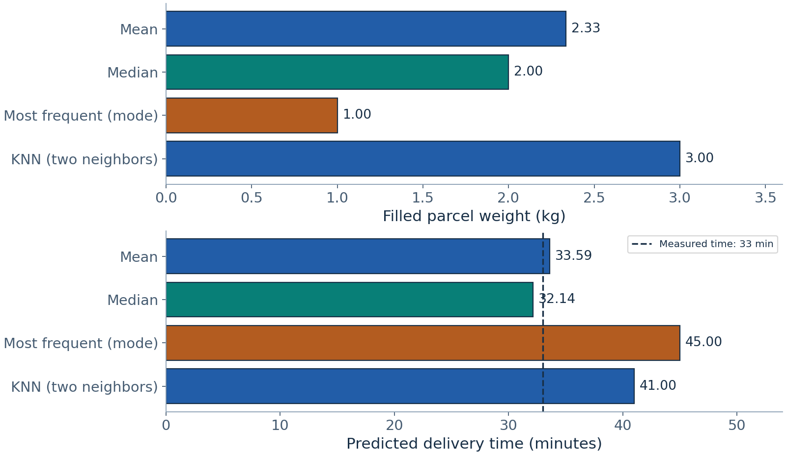

**👀 Read the visual.** The same shipment gets a different weight and prediction under each method. The dashed line marks its actual time. Choose a method on more than one validation row.

**👉 Use what you see.** Compare each right-hand bar with the actual-time line. Check several more rows before picking a fill method.

**Read the table.** Each method fills **the same missing weight** and trains its own model. The training weights available for the first three methods are 1, 2, and 4 kg. All three occur once, so scikit-learn chooses the smallest tied value for the mode. KNN looks for two similar training deliveries. The example scales the inputs first so the units can be compared.

<a id="categorical-data-mode-unknown-placeholder"></a>

###### 🏷️ Categorical Data: Mode, "Unknown" placeholder

| Lesson name | What you’ll do | Download |
| --- | --- | --- |
| 042 - Category Data: Mode, "Unknown" placeholder **Practice** | Try the most common delivery zone and an explicit Unknown label for the same blank cell. | [Lesson ZIP](sample_code_folder/042-categorical-data-mode-unknown-placeholder.zip) |

<!-- workbook-teaching:42:start -->
<details>
<summary>Learn, trace and apply this idea</summary>

### Learn and apply: Category Data: Mode, "Unknown" placeholder

**Your decision.** Try the most common delivery zone and an explicit Unknown label for the same blank cell.

**Ready check.** Distinguish a missing zone from a new, named zone. Use [the learning path](LEARNING-PATH.md) and [the word list](GLOSSARY.md) for the earlier skill. Trace the small example on paper before code.

**What it means.** A categorical fill replaces a missing name with the most common training name or an explicit Unknown name.

**Why and when.** Use the mode if a common-category assumption is defensible. Preserve Unknown when missingness deserves its own visible category.

**A worked example to follow.** The lesson fits the fill and encoder on the first four rows. It then handles the same blank zone under both choices. An explicit Unknown is a chosen placeholder, not a measurement that the parcel came from a zone called Unknown.

**Input → steps → output.** Open the supplied table. Its fields are `zone`, `minutes`. One original row is shown below in that same field order; `(missing)` marks a blank rather than zero.

```text
north | 19
```

1. Name the particular field or object involved in this lesson’s decision above. Keep its meaning and units with it.
2. Open the [complete runnable Python example](lessons/042-categorical-data-mode-unknown-placeholder/lesson.py). Its numbered comments connect reading, preparation and the resulting calculation. Install only the [declared requirements](lessons/042-categorical-data-mode-unknown-placeholder/requirements.txt) using the same course Python, as shown in Setup.
3. Trace the worked example above through the script. Keep inputs apart from measured answers. Follow this script’s split and fit, then trace the saved preparation into the held-back result and any new request. A request must not supply its own training answer.
4. Read the result by its headings. Compare with [full recorded output](lessons/042-categorical-data-mode-unknown-placeholder/expected-output.txt); the excerpt below belongs to the original supplied files. Your edits can change it.

```text
Mode  zone filled  minutes
  NaN  north     26.0
south  south     40.0
north  north     26.0
 east   east     33.0
Explicit Unknown  zone  filled  minutes
```

**How to interpret it.** Trace the worked case into the result above. Tell a calculated estimate from a measured answer.

**Common mistakes and limits.** An Unknown category with no training examples does not gain a learned effect merely because the name is written down. A new east zone and an absent zone are different situations.

**Use it yourself.** A request says east and another leaves zone blank. Which one can a missing-value fill change? What must the service decide separately?

<details>
<summary>Check your choice and reason</summary>

The fill changes the blank. It does not turn the named east zone into the training mode. Unknown-name handling belongs to the encoder and service policy; test it explicitly.

</details>

**A second check later.** Close the notes and explain the same decision using a different row from the supplied table. State one condition that would make this method unsuitable. If you cannot explain the reason, repeat the small worked example before adding more code.

</details>
<!-- workbook-teaching:42:end -->


**Before this lesson.** Find a missing input and a missing answer. Keep training and checks separate.

**In simple words.** A fill is an estimate, not a recovered fact. Learn a fill rule on training rows. Reuse it on new rows. Do not invent training answers.

**Guess first.** May a new request change the saved training median? Write your answer before running the example.

<details>
<summary>Read the reason after trying</summary>

No. Apply the saved rule. A deliberate retraining step is a separate action.

</details>


**🎯 Goal.** If the zone is missing, should a model see the most common zone or a separate Unknown category? Compare what happens to the same two deliveries.

**📋 Sample data**

| zone | minutes |
| --- | --- |
| north | 19 |
| north | 30 |
| — | 29 |
| south | 40 |
| ? | 33 |
| south | 44 |

**▶️ Run.** Unzip the [lesson files](sample_code_folder/042-categorical-data-mode-unknown-placeholder.zip) and open a terminal in that folder. Install the lesson’s packages with `python -m pip install -r requirements.txt`, then run `python lesson.py`.

**🔹 Steps in the script**

1. Read the CSV and check its inputs, including zone, minutes.
2. Set aside the check rows before the model learns.
3. Read the new CSV rows, then apply the rules from the sample.
4. Give each method the same practice data so you can compare the results.

**✅ Check.** Look for Mode  zone filled  minutes in the output excerpt below.

| Mode | zone filled | minutes |
| --- | --- | --- |
| NaN | north | 26.0 |
| south | south | 40.0 |

**Your small change.** Change zone in new_inputs.csv, for example from ? to north. Compare the printed rows. Save the named CSV before running again.


**Read the table.** On row 5 the mode uses North, while the other approach preserves Unknown. Row 6 is already South, so both methods keep it.

<a id="time-series-data-forward-fill-ffill-backward-fill-bfill"></a>

###### ⏳ Time-Series Data: Forward Fill (ffill), Backward Fill (bfill)

| Lesson name | What you’ll do | Download |
| --- | --- | --- |
| 045 - Time-Series Data: Forward Fill (ffill), Backward Fill (bfill) **Practice** | Fill a gap in daily counts using the previous day or the next recorded day. | [Lesson ZIP](sample_code_folder/045-time-series-data-forward-fill-ffill-backward-fill-bfill.zip) |

<!-- workbook-teaching:45:start -->
<details>
<summary>Learn, trace and apply this idea</summary>

### Learn and apply: Time-Series Data: Forward Fill (ffill), Backward Fill (bfill)

**Your decision.** Fill a gap in daily counts using the previous day or the next recorded day.

**Ready check.** Put days in order and say when a reading becomes available. Use [the learning path](LEARNING-PATH.md) and [the word list](GLOSSARY.md) for the earlier skill. Trace the small example on paper before code.

**What it means.** Forward fill copies the last available reading. Backward fill copies a later reading into an earlier gap.

**Why and when.** Forward fill may suit a value that stays current until replaced. Backward fill is for retrospective repair when the later reading is already known.

**A worked example to follow.** With counts 10, blank, 16 on days 1, 2, 3, forward fill gives day 2 a value of 10 and backward fill gives 16. These are estimates with different timing assumptions.

**Input → steps → output.** Open the supplied table. Its fields are `day`, `requests`. One original row is shown below in that same field order; `(missing)` marks a blank rather than zero.

```text
1 | 10
```

1. Name the particular field or object involved in this lesson’s decision above. Keep its meaning and units with it.
2. Open the [complete runnable Python example](lessons/045-time-series-data-forward-fill-ffill-backward-fill-bfill/lesson.py). Its numbered comments connect reading, preparation and the resulting calculation. Install only the [declared requirements](lessons/045-time-series-data-forward-fill-ffill-backward-fill-bfill/requirements.txt) using the same course Python, as shown in Setup.
3. Trace the worked example above through the script. Keep inputs apart from measured answers. Follow this script’s split and fit, then trace the saved preparation into the held-back result and any new request. A request must not supply its own training answer.
4. Read the result by its headings. Compare with [full recorded output](lessons/045-time-series-data-forward-fill-ffill-backward-fill-bfill/expected-output.txt); the excerpt below belongs to the original supplied files. Your edits can change it.

```text
 day  requests  forward  backward
   1      10.0     10.0      10.0
   2       NaN     10.0      16.0
   3      16.0     16.0      16.0
   4      19.0     19.0      19.0
Day 5 forecast: [22.0]
```

**How to interpret it.** Trace the worked case into the result above. Tell a calculated estimate from a measured answer.

**Common mistakes and limits.** A live day-2 decision cannot use a day-3 reading. Long gaps, resets and rapidly changing measurements may make either fill unsuitable.

**Use it yourself.** Day 3 changes to 18. Which day-2 fill changes? Which fill is available during day 2?

<details>
<summary>Check your choice and reason</summary>

Backward fill changes to 18; forward fill stays 10. Only the past value is available during day 2. Whether carrying it forward is useful still needs validation.

</details>

**A second check later.** Close the notes and explain the same decision using a different row from the supplied table. State one condition that would make this method unsuitable. If you cannot explain the reason, repeat the small worked example before adding more code.

</details>
<!-- workbook-teaching:45:end -->


**Before this lesson.** Put dates in order. Know when a reading becomes available.

**In simple words.** Forward fill uses an earlier reading. Backward fill uses a later reading, so it is for a past series where that later reading is already known.

**Guess first.** Can a live day-2 prediction use a reading from day 3? Write your answer before running the example.

<details>
<summary>Read the reason after trying</summary>

No. That reading has not arrived yet.

</details>


Fill a gap in train data and predict a later count. Compare a past-only fill with a past-series fill when the later observation is already known.

**📋 Sample data**

| day | requests |
| --- | --- |
| 1 | 10 |
| 2 | — |
| 3 | 16 |
| 4 | 19 |
| 5 | 22 |

**▶️ Run.** Unzip the [lesson files](sample_code_folder/045-time-series-data-forward-fill-ffill-backward-fill-bfill.zip) and open a terminal in that folder. Install the lesson’s packages with `python -m pip install -r requirements.txt`, then run `python lesson.py`.

**🔹 Steps in the script**

1. Read the CSV and check its inputs, including day, requests.
2. Set aside the check rows before the model learns.
3. Fit the model on the prepared training rows. Keep it for the checks below.
4. Apply the fitted model to the new CSV rows and print a result for each row.

**✅ Check.** Look for day  requests  forward  backward in the output excerpt below.

| day | requests | forward | backward |
| --- | --- | --- | --- |
| 1 | 10.0 | 10.0 | 10.0 |
| 2 | NaN | 10.0 | 16.0 |

**Your small change.** Edit the input values in new_inputs.csv and compare the displayed predictions. Save the named CSV before running again.


**💡 Takeaway.** Forward fill uses the earlier value 10. Backward fill uses 16 from day 3. For a day-2 live prediction, that later value would be unavailable.

<a id="when-missing-values-change-the-answer"></a>

###### ⚖️ When missing values change the answer

| Lesson name | What you’ll do | Download |
| --- | --- | --- |
| 048 - When missing values change the answer **Core** | See how losing the slower trips can make the average delivery time look too low. | [Lesson ZIP](sample_code_folder/048-when-missing-values-change-the-answer.zip) |

<!-- workbook-teaching:48:start -->
<details>
<summary>Learn, trace and apply this idea</summary>

### Learn and apply: When missing values change the answer

**Your decision.** See how losing the slower trips can make the average delivery time look too low.

**Ready check.** Calculate an average from a list. Use [the learning path](LEARNING-PATH.md) and [the word list](GLOSSARY.md) for the earlier skill. Trace the small example on paper before code.

**What it means.** A missing-data pattern can change which cases a summary represents.

**Why and when.** Investigate missingness when some routes, people or times are less likely to be recorded.

**A worked example to follow.** All six invented times average 23 minutes. The recorded subset averages 18 because two slow trips are absent. The lower number describes recorded trips, not necessarily all deliveries.

**Input → steps → output.** Open the supplied table. Its fields are `Route`, `True time`, `Recorded time`. One original row is shown below in that same field order; `(missing)` marks a blank rather than zero.

```text
Short | 12 | 12.0
```

1. Name the particular field or object involved in this lesson’s decision above. Keep its meaning and units with it.
2. Open the [complete runnable Python example](lessons/048-when-missing-values-change-the-answer/lesson.py). Its numbered comments connect reading, preparation and the resulting calculation. Install only the [declared requirements](lessons/048-when-missing-values-change-the-answer/requirements.txt) using the same course Python, as shown in Setup.
3. Trace the worked example above through the script. Keep the original field beside the inspected or changed value. Trace the named preparation or review step, and check whether it uses a fixed rule or a value learned from training.
4. Read the result by its headings. Compare with [full recorded output](lessons/048-when-missing-values-change-the-answer/expected-output.txt); the excerpt below belongs to the original supplied files. Your edits can change it.

```text
       Average uses  Average time (min)
      All six times                23.0
Recorded times only                18.0
```

**How to interpret it.** Trace the worked case into the result above. Tell a calculated estimate from a measured answer.

**Common mistakes and limits.** Filling gaps does not establish fairness or recover unknown outcomes. In real data the missing true times may be unavailable.

**Use it yourself.** If a broken recorder misses long routes, does a complete-looking filled table prove its average is representative?

<details>
<summary>Check your choice and reason</summary>

No. Compare missing counts by route and time, inspect the recorder/source, and report what is unknown. A fill alone cannot establish the absent outcomes.

</details>

**A second check later.** Close the notes and explain the same decision using a different row from the supplied table. State one condition that would make this method unsuitable. If you cannot explain the reason, repeat the small worked example before adding more code.

</details>
<!-- workbook-teaching:48:end -->


**Before this lesson.** Calculate an average by adding values and dividing by their count.

**In simple words.** If slow deliveries lose their recorded times, the remaining average can look too fast. A clean table can still leave out important cases.

**Guess first.** Does filling blanks guarantee the reported average is fair? Write your answer before running the example.

<details>
<summary>Read the reason after trying</summary>

No. Investigate why the values were missing.

</details>


**🎯 Goal.** What happens to the reported average if the slowest deliveries are the ones without a recorded time?

**📋 Sample data**

| Route | True time | Recorded time |
| --- | --- | --- |
| Short | 12 | 12.0 |
| Short | 14 | 14.0 |
| Short | 16 | 16.0 |
| Long | 30 | 30.0 |
| Long | 32 | — |
| Long | 34 | — |

**▶️ Run.** Unzip the [lesson files](sample_code_folder/048-when-missing-values-change-the-answer.zip) and open a terminal in that folder. Install the lesson’s packages with `python -m pip install -r requirements.txt`, then run `python lesson.py`.

**🔹 Steps in the script**

1. Read the CSV and check its inputs, including Route, True time, Recorded time.
2. Print the result next to the input values so you can compare them.
3. Plot the values so you can see how they compare.

**✅ Check.** Look for Average uses  Average time (min) in the output excerpt below.

| Average uses | Average time (min) |
| --- | --- |
| All six times | 23.0 |
| Recorded times only | 18.0 |

**Your small change.** In sample.csv, change the missing Recorded time for the 32-minute delivery to 32. Compare the recorded-only average with the all-times average. Save the named CSV before running again.


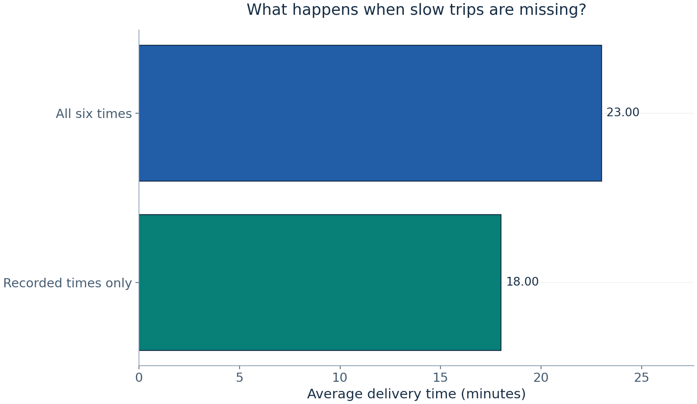

**👀 Read the visual.** When two slow deliveries are missing, the average falls. Use the graph to compare the two sets of rows.

**👉 Use what you see.** Check whether blanks tend to occur on longer trips. Use the recorded source or report the gap before treating the lower average as typical.

The toy example keeps the true times so you can see what was lost. In a real dataset those answers may be unknown. Compare where blanks appear across routes, then investigate why the time was missing.

<a id="1-3-2-remove-duplicates"></a>

#### 🔁 1.3.2 Remove Duplicates

| Lesson name | What you’ll do | Download |
| --- | --- | --- |
| 049 - 1.3.2 Remove Duplicates **Practice** | Check whether repeated order records would give some deliveries extra weight in training. | [Lesson ZIP](sample_code_folder/049-1-3-2-remove-duplicates.zip) |

<!-- workbook-teaching:49:start -->
<details>
<summary>Learn, trace and apply this idea</summary>

### Learn and apply: 1.3.2 Remove Duplicates

**Your decision.** Check whether repeated order records would give some deliveries extra weight in training.

**Ready check.** Explain what one order ID represents. Use [the learning path](LEARNING-PATH.md) and [the word list](GLOSSARY.md) for the earlier skill. Trace the small example on paper before code.

**What it means.** An exact duplicate repeats the same recorded row; it can give one event extra influence.

**Why and when.** Check identity and source before removing copies or dividing records into training and test groups.

**A worked example to follow.** If order A appears twice with identical distance and minutes, keeping one confirmed copy stops A being counted twice. Orders B and C may legitimately share the same measurements.

**Input → steps → output.** Open the supplied table. Its fields are `order_id`, `km`, `minutes`. One original row is shown below in that same field order; `(missing)` marks a blank rather than zero.

```text
A | 2 | 14
```

1. Name the particular field or object involved in this lesson’s decision above. Keep its meaning and units with it.
2. Open the [complete runnable Python example](lessons/049-1-3-2-remove-duplicates/lesson.py). Its numbered comments connect reading, preparation and the resulting calculation. Install only the [declared requirements](lessons/049-1-3-2-remove-duplicates/requirements.txt) using the same course Python, as shown in Setup.
3. Trace the worked example above through the script. Keep the original field beside the inspected or changed value. Trace the named preparation or review step, and check whether it uses a fixed rule or a value learned from training.
4. Read the result by its headings. Compare with [full recorded output](lessons/049-1-3-2-remove-duplicates/expected-output.txt); the excerpt below belongs to the original supplied files. Your edits can change it.

```text
Repeated rows: 1
D prediction: [30.0]
 km  prediction
  4        18.0
  9        28.0
 13        36.0
```

**How to interpret it.** Trace the worked case into the result above. Tell a calculated estimate from a measured answer.

**Common mistakes and limits.** Equal measurements alone do not prove duplicate events. Conflicting records with one ID need investigation rather than keeping the first arbitrarily.

**Use it yourself.** Two distinct shipment IDs both have 5 km and 20 minutes. Remove one? What if they have the same ID but different times?

<details>
<summary>Check your choice and reason</summary>

Keep distinct confirmed shipments. For one ID with conflicting times, review the source and correction history. Do not silently choose a time.

</details>

**A second check later.** Close the notes and explain the same decision using a different row from the supplied table. State one condition that would make this method unsuitable. If you cannot explain the reason, repeat the small worked example before adding more code.

</details>
<!-- workbook-teaching:49:end -->


**Before this lesson.** Know what one row and its order ID mean.

**In simple words.** Two copies of one order can give it too much influence. Two different orders can share a name, distance or weight. Check identity before removing anything.

**Guess first.** Are equal measurements enough to prove two rows are copies? Write your answer before running the example.

<details>
<summary>Read the reason after trying</summary>

No. Use the order identity and the source record.

</details>


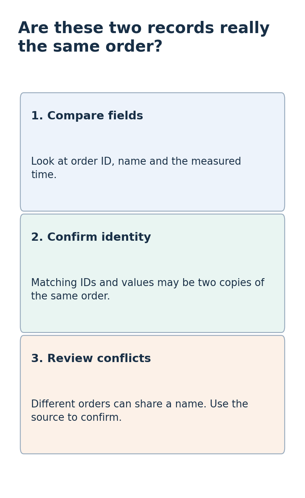

**👀 Read the visual.** Two customer names can look nearly identical while their orders differ.

**👉 Use what you see.** **Keep both rows** if the source confirms they are separate orders.

<a id="detect-remove-exact-duplicates"></a>

##### 🧾 Detect & Remove Exact Duplicates

| Lesson name | What you’ll do | Download |
| --- | --- | --- |
| 050 - Detect & Remove Exact Duplicates **Core** | Keep one copy of each exact row before training on distance and time. | [Lesson ZIP](sample_code_folder/050-detect-remove-exact-duplicates.zip) |

<!-- workbook-teaching:50:start -->
<details>
<summary>Learn, trace and apply this idea</summary>

### Learn and apply: Detect & Remove Exact Duplicates

**Your decision.** Keep one copy of each exact row before training on distance and time.

**Ready check.** Explain what one order ID represents. Use [the learning path](LEARNING-PATH.md) and [the word list](GLOSSARY.md) for the earlier skill. Trace the small example on paper before code.

**What it means.** An exact duplicate repeats the same recorded row; it can give one event extra influence.

**Why and when.** Check identity and source before removing copies or dividing records into training and test groups.

**A worked example to follow.** If order A appears twice with identical distance and minutes, keeping one confirmed copy stops A being counted twice. Orders B and C may legitimately share the same measurements.

**Input → steps → output.** Open the supplied table. Its fields are `order_id`, `km`, `minutes`. One original row is shown below in that same field order; `(missing)` marks a blank rather than zero.

```text
A | 2 | 14
```

1. Name the particular field or object involved in this lesson’s decision above. Keep its meaning and units with it.
2. Open the [complete runnable Python example](lessons/050-detect-remove-exact-duplicates/lesson.py). Its numbered comments connect reading, preparation and the resulting calculation. Install only the [declared requirements](lessons/050-detect-remove-exact-duplicates/requirements.txt) using the same course Python, as shown in Setup.
3. Trace the worked example above through the script. Keep the original field beside the inspected or changed value. Trace the named preparation or review step, and check whether it uses a fixed rule or a value learned from training.
4. Read the result by its headings. Compare with [full recorded output](lessons/050-detect-remove-exact-duplicates/expected-output.txt); the excerpt below belongs to the original supplied files. Your edits can change it.

```text
Repeated rows: 1
D prediction: [30.0]
 km  prediction
  4        18.0
  9        28.0
 13        36.0
```

**How to interpret it.** Trace the worked case into the result above. Tell a calculated estimate from a measured answer.

**Common mistakes and limits.** Equal measurements alone do not prove duplicate events. Conflicting records with one ID need investigation rather than keeping the first arbitrarily.

**Use it yourself.** Two distinct shipment IDs both have 5 km and 20 minutes. Remove one? What if they have the same ID but different times?

<details>
<summary>Check your choice and reason</summary>

Keep distinct confirmed shipments. For one ID with conflicting times, review the source and correction history. Do not silently choose a time.

</details>

**A second check later.** Close the notes and explain the same decision using a different row from the supplied table. State one condition that would make this method unsuitable. If you cannot explain the reason, repeat the small worked example before adding more code.

</details>
<!-- workbook-teaching:50:end -->


**Before this lesson.** Know what one row and its order ID mean.

**In simple words.** Two copies of one order can give it too much influence. Two different orders can share a name, distance or weight. Check identity before removing anything.

**Guess first.** Are equal measurements enough to prove two rows are copies? Write your answer before running the example.

<details>
<summary>Read the reason after trying</summary>

No. Use the order identity and the source record.

</details>


Count repeated records, keep the first exact copy, then fit on one row per order.

**📋 Sample data**

| order_id | km | minutes |
| --- | --- | --- |
| A | 2 | 14 |
| A | 2 | 14 |
| B | 5 | 20 |
| C | 8 | 26 |
| D | 10 | 30 |

**▶️ Run.** Unzip the [lesson files](sample_code_folder/050-detect-remove-exact-duplicates.zip) and open a terminal in that folder. Install the lesson’s packages with `python -m pip install -r requirements.txt`, then run `python lesson.py`.

**🔹 Steps in the script**

1. Read the CSV and check its inputs, including order_id, km, minutes.
2. Print the result next to the input values so you can compare them.
3. Apply the confirmed correction before teaching the model.
4. Set aside the check rows before the model learns.
5. Teach the model from the training inputs and delivery time in minutes.
6. Apply the fitted model to the new CSV rows and print a result for each row.

**✅ Check.** Look for Repeated rows: 1 in the output excerpt below.

```text
Repeated rows: 1
D prediction: [30.0]
km  prediction
```

**Your small change.** Edit the input values in new_inputs.csv and compare the displayed predictions. Save the named CSV before running again.


<a id="handle-near-duplicates"></a>

##### 🔍 Handle Near-Duplicates

| Lesson name | What you’ll do | Download |
| --- | --- | --- |
| 051 - Handle Near-Duplicates **Practice** | Compare near-identical names and use the order ID before combining records. | [Lesson ZIP](sample_code_folder/051-handle-near-duplicates.zip) |

<!-- workbook-teaching:51:start -->
<details>
<summary>Learn, trace and apply this idea</summary>

### Learn and apply: Handle Near-Duplicates

**Your decision.** Compare near-identical names and use the order ID before combining records.

**Ready check.** Compare names and order identities separately. Use [the learning path](LEARNING-PATH.md) and [the word list](GLOSSARY.md) for the earlier skill. Trace the small example on paper before code.

**What it means.** Text cleanup makes comparison easier; fuzzy matching scores similarity without proving identity.

**Why and when.** Use similarity to find records for review when spelling or spacing differs.

**A worked example to follow.** Maya Jensen and maya   jensen have the same normalized comparison key. Maya Jenson is similar, but the lesson keeps a different order ID separate.

**Input → steps → output.** Open the supplied table. Its fields are `order_id`, `name`, `minutes`. One original row is shown below in that same field order; `(missing)` marks a blank rather than zero.

```text
A | Maya   Jensen  | 19
```

1. Name the particular field or object involved in this lesson’s decision above. Keep its meaning and units with it.
2. Open the [complete runnable Python example](lessons/051-handle-near-duplicates/lesson.py). Its numbered comments connect reading, preparation and the resulting calculation. Install only the [declared requirements](lessons/051-handle-near-duplicates/requirements.txt) using the same course Python, as shown in Setup.
3. Trace the worked example above through the script. Keep the original field beside the inspected or changed value. Trace the named preparation or review step, and check whether it uses a fixed rule or a value learned from training.
4. Read the result by its headings. Compare with [full recorded output](lessons/051-handle-near-duplicates/expected-output.txt); the excerpt below belongs to the original supplied files. Your edits can change it.

```text
Similar names: 0.91
Confirmed distinct orders: ['A', 'B']
```

**How to interpret it.** Trace the worked case into the result above. Tell a calculated estimate from a measured answer.

**Common mistakes and limits.** A high name-match score is not permission to merge people or orders. Different people may share a name, and one person may place several orders.

**Use it yourself.** Two similar names have different order IDs and valid source records. Should a fuzzy score above 0.9 merge them?

<details>
<summary>Check your choice and reason</summary>

No. The score suggests a review candidate. Confirm what one row represents and use reliable identity evidence before merging.

</details>

**A second check later.** Close the notes and explain the same decision using a different row from the supplied table. State one condition that would make this method unsuitable. If you cannot explain the reason, repeat the small worked example before adding more code.

</details>
<!-- workbook-teaching:51:end -->


**Before this lesson.** Know what one row and its order ID mean.

**In simple words.** Two copies of one order can give it too much influence. Two different orders can share a name, distance or weight. Check identity before removing anything.

**Guess first.** Are equal measurements enough to prove two rows are copies? Write your answer before running the example.

<details>
<summary>Read the reason after trying</summary>

No. Use the order identity and the source record.

</details>


Normalize the name and use fuzzy matching to flag a candidate. Confirm the shared order ID before merging.

**📋 Sample data**

| order_id | name | minutes |
| --- | --- | --- |
| A | Maya   Jensen | 19 |
| A | maya jensen | 19 |
| B | Maya Jenson | 31 |

**▶️ Run.** Unzip the [lesson files](sample_code_folder/051-handle-near-duplicates.zip) and open a terminal in that folder. Install the lesson’s packages with `python -m pip install -r requirements.txt`, then run `python lesson.py`.

**🔹 Steps in the script**

1. Read the CSV and check its inputs, including order_id, name, minutes.
2. Give different spellings of the same value one consistent form.

**✅ Check.** Look for Similar names: 0.91 in the output excerpt below.

```text
Similar names: 0.91
Confirmed distinct orders: ['A', 'B']
```

**Your small change.** Try changing order_id from A to B in sample.csv. Compare the new output. Save the named CSV before running again.


**💡 Takeaway.** The similar names with different order IDs remain separate. If the same person can appear more than once, decide whether to group their rows when splitting.

<a id="1-3-3-fix-inconsistent-data"></a>

#### 🧰 1.3.3 Fix Inconsistent Data

| Lesson name | What you’ll do | Download |
| --- | --- | --- |
| 054 - 1.3.3 Fix Inconsistent Data **Practice** | Get two systems’ dates, weight units and delivery zones into one shared format. | [Lesson ZIP](sample_code_folder/054-1-3-3-fix-inconsistent-data.zip) |

<!-- workbook-teaching:54:start -->
<details>
<summary>Learn, trace and apply this idea</summary>

### Learn and apply: 1.3.3 Fix Inconsistent Data

**Your decision.** Get two systems’ dates, weight units and delivery zones into one shared format.

**Ready check.** Read a date format and distinguish pounds from kilograms. Use [the learning path](LEARNING-PATH.md) and [the word list](GLOSSARY.md) for the earlier skill. Trace the small example on paper before code.

**What it means.** Standardizing formats gives the same meaning one consistent representation.

**Why and when.** Do this before combining systems whose dates, units or category spellings differ.

**A worked example to follow.** The lesson knows that 01/02/2025 uses month/day/year, so it becomes 2025-01-02. A 10 lb measurement becomes about 4.54 kg. Trimming NORTH gives north; its meaning stays the same.

**Input → steps → output.** Open the supplied table. Its fields are `ship_date`, `weight`, `unit`, `zone`, `minutes`. One original row is shown below in that same field order; `(missing)` marks a blank rather than zero.

```text
01/02/2025 | 10 | lb | NORTH  | 19
```

1. Name the particular field or object involved in this lesson’s decision above. Keep its meaning and units with it.
2. Open the [complete runnable Python example](lessons/054-1-3-3-fix-inconsistent-data/lesson.py). Its numbered comments connect reading, preparation and the resulting calculation. Install only the [declared requirements](lessons/054-1-3-3-fix-inconsistent-data/requirements.txt) using the same course Python, as shown in Setup.
3. Trace the worked example above through the script. Keep the original field beside the inspected or changed value. Trace the named preparation or review step, and check whether it uses a fixed rule or a value learned from training.
4. Read the result by its headings. Compare with [full recorded output](lessons/054-1-3-3-fix-inconsistent-data/expected-output.txt); the excerpt below belongs to the original supplied files. Your edits can change it.

```text
Original date Standard date Original weight  Weight (kg) Original zone Standard zone  South flag
   01/02/2025    2025-01-02           10 lb         4.54         NORTH         north           0
   2025-01-03    2025-01-03            8 kg         8.00         south         south           1
   01/04/2025    2025-01-04          35 lbs        15.88         NORTH         north           0
   2025-01-05    2025-01-05           16 kg        16.00         south         south           1
   2025-01-06    2025-01-06           12 kg        12.00         north         north           0
```

**How to interpret it.** Trace the worked case into the result above. Tell a calculated estimate from a measured answer.

**Common mistakes and limits.** Do not guess an ambiguous date format. A unit conversion is a fixed known rule, unlike a training median learned from data. Check unsupported names rather than silently treating them as a known zone.

**Use it yourself.** A new source says 02/03/2025 but gives no date convention. May you assume the same format? What is 22 lb in kg?

<details>
<summary>Check your choice and reason</summary>

Ask the source about its date convention. The fixed conversion gives about 9.98 kg. Apply the same confirmed conversion rules to training and later requests.

</details>

**A second check later.** Close the notes and explain the same decision using a different row from the supplied table. State one condition that would make this method unsuitable. If you cannot explain the reason, repeat the small worked example before adding more code.

</details>
<!-- workbook-teaching:54:end -->


**Before this lesson.** Read dates, units and names. Know the difference between a number and text.

**In simple words.** Use one clear format for the same meaning. Ten pounds is about 4.54 kilograms. A spelling change is safe only when the source confirms the same meaning.

**Guess first.** Should 10 lb be passed to a kg field as the number 10? Write your answer before running the example.

<details>
<summary>Read the reason after trying</summary>

No. Convert it to about 4.54 kg first.

</details>


<a id="standardize-formats"></a>

##### 📅 Standardize formats

| Lesson name | What you’ll do | Download |
| --- | --- | --- |
| 055 - Standardize formats **Core** | Turn dates, pounds and uneven zone names into consistent model inputs, then predict a new delivery. | [Lesson ZIP](sample_code_folder/055-standardize-formats.zip) |

<!-- workbook-teaching:55:start -->
<details>
<summary>Learn, trace and apply this idea</summary>

### Learn and apply: Standardize formats

**Your decision.** Turn dates, pounds and uneven zone names into consistent model inputs, then predict a new delivery.

**Ready check.** Read a date format and distinguish pounds from kilograms. Use [the learning path](LEARNING-PATH.md) and [the word list](GLOSSARY.md) for the earlier skill. Trace the small example on paper before code.

**What it means.** Standardizing formats gives the same meaning one consistent representation.

**Why and when.** Do this before combining systems whose dates, units or category spellings differ.

**A worked example to follow.** The lesson knows that 01/02/2025 uses month/day/year, so it becomes 2025-01-02. A 10 lb measurement becomes about 4.54 kg. Trimming NORTH gives north; its meaning stays the same.

**Input → steps → output.** Open the supplied table. Its fields are `ship_date`, `weight`, `unit`, `zone`, `minutes`. One original row is shown below in that same field order; `(missing)` marks a blank rather than zero.

```text
01/02/2025 | 10 | lb | NORTH  | 19
```

1. Name the particular field or object involved in this lesson’s decision above. Keep its meaning and units with it.
2. Open the [complete runnable Python example](lessons/055-standardize-formats/lesson.py). Its numbered comments connect reading, preparation and the resulting calculation. Install only the [declared requirements](lessons/055-standardize-formats/requirements.txt) using the same course Python, as shown in Setup.
3. Trace the worked example above through the script. Keep the original field beside the inspected or changed value. Trace the named preparation or review step, and check whether it uses a fixed rule or a value learned from training.
4. Read the result by its headings. Compare with [full recorded output](lessons/055-standardize-formats/expected-output.txt); the excerpt below belongs to the original supplied files. Your edits can change it.

```text
Original date Standard date Original weight  Weight (kg) Original zone Standard zone  South flag
   01/02/2025    2025-01-02           10 lb         4.54         NORTH         north           0
   2025-01-03    2025-01-03            8 kg         8.00         south         south           1
   01/04/2025    2025-01-04          35 lbs        15.88         NORTH         north           0
   2025-01-05    2025-01-05           16 kg        16.00         south         south           1
   2025-01-06    2025-01-06           12 kg        12.00         north         north           0
```

**How to interpret it.** Trace the worked case into the result above. Tell a calculated estimate from a measured answer.

**Common mistakes and limits.** Do not guess an ambiguous date format. A unit conversion is a fixed known rule, unlike a training median learned from data. Check unsupported names rather than silently treating them as a known zone.

**Use it yourself.** A new source says 02/03/2025 but gives no date convention. May you assume the same format? What is 22 lb in kg?

<details>
<summary>Check your choice and reason</summary>

Ask the source about its date convention. The fixed conversion gives about 9.98 kg. Apply the same confirmed conversion rules to training and later requests.

</details>

**A second check later.** Close the notes and explain the same decision using a different row from the supplied table. State one condition that would make this method unsuitable. If you cannot explain the reason, repeat the small worked example before adding more code.

</details>
<!-- workbook-teaching:55:end -->


**Before this lesson.** Read dates, units and names. Know the difference between a number and text.

**In simple words.** Use one clear format for the same meaning. Ten pounds is about 4.54 kilograms. A spelling change is safe only when the source confirms the same meaning.

**Guess first.** Should 10 lb be passed to a kg field as the number 10? Write your answer before running the example.

<details>
<summary>Read the reason after trying</summary>

No. Convert it to about 4.54 kg first.

</details>


**Next step.** Return to [Your learning path](LEARNING-PATH.md) and open the next unfinished module.

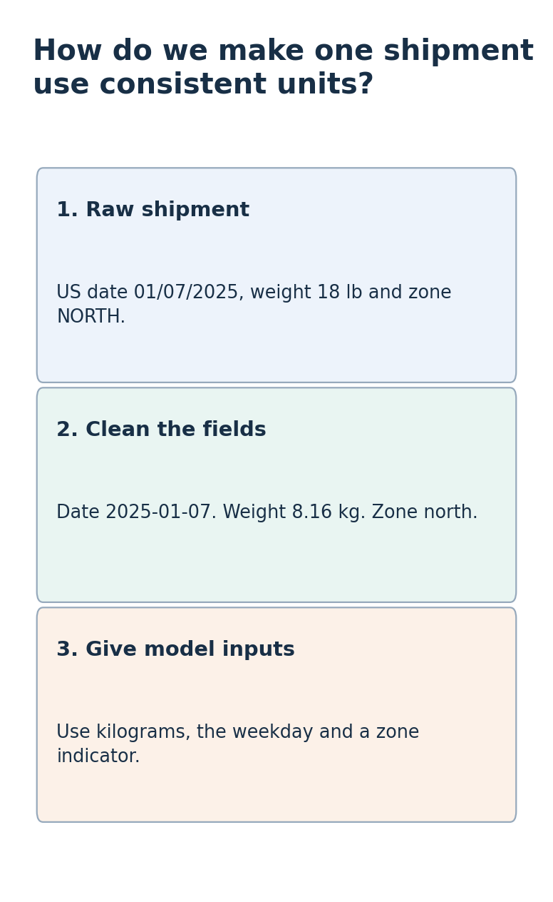

**👀 Read the visual.** The same conversion steps run for training deliveries and new shipments.

**👉 Use what you see.** Give the model **8.16 kg** for this shipment. Its training weight column uses kilograms.

**🎯 Goal.** How can the model compare shipments when one system writes pounds and another writes kilograms? Make the units, dates, and zone names consistent first.

**📋 Sample data**

| ship_date | weight | unit | zone | minutes |
| --- | --- | --- | --- | --- |
| 01/02/2025 | 10 | lb | NORTH | 19 |
| 2025-01-03 | 8 | kg | south | 27 |
| 01/04/2025 | 35 | lbs | NORTH | 38 |
| 2025-01-05 | 16 | kg | south | 40 |
| 2025-01-06 | 12 | kg | north | 35 |

**▶️ Run.** Unzip the [lesson files](sample_code_folder/055-standardize-formats.zip) and open a terminal in that folder. Install the lesson’s packages with `python -m pip install -r requirements.txt`, then run `python lesson.py`.

**🔹 Steps in the script**

1. Read the shipment records from both systems.
2. Write one cleanup function for dates, weight units and zone names.
3. Use the first four cleaned rows for training. Keep the final delivery for a check.
4. Give the model kilograms, a weekday number and a zone flag. Teach it the recorded minutes.
5. Clean new shipments with those same rules and estimate the minutes.

**✅ Check.** Find a standardized ISO date and its weight in kilograms before reading the estimate.

```text
Original date Standard date Original weight  Weight (kg) Original zone Standard zone  South flag
01/02/2025    2025-01-02           10 lb         4.54         NORTH         north           0
2025-01-03    2025-01-03            8 kg         8.00         south         south           1
```

**Your small change.** Try 22 lb on 01/13/2025 in new_inputs.csv. The cleaned row should show 2025-01-13 and about 9.98 kg. Save the named CSV before running again.

**🐍 Complete script from the ZIP**

```python
"""
Standardize formats

Turn dates, pounds and uneven zone names into consistent model inputs, then predict a new delivery.

Run: python lesson.py
Try changing ship_date from 01/07/2025 to 2025-01-10 in new_inputs.csv. Compare the new output.
"""

from pathlib import Path
import pandas as pd
from sklearn.linear_model import LinearRegression

input_path = Path(__file__).resolve().with_name("sample.csv")
new_path = Path(__file__).resolve().with_name("new_inputs.csv")


# 1. Read the shipment records from both systems.
data = pd.read_csv(input_path)


# 2. Write one cleanup function for dates, weight units and zone names.
def clean(frame):
    us_dates = pd.to_datetime(frame["ship_date"], format="%m/%d/%Y", errors="coerce")
    iso_dates = pd.to_datetime(frame["ship_date"], format="%Y-%m-%d", errors="coerce")
    dates = us_dates.fillna(iso_dates)
    units = frame["unit"].str.strip().str.lower()
    kilograms = frame["weight"] * units.map(
        {"kg": 1, "lb": 0.45359237, "lbs": 0.45359237}
    )
    zone = frame["zone"].str.strip().str.lower()
    if (
        dates.isna().any()
        or kilograms.isna().any()
        or not zone.isin(["north", "south"]).all()
    ):
        raise ValueError("Check for an unreadable date, weight, unit, or zone.")
    return pd.DataFrame(
        {
            "date": dates.dt.strftime("%Y-%m-%d"),
            "weight_kg": kilograms,
            "zone": zone,
            "weekday": dates.dt.dayofweek,
            "is_south": zone.eq("south").astype(int),
        }
    )


cleaned = clean(data)
before_after = pd.DataFrame(
    {
        "Original date": data["ship_date"],
        "Standard date": cleaned["date"],
        "Original weight": data["weight"].astype(str) + " " + data["unit"],
        "Weight (kg)": cleaned["weight_kg"].round(2),
        "Original zone": data["zone"].str.strip(),
        "Standard zone": cleaned["zone"],
        "South flag": cleaned["is_south"],
    }
)


inputs = ["weight_kg", "weekday", "is_south"]
# 3. Use the first four cleaned rows for training. Keep the final delivery for a check.
training = cleaned.iloc[:4]
# 4. Give the model kilograms, a weekday number and a zone flag. Teach it the recorded minutes.
model = LinearRegression().fit(training[inputs], data.iloc[:4]["minutes"])
last_shipment = clean(data.iloc[4:])[inputs]
predicted = model.predict(last_shipment)[0]
results = pd.DataFrame(
    {
        "Shipment": ["Check row 5"],
        "Actual time (min)": [data.iloc[4]["minutes"]],
        "Predicted time (min)": [round(predicted, 1)],
    }
)
print(before_after.to_string(index=False))
print(results.to_string(index=False))


# 5. Clean new shipments with those same rules and estimate the minutes.
rows = pd.read_csv(new_path)
changed = clean(rows)
changed["predicted_minutes"] = model.predict(changed[inputs]).round(2)
print(changed.to_string(index=False))
```


**Before and after**

| Original date | Standard date | Original weight | Weight (kg) | Original zone | Standard zone | South flag |
| --- | --- | --- | ---: | --- | --- | ---: |
| 01/02/2025 | 2025-01-02 | 10 lb | 4.54 | NORTH | north | 0 |
| 2025-01-03 | 2025-01-03 | 8 kg | 8 | south | south | 1 |
| 01/04/2025 | 2025-01-04 | 35 lbs | 15.88 | NORTH | north | 0 |
| 2025-01-05 | 2025-01-05 | 16 kg | 16 | south | south | 1 |
| 2025-01-06 | 2025-01-06 | 12 kg | 12 | north | north | 0 |

**📊 Results**

| Shipment | Actual time (min) | Predicted time (min) |
| --- | ---: | ---: |
| Check row 5 | 35 | 34.5 |

**Read the table.** The model uses kilograms, weekday, and a South flag. The true delivery times are the answers used during training.

This model learns from only four rows and three input fields. That is enough to show the file conversions, but much too little to judge a useful delivery model. The larger evaluation lesson checks many more trips.

<a id="fix-typos-and-spelling-variations"></a>

##### ✍️ Fix typos and spelling variations

| Lesson name | What you’ll do | Download |
| --- | --- | --- |
| 059 - Fix typos and spelling variations **Practice** | Map known spelling variants to a single category before encoding it. | [Lesson ZIP](sample_code_folder/059-fix-typos-and-spelling-variations.zip) |

<!-- workbook-teaching:59:start -->
<details>
<summary>Learn, trace and apply this idea</summary>

### Learn and apply: Fix typos and spelling variations

**Your decision.** Map known spelling variants to a single category before encoding it.

**Ready check.** Explain the difference between text spelling and field meaning. Use [the learning path](LEARNING-PATH.md) and [the word list](GLOSSARY.md) for the earlier skill. Trace the small example on paper before code.

**What it means.** A spelling map explicitly lists variants known to mean the same category.

**Why and when.** Use a reviewed map when a source confirms the aliases. Keep an audit of the original value.

**A worked example to follow.** The exercise maps M and male to Male only because its small vocabulary defines that meaning. It then encodes the standardized category.

**Input → steps → output.** Open the supplied table. Its fields are `record_id`, `category`. One original row is shown below in that same field order; `(missing)` marks a blank rather than zero.

```text
1 | Male
```

1. Name the particular field or object involved in this lesson’s decision above. Keep its meaning and units with it.
2. Open the [complete runnable Python example](lessons/059-fix-typos-and-spelling-variations/lesson.py). Its numbered comments connect reading, preparation and the resulting calculation. Install only the [declared requirements](lessons/059-fix-typos-and-spelling-variations/requirements.txt) using the same course Python, as shown in Setup.
3. Trace the worked example above through the script. Keep the original field beside the inspected or changed value. Trace the named preparation or review step, and check whether it uses a fixed rule or a value learned from training.
4. Read the result by its headings. Compare with [full recorded output](lessons/059-fix-typos-and-spelling-variations/expected-output.txt); the excerpt below belongs to the original supplied files. Your edits can change it.

```text
category standard
    Male     Male
       M     Male
  Female   Female
  female   Female
Held-out encoded row: [[1.0, 0.0]]
```

**How to interpret it.** Trace the worked case into the result above. Tell a calculated estimate from a measured answer.

**Common mistakes and limits.** Do not infer sensitive identity or a category from an unfamiliar abbreviation. An unrecognized spelling should raise a review question.

**Use it yourself.** The file contains an unfamiliar value X. Should you add X → Male to make the script pass?

<details>
<summary>Check your choice and reason</summary>

No. Ask what X means or leave it unresolved. A successful script is not evidence that a guessed mapping is correct.

</details>

**A second check later.** Close the notes and explain the same decision using a different row from the supplied table. State one condition that would make this method unsuitable. If you cannot explain the reason, repeat the small worked example before adding more code.

</details>
<!-- workbook-teaching:59:end -->


**Before this lesson.** Read dates, units and names. Know the difference between a number and text.

**In simple words.** Use one clear format for the same meaning. Ten pounds is about 4.54 kilograms. A spelling change is safe only when the source confirms the same meaning.

**Guess first.** Should 10 lb be passed to a kg field as the number 10? Write your answer before running the example.

<details>
<summary>Read the reason after trying</summary>

No. Convert it to about 4.54 kg first.

</details>


Clean a category from the source PDF’s example. Use an explicit mapping for trusted variants, then train and apply an encoder.

**📋 Sample data**

| record_id | category |
| --- | --- |
| 1 | Male |
| 2 | M |
| 3 | Female |
| 4 | female |

**▶️ Run.** Unzip the [lesson files](sample_code_folder/059-fix-typos-and-spelling-variations.zip) and open a terminal in that folder. Install the lesson’s packages with `python -m pip install -r requirements.txt`, then run `python lesson.py`.

**🔹 Steps in the script**

1. Read the CSV and check its inputs, including record_id, category.
2. Give different spellings of the same value one consistent form.
3. Fit the model on the prepared training rows. Keep it for the checks below.

**✅ Check.** Look for category standard in the output excerpt below.

```text
category standard
Male     Male
M     Male
```

**Your small change.** In sample.csv, replace M with male. Rerun and check that the standard value remains Male. Then try an unknown spelling and read the error before restoring the file. Save the named CSV before running again.


**💡 Takeaway.** Check the field definition before equating two spellings. Apply the same mapping and encoder before a model’s prediction, as in the one-hot lab below.

<a id="1-3-4-handle-outliers"></a>

#### 📊 1.3.4 Handle Outliers

| Lesson name | What you’ll do | Download |
| --- | --- | --- |
| 060 - 1.3.4 Handle Outliers **Practice** | Use parcel weights to see which records deserve a closer look. | [Lesson ZIP](sample_code_folder/060-1-3-4-handle-outliers.zip) |

<!-- workbook-teaching:60:start -->
<details>
<summary>Learn, trace and apply this idea</summary>

### Learn and apply: 1.3.4 Handle Outliers

**Your decision.** Use parcel weights to see which records deserve a closer look.

**Ready check.** Sort weights and read graph axes in kg. Use [the learning path](LEARNING-PATH.md) and [the word list](GLOSSARY.md) for the earlier skill. Trace the small example on paper before code.

**What it means.** An outlier is unusual under a stated comparison rule. A flag asks for investigation.

**Why and when.** Use plots and numerical rules to find records that deserve attention before fitting or reporting.

**A worked example to follow.** The 80 kg value lies far from most weights. A z-score compares it with the average and standard deviation. IQR compares it with the middle half. On a box plot, read kg on the value axis; a whisker limit is a review rule, not a physical weight limit.

**Input → steps → output.** Open the supplied table. Its fields are `weight_kg`. One original row is shown below in that same field order; `(missing)` marks a blank rather than zero.

```text
2
```

1. Name the particular field or object involved in this lesson’s decision above. Keep its meaning and units with it.
2. Open the [complete runnable Python example](lessons/060-1-3-4-handle-outliers/lesson.py). Its numbered comments connect reading, preparation and the resulting calculation. Install only the [declared requirements](lessons/060-1-3-4-handle-outliers/requirements.txt) using the same course Python, as shown in Setup.
3. Trace the worked example above through the script. Keep the original field beside the inspected or changed value. Trace the named preparation or review step, and check whether it uses a fixed rule or a value learned from training.
4. Read the result by its headings. Compare with [full recorded output](lessons/060-1-3-4-handle-outliers/expected-output.txt); the excerpt below belongs to the original supplied files. Your edits can change it.

```text
 weight_kg  Z-score  IQR
        80     True True
```

**How to interpret it.** Trace the worked case into the result above. Tell a calculated estimate from a measured answer.

**Common mistakes and limits.** Do not delete every flagged value. Large valid deliveries may be exactly the cases a service must support. Small samples and skew affect the rules.

**Use it yourself.** A weighing slip confirms an unusual 80 kg shipment. What should you do before choosing a model that cannot handle it?

<details>
<summary>Check your choice and reason</summary>

Keep the confirmed fact, check whether such shipments are in scope, gather suitable training/check examples, or state a service limit. Do not edit a real value merely to improve a score.

</details>

**A second check later.** Close the notes and explain the same decision using a different row from the supplied table. State one condition that would make this method unsuitable. If you cannot explain the reason, repeat the small worked example before adding more code.

</details>
<!-- workbook-teaching:60:end -->


**Before this lesson.** Sort numbers. The middle half is the values between the lower and upper quarters.

**In simple words.** An outlier is an unusual value. A flag says check it. It does not say it is wrong. Use the source to keep, correct or set it aside.

**Guess first.** Does an outlier flag prove a recording error? Write your answer before running the example.

<details>
<summary>Read the reason after trying</summary>

No. A very heavy parcel can be real. Ask for a source check.

</details>


<a id="detection-methods"></a>

##### 🚩 Detection Methods

| Lesson name | What you’ll do | Download |
| --- | --- | --- |
| 061 - Detection Methods **Practice** | Compare two ways to flag unusual parcel weights and inspect the chart. | [Lesson ZIP](sample_code_folder/061-detection-methods.zip) |

<!-- workbook-teaching:61:start -->
<details>
<summary>Learn, trace and apply this idea</summary>

### Learn and apply: Detection Methods

**Your decision.** Compare two ways to flag unusual parcel weights and inspect the chart.

**Ready check.** Sort weights and read graph axes in kg. Use [the learning path](LEARNING-PATH.md) and [the word list](GLOSSARY.md) for the earlier skill. Trace the small example on paper before code.

**What it means.** An outlier is unusual under a stated comparison rule. A flag asks for investigation.

**Why and when.** Use plots and numerical rules to find records that deserve attention before fitting or reporting.

**A worked example to follow.** The 80 kg value lies far from most weights. A z-score compares it with the average and standard deviation. IQR compares it with the middle half. On a box plot, read kg on the value axis; a whisker limit is a review rule, not a physical weight limit.

**Input → steps → output.** Open the supplied table. Its fields are `weight_kg`. One original row is shown below in that same field order; `(missing)` marks a blank rather than zero.

```text
2
```

1. Name the particular field or object involved in this lesson’s decision above. Keep its meaning and units with it.
2. Open the [complete runnable Python example](lessons/061-detection-methods/lesson.py). Its numbered comments connect reading, preparation and the resulting calculation. Install only the [declared requirements](lessons/061-detection-methods/requirements.txt) using the same course Python, as shown in Setup.
3. Trace the worked example above through the script. Keep the original field beside the inspected or changed value. Trace the named preparation or review step, and check whether it uses a fixed rule or a value learned from training.
4. Read the result by its headings. Compare with [full recorded output](lessons/061-detection-methods/expected-output.txt); the excerpt below belongs to the original supplied files. Your edits can change it.

```text
 weight_kg  Z-score  IQR
        80     True True
```

**How to interpret it.** Trace the worked case into the result above. Tell a calculated estimate from a measured answer.

**Common mistakes and limits.** Do not delete every flagged value. Large valid deliveries may be exactly the cases a service must support. Small samples and skew affect the rules.

**Use it yourself.** A weighing slip confirms an unusual 80 kg shipment. What should you do before choosing a model that cannot handle it?

<details>
<summary>Check your choice and reason</summary>

Keep the confirmed fact, check whether such shipments are in scope, gather suitable training/check examples, or state a service limit. Do not edit a real value merely to improve a score.

</details>

**A second check later.** Close the notes and explain the same decision using a different row from the supplied table. State one condition that would make this method unsuitable. If you cannot explain the reason, repeat the small worked example before adding more code.

</details>
<!-- workbook-teaching:61:end -->


**Before this lesson.** Sort numbers. The middle half is the values between the lower and upper quarters.

**In simple words.** An outlier is an unusual value. A flag says check it. It does not say it is wrong. Use the source to keep, correct or set it aside.

**Guess first.** Does an outlier flag prove a recording error? Write your answer before running the example.

<details>
<summary>Read the reason after trying</summary>

No. A very heavy parcel can be real. Ask for a source check.

</details>


<a id="boxplots-visualization"></a>

###### 📦 Boxplots & Visualization

| Lesson name | What you’ll do | Download |
| --- | --- | --- |
| 062 - Boxplots & Visualization **Practice** | Find a weight far from the others on a boxplot. | [Lesson ZIP](sample_code_folder/062-boxplots-visualization.zip) |

<!-- workbook-teaching:62:start -->
<details>
<summary>Learn, trace and apply this idea</summary>

### Learn and apply: Boxplots & Visualization

**Your decision.** Find a weight far from the others on a boxplot.

**Ready check.** Sort weights and read graph axes in kg. Use [the learning path](LEARNING-PATH.md) and [the word list](GLOSSARY.md) for the earlier skill. Trace the small example on paper before code.

**What it means.** An outlier is unusual under a stated comparison rule. A flag asks for investigation.

**Why and when.** Use plots and numerical rules to find records that deserve attention before fitting or reporting.

**A worked example to follow.** The 80 kg value lies far from most weights. A z-score compares it with the average and standard deviation. IQR compares it with the middle half. On a box plot, read kg on the value axis; a whisker limit is a review rule, not a physical weight limit.

**Input → steps → output.** Open the supplied table. Its fields are `weight_kg`. One original row is shown below in that same field order; `(missing)` marks a blank rather than zero.

```text
2
```

1. Name the particular field or object involved in this lesson’s decision above. Keep its meaning and units with it.
2. Open the [complete runnable Python example](lessons/062-boxplots-visualization/lesson.py). Its numbered comments connect reading, preparation and the resulting calculation. Install only the [declared requirements](lessons/062-boxplots-visualization/requirements.txt) using the same course Python, as shown in Setup.
3. Trace the worked example above through the script. Keep the original field beside the inspected or changed value. Trace the named preparation or review step, and check whether it uses a fixed rule or a value learned from training.
4. Read the result by its headings. Compare with [full recorded output](lessons/062-boxplots-visualization/expected-output.txt); the excerpt below belongs to the original supplied files. Your edits can change it.

```text
 weight_kg  Z-score  IQR
        80     True True
```

**How to interpret it.** Trace the worked case into the result above. Tell a calculated estimate from a measured answer.

**Common mistakes and limits.** Do not delete every flagged value. Large valid deliveries may be exactly the cases a service must support. Small samples and skew affect the rules.

**Use it yourself.** A weighing slip confirms an unusual 80 kg shipment. What should you do before choosing a model that cannot handle it?

<details>
<summary>Check your choice and reason</summary>

Keep the confirmed fact, check whether such shipments are in scope, gather suitable training/check examples, or state a service limit. Do not edit a real value merely to improve a score.

</details>

**A second check later.** Close the notes and explain the same decision using a different row from the supplied table. State one condition that would make this method unsuitable. If you cannot explain the reason, repeat the small worked example before adding more code.

</details>
<!-- workbook-teaching:62:end -->


**Before this lesson.** Sort numbers. The middle half is the values between the lower and upper quarters.

**In simple words.** An outlier is an unusual value. A flag says check it. It does not say it is wrong. Use the source to keep, correct or set it aside.

**Guess first.** Does an outlier flag prove a recording error? Write your answer before running the example.

<details>
<summary>Read the reason after trying</summary>

No. A very heavy parcel can be real. Ask for a source check.

</details>


Run the detection code below and inspect the isolated point above the upper whisker.

<a id="z-score-method"></a>

###### 📏 Z-score Method

| Lesson name | What you’ll do | Download |
| --- | --- | --- |
| 063 - Z-score Method **Practice** | Flag a parcel that is more than three standard deviations from the average weight. | [Lesson ZIP](sample_code_folder/063-z-score-method.zip) |

<!-- workbook-teaching:63:start -->
<details>
<summary>Learn, trace and apply this idea</summary>

### Learn and apply: Z-score Method

**Your decision.** Flag a parcel that is more than three standard deviations from the average weight.

**Ready check.** Sort weights and read graph axes in kg. Use [the learning path](LEARNING-PATH.md) and [the word list](GLOSSARY.md) for the earlier skill. Trace the small example on paper before code.

**What it means.** An outlier is unusual under a stated comparison rule. A flag asks for investigation.

**Why and when.** Use plots and numerical rules to find records that deserve attention before fitting or reporting.

**A worked example to follow.** The 80 kg value lies far from most weights. A z-score compares it with the average and standard deviation. IQR compares it with the middle half. On a box plot, read kg on the value axis; a whisker limit is a review rule, not a physical weight limit.

**Input → steps → output.** Open the supplied table. Its fields are `weight_kg`. One original row is shown below in that same field order; `(missing)` marks a blank rather than zero.

```text
2
```

1. Name the particular field or object involved in this lesson’s decision above. Keep its meaning and units with it.
2. Open the [complete runnable Python example](lessons/063-z-score-method/lesson.py). Its numbered comments connect reading, preparation and the resulting calculation. Install only the [declared requirements](lessons/063-z-score-method/requirements.txt) using the same course Python, as shown in Setup.
3. Trace the worked example above through the script. Keep the original field beside the inspected or changed value. Trace the named preparation or review step, and check whether it uses a fixed rule or a value learned from training.
4. Read the result by its headings. Compare with [full recorded output](lessons/063-z-score-method/expected-output.txt); the excerpt below belongs to the original supplied files. Your edits can change it.

```text
 weight_kg  Z-score  IQR
        80     True True
```

**How to interpret it.** Trace the worked case into the result above. Tell a calculated estimate from a measured answer.

**Common mistakes and limits.** Do not delete every flagged value. Large valid deliveries may be exactly the cases a service must support. Small samples and skew affect the rules.

**Use it yourself.** A weighing slip confirms an unusual 80 kg shipment. What should you do before choosing a model that cannot handle it?

<details>
<summary>Check your choice and reason</summary>

Keep the confirmed fact, check whether such shipments are in scope, gather suitable training/check examples, or state a service limit. Do not edit a real value merely to improve a score.

</details>

**A second check later.** Close the notes and explain the same decision using a different row from the supplied table. State one condition that would make this method unsuitable. If you cannot explain the reason, repeat the small worked example before adding more code.

</details>
<!-- workbook-teaching:63:end -->


**Before this lesson.** Sort numbers. The middle half is the values between the lower and upper quarters.

**In simple words.** An outlier is an unusual value. A flag says check it. It does not say it is wrong. Use the source to keep, correct or set it aside.

**Guess first.** Does an outlier flag prove a recording error? Write your answer before running the example.

<details>
<summary>Read the reason after trying</summary>

No. A very heavy parcel can be real. Ask for a source check.

</details>


The detection code calculates the training mean and standard deviation, then flags readings more than 3 standard deviations away.

<a id="interquartile-range-iqr"></a>

###### 📐 Interquartile Range (IQR)

| Lesson name | What you’ll do | Download |
| --- | --- | --- |
| 064 - Interquartile Range (IQR) **Practice** | Use the middle half of the weight distribution to set a review range. | [Lesson ZIP](sample_code_folder/064-interquartile-range-iqr.zip) |

<!-- workbook-teaching:64:start -->
<details>
<summary>Learn, trace and apply this idea</summary>

### Learn and apply: Interquartile Range (IQR)

**Your decision.** Use the middle half of the weight distribution to set a review range.

**Ready check.** Sort weights and read graph axes in kg. Use [the learning path](LEARNING-PATH.md) and [the word list](GLOSSARY.md) for the earlier skill. Trace the small example on paper before code.

**What it means.** An outlier is unusual under a stated comparison rule. A flag asks for investigation.

**Why and when.** Use plots and numerical rules to find records that deserve attention before fitting or reporting.

**A worked example to follow.** The 80 kg value lies far from most weights. A z-score compares it with the average and standard deviation. IQR compares it with the middle half. On a box plot, read kg on the value axis; a whisker limit is a review rule, not a physical weight limit.

**Input → steps → output.** Open the supplied table. Its fields are `weight_kg`. One original row is shown below in that same field order; `(missing)` marks a blank rather than zero.

```text
2
```

1. Name the particular field or object involved in this lesson’s decision above. Keep its meaning and units with it.
2. Open the [complete runnable Python example](lessons/064-interquartile-range-iqr/lesson.py). Its numbered comments connect reading, preparation and the resulting calculation. Install only the [declared requirements](lessons/064-interquartile-range-iqr/requirements.txt) using the same course Python, as shown in Setup.
3. Trace the worked example above through the script. Keep the original field beside the inspected or changed value. Trace the named preparation or review step, and check whether it uses a fixed rule or a value learned from training.
4. Read the result by its headings. Compare with [full recorded output](lessons/064-interquartile-range-iqr/expected-output.txt); the excerpt below belongs to the original supplied files. Your edits can change it.

```text
 weight_kg  Z-score  IQR
        80     True True
```

**How to interpret it.** Trace the worked case into the result above. Tell a calculated estimate from a measured answer.

**Common mistakes and limits.** Do not delete every flagged value. Large valid deliveries may be exactly the cases a service must support. Small samples and skew affect the rules.

**Use it yourself.** A weighing slip confirms an unusual 80 kg shipment. What should you do before choosing a model that cannot handle it?

<details>
<summary>Check your choice and reason</summary>

Keep the confirmed fact, check whether such shipments are in scope, gather suitable training/check examples, or state a service limit. Do not edit a real value merely to improve a score.

</details>

**A second check later.** Close the notes and explain the same decision using a different row from the supplied table. State one condition that would make this method unsuitable. If you cannot explain the reason, repeat the small worked example before adding more code.

</details>
<!-- workbook-teaching:64:end -->


**Before this lesson.** Sort numbers. The middle half is the values between the lower and upper quarters.

**In simple words.** An outlier is an unusual value. A flag says check it. It does not say it is wrong. Use the source to keep, correct or set it aside.

**Guess first.** Does an outlier flag prove a recording error? Write your answer before running the example.

<details>
<summary>Read the reason after trying</summary>

No. A very heavy parcel can be real. Ask for a source check.

</details>


Create normal-looking delivery weights and a deliberately large value. Flag it with the two numeric checks, then inspect the box plot.

**📋 Sample data.** Preview of the first 8 of 12 rows.

| weight_kg |
| ---: |
| 2 |
| 3 |
| 3 |
| 4 |
| 4 |
| 4 |
| 5 |
| 5 |

**▶️ Run.** Unzip the [lesson files](sample_code_folder/064-interquartile-range-iqr.zip) and open a terminal in that folder. Install the lesson’s packages with `python -m pip install -r requirements.txt`, then run `python lesson.py`.

**🔹 Steps in the script**

1. Read the CSV and check its inputs, including weight_kg.
2. Find where the middle values sit, then compare the remaining rows with those limits.
3. Plot the values so you can see how they compare.

**✅ Check.** Look for weight_kg  Z-score  IQR in the output excerpt below.

```text
weight_kg  Z-score  IQR
80     True True
```

**Your small change.** Compare 80 kg with 8 kg. Change or add a measured weight in sample.csv, then look for the flag and the boxplot. Save the named CSV before running again.


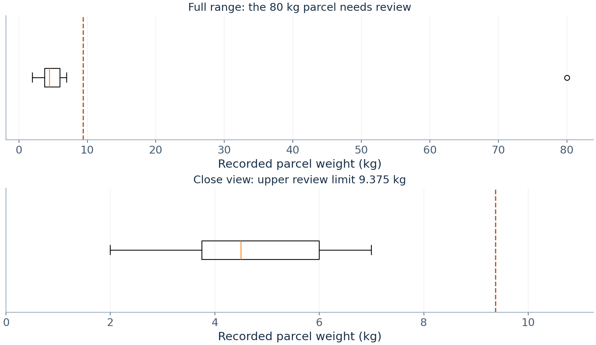

**👀 Read the visual.** The 80 kg weight is above the review line. The zoom shows how the middle half of the recorded weights anchors the review rule.

**👉 Use what you see.** Check the source record before you change or set aside a flagged weight.

**💡 Takeaway.** Review any flagged value with the source. A large valid delivery is useful data when the model needs to handle it.

<a id="handling-strategies"></a>

##### 🛠️ Handling Strategies

| Lesson name | What you’ll do | Download |
| --- | --- | --- |
| 065 - Handling Strategies **Practice** | Compare deleting a confirmed error, clipping a value and applying a log. | [Lesson ZIP](sample_code_folder/065-handling-strategies.zip) |

<!-- workbook-teaching:65:start -->
<details>
<summary>Learn, trace and apply this idea</summary>

### Learn and apply: Handling Strategies

**Your decision.** Compare deleting a confirmed error, clipping a value and applying a log.

**Ready check.** Separate a physically invalid value from a valid unusual value. Use [the learning path](LEARNING-PATH.md) and [the word list](GLOSSARY.md) for the earlier skill. Trace the small example on paper before code.

**What it means.** Removing, clipping and transforming are different actions with different meanings.

**Why and when.** Remove confirmed recording errors; consider a fitted clipping or log rule only for a stated modeling reason.

**A worked example to follow.** A negative parcel weight is invalid in this exercise. A real 40 kg shipment is not. Clipping changes the model input to a limit learned from training; a log compresses gaps while preserving order for its valid domain.

**Input → steps → output.** Open the supplied table. Its fields are `weight_kg`, `minutes`. One original row is shown below in that same field order; `(missing)` marks a blank rather than zero.

```text
1 | 18
```

1. Name the particular field or object involved in this lesson’s decision above. Keep its meaning and units with it.
2. Open the [complete runnable Python example](lessons/065-handling-strategies/lesson.py). Its numbered comments connect reading, preparation and the resulting calculation. Install only the [declared requirements](lessons/065-handling-strategies/requirements.txt) using the same course Python, as shown in Setup.
3. Trace the worked example above through the script. Keep the original field beside the inspected or changed value. Trace the named preparation or review step, and check whether it uses a fixed rule or a value learned from training.
4. Read the result by its headings. Compare with [full recorded output](lessons/065-handling-strategies/expected-output.txt); the excerpt below belongs to the original supplied files. Your edits can change it.

```text
Confirmed errors removed: 1
remove only
 weight_used_by_model  original_weight_kg  predicted_minutes  actual_minutes
                  7.0                 7.0               28.1              32
remove and clip
 weight_used_by_model  original_weight_kg  predicted_minutes  actual_minutes
```

**How to interpret it.** Trace the worked case into the result above. Tell a calculated estimate from a measured answer.

**Common mistakes and limits.** Keep the original measurement. Fit data-based limits inside training folds. Neither clipping nor logging proves an outlier was wrong.

**Use it yourself.** A new weight exceeds the saved clipping limit. Recalculate that limit using the request?

<details>
<summary>Check your choice and reason</summary>

No. Apply the training limit and record that clipping happened. Relearning a limit is part of explicit retraining, followed by a new fair check.

</details>

**A second check later.** Close the notes and explain the same decision using a different row from the supplied table. State one condition that would make this method unsuitable. If you cannot explain the reason, repeat the small worked example before adding more code.

</details>
<!-- workbook-teaching:65:end -->


**Before this lesson.** Sort numbers. The middle half is the values between the lower and upper quarters.

**In simple words.** An outlier is an unusual value. A flag says check it. It does not say it is wrong. Use the source to keep, correct or set it aside.

**Guess first.** Does an outlier flag prove a recording error? Write your answer before running the example.

<details>
<summary>Read the reason after trying</summary>

No. A very heavy parcel can be real. Ask for a source check.

</details>


<a id="remove-2"></a>

###### 🧽 Remove

| Lesson name | What you’ll do | Download |
| --- | --- | --- |
| 066 - Remove **Practice** | Remove an impossible negative parcel weight before fitting a model. | [Lesson ZIP](sample_code_folder/066-remove-2.zip) |

<!-- workbook-teaching:66:start -->
<details>
<summary>Learn, trace and apply this idea</summary>

### Learn and apply: Remove

**Your decision.** Remove an impossible negative parcel weight before fitting a model.

**Ready check.** Separate a physically invalid value from a valid unusual value. Use [the learning path](LEARNING-PATH.md) and [the word list](GLOSSARY.md) for the earlier skill. Trace the small example on paper before code.

**What it means.** Removing, clipping and transforming are different actions with different meanings.

**Why and when.** Remove confirmed recording errors; consider a fitted clipping or log rule only for a stated modeling reason.

**A worked example to follow.** A negative parcel weight is invalid in this exercise. A real 40 kg shipment is not. Clipping changes the model input to a limit learned from training; a log compresses gaps while preserving order for its valid domain.

**Input → steps → output.** Open the supplied table. Its fields are `weight_kg`, `minutes`. One original row is shown below in that same field order; `(missing)` marks a blank rather than zero.

```text
1 | 18
```

1. Name the particular field or object involved in this lesson’s decision above. Keep its meaning and units with it.
2. Open the [complete runnable Python example](lessons/066-remove-2/lesson.py). Its numbered comments connect reading, preparation and the resulting calculation. Install only the [declared requirements](lessons/066-remove-2/requirements.txt) using the same course Python, as shown in Setup.
3. Trace the worked example above through the script. Keep the original field beside the inspected or changed value. Trace the named preparation or review step, and check whether it uses a fixed rule or a value learned from training.
4. Read the result by its headings. Compare with [full recorded output](lessons/066-remove-2/expected-output.txt); the excerpt below belongs to the original supplied files. Your edits can change it.

```text
Confirmed errors removed: 1
remove only
 weight_used_by_model  original_weight_kg  predicted_minutes  actual_minutes
                  7.0                 7.0               28.1              32
remove and clip
 weight_used_by_model  original_weight_kg  predicted_minutes  actual_minutes
```

**How to interpret it.** Trace the worked case into the result above. Tell a calculated estimate from a measured answer.

**Common mistakes and limits.** Keep the original measurement. Fit data-based limits inside training folds. Neither clipping nor logging proves an outlier was wrong.

**Use it yourself.** A new weight exceeds the saved clipping limit. Recalculate that limit using the request?

<details>
<summary>Check your choice and reason</summary>

No. Apply the training limit and record that clipping happened. Relearning a limit is part of explicit retraining, followed by a new fair check.

</details>

**A second check later.** Close the notes and explain the same decision using a different row from the supplied table. State one condition that would make this method unsuitable. If you cannot explain the reason, repeat the small worked example before adding more code.

</details>
<!-- workbook-teaching:66:end -->


**Before this lesson.** Sort numbers. The middle half is the values between the lower and upper quarters.

**In simple words.** An outlier is an unusual value. A flag says check it. It does not say it is wrong. Use the source to keep, correct or set it aside.

**Guess first.** Does an outlier flag prove a recording error? Write your answer before running the example.

<details>
<summary>Read the reason after trying</summary>

No. A very heavy parcel can be real. Ask for a source check.

</details>


In the handling exercise below, remove the deliberately invalid negative weight and check the row count.

<a id="cap-clip-values"></a>

###### ✂️ Cap/Clip Values

| Lesson name | What you’ll do | Download |
| --- | --- | --- |
| 067 - Cap/Clip Values **Practice** | Cap very low and very high weights using limits learned from training rows. | [Lesson ZIP](sample_code_folder/067-cap-clip-values.zip) |

<!-- workbook-teaching:67:start -->
<details>
<summary>Learn, trace and apply this idea</summary>

### Learn and apply: Cap/Clip Values

**Your decision.** Cap very low and very high weights using limits learned from training rows.

**Ready check.** Separate a physically invalid value from a valid unusual value. Use [the learning path](LEARNING-PATH.md) and [the word list](GLOSSARY.md) for the earlier skill. Trace the small example on paper before code.

**What it means.** Removing, clipping and transforming are different actions with different meanings.

**Why and when.** Remove confirmed recording errors; consider a fitted clipping or log rule only for a stated modeling reason.

**A worked example to follow.** A negative parcel weight is invalid in this exercise. A real 40 kg shipment is not. Clipping changes the model input to a limit learned from training; a log compresses gaps while preserving order for its valid domain.

**Input → steps → output.** Open the supplied table. Its fields are `weight_kg`, `minutes`. One original row is shown below in that same field order; `(missing)` marks a blank rather than zero.

```text
1 | 18
```

1. Name the particular field or object involved in this lesson’s decision above. Keep its meaning and units with it.
2. Open the [complete runnable Python example](lessons/067-cap-clip-values/lesson.py). Its numbered comments connect reading, preparation and the resulting calculation. Install only the [declared requirements](lessons/067-cap-clip-values/requirements.txt) using the same course Python, as shown in Setup.
3. Trace the worked example above through the script. Keep the original field beside the inspected or changed value. Trace the named preparation or review step, and check whether it uses a fixed rule or a value learned from training.
4. Read the result by its headings. Compare with [full recorded output](lessons/067-cap-clip-values/expected-output.txt); the excerpt below belongs to the original supplied files. Your edits can change it.

```text
Confirmed errors removed: 1
remove only
 weight_used_by_model  original_weight_kg  predicted_minutes  actual_minutes
                  7.0                 7.0               28.1              32
remove and clip
 weight_used_by_model  original_weight_kg  predicted_minutes  actual_minutes
```

**How to interpret it.** Trace the worked case into the result above. Tell a calculated estimate from a measured answer.

**Common mistakes and limits.** Keep the original measurement. Fit data-based limits inside training folds. Neither clipping nor logging proves an outlier was wrong.

**Use it yourself.** A new weight exceeds the saved clipping limit. Recalculate that limit using the request?

<details>
<summary>Check your choice and reason</summary>

No. Apply the training limit and record that clipping happened. Relearning a limit is part of explicit retraining, followed by a new fair check.

</details>

**A second check later.** Close the notes and explain the same decision using a different row from the supplied table. State one condition that would make this method unsuitable. If you cannot explain the reason, repeat the small worked example before adding more code.

</details>
<!-- workbook-teaching:67:end -->


**Before this lesson.** Sort numbers. The middle half is the values between the lower and upper quarters.

**In simple words.** An outlier is an unusual value. A flag says check it. It does not say it is wrong. Use the source to keep, correct or set it aside.

**Guess first.** Does an outlier flag prove a recording error? Write your answer before running the example.

<details>
<summary>Read the reason after trying</summary>

No. A very heavy parcel can be real. Ask for a source check.

</details>


In the same exercise, print the capped training input and apply the training limit to the kept-back row.

<a id="transform-data"></a>

###### 📉 Transform Data

| Lesson name | What you’ll do | Download |
| --- | --- | --- |
| 068 - Transform Data **Practice** | Use a log to shrink the effect of large weights, then compare the predicted time. | [Lesson ZIP](sample_code_folder/068-transform-data.zip) |

<!-- workbook-teaching:68:start -->
<details>
<summary>Learn, trace and apply this idea</summary>

### Learn and apply: Transform Data

**Your decision.** Use a log to shrink the effect of large weights, then compare the predicted time.

**Ready check.** Separate a physically invalid value from a valid unusual value. Use [the learning path](LEARNING-PATH.md) and [the word list](GLOSSARY.md) for the earlier skill. Trace the small example on paper before code.

**What it means.** Removing, clipping and transforming are different actions with different meanings.

**Why and when.** Remove confirmed recording errors; consider a fitted clipping or log rule only for a stated modeling reason.

**A worked example to follow.** A negative parcel weight is invalid in this exercise. A real 40 kg shipment is not. Clipping changes the model input to a limit learned from training; a log compresses gaps while preserving order for its valid domain.

**Input → steps → output.** Open the supplied table. Its fields are `weight_kg`, `minutes`. One original row is shown below in that same field order; `(missing)` marks a blank rather than zero.

```text
1 | 18
```

1. Name the particular field or object involved in this lesson’s decision above. Keep its meaning and units with it.
2. Open the [complete runnable Python example](lessons/068-transform-data/lesson.py). Its numbered comments connect reading, preparation and the resulting calculation. Install only the [declared requirements](lessons/068-transform-data/requirements.txt) using the same course Python, as shown in Setup.
3. Trace the worked example above through the script. Keep the original field beside the inspected or changed value. Trace the named preparation or review step, and check whether it uses a fixed rule or a value learned from training.
4. Read the result by its headings. Compare with [full recorded output](lessons/068-transform-data/expected-output.txt); the excerpt below belongs to the original supplied files. Your edits can change it.

```text
Confirmed errors removed: 1
remove only
 weight_used_by_model  original_weight_kg  predicted_minutes  actual_minutes
                  7.0                 7.0               28.1              32
remove and clip
 weight_used_by_model  original_weight_kg  predicted_minutes  actual_minutes
```

**How to interpret it.** Trace the worked case into the result above. Tell a calculated estimate from a measured answer.

**Common mistakes and limits.** Keep the original measurement. Fit data-based limits inside training folds. Neither clipping nor logging proves an outlier was wrong.

**Use it yourself.** A new weight exceeds the saved clipping limit. Recalculate that limit using the request?

<details>
<summary>Check your choice and reason</summary>

No. Apply the training limit and record that clipping happened. Relearning a limit is part of explicit retraining, followed by a new fair check.

</details>

**A second check later.** Close the notes and explain the same decision using a different row from the supplied table. State one condition that would make this method unsuitable. If you cannot explain the reason, repeat the small worked example before adding more code.

</details>
<!-- workbook-teaching:68:end -->


**Before this lesson.** Sort numbers. The middle half is the values between the lower and upper quarters.

**In simple words.** An outlier is an unusual value. A flag says check it. It does not say it is wrong. Use the source to keep, correct or set it aside.

**Guess first.** Does an outlier flag prove a recording error? Write your answer before running the example.

<details>
<summary>Read the reason after trying</summary>

No. A very heavy parcel can be real. Ask for a source check.

</details>


Run three strategies on a table with a deliberately invalid negative weight and a real heavy shipment. Learn the clipping limit from training data.

**📋 Sample data**

| weight_kg | minutes |
| --- | --- |
| 1 | 18 |
| -45 | 18 |
| 2 | 21 |
| 3 | 23 |
| 5 | 28 |
| 40 | 72 |
| 7 | 32 |

**▶️ Run.** Unzip the [lesson files](sample_code_folder/068-transform-data.zip) and open a terminal in that folder. Install the lesson’s packages with `python -m pip install -r requirements.txt`, then run `python lesson.py`.

**🔹 Steps in the script**

1. Read the weights in kilograms and the delivery times in minutes.
2. Set aside the check rows before the model learns.
3. Give each method the same practice data so you can compare the results.

**✅ Check.** Look for Confirmed errors removed: 1 in the output excerpt below.

```text
Confirmed errors removed: 1
remove only
weight_used_by_model  original_weight_kg  predicted_minutes  actual_minutes
```

**Your small change.** Try changing weight_kg from 1 to 2 in sample.csv. Compare the new output. Save the named CSV before running again.


**💡 Takeaway.** Use a validation set to choose a strategy. For cross-validation, learn a clipping bound inside each training fold.

<a id="spot-check-and-handle-an-outlier"></a>

###### 🚦 Spot, check, and handle an outlier

| Lesson name | What you’ll do | Download |
| --- | --- | --- |
| 069 - Spot, check, and handle an outlier **Core** | Investigate the recorded 90 kg parcel using its source slip; choose KEEP, CORRECT or FLAG and compare the same kept-back trip. | [Lesson ZIP](sample_code_folder/069-spot-check-and-handle-an-outlier.zip) |

<!-- workbook-teaching:69:start -->
<details>
<summary>Learn, trace and apply this idea</summary>

### Learn and apply: Spot, check, and handle an outlier

**Your decision.** Investigate a recorded 90 kg parcel. Use the weighing slip to choose KEEP, CORRECT or FLAG, then compare predictions for the same kept-back parcel.

**Ready check.** Find a parcel ID on the horizontal axis and kg on the vertical axis. Use [the learning path](LEARNING-PATH.md) and [the word list](GLOSSARY.md) for the earlier skill. Trace the small example on paper before code.

**What it means.** Source review decides whether a flagged measurement is wrong, valid or unresolved.

**Why and when.** Use the source record before changing an unusual training value.

**A worked example to follow.** Parcel 5 has recorded weight 90 kg and crosses the 12.5 kg review line. A slip confirming 5 kg justifies correction; 90 kg justifies keeping it; an absent usable slip leaves it flagged. The later chart compares predictions for the same held-back parcel 8, whose actual time is 26 minutes.

**Input → steps → output.** Open the supplied table. Its fields are `parcel`, `weight_kg`, `minutes`. One original row is shown below in that same field order; `(missing)` marks a blank rather than zero.

```text
1 | 1 | 12
```

1. Name the particular field or object involved in this lesson’s decision above. Keep its meaning and units with it.
2. Open the [complete runnable Python example](lessons/069-spot-check-and-handle-an-outlier/lesson.py). Its numbered comments connect reading, preparation and the resulting calculation. Install only the [declared requirements](lessons/069-spot-check-and-handle-an-outlier/requirements.txt) using the same course Python, as shown in Setup.
3. Trace the worked example above through the script. Keep the original field beside the inspected or changed value. Trace the named preparation or review step, and check whether it uses a fixed rule or a value learned from training.
4. Read the result by its headings. Compare with [full recorded output](lessons/069-spot-check-and-handle-an-outlier/expected-output.txt); the excerpt below belongs to the original supplied files. Your edits can change it.

```text
Training review range: -3.5 to 12.5 kg.
Training records outside that range
 parcel  weight_kg
      5         90

Decision: CORRECT
```

**How to interpret it.** Trace the worked case into the result above. Tell a calculated estimate from a measured answer.

**Common mistakes and limits.** The flag does not establish an error, and improvement on one held-back trip does not establish general improvement. Do not use the test answer to invent a correction.

**Use it yourself.** The slip confirms 90 kg, but correcting to 5 would improve this one score. Which value belongs in the reviewed data?

<details>
<summary>Check your choice and reason</summary>

Keep 90 kg. Evidence about the measurement decides correction. Model suitability is a separate question requiring more suitable check examples.

</details>

**A second check later.** Close the notes and explain the same decision using a different row from the supplied table. State one condition that would make this method unsuitable. If you cannot explain the reason, repeat the small worked example before adding more code.

</details>
<!-- workbook-teaching:69:end -->


**Before this lesson.** Sort numbers. The middle half is the values between the lower and upper quarters.

**In simple words.** An outlier is an unusual value. A flag says check it. It does not say it is wrong. Use the source to keep, correct or set it aside.

**Guess first.** Does an outlier flag prove a recording error? Write your answer before running the example.

<details>
<summary>Read the reason after trying</summary>

No. A very heavy parcel can be real. Ask for a source check.

</details>


**Next step.** Return to [Your learning path](LEARNING-PATH.md) and open the next unfinished module.

**🎯 Goal.** Is a 90 kg parcel a recording mistake? Follow one point from the raw table to the flag, check the source, then compare two model predictions.

**📋 Sample data**

| parcel | weight_kg | minutes |
| --- | --- | --- |
| 1 | 1 | 12 |
| 2 | 2 | 14 |
| 3 | 3 | 16 |
| 4 | 4 | 18 |
| 5 | 90 | 20 |
| 6 | 6 | 22 |
| 7 | 7 | 24 |
| 8 | 8 | 26 |

**▶️ Run.** Unzip the [lesson files](sample_code_folder/069-spot-check-and-handle-an-outlier.zip) and open a terminal in that folder. Install the lesson’s packages with `python -m pip install -r requirements.txt`, then run `python lesson.py`.

Edit **weighing_slip.csv** to make a different decision. The script reads the recorded weight from sample.csv and the verified weight from the slip.

**🐍 Complete script from the ZIP**

```python
"""Review the 90 kg entry for parcel 5. Run with python lesson.py."""

from pathlib import Path

import matplotlib.pyplot as plt
import pandas as pd
from sklearn.linear_model import LinearRegression

folder = Path(__file__).resolve().parent

# 1. Open the delivery log. Keep the last parcel for a fair model check.
deliveries = pd.read_csv(folder / "sample.csv")
training = deliveries.iloc[:-1].copy()
check = deliveries.iloc[[-1]]
parcel_under_review = 5
is_parcel_5 = training["parcel"].eq(parcel_under_review)
recorded_kg = training.loc[is_parcel_5, "weight_kg"].item()

# 2. Learn the review limits from the middle half of the training weights.
lower_quarter = training["weight_kg"].quantile(0.25)
upper_quarter = training["weight_kg"].quantile(0.75)
middle_spread = upper_quarter - lower_quarter
lower_limit = lower_quarter - 1.5 * middle_spread
upper_limit = upper_quarter + 1.5 * middle_spread
flagged = training.loc[
    ~training["weight_kg"].between(lower_limit, upper_limit), ["parcel", "weight_kg"]
]
print(f"Training review range: {lower_limit:g} to {upper_limit:g} kg.")
print("Training records outside that range")
print(flagged.to_string(index=False))

fig, ax = plt.subplots(figsize=(8, 4), layout="constrained")
ax.scatter(deliveries["parcel"], deliveries["weight_kg"], color="#165eab")
ax.scatter([parcel_under_review], [recorded_kg], marker="D", color="#a94914", s=95)
ax.axhline(upper_limit, color="#165eab", linestyle="--", label="Upper review limit")
ax.set(xlabel="Parcel ID", ylabel="Recorded weight (kg)", title="Compare recorded weights")
ax.legend()
fig.savefig(folder / "review-weights.png", dpi=180)
plt.close(fig)

# 3. Look up parcel 5 on the original weighing slip.
# A blank cell, missing row or missing file leaves the weight unverified.
slip_file = folder / "weighing_slip.csv"
verified_kg = None
if slip_file.exists() and slip_file.stat().st_size:
    slip = pd.read_csv(slip_file)
    weights = slip.loc[slip["parcel"].eq(parcel_under_review), "verified_weight_kg"]
    if len(weights) == 1:
        weight = pd.to_numeric(weights, errors="coerce").item()
        if pd.notna(weight) and 0 < weight < float("inf"):
            verified_kg = weight

# 4. Follow the slip. A flag by itself cannot tell us the right weight.
reviewed = training.copy()
if verified_kg is None:
    decision = "FLAG"
    # Set the unverified row aside in this exercise until someone reweighs it.
    reviewed = reviewed.loc[~is_parcel_5]
    explanation = "Parcel 5 needs a source check. Set it aside for this model run."
elif verified_kg == recorded_kg:
    decision = "KEEP"
    explanation = f"The slip confirms {recorded_kg:g} kg. Keep the recorded weight."
else:
    decision = "CORRECT"
    reviewed["weight_kg"] = reviewed["weight_kg"].astype(float)
    reviewed.loc[is_parcel_5, "weight_kg"] = verified_kg
    explanation = f"The slip confirms {verified_kg:g} kg. Change {recorded_kg:g} kg to {verified_kg:g} kg."

print(f"\nDecision: {decision}")
print(explanation)

# 5. Ask both models about the same reserved parcel and compare with its actual time.
columns = ["weight_kg"]
actual = check["minutes"].item()
results = []
for name, rows in [("Original records", training), ("After source review", reviewed)]:
    model = LinearRegression().fit(rows[columns], rows["minutes"])
    estimate = model.predict(check[columns]).item()
    results.append([name, estimate, actual])

comparison = pd.DataFrame(results, columns=["Training data", "Predicted minutes", "Actual minutes"])
print("\nCheck parcel 8")
print(comparison.round(1).to_string(index=False))

fig, ax = plt.subplots(figsize=(8, 3.7), layout="constrained")
bars = ax.barh(comparison["Training data"], comparison["Predicted minutes"],
              color=["#a94914", "#096f69"])
ax.bar_label(bars, fmt="%.1f", padding=5)
ax.axvline(actual, color="#172740", linestyle="--", label=f"Actual: {actual:g} min")
ax.set(xlabel="Predicted minutes", xlim=(0, max(actual, *comparison["Predicted minutes"]) * 1.30))
ax.legend()
fig.savefig(folder / "compare-estimates.png", dpi=180)
plt.close(fig)
print("Open review-weights.png and compare-estimates.png in this folder.")
```

**✅ Check.** Find Decision: CORRECT and compare 17.7 with 26.0 minutes for the same check parcel.

| Training data | Predicted minutes | Actual minutes |
| --- | --- | --- |
| Original records | 17.7 | 26 |
| After source review | 26.0 | 26 |

**Your small change.** In weighing_slip.csv, change the verified weight from 5 to 90 for KEEP. Clear the second cell for FLAG. Save the named CSV before running again.

| Second cell in weighing_slip.csv | Expected decision | Action |
| --- | --- | --- |
| 5 | CORRECT | Use 5 kg in the reviewed training copy. |
| 90 | KEEP | Use the original 90 kg. |
| Blank | FLAG | Set that row aside for this practice run and request a source check. |


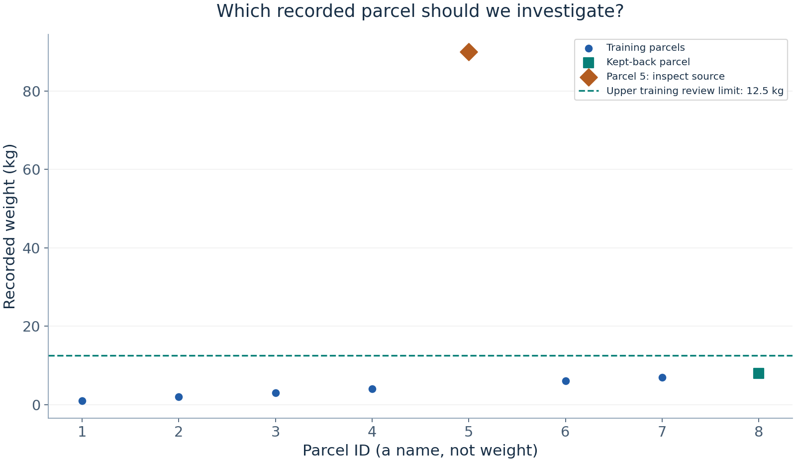

**👀 Read the visual.** Spot parcel 5 above the review line. Use the weighing slip to decide what to do with it.

**👉 Use what you see.** **Flag parcel 5 for review.** The plot tells you which record to check.

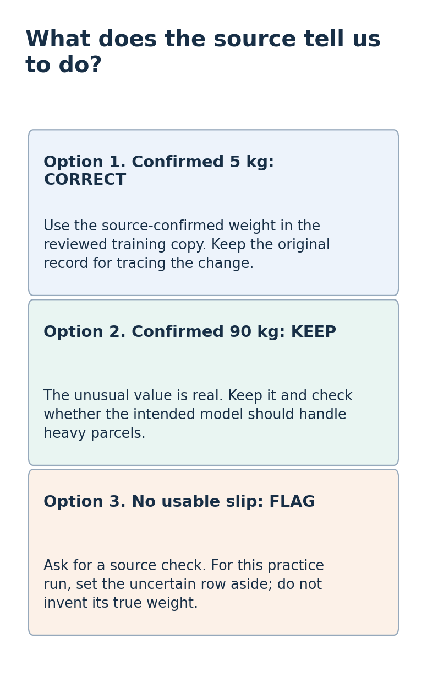

**👀 Read the visual.** Follow the branch that matches the source. In this exercise the weighing slip shows **5 kg**, so the 90 kg entry gets corrected.

**👉 Use what you see.** Keep a confirmed 90 kg. If the source is missing, request a reweigh and leave the value flagged.

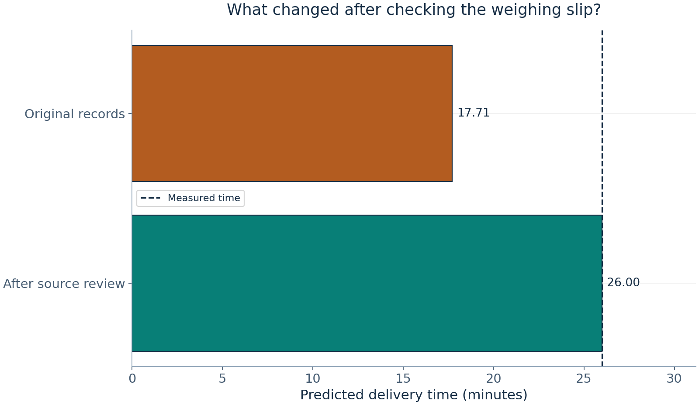

**👀 Read the visual.** The corrected bar reaches the actual-time line for this parcel. Test on more deliveries before treating that as evidence of a general improvement.

**👉 Use what you see.** Use the verified training correction, then check more kept-back deliveries before trusting the improvement in an app.

**💡 What happened?** The example supplies a fictional source note confirming that parcel 5 weighed **5 kg**. Only that confirmation justifies correcting the 90. If the source confirms 90 kg, keep it and decide whether the model should handle that kind of delivery. The error for one check parcel illustrates the effect. It does not establish how well the model will work elsewhere.

<a id="1-3-5-normalize-or-standardize-data"></a>

#### ⚖️ 1.3.5 Normalize or Standardize Data

| Lesson name | What you’ll do | Download |
| --- | --- | --- |
| 070 - 1.3.5 Normalize or Standardize Data **Practice** | Learn a scale from training deliveries and reuse it on new rows. | [Lesson ZIP](sample_code_folder/070-1-3-5-normalize-or-standardize-data.zip) |

<!-- workbook-teaching:70:start -->
<details>
<summary>Learn, trace and apply this idea</summary>

### Learn and apply: 1.3.5 Normalize or Standardize Data

**Your decision.** Learn a scale from training deliveries and reuse it on new rows.

**Ready check.** Read a minimum, maximum, average and spread. Use [the learning path](LEARNING-PATH.md) and [the word list](GLOSSARY.md) for the earlier skill. Trace the small example on paper before code.

**What it means.** Scaling changes the numbers passed to a model, using a rule fitted on training values.

**Why and when.** Use it when input units affect distances or penalties. Compare with unchanged inputs; trees often do not need ordinary linear scaling.

**A worked example to follow.** Min-max uses (value − training minimum) ÷ training range. With limits 1 and 50 km, 90 km becomes 89 ÷ 49, about 1.8163. Standard scaling subtracts the training mean and divides by its standard deviation. Robust scaling uses the training median and IQR.

**Input → steps → output.** Open the supplied table. Its fields are `distance_km`, `weight_kg`, `delivery_minutes`. One original row is shown below in that same field order; `(missing)` marks a blank rather than zero.

```text
2 | 1 | 19
```

1. Name the particular field or object involved in this lesson’s decision above. Keep its meaning and units with it.
2. Open the [complete runnable Python example](lessons/070-1-3-5-normalize-or-standardize-data/lesson.py). Its numbered comments connect reading, preparation and the resulting calculation. Install only the [declared requirements](lessons/070-1-3-5-normalize-or-standardize-data/requirements.txt) using the same course Python, as shown in Setup.
3. Trace the worked example above through the script. Keep inputs apart from measured answers. Follow this script’s split and fit, then trace the saved preparation into the held-back result and any new request. A request must not supply its own training answer.
4. Read the result by its headings. Compare with [full recorded output](lessons/070-1-3-5-normalize-or-standardize-data/expected-output.txt); the excerpt below belongs to the original supplied files. Your edits can change it.

```text
Training rows before and after scaling
 distance_km  weight_kg  scaled_distance  scaled_weight
           2          1             0.00           0.00
           4          3             0.33           0.67
           6          2             0.67           0.33
           8          4             1.00           1.00
```

**How to interpret it.** Trace the worked case into the result above. Tell a calculated estimate from a measured answer.

**Common mistakes and limits.** New values can fall outside a fitted 0–1 range. Do not refit on each request. Scaling is not a guarantee of better predictions or a way to make a distribution normal.

**Use it yourself.** The fitted range is 1–50 km. What does 25 km become? Does an out-of-range number automatically mean an invalid measurement?

<details>
<summary>Check your choice and reason</summary>

25 becomes 24 ÷ 49, about 0.4898. An out-of-range number may be physically possible but outside the evidence for a service. Keep the fitted rule and apply a stated acceptance/fallback policy.

</details>

**A second check later.** Close the notes and explain the same decision using a different row from the supplied table. State one condition that would make this method unsuitable. If you cannot explain the reason, repeat the small worked example before adding more code.

</details>
<!-- workbook-teaching:70:end -->


**Before this lesson.** Read minimum, maximum and average. Keep training rows separate.

**In simple words.** Scaling changes the numbers the model receives. Save the rule learned from training. A value above the old maximum may become greater than 1.

**Guess first.** Does a scaled value above 1 prove the input is invalid? Write your answer before running the example.

<details>
<summary>Read the reason after trying</summary>

No. It may be a possible value outside the training range. The service needs a stated policy.

</details>


<a id="normalization-min-max-scaling"></a>

##### 🟦 Normalization (Min-Max Scaling)

| Lesson name | What you’ll do | Download |
| --- | --- | --- |
| 071 - Normalization (Min-Max Scaling) **Core** | Scale known distances, then see what happens when training covers 1–50 km and someone enters 90 km. | [Lesson ZIP](sample_code_folder/071-normalization-min-max-scaling.zip) |

<!-- workbook-teaching:71:start -->
<details>
<summary>Learn, trace and apply this idea</summary>

### Learn and apply: Normalization (Min-Max Scaling)

**Your decision.** Scale known distances, then see what happens when training covers 1–50 km and someone enters 90 km.

**Ready check.** Read a minimum, maximum, average and spread. Use [the learning path](LEARNING-PATH.md) and [the word list](GLOSSARY.md) for the earlier skill. Trace the small example on paper before code.

**What it means.** Scaling changes the numbers passed to a model, using a rule fitted on training values.

**Why and when.** Use it when input units affect distances or penalties. Compare with unchanged inputs; trees often do not need ordinary linear scaling.

**A worked example to follow.** Min-max uses (value − training minimum) ÷ training range. With limits 1 and 50 km, 90 km becomes 89 ÷ 49, about 1.8163. Standard scaling subtracts the training mean and divides by its standard deviation. Robust scaling uses the training median and IQR.

**Input → steps → output.** Open the supplied table. Its fields are `distance_km`, `weight_kg`, `delivery_minutes`. One original row is shown below in that same field order; `(missing)` marks a blank rather than zero.

```text
2 | 1 | 19
```

1. Name the particular field or object involved in this lesson’s decision above. Keep its meaning and units with it.
2. Open the [complete runnable Python example](lessons/071-normalization-min-max-scaling/lesson.py). Its numbered comments connect reading, preparation and the resulting calculation. Install only the [declared requirements](lessons/071-normalization-min-max-scaling/requirements.txt) using the same course Python, as shown in Setup.
3. Trace the worked example above through the script. Keep inputs apart from measured answers. Follow this script’s split and fit, then trace the saved preparation into the held-back result and any new request. A request must not supply its own training answer.
4. Read the result by its headings. Compare with [full recorded output](lessons/071-normalization-min-max-scaling/expected-output.txt); the excerpt below belongs to the original supplied files. Your edits can change it.

```text
Training rows before and after scaling
 distance_km  weight_kg  scaled_distance  scaled_weight
           2          1             0.00           0.00
           4          3             0.33           0.67
           6          2             0.67           0.33
           8          4             1.00           1.00
```

**How to interpret it.** Trace the worked case into the result above. Tell a calculated estimate from a measured answer.

**Common mistakes and limits.** New values can fall outside a fitted 0–1 range. Do not refit on each request. Scaling is not a guarantee of better predictions or a way to make a distribution normal.

**Use it yourself.** The fitted range is 1–50 km. What does 25 km become? Does an out-of-range number automatically mean an invalid measurement?

<details>
<summary>Check your choice and reason</summary>

25 becomes 24 ÷ 49, about 0.4898. An out-of-range number may be physically possible but outside the evidence for a service. Keep the fitted rule and apply a stated acceptance/fallback policy.

</details>

**A second check later.** Close the notes and explain the same decision using a different row from the supplied table. State one condition that would make this method unsuitable. If you cannot explain the reason, repeat the small worked example before adding more code.

</details>
<!-- workbook-teaching:71:end -->


**Before this lesson.** Read minimum, maximum and average. Keep training rows separate.

**In simple words.** Scaling changes the numbers the model receives. Save the rule learned from training. A value above the old maximum may become greater than 1.

**Guess first.** Does a scaled value above 1 prove the input is invalid? Write your answer before running the example.

<details>
<summary>Read the reason after trying</summary>

No. It may be a possible value outside the training range. The service needs a stated policy.

</details>


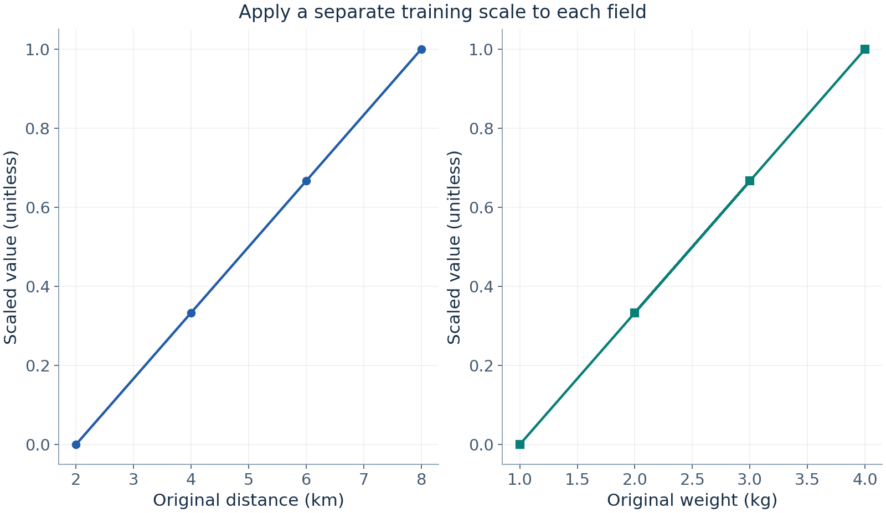

**👀 Read the visual.** Follow the distance axis. The shortest training distance (2 km) maps to 0, and the longest (8 km) maps to 1.

**👉 Use what you see.** Scale the new distance with those same endpoints. The weight uses its own training endpoints.

**Next step.** Return to [Your learning path](LEARNING-PATH.md) and open the next unfinished module.

**🎯 Goal.** How long will a 5 km delivery with a 2 kg parcel take? We know the distance and weight. The **delivery time** is the answer we want the model to predict. Below, the first four rows teach the model and the last two check it.

**📋 Sample data**

| distance_km | weight_kg | delivery_minutes |
| --- | --- | --- |
| 2 | 1 | 19 |
| 4 | 3 | 30 |
| 6 | 2 | 29 |
| 8 | 4 | 40 |
| 10 | 1 | 33 |
| 12 | 3 | 44 |

**▶️ Run.** Unzip the [lesson files](sample_code_folder/071-normalization-min-max-scaling.zip) and open a terminal in that folder. Install the lesson’s packages with `python -m pip install -r requirements.txt`, then run `python lesson.py`.

**🐍 Complete script from the ZIP**

```python
"""
Normalization (Min-Max Scaling)

Scale known distances, then see what happens when training covers 1–50 km and someone enters 90 km.

Run: python lesson.py
Try 5 km with 2 kg and 12 km with 4 kg in new_inputs.csv. Then use the separate saved-model exercise to try a 90 km route.
"""

from pathlib import Path
import pandas as pd
from sklearn.linear_model import LinearRegression
from sklearn.preprocessing import MinMaxScaler

input_path = Path(__file__).resolve().with_name("sample.csv")
new_path = Path(__file__).resolve().with_name("new_inputs.csv")


# 1. Read the delivery log. Each row has a distance, a weight and an actual time.
deliveries = pd.read_csv(input_path)


# iloc counts rows by position. The first four teach the scaler and model.
# 2. Take the first four trips for training. Save the last two to check the model.
training = deliveries.iloc[:4]
checking = deliveries.iloc[4:]
inputs = ["distance_km", "weight_kg"]
scaler = MinMaxScaler()
# 3. Find the smallest and largest training values for each input, then scale the training rows.
scaled_training = scaler.fit_transform(training[inputs])
training_table = training[inputs].reset_index(drop=True)
training_table[["scaled_distance", "scaled_weight"]] = scaled_training.round(2)
print("Training rows before and after scaling")
print(training_table.to_string(index=False))


model = LinearRegression()
# 4. Teach the model using the scaled distance and weight. Leave the answers in minutes.
model.fit(scaled_training, training["delivery_minutes"])


# 5. Check the model against the measured delivery times.
check_times = model.predict(scaler.transform(checking[inputs]))
known_results = checking[inputs].copy()
known_results["actual_minutes"] = checking["delivery_minutes"]
known_results["predicted_minutes"] = check_times.round(1)
print("\nCheck the predictions against actual deliveries")
print(known_results.to_string(index=False))

# 6. Reuse the fitted scaler for the new trips. Print the raw inputs, scaled inputs and predicted minutes together.
new_delivery = pd.read_csv(new_path)
scaled_new = scaler.transform(new_delivery[inputs])
new_time = model.predict(scaled_new)

new_delivery[["scaled_distance", "scaled_weight"]] = scaled_new.round(2)
new_delivery["predicted_minutes"] = new_time.round(1)
print("\nNew deliveries and their predicted minutes")
print(new_delivery.to_string(index=False))
```

**✅ Check.** On the short example, find 27.5 minutes for the new 5 km, 2 kg parcel. In the saved model exercise, find 1.8163 for 90 km.

| Distance (km) | Weight (kg) | Scaled distance | Scaled weight | Predicted minutes |
| --- | --- | --- | --- | --- |
| 5 | 2 | 0.50 | 0.33 | 27.5 |
| 10 | 3 | 1.33 | 0.67 | 39.0 |
| 12 | 4 | 1.67 | 1.00 | 46.0 |

**Your small change.** Change 90 to 45 in range_requests.csv. Run only test_range_model.py. The app should offer an estimate. Save the named CSV before running again.


**Read the prediction.** The model receives approximately **0.50** and **0.33** for the new delivery and predicts **27.5 minutes**. A later distance outside the training range can scale below 0 or above 1. Keep the same fitted scaler when predicting. This linear model illustrates the wiring. Scaling can change how distance-based or regularized models behave.


###### 🚚 The training range is 1–50 km. A user enters 90 km.

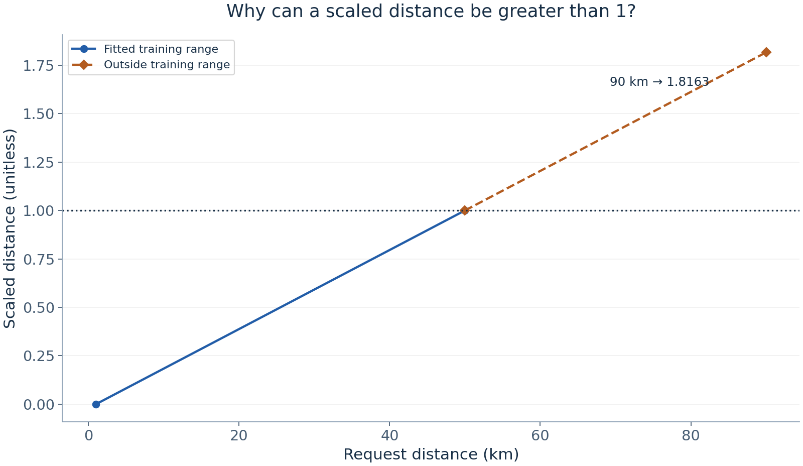

**👀 Read the visual.** Follow 90 km up to the orange diamond. It is above 1 because 90 is above the fitted maximum of 50.

**👉 Use what you see.** Check whether the app should return an estimate for a distance outside its training range.

Use the files in the [Min-Max Scaling lesson ZIP](sample_code_folder/071-normalization-min-max-scaling.zip).

1. Run `python train_range_model.py`. It learns from the measured trips in `range_training.csv`, checks three separate trips, and saves the scaler together with the model.
2. Open `range_requests.csv`. The 90 km row is already there. The model has never seen that row or an actual delivery time for it.
3. Run `python test_range_model.py`. It loads the saved model and uses the same minimum of **1 km** and maximum of **50 km**.
4. Replace 90 with 45, 105 or `unknown` and rerun only the test script.

| Entered distance (km) | Scaled distance | Demo estimate (min) | In-range-only app |
| ---: | ---: | ---: | --- |
| 1 | 0.0000 | 12.0 | Shows 12.0 min |
| 25 | 0.4898 | 60.0 | Shows 60.0 min |
| 50 | 1.0000 | 110.0 | Shows 110.0 min |
| 90 | 1.8163 | 190.0 | Shows an outside-range message |

The 90 km calculation is **(90 − 1) ÷ (50 − 1) ≈ 1.8163**. Since the input is above the fitted maximum, the scaled value is above 1. The toy model extends its line to 190 minutes. To support long routes, train and test with separate measured long-distance deliveries.

**🐍 Train once and save**

```python
"""Train and save the model for deliveries from 1 to 50 km."""

from pathlib import Path

import joblib
import pandas as pd
from sklearn.linear_model import LinearRegression
from sklearn.pipeline import make_pipeline
from sklearn.preprocessing import MinMaxScaler

folder = Path(__file__).resolve().parent
inputs = ["distance_km"]

# 1. Read completed deliveries. Each distance has a measured time in minutes.
training = pd.read_csv(folder / "range_training.csv")
checking = pd.read_csv(folder / "range_check.csv")

# 2. Teach the scaler and the model using only the training rows.
# The pipeline keeps them together, so the same scaler is used every time.
delivery_model = make_pipeline(MinMaxScaler(), LinearRegression())
delivery_model.fit(training[inputs], training["actual_minutes"])

# 3. Use separate completed trips to check the model's estimates.
checking["predicted_minutes"] = delivery_model.predict(checking[inputs]).round(1)
print("Check rows with known times")
print(checking.to_string(index=False))

# 4. Save everything needed for later predictions.
model_file = folder / "range_model.joblib"
joblib.dump(delivery_model, model_file)
print(f"Saved {model_file.name}. Next, run python test_range_model.py.")
```

**🐍 Try distances without retraining**

```python
"""Test new distances without retraining the model."""

from pathlib import Path

import joblib
import pandas as pd

folder = Path(__file__).resolve().parent
inputs = ["distance_km"]

# 1. Open the file you created by running train_range_model.py.
model_file = folder / "range_model.joblib"
if not model_file.is_file():
    raise SystemExit("Run python train_range_model.py first.")
# Load the file you trained here, or another artifact from a source you trust.
delivery_model = joblib.load(model_file)
scaler = delivery_model.named_steps["minmaxscaler"]

# 2. Read the distances someone entered. You can edit this CSV and rerun.
requests = pd.read_csv(folder / "range_requests.csv")
distance = pd.to_numeric(requests["distance_km"], errors="coerce")
valid = distance.notna() & distance.ge(0) & distance.lt(float("inf"))
lowest = scaler.data_min_[0]
highest = scaler.data_max_[0]
within_training_range = valid & distance.between(lowest, highest)
print(f"Training range: {lowest:g} to {highest:g} km")

# 3. Show what the scaler and the toy model do with all valid distances.
# 90 km is a valid distance and will scale above 1.
requests["scaled_distance"] = float("nan")
requests["demo_minutes"] = float("nan")
if valid.any():
    valid_inputs = distance.loc[valid].to_frame("distance_km")
    requests.loc[valid, "scaled_distance"] = scaler.transform(valid_inputs).ravel()
    requests.loc[valid, "demo_minutes"] = delivery_model.predict(valid_inputs)

# 4. Show what a delivery app could return if it serves this range only.
requests["app_minutes"] = requests["demo_minutes"].where(within_training_range)
requests["app_message"] = "Estimate ready"
requests.loc[~valid, "app_message"] = "Enter a finite, nonnegative distance."
requests.loc[valid & ~within_training_range, "app_message"] = (
    f"Outside training range ({lowest:g}–{highest:g} km)"
)
print(
    requests.to_string(
        index=False,
        na_rep="—",
        formatters={
            "scaled_distance": "{:.4f}".format,
            "demo_minutes": "{:.1f}".format,
            "app_minutes": "{:.1f}".format,
        },
    )
)
```

<a id="standardization-z-score-scaling"></a>

##### 🟩 Standardization (Z-score Scaling)

| Lesson name | What you’ll do | Download |
| --- | --- | --- |
| 072 - Standardization (Z-score Scaling) **Practice** | Measure distance and weight relative to their training averages, then estimate a new delivery time. | [Lesson ZIP](sample_code_folder/072-standardization-z-score-scaling.zip) |

<!-- workbook-teaching:72:start -->
<details>
<summary>Learn, trace and apply this idea</summary>

### Learn and apply: Standardization (Z-score Scaling)

**Your decision.** Measure distance and weight relative to their training averages, then estimate a new delivery time.

**Ready check.** Read a minimum, maximum, average and spread. Use [the learning path](LEARNING-PATH.md) and [the word list](GLOSSARY.md) for the earlier skill. Trace the small example on paper before code.

**What it means.** Scaling changes the numbers passed to a model, using a rule fitted on training values.

**Why and when.** Use it when input units affect distances or penalties. Compare with unchanged inputs; trees often do not need ordinary linear scaling.

**A worked example to follow.** Min-max uses (value − training minimum) ÷ training range. With limits 1 and 50 km, 90 km becomes 89 ÷ 49, about 1.8163. Standard scaling subtracts the training mean and divides by its standard deviation. Robust scaling uses the training median and IQR.

**Input → steps → output.** Open the supplied table. Its fields are `distance_km`, `weight_kg`, `delivery_minutes`. One original row is shown below in that same field order; `(missing)` marks a blank rather than zero.

```text
2 | 1 | 19
```

1. Name the particular field or object involved in this lesson’s decision above. Keep its meaning and units with it.
2. Open the [complete runnable Python example](lessons/072-standardization-z-score-scaling/lesson.py). Its numbered comments connect reading, preparation and the resulting calculation. Install only the [declared requirements](lessons/072-standardization-z-score-scaling/requirements.txt) using the same course Python, as shown in Setup.
3. Trace the worked example above through the script. Keep inputs apart from measured answers. Follow this script’s split and fit, then trace the saved preparation into the held-back result and any new request. A request must not supply its own training answer.
4. Read the result by its headings. Compare with [full recorded output](lessons/072-standardization-z-score-scaling/expected-output.txt); the excerpt below belongs to the original supplied files. Your edits can change it.

```text
Training rows before and after scaling
 distance_km  weight_kg  scaled_distance  scaled_weight
           2          1            -1.34          -1.34
           4          3            -0.45           0.45
           6          2             0.45          -0.45
           8          4             1.34           1.34
```

**How to interpret it.** Trace the worked case into the result above. Tell a calculated estimate from a measured answer.

**Common mistakes and limits.** New values can fall outside a fitted 0–1 range. Do not refit on each request. Scaling is not a guarantee of better predictions or a way to make a distribution normal.

**Use it yourself.** The fitted range is 1–50 km. What does 25 km become? Does an out-of-range number automatically mean an invalid measurement?

<details>
<summary>Check your choice and reason</summary>

25 becomes 24 ÷ 49, about 0.4898. An out-of-range number may be physically possible but outside the evidence for a service. Keep the fitted rule and apply a stated acceptance/fallback policy.

</details>

**A second check later.** Close the notes and explain the same decision using a different row from the supplied table. State one condition that would make this method unsuitable. If you cannot explain the reason, repeat the small worked example before adding more code.

</details>
<!-- workbook-teaching:72:end -->


**Before this lesson.** Read minimum, maximum and average. Keep training rows separate.

**In simple words.** Scaling changes the numbers the model receives. Save the rule learned from training. A value above the old maximum may become greater than 1.

**Guess first.** Does a scaled value above 1 prove the input is invalid? Write your answer before running the example.

<details>
<summary>Read the reason after trying</summary>

No. It may be a possible value outside the training range. The service needs a stated policy.

</details>


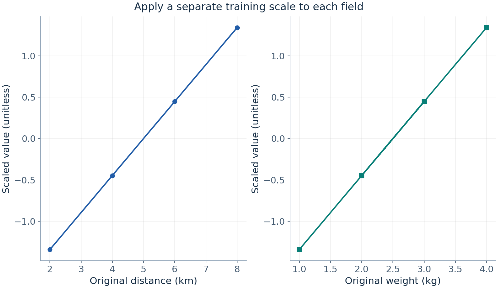

**👀 Read the visual.** Start with the dashed zero line. Points below it have an original value below the training average.

**👉 Use what you see.** Use the training average and spread to prepare each new delivery before it reaches the model.

**🎯 Goal.** How does the same delivery example work if we measure distances and weights relative to their training average? The model still predicts minutes.

**📋 Sample data**

| distance_km | weight_kg | delivery_minutes |
| --- | --- | --- |
| 2 | 1 | 19 |
| 4 | 3 | 30 |
| 6 | 2 | 29 |
| 8 | 4 | 40 |
| 10 | 1 | 33 |
| 12 | 3 | 44 |

**▶️ Run.** Unzip the [lesson files](sample_code_folder/072-standardization-z-score-scaling.zip) and open a terminal in that folder. Install the lesson’s packages with `python -m pip install -r requirements.txt`, then run `python lesson.py`.

**🔹 Steps in the script**

1. Read the practice deliveries and their measured times.
2. Use the first four trips to learn and keep the last two for checking.
3. Find the training average and spread for each input. Express each row in those units.
4. Teach the model how the scaled inputs relate to the measured minutes.
5. Read the new trips and scale them using the training values.
6. Compare estimates with the two known times, then read the estimates for your new trips.

**✅ Check.** Look for New deliveries and their predicted minutes in the output excerpt below.

```text
New deliveries and their predicted minutes
distance_km  weight_kg  scaled_distance  scaled_weight  predicted_minutes
5          2             0.00          -0.45               27.5
```

**Your small change.** In new_inputs.csv, try 5 km and 2 kg, then try 12 km and 4 kg. Read the scaled values and predicted minutes in the same row. Save the named CSV before running again.


**Read the prediction.** The input scale changes and this example still predicts **27.5 minutes** for the new delivery. Standardization works for this calculation even when the data is skewed.

<a id="when-to-use"></a>

##### 🧭 When to use?

| Lesson name | What you’ll do | Download |
| --- | --- | --- |
| 073 - When to use? **Practice** | Compare several transformations using the same rows and pick one based on validation error. | [Lesson ZIP](sample_code_folder/073-when-to-use.zip) |

<!-- workbook-teaching:73:start -->
<details>
<summary>Learn, trace and apply this idea</summary>

### Learn and apply: When to use?

**Your decision.** Compare several transformations using the same rows and pick one based on validation error.

**Ready check.** Calculate an error and distinguish training from validation. Use [the learning path](LEARNING-PATH.md) and [the word list](GLOSSARY.md) for the earlier skill. Trace the small example on paper before code.

**What it means.** A transformation is a candidate preparation choice, not a compulsory checklist.

**Why and when.** Compare a sensible change with unchanged inputs on identical validation folds.

**A worked example to follow.** The script fits each transformation inside a pipeline for each training fold, then reports error on that fold’s held-back rows. This prevents a fold’s check values from choosing its scale or bin edges.

**Input → steps → output.** Open the supplied table. Its fields are `signal`, `cost`. One original row is shown below in that same field order; `(missing)` marks a blank rather than zero.

```text
1 | 10
```

1. Name the particular field or object involved in this lesson’s decision above. Keep its meaning and units with it.
2. Open the [complete runnable Python example](lessons/073-when-to-use/lesson.py). Its numbered comments connect reading, preparation and the resulting calculation. Install only the [declared requirements](lessons/073-when-to-use/requirements.txt) using the same course Python, as shown in Setup.
3. Trace the worked example above through the script. Keep inputs apart from measured answers. Follow this script’s split and fit, then trace the saved preparation into the held-back result and any new request. A request must not supply its own training answer.
4. Read the result by its headings. Compare with [full recorded output](lessons/073-when-to-use/expected-output.txt); the excerpt below belongs to the original supplied files. Your edits can change it.

```text
Raw                         MAE 10.88
Min-Max Scaling             MAE 12.18
Z-Score Standardization     MAE 10.94
Log Transformation          MAE 3.64
Robust Scaling              MAE 10.37
Power Transformations       MAE 3.64
```

**How to interpret it.** Trace the worked case into the result above. Tell a calculated estimate from a measured answer.

**Common mistakes and limits.** The best score on this tiny table may be unstable. Do not apply every transform or use repeated final test scores to choose among them.

**Use it yourself.** Transform A has lower training error but higher validation error than raw inputs. Which setup has better evidence for the next check?

<details>
<summary>Check your choice and reason</summary>

Raw inputs have better validation evidence in this comparison. State the counts and variation, freeze the choice, and assess it on a separate final check.

</details>

**A second check later.** Close the notes and explain the same decision using a different row from the supplied table. State one condition that would make this method unsuitable. If you cannot explain the reason, repeat the small worked example before adding more code.

</details>
<!-- workbook-teaching:73:end -->


**Before this lesson.** Read minimum, maximum and average. Keep training rows separate.

**In simple words.** Scaling changes the numbers the model receives. Save the rule learned from training. A value above the old maximum may become greater than 1.

**Guess first.** Does a scaled value above 1 prove the input is invalid? Write your answer before running the example.

<details>
<summary>Read the reason after trying</summary>

No. It may be a possible value outside the training range. The service needs a stated policy.

</details>


Run [Which Technique Should You Use?](#which-technique-should-you-use) to compare the original values and both scalers under the same validation procedure. Choose the setup on validation rows and measure the chosen model on separate final test rows.

<a id="1-3-6-convert-categorical-data"></a>

#### 🏷️ 1.3.6 Convert Categorical Data

| Lesson name | What you’ll do | Download |
| --- | --- | --- |
| 074 - 1.3.6 Convert Category Data **Practice** | Turn labels such as color into numerical columns a model can read. | [Lesson ZIP](sample_code_folder/074-1-3-6-convert-categorical-data.zip) |

<!-- workbook-teaching:74:start -->
<details>
<summary>Learn, trace and apply this idea</summary>

### Learn and apply: 1.3.6 Convert Category Data

**Your decision.** Turn labels such as color into numerical columns a model can read.

**Ready check.** Tell a category name from a measured amount. Use [the learning path](LEARNING-PATH.md) and [the word list](GLOSSARY.md) for the earlier skill. Trace the small example on paper before code.

**What it means.** One-hot encoding gives each known category a separate 0-or-1 column. It avoids inventing an order between names.

**Why and when.** Use it for a modest set of unordered names when the chosen model requires numeric inputs.

**A worked example to follow.** This script explicitly declares the column order Red, Blue, Green. Green becomes 0, 0, 1. Fit the encoder using training inputs, then transform check rows and new requests with that same encoder. The order and number of columns stay fixed.

**Input → steps → output.** Open the supplied table. Its fields are `color`, `orders`. One original row is shown below in that same field order; `(missing)` marks a blank rather than zero.

```text
Red | 20
```

1. Name the particular field or object involved in this lesson’s decision above. Keep its meaning and units with it.
2. Open the [complete runnable Python example](lessons/074-1-3-6-convert-categorical-data/lesson.py). Its numbered comments connect reading, preparation and the resulting calculation. Install only the [declared requirements](lessons/074-1-3-6-convert-categorical-data/requirements.txt) using the same course Python, as shown in Setup.
3. Trace the worked example above through the script. Keep inputs apart from measured answers. Follow this script’s split and fit, then trace the saved preparation into the held-back result and any new request. A request must not supply its own training answer.
4. Read the result by its headings. Compare with [full recorded output](lessons/074-1-3-6-convert-categorical-data/expected-output.txt); the excerpt below belongs to the original supplied files. Your edits can change it.

```text
Check actual / predicted: [23] [21.0]
Original color  Red  Blue  Green
           Red    1     0      0
          Blue    0     1      0
         Green    0     0      1
        Purple    0     0      0
```

**How to interpret it.** Trace the worked case into the result above. Tell a calculated estimate from a measured answer.

**Common mistakes and limits.** Purple becomes 0, 0, 0 here because handle_unknown is ignore. That is an allowed representation, not evidence about Purple-specific demand. Do not fit a separate encoder on new requests. Thousands of categories may need a different, validated approach.

**Use it yourself.** Encode Blue on paper. A new request says Yellow. Add a Yellow column only to that request, or keep the saved three-column schema? Explain what the service must decide.

<details>
<summary>Check your choice and reason</summary>

Blue is 0, 1, 0. Keep the saved schema; changing only the request columns breaks the model contract. This demonstration maps Yellow to all zeros. A real service must explicitly reject, review or use a tested fallback for unfamiliar names.

</details>

**A second check later.** Close the notes and explain the same decision using a different row from the supplied table. State one condition that would make this method unsuitable. If you cannot explain the reason, repeat the small worked example before adding more code.

</details>
<!-- workbook-teaching:74:end -->


**Before this lesson.** Tell a category name from a measured number.

**In simple words.** Unordered names get separate 0-or-1 columns. Ordered names such as low, medium and high can use an explicit order. LabelEncoder is for answer labels.

**Guess first.** Should red, green and blue receive a made-up low-to-high order? Write your answer before running the example.

<details>
<summary>Read the reason after trying</summary>

No. Use separate columns when there is no real order.

</details>


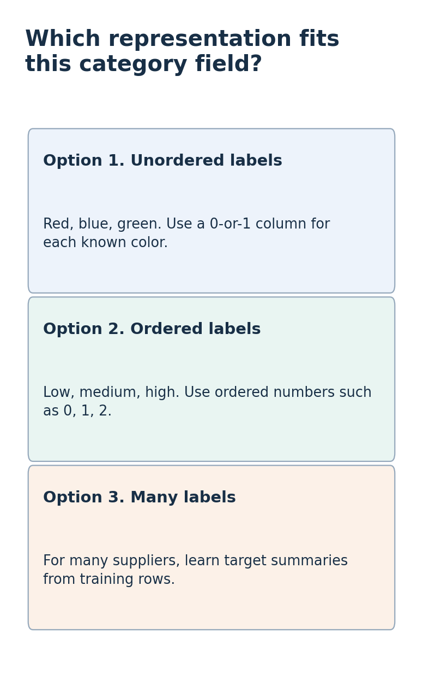

**👀 Read the visual.** Ask whether there is a natural order before you choose an encoding.

**👉 Use what you see.** **Low < Medium < High** is meaningful. Use one-hot encoding if giving the labels an order would invent a ranking.

<a id="one-hot-encoding-for-unordered-categories"></a>

##### 🌈 One-Hot Encoding (For Unordered Categories)

| Lesson name | What you’ll do | Download |
| --- | --- | --- |
| 075 - One-Hot Encoding (For Unordered Categories) **Core** | Give each known color its own 0-or-1 column and try a new color. | [Lesson ZIP](sample_code_folder/075-one-hot-encoding-for-unordered-categories.zip) |

<!-- workbook-teaching:75:start -->
<details>
<summary>Learn, trace and apply this idea</summary>

### Learn and apply: One-Hot Encoding (For Unordered Categories)

**Your decision.** Give each known color its own 0-or-1 column and try a new color.

**Ready check.** Tell a category name from a measured amount. Use [the learning path](LEARNING-PATH.md) and [the word list](GLOSSARY.md) for the earlier skill. Trace the small example on paper before code.

**What it means.** One-hot encoding gives each known category a separate 0-or-1 column. It avoids inventing an order between names.

**Why and when.** Use it for a modest set of unordered names when the chosen model requires numeric inputs.

**A worked example to follow.** This script explicitly declares the column order Red, Blue, Green. Green becomes 0, 0, 1. Fit the encoder using training inputs, then transform check rows and new requests with that same encoder. The order and number of columns stay fixed.

**Input → steps → output.** Open the supplied table. Its fields are `color`, `orders`. One original row is shown below in that same field order; `(missing)` marks a blank rather than zero.

```text
Red | 20
```

1. Name the particular field or object involved in this lesson’s decision above. Keep its meaning and units with it.
2. Open the [complete runnable Python example](lessons/075-one-hot-encoding-for-unordered-categories/lesson.py). Its numbered comments connect reading, preparation and the resulting calculation. Install only the [declared requirements](lessons/075-one-hot-encoding-for-unordered-categories/requirements.txt) using the same course Python, as shown in Setup.
3. Trace the worked example above through the script. Keep inputs apart from measured answers. Follow this script’s split and fit, then trace the saved preparation into the held-back result and any new request. A request must not supply its own training answer.
4. Read the result by its headings. Compare with [full recorded output](lessons/075-one-hot-encoding-for-unordered-categories/expected-output.txt); the excerpt below belongs to the original supplied files. Your edits can change it.

```text
Check actual / predicted: [23] [21.0]
Original color  Red  Blue  Green
           Red    1     0      0
          Blue    0     1      0
         Green    0     0      1
        Purple    0     0      0
```

**How to interpret it.** Trace the worked case into the result above. Tell a calculated estimate from a measured answer.

**Common mistakes and limits.** Purple becomes 0, 0, 0 here because handle_unknown is ignore. That is an allowed representation, not evidence about Purple-specific demand. Do not fit a separate encoder on new requests. Thousands of categories may need a different, validated approach.

**Use it yourself.** Encode Blue on paper. A new request says Yellow. Add a Yellow column only to that request, or keep the saved three-column schema? Explain what the service must decide.

<details>
<summary>Check your choice and reason</summary>

Blue is 0, 1, 0. Keep the saved schema; changing only the request columns breaks the model contract. This demonstration maps Yellow to all zeros. A real service must explicitly reject, review or use a tested fallback for unfamiliar names.

</details>

**A second check later.** Close the notes and explain the same decision using a different row from the supplied table. State one condition that would make this method unsuitable. If you cannot explain the reason, repeat the small worked example before adding more code.

</details>
<!-- workbook-teaching:75:end -->


**Before this lesson.** Tell a category name from a measured number.

**In simple words.** Unordered names get separate 0-or-1 columns. Ordered names such as low, medium and high can use an explicit order. LabelEncoder is for answer labels.

**Guess first.** Should red, green and blue receive a made-up low-to-high order? Write your answer before running the example.

<details>
<summary>Read the reason after trying</summary>

No. Use separate columns when there is no real order.

</details>


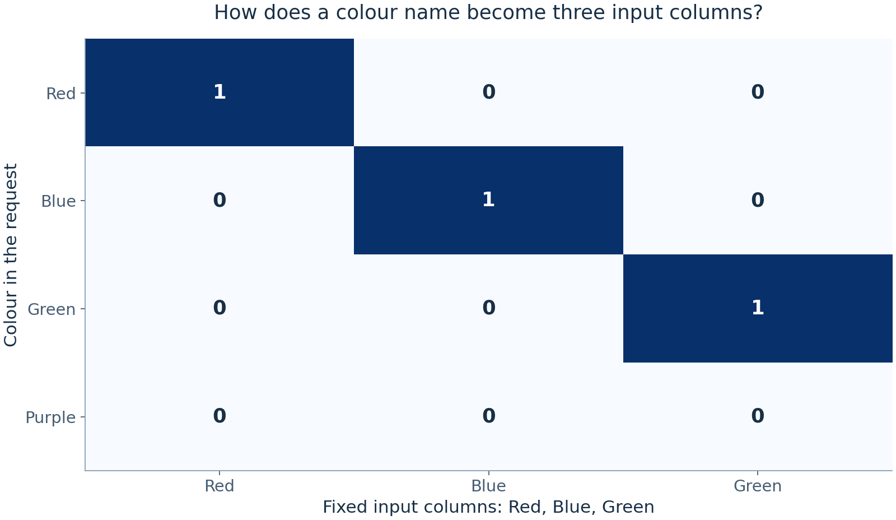

**👀 Read the visual.** Find the 1 in the red row. Each known color activates a different column.

**👉 Use what you see.** Find the purple row in the script’s result. The encoder gives it three zeros because purple never appeared in training.

**🎯 Goal.** How many orders might a product receive if the only input is its color? Turn each color name into numbers the model can read.

**📋 Sample data**

| color | orders |
| --- | --- |
| Red | 20 |
| Blue | 12 |
| Green | 15 |
| Red | 22 |
| Blue | 14 |
| Green | 16 |
| Red | 23 |

**▶️ Run.** Unzip the [lesson files](sample_code_folder/075-one-hot-encoding-for-unordered-categories.zip) and open a terminal in that folder. Install the lesson’s packages with `python -m pip install -r requirements.txt`, then run `python lesson.py`.

**🔹 Steps in the script**

1. Read the CSV and check its inputs, including color, orders.
2. Set aside the check rows before the model learns.
3. Learn the conversion on the training inputs before applying it to a new row.
4. Teach the model from the training inputs and the recorded order count.
5. Apply the fitted model to the new CSV rows and print a result for each row.

**✅ Check.** Look for Original color  Red  Blue  Green in the output excerpt below.

| Original color | Red | Blue | Green |
| --- | --- | --- | --- |
| Red | 1 | 0 | 0 |
| Blue | 0 | 1 | 0 |

**Your small change.** In new_inputs.csv, enter Red, Blue and an unfamiliar color such as Purple. See the encoded columns and predicted orders for each one. Save the named CSV before running again.

**🐍 Complete script from the ZIP**

```python
"""
One-Hot Encoding (For Unordered Categories)

Give each known color its own 0-or-1 column and try a new color.

Run: python lesson.py
In new_inputs.csv, enter Red, Blue and an unfamiliar color such as Purple. See the encoded columns and predicted orders for each one.
"""

from pathlib import Path
import pandas as pd
from sklearn.linear_model import LinearRegression
from sklearn.preprocessing import OneHotEncoder

input_path = Path(__file__).resolve().with_name("sample.csv")
new_path = Path(__file__).resolve().with_name("new_inputs.csv")


# 1. Read the CSV and check its inputs, including color, orders.
products = pd.read_csv(input_path)
# 2. Set aside the check rows before the model learns.
training = products.iloc[:6]
checking = products.iloc[6:]


# An unfamiliar category can still pass through the encoder.
encoder = OneHotEncoder(
    categories=[["Red", "Blue", "Green"]], handle_unknown="ignore", sparse_output=False
)
# 3. Learn the conversion on the training inputs before applying it to a new row.
training_bits = encoder.fit_transform(training[["color"]])
colors = pd.DataFrame({"color": ["Red", "Blue", "Green", "Purple"]})
bits = encoder.transform(colors).astype(int)
encoding_table = pd.DataFrame(bits, columns=["Red", "Blue", "Green"])
encoding_table.insert(0, "Original color", colors["color"])


# 4. Teach the model from the training inputs and the recorded order count.
model = LinearRegression().fit(training_bits, training["orders"])
print("Check actual / predicted:", checking["orders"].tolist(),
      model.predict(encoder.transform(checking[["color"]])).round(1).tolist())
# 5. Apply the fitted model to the new CSV rows and print a result for each row.
test_colors = pd.read_csv(new_path)
fresh_bits = encoder.transform(test_colors)
estimates = model.predict(fresh_bits)
results = test_colors.copy()
results[["Red", "Blue", "Green"]] = fresh_bits.astype(int)
results["Predicted orders"] = estimates.round(1)
print(encoding_table.to_string(index=False))
print(results.to_string(index=False))
```


**Read the table.** Red is **1, 0, 0**. Purple has no column because it was absent from training. The example still returns an estimate, but the model has learned nothing specific about Purple.

<a id="label-encoding-for-ordered-categories"></a>

##### 🪜 Turn ordered names into numbers (OrdinalEncoder)

| Lesson name | What you’ll do | Download |
| --- | --- | --- |
| 076 - Turn ordered names into numbers (OrdinalEncoder) **Practice** | Turn Low, Medium and High into ordered numbers before predicting a review action. | [Lesson ZIP](sample_code_folder/076-label-encoding-for-ordered-categories.zip) |

<!-- workbook-teaching:76:start -->
<details>
<summary>Learn, trace and apply this idea</summary>

### Learn and apply: Turn ordered names into numbers (OrdinalEncoder)

**Your decision.** Turn Low, Medium and High into ordered numbers before predicting a review action.

**Ready check.** Explain why low, medium and high have an order. Use [the learning path](LEARNING-PATH.md) and [the word list](GLOSSARY.md) for the earlier skill. Trace the small example on paper before code.

**What it means.** Ordinal encoding records an explicit order between input categories. Label encoding gives identifiers to answer classes.

**Why and when.** Use an order only when the field meaning supports it. The model may also impose a spacing assumption on those numbers.

**A worked example to follow.** Low, Medium, High become 0, 1, 2 in this exercise. LabelEncoder separately turns the wait/review answers into class IDs and reverses predictions to readable names.

**Input → steps → output.** Open the supplied table. Its fields are `priority`, `action`. One original row is shown below in that same field order; `(missing)` marks a blank rather than zero.

```text
Low | wait
```

1. Name the particular field or object involved in this lesson’s decision above. Keep its meaning and units with it.
2. Open the [complete runnable Python example](lessons/076-label-encoding-for-ordered-categories/lesson.py). Its numbered comments connect reading, preparation and the resulting calculation. Install only the [declared requirements](lessons/076-label-encoding-for-ordered-categories/requirements.txt) using the same course Python, as shown in Setup.
3. Trace the worked example above through the script. Keep inputs apart from measured answers. Follow this script’s split and fit, then trace the saved preparation into the held-back result and any new request. A request must not supply its own training answer.
4. Read the result by its headings. Compare with [full recorded output](lessons/076-label-encoding-for-ordered-categories/expected-output.txt); the excerpt below belongs to the original supplied files. Your edits can change it.

```text
Priority codes: [0.0, 1.0, 2.0]
Held-out label: ['review']
priority action
     Low   wait
  Medium review
    High review
```

**How to interpret it.** Trace the worked case into the result above. Tell a calculated estimate from a measured answer.

**Common mistakes and limits.** Codes 0, 1, 2 do not prove that the gap between low and medium equals the gap between medium and high. Unordered colours need a different representation.

**Use it yourself.** Could North, South and West be ordered 0, 1, 2 because a terminal prints them that way?

<details>
<summary>Check your choice and reason</summary>

No. Alphabetical or display order is not a real scale. Use separate columns or another justified categorical representation.

</details>

**A second check later.** Close the notes and explain the same decision using a different row from the supplied table. State one condition that would make this method unsuitable. If you cannot explain the reason, repeat the small worked example before adding more code.

</details>
<!-- workbook-teaching:76:end -->


**Before this lesson.** Tell a category name from a measured number.

**In simple words.** Unordered names get separate 0-or-1 columns. Ordered names such as low, medium and high can use an explicit order. LabelEncoder is for answer labels.

**Guess first.** Should red, green and blue receive a made-up low-to-high order? Write your answer before running the example.

<details>
<summary>Read the reason after trying</summary>

No. Use separate columns when there is no real order.

</details>


Encode ordered priority values low → medium → high. Use LabelEncoder separately for the answer column when integer class IDs are needed.

**📋 Sample data**

| priority | action |
| --- | --- |
| Low | wait |
| Low | wait |
| Medium | wait |
| Medium | review |
| High | review |
| High | review |
| High | review |

**▶️ Run.** Unzip the [lesson files](sample_code_folder/076-label-encoding-for-ordered-categories.zip) and open a terminal in that folder. Install the lesson’s packages with `python -m pip install -r requirements.txt`, then run `python lesson.py`.

**🔹 Steps in the script**

1. Read the CSV and check its inputs, including priority, action.
2. Set aside the check rows before the model learns.
3. Teach the model from the training inputs and the boarding priority.
4. Apply the fitted model to the new CSV rows and print a result for each row.

**✅ Check.** Look for Priority codes: [0.0, 1.0, 2.0] in the output excerpt below.

```text
Priority codes: [0.0, 1.0, 2.0]
Held-out label: ['review']
priority action
```

**Your small change.** Try changing priority from Low to High in new_inputs.csv. Compare the new output. Save the named CSV before running again.


**💡 Takeaway.** The input uses **OrdinalEncoder** because priority has a meaningful order. LabelEncoder maps the labels and reverses the prediction.

<a id="target-encoding-for-high-cardinality-categories"></a>

##### 🎯 Target Encoding (For Many Different Categories)

| Lesson name | What you’ll do | Download |
| --- | --- | --- |
| 077 - Target Encoding (For Many Different Categories) **Practice** | Summarize each supplier by its learned delay rate and try a supplier the model has never seen. | [Lesson ZIP](sample_code_folder/077-target-encoding-for-high-cardinality-categories.zip) |

<!-- workbook-teaching:77:start -->
<details>
<summary>Learn, trace and apply this idea</summary>

### Learn and apply: Target Encoding (For Many Different Categories)

**Your decision.** Summarize each supplier by its learned delay rate and try a supplier the model has never seen.

**Ready check.** Count delayed orders and explain training-only preparation. Use [the learning path](LEARNING-PATH.md) and [the word list](GLOSSARY.md) for the earlier skill. Trace the small example on paper before code.

**What it means.** Target encoding replaces a category with a summary learned from training answers.

**Why and when.** Consider it for many categories when one-hot columns become unwieldy. Validate the whole preparation/model pipeline.

**A worked example to follow.** If two of five supplier orders were delayed, the simple observed rate is 0.40. The lesson uses smoothing for small groups and cross-fitting so a training row does not provide its own encoded answer. An unseen supplier uses broader training information.

**Input → steps → output.** Open the supplied table. Its fields are `supplier`, `delayed`. One original row is shown below in that same field order; `(missing)` marks a blank rather than zero.

```text
S00 | 1
```

1. Name the particular field or object involved in this lesson’s decision above. Keep its meaning and units with it.
2. Open the [complete runnable Python example](lessons/077-target-encoding-for-high-cardinality-categories/lesson.py). Its numbered comments connect reading, preparation and the resulting calculation. Install only the [declared requirements](lessons/077-target-encoding-for-high-cardinality-categories/requirements.txt) using the same course Python, as shown in Setup.
3. Trace the worked example above through the script. Keep inputs apart from measured answers. Follow this script’s split and fit, then trace the saved preparation into the held-back result and any new request. A request must not supply its own training answer.
4. Read the result by its headings. Compare with [full recorded output](lessons/077-target-encoding-for-high-cardinality-categories/expected-output.txt); the excerpt below belongs to the original supplied files. Your edits can change it.

```text
supplier  delayed
     S00        1
     S01        1
     S02        1
     S03        1
     S04        0
```

**How to interpret it.** Trace the worked case into the result above. Tell a calculated estimate from a measured answer.

**Common mistakes and limits.** A supplier with one delayed order does not establish a true delay chance of 100%. Predicting wholly new suppliers needs a supplier-grouped evaluation.

**Use it yourself.** A supplier has one order and its answer is delayed. Is writing 1.0 into that same training row a safe target encoding?

<details>
<summary>Check your choice and reason</summary>

No. It can reveal the row’s own answer. Use a training procedure with cross-fitting and appropriate smoothing, and keep evaluation answers out of all preparation.

</details>

**A second check later.** Close the notes and explain the same decision using a different row from the supplied table. State one condition that would make this method unsuitable. If you cannot explain the reason, repeat the small worked example before adding more code.

</details>
<!-- workbook-teaching:77:end -->


**Before this lesson.** Understand categories, training rows and leakage.

**In simple words.** Count how often training orders were delayed for a supplier. A target encoder uses a careful version of this idea. It must not give a training row its own answer.

**Guess first.** Why is a supplier with one order uncertain? Write your answer before running the example.

<details>
<summary>Read the reason after trying</summary>

One outcome is little evidence. Smoothing uses broader training information to avoid trusting a tiny group too much.

</details>


Generate batches with repeated supplier IDs and different delay rates. Fit a cross-fitted target encoder inside a pipeline. Inspect the value used for an new supplier.

Replace a supplier name with a number based on how often its training orders were delayed. If 2 of 5 orders were delayed, the simple rate is 2 ÷ 5 = 0.40. The encoder adjusts rates for small groups and computes training values without using the row’s own answer.

**📋 Sample data.** Preview of the first 5 of 72 rows.

| supplier | delayed |
| --- | ---: |
| S00 | 1 |
| S01 | 1 |
| S02 | 1 |
| S03 | 1 |
| S04 | 0 |

**▶️ Run.** Unzip the [lesson files](sample_code_folder/077-target-encoding-for-high-cardinality-categories.zip) and open a terminal in that folder. Install the lesson’s packages with `python -m pip install -r requirements.txt`, then run `python lesson.py`.

**🔹 Steps in the script**

1. Read the CSV and check its inputs, including supplier, delayed.
2. Set aside the check rows before the model learns.
3. Fit the model on the prepared training rows. Keep it for the checks below.
4. Apply the fitted model to the new CSV rows and print a result for each row.

**✅ Check.** Look for supplier  delayed in the output excerpt below.

| supplier | delayed |
| --- | --- |
| S00 | 1 |
| S01 | 1 |

**Your small change.** Enter S00 and a supplier name such as New Supplier. Compare their encoded values and estimated chances of delay. Save the named CSV before running again.


**💡 Takeaway.** The encoder estimates a smoothed training target rate. The training transform inside the pipeline uses cross-fitting. If the real task predicts completely new suppliers, group the evaluation split by supplier.

**Read one row.** The first number belongs to supplier S00. The second is the value used for an new supplier. These numbers represent training delay rates, adjusted by the encoder.

<a id="1-3-7-text-data-cleaning"></a>

#### ✍️ 1.3.7 Text Data Cleaning

| Lesson name | What you’ll do | Download |
| --- | --- | --- |
| 078 - 1.3.7 Text Data Cleaning **Practice** | Clean the capitalization and punctuation in support messages before classifying them. | [Lesson ZIP](sample_code_folder/078-1-3-7-text-data-cleaning.zip) |

<!-- workbook-teaching:78:start -->
<details>
<summary>Learn, trace and apply this idea</summary>

### Learn and apply: 1.3.7 Text Data Cleaning

**Your decision.** Clean the capitalization and punctuation in support messages before classifying them.

**Ready check.** Read a message and distinguish its words from its category. Use [the learning path](LEARNING-PATH.md) and [the word list](GLOSSARY.md) for the earlier skill. Trace the small example on paper before code.

**What it means.** Text cleaning gives messages a consistent representation before words are counted.

**Why and when.** Lowercase or remove punctuation only when doing so preserves information useful to the task.

**A worked example to follow.** WHERE IS MY PARCEL!!! becomes where is my parcel in this exercise. The fitted vocabulary gives a word-count column to known words; the trained classifier turns those numbers into a delivery or billing guess.

**Input → steps → output.** Open the supplied table. Its fields are `message`, `category`. One original row is shown below in that same field order; `(missing)` marks a blank rather than zero.

```text
MY Parcel Is Late!!! | delivery
```

1. Name the particular field or object involved in this lesson’s decision above. Keep its meaning and units with it.
2. Open the [complete runnable Python example](lessons/078-1-3-7-text-data-cleaning/lesson.py). Its numbered comments connect reading, preparation and the resulting calculation. Install only the [declared requirements](lessons/078-1-3-7-text-data-cleaning/requirements.txt) using the same course Python, as shown in Setup.
3. Trace the worked example above through the script. Keep inputs apart from measured answers. Follow this script’s split and fit, then trace the saved preparation into the held-back result and any new request. A request must not supply its own training answer.
4. Read the result by its headings. Compare with [full recorded output](lessons/078-1-3-7-text-data-cleaning/expected-output.txt); the excerpt below belongs to the original supplied files. Your edits can change it.

```text
    Original message   Cleaned message
MY Parcel Is Late!!! my parcel is late
Check actual / predicted: ['delivery', 'billing'] ['delivery', 'billing']
               Raw message             Clean message Prediction
     WHERE IS MY PARCEL!!!        where is my parcel   delivery
    REFUND my card charge!     refund my card charge    billing
```

**How to interpret it.** Trace the worked case into the result above. Tell a calculated estimate from a measured answer.

**Common mistakes and limits.** NOT LATE differs from LATE. Case and punctuation may matter for names, product codes or sentiment. Unknown words do not receive new columns at prediction time.

**Use it yourself.** Try not late and late. If your cleanup makes them identical, what information was lost? Should every language use the same cleanup?

<details>
<summary>Check your choice and reason</summary>

Negation was lost. Retain it or change the representation and validate it. Languages and tasks need their own tested tokenization and cleanup rules.

</details>

**A second check later.** Close the notes and explain the same decision using a different row from the supplied table. State one condition that would make this method unsuitable. If you cannot explain the reason, repeat the small worked example before adding more code.

</details>
<!-- workbook-teaching:78:end -->


**Before this lesson.** Read a message as text. Start with counting one word.

**In simple words.** A model needs numbers. Counts make one column for a known word. TF-IDF gives different weights to common and less common words. Cleanup can lose meaning.

**Guess first.** Should we always remove the word not? Write your answer before running the example.

<details>
<summary>Read the reason after trying</summary>

No. Removing it can reverse meaning. Test cleanup for the task.

</details>


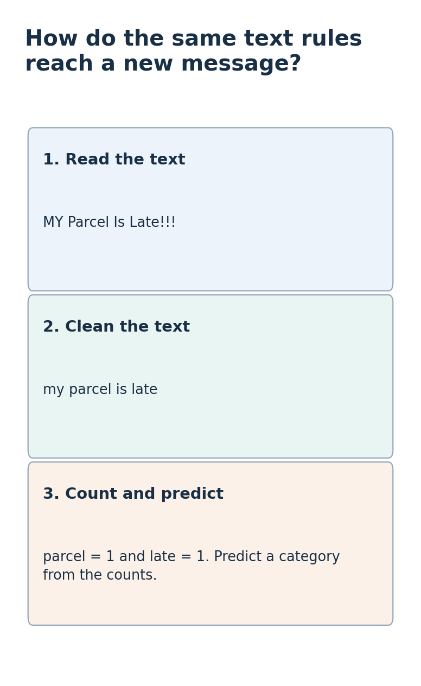

**👀 Read the visual.** Use the same text processing for every message.

**👉 Use what you see.** Try a billing message next. See which words the model can count using its training vocabulary.

<a id="convert-to-lowercase-remove-punctuation"></a>

##### 🔡 Convert to lowercase & remove punctuation

| Lesson name | What you’ll do | Download |
| --- | --- | --- |
| 079 - Convert to lowercase & remove punctuation **Practice** | Compare the original and cleaned message, then see which category the model predicts. | [Lesson ZIP](sample_code_folder/079-convert-to-lowercase-remove-punctuation.zip) |

<!-- workbook-teaching:79:start -->
<details>
<summary>Learn, trace and apply this idea</summary>

### Learn and apply: Convert to lowercase & remove punctuation

**Your decision.** Compare the original and cleaned message, then see which category the model predicts.

**Ready check.** Read a message and distinguish its words from its category. Use [the learning path](LEARNING-PATH.md) and [the word list](GLOSSARY.md) for the earlier skill. Trace the small example on paper before code.

**What it means.** Text cleaning gives messages a consistent representation before words are counted.

**Why and when.** Lowercase or remove punctuation only when doing so preserves information useful to the task.

**A worked example to follow.** WHERE IS MY PARCEL!!! becomes where is my parcel in this exercise. The fitted vocabulary gives a word-count column to known words; the trained classifier turns those numbers into a delivery or billing guess.

**Input → steps → output.** Open the supplied table. Its fields are `message`, `category`. One original row is shown below in that same field order; `(missing)` marks a blank rather than zero.

```text
MY Parcel Is Late!!! | delivery
```

1. Name the particular field or object involved in this lesson’s decision above. Keep its meaning and units with it.
2. Open the [complete runnable Python example](lessons/079-convert-to-lowercase-remove-punctuation/lesson.py). Its numbered comments connect reading, preparation and the resulting calculation. Install only the [declared requirements](lessons/079-convert-to-lowercase-remove-punctuation/requirements.txt) using the same course Python, as shown in Setup.
3. Trace the worked example above through the script. Keep inputs apart from measured answers. Follow this script’s split and fit, then trace the saved preparation into the held-back result and any new request. A request must not supply its own training answer.
4. Read the result by its headings. Compare with [full recorded output](lessons/079-convert-to-lowercase-remove-punctuation/expected-output.txt); the excerpt below belongs to the original supplied files. Your edits can change it.

```text
    Original message   Cleaned message
MY Parcel Is Late!!! my parcel is late
Check actual / predicted: ['delivery', 'billing'] ['delivery', 'billing']
               Raw message             Clean message Prediction
     WHERE IS MY PARCEL!!!        where is my parcel   delivery
    REFUND my card charge!     refund my card charge    billing
```

**How to interpret it.** Trace the worked case into the result above. Tell a calculated estimate from a measured answer.

**Common mistakes and limits.** NOT LATE differs from LATE. Case and punctuation may matter for names, product codes or sentiment. Unknown words do not receive new columns at prediction time.

**Use it yourself.** Try not late and late. If your cleanup makes them identical, what information was lost? Should every language use the same cleanup?

<details>
<summary>Check your choice and reason</summary>

Negation was lost. Retain it or change the representation and validate it. Languages and tasks need their own tested tokenization and cleanup rules.

</details>

**A second check later.** Close the notes and explain the same decision using a different row from the supplied table. State one condition that would make this method unsuitable. If you cannot explain the reason, repeat the small worked example before adding more code.

</details>
<!-- workbook-teaching:79:end -->


**Before this lesson.** Read a message as text. Start with counting one word.

**In simple words.** A model needs numbers. Counts make one column for a known word. TF-IDF gives different weights to common and less common words. Cleanup can lose meaning.

**Guess first.** Should we always remove the word not? Write your answer before running the example.

<details>
<summary>Read the reason after trying</summary>

No. Removing it can reverse meaning. Test cleanup for the task.

</details>


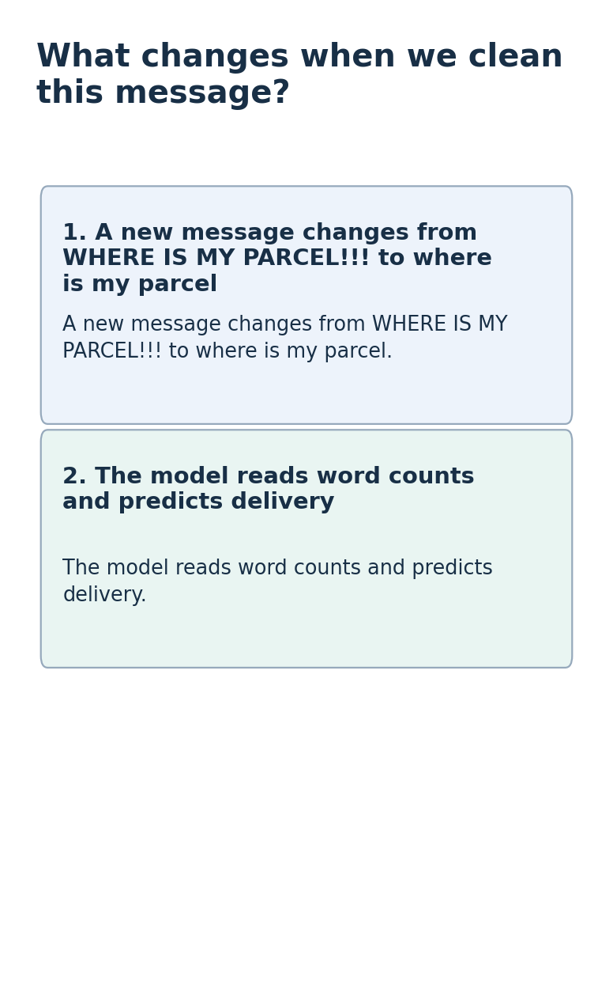

**👀 Read the visual.** Compare the first and second steps. The punctuation disappears and the letters become lowercase before the model receives the counts.

**👉 Use what you see.** Try the refund message. Compare its cleaned words and category with the parcel message.

**🎯 Goal.** Is **WHERE IS MY PARCEL!!!** a delivery or billing message? The model needs numbers, so we clean the text and count words first.

**📋 Sample data**

| message | category |
| --- | --- |
| MY Parcel Is Late!!! | delivery |
| Where is my PACKAGE? | delivery |
| The parcel never arrived. | delivery |
| Please REFUND my payment! | billing |
| My invoice is WRONG? | billing |
| I was charged twice. | billing |
| Where is my parcel? | delivery |
| Please refund this charge! | billing |

**▶️ Run.** Unzip the [lesson files](sample_code_folder/079-convert-to-lowercase-remove-punctuation.zip) and open a terminal in that folder. Install the lesson’s packages with `python -m pip install -r requirements.txt`, then run `python lesson.py`.

**🔹 Steps in the script**

1. Read the support messages and their known categories.
2. Keep the same lowercase and punctuation rules for training and new messages.
3. Set aside the check rows before the model learns.
4. Teach the model from the training inputs and the known message category.
5. Apply the fitted model to the new CSV rows and print a result for each row.

**✅ Check.** Read the original message, the cleaned message and the predicted category on the same row.

```text
Original message   Cleaned message
MY Parcel Is Late!!! my parcel is late
Raw message             Clean message Prediction
```

**Your small change.** Try WHERE IS MY PARCEL!!! and check that cleanup produces where is my parcel. Save the named CSV before running again.

**🐍 Complete script from the ZIP**

```python
"""
Convert to lowercase & remove punctuation

Compare the original and cleaned message, then see which category the model predicts.

Run: python lesson.py
Try WHERE IS MY PARCEL!!! and Please refund my card charge. Read the cleaned message and its category.
"""

from pathlib import Path
import re
import pandas as pd
from sklearn.feature_extraction.text import CountVectorizer
from sklearn.linear_model import LogisticRegression

input_path = Path(__file__).resolve().with_name("sample.csv")
new_path = Path(__file__).resolve().with_name("new_inputs.csv")


# 1. Read the support messages and their known categories.
messages = pd.read_csv(input_path)


# 2. Keep the same lowercase and punctuation rules for training and new messages.
def clean_message(text):
    lower = text.lower()
    words = re.sub(r"[^\w\s]|_", " ", lower)
    return " ".join(words.split())


before_after = pd.DataFrame(
    {
        "Original message": [messages.iloc[0]["message"]],
        "Cleaned message": [clean_message(messages.iloc[0]["message"])],
    }
)
print(before_after.to_string(index=False))


# 3. Set aside the check rows before the model learns.
training = messages.iloc[:6]
checking = messages.iloc[6:]
counts = CountVectorizer(preprocessor=clean_message)
# Learn the needed values here. New rows use transform with these saved values.
word_counts = counts.fit_transform(training["message"])
# 4. Teach the model from the training inputs and the known message category.
model = LogisticRegression().fit(word_counts, training["category"])
print("Check actual / predicted:", checking["category"].tolist(),
      model.predict(counts.transform(checking["message"])).tolist())


# 5. Apply the fitted model to the new CSV rows and print a result for each row.
raw_messages = pd.read_csv(new_path)["message"].tolist()
predictions = model.predict(counts.transform(raw_messages))
results = pd.DataFrame(
    {
        "Raw message": raw_messages,
        "Clean message": [clean_message(text) for text in raw_messages],
        "Prediction": predictions,
    }
)
print(results.to_string(index=False))
```


**Read the prediction.** The new message is predicted as **delivery**. `counts.transform(...)` reuses the training vocabulary and applies the same cleaning to the new message.

<a id="remove-stop-words-e-g-the-and-is"></a>

##### 🧽 Remove stop words (e.g., "the", "and", "is")

| Lesson name | What you’ll do | Download |
| --- | --- | --- |
| 080 - Remove stop words (e.g., "the", "and", "is") **Practice** | Drop selected common words such as the and is, then test a delivery or billing message. | [Lesson ZIP](sample_code_folder/080-remove-stop-words-e-g-the-and-is.zip) |

<!-- workbook-teaching:80:start -->
<details>
<summary>Learn, trace and apply this idea</summary>

### Learn and apply: Remove stop words (e.g., "the", "and", "is")

**Your decision.** Drop selected common words such as the and is, then test a delivery or billing message.

**Ready check.** Count a word in a short sentence. Use [the learning path](LEARNING-PATH.md) and [the word list](GLOSSARY.md) for the earlier skill. Trace the small example on paper before code.

**What it means.** A stop-word list removes selected common words before the model sees counts.

**Why and when.** Try it only if those words add little useful information for the task.

**A worked example to follow.** The explicit list removes the, and, is. The example keeps not, so the phrase not here retains a clue that the parcel is absent.

**Input → steps → output.** Open the supplied table. Its fields are `message`, `category`. One original row is shown below in that same field order; `(missing)` marks a blank rather than zero.

```text
MY Parcel Is Late!!! | delivery
```

1. Name the particular field or object involved in this lesson’s decision above. Keep its meaning and units with it.
2. Open the [complete runnable Python example](lessons/080-remove-stop-words-e-g-the-and-is/lesson.py). Its numbered comments connect reading, preparation and the resulting calculation. Install only the [declared requirements](lessons/080-remove-stop-words-e-g-the-and-is/requirements.txt) using the same course Python, as shown in Setup.
3. Trace the worked example above through the script. Keep inputs apart from measured answers. Follow this script’s split and fit, then trace the saved preparation into the held-back result and any new request. A request must not supply its own training answer.
4. Read the result by its headings. Compare with [full recorded output](lessons/080-remove-stop-words-e-g-the-and-is/expected-output.txt); the excerpt below belongs to the original supplied files. Your edits can change it.

```text
Before: ['the', 'parcel', 'is', 'not', 'here', 'and', 'am', 'waiting']
After: ['parcel', 'not', 'here', 'am', 'waiting']
Actual: ['delivery', 'billing']
Predicted: ['delivery', 'billing']
                         message predicted
             The parcel is late!  delivery
```

**How to interpret it.** Trace the worked case into the result above. Tell a calculated estimate from a measured answer.

**Common mistakes and limits.** A general stop list may remove negation or words useful for your language and task. Shorter text is not automatically a better representation.

**Use it yourself.** Would a stop list that removes not be safe for distinguishing late from not late?

<details>
<summary>Check your choice and reason</summary>

Not without evidence. Those phrases could become identical. Compare token lists and validation mistakes before deciding.

</details>

**A second check later.** Close the notes and explain the same decision using a different row from the supplied table. State one condition that would make this method unsuitable. If you cannot explain the reason, repeat the small worked example before adding more code.

</details>
<!-- workbook-teaching:80:end -->


**Before this lesson.** Read a message as text. Start with counting one word.

**In simple words.** A model needs numbers. Counts make one column for a known word. TF-IDF gives different weights to common and less common words. Cleanup can lose meaning.

**Guess first.** Should we always remove the word not? Write your answer before running the example.

<details>
<summary>Read the reason after trying</summary>

No. Removing it can reverse meaning. Test cleanup for the task.

</details>


Inspect the tokens before and after removing a small stop list. Keep the word ‘not’ so it can retain meaning in a larger dataset.

**📋 Sample data**

| message | category |
| --- | --- |
| MY Parcel Is Late!!! | delivery |
| Where is my PACKAGE? | delivery |
| The parcel never arrived. | delivery |
| Please REFUND my payment! | billing |
| My invoice is WRONG? | billing |
| I was charged twice. | billing |
| Where is my parcel? | delivery |
| Please refund this charge! | billing |

**▶️ Run.** Unzip the [lesson files](sample_code_folder/080-remove-stop-words-e-g-the-and-is.zip) and open a terminal in that folder. Install the lesson’s packages with `python -m pip install -r requirements.txt`, then run `python lesson.py`.

**🔹 Steps in the script**

1. Read the support messages and their known categories.
2. Print the result next to the input values so you can compare them.
3. Set aside the check rows before the model learns.
4. Teach the model from the training inputs and the known message category.
5. Apply the fitted model to the new CSV rows and print a result for each row.

**✅ Check.** Look for Before: ['the', 'parcel', 'is', 'not', 'here', 'and', 'am', 'waiting'] in the output excerpt below.

```text
Before: ['the', 'parcel', 'is', 'not', 'here', 'and', 'am', 'waiting']
After: ['parcel', 'not', 'here', 'am', 'waiting']
Actual: ['delivery', 'billing']
```

**Your small change.** Replace one message in new_inputs.csv. Include one delivery message and one billing message. Save the named CSV before running again.


<a id="tokenization-lemmatization"></a>

##### 🔤 Tokenization & Lemmatization

| Lesson name | What you’ll do | Download |
| --- | --- | --- |
| 081 - Tokenization & Lemmatization **Practice** | Split sentences into words and bring a few word variants back to the same form. | [Lesson ZIP](sample_code_folder/081-tokenization-lemmatization.zip) |

<!-- workbook-teaching:81:start -->
<details>
<summary>Learn, trace and apply this idea</summary>

### Learn and apply: Tokenization & Lemmatization

**Your decision.** Split sentences into words and bring a few word variants back to the same form.

**Ready check.** Identify individual words and their spelling variants. Use [the learning path](LEARNING-PATH.md) and [the word list](GLOSSARY.md) for the earlier skill. Trace the small example on paper before code.

**What it means.** Tokenization splits text into pieces. Lemmatization maps word forms to a base form using language rules or a stated lookup.

**Why and when.** Use tokens to form features; consider base forms when variants should share evidence.

**A worked example to follow.** This small lookup turns charged and charges into charge, then counts the resulting tokens. It is an explicit exercise dictionary rather than a full language system.

**Input → steps → output.** Open the supplied table. Its fields are `message`, `category`. One original row is shown below in that same field order; `(missing)` marks a blank rather than zero.

```text
MY Parcel Is Late!!! | delivery
```

1. Name the particular field or object involved in this lesson’s decision above. Keep its meaning and units with it.
2. Open the [complete runnable Python example](lessons/081-tokenization-lemmatization/lesson.py). Its numbered comments connect reading, preparation and the resulting calculation. Install only the [declared requirements](lessons/081-tokenization-lemmatization/requirements.txt) using the same course Python, as shown in Setup.
3. Trace the worked example above through the script. Keep inputs apart from measured answers. Follow this script’s split and fit, then trace the saved preparation into the held-back result and any new request. A request must not supply its own training answer.
4. Read the result by its headings. Compare with [full recorded output](lessons/081-tokenization-lemmatization/expected-output.txt); the excerpt below belongs to the original supplied files. Your edits can change it.

```text
Tokens: ['late', 'parcel', 'and', 'two', 'charge']
Actual: ['delivery', 'billing']
Predicted: ['delivery', 'billing']
                         message predicted
             The parcel is late!  delivery
I need a refund for two charges.   billing
```

**How to interpret it.** Trace the worked case into the result above. Tell a calculated estimate from a measured answer.

**Common mistakes and limits.** The lookup covers only listed forms. Context, language and ambiguous words can change the correct base form.

**Use it yourself.** An unfamiliar word arrives. Should the lesson’s dictionary invent its base form? What should remain consistent between old and new messages?

<details>
<summary>Check your choice and reason</summary>

Keep an unlisted token unchanged or apply a tested language tool. Reuse exactly the same tokenizer and vocabulary preparation for training and prediction.

</details>

**A second check later.** Close the notes and explain the same decision using a different row from the supplied table. State one condition that would make this method unsuitable. If you cannot explain the reason, repeat the small worked example before adding more code.

</details>
<!-- workbook-teaching:81:end -->


**Before this lesson.** Read a message as text. Start with counting one word.

**In simple words.** A model needs numbers. Counts make one column for a known word. TF-IDF gives different weights to common and less common words. Cleanup can lose meaning.

**Guess first.** Should we always remove the word not? Write your answer before running the example.

<details>
<summary>Read the reason after trying</summary>

No. Removing it can reverse meaning. Test cleanup for the task.

</details>


Split a sentence into tokens and apply a short, explicit base-form dictionary. Fit the word-count classifier using the same tokenizer for predictions.

**📋 Sample data**

| message | category |
| --- | --- |
| MY Parcel Is Late!!! | delivery |
| Where is my PACKAGE? | delivery |
| The parcel never arrived. | delivery |
| Please REFUND my payment! | billing |
| My invoice is WRONG? | billing |
| I was charged twice. | billing |
| Where is my parcel? | delivery |
| Please refund this charge! | billing |

**▶️ Run.** Unzip the [lesson files](sample_code_folder/081-tokenization-lemmatization.zip) and open a terminal in that folder. Install the lesson’s packages with `python -m pip install -r requirements.txt`, then run `python lesson.py`.

**🔹 Steps in the script**

1. Read the support messages and their known categories.
2. Split text into words, then look up each word’s usual form.
3. Set aside the check rows before the model learns.
4. Teach the model from the training inputs and the known message category.
5. Apply the fitted model to the new CSV rows and print a result for each row.

**✅ Check.** Look for Tokens: ['late', 'parcel', 'and', 'two', 'charge'] in the output excerpt below.

```text
Tokens: ['late', 'parcel', 'and', 'two', 'charge']
Actual: ['delivery', 'billing']
Predicted: ['delivery', 'billing']
```

**Your small change.** Replace one message in new_inputs.csv. Include one delivery message and one billing message. Save the named CSV before running again.


**💡 Takeaway.** This small dictionary covers the words in the exercise. For varied text, use and test a language-aware lemmatizer.

<a id="convert-text-to-numerical-representation"></a>

##### 🔢 Convert Text to Numerical Representation

| Lesson name | What you’ll do | Download |
| --- | --- | --- |
| 084 - Convert Text to Numerical Representation **Practice** | Compare plain word counts and weighted word counts for short messages. | [Lesson ZIP](sample_code_folder/084-convert-text-to-numerical-representation.zip) |

<!-- workbook-teaching:84:start -->
<details>
<summary>Learn, trace and apply this idea</summary>

### Learn and apply: Convert Text to Numerical Representation

**Your decision.** Compare plain word counts and weighted word counts for short messages.

**Ready check.** Count parcel in three short messages. Use [the learning path](LEARNING-PATH.md) and [the word list](GLOSSARY.md) for the earlier skill. Trace the small example on paper before code.

**What it means.** Word counts record occurrences. TF-IDF changes weights using how common a word is across training messages.

**Why and when.** Use counts as a simple text baseline; compare TF-IDF when common words should contribute differently.

**A worked example to follow.** A known word has one fixed column. Its raw count may be 1 in a message; its TF-IDF value also depends on the training corpus and normalization. The script prints both values for parcel before predicting held-back categories.

**Input → steps → output.** Open the supplied table. Its fields are `message`, `category`. One original row is shown below in that same field order; `(missing)` marks a blank rather than zero.

```text
MY Parcel Is Late!!! | delivery
```

1. Name the particular field or object involved in this lesson’s decision above. Keep its meaning and units with it.
2. Open the [complete runnable Python example](lessons/084-convert-text-to-numerical-representation/lesson.py). Its numbered comments connect reading, preparation and the resulting calculation. Install only the [declared requirements](lessons/084-convert-text-to-numerical-representation/requirements.txt) using the same course Python, as shown in Setup.
3. Trace the worked example above through the script. Keep inputs apart from measured answers. Follow this script’s split and fit, then trace the saved preparation into the held-back result and any new request. A request must not supply its own training answer.
4. Read the result by its headings. Compare with [full recorded output](lessons/084-convert-text-to-numerical-representation/expected-output.txt); the excerpt below belongs to the original supplied files. Your edits can change it.

```text
CountVectorizer parcel feature: 1 predictions: ['delivery', 'billing']
                         message predicted
             The parcel is late!  delivery
I need a refund for two charges.   billing
          WHERE ARE MY PACKAGES?  delivery
TfidfVectorizer parcel feature: 0.52 predictions: ['delivery', 'billing']
```

**How to interpret it.** Trace the worked case into the result above. Tell a calculated estimate from a measured answer.

**Common mistakes and limits.** A TF-IDF weight is not a probability or a semantic meaning. Fit vocabulary and IDF on training only; a new message must not relearn them.

**Use it yourself.** A new message contains only words absent from training. Does a predicted category establish that the text was understood?

<details>
<summary>Check your choice and reason</summary>

No. Its representation can contain no known-word evidence. Inspect it, record the limitation and use an appropriate fallback or better training coverage.

</details>

**A second check later.** Close the notes and explain the same decision using a different row from the supplied table. State one condition that would make this method unsuitable. If you cannot explain the reason, repeat the small worked example before adding more code.

</details>
<!-- workbook-teaching:84:end -->


**Before this lesson.** Read a message as text. Start with counting one word.

**In simple words.** A model needs numbers. Counts make one column for a known word. TF-IDF gives different weights to common and less common words. Cleanup can lose meaning.

**Guess first.** Should we always remove the word not? Write your answer before running the example.

<details>
<summary>Read the reason after trying</summary>

No. Removing it can reverse meaning. Test cleanup for the task.

</details>


Use the same messages to compare two ways of turning words into numbers. The combined script prints a raw count and a TF-IDF weight for the word `parcel`. Follow the same row before comparing the two values.

**📋 Sample data**

| message | category |
| --- | --- |
| MY Parcel Is Late!!! | delivery |
| Where is my PACKAGE? | delivery |
| The parcel never arrived. | delivery |
| Please REFUND my payment! | billing |
| My invoice is WRONG? | billing |
| I was charged twice. | billing |
| Where is my parcel? | delivery |
| Please refund this charge! | billing |

<a id="countvectorizer"></a>

###### 🧮 CountVectorizer

| Lesson name | What you’ll do | Download |
| --- | --- | --- |
| 085 - CountVectorizer **Practice** | Make one column for each learned word and count it in a new message. | [Lesson ZIP](sample_code_folder/085-countvectorizer.zip) |

<!-- workbook-teaching:85:start -->
<details>
<summary>Learn, trace and apply this idea</summary>

### Learn and apply: CountVectorizer

**Your decision.** Make one column for each learned word and count it in a new message.

**Ready check.** Count parcel in three short messages. Use [the learning path](LEARNING-PATH.md) and [the word list](GLOSSARY.md) for the earlier skill. Trace the small example on paper before code.

**What it means.** Word counts record occurrences. TF-IDF changes weights using how common a word is across training messages.

**Why and when.** Use counts as a simple text baseline; compare TF-IDF when common words should contribute differently.

**A worked example to follow.** A known word has one fixed column. Its raw count may be 1 in a message; its TF-IDF value also depends on the training corpus and normalization. The script prints both values for parcel before predicting held-back categories.

**Input → steps → output.** Open the supplied table. Its fields are `message`, `category`. One original row is shown below in that same field order; `(missing)` marks a blank rather than zero.

```text
MY Parcel Is Late!!! | delivery
```

1. Name the particular field or object involved in this lesson’s decision above. Keep its meaning and units with it.
2. Open the [complete runnable Python example](lessons/085-countvectorizer/lesson.py). Its numbered comments connect reading, preparation and the resulting calculation. Install only the [declared requirements](lessons/085-countvectorizer/requirements.txt) using the same course Python, as shown in Setup.
3. Trace the worked example above through the script. Keep inputs apart from measured answers. Follow this script’s split and fit, then trace the saved preparation into the held-back result and any new request. A request must not supply its own training answer.
4. Read the result by its headings. Compare with [full recorded output](lessons/085-countvectorizer/expected-output.txt); the excerpt below belongs to the original supplied files. Your edits can change it.

```text
CountVectorizer parcel feature: 1 predictions: ['delivery', 'billing']
                         message predicted
             The parcel is late!  delivery
I need a refund for two charges.   billing
          WHERE ARE MY PACKAGES?  delivery
```

**How to interpret it.** Trace the worked case into the result above. Tell a calculated estimate from a measured answer.

**Common mistakes and limits.** A TF-IDF weight is not a probability or a semantic meaning. Fit vocabulary and IDF on training only; a new message must not relearn them.

**Use it yourself.** A new message contains only words absent from training. Does a predicted category establish that the text was understood?

<details>
<summary>Check your choice and reason</summary>

No. Its representation can contain no known-word evidence. Inspect it, record the limitation and use an appropriate fallback or better training coverage.

</details>

**A second check later.** Close the notes and explain the same decision using a different row from the supplied table. State one condition that would make this method unsuitable. If you cannot explain the reason, repeat the small worked example before adding more code.

</details>
<!-- workbook-teaching:85:end -->


**Before this lesson.** Read a message as text. Start with counting one word.

**In simple words.** A model needs numbers. Counts make one column for a known word. TF-IDF gives different weights to common and less common words. Cleanup can lose meaning.

**Guess first.** Should we always remove the word not? Write your answer before running the example.

<details>
<summary>Read the reason after trying</summary>

No. Removing it can reverse meaning. Test cleanup for the task.

</details>


**▶️ Run.** Unzip the lesson and follow its README to run `python lesson.py`.

1. Read the CSV of messages and known categories. Set aside the check rows.
2. Learn the vocabulary and see how CountVectorizer represents one word.
3. Use the same fitted vectorizer for the check rows and new messages.

**✅ Check.** Look for `CountVectorizer parcel feature: 1`. The first training message contains `parcel` once.

**Your small change.** Change message in new_inputs.csv, for example from The parcel is late! to WHERE ARE MY PACKAGES?. Compare the printed rows. Save the named CSV before running again.

<a id="tf-idf"></a>

###### 📊 TF-IDF

| Lesson name | What you’ll do | Download |
| --- | --- | --- |
| 086 - TF-IDF **Practice** | Make words that stand out across messages count more than words that appear everywhere. | [Lesson ZIP](sample_code_folder/086-tf-idf.zip) |

<!-- workbook-teaching:86:start -->
<details>
<summary>Learn, trace and apply this idea</summary>

### Learn and apply: TF-IDF

**Your decision.** Make words that stand out across messages count more than words that appear everywhere.

**Ready check.** Count parcel in three short messages. Use [the learning path](LEARNING-PATH.md) and [the word list](GLOSSARY.md) for the earlier skill. Trace the small example on paper before code.

**What it means.** Word counts record occurrences. TF-IDF changes weights using how common a word is across training messages.

**Why and when.** Use counts as a simple text baseline; compare TF-IDF when common words should contribute differently.

**A worked example to follow.** A known word has one fixed column. Its raw count may be 1 in a message; its TF-IDF value also depends on the training corpus and normalization. The script prints both values for parcel before predicting held-back categories.

**Input → steps → output.** Open the supplied table. Its fields are `message`, `category`. One original row is shown below in that same field order; `(missing)` marks a blank rather than zero.

```text
MY Parcel Is Late!!! | delivery
```

1. Name the particular field or object involved in this lesson’s decision above. Keep its meaning and units with it.
2. Open the [complete runnable Python example](lessons/086-tf-idf/lesson.py). Its numbered comments connect reading, preparation and the resulting calculation. Install only the [declared requirements](lessons/086-tf-idf/requirements.txt) using the same course Python, as shown in Setup.
3. Trace the worked example above through the script. Keep inputs apart from measured answers. Follow this script’s split and fit, then trace the saved preparation into the held-back result and any new request. A request must not supply its own training answer.
4. Read the result by its headings. Compare with [full recorded output](lessons/086-tf-idf/expected-output.txt); the excerpt below belongs to the original supplied files. Your edits can change it.

```text
TfidfVectorizer parcel feature: 0.52 predictions: ['delivery', 'billing']
                         message predicted
             The parcel is late!  delivery
I need a refund for two charges.   billing
          WHERE ARE MY PACKAGES?  delivery
```

**How to interpret it.** Trace the worked case into the result above. Tell a calculated estimate from a measured answer.

**Common mistakes and limits.** A TF-IDF weight is not a probability or a semantic meaning. Fit vocabulary and IDF on training only; a new message must not relearn them.

**Use it yourself.** A new message contains only words absent from training. Does a predicted category establish that the text was understood?

<details>
<summary>Check your choice and reason</summary>

No. Its representation can contain no known-word evidence. Inspect it, record the limitation and use an appropriate fallback or better training coverage.

</details>

**A second check later.** Close the notes and explain the same decision using a different row from the supplied table. State one condition that would make this method unsuitable. If you cannot explain the reason, repeat the small worked example before adding more code.

</details>
<!-- workbook-teaching:86:end -->


**Before this lesson.** Read a message as text. Start with counting one word.

**In simple words.** A model needs numbers. Counts make one column for a known word. TF-IDF gives different weights to common and less common words. Cleanup can lose meaning.

**Guess first.** Should we always remove the word not? Write your answer before running the example.

<details>
<summary>Read the reason after trying</summary>

No. Removing it can reverse meaning. Test cleanup for the task.

</details>


**▶️ Run.** Unzip the lesson and follow its README to run `python lesson.py`.

1. Read the CSV of messages and known categories. Set aside the check rows.
2. Learn the vocabulary and see how TfidfVectorizer represents one word.
3. Use the same fitted vectorizer for the check rows and new messages.

**✅ Check.** Look for `TfidfVectorizer parcel feature: 0.52`. This is the rounded weight for `parcel` in the first training message.

**Your small change.** Change message in new_inputs.csv, for example from The parcel is late! to WHERE ARE MY PACKAGES?. Compare the printed rows. Save the named CSV before running again.

<a id="word-embeddings-word2vec-bert-etc"></a>

###### 🧬 Word Embeddings (Word2Vec, BERT, etc.)

| Lesson name | What you’ll do | Download |
| --- | --- | --- |
| 087 - Word Embeddings (Word2Vec, BERT, etc.) **Practice** | Represent a message with a short list of numbers and feed it into a classifier. | [Lesson ZIP](sample_code_folder/087-word-embeddings-word2vec-bert-etc.zip) |

<!-- workbook-teaching:87:start -->
<details>
<summary>Learn, trace and apply this idea</summary>

### Learn and apply: Word Embeddings (Word2Vec, BERT, etc.)

**Your decision.** Represent a message with a short list of numbers and feed it into a classifier.

**Ready check.** Read a list of numbers as a vector; complete the network bridge in Extra topics. Use [the learning path](LEARNING-PATH.md) and [the word list](GLOSSARY.md) for the earlier skill. Trace the small example on paper before code.

**What it means.** An embedding is a list of numbers representing an item. Its usefulness depends on how that representation was constructed or learned.

**Why and when.** Use embeddings when a validated representation captures information useful for your task. Compare with a word-count baseline.

**A worked example to follow.** Word2Vec learns tiny vectors from the supplied training messages and averages known-word vectors. The BERT exercise starts a random small encoder to show token vectors and pooling; it is not a pretrained language model.

**Input → steps → output.** Open the supplied table. Its fields are `message`, `category`. One original row is shown below in that same field order; `(missing)` marks a blank rather than zero.

```text
MY Parcel Is Late!!! | delivery
```

1. Name the particular field or object involved in this lesson’s decision above. Keep its meaning and units with it.
2. Open the [complete runnable Python example](lessons/087-word-embeddings-word2vec-bert-etc/lesson.py). Its numbered comments connect reading, preparation and the resulting calculation. Install only the [declared requirements](lessons/087-word-embeddings-word2vec-bert-etc/requirements.txt) using the same course Python, as shown in Setup.
3. Trace the worked example above through the script. Keep inputs apart from measured answers. Follow this script’s split and fit, then trace the saved preparation into the held-back result and any new request. A request must not supply its own training answer.
4. Read the result by its headings. Compare with [full recorded output](lessons/087-word-embeddings-word2vec-bert-etc/expected-output.txt); the excerpt below belongs to the original supplied files. Your edits can change it.

```text
Training matrix: (6, 8)
Held-out predictions: ['delivery', 'billing']
                         message predicted
             The parcel is late!  delivery
I need a refund for two charges.   billing
          WHERE ARE MY PACKAGES?   billing
```

**How to interpret it.** Trace the worked case into the result above. Tell a calculated estimate from a measured answer.

**Common mistakes and limits.** A returned array does not prove language understanding. The tiny corpus and random BERT weights do not justify claims about real message meaning.

**Use it yourself.** Which evidence would you need before replacing a word-count model with these vectors?

<details>
<summary>Check your choice and reason</summary>

Use the same untouched validation examples, report suitable errors and inspect new words/languages and failures. Check representation provenance. Do not choose from a single convenient prediction.

</details>

**A second check later.** Close the notes and explain the same decision using a different row from the supplied table. State one condition that would make this method unsuitable. If you cannot explain the reason, repeat the small worked example before adding more code.

</details>
<!-- workbook-teaching:87:end -->


**Before this lesson.** Finish word counts and the network notes in Extra topics first.

**In simple words.** An embedding is a list of numbers representing a message. This tiny example shows the steps. A randomly started BERT model has not learned a language.

**Guess first.** Does a random encoder understand a message because it returns numbers? Write your answer before running the example.

<details>
<summary>Read the reason after trying</summary>

No. Returning an array does not prove useful language knowledge.

</details>


Fit Word2Vec only on original training sentences. Average their word vectors into one row per message, then train a message classifier.

**Advanced.** An embedding is a list of numbers that represents something. Here one list represents one message.

**📋 Sample data**

| message | category |
| --- | --- |
| MY Parcel Is Late!!! | delivery |
| Where is my PACKAGE? | delivery |
| The parcel never arrived. | delivery |
| Please REFUND my payment! | billing |
| My invoice is WRONG? | billing |
| I was charged twice. | billing |
| Where is my parcel? | delivery |
| Please refund this charge! | billing |

**▶️ Run.** Unzip the [lesson files](sample_code_folder/088-word2vec.zip) and open a terminal in that folder. Install the lesson’s packages with `python -m pip install -r requirements.txt`, then run `python lesson.py`.

**🔹 Steps in the script**

1. Read the support messages and their known categories.
2. Set aside the check rows before the model learns.
3. Teach the model from the training inputs and the known message category.
4. Apply the fitted model to the new CSV rows and print a result for each row.

**✅ Check.** Look for Training matrix: (6, 8) in the output excerpt below.

```text
Training matrix: (6, 8)
Held-out predictions: ['delivery', 'billing']
message predicted
```

**Your small change.** Replace one message in new_inputs.csv. Include one delivery message and one billing message. Save the named CSV before running again.


**💡 Takeaway.** An 8-element row enters the classifier. A tiny corpus illustrates the mechanics. Use more original text before comparing representation quality.

Create a tiny randomly initialized BERT model to inspect contextual representations without downloading weights. Learn the token vocabulary from the original training messages, pool their token vectors, and fit a classifier.

**Advanced.** An embedding is a list of numbers that represents something. Here one list represents one message.

**📋 Sample data**

| message | category |
| --- | --- |
| MY Parcel Is Late!!! | delivery |
| Where is my PACKAGE? | delivery |
| The parcel never arrived. | delivery |
| Please REFUND my payment! | billing |
| My invoice is WRONG? | billing |
| I was charged twice. | billing |
| Where is my parcel? | delivery |
| Please refund this charge! | billing |

**▶️ Run.** Unzip the [lesson files](sample_code_folder/089-bert.zip) and open a terminal in that folder. Install the lesson’s packages with `python -m pip install -r requirements.txt`, then run `python lesson.py`.

**🔹 Steps in the script**

1. Read the support messages and their known categories.
2. Set aside the check rows before the model learns.
3. Teach the model from the training inputs and the known message category.
4. Apply the fitted model to the new CSV rows and print a result for each row.

**✅ Check.** Look for Training matrix: (6, 16) in the output excerpt below.

```text
Training matrix: (6, 16)
Held-out predictions: ['delivery', 'billing']
message predicted
```

**Your small change.** Replace one message in new_inputs.csv. Include one delivery message and one billing message. Save the named CSV before running again.


**💡 Takeaway.** The attention mask excludes padding. This randomly initialized encoder demonstrates the mechanics and has no learned language knowledge.

<a id="1-3-8-handle-boolean-data"></a>

#### ✅ 1.3.8 Handle Boolean Data

| Lesson name | What you’ll do | Download |
| --- | --- | --- |
| 090 - 1.3.8 Handle Boolean Data **Practice** | Make mixed yes/no entries consistent before a model uses them. | [Lesson ZIP](sample_code_folder/090-1-3-8-handle-boolean-data.zip) |

<!-- workbook-teaching:90:start -->
<details>
<summary>Learn, trace and apply this idea</summary>

### Learn and apply: 1.3.8 Handle Boolean Data

**Your decision.** Make mixed yes/no entries consistent before a model uses them.

**Ready check.** Tell known yes, known no and unknown apart. Use [the learning path](LEARNING-PATH.md) and [the word list](GLOSSARY.md) for the earlier skill. Trace the small example on paper before code.

**What it means.** Boolean preparation converts agreed yes/no spellings into two known values while preserving unknowns.

**Why and when.** Use it when a source really records a two-state field. Fill an absent value only through a stated training rule.

**A worked example to follow.** Yes, true and 1 map to 1; no, false and 0 map to 0. Unknown remains missing. The imputation variant learns the most frequent training flag rather than claiming the missing person answered no.

**Input → steps → output.** Open the supplied table. Its fields are `signed_up`. One original row is shown below in that same field order; `(missing)` marks a blank rather than zero.

```text
Yes
```

1. Name the particular field or object involved in this lesson’s decision above. Keep its meaning and units with it.
2. Open the [complete runnable Python example](lessons/090-1-3-8-handle-boolean-data/lesson.py). Its numbered comments connect reading, preparation and the resulting calculation. Install only the [declared requirements](lessons/090-1-3-8-handle-boolean-data/requirements.txt) using the same course Python, as shown in Setup.
3. Trace the worked example above through the script. Keep inputs apart from measured answers. Follow this script’s split and fit, then trace the saved preparation into the held-back result and any new request. A request must not supply its own training answer.
4. Read the result by its headings. Compare with [full recorded output](lessons/090-1-3-8-handle-boolean-data/expected-output.txt); the excerpt below belongs to the original supplied files. Your edits can change it.

```text
signed_up  flag
      Yes   1.0
       no   0.0
     true   1.0
        0   0.0
  unknown   NaN
```

**How to interpret it.** Trace the worked case into the result above. Tell a calculated estimate from a measured answer.

**Common mistakes and limits.** Do not treat every nonempty string as true or every unknown as false. Verify source spellings; some fields have more than two real states.

**Use it yourself.** A signup field contains false, 1 and undecided. Which values are known under this lesson’s mapping?

<details>
<summary>Check your choice and reason</summary>

false is known 0 and 1 is known 1. undecided is unmapped/missing under this mapping. Review its meaning rather than inventing a confirmed answer.

</details>

**A second check later.** Close the notes and explain the same decision using a different row from the supplied table. State one condition that would make this method unsuitable. If you cannot explain the reason, repeat the small worked example before adding more code.

</details>
<!-- workbook-teaching:90:end -->


**Before this lesson.** Tell yes, no and unknown apart.

**In simple words.** Yes, true and 1 mean known yes. No, false and 0 mean known no. An unknown value stays missing until a stated rule handles it.

**Guess first.** Is unknown the same as false? Write your answer before running the example.

<details>
<summary>Read the reason after trying</summary>

No. False is a known answer. Unknown is missing information.

</details>


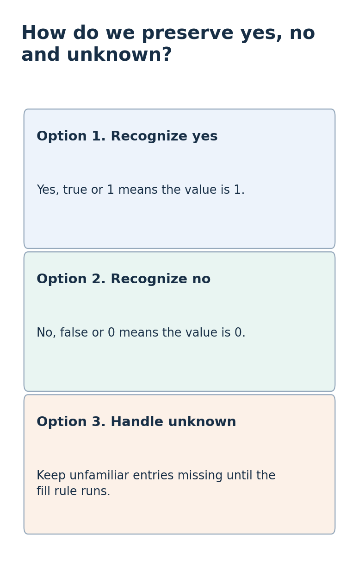

**👀 Read the visual.** Handle each entry based on its meaning.

**👉 Use what you see.** A false value is a known **0**. Leave an unknown entry missing until a rule handles it.

<a id="convert-boolean-values-to-standard-format-1-or-0"></a>

##### 🔢 Convert Boolean values to standard format (1 or 0)

| Lesson name | What you’ll do | Download |
| --- | --- | --- |
| 091 - Convert Boolean values to standard format (1 or 0) **Practice** | Change different spellings of yes and no into 1 and 0 and flag unrecognized values. | [Lesson ZIP](sample_code_folder/091-convert-boolean-values-to-standard-format-1-or-0.zip) |

<!-- workbook-teaching:91:start -->
<details>
<summary>Learn, trace and apply this idea</summary>

### Learn and apply: Convert Boolean values to standard format (1 or 0)

**Your decision.** Change different spellings of yes and no into 1 and 0 and flag unrecognized values.

**Ready check.** Tell known yes, known no and unknown apart. Use [the learning path](LEARNING-PATH.md) and [the word list](GLOSSARY.md) for the earlier skill. Trace the small example on paper before code.

**What it means.** Boolean preparation converts agreed yes/no spellings into two known values while preserving unknowns.

**Why and when.** Use it when a source really records a two-state field. Fill an absent value only through a stated training rule.

**A worked example to follow.** Yes, true and 1 map to 1; no, false and 0 map to 0. Unknown remains missing. The imputation variant learns the most frequent training flag rather than claiming the missing person answered no.

**Input → steps → output.** Open the supplied table. Its fields are `signed_up`. One original row is shown below in that same field order; `(missing)` marks a blank rather than zero.

```text
Yes
```

1. Name the particular field or object involved in this lesson’s decision above. Keep its meaning and units with it.
2. Open the [complete runnable Python example](lessons/091-convert-boolean-values-to-standard-format-1-or-0/lesson.py). Its numbered comments connect reading, preparation and the resulting calculation. Install only the [declared requirements](lessons/091-convert-boolean-values-to-standard-format-1-or-0/requirements.txt) using the same course Python, as shown in Setup.
3. Trace the worked example above through the script. Keep inputs apart from measured answers. Follow this script’s split and fit, then trace the saved preparation into the held-back result and any new request. A request must not supply its own training answer.
4. Read the result by its headings. Compare with [full recorded output](lessons/091-convert-boolean-values-to-standard-format-1-or-0/expected-output.txt); the excerpt below belongs to the original supplied files. Your edits can change it.

```text
signed_up  flag
      Yes   1.0
       no   0.0
     true   1.0
        0   0.0
  unknown   NaN
```

**How to interpret it.** Trace the worked case into the result above. Tell a calculated estimate from a measured answer.

**Common mistakes and limits.** Do not treat every nonempty string as true or every unknown as false. Verify source spellings; some fields have more than two real states.

**Use it yourself.** A signup field contains false, 1 and undecided. Which values are known under this lesson’s mapping?

<details>
<summary>Check your choice and reason</summary>

false is known 0 and 1 is known 1. undecided is unmapped/missing under this mapping. Review its meaning rather than inventing a confirmed answer.

</details>

**A second check later.** Close the notes and explain the same decision using a different row from the supplied table. State one condition that would make this method unsuitable. If you cannot explain the reason, repeat the small worked example before adding more code.

</details>
<!-- workbook-teaching:91:end -->


**Before this lesson.** Tell yes, no and unknown apart.

**In simple words.** Yes, true and 1 mean known yes. No, false and 0 mean known no. An unknown value stays missing until a stated rule handles it.

**Guess first.** Is unknown the same as false? Write your answer before running the example.

<details>
<summary>Read the reason after trying</summary>

No. False is a known answer. Unknown is missing information.

</details>


Create and read a short signup CSV. Map the original spellings to numeric flags before modeling.

**📋 Sample data**

| signed_up |
| --- |
| Yes |
| no |
| true |
| 0 |
| unknown |

**▶️ Run.** Unzip the [lesson files](sample_code_folder/091-convert-boolean-values-to-standard-format-1-or-0.zip) and open a terminal in that folder. Install the lesson’s packages with `python -m pip install -r requirements.txt`, then run `python lesson.py`.

**🔹 Steps in the script**

1. Read the CSV and check its inputs, including signed_up.
2. Give different spellings of the same value one consistent form.

**✅ Check.** Look for signed_up  flag in the output excerpt below.

| signed_up | flag |
| --- | --- |
| Yes | 1.0 |
| no | 0.0 |

**Your small change.** Change signed_up in sample.csv, for example from Yes to true. Compare the printed rows. Save the named CSV before running again.


**💡 Takeaway.** The unknown entry stays missing so the next example can handle it explicitly.

<a id="fill-missing-values-with-mode"></a>

##### 🩹 Fill missing values with mode

| Lesson name | What you’ll do | Download |
| --- | --- | --- |
| 092 - Fill missing values with mode **Practice** | Fill an unknown signup flag with the most common training value before making a prediction. | [Lesson ZIP](sample_code_folder/092-fill-missing-values-with-mode.zip) |

<!-- workbook-teaching:92:start -->
<details>
<summary>Learn, trace and apply this idea</summary>

### Learn and apply: Fill missing values with mode

**Your decision.** Fill an unknown signup flag with the most common training value before making a prediction.

**Ready check.** Tell known yes, known no and unknown apart. Use [the learning path](LEARNING-PATH.md) and [the word list](GLOSSARY.md) for the earlier skill. Trace the small example on paper before code.

**What it means.** Boolean preparation converts agreed yes/no spellings into two known values while preserving unknowns.

**Why and when.** Use it when a source really records a two-state field. Fill an absent value only through a stated training rule.

**A worked example to follow.** Yes, true and 1 map to 1; no, false and 0 map to 0. Unknown remains missing. The imputation variant learns the most frequent training flag rather than claiming the missing person answered no.

**Input → steps → output.** Open the supplied table. Its fields are `signed_up`, `clicked`. One original row is shown below in that same field order; `(missing)` marks a blank rather than zero.

```text
Yes | 1
```

1. Name the particular field or object involved in this lesson’s decision above. Keep its meaning and units with it.
2. Open the [complete runnable Python example](lessons/092-fill-missing-values-with-mode/lesson.py). Its numbered comments connect reading, preparation and the resulting calculation. Install only the [declared requirements](lessons/092-fill-missing-values-with-mode/requirements.txt) using the same course Python, as shown in Setup.
3. Trace the worked example above through the script. Keep inputs apart from measured answers. Follow this script’s split and fit, then trace the saved preparation into the held-back result and any new request. A request must not supply its own training answer.
4. Read the result by its headings. Compare with [full recorded output](lessons/092-fill-missing-values-with-mode/expected-output.txt); the excerpt below belongs to the original supplied files. Your edits can change it.

```text
signed_up  flag
      Yes   1.0
       No   0.0
     True   1.0
        0   0.0
        1   1.0
```

**How to interpret it.** Trace the worked case into the result above. Tell a calculated estimate from a measured answer.

**Common mistakes and limits.** Do not treat every nonempty string as true or every unknown as false. Verify source spellings; some fields have more than two real states.

**Use it yourself.** A signup field contains false, 1 and undecided. Which values are known under this lesson’s mapping?

<details>
<summary>Check your choice and reason</summary>

false is known 0 and 1 is known 1. undecided is unmapped/missing under this mapping. Review its meaning rather than inventing a confirmed answer.

</details>

**A second check later.** Close the notes and explain the same decision using a different row from the supplied table. State one condition that would make this method unsuitable. If you cannot explain the reason, repeat the small worked example before adding more code.

</details>
<!-- workbook-teaching:92:end -->


**Before this lesson.** Tell yes, no and unknown apart.

**In simple words.** Yes, true and 1 mean known yes. No, false and 0 mean known no. An unknown value stays missing until a stated rule handles it.

**Guess first.** Is unknown the same as false? Write your answer before running the example.

<details>
<summary>Read the reason after trying</summary>

No. False is a known answer. Unknown is missing information.

</details>


Read mixed Boolean spellings, map them to 0/1, and fit the most-frequent imputer inside a classifier.

**📋 Sample data**

| signed_up | clicked |
| --- | --- |
| Yes | 1 |
| No | 0 |
| True | 1 |
| 0 | 0 |
| 1 | 1 |
| unknown | 0 |

**▶️ Run.** Unzip the [lesson files](sample_code_folder/092-fill-missing-values-with-mode.zip) and open a terminal in that folder. Install the lesson’s packages with `python -m pip install -r requirements.txt`, then run `python lesson.py`.

**🔹 Steps in the script**

1. Read the CSV and check its inputs, including signed_up, clicked.
2. Give different spellings of the same value one consistent form.
3. Fit the model on the prepared training rows. Keep it for the checks below.
4. Apply the fitted model to the new CSV rows and print a result for each row.

**✅ Check.** Look for signed_up  flag in the output excerpt below.

| signed_up | flag |
| --- | --- |
| Yes | 1.0 |
| No | 0.0 |

**Your small change.** Try Yes, 0 and an unknown value in new_inputs.csv. Save the named CSV before running again.


<a id="1-3-9-handle-date-time-data"></a>

#### ⏳ 1.3.9 Handle Date/Time Data

| Lesson name | What you’ll do | Download |
| --- | --- | --- |
| 093 - 1.3.9 Handle Date/Time Data **Practice** | Read written dates and timestamps so Python can use them consistently. | [Lesson ZIP](sample_code_folder/093-1-3-9-handle-date-time-data.zip) |

<!-- workbook-teaching:93:start -->
<details>
<summary>Learn, trace and apply this idea</summary>

### Learn and apply: 1.3.9 Handle Date/Time Data

**Your decision.** Read written dates and timestamps so Python can use them consistently.

**Ready check.** Read a calendar date and a clock time. Use [the learning path](LEARNING-PATH.md) and [the word list](GLOSSARY.md) for the earlier skill. Trace the small example on paper before code.

**What it means.** Parsing turns a written time into a date value; feature extraction selects parts such as year, weekday or hour.

**Why and when.** Use a part only if it is known when predicting and relevant to the job. Record the date convention and timezone.

**A worked example to follow.** 2025-02-03 08:00 has year 2025, month 2, day 3, weekday 0 (Monday in pandas) and hour 8. The lesson fits the named date parts and reuses the same parser on later inputs.

**Input → steps → output.** Open the supplied table. Its fields are `raw_date`. One original row is shown below in that same field order; `(missing)` marks a blank rather than zero.

```text
02/03/2025
```

1. Name the particular field or object involved in this lesson’s decision above. Keep its meaning and units with it.
2. Open the [complete runnable Python example](lessons/093-1-3-9-handle-date-time-data/lesson.py). Its numbered comments connect reading, preparation and the resulting calculation. Install only the [declared requirements](lessons/093-1-3-9-handle-date-time-data/requirements.txt) using the same course Python, as shown in Setup.
3. Trace the worked example above through the script. Keep the original field beside the inspected or changed value. Trace the named preparation or review step, and check whether it uses a fixed rule or a value learned from training.
4. Read the result by its headings. Compare with [full recorded output](lessons/093-1-3-9-handle-date-time-data/expected-output.txt); the excerpt below belongs to the original supplied files. Your edits can change it.

```text
['2025-02-03', '2025-02-04', 'invalid date', '2023-02-10']
```

**How to interpret it.** Trace the worked case into the result above. Tell a calculated estimate from a measured answer.

**Common mistakes and limits.** Written hour numbers are not distances around a clock: 23:00 and 00:00 are one hour apart. A Unix timestamp needs a stated unit and time convention. Do not guess ambiguous formats.

**Use it yourself.** Two systems write 02/03/2025. What must be known before combining them? Can using a later correction time leak information?

<details>
<summary>Check your choice and reason</summary>

Confirm month/day versus day/month and the timezone. A later correction time may be unavailable at prediction time; use only fields actually known then.

</details>

**A second check later.** Close the notes and explain the same decision using a different row from the supplied table. State one condition that would make this method unsuitable. If you cannot explain the reason, repeat the small worked example before adding more code.

</details>
<!-- workbook-teaching:93:end -->


**Before this lesson.** Read a date and time. Know the format used in the file.

**In simple words.** Parse a date once, then take parts such as year or hour. These are possible inputs, not proof they are useful. Keep timezone and prediction timing clear.

**Guess first.** Are hour 23 and hour 0 far apart in time? Write your answer before running the example.

<details>
<summary>Read the reason after trying</summary>

No. They are an hour apart across midnight. Numeric coding may need to reflect that cycle.

</details>


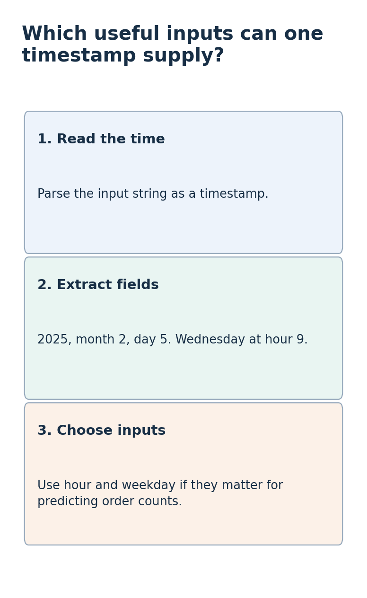

**👀 Read the visual.** Use the date and time 2025-02-05 09:00 as a worked example.

**👉 Use what you see.** Change **09:00** to **17:00** and find the difference in the Hour column.

<a id="convert-to-datetime-format"></a>

##### 📅 Convert to datetime format

| Lesson name | What you’ll do | Download |
| --- | --- | --- |
| 094 - Convert to datetime format **Practice** | Parse two date formats and a Unix timestamp, and spot an unreadable value. | [Lesson ZIP](sample_code_folder/094-convert-to-datetime-format.zip) |

<!-- workbook-teaching:94:start -->
<details>
<summary>Learn, trace and apply this idea</summary>

### Learn and apply: Convert to datetime format

**Your decision.** Parse two date formats and a Unix timestamp, and spot an unreadable value.

**Ready check.** Read a calendar date and a clock time. Use [the learning path](LEARNING-PATH.md) and [the word list](GLOSSARY.md) for the earlier skill. Trace the small example on paper before code.

**What it means.** Parsing turns a written time into a date value; feature extraction selects parts such as year, weekday or hour.

**Why and when.** Use a part only if it is known when predicting and relevant to the job. Record the date convention and timezone.

**A worked example to follow.** 2025-02-03 08:00 has year 2025, month 2, day 3, weekday 0 (Monday in pandas) and hour 8. The lesson fits the named date parts and reuses the same parser on later inputs.

**Input → steps → output.** Open the supplied table. Its fields are `raw_date`. One original row is shown below in that same field order; `(missing)` marks a blank rather than zero.

```text
02/03/2025
```

1. Name the particular field or object involved in this lesson’s decision above. Keep its meaning and units with it.
2. Open the [complete runnable Python example](lessons/094-convert-to-datetime-format/lesson.py). Its numbered comments connect reading, preparation and the resulting calculation. Install only the [declared requirements](lessons/094-convert-to-datetime-format/requirements.txt) using the same course Python, as shown in Setup.
3. Trace the worked example above through the script. Keep the original field beside the inspected or changed value. Trace the named preparation or review step, and check whether it uses a fixed rule or a value learned from training.
4. Read the result by its headings. Compare with [full recorded output](lessons/094-convert-to-datetime-format/expected-output.txt); the excerpt below belongs to the original supplied files. Your edits can change it.

```text
['2025-02-03', '2025-02-04', 'invalid date', '2023-02-10']
```

**How to interpret it.** Trace the worked case into the result above. Tell a calculated estimate from a measured answer.

**Common mistakes and limits.** Written hour numbers are not distances around a clock: 23:00 and 00:00 are one hour apart. A Unix timestamp needs a stated unit and time convention. Do not guess ambiguous formats.

**Use it yourself.** Two systems write 02/03/2025. What must be known before combining them? Can using a later correction time leak information?

<details>
<summary>Check your choice and reason</summary>

Confirm month/day versus day/month and the timezone. A later correction time may be unavailable at prediction time; use only fields actually known then.

</details>

**A second check later.** Close the notes and explain the same decision using a different row from the supplied table. State one condition that would make this method unsuitable. If you cannot explain the reason, repeat the small worked example before adding more code.

</details>
<!-- workbook-teaching:94:end -->


**Before this lesson.** Read a date and time. Know the format used in the file.

**In simple words.** Parse a date once, then take parts such as year or hour. These are possible inputs, not proof they are useful. Keep timezone and prediction timing clear.

**Guess first.** Are hour 23 and hour 0 far apart in time? Write your answer before running the example.

<details>
<summary>Read the reason after trying</summary>

No. They are an hour apart across midnight. Numeric coding may need to reflect that cycle.

</details>


Read two timestamp formats plus a Unix timestamp. Convert valid values and report a malformed date.

**▶️ Run.** Unzip the [lesson files](sample_code_folder/094-convert-to-datetime-format.zip) and open a terminal in that folder. Install the lesson’s packages with `python -m pip install -r requirements.txt`, then run `python lesson.py`.

**🔹 Steps in the script**

1. Read the raw date strings, including different formats and an invalid value.
2. Print the result next to the input values so you can compare them.

**✅ Check.** Look for ['2025-02-03', '2025-02-04', 'invalid date', '2023-02-10'] in the output excerpt below.

```text
['2025-02-03', '2025-02-04', 'invalid date', '2023-02-10']
```

**Your small change.** Enter 12/31/2025, 2025-12-31 and an unreadable date. Compare the results. Save the named CSV before running again.


<a id="extract-useful-features-year-month-day-weekday-hour-etc"></a>

##### 🗓️ Extract useful features (Year, Month, Day, Weekday, Hour, etc.)

| Lesson name | What you’ll do | Download |
| --- | --- | --- |
| 095 - Extract useful features (Year, Month, Day, Weekday, Hour, etc.) **Practice** | Turn one timestamp into model inputs such as weekday and hour. | [Lesson ZIP](sample_code_folder/095-extract-useful-features-year-month-day-weekday-hour-etc.zip) |

<!-- workbook-teaching:95:start -->
<details>
<summary>Learn, trace and apply this idea</summary>

### Learn and apply: Extract useful features (Year, Month, Day, Weekday, Hour, etc.)

**Your decision.** Turn one timestamp into model inputs such as weekday and hour.

**Ready check.** Read a calendar date and a clock time. Use [the learning path](LEARNING-PATH.md) and [the word list](GLOSSARY.md) for the earlier skill. Trace the small example on paper before code.

**What it means.** Parsing turns a written time into a date value; feature extraction selects parts such as year, weekday or hour.

**Why and when.** Use a part only if it is known when predicting and relevant to the job. Record the date convention and timezone.

**A worked example to follow.** 2025-02-03 08:00 has year 2025, month 2, day 3, weekday 0 (Monday in pandas) and hour 8. The lesson fits the named date parts and reuses the same parser on later inputs.

**Input → steps → output.** Open the supplied table. Its fields are `timestamp`, `orders`. One original row is shown below in that same field order; `(missing)` marks a blank rather than zero.

```text
2025-02-03 08:00 | 10
```

1. Name the particular field or object involved in this lesson’s decision above. Keep its meaning and units with it.
2. Open the [complete runnable Python example](lessons/095-extract-useful-features-year-month-day-weekday-hour-etc/lesson.py). Its numbered comments connect reading, preparation and the resulting calculation. Install only the [declared requirements](lessons/095-extract-useful-features-year-month-day-weekday-hour-etc/requirements.txt) using the same course Python, as shown in Setup.
3. Trace the worked example above through the script. Keep the original field beside the inspected or changed value. Trace the named preparation or review step, and check whether it uses a fixed rule or a value learned from training.
4. Read the result by its headings. Compare with [full recorded output](lessons/095-extract-useful-features-year-month-day-weekday-hour-etc/expected-output.txt); the excerpt below belongs to the original supplied files. Your edits can change it.

```text
 Year  Month  Day  Weekday  Hour
 2025      2    3        0     8
 2025      2    3        0    10
 2025      2    4        1     8
 2025      2    4        1    10
       timestamp  Weekday  Hour  estimated_orders
```

**How to interpret it.** Trace the worked case into the result above. Tell a calculated estimate from a measured answer.

**Common mistakes and limits.** Written hour numbers are not distances around a clock: 23:00 and 00:00 are one hour apart. A Unix timestamp needs a stated unit and time convention. Do not guess ambiguous formats.

**Use it yourself.** Two systems write 02/03/2025. What must be known before combining them? Can using a later correction time leak information?

<details>
<summary>Check your choice and reason</summary>

Confirm month/day versus day/month and the timezone. A later correction time may be unavailable at prediction time; use only fields actually known then.

</details>

**A second check later.** Close the notes and explain the same decision using a different row from the supplied table. State one condition that would make this method unsuitable. If you cannot explain the reason, repeat the small worked example before adding more code.

</details>
<!-- workbook-teaching:95:end -->


**Before this lesson.** Read a date and time. Know the format used in the file.

**In simple words.** Parse a date once, then take parts such as year or hour. These are possible inputs, not proof they are useful. Keep timezone and prediction timing clear.

**Guess first.** Are hour 23 and hour 0 far apart in time? Write your answer before running the example.

<details>
<summary>Read the reason after trying</summary>

No. They are an hour apart across midnight. Numeric coding may need to reflect that cycle.

</details>


Turn timestamp strings into five features. Use hour and weekday to fit a delivery-volume model, then predict a new hour using the same parser.

**📋 Sample data**

| timestamp | orders |
| --- | --- |
| 2025-02-03 08:00 | 10 |
| 2025-02-03 10:00 | 14 |
| 2025-02-04 08:00 | 13 |
| 2025-02-04 10:00 | 17 |

**▶️ Run.** Unzip the [lesson files](sample_code_folder/095-extract-useful-features-year-month-day-weekday-hour-etc.zip) and open a terminal in that folder. Install the lesson’s packages with `python -m pip install -r requirements.txt`, then run `python lesson.py`.

**🔹 Steps in the script**

1. Read the timestamp and recorded order count for each row.
2. Read each timestamp once and pull out the parts the model can use.
3. Teach the model from the training inputs and the recorded order count.
4. Apply the fitted model to the new CSV rows and print a result for each row.

**✅ Check.** Look for Year  Month  Day  Weekday  Hour in the output excerpt below.

| Year | Month | Day | Weekday | Hour |
| --- | --- | --- | --- | --- |
| 2025 | 2 | 3 | 0 | 8 |
| 2025 | 2 | 3 | 0 | 10 |

**Your small change.** Try 2025-02-05 09:00 and 2026-01-12 08:30 in new_inputs.csv. Keep the YYYY-MM-DD HH:MM format. Save the named CSV before running again.


<a id="handle-missing-dates-using-interpolation"></a>

##### 🩹 Handle missing dates using interpolation

| Lesson name | What you’ll do | Download |
| --- | --- | --- |
| 101 - Handle missing dates using interpolation **Practice** | Estimate a missing time-series reading from the readings on either side. | [Lesson ZIP](sample_code_folder/101-handle-missing-dates-using-interpolation.zip) |

<!-- workbook-teaching:101:start -->
<details>
<summary>Learn, trace and apply this idea</summary>

### Learn and apply: Handle missing dates using interpolation

**Your decision.** Estimate a missing time-series reading from the readings on either side.

**Ready check.** Sort dates and check one reading per date. Use [the learning path](LEARNING-PATH.md) and [the word list](GLOSSARY.md) for the earlier skill. Trace the small example on paper before code.

**What it means.** Interpolation estimates a gap between known readings on a stated calendar.

**Why and when.** Use it for a retrospective series when the neighboring readings and a smooth-change assumption make sense.

**A worked example to follow.** February 1 has 10 orders and February 3 has 16. A straight time interpolation gives February 2 a value of 13. Changing February 3 to 18 makes the midpoint 14.

**Input → steps → output.** Open the supplied table. Its fields are `day`, `orders`. One original row is shown below in that same field order; `(missing)` marks a blank rather than zero.

```text
2025-02-01 | 10
```

1. Name the particular field or object involved in this lesson’s decision above. Keep its meaning and units with it.
2. Open the [complete runnable Python example](lessons/101-handle-missing-dates-using-interpolation/lesson.py). Its numbered comments connect reading, preparation and the resulting calculation. Install only the [declared requirements](lessons/101-handle-missing-dates-using-interpolation/requirements.txt) using the same course Python, as shown in Setup.
3. Trace the worked example above through the script. Keep the original field beside the inspected or changed value. Trace the named preparation or review step, and check whether it uses a fixed rule or a value learned from training.
4. Read the result by its headings. Compare with [full recorded output](lessons/101-handle-missing-dates-using-interpolation/expected-output.txt); the excerpt below belongs to the original supplied files. Your edits can change it.

```text
            observed  interpolated
day
2025-02-01      10.0          10.0
2025-02-02       NaN          13.0
2025-02-03      16.0          16.0
2025-02-04      19.0          19.0
```

**How to interpret it.** Trace the worked case into the result above. Tell a calculated estimate from a measured answer.

**Common mistakes and limits.** This estimates the missing measurement, not the missing date. It uses the later reading; a live February 2 prediction could not use February 3.

**Use it yourself.** May a real-time February 2 forecast report the interpolated 13 as though it used only available information?

<details>
<summary>Check your choice and reason</summary>

No. That would use a future observation. For live forecasting restrict information to what had arrived; keep retrospective repair clearly labelled.

</details>

**A second check later.** Close the notes and explain the same decision using a different row from the supplied table. State one condition that would make this method unsuitable. If you cannot explain the reason, repeat the small worked example before adding more code.

</details>
<!-- workbook-teaching:101:end -->


**Before this lesson.** Put dates in order and check that each date appears once.

**In simple words.** A daily calendar can reveal a missing measurement. Interpolation estimates it using readings around the gap. Here we are looking back, not predicting live.

**Guess first.** If February 3 rises, can the estimate for February 2 rise? Write your answer before running the example.

<details>
<summary>Read the reason after trying</summary>

Yes. The past-series estimate uses that later reading. Do not use it for a live February 2 decision.

</details>


Put observations on a daily calendar and estimate the missing measurement in a past-series series.

**📋 Sample data**

| day | orders |
| --- | --- |
| 2025-02-01 | 10 |
| 2025-02-03 | 16 |
| 2025-02-04 | 19 |

**▶️ Run.** Unzip the [lesson files](sample_code_folder/101-handle-missing-dates-using-interpolation.zip) and open a terminal in that folder. Install the lesson’s packages with `python -m pip install -r requirements.txt`, then run `python lesson.py`.

**🔹 Steps in the script**

1. Read the CSV and check its inputs, including day, orders.
2. Print the result next to the input values so you can compare them.

**✅ Check.** Look for observed  interpolated in the output excerpt below.

```text
observed  interpolated
day
2025-02-01      10.0          10.0
```

**Your small change.** In sample.csv, change orders for 2025-02-03 from 16 to 18. The February 2 estimate should become 14. Keep each date unique. Save the named CSV before running again.


**💡 Takeaway.** February 2 gets 13 using both adjacent days. Interpolate a missing measurement on a known schedule. For a live prediction on February 2, restrict inputs to data actually available then.

<a id="1-3-10-handle-large-numbers"></a>

#### 🔢 1.3.10 Handle Large Numbers

| Lesson name | What you’ll do | Download |
| --- | --- | --- |
| 102 - 1.3.10 Handle Large Numbers **Practice** | Check how a log makes large numeric values easier to compare. | [Lesson ZIP](sample_code_folder/102-1-3-10-handle-large-numbers.zip) |

<!-- workbook-teaching:102:start -->
<details>
<summary>Learn, trace and apply this idea</summary>

### Learn and apply: 1.3.10 Handle Large Numbers

**Your decision.** Check how a log makes large numeric values easier to compare.

**Ready check.** Compare 10, 100 and 1000 and explain a zero. Use [the learning path](LEARNING-PATH.md) and [the word list](GLOSSARY.md) for the earlier skill. Trace the small example on paper before code.

**What it means.** A logarithm compresses large positive gaps; log1p applies natural log to 1 + value.

**Why and when.** Try a log for a skewed measurement or a multiplicative relationship, then compare validation results with unchanged input.

**A worked example to follow.** Base-10 log maps 1, 10, 100, 1000 to 0, 1, 2, 3. log1p keeps zero valid and uses a different base. The lesson trains on the transformed signal and predicts cost in its original unit.

**Input → steps → output.** Open the supplied table. Its fields are `signal`, `cost`. One original row is shown below in that same field order; `(missing)` marks a blank rather than zero.

```text
1 | 10
```

1. Name the particular field or object involved in this lesson’s decision above. Keep its meaning and units with it.
2. Open the [complete runnable Python example](lessons/102-1-3-10-handle-large-numbers/lesson.py). Its numbered comments connect reading, preparation and the resulting calculation. Install only the [declared requirements](lessons/102-1-3-10-handle-large-numbers/requirements.txt) using the same course Python, as shown in Setup.
3. Trace the worked example above through the script. Keep inputs apart from measured answers. Follow this script’s split and fit, then trace the saved preparation into the held-back result and any new request. A request must not supply its own training answer.
4. Read the result by its headings. Compare with [full recorded output](lessons/102-1-3-10-handle-large-numbers/expected-output.txt); the excerpt below belongs to the original supplied files. Your edits can change it.

```text
Log Transformation first two training rows: [[0.69], [1.79]]
Actual costs: [23, 48]
Predicted costs: [26.7, 47.2]
 signal  predicted_cost
      3           13.94
     15           31.43
```

**How to interpret it.** Trace the worked case into the result above. Tell a calculated estimate from a measured answer.

**Common mistakes and limits.** Scientific notation is only a display choice. A log actually changes the numeric feature. Check the domain; logging negative values can fail, and a target log needs its inverse before interpreting predictions.

**Use it yourself.** Does writing 1000 as 1e3 make it a log feature? What happens to zero under log10 and log1p?

<details>
<summary>Check your choice and reason</summary>

1e3 is still 1000. log10(0) is not finite, while log1p(0) is 0. Choose a justified valid transformation and reuse it consistently.

</details>

**A second check later.** Close the notes and explain the same decision using a different row from the supplied table. State one condition that would make this method unsuitable. If you cannot explain the reason, repeat the small worked example before adding more code.

</details>
<!-- workbook-teaching:102:end -->


**Before this lesson.** Read large numbers and know which fields are IDs.

**In simple words.** Scientific notation only changes how a number is displayed. A log changes the numeric input. An ID is a name, even when it contains digits.

**Guess first.** Does writing 1000 as 1e3 make its value smaller? Write your answer before running the example.

<details>
<summary>Read the reason after trying</summary>

No. The value stays 1000. A log is a different operation.

</details>


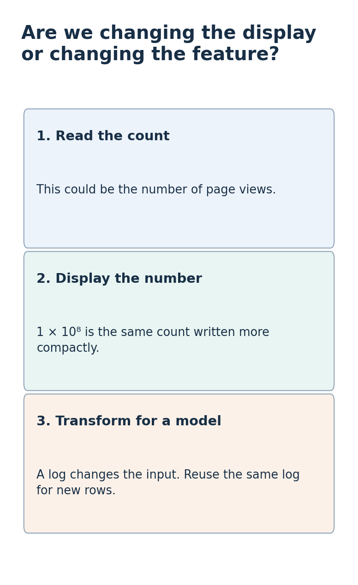

**👀 Read the visual.** Start with the count 100,000,000.

**👉 Use what you see.** Use scientific notation for readability. Apply a transformation when the model should see a different scale.

<a id="apply-log-transformation-if-data-is-highly-skewed"></a>

##### 📉 Apply Log Transformation (if data is highly skewed)

| Lesson name | What you’ll do | Download |
| --- | --- | --- |
| 103 - Apply Log Transformation (if data is highly skewed) **Practice** | Use a log so a few very large readings have less influence on the scale. | [Lesson ZIP](sample_code_folder/103-apply-log-transformation-if-data-is-highly-skewed.zip) |

<!-- workbook-teaching:103:start -->
<details>
<summary>Learn, trace and apply this idea</summary>

### Learn and apply: Apply Log Transformation (if data is highly skewed)

**Your decision.** Use a log so a few very large readings have less influence on the scale.

**Ready check.** Compare 10, 100 and 1000 and explain a zero. Use [the learning path](LEARNING-PATH.md) and [the word list](GLOSSARY.md) for the earlier skill. Trace the small example on paper before code.

**What it means.** A logarithm compresses large positive gaps; log1p applies natural log to 1 + value.

**Why and when.** Try a log for a skewed measurement or a multiplicative relationship, then compare validation results with unchanged input.

**A worked example to follow.** Base-10 log maps 1, 10, 100, 1000 to 0, 1, 2, 3. log1p keeps zero valid and uses a different base. The lesson trains on the transformed signal and predicts cost in its original unit.

**Input → steps → output.** Open the supplied table. Its fields are `signal`, `cost`. One original row is shown below in that same field order; `(missing)` marks a blank rather than zero.

```text
1 | 10
```

1. Name the particular field or object involved in this lesson’s decision above. Keep its meaning and units with it.
2. Open the [complete runnable Python example](lessons/103-apply-log-transformation-if-data-is-highly-skewed/lesson.py). Its numbered comments connect reading, preparation and the resulting calculation. Install only the [declared requirements](lessons/103-apply-log-transformation-if-data-is-highly-skewed/requirements.txt) using the same course Python, as shown in Setup.
3. Trace the worked example above through the script. Keep inputs apart from measured answers. Follow this script’s split and fit, then trace the saved preparation into the held-back result and any new request. A request must not supply its own training answer.
4. Read the result by its headings. Compare with [full recorded output](lessons/103-apply-log-transformation-if-data-is-highly-skewed/expected-output.txt); the excerpt below belongs to the original supplied files. Your edits can change it.

```text
Log Transformation first two training rows: [[0.69], [1.79]]
Actual costs: [23, 48]
Predicted costs: [26.7, 47.2]
 signal  predicted_cost
      3           13.94
     15           31.43
```

**How to interpret it.** Trace the worked case into the result above. Tell a calculated estimate from a measured answer.

**Common mistakes and limits.** Scientific notation is only a display choice. A log actually changes the numeric feature. Check the domain; logging negative values can fail, and a target log needs its inverse before interpreting predictions.

**Use it yourself.** Does writing 1000 as 1e3 make it a log feature? What happens to zero under log10 and log1p?

<details>
<summary>Check your choice and reason</summary>

1e3 is still 1000. log10(0) is not finite, while log1p(0) is 0. Choose a justified valid transformation and reuse it consistently.

</details>

**A second check later.** Close the notes and explain the same decision using a different row from the supplied table. State one condition that would make this method unsuitable. If you cannot explain the reason, repeat the small worked example before adding more code.

</details>
<!-- workbook-teaching:103:end -->


**Before this lesson.** Read large numbers and know which fields are IDs.

**In simple words.** Scientific notation only changes how a number is displayed. A log changes the numeric input. An ID is a name, even when it contains digits.

**Guess first.** Does writing 1000 as 1e3 make its value smaller? Write your answer before running the example.

<details>
<summary>Read the reason after trying</summary>

No. The value stays 1000. A log is a different operation.

</details>


Run the traffic model below and compare the raw counts with the log features. Try `log1p` when the feature can contain zero.

<a id="convert-to-scientific-notation-if-values-are-too-large"></a>

##### 🔬 Convert to scientific notation (if values are too large)

| Lesson name | What you’ll do | Download |
| --- | --- | --- |
| 104 - Convert to scientific notation (if values are too large) **Practice** | Display large numbers in compact scientific notation and read the original value alongside them. | [Lesson ZIP](sample_code_folder/104-convert-to-scientific-notation-if-values-are-too-large.zip) |

<!-- workbook-teaching:104:start -->
<details>
<summary>Learn, trace and apply this idea</summary>

### Learn and apply: Convert to scientific notation (if values are too large)

**Your decision.** Display large numbers in compact scientific notation and read the original value alongside them.

**Ready check.** Distinguish an identifier from a measured count. Use [the learning path](LEARNING-PATH.md) and [the word list](GLOSSARY.md) for the earlier skill. Trace the small example on paper before code.

**What it means.** Scientific notation writes the same value compactly. An ID remains a name even when all its characters are digits.

**Why and when.** Use compact notation to display large measurements, and exact strings to preserve long IDs.

**A worked example to follow.** 1000 and 1e3 mean the same number. The script preserves event_id as text and separately passes log-transformed visits to the cost model.

**Input → steps → output.** Open the supplied table. Its fields are `event_id`, `visits`, `server_cost`. One original row is shown below in that same field order; `(missing)` marks a blank rather than zero.

```text
123456789012345 | 100 | 8
```

1. Name the particular field or object involved in this lesson’s decision above. Keep its meaning and units with it.
2. Open the [complete runnable Python example](lessons/104-convert-to-scientific-notation-if-values-are-too-large/lesson.py). Its numbered comments connect reading, preparation and the resulting calculation. Install only the [declared requirements](lessons/104-convert-to-scientific-notation-if-values-are-too-large/requirements.txt) using the same course Python, as shown in Setup.
3. Trace the worked example above through the script. Keep the original field beside the inspected or changed value. Trace the named preparation or review step, and check whether it uses a fixed rule or a value learned from training.
4. Read the result by its headings. Compare with [full recorded output](lessons/104-convert-to-scientific-notation-if-values-are-too-large/expected-output.txt); the excerpt below belongs to the original supplied files. Your edits can change it.

```text
First ID: 123456789012345
Traffic display: ['1.000e+02', '1.000e+04', '1.000e+06', '1.250e+10']
Numeric log features: [4.62, 9.21, 13.82, 23.25]
Held-out cost estimate: [30.8]
```

**How to interpret it.** Trace the worked case into the result above. Tell a calculated estimate from a measured answer.

**Common mistakes and limits.** Rounding an ID or treating its magnitude as a useful measurement can destroy identity or invent a relationship.

**Use it yourself.** A table has an account ID 000123 and a count of 1000000. Which may be formatted as 1e6 and which should preserve characters?

<details>
<summary>Check your choice and reason</summary>

The count may be displayed as 1e6. Preserve 000123 exactly as text; its leading zeros can be part of its identity.

</details>

**A second check later.** Close the notes and explain the same decision using a different row from the supplied table. State one condition that would make this method unsuitable. If you cannot explain the reason, repeat the small worked example before adding more code.

</details>
<!-- workbook-teaching:104:end -->


**Before this lesson.** Read large numbers and know which fields are IDs.

**In simple words.** Scientific notation only changes how a number is displayed. A log changes the numeric input. An ID is a name, even when it contains digits.

**Guess first.** Does writing 1000 as 1e3 make its value smaller? Write your answer before running the example.

<details>
<summary>Read the reason after trying</summary>

No. The value stays 1000. A log is a different operation.

</details>


Read large traffic values and long event IDs. Display traffic in scientific notation and send its log-transformed numeric form into regression.

**📋 Sample data**

| event_id | visits | server_cost |
| --- | --- | --- |
| 123456789012345 | 100 | 8 |
| 123456789012346 | 10000 | 15 |
| 123456789012347 | 1000000 | 19 |
| 123456789012348 | 12500000000 | 30 |

**▶️ Run.** Unzip the [lesson files](sample_code_folder/104-convert-to-scientific-notation-if-values-are-too-large.zip) and open a terminal in that folder. Install the lesson’s packages with `python -m pip install -r requirements.txt`, then run `python lesson.py`.

**🔹 Steps in the script**

1. Read the CSV and check its inputs, including event_id, visits, server_cost.
2. Print the result next to the input values so you can compare them.
3. Fit the model on the prepared training rows. Keep it for the checks below.

**✅ Check.** Look for First ID: 123456789012345 in the output excerpt below.

```text
First ID: 123456789012345
Traffic display: ['1.000e+02', '1.000e+04', '1.000e+06', '1.250e+10']
Numeric log features: [4.62, 9.21, 13.82, 23.25]
```

**Your small change.** Change visits in sample.csv from 100 to 1000. Compare its written scientific notation and log value. Keep event_id as exact text; do not use it as a measurement. Save the named CSV before running again.


**💡 Takeaway.** Scientific notation changes the display. The log changes the numeric feature. IDs remain exact strings and stay out of the model.

<a id="data-types-issues-preprocessing-techniques"></a>

#### 🗂️ Data Types, Issues & Preprocessing Techniques

| Lesson name | What you’ll do | Download |
| --- | --- | --- |
| 105 - Data Types, Issues & Preprocessing Techniques **Practice** | Turn a nested record into a flat row and identify the fields a model can use. | [Lesson ZIP](sample_code_folder/105-data-types-issues-preprocessing-techniques.zip) |

<!-- workbook-teaching:105:start -->
<details>
<summary>Learn, trace and apply this idea</summary>

### Learn and apply: Data Types, Issues & Preprocessing Techniques

**Your decision.** Turn a nested record into a flat row and identify the fields a model can use.

**Ready check.** Find a field name and value in a row. Use [the learning path](LEARNING-PATH.md) and [the word list](GLOSSARY.md) for the earlier skill. Trace the small example on paper before code.

**What it means.** A nested record holds values inside named groups. Flattening selects those values into columns.

**Why and when.** Use it when JSON, XML or dictionaries must supply a fixed model input table.

**A worked example to follow.** A parcel object with kg inside it becomes parcel.kg after flattening. A missing kg key must remain missing rather than being assumed zero. XML field extraction similarly reads an explicitly named field.

**Input → steps → output.** Open the supplied table. Its fields are `address`, `weight_kg`, `minutes`. One original row is shown below in that same field order; `(missing)` marks a blank rather than zero.

```text
Depot North | 1 | 10
```

1. Name the particular field or object involved in this lesson’s decision above. Keep its meaning and units with it.
2. Open the [complete runnable Python example](lessons/105-data-types-issues-preprocessing-techniques/lesson.py). Its numbered comments connect reading, preparation and the resulting calculation. Install only the [declared requirements](lessons/105-data-types-issues-preprocessing-techniques/requirements.txt) using the same course Python, as shown in Setup.
3. Trace the worked example above through the script. Keep the original field beside the inspected or changed value. Trace the named preparation or review step, and check whether it uses a fixed rule or a value learned from training.
4. Read the result by its headings. Compare with [full recorded output](lessons/105-data-types-issues-preprocessing-techniques/expected-output.txt); the excerpt below belongs to the original supplied files. Your edits can change it.

```text
    address  minutes  parcel.kg  latitude  longitude
Depot North       10        1.0     59.35      18.05
Depot South       16        3.0     59.28      18.02
Depot North       12        NaN     59.35      18.05
    Unknown       15        2.0       NaN        NaN
XML weight: 2.0
```

**How to interpret it.** Trace the worked case into the result above. Tell a calculated estimate from a measured answer.

**Common mistakes and limits.** A flattened table can still contain absent fields, repeated records or mixed units. Do not pass IDs, nested text or unavailable answers to a model by accident.

**Use it yourself.** One parcel has no kg key and another has kg equal to zero. Should flattening make those records identical?

<details>
<summary>Check your choice and reason</summary>

No. One weight is unknown and the other is a recorded zero requiring a domain check. Preserve missingness and validate the expected schema and units.

</details>

**A second check later.** Close the notes and explain the same decision using a different row from the supplied table. State one condition that would make this method unsuitable. If you cannot explain the reason, repeat the small worked example before adding more code.

</details>
<!-- workbook-teaching:105:end -->


**Before this lesson.** Read a simple row, a named field and a missing value.

**In simple words.** A nested record holds facts inside other facts. Flattening puts selected facts into columns. A local address lookup has only the addresses in its own list.

**Guess first.** What should happen to an address absent from that list? Write your answer before running the example.

<details>
<summary>Read the reason after trying</summary>

Flag it for a source lookup. Do not invent coordinates.

</details>


| PDF data type | Example you can try | Common issue and fix |
| --- | --- | --- |
| 🔢 Numeric (int, float) | `42`, `3.14`, `-100`, `0.001` | Check missing values and outliers, then scale when useful. |
| 🏷️ Categorical (enum, labels) | `Red`, `Blue`, `Yes`, `No` | Standardize spelling and choose one-hot or ordinal encoding. |
| ✍️ Text (strings) | `Hello`, `Data Science!`, `abc123` | Test case and punctuation changes, stop words, TF-IDF, or embeddings. |
| ✅ Boolean (True/False) | `True`, `False`, `1`, `0`, `Yes`, `No` | Map consistently and treat missing values explicitly. |
| 🔭 Large Numbers (BigInt, Long Float) | `123456789012345`, `9.87654321e+10` | Preserve IDs, format large measurements for display, and try log for skew. |
| 📅 Datetime (Timestamps, Dates) | `2024-02-10`, `10:30 AM`, `1676025600` | Parse formats explicitly and derive year, month, day, weekday, or hour. |
| 🌍 Geospatial (Lat/Long, Addresses) | `(37.7749, -122.4194)`, `New York, USA` | Check bounds and unmatched addresses. Use a permitted geocoder for new data. |
| 🧱 Complex Data (JSON, XML, Dictionaries) | `{"name": "John", "age": 25}` | Flatten nested data and check missing keys. |
| 🖼️ Images (Pixels, Matrices) | `RGB(255, 0, 0)`, `[[0.1, 0.2], [0.3, 0.4]]` | Resize, try grayscale, and extract pixels or CNN features. |
| 🎧 Audio (Waves, Spectrograms) | WAV, MP3 | Inspect sample rate and noise, then build a spectrogram or MFCCs. |
| 🎬 Video (Frames, Sequences) | MP4 or image sequence | Sample frames in order and build CNN features for a sequence model such as an LSTM. |

<a id="geospatial-lat-long-addresses"></a>

##### 🌍 Geospatial (Lat/Long, Addresses)

| Lesson name | What you’ll do | Download |
| --- | --- | --- |
| 106 - Geospatial (Lat/Long, Addresses) **Practice** | Look up coordinates for three depots and use them to estimate delivery time. | [Lesson ZIP](sample_code_folder/106-geospatial-lat-long-addresses.zip) |

<!-- workbook-teaching:106:start -->
<details>
<summary>Learn, trace and apply this idea</summary>

### Learn and apply: Geospatial (Lat/Long, Addresses)

**Your decision.** Look up coordinates for three depots and use them to estimate delivery time.

**Ready check.** Read latitude and longitude as two different coordinates. Use [the learning path](LEARNING-PATH.md) and [the word list](GLOSSARY.md) for the earlier skill. Trace the small example on paper before code.

**What it means.** Geocoding finds coordinates for a named place. A local lookup only knows its listed places.

**Why and when.** Use coordinates when location is relevant and the match is verified. Live geocoding is a separate service step.

**A worked example to follow.** North Depot maps to the supplied coordinate pair. Unknown Depot remains unlocated; the script does not invent a point or make a live request.

**Input → steps → output.** Open the supplied table. Its fields are `address`, `weight_kg`, `minutes`. One original row is shown below in that same field order; `(missing)` marks a blank rather than zero.

```text
North Depot | 2 | 19
```

1. Name the particular field or object involved in this lesson’s decision above. Keep its meaning and units with it.
2. Open the [complete runnable Python example](lessons/106-geospatial-lat-long-addresses/lesson.py). Its numbered comments connect reading, preparation and the resulting calculation. Install only the [declared requirements](lessons/106-geospatial-lat-long-addresses/requirements.txt) using the same course Python, as shown in Setup.
3. Trace the worked example above through the script. Keep the original field beside the inspected or changed value. Trace the named preparation or review step, and check whether it uses a fixed rule or a value learned from training.
4. Read the result by its headings. Compare with [full recorded output](lessons/106-geospatial-lat-long-addresses/expected-output.txt); the excerpt below belongs to the original supplied files. Your edits can change it.

```text
      address  weight_kg             latitude            longitude    estimated_minutes
  North Depot          3                59.35                18.06                 22.5
  South Depot          2                59.28                18.02                 23.0
Unknown Depot          2 address needs review address needs review address needs review
```

**How to interpret it.** Trace the worked case into the result above. Tell a calculated estimate from a measured answer.

**Common mistakes and limits.** Ambiguous place names can resolve incorrectly. Latitude/longitude degrees do not directly give travel distance. Do not send personal addresses to an unapproved service.

**Use it yourself.** An unknown address gets coordinates 0,0 from a guessed fallback. Is that a safe representation of missing location?

<details>
<summary>Check your choice and reason</summary>

No. 0,0 is an actual location. Keep the match unresolved and request a source lookup or use a separately tested missing-location policy.

</details>

**A second check later.** Close the notes and explain the same decision using a different row from the supplied table. State one condition that would make this method unsuitable. If you cannot explain the reason, repeat the small worked example before adding more code.

</details>
<!-- workbook-teaching:106:end -->


**Before this lesson.** Read a simple row, a named field and a missing value.

**In simple words.** A nested record holds facts inside other facts. Flattening puts selected facts into columns. A local address lookup has only the addresses in its own list.

**Guess first.** What should happen to an address absent from that list? Write your answer before running the example.

<details>
<summary>Read the reason after trying</summary>

Flag it for a source lookup. Do not invent coordinates.

</details>


Use the local list of depots to find latitude and longitude. Separate addresses with coordinates from those that need review.

<a id="convert-to-coordinates"></a>

###### 📍 Convert to coordinates

| Lesson name | What you’ll do | Download |
| --- | --- | --- |
| 107 - Convert to coordinates **Practice** | Turn a known depot name into latitude and longitude. | [Lesson ZIP](sample_code_folder/107-convert-to-coordinates.zip) |

<!-- workbook-teaching:107:start -->
<details>
<summary>Learn, trace and apply this idea</summary>

### Learn and apply: Convert to coordinates

**Your decision.** Turn a known depot name into latitude and longitude.

**Ready check.** Read latitude and longitude as two different coordinates. Use [the learning path](LEARNING-PATH.md) and [the word list](GLOSSARY.md) for the earlier skill. Trace the small example on paper before code.

**What it means.** Geocoding finds coordinates for a named place. A local lookup only knows its listed places.

**Why and when.** Use coordinates when location is relevant and the match is verified. Live geocoding is a separate service step.

**A worked example to follow.** North Depot maps to the supplied coordinate pair. Unknown Depot remains unlocated; the script does not invent a point or make a live request.

**Input → steps → output.** Open the supplied table. Its fields are `address`, `weight_kg`, `minutes`. One original row is shown below in that same field order; `(missing)` marks a blank rather than zero.

```text
North Depot | 2 | 19
```

1. Name the particular field or object involved in this lesson’s decision above. Keep its meaning and units with it.
2. Open the [complete runnable Python example](lessons/107-convert-to-coordinates/lesson.py). Its numbered comments connect reading, preparation and the resulting calculation. Install only the [declared requirements](lessons/107-convert-to-coordinates/requirements.txt) using the same course Python, as shown in Setup.
3. Trace the worked example above through the script. Keep the original field beside the inspected or changed value. Trace the named preparation or review step, and check whether it uses a fixed rule or a value learned from training.
4. Read the result by its headings. Compare with [full recorded output](lessons/107-convert-to-coordinates/expected-output.txt); the excerpt below belongs to the original supplied files. Your edits can change it.

```text
      address  weight_kg             latitude            longitude    estimated_minutes
  North Depot          3                59.35                18.06                 22.5
  South Depot          2                59.28                18.02                 23.0
Unknown Depot          2 address needs review address needs review address needs review
```

**How to interpret it.** Trace the worked case into the result above. Tell a calculated estimate from a measured answer.

**Common mistakes and limits.** Ambiguous place names can resolve incorrectly. Latitude/longitude degrees do not directly give travel distance. Do not send personal addresses to an unapproved service.

**Use it yourself.** An unknown address gets coordinates 0,0 from a guessed fallback. Is that a safe representation of missing location?

<details>
<summary>Check your choice and reason</summary>

No. 0,0 is an actual location. Keep the match unresolved and request a source lookup or use a separately tested missing-location policy.

</details>

**A second check later.** Close the notes and explain the same decision using a different row from the supplied table. State one condition that would make this method unsuitable. If you cannot explain the reason, repeat the small worked example before adding more code.

</details>
<!-- workbook-teaching:107:end -->


**Before this lesson.** Read a simple row, a named field and a missing value.

**In simple words.** A nested record holds facts inside other facts. Flattening puts selected facts into columns. A local address lookup has only the addresses in its own list.

**Guess first.** What should happen to an address absent from that list? Write your answer before running the example.

<details>
<summary>Read the reason after trying</summary>

Flag it for a source lookup. Do not invent coordinates.

</details>


**Your small change.** Change address in new_inputs.csv, for example from North Depot to Unknown Depot. Compare the printed rows. Save the named CSV before running again.

<a id="geocoding-apis"></a>

###### 🌐 Geocoding APIs

| Lesson name | What you’ll do | Download |
| --- | --- | --- |
| 108 - Geocoding APIs **Reference** | Try a local address lookup and see how it handles an address outside its small list. | [Lesson ZIP](sample_code_folder/108-geocoding-apis.zip) |

<!-- workbook-teaching:108:start -->
<details>
<summary>Learn, trace and apply this idea</summary>

### Learn and apply: Geocoding APIs

**Your decision.** Try a local address lookup and see how it handles an address outside its small list.

**Ready check.** Read latitude and longitude as two different coordinates. Use [the learning path](LEARNING-PATH.md) and [the word list](GLOSSARY.md) for the earlier skill. Trace the small example on paper before code.

**What it means.** Geocoding finds coordinates for a named place. A local lookup only knows its listed places.

**Why and when.** Use coordinates when location is relevant and the match is verified. Live geocoding is a separate service step.

**A worked example to follow.** North Depot maps to the supplied coordinate pair. Unknown Depot remains unlocated; the script does not invent a point or make a live request.

**Input → steps → output.** Open the supplied table. Its fields are `address`, `weight_kg`, `minutes`. One original row is shown below in that same field order; `(missing)` marks a blank rather than zero.

```text
North Depot | 2 | 19
```

1. Name the particular field or object involved in this lesson’s decision above. Keep its meaning and units with it.
2. Open the [complete runnable Python example](lessons/108-geocoding-apis/lesson.py). Its numbered comments connect reading, preparation and the resulting calculation. Install only the [declared requirements](lessons/108-geocoding-apis/requirements.txt) using the same course Python, as shown in Setup.
3. Trace the worked example above through the script. Keep the original field beside the inspected or changed value. Trace the named preparation or review step, and check whether it uses a fixed rule or a value learned from training.
4. Read the result by its headings. Compare with [full recorded output](lessons/108-geocoding-apis/expected-output.txt); the excerpt below belongs to the original supplied files. Your edits can change it.

```text
      address  weight_kg             latitude            longitude    estimated_minutes
  North Depot          3                59.35                18.06                 22.5
  South Depot          2                59.28                18.02                 23.0
Unknown Depot          2 address needs review address needs review address needs review
```

**How to interpret it.** Trace the worked case into the result above. Tell a calculated estimate from a measured answer.

**Common mistakes and limits.** Ambiguous place names can resolve incorrectly. Latitude/longitude degrees do not directly give travel distance. Do not send personal addresses to an unapproved service.

**Use it yourself.** An unknown address gets coordinates 0,0 from a guessed fallback. Is that a safe representation of missing location?

<details>
<summary>Check your choice and reason</summary>

No. 0,0 is an actual location. Keep the match unresolved and request a source lookup or use a separately tested missing-location policy.

</details>

**A second check later.** Close the notes and explain the same decision using a different row from the supplied table. State one condition that would make this method unsuitable. If you cannot explain the reason, repeat the small worked example before adding more code.

</details>
<!-- workbook-teaching:108:end -->


**Before this lesson.** Read a simple row, a named field and a missing value.

**In simple words.** A nested record holds facts inside other facts. Flattening puts selected facts into columns. A local address lookup has only the addresses in its own list.

**Guess first.** What should happen to an address absent from that list? Write your answer before running the example.

<details>
<summary>Read the reason after trying</summary>

Flag it for a source lookup. Do not invent coordinates.

</details>


Open the ZIP’s README for the manual walkthrough. The runnable example uses a local depot lookup.


<a id="complex-data-json-xml-dictionaries"></a>

##### 🧱 Complex Data (JSON, XML, Dictionaries)

| Lesson name | What you’ll do | Download |
| --- | --- | --- |
| 109 - Complex Data (JSON, XML, Dictionaries) **Practice** | Read the same delivery fields from a nested dictionary, JSON, and XML. | [Lesson ZIP](sample_code_folder/109-complex-data-json-xml-dictionaries.zip) |

<!-- workbook-teaching:109:start -->
<details>
<summary>Learn, trace and apply this idea</summary>

### Learn and apply: Complex Data (JSON, XML, Dictionaries)

**Your decision.** Read the same delivery fields from a nested dictionary, JSON, and XML.

**Ready check.** Find a field name and value in a row. Use [the learning path](LEARNING-PATH.md) and [the word list](GLOSSARY.md) for the earlier skill. Trace the small example on paper before code.

**What it means.** A nested record holds values inside named groups. Flattening selects those values into columns.

**Why and when.** Use it when JSON, XML or dictionaries must supply a fixed model input table.

**A worked example to follow.** A parcel object with kg inside it becomes parcel.kg after flattening. A missing kg key must remain missing rather than being assumed zero. XML field extraction similarly reads an explicitly named field.

**Input → steps → output.** Open the supplied table. Its fields are `address`, `weight_kg`, `minutes`. One original row is shown below in that same field order; `(missing)` marks a blank rather than zero.

```text
Depot North | 1 | 10
```

1. Name the particular field or object involved in this lesson’s decision above. Keep its meaning and units with it.
2. Open the [complete runnable Python example](lessons/109-complex-data-json-xml-dictionaries/lesson.py). Its numbered comments connect reading, preparation and the resulting calculation. Install only the [declared requirements](lessons/109-complex-data-json-xml-dictionaries/requirements.txt) using the same course Python, as shown in Setup.
3. Trace the worked example above through the script. Keep the original field beside the inspected or changed value. Trace the named preparation or review step, and check whether it uses a fixed rule or a value learned from training.
4. Read the result by its headings. Compare with [full recorded output](lessons/109-complex-data-json-xml-dictionaries/expected-output.txt); the excerpt below belongs to the original supplied files. Your edits can change it.

```text
    address  minutes  parcel.kg  latitude  longitude
Depot North       10        1.0     59.35      18.05
Depot South       16        3.0     59.28      18.02
Depot North       12        NaN     59.35      18.05
    Unknown       15        2.0       NaN        NaN
XML weight: 2.0
```

**How to interpret it.** Trace the worked case into the result above. Tell a calculated estimate from a measured answer.

**Common mistakes and limits.** A flattened table can still contain absent fields, repeated records or mixed units. Do not pass IDs, nested text or unavailable answers to a model by accident.

**Use it yourself.** One parcel has no kg key and another has kg equal to zero. Should flattening make those records identical?

<details>
<summary>Check your choice and reason</summary>

No. One weight is unknown and the other is a recorded zero requiring a domain check. Preserve missingness and validate the expected schema and units.

</details>

**A second check later.** Close the notes and explain the same decision using a different row from the supplied table. State one condition that would make this method unsuitable. If you cannot explain the reason, repeat the small worked example before adding more code.

</details>
<!-- workbook-teaching:109:end -->


**Before this lesson.** Read a simple row, a named field and a missing value.

**In simple words.** A nested record holds facts inside other facts. Flattening puts selected facts into columns. A local address lookup has only the addresses in its own list.

**Guess first.** What should happen to an address absent from that list? Write your answer before running the example.

<details>
<summary>Read the reason after trying</summary>

Flag it for a source lookup. Do not invent coordinates.

</details>


Resolve some sample addresses using a small offline lookup, preserve missing coordinates, and flatten two nested input formats. Feed the extracted fields into a simple model.

**📋 Sample data**

| address | weight_kg | minutes |
| --- | --- | --- |
| Depot North | 1 | 10 |
| Depot South | 3 | 16 |
| Depot North | — | 12 |
| Unknown | 2 | 15 |

**▶️ Run.** Unzip the [lesson files](sample_code_folder/109-complex-data-json-xml-dictionaries.zip) and open a terminal in that folder. Install the lesson’s packages with `python -m pip install -r requirements.txt`, then run `python lesson.py`.

**🔹 Steps in the script**

1. Read the weights in kilograms and the delivery times in minutes.
2. Print the result next to the input values so you can compare them.
3. Teach the model from the training inputs and delivery time in minutes.

**✅ Check.** Look for address  minutes  parcel.kg  latitude  longitude in the output excerpt below.

| address | minutes | parcel.kg | latitude | longitude |
| --- | --- | --- | --- | --- |
| Depot North | 10 | 1.0 | 59.35 | 18.05 |
| Depot South | 16 | 3.0 | 59.28 | 18.02 |

**Your small change.** Change address in sample.csv, for example from Depot North to Depot South. Compare the printed rows. Save the named CSV before running again.


<a id="images-pixels-matrices"></a>

##### 🖼️ Images (Pixels, Matrices)

| Lesson name | What you’ll do | Download |
| --- | --- | --- |
| 113 - Images (Pixels, Matrices) **Practice** | Turn simple color pictures into a small matrix of numbers. | [Lesson ZIP](sample_code_folder/113-images-pixels-matrices.zip) |

<!-- workbook-teaching:113:start -->
<details>
<summary>Learn, trace and apply this idea</summary>

### Learn and apply: Images (Pixels, Matrices)

**Your decision.** Turn simple color pictures into a small matrix of numbers.

**Ready check.** Draw a small grid and label row and column positions. Use [the learning path](LEARNING-PATH.md) and [the word list](GLOSSARY.md) for the earlier skill. Trace the small example on paper before code.

**What it means.** A digital picture stores pixel values. Resize changes its grid size; grayscale changes colour representation; flatten arranges values in a row.

**Why and when.** Prepare all images with the same rules for a pixel-based model. Keep spatial dimensions for models that use neighborhoods.

**A worked example to follow.** This exercise makes a 6-by-6 RGB image, converts brightness to a 4-by-4 grid and flattens it into 16 values divided by 255. A nearest-neighbour classifier compares those numeric rows; it is not a CNN.

**Input → steps → output.** Open the supplied table. Its fields are `red`, `green`, `blue`, `label`. One original row is shown below in that same field order; `(missing)` marks a blank rather than zero.

```text
15 | 15 | 15 | dark
```

1. Name the particular field or object involved in this lesson’s decision above. Keep its meaning and units with it.
2. Open the [complete runnable Python example](lessons/113-images-pixels-matrices/lesson.py). Its numbered comments connect reading, preparation and the resulting calculation. Install only the [declared requirements](lessons/113-images-pixels-matrices/requirements.txt) using the same course Python, as shown in Setup.
3. Trace the worked example above through the script. Keep inputs apart from measured answers. Follow this script’s split and fit, then trace the saved preparation into the held-back result and any new request. A request must not supply its own training answer.
4. Read the result by its headings. Compare with [full recorded output](lessons/113-images-pixels-matrices/expected-output.txt); the excerpt below belongs to the original supplied files. Your edits can change it.

```text
Image matrix becomes one row: (4, 16)
First normalized pixels: [0.059, 0.059, 0.059, 0.059]
New picture: ['light', 'dark', 'light']
```

**How to interpret it.** Trace the worked case into the result above. Tell a calculated estimate from a measured answer.

**Common mistakes and limits.** Grayscale can discard useful colour information. Resizing and flattening are different operations. A uniform-colour toy image is far simpler than an everyday photograph.

**Use it yourself.** A 4-by-4 grayscale grid becomes how many values after flattening? Could a new 5-by-5 row be sent to the same 16-input model?

<details>
<summary>Check your choice and reason</summary>

It becomes 16 values. Apply the saved resizing/preparation rule first; the model expects the same input count and ordering.

</details>

**A second check later.** Close the notes and explain the same decision using a different row from the supplied table. State one condition that would make this method unsuitable. If you cannot explain the reason, repeat the small worked example before adding more code.

</details>
<!-- workbook-teaching:113:end -->


**Before this lesson.** Draw a small grid. Each cell is a pixel value.

**In simple words.** Resize makes pictures the same size. Flatten puts the grid in a row. This KNN example compares pixel values; it does not train a CNN.

**Guess first.** Do flattening and resizing mean the same thing? Write your answer before running the example.

<details>
<summary>Read the reason after trying</summary>

No. Resizing changes the grid size. Flattening changes how its values are arranged.

</details>


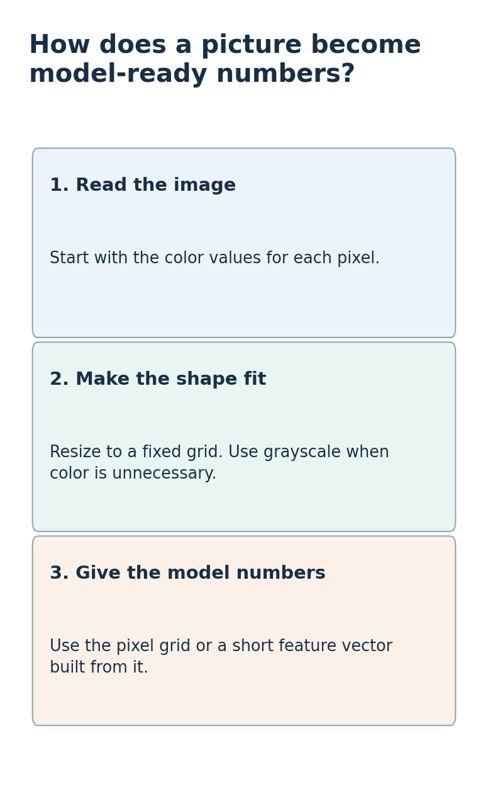

**👀 Read the visual.** Give the model an image shape it recognizes.

**👉 Use what you see.** If a new picture is larger, apply the same **resize** rule before predicting.

Create two tiny RGB images, resize and convert them to grayscale, then fit a model on the pixel vectors and predict a new image.

**▶️ Run.** Unzip the [lesson files](sample_code_folder/113-images-pixels-matrices.zip) and open a terminal in that folder. Install the lesson’s packages with `python -m pip install -r requirements.txt`, then run `python lesson.py`.

**🔹 Steps in the script**

1. Read the CSV and check its inputs, including red, green, blue.
2. Fit the model on the prepared training rows. Keep it for the checks below.
3. Apply the fitted model to the new CSV rows and print a result for each row.

**✅ Check.** Look for Image matrix becomes one row: (4, 16) in the output excerpt below.

```text
Image matrix becomes one row: (4, 16)
First normalized pixels: [0.059, 0.059, 0.059, 0.059]
New picture: ['light', 'dark', 'light']
```

**Your small change.** Edit the red, green, and blue numbers (0–255) in new_inputs.csv to predict dark or light. Save the named CSV before running again.


<a id="image-embeddings"></a>

###### 🧩 Image embeddings

| Lesson name | What you’ll do | Download |
| --- | --- | --- |
| 114 - Image embeddings **Practice** | Summarize a drawing with two numeric measurements and use them to predict its direction. | [Lesson ZIP](sample_code_folder/114-image-embeddings.zip) |

<!-- workbook-teaching:114:start -->
<details>
<summary>Learn, trace and apply this idea</summary>

### Learn and apply: Image embeddings

**Your decision.** Summarize a drawing with two numeric measurements and use them to predict its direction.

**Ready check.** Find lit cells in rows and columns of a grid. Use [the learning path](LEARNING-PATH.md) and [the word list](GLOSSARY.md) for the earlier skill. Trace the small example on paper before code.

**What it means.** A feature vector can summarize a picture without passing every pixel.

**Why and when.** Use hand-built measurements when they preserve the information the task needs, and compare their failures with alternatives.

**A worked example to follow.** A sideways bar has horizontal spread and little vertical spread. An upright bar reverses that pattern. The lesson gives those two spread values to a nearest-neighbour model.

**Input → steps → output.** Open the supplied table. Its fields are `direction`, `position`. One original row is shown below in that same field order; `(missing)` marks a blank rather than zero.

```text
Sideways | 1
```

1. Name the particular field or object involved in this lesson’s decision above. Keep its meaning and units with it.
2. Open the [complete runnable Python example](lessons/114-image-embeddings/lesson.py). Its numbered comments connect reading, preparation and the resulting calculation. Install only the [declared requirements](lessons/114-image-embeddings/requirements.txt) using the same course Python, as shown in Setup.
3. Trace the worked example above through the script. Keep inputs apart from measured answers. Follow this script’s split and fit, then trace the saved preparation into the held-back result and any new request. A request must not supply its own training answer.
4. Read the result by its headings. Compare with [full recorded output](lessons/114-image-embeddings/expected-output.txt); the excerpt below belongs to the original supplied files. Your edits can change it.

```text
 Vertical spread  Horizontal spread Label or prediction
            0.00               1.12            Sideways
            0.00               1.12            Sideways
            1.12               0.00             Upright
            1.12               0.00             Upright
            1.12               0.00 Upright (predicted)
```

**How to interpret it.** Trace the worked case into the result above. Tell a calculated estimate from a measured answer.

**Common mistakes and limits.** These hand-built features do not prove that a neural image encoder was trained. Two different images can share the same summary and become indistinguishable.

**Use it yourself.** Would these two spread values alone reliably distinguish a handwritten 6 from an 8? What test would reveal a weakness?

<details>
<summary>Check your choice and reason</summary>

Not necessarily. Find distinct drawings with similar spreads and compare their feature vectors and held-back predictions. A summary must be assessed for the actual task.

</details>

**A second check later.** Close the notes and explain the same decision using a different row from the supplied table. State one condition that would make this method unsuitable. If you cannot explain the reason, repeat the small worked example before adding more code.

</details>
<!-- workbook-teaching:114:end -->


**Before this lesson.** Draw a small grid. Each cell is a pixel value.

**In simple words.** Resize makes pictures the same size. Flatten puts the grid in a row. This KNN example compares pixel values; it does not train a CNN.

**Guess first.** Do flattening and resizing mean the same thing? Write your answer before running the example.

<details>
<summary>Read the reason after trying</summary>

No. Resizing changes the grid size. Flattening changes how its values are arranged.

</details>


**🎯 Goal.** Can two easy measurements describe a picture well enough to tell whether a bar is sideways or upright? A short list of numbers that represents a picture is an embedding.

**📋 Sample data**

| direction | position |
| --- | --- |
| Sideways | 1 |
| Sideways | 3 |
| Upright | 1 |
| Upright | 3 |

**▶️ Run.** Unzip the [lesson files](sample_code_folder/114-image-embeddings.zip) and open a terminal in that folder. Install the lesson’s packages with `python -m pip install -r requirements.txt`, then run `python lesson.py`.

**🔹 Steps in the script**

1. Read the CSV and check its inputs, including direction, position.
2. Read the new CSV rows, then apply the rules from the sample.
3. Fit the model on the prepared training rows. Keep it for the checks below.
4. Plot the values so you can see how they compare.

**✅ Check.** Look for Vertical spread  Horizontal spread Label or prediction in the output excerpt below.

```text
Vertical spread  Horizontal spread Label or prediction
0.00               1.12            Sideways
0.00               1.12            Sideways
```

**Your small change.** Try changing direction from Upright to Sideways in new_inputs.csv. Compare the new output. Save the named CSV before running again.


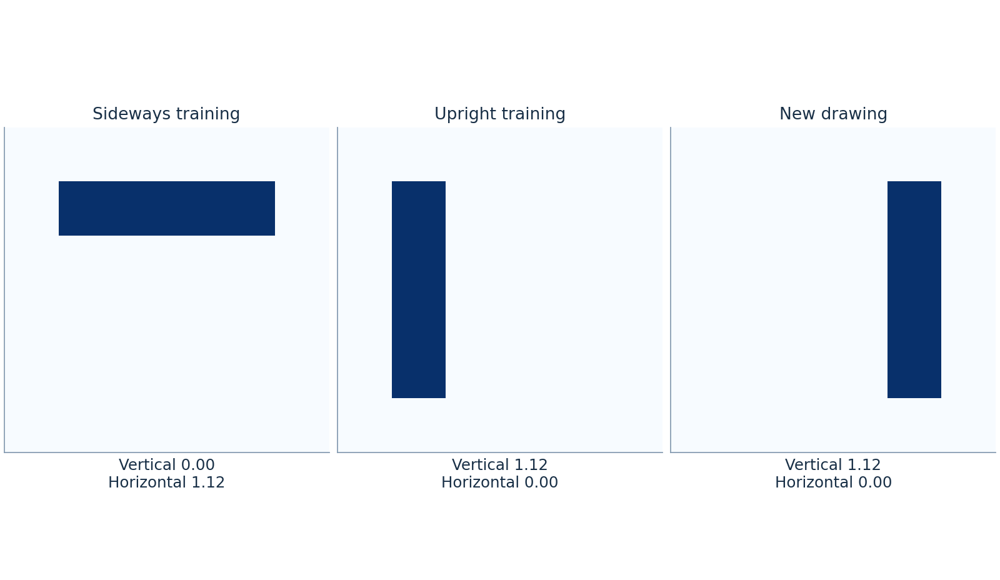

**👀 Read the visual.** A narrow upright line has vertical spread and no horizontal spread. The classifier receives these two numbers for the third drawing.

**👉 Use what you see.** Change the orientation of the new drawing and inspect its two numbers before reading the prediction.

A vertical bar spreads lit pixels across several rows. The first number is larger. The model receives the two numbers, then finds the training picture with the closest pair. This exercise uses two hand-picked measurements. A neural image encoder can learn its own measurements.

<a id="audio-waves-spectrograms"></a>

##### 🎧 Audio (Waves, Spectrograms)

| Lesson name | What you’ll do | Download |
| --- | --- | --- |
| 118 - Audio (Waves, Spectrograms) **Practice** | Create tones, inspect how their pitch looks in a plot, and classify them. | [Lesson ZIP](sample_code_folder/118-audio-waves-spectrograms.zip) |

<!-- workbook-teaching:118:start -->
<details>
<summary>Learn, trace and apply this idea</summary>

### Learn and apply: Audio (Waves, Spectrograms)

**Your decision.** Create tones, inspect how their pitch looks in a plot, and classify them.

**Ready check.** Read a time axis, a frequency in hertz, and a simple wave. Use [the learning path](LEARNING-PATH.md) and [the word list](GLOSSARY.md) for the earlier skill. Trace the small example on paper before code.

**What it means.** Audio samples record a changing signal. A spectrogram shows frequency content over time; MFCCs summarize a transformed frequency representation.

**Why and when.** Use a fixed sample rate and the same feature calculation when comparing recordings.

**A worked example to follow.** The script creates low and high tones, saves WAV, extracts frequency features and classifies pitch. A decoded MP3 is checked through the same feature function rather than treated as identical bytes.

**Input → steps → output.** Open the supplied table. Its fields are `frequency_hz`, `label`. One original row is shown below in that same field order; `(missing)` marks a blank rather than zero.

```text
260 | low
```

1. Name the particular field or object involved in this lesson’s decision above. Keep its meaning and units with it.
2. Open the [complete runnable Python example](lessons/118-audio-waves-spectrograms/lesson.py). Its numbered comments connect reading, preparation and the resulting calculation. Install only the [declared requirements](lessons/118-audio-waves-spectrograms/requirements.txt) using the same course Python, as shown in Setup.
3. Trace the worked example above through the script. Keep inputs apart from measured answers. Follow this script’s split and fit, then trace the saved preparation into the held-back result and any new request. A request must not supply its own training answer.
4. Read the result by its headings. Compare with [full recorded output](lessons/118-audio-waves-spectrograms/expected-output.txt); the excerpt below belongs to the original supplied files. Your edits can change it.

```text
One MFCC row: 8
New WAV sound: ['high']
Decoded MP3 sound: ['high']
285 low
920 high
```

**How to interpret it.** Trace the worked case into the result above. Tell a calculated estimate from a measured answer.

**Common mistakes and limits.** A tone classifier does not recognize speech. Compression and sample rate can change values. Extra FFmpeg/media dependencies must be available before running the audio tasks.

**Use it yourself.** Two recordings have different sample rates. May you compare their feature columns without checking how those columns were constructed?

<details>
<summary>Check your choice and reason</summary>

No. Decode and prepare a consistent sample rate, channels and frame procedure, then check feature shape and validation behavior. The same column position must retain the same meaning.

</details>

**A second check later.** Close the notes and explain the same decision using a different row from the supplied table. State one condition that would make this method unsuitable. If you cannot explain the reason, repeat the small worked example before adding more code.

</details>
<!-- workbook-teaching:118:end -->


**Before this lesson.** Finish the audio notes in Extra topics.

**In simple words.** A sound can be shown over time or by its frequencies. The example makes tones locally. A short feature list summarizes them before comparing them.

**Guess first.** Does a tone example prove the model recognizes everyday speech? Write your answer before running the example.

<details>
<summary>Read the reason after trying</summary>

No. Speech is a much harder and different task.

</details>


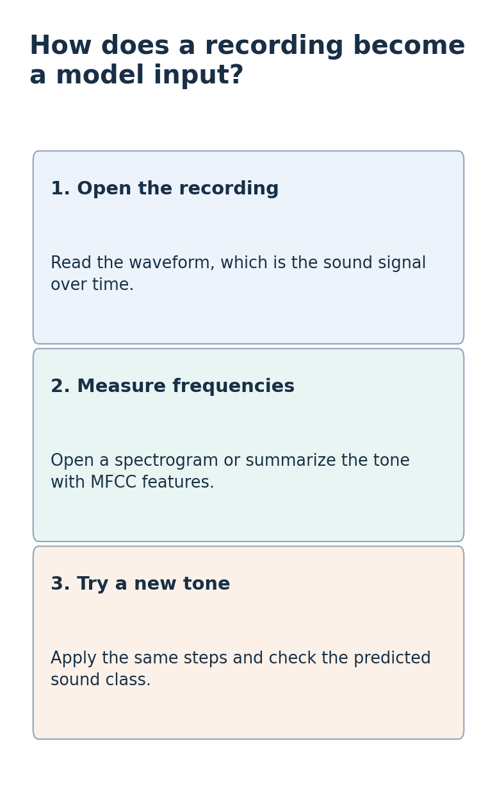

**👀 Read the visual.** Turn a practice recording into measurements the model can use.

**👉 Use what you see.** Try a higher pitch and look for a higher band in the spectrogram.

Create four WAV recordings of original tones. Convert each WAV into log-mel and MFCC features, train on the feature rows, and classify a new tone. The same feature extraction works after decoding an MP3 to the same sample rate.

**▶️ Run.** Unzip the [lesson files](sample_code_folder/118-audio-waves-spectrograms.zip) and open a terminal in that folder. Install the lesson’s packages with `python -m pip install -r requirements.txt`, then run `python lesson.py`.

**🔹 Steps in the script**

1. Build a short sound from a frequency in the CSV.
2. Read the tone frequencies. Each row describes one sound to make.
3. Fit the model on the prepared training rows. Keep it for the checks below.
4. Apply the fitted model to the new CSV rows and print a result for each row.

**✅ Check.** Look for One MFCC row: 8 in the output excerpt below.

```text
One MFCC row: 8
New WAV sound: ['high']
Decoded MP3 sound: ['high']
```

**Your small change.** Change the frequency in new_inputs.csv to a value around 280 or 900. The script creates real WAV audio from those numbers and checks an MP3 round trip. Save the named CSV before running again.


<a id="video-frames-sequences"></a>

##### 🎬 Video (Frames, Sequences)

| Lesson name | What you’ll do | Download |
| --- | --- | --- |
| 122 - Video (Frames, Sequences) **Practice** | Make a short video from frames and classify which way an object moves. | [Lesson ZIP](sample_code_folder/122-video-frames-sequences.zip) |

<!-- workbook-teaching:122:start -->
<details>
<summary>Learn, trace and apply this idea</summary>

### Learn and apply: Video (Frames, Sequences)

**Your decision.** Make a short video from frames and classify which way an object moves.

**Ready check.** Complete pixel and small-network bridges; read an array shape. Use [the learning path](LEARNING-PATH.md) and [the word list](GLOSSARY.md) for the earlier skill. Trace the small example on paper before code.

**What it means.** A video is an ordered sequence of frames. Frame features describe pictures; a sequence model can use their order.

**Why and when.** Use a temporal model when motion or order matters rather than a single still image.

**A worked example to follow.** The moving dot appears at the same four columns in opposite time orders. A small CNN reads frames, and an LSTM reads the resulting sequence. The script also decodes an MP4 before prediction.

**Input → steps → output.** Open the supplied table. Its fields are `direction`, `row`. One original row is shown below in that same field order; `(missing)` marks a blank rather than zero.

```text
0 | 1
```

1. Name the particular field or object involved in this lesson’s decision above. Keep its meaning and units with it.
2. Open the [complete runnable Python example](lessons/122-video-frames-sequences/lesson.py). Its numbered comments connect reading, preparation and the resulting calculation. Install only the [declared requirements](lessons/122-video-frames-sequences/requirements.txt) using the same course Python, as shown in Setup.
3. Trace the worked example above through the script. Keep inputs apart from measured answers. Follow this script’s split and fit, then trace the saved preparation into the held-back result and any new request. A request must not supply its own training answer.
4. Read the result by its headings. Compare with [full recorded output](lessons/122-video-frames-sequences/expected-output.txt); the excerpt below belongs to the original supplied files. Your edits can change it.

```text
Clips × frames × channels × height × width: (8, 4, 1, 6, 6)
Decoded MP4 direction: [1]
Directions for all new clips: [1, 0]
```

**How to interpret it.** Trace the worked case into the result above. Tell a calculated estimate from a measured answer.

**Common mistakes and limits.** Keep frames from one source clip in the same evaluation group. Toy dot motion is not evidence for reliable recognition in real videos.

**Use it yourself.** If you reverse all frames of a right-moving dot, what changes? Could random frame splitting exaggerate performance?

<details>
<summary>Check your choice and reason</summary>

The direction reverses although the set of frames is unchanged. Splitting related frames can leak clip information; split by independent source clip or recording session as needed.

</details>

**A second check later.** Close the notes and explain the same decision using a different row from the supplied table. State one condition that would make this method unsuitable. If you cannot explain the reason, repeat the small worked example before adding more code.

</details>
<!-- workbook-teaching:122:end -->


**Before this lesson.** Understand one image, array shapes and basic network training.

**In simple words.** A video is a sequence of frames. The order matters for motion. The extra lesson uses a network to read each frame and another to read the sequence.

**Guess first.** Can reversing the same frames change the motion? Write your answer before running the example.

<details>
<summary>Read the reason after trying</summary>

Yes. Keep frames from a source clip together when checking a model.

</details>


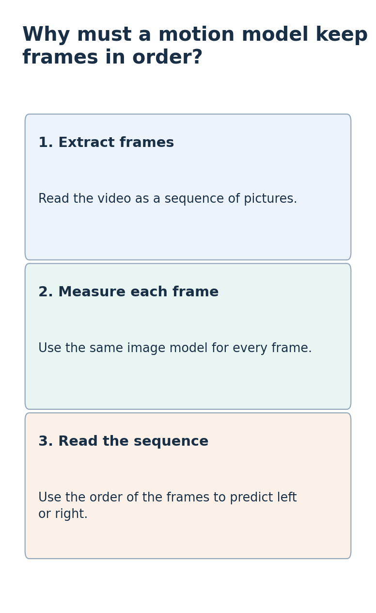

**👀 Read the visual.** Keep the pictures in time order so movement stays visible.

**👉 Use what you see.** Check frame order when direction matters. A picture shows position and the sequence shows movement.

Create small moving-dot clips. Use a convolution to extract frame features and an LSTM to classify movement direction from ordered frames. The vectors shown come from the original frame sequence.

**▶️ Run.** Unzip the [lesson files](sample_code_folder/122-video-frames-sequences.zip) and open a terminal in that folder. Install the lesson’s packages with `python -m pip install -r requirements.txt`, then run `python lesson.py`.

**🔹 Steps in the script**

1. Build a short sequence of frames showing one direction of travel.
2. Read the CSV and check its inputs, including direction, row.
3. Apply the fitted model to the new CSV rows and print a result for each row.

**✅ Check.** Look for Clips × frames × channels × height × width: (8, 4, 1, 6, 6) in the output excerpt below.

```text
Clips × frames × channels × height × width: (8, 4, 1, 6, 6)
Decoded MP4 direction: [1]
Directions for all new clips: [1, 0]
```

**Your small change.** Try changing direction from 1 to 0 in new_inputs.csv. Compare the new output. Save the named CSV before running again.


**💡 Takeaway.** Keep all frames from a source clip in the same split. When using MP4, decode frames in order and choose a frame interval before creating the tensor.

<a id="data"></a>

#### ℹ️ Data

| Lesson name | What you’ll do | Download |
| --- | --- | --- |
| 131 - Data **Practice** | Use original sensor readings to see how a numeric transformation changes model inputs. | [Lesson ZIP](sample_code_folder/131-data.zip) |

<!-- workbook-teaching:131:start -->
<details>
<summary>Learn, trace and apply this idea</summary>

### Learn and apply: Data

**Your decision.** Use original sensor readings to see how a numeric transformation changes model inputs.

**Ready check.** Read a minimum, maximum, average and spread. Use [the learning path](LEARNING-PATH.md) and [the word list](GLOSSARY.md) for the earlier skill. Trace the small example on paper before code.

**What it means.** Scaling changes the numbers passed to a model, using a rule fitted on training values.

**Why and when.** Use it when input units affect distances or penalties. Compare with unchanged inputs; trees often do not need ordinary linear scaling.

**A worked example to follow.** Min-max uses (value − training minimum) ÷ training range. With limits 1 and 50 km, 90 km becomes 89 ÷ 49, about 1.8163. Standard scaling subtracts the training mean and divides by its standard deviation. Robust scaling uses the training median and IQR.

**Input → steps → output.** Open the supplied table. Its fields are `signal`, `cost`. One original row is shown below in that same field order; `(missing)` marks a blank rather than zero.

```text
1 | 10
```

1. Name the particular field or object involved in this lesson’s decision above. Keep its meaning and units with it.
2. Open the [complete runnable Python example](lessons/131-data/lesson.py). Its numbered comments connect reading, preparation and the resulting calculation. Install only the [declared requirements](lessons/131-data/requirements.txt) using the same course Python, as shown in Setup.
3. Trace the worked example above through the script. Keep inputs apart from measured answers. Follow this script’s split and fit, then trace the saved preparation into the held-back result and any new request. A request must not supply its own training answer.
4. Read the result by its headings. Compare with [full recorded output](lessons/131-data/expected-output.txt); the excerpt below belongs to the original supplied files. Your edits can change it.

```text
Min-Max Scaling first two training rows: [[0.0], [0.03]]
Actual costs: [23, 48]
Predicted costs: [23.9, 37.7]
 signal  predicted_cost
      3           21.69
     15           25.40
```

**How to interpret it.** Trace the worked case into the result above. Tell a calculated estimate from a measured answer.

**Common mistakes and limits.** New values can fall outside a fitted 0–1 range. Do not refit on each request. Scaling is not a guarantee of better predictions or a way to make a distribution normal.

**Use it yourself.** The fitted range is 1–50 km. What does 25 km become? Does an out-of-range number automatically mean an invalid measurement?

<details>
<summary>Check your choice and reason</summary>

25 becomes 24 ÷ 49, about 0.4898. An out-of-range number may be physically possible but outside the evidence for a service. Keep the fitted rule and apply a stated acceptance/fallback policy.

</details>

**A second check later.** Close the notes and explain the same decision using a different row from the supplied table. State one condition that would make this method unsuitable. If you cannot explain the reason, repeat the small worked example before adding more code.

</details>
<!-- workbook-teaching:131:end -->


**Before this lesson.** Understand scaling, a baseline and validation.

**In simple words.** Use a transformation only for a stated reason. Compare it with unchanged inputs on the same validation rows. Learn every data-based rule inside training.

**Guess first.** Must all eight transformations be applied? Write your answer before running the example.

<details>
<summary>Read the reason after trying</summary>

No. Start simple. Compare a suitable candidate and keep separate final test rows.

</details>


These eight transformations use only original measurements. Fit each transformation on training rows and keep the same fitted object for later predictions.

<a id="min-max-scaling-normalization"></a>

##### 📘 1️⃣ Min-Max Scaling (Normalization)

| Lesson name | What you’ll do | Download |
| --- | --- | --- |
| 132 - Min-Max Scaling (Normalization) **Practice** | Rescale the sensor training range to 0–1 and predict the costs of new readings. | [Lesson ZIP](sample_code_folder/132-min-max-scaling-normalization.zip) |

<!-- workbook-teaching:132:start -->
<details>
<summary>Learn, trace and apply this idea</summary>

### Learn and apply: Min-Max Scaling (Normalization)

**Your decision.** Rescale the sensor training range to 0–1 and predict the costs of new readings.

**Ready check.** Read a minimum, maximum, average and spread. Use [the learning path](LEARNING-PATH.md) and [the word list](GLOSSARY.md) for the earlier skill. Trace the small example on paper before code.

**What it means.** Scaling changes the numbers passed to a model, using a rule fitted on training values.

**Why and when.** Use it when input units affect distances or penalties. Compare with unchanged inputs; trees often do not need ordinary linear scaling.

**A worked example to follow.** Min-max uses (value − training minimum) ÷ training range. With limits 1 and 50 km, 90 km becomes 89 ÷ 49, about 1.8163. Standard scaling subtracts the training mean and divides by its standard deviation. Robust scaling uses the training median and IQR.

**Input → steps → output.** Open the supplied table. Its fields are `signal`, `cost`. One original row is shown below in that same field order; `(missing)` marks a blank rather than zero.

```text
1 | 10
```

1. Name the particular field or object involved in this lesson’s decision above. Keep its meaning and units with it.
2. Open the [complete runnable Python example](lessons/132-min-max-scaling-normalization/lesson.py). Its numbered comments connect reading, preparation and the resulting calculation. Install only the [declared requirements](lessons/132-min-max-scaling-normalization/requirements.txt) using the same course Python, as shown in Setup.
3. Trace the worked example above through the script. Keep inputs apart from measured answers. Follow this script’s split and fit, then trace the saved preparation into the held-back result and any new request. A request must not supply its own training answer.
4. Read the result by its headings. Compare with [full recorded output](lessons/132-min-max-scaling-normalization/expected-output.txt); the excerpt below belongs to the original supplied files. Your edits can change it.

```text
Min-Max Scaling first two training rows: [[0.0], [0.03]]
Actual costs: [23, 48]
Predicted costs: [23.9, 37.7]
 signal  predicted_cost
      3           21.69
     15           25.40
```

**How to interpret it.** Trace the worked case into the result above. Tell a calculated estimate from a measured answer.

**Common mistakes and limits.** New values can fall outside a fitted 0–1 range. Do not refit on each request. Scaling is not a guarantee of better predictions or a way to make a distribution normal.

**Use it yourself.** The fitted range is 1–50 km. What does 25 km become? Does an out-of-range number automatically mean an invalid measurement?

<details>
<summary>Check your choice and reason</summary>

25 becomes 24 ÷ 49, about 0.4898. An out-of-range number may be physically possible but outside the evidence for a service. Keep the fitted rule and apply a stated acceptance/fallback policy.

</details>

**A second check later.** Close the notes and explain the same decision using a different row from the supplied table. State one condition that would make this method unsuitable. If you cannot explain the reason, repeat the small worked example before adding more code.

</details>
<!-- workbook-teaching:132:end -->


**Before this lesson.** Understand scaling, a baseline and validation.

**In simple words.** Use a transformation only for a stated reason. Compare it with unchanged inputs on the same validation rows. Learn every data-based rule inside training.

**Guess first.** Must all eight transformations be applied? Write your answer before running the example.

<details>
<summary>Read the reason after trying</summary>

No. Start simple. Compare a suitable candidate and keep separate final test rows.

</details>


**🎯 Goal.** How much might a new reading cost? Signal is the input. Cost is the known answer. Change the signal first, then give the model that changed number.

**📋 Sample data**

| signal | cost |
| --- | --- |
| 1 | 10 |
| 5 | 18 |
| 12 | 25 |
| 20 | 31 |
| 35 | 41 |
| 80 | 53 |
| 160 | 64 |
| 10 | 23 |

Showing the first 8 of 9 rows. The CSV has the full sample.

**▶️ Run.** Unzip the [lesson files](sample_code_folder/132-min-max-scaling-normalization.zip) and open a terminal in that folder. Install the lesson’s packages with `python -m pip install -r requirements.txt`, then run `python lesson.py`.

**🔹 Steps in the script**

1. Read the sensor readings and their measured costs.
2. Set aside the check rows before the model learns.
3. Teach the model from the training inputs and the recorded cost.
4. Apply the fitted model to the new CSV rows and print a result for each row.

**✅ Check.** Look for Min-Max Scaling first two training rows: [[0.0], [0.03]] in the output excerpt below.

```text
Min-Max Scaling first two training rows: [[0.0], [0.03]]
Actual costs: [23, 48]
Predicted costs: [23.9, 37.7]
```

**Your small change.** Try a signal reading of 3, 15, or 40 in new_inputs.csv. Compare the predicted cost for each row. Save the named CSV before running again.


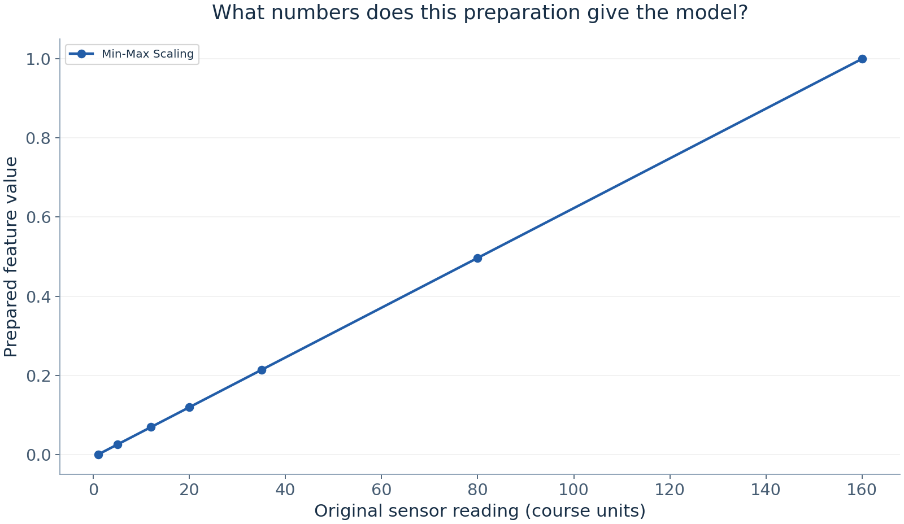

**👀 Read the visual.** Each dot connects one original measurement to the value used by the model.

**👉 Use what you see.** Use the first and last dots to check how the training extremes map to 0 and 1.

**💡 Takeaway.** Compute `(x - train_min) / (train_max - train_min)` on nonconstant features. The PDF’s `[20, 30, 50, 80, 100]` becomes `[0, .125, .375, .75, 1]`. A bounded training range can help some neural-network inputs. For −1 to 1, change `feature_range`.

<a id="z-score-standardization-standardization"></a>

##### 📘 2️⃣ Z-Score Standardization (Standardization)

| Lesson name | What you’ll do | Download |
| --- | --- | --- |
| 135 - Z-Score Standardization (Standardization) **Practice** | Measure sensor readings in standard deviations from the training average. | [Lesson ZIP](sample_code_folder/135-z-score-standardization-standardization.zip) |

<!-- workbook-teaching:135:start -->
<details>
<summary>Learn, trace and apply this idea</summary>

### Learn and apply: Z-Score Standardization (Standardization)

**Your decision.** Measure sensor readings in standard deviations from the training average.

**Ready check.** Read a minimum, maximum, average and spread. Use [the learning path](LEARNING-PATH.md) and [the word list](GLOSSARY.md) for the earlier skill. Trace the small example on paper before code.

**What it means.** Scaling changes the numbers passed to a model, using a rule fitted on training values.

**Why and when.** Use it when input units affect distances or penalties. Compare with unchanged inputs; trees often do not need ordinary linear scaling.

**A worked example to follow.** Min-max uses (value − training minimum) ÷ training range. With limits 1 and 50 km, 90 km becomes 89 ÷ 49, about 1.8163. Standard scaling subtracts the training mean and divides by its standard deviation. Robust scaling uses the training median and IQR.

**Input → steps → output.** Open the supplied table. Its fields are `signal`, `cost`. One original row is shown below in that same field order; `(missing)` marks a blank rather than zero.

```text
1 | 10
```

1. Name the particular field or object involved in this lesson’s decision above. Keep its meaning and units with it.
2. Open the [complete runnable Python example](lessons/135-z-score-standardization-standardization/lesson.py). Its numbered comments connect reading, preparation and the resulting calculation. Install only the [declared requirements](lessons/135-z-score-standardization-standardization/requirements.txt) using the same course Python, as shown in Setup.
3. Trace the worked example above through the script. Keep inputs apart from measured answers. Follow this script’s split and fit, then trace the saved preparation into the held-back result and any new request. A request must not supply its own training answer.
4. Read the result by its headings. Compare with [full recorded output](lessons/135-z-score-standardization-standardization/expected-output.txt); the excerpt below belongs to the original supplied files. Your edits can change it.

```text
Z-Score Standardization first two training rows: [[-0.82], [-0.75]]
Actual costs: [23, 48]
Predicted costs: [23.9, 37.7]
 signal  predicted_cost
      3           21.69
     15           25.40
```

**How to interpret it.** Trace the worked case into the result above. Tell a calculated estimate from a measured answer.

**Common mistakes and limits.** New values can fall outside a fitted 0–1 range. Do not refit on each request. Scaling is not a guarantee of better predictions or a way to make a distribution normal.

**Use it yourself.** The fitted range is 1–50 km. What does 25 km become? Does an out-of-range number automatically mean an invalid measurement?

<details>
<summary>Check your choice and reason</summary>

25 becomes 24 ÷ 49, about 0.4898. An out-of-range number may be physically possible but outside the evidence for a service. Keep the fitted rule and apply a stated acceptance/fallback policy.

</details>

**A second check later.** Close the notes and explain the same decision using a different row from the supplied table. State one condition that would make this method unsuitable. If you cannot explain the reason, repeat the small worked example before adding more code.

</details>
<!-- workbook-teaching:135:end -->


**Before this lesson.** Understand scaling, a baseline and validation.

**In simple words.** Use a transformation only for a stated reason. Compare it with unchanged inputs on the same validation rows. Learn every data-based rule inside training.

**Guess first.** Must all eight transformations be applied? Write your answer before running the example.

<details>
<summary>Read the reason after trying</summary>

No. Start simple. Compare a suitable candidate and keep separate final test rows.

</details>


**🎯 Goal.** How much might a new reading cost? Signal is the input. Cost is the known answer. Change the signal first, then give the model that changed number.

**📋 Sample data**

| signal | cost |
| --- | --- |
| 1 | 10 |
| 5 | 18 |
| 12 | 25 |
| 20 | 31 |
| 35 | 41 |
| 80 | 53 |
| 160 | 64 |
| 10 | 23 |

Showing the first 8 of 9 rows. The CSV has the full sample.

**▶️ Run.** Unzip the [lesson files](sample_code_folder/135-z-score-standardization-standardization.zip) and open a terminal in that folder. Install the lesson’s packages with `python -m pip install -r requirements.txt`, then run `python lesson.py`.

**🔹 Steps in the script**

1. Read the sensor readings and their measured costs.
2. Set aside the check rows before the model learns.
3. Teach the model from the training inputs and the recorded cost.
4. Apply the fitted model to the new CSV rows and print a result for each row.

**✅ Check.** Look for Z-Score Standardization first two training rows: [[-0.82], [-0.75]] in the output excerpt below.

```text
Z-Score Standardization first two training rows: [[-0.82], [-0.75]]
Actual costs: [23, 48]
Predicted costs: [23.9, 37.7]
```

**Your small change.** Try a signal reading of 3, 15, or 40 in new_inputs.csv. Compare the predicted cost for each row. Save the named CSV before running again.


**👀 Read the visual.** Each dot connects one original measurement to the value used by the model.

**👉 Use what you see.** Find where the curve crosses zero. Readings on that side of the training average change sign.

**💡 Takeaway.** Standardization subtracts the training mean and divides by the training standard deviation. Practice: `(70 - 50) / 10 = 2`.

<a id="log-transformation-log-scaling"></a>

##### 📘 3️⃣ Log Transformation (Log Scaling)

| Lesson name | What you’ll do | Download |
| --- | --- | --- |
| 136 - Log Transformation (Log Scaling) **Practice** | Use a log so large sensor readings have less influence on the scale. | [Lesson ZIP](sample_code_folder/136-log-transformation-log-scaling.zip) |

<!-- workbook-teaching:136:start -->
<details>
<summary>Learn, trace and apply this idea</summary>

### Learn and apply: Log Transformation (Log Scaling)

**Your decision.** Use a log so large sensor readings have less influence on the scale.

**Ready check.** Compare 10, 100 and 1000 and explain a zero. Use [the learning path](LEARNING-PATH.md) and [the word list](GLOSSARY.md) for the earlier skill. Trace the small example on paper before code.

**What it means.** A logarithm compresses large positive gaps; log1p applies natural log to 1 + value.

**Why and when.** Try a log for a skewed measurement or a multiplicative relationship, then compare validation results with unchanged input.

**A worked example to follow.** Base-10 log maps 1, 10, 100, 1000 to 0, 1, 2, 3. log1p keeps zero valid and uses a different base. The lesson trains on the transformed signal and predicts cost in its original unit.

**Input → steps → output.** Open the supplied table. Its fields are `signal`, `cost`. One original row is shown below in that same field order; `(missing)` marks a blank rather than zero.

```text
1 | 10
```

1. Name the particular field or object involved in this lesson’s decision above. Keep its meaning and units with it.
2. Open the [complete runnable Python example](lessons/136-log-transformation-log-scaling/lesson.py). Its numbered comments connect reading, preparation and the resulting calculation. Install only the [declared requirements](lessons/136-log-transformation-log-scaling/requirements.txt) using the same course Python, as shown in Setup.
3. Trace the worked example above through the script. Keep inputs apart from measured answers. Follow this script’s split and fit, then trace the saved preparation into the held-back result and any new request. A request must not supply its own training answer.
4. Read the result by its headings. Compare with [full recorded output](lessons/136-log-transformation-log-scaling/expected-output.txt); the excerpt below belongs to the original supplied files. Your edits can change it.

```text
Log Transformation first two training rows: [[0.69], [1.79]]
Actual costs: [23, 48]
Predicted costs: [26.7, 47.2]
 signal  predicted_cost
      3           13.94
     15           31.43
```

**How to interpret it.** Trace the worked case into the result above. Tell a calculated estimate from a measured answer.

**Common mistakes and limits.** Scientific notation is only a display choice. A log actually changes the numeric feature. Check the domain; logging negative values can fail, and a target log needs its inverse before interpreting predictions.

**Use it yourself.** Does writing 1000 as 1e3 make it a log feature? What happens to zero under log10 and log1p?

<details>
<summary>Check your choice and reason</summary>

1e3 is still 1000. log10(0) is not finite, while log1p(0) is 0. Choose a justified valid transformation and reuse it consistently.

</details>

**A second check later.** Close the notes and explain the same decision using a different row from the supplied table. State one condition that would make this method unsuitable. If you cannot explain the reason, repeat the small worked example before adding more code.

</details>
<!-- workbook-teaching:136:end -->


**Before this lesson.** Understand scaling, a baseline and validation.

**In simple words.** Use a transformation only for a stated reason. Compare it with unchanged inputs on the same validation rows. Learn every data-based rule inside training.

**Guess first.** Must all eight transformations be applied? Write your answer before running the example.

<details>
<summary>Read the reason after trying</summary>

No. Start simple. Compare a suitable candidate and keep separate final test rows.

</details>


**🎯 Goal.** How much might a new reading cost? Signal is the input. Cost is the known answer. Change the signal first, then give the model that changed number.

**📋 Sample data**

| signal | cost |
| --- | --- |
| 1 | 10 |
| 5 | 18 |
| 12 | 25 |
| 20 | 31 |
| 35 | 41 |
| 80 | 53 |
| 160 | 64 |
| 10 | 23 |

Showing the first 8 of 9 rows. The CSV has the full sample.

**▶️ Run.** Unzip the [lesson files](sample_code_folder/136-log-transformation-log-scaling.zip) and open a terminal in that folder. Install the lesson’s packages with `python -m pip install -r requirements.txt`, then run `python lesson.py`.

**🔹 Steps in the script**

1. Read the sensor readings and their measured costs.
2. Set aside the check rows before the model learns.
3. Teach the model from the training inputs and the recorded cost.
4. Apply the fitted model to the new CSV rows and print a result for each row.

**✅ Check.** Look for Log Transformation first two training rows: [[0.69], [1.79]] in the output excerpt below.

```text
Log Transformation first two training rows: [[0.69], [1.79]]
Actual costs: [23, 48]
Predicted costs: [26.7, 47.2]
```

**Your small change.** Try a signal reading of 3, 15, or 40 in new_inputs.csv. Compare the predicted cost for each row. Save the named CSV before running again.


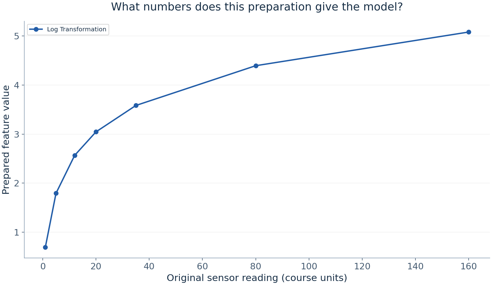

**👀 Read the visual.** Each dot connects one original measurement to the value used by the model.

**👉 Use what you see.** Compare the vertical gaps at the low and high ends. A log gives later increases in the raw reading less space on the transformed scale.

**💡 Takeaway.** For the PDF’s numeric example, `log10([1, 10, 100, 1000])` gives `[0, 1, 2, 3]`. To use `log10(1 + x)`, the inputs for those outputs are `[0, 9, 99, 999]`. This pipeline uses natural log with `log1p`.

<a id="robust-scaling-median-iqr-scaling"></a>

##### 📘 4️⃣ Robust Scaling (Median & IQR Scaling)

| Lesson name | What you’ll do | Download |
| --- | --- | --- |
| 138 - Robust Scaling (Median & IQR Scaling) **Practice** | Scale readings using the middle value and the spread of the middle half. | [Lesson ZIP](sample_code_folder/138-robust-scaling-median-iqr-scaling.zip) |

<!-- workbook-teaching:138:start -->
<details>
<summary>Learn, trace and apply this idea</summary>

### Learn and apply: Robust Scaling (Median & IQR Scaling)

**Your decision.** Scale readings using the middle value and the spread of the middle half.

**Ready check.** Read a minimum, maximum, average and spread. Use [the learning path](LEARNING-PATH.md) and [the word list](GLOSSARY.md) for the earlier skill. Trace the small example on paper before code.

**What it means.** Scaling changes the numbers passed to a model, using a rule fitted on training values.

**Why and when.** Use it when input units affect distances or penalties. Compare with unchanged inputs; trees often do not need ordinary linear scaling.

**A worked example to follow.** Min-max uses (value − training minimum) ÷ training range. With limits 1 and 50 km, 90 km becomes 89 ÷ 49, about 1.8163. Standard scaling subtracts the training mean and divides by its standard deviation. Robust scaling uses the training median and IQR.

**Input → steps → output.** Open the supplied table. Its fields are `signal`, `cost`. One original row is shown below in that same field order; `(missing)` marks a blank rather than zero.

```text
1 | 10
```

1. Name the particular field or object involved in this lesson’s decision above. Keep its meaning and units with it.
2. Open the [complete runnable Python example](lessons/138-robust-scaling-median-iqr-scaling/lesson.py). Its numbered comments connect reading, preparation and the resulting calculation. Install only the [declared requirements](lessons/138-robust-scaling-median-iqr-scaling/requirements.txt) using the same course Python, as shown in Setup.
3. Trace the worked example above through the script. Keep inputs apart from measured answers. Follow this script’s split and fit, then trace the saved preparation into the held-back result and any new request. A request must not supply its own training answer.
4. Read the result by its headings. Compare with [full recorded output](lessons/138-robust-scaling-median-iqr-scaling/expected-output.txt); the excerpt below belongs to the original supplied files. Your edits can change it.

```text
Robust Scaling first two training rows: [[-0.39], [-0.31]]
Actual costs: [23, 48]
Predicted costs: [23.9, 37.7]
 signal  predicted_cost
      3           21.69
     15           25.40
```

**How to interpret it.** Trace the worked case into the result above. Tell a calculated estimate from a measured answer.

**Common mistakes and limits.** New values can fall outside a fitted 0–1 range. Do not refit on each request. Scaling is not a guarantee of better predictions or a way to make a distribution normal.

**Use it yourself.** The fitted range is 1–50 km. What does 25 km become? Does an out-of-range number automatically mean an invalid measurement?

<details>
<summary>Check your choice and reason</summary>

25 becomes 24 ÷ 49, about 0.4898. An out-of-range number may be physically possible but outside the evidence for a service. Keep the fitted rule and apply a stated acceptance/fallback policy.

</details>

**A second check later.** Close the notes and explain the same decision using a different row from the supplied table. State one condition that would make this method unsuitable. If you cannot explain the reason, repeat the small worked example before adding more code.

</details>
<!-- workbook-teaching:138:end -->


**Before this lesson.** Understand scaling, a baseline and validation.

**In simple words.** Use a transformation only for a stated reason. Compare it with unchanged inputs on the same validation rows. Learn every data-based rule inside training.

**Guess first.** Must all eight transformations be applied? Write your answer before running the example.

<details>
<summary>Read the reason after trying</summary>

No. Start simple. Compare a suitable candidate and keep separate final test rows.

</details>


**🎯 Goal.** How much might a new reading cost? Signal is the input. Cost is the known answer. Change the signal first, then give the model that changed number.

**📋 Sample data**

| signal | cost |
| --- | --- |
| 1 | 10 |
| 5 | 18 |
| 12 | 25 |
| 20 | 31 |
| 35 | 41 |
| 80 | 53 |
| 160 | 64 |
| 10 | 23 |

Showing the first 8 of 9 rows. The CSV has the full sample.

**▶️ Run.** Unzip the [lesson files](sample_code_folder/138-robust-scaling-median-iqr-scaling.zip) and open a terminal in that folder. Install the lesson’s packages with `python -m pip install -r requirements.txt`, then run `python lesson.py`.

**🔹 Steps in the script**

1. Read the sensor readings and their measured costs.
2. Set aside the check rows before the model learns.
3. Teach the model from the training inputs and the recorded cost.
4. Apply the fitted model to the new CSV rows and print a result for each row.

**✅ Check.** Look for Robust Scaling first two training rows: [[-0.39], [-0.31]] in the output excerpt below.

```text
Robust Scaling first two training rows: [[-0.39], [-0.31]]
Actual costs: [23, 48]
Predicted costs: [23.9, 37.7]
```

**Your small change.** Try a signal reading of 3, 15, or 40 in new_inputs.csv. Compare the predicted cost for each row. Save the named CSV before running again.


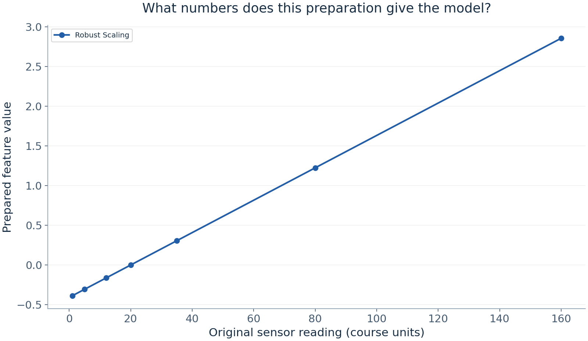

**👀 Read the visual.** Each dot connects one original measurement to the value used by the model.

**👉 Use what you see.** Find the training median near zero, then inspect how far the largest reading sits from it.

**💡 Takeaway.** The transform is `(x - median) / IQR`. Try the PDF’s `[10, 15, 20, 1000]` and compare the robust and z-score values for the first three inputs. An extreme can still affect the IQR in tiny samples.

<a id="power-transformations-box-cox-yeo-johnson"></a>

##### 📘 5️⃣ Power Transformations (Box-Cox & Yeo-Johnson)

| Lesson name | What you’ll do | Download |
| --- | --- | --- |
| 139 - Power Transformations (Box-Cox & Yeo-Johnson) **Practice** | Try two power transformations on the same readings and compare the cost predictions. | [Lesson ZIP](sample_code_folder/139-power-transformations-box-cox-yeo-johnson.zip) |

<!-- workbook-teaching:139:start -->
<details>
<summary>Learn, trace and apply this idea</summary>

### Learn and apply: Power Transformations (Box-Cox & Yeo-Johnson)

**Your decision.** Try two power transformations on the same readings and compare the cost predictions.

**Ready check.** Read a graph and distinguish zero from a positive value. Use [the learning path](LEARNING-PATH.md) and [the word list](GLOSSARY.md) for the earlier skill. Trace the small example on paper before code.

**What it means.** Power transformations reshape numerical gaps using parameters learned from training data.

**Why and when.** Try them when a skewed feature or model assumptions suggest a reason, and compare validation evidence.

**A worked example to follow.** Box–Cox requires strictly positive values. Yeo–Johnson accepts zero and negative values. The fitted transformation is reused for new signal readings before the cost model.

**Input → steps → output.** Open the supplied table. Its fields are `signal`, `cost`. One original row is shown below in that same field order; `(missing)` marks a blank rather than zero.

```text
1 | 10
```

1. Name the particular field or object involved in this lesson’s decision above. Keep its meaning and units with it.
2. Open the [complete runnable Python example](lessons/139-power-transformations-box-cox-yeo-johnson/lesson.py). Its numbered comments connect reading, preparation and the resulting calculation. Install only the [declared requirements](lessons/139-power-transformations-box-cox-yeo-johnson/requirements.txt) using the same course Python, as shown in Setup.
3. Trace the worked example above through the script. Keep inputs apart from measured answers. Follow this script’s split and fit, then trace the saved preparation into the held-back result and any new request. A request must not supply its own training answer.
4. Read the result by its headings. Compare with [full recorded output](lessons/139-power-transformations-box-cox-yeo-johnson/expected-output.txt); the excerpt below belongs to the original supplied files. Your edits can change it.

```text
Box-Cox first two training rows: [[-1.64], [-0.85]]
Actual costs: [23, 48]
Predicted costs: [26.5, 46.6]
 signal  predicted_cost
      3           14.76
     15           30.88
```

**How to interpret it.** Trace the worked case into the result above. Tell a calculated estimate from a measured answer.

**Common mistakes and limits.** A more symmetric-looking histogram is not proof of better predictions. Fit parameters within training, and do not shift inputs arbitrarily merely to make a command run.

**Use it yourself.** A feature contains −4, 0 and 14. Which of these two methods can accept it directly?

<details>
<summary>Check your choice and reason</summary>

Yeo–Johnson. Box–Cox cannot directly accept its nonpositive entries. Suitability and validation still decide whether transforming is useful.

</details>

**A second check later.** Close the notes and explain the same decision using a different row from the supplied table. State one condition that would make this method unsuitable. If you cannot explain the reason, repeat the small worked example before adding more code.

</details>
<!-- workbook-teaching:139:end -->


**Before this lesson.** Understand scaling, a baseline and validation.

**In simple words.** Use a transformation only for a stated reason. Compare it with unchanged inputs on the same validation rows. Learn every data-based rule inside training.

**Guess first.** Must all eight transformations be applied? Write your answer before running the example.

<details>
<summary>Read the reason after trying</summary>

No. Start simple. Compare a suitable candidate and keep separate final test rows.

</details>


**🎯 Goal.** How much might a new reading cost? Signal is the input. Cost is the known answer. Change the signal first, then give the model that changed number.

**📋 Sample data**

| signal | cost |
| --- | --- |
| 1 | 10 |
| 5 | 18 |
| 12 | 25 |
| 20 | 31 |
| 35 | 41 |
| 80 | 53 |
| 160 | 64 |
| 10 | 23 |

Showing the first 8 of 9 rows. The CSV has the full sample.

**▶️ Run.** Unzip the [lesson files](sample_code_folder/139-power-transformations-box-cox-yeo-johnson.zip) and open a terminal in that folder. Install the lesson’s packages with `python -m pip install -r requirements.txt`, then run `python lesson.py`.

**🔹 Steps in the script**

1. Read the sensor readings and their measured costs.
2. Set aside the check rows before the model learns.
3. Read the new CSV rows, then apply the rules from the sample.
4. Give each method the same practice data so you can compare the results.

**✅ Check.** Look for Box-Cox first two training rows: [[-1.64], [-0.85]] in the output excerpt below.

```text
Box-Cox first two training rows: [[-1.64], [-0.85]]
Actual costs: [23, 48]
Predicted costs: [26.5, 46.6]
```

**Your small change.** Try a signal reading of 3, 15, or 40 in new_inputs.csv. Compare the predicted cost for each row. Save the named CSV before running again.


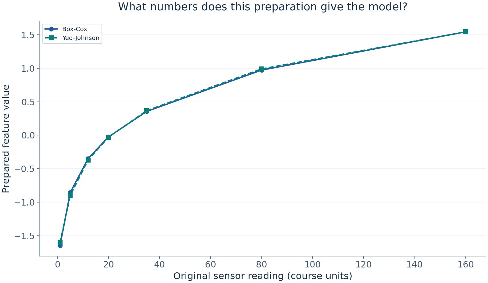

**👀 Read the visual.** Compare the square and circle at the same original reading. The methods fit separate transformations to training data.

**👉 Use what you see.** Try a positive reading first. The Box–Cox variant requires positive input.

**💡 Takeaway.** Box–Cox needs strictly positive inputs. Yeo–Johnson is also suitable when the feature contains zeros or negatives.

<a id="quantile-transformation-rank-scaling"></a>

##### 📘 6️⃣ Quantile Transformation (Rank Scaling)

| Lesson name | What you’ll do | Download |
| --- | --- | --- |
| 142 - Quantile Transformation (Rank Scaling) **Practice** | Use the rank of each reading to place it on a new scale. | [Lesson ZIP](sample_code_folder/142-quantile-transformation-rank-scaling.zip) |

<!-- workbook-teaching:142:start -->
<details>
<summary>Learn, trace and apply this idea</summary>

### Learn and apply: Quantile Transformation (Rank Scaling)

**Your decision.** Use the rank of each reading to place it on a new scale.

**Ready check.** Sort numbers and explain rank. Use [the learning path](LEARNING-PATH.md) and [the word list](GLOSSARY.md) for the earlier skill. Trace the small example on paper before code.

**What it means.** A quantile transformation maps training ranks to a chosen output distribution.

**Why and when.** Use it when a model benefits from the changed spacing and the distortion is acceptable.

**A worked example to follow.** Training readings can be mapped across a uniform scale or a normal-shaped scale. The distances between original readings change; new rows use the saved training mapping.

**Input → steps → output.** Open the supplied table. Its fields are `signal`, `cost`. One original row is shown below in that same field order; `(missing)` marks a blank rather than zero.

```text
1 | 10
```

1. Name the particular field or object involved in this lesson’s decision above. Keep its meaning and units with it.
2. Open the [complete runnable Python example](lessons/142-quantile-transformation-rank-scaling/lesson.py). Its numbered comments connect reading, preparation and the resulting calculation. Install only the [declared requirements](lessons/142-quantile-transformation-rank-scaling/requirements.txt) using the same course Python, as shown in Setup.
3. Trace the worked example above through the script. Keep inputs apart from measured answers. Follow this script’s split and fit, then trace the saved preparation into the held-back result and any new request. A request must not supply its own training answer.
4. Read the result by its headings. Compare with [full recorded output](lessons/142-quantile-transformation-rank-scaling/expected-output.txt); the excerpt below belongs to the original supplied files. Your edits can change it.

```text
uniform first two training rows: [[0.0], [0.13]]
Actual costs: [23, 48]
Predicted costs: [24.0, 48.1]
 signal  predicted_cost
      3           12.39
     15           29.78
```

**How to interpret it.** Trace the worked case into the result above. Tell a calculated estimate from a measured answer.

**Common mistakes and limits.** The method does not recover a true normal-generating process. Ties and values beyond the training range need inspection; an inverse can only reflect the fitted mapping.

**Use it yourself.** If two different readings are close in rank but far apart in original units, will rank scaling preserve that large physical gap?

<details>
<summary>Check your choice and reason</summary>

Not necessarily. It changes spacing based on ranks. Keep original units available for interpretation and validate whether losing gap information helps the task.

</details>

**A second check later.** Close the notes and explain the same decision using a different row from the supplied table. State one condition that would make this method unsuitable. If you cannot explain the reason, repeat the small worked example before adding more code.

</details>
<!-- workbook-teaching:142:end -->


**Before this lesson.** Understand scaling, a baseline and validation.

**In simple words.** Use a transformation only for a stated reason. Compare it with unchanged inputs on the same validation rows. Learn every data-based rule inside training.

**Guess first.** Must all eight transformations be applied? Write your answer before running the example.

<details>
<summary>Read the reason after trying</summary>

No. Start simple. Compare a suitable candidate and keep separate final test rows.

</details>


**🎯 Goal.** How much might a new reading cost? Signal is the input. Cost is the known answer. Change the signal first, then give the model that changed number.

**📋 Sample data**

| signal | cost |
| --- | --- |
| 1 | 10 |
| 5 | 18 |
| 12 | 25 |
| 20 | 31 |
| 35 | 41 |
| 80 | 53 |
| 160 | 64 |
| 10 | 23 |

Showing the first 8 of 9 rows. The CSV has the full sample.

**▶️ Run.** Unzip the [lesson files](sample_code_folder/142-quantile-transformation-rank-scaling.zip) and open a terminal in that folder. Install the lesson’s packages with `python -m pip install -r requirements.txt`, then run `python lesson.py`.

**🔹 Steps in the script**

1. Read the sensor readings and their measured costs.
2. Set aside the check rows before the model learns.
3. Read the new CSV rows, then apply the rules from the sample.
4. Give each method the same practice data so you can compare the results.

**✅ Check.** Look for uniform first two training rows: [[0.0], [0.13]] in the output excerpt below.

```text
uniform first two training rows: [[0.0], [0.13]]
Actual costs: [23, 48]
Predicted costs: [24.0, 48.1]
```

**Your small change.** Try a signal reading of 3, 15, or 40 in new_inputs.csv. Compare the predicted cost for each row. Save the named CSV before running again.


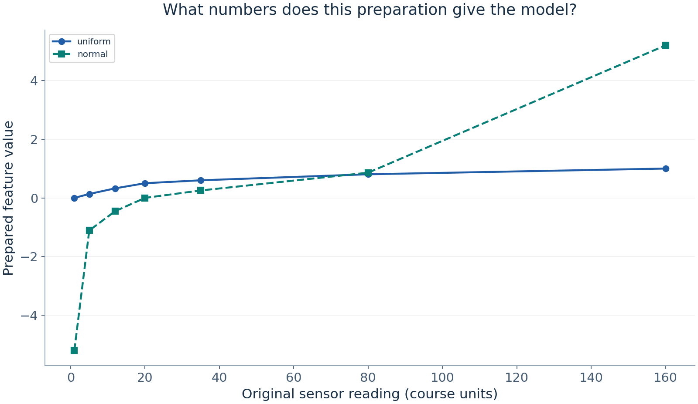

**👀 Read the visual.** The same training ranks stretch across different output scales. Circles show uniform output and squares show normal output.

**👉 Use what you see.** Try another input and compare which fitted output scale changes the model result.

**💡 Takeaway.** Ranking changes the distances between measurements. Compare uniform and normal output, and check the handling of ties.

<a id="binning-discretization"></a>

##### 📘 7️⃣ Binning (Discretization)

| Lesson name | What you’ll do | Download |
| --- | --- | --- |
| 145 - Binning (Discretization) **Practice** | Put continuous sensor readings into bins and use the bins as model inputs. | [Lesson ZIP](sample_code_folder/145-binning-discretization.zip) |

<!-- workbook-teaching:145:start -->
<details>
<summary>Learn, trace and apply this idea</summary>

### Learn and apply: Binning (Discretization)

**Your decision.** Put continuous sensor readings into bins and use the bins as model inputs.

**Ready check.** Place a value between two stated limits. Use [the learning path](LEARNING-PATH.md) and [the word list](GLOSSARY.md) for the earlier skill. Trace the small example on paper before code.

**What it means.** Binning puts a continuous measurement into one of several intervals.

**Why and when.** Use bins when a coarse representation is useful and the information lost inside an interval is acceptable.

**A worked example to follow.** The lesson learns training edges and makes indicator columns for bins. Two readings inside the same interval receive the same bin representation.

**Input → steps → output.** Open the supplied table. Its fields are `signal`, `cost`. One original row is shown below in that same field order; `(missing)` marks a blank rather than zero.

```text
1 | 10
```

1. Name the particular field or object involved in this lesson’s decision above. Keep its meaning and units with it.
2. Open the [complete runnable Python example](lessons/145-binning-discretization/lesson.py). Its numbered comments connect reading, preparation and the resulting calculation. Install only the [declared requirements](lessons/145-binning-discretization/requirements.txt) using the same course Python, as shown in Setup.
3. Trace the worked example above through the script. Keep the original field beside the inspected or changed value. Trace the named preparation or review step, and check whether it uses a fixed rule or a value learned from training.
4. Read the result by its headings. Compare with [full recorded output](lessons/145-binning-discretization/expected-output.txt); the excerpt below belongs to the original supplied files. Your edits can change it.

```text
Binning first two training rows: [[1.0, 0.0, 0.0], [1.0, 0.0, 0.0]]
Actual costs: [23, 48]
Predicted costs: [25.0, 53.0]
Training edges: [1.0, 54.0, 107.0, 160.0]
 signal  predicted_cost
      3            25.0
```

**How to interpret it.** Trace the worked case into the result above. Tell a calculated estimate from a measured answer.

**Common mistakes and limits.** An edge convention determines which interval owns a boundary value. Relearning edges on each request changes what a column means.

**Use it yourself.** Read the printed edges. If readings 20 and 30 fall in the same bin, can a model receiving only that bin distinguish them?

<details>
<summary>Check your choice and reason</summary>

No. It sees the same representation. Compare this loss with using the original signal, and keep training edges fixed for later rows.

</details>

**A second check later.** Close the notes and explain the same decision using a different row from the supplied table. State one condition that would make this method unsuitable. If you cannot explain the reason, repeat the small worked example before adding more code.

</details>
<!-- workbook-teaching:145:end -->


**Before this lesson.** Understand scaling, a baseline and validation.

**In simple words.** Use a transformation only for a stated reason. Compare it with unchanged inputs on the same validation rows. Learn every data-based rule inside training.

**Guess first.** Must all eight transformations be applied? Write your answer before running the example.

<details>
<summary>Read the reason after trying</summary>

No. Start simple. Compare a suitable candidate and keep separate final test rows.

</details>


**🎯 Goal.** How much might a new reading cost? Signal is the input. Cost is the known answer. Change the signal first, then give the model that changed number.

**📋 Sample data**

| signal | cost |
| --- | --- |
| 1 | 10 |
| 5 | 18 |
| 12 | 25 |
| 20 | 31 |
| 35 | 41 |
| 80 | 53 |
| 160 | 64 |
| 10 | 23 |

Showing the first 8 of 9 rows. The CSV has the full sample.

**▶️ Run.** Unzip the [lesson files](sample_code_folder/145-binning-discretization.zip) and open a terminal in that folder. Install the lesson’s packages with `python -m pip install -r requirements.txt`, then run `python lesson.py`.

**🔹 Steps in the script**

1. Read the sensor readings and their measured costs.
2. Set aside the check rows before the model learns.
3. Teach the model from the training inputs and the recorded cost.
4. Apply the fitted model to the new CSV rows and print a result for each row.

**✅ Check.** Look for Binning first two training rows: [[1.0, 0.0, 0.0], [1.0, 0.0, 0.0]] in the output excerpt below.

```text
Binning first two training rows: [[1.0, 0.0, 0.0], [1.0, 0.0, 0.0]]
Actual costs: [23, 48]
Predicted costs: [25.0, 53.0]
```

**Your small change.** Enter 3, 60, and 150 as signal values. Compare their predictions with the printed bin limits. Save the named CSV before running again.


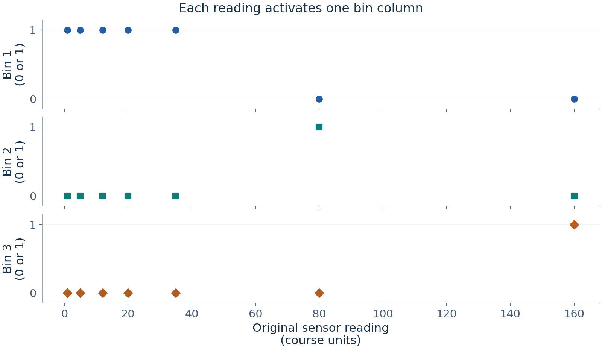

**👀 Read the visual.** Each dot connects one original measurement to the value used by the model.

**👉 Use what you see.** Compare the active 1 for different raw readings. A change in the active column marks a move into another bin.

**💡 Takeaway.** With the PDF’s ages `[5, 12, 25, 40, 60]`, bands 0–12, 13–19, and 20–60 give child, child, adult, adult, adult. For a learned binning rule, print the training edges and reuse them at prediction.

<a id="polynomial-features-feature-expansion"></a>

##### 📘 8️⃣ Polynomial Features (Feature Expansion)

| Lesson name | What you’ll do | Download |
| --- | --- | --- |
| 146 - Polynomial Features (Feature Expansion) **Practice** | Add squared terms so a linear model can describe a curved pattern. | [Lesson ZIP](sample_code_folder/146-polynomial-features-feature-expansion.zip) |

<!-- workbook-teaching:146:start -->
<details>
<summary>Learn, trace and apply this idea</summary>

### Learn and apply: Polynomial Features (Feature Expansion)

**Your decision.** Add squared terms so a linear model can describe a curved pattern.

**Ready check.** Calculate 2 × 2 and 2 × 2 × 2; keep validation separate. Use [the learning path](LEARNING-PATH.md) and [the word list](GLOSSARY.md) for the earlier skill. Trace the small example on paper before code.

**What it means.** Polynomial features add powers and products so a linear model can represent curved relationships.

**Why and when.** Try a small degree when a curve is plausible, then check whether the added flexibility helps on validation rows.

**A worked example to follow.** For one input x = 2, the degree-three row is x, x², x³ = 2, 4, 8. These are three features from one measured input. For x greater than 1, the cubic grows faster than the square. A graph with a logarithmic output axis uses multiplicative spacing, so start with the small table before reading that optional graph.

**Input → steps → output.** Open the supplied table. Its fields are `signal`, `cost`. One original row is shown below in that same field order; `(missing)` marks a blank rather than zero.

```text
1 | 10
```

1. Name the particular field or object involved in this lesson’s decision above. Keep its meaning and units with it.
2. Open the [complete runnable Python example](lessons/146-polynomial-features-feature-expansion/lesson.py). Its numbered comments connect reading, preparation and the resulting calculation. Install only the [declared requirements](lessons/146-polynomial-features-feature-expansion/requirements.txt) using the same course Python, as shown in Setup.
3. Trace the worked example above through the script. Keep inputs apart from measured answers. Follow this script’s split and fit, then trace the saved preparation into the held-back result and any new request. A request must not supply its own training answer.
4. Read the result by its headings. Compare with [full recorded output](lessons/146-polynomial-features-feature-expansion/expected-output.txt); the excerpt below belongs to the original supplied files. Your edits can change it.

```text
Polynomial Features first two training rows: [[1.0, 1.0, 1.0], [5.0, 25.0, 125.0]]
Actual costs: [23, 48]
Predicted costs: [22.0, 49.4]
 signal  predicted_cost
      3           14.10
     15           26.99
```

**How to interpret it.** Trace the worked case into the result above. Tell a calculated estimate from a measured answer.

**Common mistakes and limits.** High powers can grow rapidly outside training and overfit. More columns are not automatically more evidence. Scaling and regularization may matter.

**Use it yourself.** Write the three features for x = 3. Does the cubic term make predictions safe far outside the observed range?

<details>
<summary>Check your choice and reason</summary>

They are 3, 9 and 27. No: large powers can make extrapolation unstable. Choose degree within validation and state the supported range.

</details>

**A second check later.** Close the notes and explain the same decision using a different row from the supplied table. State one condition that would make this method unsuitable. If you cannot explain the reason, repeat the small worked example before adding more code.

</details>
<!-- workbook-teaching:146:end -->


**Before this lesson.** Understand scaling, a baseline and validation.

**In simple words.** Use a transformation only for a stated reason. Compare it with unchanged inputs on the same validation rows. Learn every data-based rule inside training.

**Guess first.** Must all eight transformations be applied? Write your answer before running the example.

<details>
<summary>Read the reason after trying</summary>

No. Start simple. Compare a suitable candidate and keep separate final test rows.

</details>


**🎯 Goal.** How much might a new reading cost? Signal is the input. Cost is the known answer. Change the signal first, then give the model that changed number.

**📋 Sample data**

| signal | cost |
| --- | --- |
| 1 | 10 |
| 5 | 18 |
| 12 | 25 |
| 20 | 31 |
| 35 | 41 |
| 80 | 53 |
| 160 | 64 |
| 10 | 23 |

Showing the first 8 of 9 rows. The CSV has the full sample.

**▶️ Run.** Unzip the [lesson files](sample_code_folder/146-polynomial-features-feature-expansion.zip) and open a terminal in that folder. Install the lesson’s packages with `python -m pip install -r requirements.txt`, then run `python lesson.py`.

**🔹 Steps in the script**

1. Read the sensor readings and their measured costs.
2. Set aside the check rows before the model learns.
3. Teach the model from the training inputs and the recorded cost.
4. Apply the fitted model to the new CSV rows and print a result for each row.

**✅ Check.** Look for Polynomial Features first two training rows: [[1.0, 1.0, 1.0], [5.0, 25.0, 125.0]] in the output excerpt below.

```text
Polynomial Features first two training rows: [[1.0, 1.0, 1.0], [5.0, 25.0, 125.0]]
Actual costs: [23, 48]
Predicted costs: [22.0, 49.4]
```

**Your small change.** Try a signal reading of 3, 15, or 40 in new_inputs.csv. Compare the predicted cost for each row. Save the named CSV before running again.


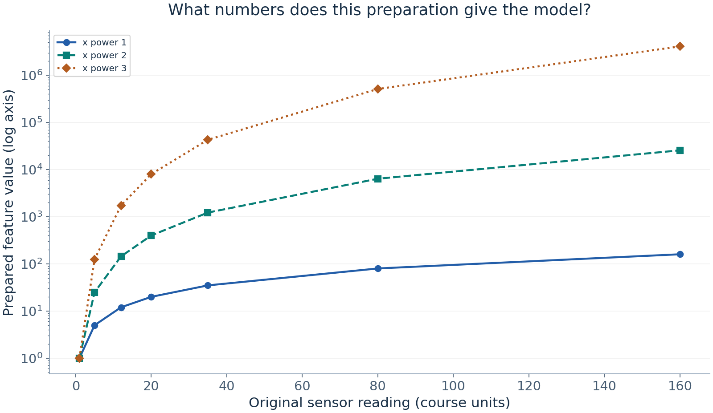

**👀 Read the visual.** Each dot connects one original measurement to the value used by the model.

**👉 Use what you see.** Follow all three values for the same reading: x, x squared and x cubed. At x = 2 these are 2, 4 and 8. For x greater than 1, the cubic grows faster than the square. This large-range graph uses a logarithmic output axis: equal axis steps represent multiplication, not equal addition. Read the small table first.

**💡 Takeaway.** With one input, the expansion adds `x²` and `x³`. For `x = 2`, the row is `[2, 4, 8]`.

<a id="which-technique-should-you-use"></a>

##### 🧭 Which Technique Should You Use?

| Lesson name | What you’ll do | Download |
| --- | --- | --- |
| 147 - Which Technique Should You Use? **Practice** | Use the same validation folds to compare which transformation makes better predictions. | [Lesson ZIP](sample_code_folder/147-which-technique-should-you-use.zip) |

<!-- workbook-teaching:147:start -->
<details>
<summary>Learn, trace and apply this idea</summary>

### Learn and apply: Which Technique Should You Use?

**Your decision.** Use the same validation folds to compare which transformation makes better predictions.

**Ready check.** Calculate an error and distinguish training from validation. Use [the learning path](LEARNING-PATH.md) and [the word list](GLOSSARY.md) for the earlier skill. Trace the small example on paper before code.

**What it means.** A transformation is a candidate preparation choice, not a compulsory checklist.

**Why and when.** Compare a sensible change with unchanged inputs on identical validation folds.

**A worked example to follow.** The script fits each transformation inside a pipeline for each training fold, then reports error on that fold’s held-back rows. This prevents a fold’s check values from choosing its scale or bin edges.

**Input → steps → output.** Open the supplied table. Its fields are `signal`, `cost`. One original row is shown below in that same field order; `(missing)` marks a blank rather than zero.

```text
1 | 10
```

1. Name the particular field or object involved in this lesson’s decision above. Keep its meaning and units with it.
2. Open the [complete runnable Python example](lessons/147-which-technique-should-you-use/lesson.py). Its numbered comments connect reading, preparation and the resulting calculation. Install only the [declared requirements](lessons/147-which-technique-should-you-use/requirements.txt) using the same course Python, as shown in Setup.
3. Trace the worked example above through the script. Keep inputs apart from measured answers. Follow this script’s split and fit, then trace the saved preparation into the held-back result and any new request. A request must not supply its own training answer.
4. Read the result by its headings. Compare with [full recorded output](lessons/147-which-technique-should-you-use/expected-output.txt); the excerpt below belongs to the original supplied files. Your edits can change it.

```text
Raw                         MAE 10.88
Min-Max Scaling             MAE 12.18
Z-Score Standardization     MAE 10.94
Log Transformation          MAE 3.64
Robust Scaling              MAE 10.37
Power Transformations       MAE 3.64
```

**How to interpret it.** Trace the worked case into the result above. Tell a calculated estimate from a measured answer.

**Common mistakes and limits.** The best score on this tiny table may be unstable. Do not apply every transform or use repeated final test scores to choose among them.

**Use it yourself.** Transform A has lower training error but higher validation error than raw inputs. Which setup has better evidence for the next check?

<details>
<summary>Check your choice and reason</summary>

Raw inputs have better validation evidence in this comparison. State the counts and variation, freeze the choice, and assess it on a separate final check.

</details>

**A second check later.** Close the notes and explain the same decision using a different row from the supplied table. State one condition that would make this method unsuitable. If you cannot explain the reason, repeat the small worked example before adding more code.

</details>
<!-- workbook-teaching:147:end -->


**Before this lesson.** Understand scaling, a baseline and validation.

**In simple words.** Use a transformation only for a stated reason. Compare it with unchanged inputs on the same validation rows. Learn every data-based rule inside training.

**Guess first.** Must all eight transformations be applied? Write your answer before running the example.

<details>
<summary>Read the reason after trying</summary>

No. Start simple. Compare a suitable candidate and keep separate final test rows.

</details>


Compare candidates using the same folds on an original, skewed feature. Each transformation learns from the training part of each fold. The validation scores help you choose a method. Use separate final test rows to measure the result you would report.

**📋 Sample data**

| signal | cost |
| --- | --- |
| 1 | 10 |
| 5 | 18 |
| 12 | 25 |
| 20 | 31 |
| 35 | 41 |
| 80 | 53 |
| 160 | 64 |
| 10 | 23 |

Showing the first 8 of 9 rows. The CSV has the full sample.

**▶️ Run.** Unzip the [lesson files](sample_code_folder/147-which-technique-should-you-use.zip) and open a terminal in that folder. Install the lesson’s packages with `python -m pip install -r requirements.txt`, then run `python lesson.py`.

**🔹 Steps in the script**

1. Read the sensor readings and their measured costs.
2. Compare the printed output with the original values.

**✅ Check.** Look for Raw                         MAE 10.88 in the output excerpt below.

| Raw | MAE 10.88 |
| --- | --- |
| Min-Max Scaling | MAE 12.18 |
| Z-Score Standardization | MAE 10.94 |

**Your small change.** Try changing signal from 1 to 12 in sample.csv. Compare the new output. Save the named CSV before running again.


**💡 Takeaway.** Compare the reported errors and any differences in results across folds. One small table illustrates the method.

<a id="1-4-exploratory-data-analysis-eda"></a>

### 🔍 1.4. Exploratory Data Analysis (EDA)

| Lesson name | What you’ll do | Download |
| --- | --- | --- |
| 148 - 1.4. Exploratory Data Analysis (EDA) **Practice** | Explore a delivery table with charts and numbers before you train. | [Lesson ZIP](sample_code_folder/148-1-4-exploratory-data-analysis-eda.zip) |

<!-- workbook-teaching:148:start -->
<details>
<summary>Learn, trace and apply this idea</summary>

### Learn and apply: 1.4. Exploratory Data Analysis (EDA)

**Your decision.** Explore a delivery table with charts and numbers before you train.

**Ready check.** Read horizontal and vertical axes and identify one record. Use [the learning path](LEARNING-PATH.md) and [the word list](GLOSSARY.md) for the earlier skill. Trace the small example on paper before code.

**What it means.** Exploration asks questions of recorded data using summaries and charts.

**Why and when.** Use a chart that answers a particular question before making a modeling decision.

**A worked example to follow.** A histogram counts records in weight ranges; a scatterplot puts one delivery at distance and time; a heatmap summarizes correlations; a pair plot shows several pairs. The duplicate route_distance column moves exactly with distance in the tiny sample.

**Input → steps → output.** Open the supplied table. Its fields are `distance`, `route_distance`, `weight`, `minutes`. One original row is shown below in that same field order; `(missing)` marks a blank rather than zero.

```text
2 | 2.2 | 1 | 19
```

1. Name the particular field or object involved in this lesson’s decision above. Keep its meaning and units with it.
2. Open the [complete runnable Python example](lessons/148-1-4-exploratory-data-analysis-eda/lesson.py). Its numbered comments connect reading, preparation and the resulting calculation. Install only the [declared requirements](lessons/148-1-4-exploratory-data-analysis-eda/requirements.txt) using the same course Python, as shown in Setup.
3. Trace the worked example above through the script. Keep the original field beside the inspected or changed value. Trace the named preparation or review step, and check whether it uses a fixed rule or a value learned from training.
4. Read the result by its headings. Compare with [full recorded output](lessons/148-1-4-exploratory-data-analysis-eda/expected-output.txt); the excerpt below belongs to the original supplied files. Your edits can change it.

```text
        distance  route_distance  weight  minutes
mean         7.0             7.7    4.33    35.33
median       7.0             7.7    2.50    31.50
skew         0.0            -0.0    2.20     1.26
Distance overlap: 1.0
```

**How to interpret it.** Trace the worked case into the result above. Tell a calculated estimate from a measured answer.

**Common mistakes and limits.** Correlation does not establish cause. Axis scales, missing rows and small counts can change a story. Use training data when exploration guides model choices.

**Use it yourself.** Which chart would show whether longer trips tend to take longer? Which chart would show how often a weight range occurs?

<details>
<summary>Check your choice and reason</summary>

Use a distance-versus-time scatterplot for the relationship and a weight histogram for frequency. Name units and counts; do not infer causation from a sloping cloud.

</details>

**A second check later.** Close the notes and explain the same decision using a different row from the supplied table. State one condition that would make this method unsuitable. If you cannot explain the reason, repeat the small worked example before adding more code.

</details>
<!-- workbook-teaching:148:end -->


**Before this lesson.** Read axes, units and one point per row.

**In simple words.** A chart answers a question about the data. A histogram counts ranges; a scatterplot compares two facts. A correlation shows movement together, not a cause.

**Guess first.** Does a strong correlation prove what causes the result? Write your answer before running the example.

<details>
<summary>Read the reason after trying</summary>

No. Check other explanations and what was actually measured.

</details>


**📌 Before you start.** Read a sample table and locate its numeric columns.

<a id="visualization-is-used-here"></a>

#### 📊 Visualization is used here!

| Lesson name | What you’ll do | Download |
| --- | --- | --- |
| 149 - Visualization is used here! **Practice** | Use charts to see how weights spread and how time changes with distance. | [Lesson ZIP](sample_code_folder/149-visualization-is-used-here.zip) |

<!-- workbook-teaching:149:start -->
<details>
<summary>Learn, trace and apply this idea</summary>

### Learn and apply: Visualization is used here!

**Your decision.** Use charts to see how weights spread and how time changes with distance.

**Ready check.** Read horizontal and vertical axes and identify one record. Use [the learning path](LEARNING-PATH.md) and [the word list](GLOSSARY.md) for the earlier skill. Trace the small example on paper before code.

**What it means.** Exploration asks questions of recorded data using summaries and charts.

**Why and when.** Use a chart that answers a particular question before making a modeling decision.

**A worked example to follow.** A histogram counts records in weight ranges; a scatterplot puts one delivery at distance and time; a heatmap summarizes correlations; a pair plot shows several pairs. The duplicate route_distance column moves exactly with distance in the tiny sample.

**Input → steps → output.** Open the supplied table. Its fields are `distance`, `route_distance`, `weight`, `minutes`. One original row is shown below in that same field order; `(missing)` marks a blank rather than zero.

```text
2 | 2.2 | 1 | 19
```

1. Name the particular field or object involved in this lesson’s decision above. Keep its meaning and units with it.
2. Open the [complete runnable Python example](lessons/149-visualization-is-used-here/lesson.py). Its numbered comments connect reading, preparation and the resulting calculation. Install only the [declared requirements](lessons/149-visualization-is-used-here/requirements.txt) using the same course Python, as shown in Setup.
3. Trace the worked example above through the script. Keep the original field beside the inspected or changed value. Trace the named preparation or review step, and check whether it uses a fixed rule or a value learned from training.
4. Read the result by its headings. Compare with [full recorded output](lessons/149-visualization-is-used-here/expected-output.txt); the excerpt below belongs to the original supplied files. Your edits can change it.

```text
        distance  route_distance  weight  minutes
mean         7.0             7.7    4.33    35.33
median       7.0             7.7    2.50    31.50
skew         0.0            -0.0    2.20     1.26
Distance overlap: 1.0
```

**How to interpret it.** Trace the worked case into the result above. Tell a calculated estimate from a measured answer.

**Common mistakes and limits.** Correlation does not establish cause. Axis scales, missing rows and small counts can change a story. Use training data when exploration guides model choices.

**Use it yourself.** Which chart would show whether longer trips tend to take longer? Which chart would show how often a weight range occurs?

<details>
<summary>Check your choice and reason</summary>

Use a distance-versus-time scatterplot for the relationship and a weight histogram for frequency. Name units and counts; do not infer causation from a sloping cloud.

</details>

**A second check later.** Close the notes and explain the same decision using a different row from the supplied table. State one condition that would make this method unsuitable. If you cannot explain the reason, repeat the small worked example before adding more code.

</details>
<!-- workbook-teaching:149:end -->


**Before this lesson.** Read axes, units and one point per row.

**In simple words.** A chart answers a question about the data. A histogram counts ranges; a scatterplot compares two facts. A correlation shows movement together, not a cause.

**Guess first.** Does a strong correlation prove what causes the result? Write your answer before running the example.

<details>
<summary>Read the reason after trying</summary>

No. Check other explanations and what was actually measured.

</details>


<a id="visualization-techniques"></a>

#### 🎨 Visualization Techniques

| Lesson name | What you’ll do | Download |
| --- | --- | --- |
| 154 - Visualization Techniques **Practice** | Use histograms, scatter plots, box plots, heatmaps and pair plots to explore the same table. | [Lesson ZIP](sample_code_folder/154-visualization-techniques.zip) |

<!-- workbook-teaching:154:start -->
<details>
<summary>Learn, trace and apply this idea</summary>

### Learn and apply: Visualization Techniques

**Your decision.** Use histograms, scatter plots, box plots, heatmaps and pair plots to explore the same table.

**Ready check.** Read horizontal and vertical axes and identify one record. Use [the learning path](LEARNING-PATH.md) and [the word list](GLOSSARY.md) for the earlier skill. Trace the small example on paper before code.

**What it means.** Exploration asks questions of recorded data using summaries and charts.

**Why and when.** Use a chart that answers a particular question before making a modeling decision.

**A worked example to follow.** A histogram counts records in weight ranges; a scatterplot puts one delivery at distance and time; a heatmap summarizes correlations; a pair plot shows several pairs. The duplicate route_distance column moves exactly with distance in the tiny sample.

**Input → steps → output.** Open the supplied table. Its fields are `distance`, `route_distance`, `weight`, `minutes`. One original row is shown below in that same field order; `(missing)` marks a blank rather than zero.

```text
2 | 2.2 | 1 | 19
```

1. Name the particular field or object involved in this lesson’s decision above. Keep its meaning and units with it.
2. Open the [complete runnable Python example](lessons/154-visualization-techniques/lesson.py). Its numbered comments connect reading, preparation and the resulting calculation. Install only the [declared requirements](lessons/154-visualization-techniques/requirements.txt) using the same course Python, as shown in Setup.
3. Trace the worked example above through the script. Keep the original field beside the inspected or changed value. Trace the named preparation or review step, and check whether it uses a fixed rule or a value learned from training.
4. Read the result by its headings. Compare with [full recorded output](lessons/154-visualization-techniques/expected-output.txt); the excerpt below belongs to the original supplied files. Your edits can change it.

```text
        distance  route_distance  weight  minutes
mean         7.0             7.7    4.33    35.33
median       7.0             7.7    2.50    31.50
skew         0.0            -0.0    2.20     1.26
Distance overlap: 1.0
```

**How to interpret it.** Trace the worked case into the result above. Tell a calculated estimate from a measured answer.

**Common mistakes and limits.** Correlation does not establish cause. Axis scales, missing rows and small counts can change a story. Use training data when exploration guides model choices.

**Use it yourself.** Which chart would show whether longer trips tend to take longer? Which chart would show how often a weight range occurs?

<details>
<summary>Check your choice and reason</summary>

Use a distance-versus-time scatterplot for the relationship and a weight histogram for frequency. Name units and counts; do not infer causation from a sloping cloud.

</details>

**A second check later.** Close the notes and explain the same decision using a different row from the supplied table. State one condition that would make this method unsuitable. If you cannot explain the reason, repeat the small worked example before adding more code.

</details>
<!-- workbook-teaching:154:end -->


**Before this lesson.** Read axes, units and one point per row.

**In simple words.** A chart answers a question about the data. A histogram counts ranges; a scatterplot compares two facts. A correlation shows movement together, not a cause.

**Guess first.** Does a strong correlation prove what causes the result? Write your answer before running the example.

<details>
<summary>Read the reason after trying</summary>

No. Check other explanations and what was actually measured.

</details>


<a id="histograms"></a>

##### 📊 Histograms

| Lesson name | What you’ll do | Download |
| --- | --- | --- |
| 155 - Histograms **Practice** | Count how often each range of weights occurs. | [Lesson ZIP](sample_code_folder/155-histograms.zip) |

<!-- workbook-teaching:155:start -->
<details>
<summary>Learn, trace and apply this idea</summary>

### Learn and apply: Histograms

**Your decision.** Count how often each range of weights occurs.

**Ready check.** Read horizontal and vertical axes and identify one record. Use [the learning path](LEARNING-PATH.md) and [the word list](GLOSSARY.md) for the earlier skill. Trace the small example on paper before code.

**What it means.** Exploration asks questions of recorded data using summaries and charts.

**Why and when.** Use a chart that answers a particular question before making a modeling decision.

**A worked example to follow.** A histogram counts records in weight ranges; a scatterplot puts one delivery at distance and time; a heatmap summarizes correlations; a pair plot shows several pairs. The duplicate route_distance column moves exactly with distance in the tiny sample.

**Input → steps → output.** Open the supplied table. Its fields are `distance`, `route_distance`, `weight`, `minutes`. One original row is shown below in that same field order; `(missing)` marks a blank rather than zero.

```text
2 | 2.2 | 1 | 19
```

1. Name the particular field or object involved in this lesson’s decision above. Keep its meaning and units with it.
2. Open the [complete runnable Python example](lessons/155-histograms/lesson.py). Its numbered comments connect reading, preparation and the resulting calculation. Install only the [declared requirements](lessons/155-histograms/requirements.txt) using the same course Python, as shown in Setup.
3. Trace the worked example above through the script. Keep the original field beside the inspected or changed value. Trace the named preparation or review step, and check whether it uses a fixed rule or a value learned from training.
4. Read the result by its headings. Compare with [full recorded output](lessons/155-histograms/expected-output.txt); the excerpt below belongs to the original supplied files. Your edits can change it.

```text
        distance  route_distance  weight  minutes
mean         7.0             7.7    4.33    35.33
median       7.0             7.7    2.50    31.50
skew         0.0            -0.0    2.20     1.26
Distance overlap: 1.0
```

**How to interpret it.** Trace the worked case into the result above. Tell a calculated estimate from a measured answer.

**Common mistakes and limits.** Correlation does not establish cause. Axis scales, missing rows and small counts can change a story. Use training data when exploration guides model choices.

**Use it yourself.** Which chart would show whether longer trips tend to take longer? Which chart would show how often a weight range occurs?

<details>
<summary>Check your choice and reason</summary>

Use a distance-versus-time scatterplot for the relationship and a weight histogram for frequency. Name units and counts; do not infer causation from a sloping cloud.

</details>

**A second check later.** Close the notes and explain the same decision using a different row from the supplied table. State one condition that would make this method unsuitable. If you cannot explain the reason, repeat the small worked example before adding more code.

</details>
<!-- workbook-teaching:155:end -->


**Before this lesson.** Read axes, units and one point per row.

**In simple words.** A chart answers a question about the data. A histogram counts ranges; a scatterplot compares two facts. A correlation shows movement together, not a cause.

**Guess first.** Does a strong correlation prove what causes the result? Write your answer before running the example.

<details>
<summary>Read the reason after trying</summary>

No. Check other explanations and what was actually measured.

</details>


Count how many weights fall in each range before checking the large value.

<a id="scatter-plots"></a>

##### 🔵 Scatter Plots

| Lesson name | What you’ll do | Download |
| --- | --- | --- |
| 156 - Scatter Plots **Practice** | Put distance on one axis and delivery time on the other. | [Lesson ZIP](sample_code_folder/156-scatter-plots.zip) |

<!-- workbook-teaching:156:start -->
<details>
<summary>Learn, trace and apply this idea</summary>

### Learn and apply: Scatter Plots

**Your decision.** Put distance on one axis and delivery time on the other.

**Ready check.** Read horizontal and vertical axes and identify one record. Use [the learning path](LEARNING-PATH.md) and [the word list](GLOSSARY.md) for the earlier skill. Trace the small example on paper before code.

**What it means.** Exploration asks questions of recorded data using summaries and charts.

**Why and when.** Use a chart that answers a particular question before making a modeling decision.

**A worked example to follow.** A histogram counts records in weight ranges; a scatterplot puts one delivery at distance and time; a heatmap summarizes correlations; a pair plot shows several pairs. The duplicate route_distance column moves exactly with distance in the tiny sample.

**Input → steps → output.** Open the supplied table. Its fields are `distance`, `route_distance`, `weight`, `minutes`. One original row is shown below in that same field order; `(missing)` marks a blank rather than zero.

```text
2 | 2.2 | 1 | 19
```

1. Name the particular field or object involved in this lesson’s decision above. Keep its meaning and units with it.
2. Open the [complete runnable Python example](lessons/156-scatter-plots/lesson.py). Its numbered comments connect reading, preparation and the resulting calculation. Install only the [declared requirements](lessons/156-scatter-plots/requirements.txt) using the same course Python, as shown in Setup.
3. Trace the worked example above through the script. Keep the original field beside the inspected or changed value. Trace the named preparation or review step, and check whether it uses a fixed rule or a value learned from training.
4. Read the result by its headings. Compare with [full recorded output](lessons/156-scatter-plots/expected-output.txt); the excerpt below belongs to the original supplied files. Your edits can change it.

```text
        distance  route_distance  weight  minutes
mean         7.0             7.7    4.33    35.33
median       7.0             7.7    2.50    31.50
skew         0.0            -0.0    2.20     1.26
Distance overlap: 1.0
```

**How to interpret it.** Trace the worked case into the result above. Tell a calculated estimate from a measured answer.

**Common mistakes and limits.** Correlation does not establish cause. Axis scales, missing rows and small counts can change a story. Use training data when exploration guides model choices.

**Use it yourself.** Which chart would show whether longer trips tend to take longer? Which chart would show how often a weight range occurs?

<details>
<summary>Check your choice and reason</summary>

Use a distance-versus-time scatterplot for the relationship and a weight histogram for frequency. Name units and counts; do not infer causation from a sloping cloud.

</details>

**A second check later.** Close the notes and explain the same decision using a different row from the supplied table. State one condition that would make this method unsuitable. If you cannot explain the reason, repeat the small worked example before adding more code.

</details>
<!-- workbook-teaching:156:end -->


**Before this lesson.** Read axes, units and one point per row.

**In simple words.** A chart answers a question about the data. A histogram counts ranges; a scatterplot compares two facts. A correlation shows movement together, not a cause.

**Guess first.** Does a strong correlation prove what causes the result? Write your answer before running the example.

<details>
<summary>Read the reason after trying</summary>

No. Check other explanations and what was actually measured.

</details>


One dot is one delivery. Read distance along the bottom and minutes up the side.

<a id="box-plots"></a>

##### 📦 Box Plots

| Lesson name | What you’ll do | Download |
| --- | --- | --- |
| 157 - Box Plots **Practice** | Find which weights sit far outside the usual group. | [Lesson ZIP](sample_code_folder/157-box-plots.zip) |

<!-- workbook-teaching:157:start -->
<details>
<summary>Learn, trace and apply this idea</summary>

### Learn and apply: Box Plots

**Your decision.** Find which weights sit far outside the usual group.

**Ready check.** Sort weights and read graph axes in kg. Use [the learning path](LEARNING-PATH.md) and [the word list](GLOSSARY.md) for the earlier skill. Trace the small example on paper before code.

**What it means.** An outlier is unusual under a stated comparison rule. A flag asks for investigation.

**Why and when.** Use plots and numerical rules to find records that deserve attention before fitting or reporting.

**A worked example to follow.** The 80 kg value lies far from most weights. A z-score compares it with the average and standard deviation. IQR compares it with the middle half. On a box plot, read kg on the value axis; a whisker limit is a review rule, not a physical weight limit.

**Input → steps → output.** Open the supplied table. Its fields are `distance`, `route_distance`, `weight`, `minutes`. One original row is shown below in that same field order; `(missing)` marks a blank rather than zero.

```text
2 | 2.2 | 1 | 19
```

1. Name the particular field or object involved in this lesson’s decision above. Keep its meaning and units with it.
2. Open the [complete runnable Python example](lessons/157-box-plots/lesson.py). Its numbered comments connect reading, preparation and the resulting calculation. Install only the [declared requirements](lessons/157-box-plots/requirements.txt) using the same course Python, as shown in Setup.
3. Trace the worked example above through the script. Keep the original field beside the inspected or changed value. Trace the named preparation or review step, and check whether it uses a fixed rule or a value learned from training.
4. Read the result by its headings. Compare with [full recorded output](lessons/157-box-plots/expected-output.txt); the excerpt below belongs to the original supplied files. Your edits can change it.

```text
        distance  route_distance  weight  minutes
mean         7.0             7.7    4.33    35.33
median       7.0             7.7    2.50    31.50
skew         0.0            -0.0    2.20     1.26
Distance overlap: 1.0
```

**How to interpret it.** Trace the worked case into the result above. Tell a calculated estimate from a measured answer.

**Common mistakes and limits.** Do not delete every flagged value. Large valid deliveries may be exactly the cases a service must support. Small samples and skew affect the rules.

**Use it yourself.** A weighing slip confirms an unusual 80 kg shipment. What should you do before choosing a model that cannot handle it?

<details>
<summary>Check your choice and reason</summary>

Keep the confirmed fact, check whether such shipments are in scope, gather suitable training/check examples, or state a service limit. Do not edit a real value merely to improve a score.

</details>

**A second check later.** Close the notes and explain the same decision using a different row from the supplied table. State one condition that would make this method unsuitable. If you cannot explain the reason, repeat the small worked example before adding more code.

</details>
<!-- workbook-teaching:157:end -->


**Before this lesson.** Read axes, units and one point per row.

**In simple words.** A chart answers a question about the data. A histogram counts ranges; a scatterplot compares two facts. A correlation shows movement together, not a cause.

**Guess first.** Does a strong correlation prove what causes the result? Write your answer before running the example.

<details>
<summary>Read the reason after trying</summary>

No. Check other explanations and what was actually measured.

</details>


The box represents the middle half of the weights. Inspect a point far beyond the whiskers.

<a id="heatmaps"></a>

##### 🌡️ Heatmaps

| Lesson name | What you’ll do | Download |
| --- | --- | --- |
| 158 - Heatmaps **Practice** | Compare how strongly pairs of numeric columns move together. | [Lesson ZIP](sample_code_folder/158-heatmaps.zip) |

<!-- workbook-teaching:158:start -->
<details>
<summary>Learn, trace and apply this idea</summary>

### Learn and apply: Heatmaps

**Your decision.** Compare how strongly pairs of numeric columns move together.

**Ready check.** Read horizontal and vertical axes and identify one record. Use [the learning path](LEARNING-PATH.md) and [the word list](GLOSSARY.md) for the earlier skill. Trace the small example on paper before code.

**What it means.** Exploration asks questions of recorded data using summaries and charts.

**Why and when.** Use a chart that answers a particular question before making a modeling decision.

**A worked example to follow.** A histogram counts records in weight ranges; a scatterplot puts one delivery at distance and time; a heatmap summarizes correlations; a pair plot shows several pairs. The duplicate route_distance column moves exactly with distance in the tiny sample.

**Input → steps → output.** Open the supplied table. Its fields are `distance`, `route_distance`, `weight`, `minutes`. One original row is shown below in that same field order; `(missing)` marks a blank rather than zero.

```text
2 | 2.2 | 1 | 19
```

1. Name the particular field or object involved in this lesson’s decision above. Keep its meaning and units with it.
2. Open the [complete runnable Python example](lessons/158-heatmaps/lesson.py). Its numbered comments connect reading, preparation and the resulting calculation. Install only the [declared requirements](lessons/158-heatmaps/requirements.txt) using the same course Python, as shown in Setup.
3. Trace the worked example above through the script. Keep the original field beside the inspected or changed value. Trace the named preparation or review step, and check whether it uses a fixed rule or a value learned from training.
4. Read the result by its headings. Compare with [full recorded output](lessons/158-heatmaps/expected-output.txt); the excerpt below belongs to the original supplied files. Your edits can change it.

```text
        distance  route_distance  weight  minutes
mean         7.0             7.7    4.33    35.33
median       7.0             7.7    2.50    31.50
skew         0.0            -0.0    2.20     1.26
Distance overlap: 1.0
```

**How to interpret it.** Trace the worked case into the result above. Tell a calculated estimate from a measured answer.

**Common mistakes and limits.** Correlation does not establish cause. Axis scales, missing rows and small counts can change a story. Use training data when exploration guides model choices.

**Use it yourself.** Which chart would show whether longer trips tend to take longer? Which chart would show how often a weight range occurs?

<details>
<summary>Check your choice and reason</summary>

Use a distance-versus-time scatterplot for the relationship and a weight histogram for frequency. Name units and counts; do not infer causation from a sloping cloud.

</details>

**A second check later.** Close the notes and explain the same decision using a different row from the supplied table. State one condition that would make this method unsuitable. If you cannot explain the reason, repeat the small worked example before adding more code.

</details>
<!-- workbook-teaching:158:end -->


**Before this lesson.** Read axes, units and one point per row.

**In simple words.** A chart answers a question about the data. A histogram counts ranges; a scatterplot compares two facts. A correlation shows movement together, not a cause.

**Guess first.** Does a strong correlation prove what causes the result? Write your answer before running the example.

<details>
<summary>Read the reason after trying</summary>

No. Check other explanations and what was actually measured.

</details>


Find the value where two column names meet. Values near 1 indicate the measurements rise together.

<a id="pair-plots"></a>

##### 🟣 Pair Plots

| Lesson name | What you’ll do | Download |
| --- | --- | --- |
| 159 - Pair Plots **Practice** | View several pairs of input columns at once. | [Lesson ZIP](sample_code_folder/159-pair-plots.zip) |

<!-- workbook-teaching:159:start -->
<details>
<summary>Learn, trace and apply this idea</summary>

### Learn and apply: Pair Plots

**Your decision.** View several pairs of input columns at once.

**Ready check.** Read horizontal and vertical axes and identify one record. Use [the learning path](LEARNING-PATH.md) and [the word list](GLOSSARY.md) for the earlier skill. Trace the small example on paper before code.

**What it means.** Exploration asks questions of recorded data using summaries and charts.

**Why and when.** Use a chart that answers a particular question before making a modeling decision.

**A worked example to follow.** A histogram counts records in weight ranges; a scatterplot puts one delivery at distance and time; a heatmap summarizes correlations; a pair plot shows several pairs. The duplicate route_distance column moves exactly with distance in the tiny sample.

**Input → steps → output.** Open the supplied table. Its fields are `distance`, `route_distance`, `weight`, `minutes`. One original row is shown below in that same field order; `(missing)` marks a blank rather than zero.

```text
2 | 2.2 | 1 | 19
```

1. Name the particular field or object involved in this lesson’s decision above. Keep its meaning and units with it.
2. Open the [complete runnable Python example](lessons/159-pair-plots/lesson.py). Its numbered comments connect reading, preparation and the resulting calculation. Install only the [declared requirements](lessons/159-pair-plots/requirements.txt) using the same course Python, as shown in Setup.
3. Trace the worked example above through the script. Keep the original field beside the inspected or changed value. Trace the named preparation or review step, and check whether it uses a fixed rule or a value learned from training.
4. Read the result by its headings. Compare with [full recorded output](lessons/159-pair-plots/expected-output.txt); the excerpt below belongs to the original supplied files. Your edits can change it.

```text
        distance  route_distance  weight  minutes
mean         7.0             7.7    4.33    35.33
median       7.0             7.7    2.50    31.50
skew         0.0            -0.0    2.20     1.26
Distance overlap: 1.0
```

**How to interpret it.** Trace the worked case into the result above. Tell a calculated estimate from a measured answer.

**Common mistakes and limits.** Correlation does not establish cause. Axis scales, missing rows and small counts can change a story. Use training data when exploration guides model choices.

**Use it yourself.** Which chart would show whether longer trips tend to take longer? Which chart would show how often a weight range occurs?

<details>
<summary>Check your choice and reason</summary>

Use a distance-versus-time scatterplot for the relationship and a weight histogram for frequency. Name units and counts; do not infer causation from a sloping cloud.

</details>

**A second check later.** Close the notes and explain the same decision using a different row from the supplied table. State one condition that would make this method unsuitable. If you cannot explain the reason, repeat the small worked example before adding more code.

</details>
<!-- workbook-teaching:159:end -->


**Before this lesson.** Read axes, units and one point per row.

**In simple words.** A chart answers a question about the data. A histogram counts ranges; a scatterplot compares two facts. A correlation shows movement together, not a cause.

**Guess first.** Does a strong correlation prove what causes the result? Write your answer before running the example.

<details>
<summary>Read the reason after trying</summary>

No. Check other explanations and what was actually measured.

</details>


Run the following example for all five charts. The diagonal panels show one field at a time.

Create sample measurements. Compute mean, median, and skew, then use the five charts to inspect distributions, trends, outliers, and redundant inputs.

**📋 Sample data**

| distance | route_distance | weight | minutes |
| --- | --- | --- | --- |
| 2 | 2.2 | 1 | 19 |
| 4 | 4.4 | 3 | 30 |
| 6 | 6.6 | 2 | 29 |
| 8 | 8.8 | 4 | 40 |
| 10 | 11 | 1 | 33 |
| 12 | 13.2 | 15 | 61 |

**▶️ Run.** Unzip the [lesson files](sample_code_folder/159-pair-plots.zip) and open a terminal in that folder. Install the lesson’s packages with `python -m pip install -r requirements.txt`, then run `python lesson.py`.

**🔹 Steps in the script**

1. Read the CSV and check its inputs, including distance, route_distance, weight.
2. Print the result next to the input values so you can compare them.
3. Plot the values so you can see how they compare.

**✅ Check.** Look for distance  route_distance  weight  minutes in the output excerpt below.

```text
distance  route_distance  weight  minutes
mean         7.0             7.7    4.33    35.33
median       7.0             7.7    2.50    31.50
```

**Your small change.** Try changing distance from 2 to 6 in sample.csv. Compare the new output. Save the named CSV before running again.


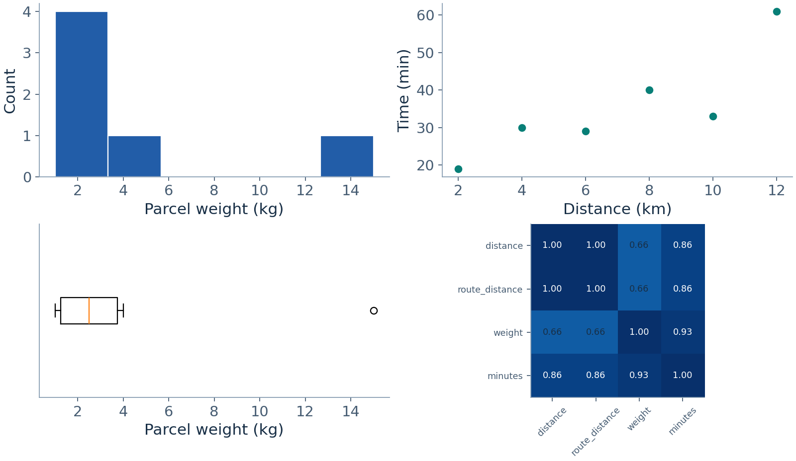

**👀 Read the visual.** Compare distance with route distance in the matrix. Values close to +1 move together in this sample, which makes the two inputs candidates for a redundancy check.

**👉 Use what you see.** Start with the plot that answers your question. Use the box plot to review unusual weights, then use the scatter plot to compare distance and time.

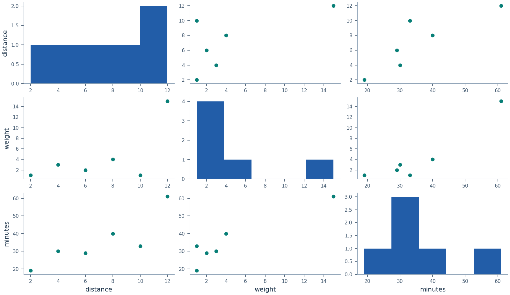

**👀 Read the visual.** Find the distance-versus-time cell. The dots are the same deliveries you saw in the earlier chart.

**👉 Use what you see.** If two measured columns show nearly the same pattern, check if both are available and useful before training with both.

**💡 Takeaway.** Distance and route distance track one another perfectly in the sample. The name for this kind of overlap between model inputs is **overlap between inputs (multicollinearity)**. Consider keeping one. If exploration guides modeling, use training data.

<a id="1-5-feature-engineering-feature-selection"></a>

### 🛠️ 1.5. Feature Engineering & Feature Selection

| Lesson name | What you’ll do | Download |
| --- | --- | --- |
| 160 - 1.5. Feature Engineering & Feature Selection **Practice** | See how creating or choosing useful input columns helps the model. | [Lesson ZIP](sample_code_folder/160-1-5-feature-engineering-feature-selection.zip) |

<!-- workbook-teaching:160:start -->
<details>
<summary>Learn, trace and apply this idea</summary>

### Learn and apply: 1.5. Feature Engineering & Feature Selection

**Your decision.** See how creating or choosing useful input columns helps the model.

**Ready check.** Explain a held-back score and why a target is not an input. Use [the learning path](LEARNING-PATH.md) and [the word list](GLOSSARY.md) for the earlier skill. Trace the small example on paper before code.

**What it means.** Model evaluation measures mistakes; permutation importance asks how a fitted model’s score changes when one input is shuffled.

**Why and when.** Use importance to investigate model reliance on a particular check set, alongside errors and data knowledge.

**A worked example to follow.** The lesson compares classifiers using training folds, checks the chosen rule on kept-back orders, and shuffles distance or weight on separate check rows. A larger score drop suggests more reliance in that check.

**Input → steps → output.** Open the supplied table. Its fields are `distance`, `weight`, `answer`. One original row is shown below in that same field order; `(missing)` marks a blank rather than zero.

```text
37 | 5 | 1
```

1. Name the particular field or object involved in this lesson’s decision above. Keep its meaning and units with it.
2. Open the [complete runnable Python example](lessons/160-1-5-feature-engineering-feature-selection/lesson.py). Its numbered comments connect reading, preparation and the resulting calculation. Install only the [declared requirements](lessons/160-1-5-feature-engineering-feature-selection/requirements.txt) using the same course Python, as shown in Setup.
3. Trace the worked example above through the script. Keep inputs apart from measured answers. Follow this script’s split and fit, then trace the saved preparation into the held-back result and any new request. A request must not supply its own training answer.
4. Read the result by its headings. Compare with [full recorded output](lessons/160-1-5-feature-engineering-feature-selection/expected-output.txt); the excerpt below belongs to the original supplied files. Your edits can change it.

```text
accuracy     0.900
precision    0.895
recall       0.944
F1           0.919
AUC-ROC      0.991
 distance  weight  predicted_urgent
```

**How to interpret it.** Trace the worked case into the result above. Tell a calculated estimate from a measured answer.

**Common mistakes and limits.** Importance is not a cause or a universal property of a field. Correlated inputs can share or hide reliance. A final test is not a repeated feature-selection tool.

**Use it yourself.** Shuffling distance reduces F1. Does this prove making a delivery shorter would cause it to become less urgent?

<details>
<summary>Check your choice and reason</summary>

No. It shows reliance by this fitted model under this check. Causal effects require a suitable design and assumptions, not a shuffled prediction score.

</details>

**A second check later.** Close the notes and explain the same decision using a different row from the supplied table. State one condition that would make this method unsuitable. If you cannot explain the reason, repeat the small worked example before adding more code.

</details>
<!-- workbook-teaching:160:end -->


**Before this lesson.** Know the target and which facts exist at prediction time.

**In simple words.** A useful feature must be known in time. Some inputs repeat the same information. Choose features within training, not by inspecting final test answers.

**Guess first.** Does a high feature-importance score prove a cause? Write your answer before running the example.

<details>
<summary>Read the reason after trying</summary>

No. It shows reliance by this model in this check.

</details>


**📌 Before you start.** Identify the raw columns the app will have when it makes a prediction.

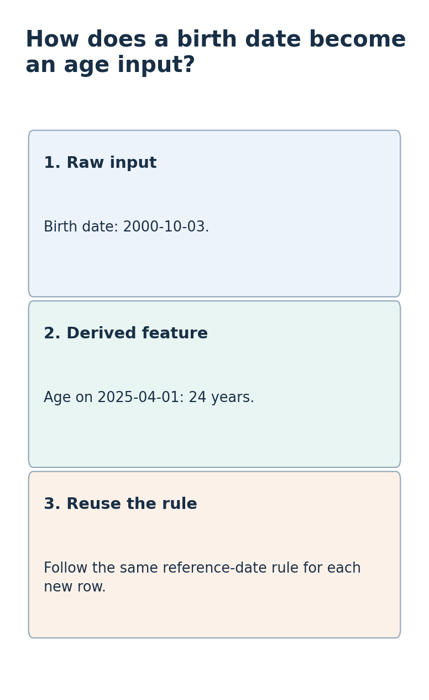

**👀 Read the visual.** Choose fields the app can use when the request arrives.

**👉 Use what you see.** Use a feature only if the app knows it at prediction time. A measured delivery time arrives after the trip.

<a id="visualization-helps-here"></a>

#### 🎨 Visualization helps here!

| Lesson name | What you’ll do | Download |
| --- | --- | --- |
| 161 - Visualization helps here! **Practice** | Shuffle model inputs one at a time and plot which one changes the score most. | [Lesson ZIP](sample_code_folder/161-visualization-helps-here.zip) |

<!-- workbook-teaching:161:start -->
<details>
<summary>Learn, trace and apply this idea</summary>

### Learn and apply: Visualization helps here!

**Your decision.** Shuffle model inputs one at a time and plot which one changes the score most.

**Ready check.** Explain a held-back score and why a target is not an input. Use [the learning path](LEARNING-PATH.md) and [the word list](GLOSSARY.md) for the earlier skill. Trace the small example on paper before code.

**What it means.** Model evaluation measures mistakes; permutation importance asks how a fitted model’s score changes when one input is shuffled.

**Why and when.** Use importance to investigate model reliance on a particular check set, alongside errors and data knowledge.

**A worked example to follow.** The lesson compares classifiers using training folds, checks the chosen rule on kept-back orders, and shuffles distance or weight on separate check rows. A larger score drop suggests more reliance in that check.

**Input → steps → output.** Open the supplied table. Its fields are `distance`, `weight`, `answer`. One original row is shown below in that same field order; `(missing)` marks a blank rather than zero.

```text
37 | 5 | 1
```

1. Name the particular field or object involved in this lesson’s decision above. Keep its meaning and units with it.
2. Open the [complete runnable Python example](lessons/161-visualization-helps-here/lesson.py). Its numbered comments connect reading, preparation and the resulting calculation. Install only the [declared requirements](lessons/161-visualization-helps-here/requirements.txt) using the same course Python, as shown in Setup.
3. Trace the worked example above through the script. Keep inputs apart from measured answers. Follow this script’s split and fit, then trace the saved preparation into the held-back result and any new request. A request must not supply its own training answer.
4. Read the result by its headings. Compare with [full recorded output](lessons/161-visualization-helps-here/expected-output.txt); the excerpt below belongs to the original supplied files. Your edits can change it.

```text
accuracy     0.900
precision    0.895
recall       0.944
F1           0.919
AUC-ROC      0.991
 distance  weight  predicted_urgent
```

**How to interpret it.** Trace the worked case into the result above. Tell a calculated estimate from a measured answer.

**Common mistakes and limits.** Importance is not a cause or a universal property of a field. Correlated inputs can share or hide reliance. A final test is not a repeated feature-selection tool.

**Use it yourself.** Shuffling distance reduces F1. Does this prove making a delivery shorter would cause it to become less urgent?

<details>
<summary>Check your choice and reason</summary>

No. It shows reliance by this fitted model under this check. Causal effects require a suitable design and assumptions, not a shuffled prediction score.

</details>

**A second check later.** Close the notes and explain the same decision using a different row from the supplied table. State one condition that would make this method unsuitable. If you cannot explain the reason, repeat the small worked example before adding more code.

</details>
<!-- workbook-teaching:161:end -->


**Before this lesson.** Know the target and which facts exist at prediction time.

**In simple words.** A useful feature must be known in time. Some inputs repeat the same information. Choose features within training, not by inspecting final test answers.

**Guess first.** Does a high feature-importance score prove a cause? Write your answer before running the example.

<details>
<summary>Read the reason after trying</summary>

No. It shows reliance by this model in this check.

</details>


<a id="feature-engineering"></a>

#### 🔧 Feature Engineering

| Lesson name | What you’ll do | Download |
| --- | --- | --- |
| 162 - Feature Engineering **Practice** | Create age and an urgent-word flag from two raw fields. | [Lesson ZIP](sample_code_folder/162-feature-engineering.zip) |

<!-- workbook-teaching:162:start -->
<details>
<summary>Learn, trace and apply this idea</summary>

### Learn and apply: Feature Engineering

**Your decision.** Create age and an urgent-word flag from two raw fields.

**Ready check.** Read dates and messages; know when the prediction happens. Use [the learning path](LEARNING-PATH.md) and [the word list](GLOSSARY.md) for the earlier skill. Trace the small example on paper before code.

**What it means.** Feature engineering derives a useful input from recorded information.

**Why and when.** Create a feature when its meaning is justified and its source is available at prediction time.

**A worked example to follow.** Age is computed at the stated reference date with a birthday check. A separate flag marks the complete word urgent in a message. The same function prepares old and new rows.

**Input → steps → output.** Open the supplied table. Its fields are `birth`, `message`, `review`. One original row is shown below in that same field order; `(missing)` marks a blank rather than zero.

```text
1990-11-16 | please help urgently | 1
```

1. Name the particular field or object involved in this lesson’s decision above. Keep its meaning and units with it.
2. Open the [complete runnable Python example](lessons/162-feature-engineering/lesson.py). Its numbered comments connect reading, preparation and the resulting calculation. Install only the [declared requirements](lessons/162-feature-engineering/requirements.txt) using the same course Python, as shown in Setup.
3. Trace the worked example above through the script. Keep inputs apart from measured answers. Follow this script’s split and fit, then trace the saved preparation into the held-back result and any new request. A request must not supply its own training answer.
4. Read the result by its headings. Compare with [full recorded output](lessons/162-feature-engineering/expected-output.txt); the excerpt below belongs to the original supplied files. Your edits can change it.

```text
 age  urgent
  34       0
  24       0
  42       1
  32       0
  27       1
```

**How to interpret it.** Trace the worked case into the result above. Tell a calculated estimate from a measured answer.

**Common mistakes and limits.** A keyword can miss negation or other languages. Age depends on the reference date; using a future reference or later field can introduce unavailable information.

**Use it yourself.** On a date before someone’s birthday, should subtracting birth year alone give their age? Does not urgent mean the same thing as urgent?

<details>
<summary>Check your choice and reason</summary>

Subtract one when the birthday is still ahead. The keyword flag alone does not distinguish not urgent, so inspect and validate that failure rather than treating the flag as meaning.

</details>

**A second check later.** Close the notes and explain the same decision using a different row from the supplied table. State one condition that would make this method unsuitable. If you cannot explain the reason, repeat the small worked example before adding more code.

</details>
<!-- workbook-teaching:162:end -->


**Before this lesson.** Know the target and which facts exist at prediction time.

**In simple words.** A useful feature must be known in time. Some inputs repeat the same information. Choose features within training, not by inspecting final test answers.

**Guess first.** Does a high feature-importance score prove a cause? Write your answer before running the example.

<details>
<summary>Read the reason after trying</summary>

No. It shows reliance by this model in this check.

</details>


<a id="create-new-features"></a>

##### ➕ Create new features

| Lesson name | What you’ll do | Download |
| --- | --- | --- |
| 163 - Create new features **Practice** | Give the model numbers derived from dates and messages. | [Lesson ZIP](sample_code_folder/163-create-new-features.zip) |

<!-- workbook-teaching:163:start -->
<details>
<summary>Learn, trace and apply this idea</summary>

### Learn and apply: Create new features

**Your decision.** Give the model numbers derived from dates and messages.

**Ready check.** Read dates and messages; know when the prediction happens. Use [the learning path](LEARNING-PATH.md) and [the word list](GLOSSARY.md) for the earlier skill. Trace the small example on paper before code.

**What it means.** Feature engineering derives a useful input from recorded information.

**Why and when.** Create a feature when its meaning is justified and its source is available at prediction time.

**A worked example to follow.** Age is computed at the stated reference date with a birthday check. A separate flag marks the complete word urgent in a message. The same function prepares old and new rows.

**Input → steps → output.** Open the supplied table. Its fields are `birth`, `message`, `review`. One original row is shown below in that same field order; `(missing)` marks a blank rather than zero.

```text
1990-11-16 | please help urgently | 1
```

1. Name the particular field or object involved in this lesson’s decision above. Keep its meaning and units with it.
2. Open the [complete runnable Python example](lessons/163-create-new-features/lesson.py). Its numbered comments connect reading, preparation and the resulting calculation. Install only the [declared requirements](lessons/163-create-new-features/requirements.txt) using the same course Python, as shown in Setup.
3. Trace the worked example above through the script. Keep inputs apart from measured answers. Follow this script’s split and fit, then trace the saved preparation into the held-back result and any new request. A request must not supply its own training answer.
4. Read the result by its headings. Compare with [full recorded output](lessons/163-create-new-features/expected-output.txt); the excerpt below belongs to the original supplied files. Your edits can change it.

```text
 age  urgent
  34       0
  24       0
  42       1
  32       0
  27       1
```

**How to interpret it.** Trace the worked case into the result above. Tell a calculated estimate from a measured answer.

**Common mistakes and limits.** A keyword can miss negation or other languages. Age depends on the reference date; using a future reference or later field can introduce unavailable information.

**Use it yourself.** On a date before someone’s birthday, should subtracting birth year alone give their age? Does not urgent mean the same thing as urgent?

<details>
<summary>Check your choice and reason</summary>

Subtract one when the birthday is still ahead. The keyword flag alone does not distinguish not urgent, so inspect and validate that failure rather than treating the flag as meaning.

</details>

**A second check later.** Close the notes and explain the same decision using a different row from the supplied table. State one condition that would make this method unsuitable. If you cannot explain the reason, repeat the small worked example before adding more code.

</details>
<!-- workbook-teaching:163:end -->


**Before this lesson.** Know the target and which facts exist at prediction time.

**In simple words.** A useful feature must be known in time. Some inputs repeat the same information. Choose features within training, not by inspecting final test answers.

**Guess first.** Does a high feature-importance score prove a cause? Write your answer before running the example.

<details>
<summary>Read the reason after trying</summary>

No. It shows reliance by this model in this check.

</details>


Create age as of the input date, and turn a message keyword into a model feature. Repeat the same steps on a new row.

**📋 Sample data**

| birth | message | review |
| --- | --- | --- |
| 1990-11-16 | please help urgently | 1 |
| 2000-10-03 | regular update | 0 |
| 1983-01-09 | urgent order change | 1 |
| 1992-07-05 | thanks for the update | 0 |
| 1998-03-01 | urgent call requested | 1 |

**▶️ Run.** Unzip the [lesson files](sample_code_folder/163-create-new-features.zip) and open a terminal in that folder. Install the lesson’s packages with `python -m pip install -r requirements.txt`, then run `python lesson.py`.

**🔹 Steps in the script**

1. Read the CSV and check its inputs, including birth, message, review.
2. Turn a date and a message into numerical inputs.
3. Teach the model from the training inputs and whether the message needs review.
4. Apply the fitted model to the new CSV rows and print a result for each row.

**✅ Check.** Look for age  urgent in the output excerpt below.

| age | urgent |
| --- | --- |
| 34 | 0 |
| 24 | 0 |

**Your small change.** Edit the input values in new_inputs.csv and compare the displayed predictions. Save the named CSV before running again.


<a id="transform-features"></a>

##### 🪄 Transform features

| Lesson name | What you’ll do | Download |
| --- | --- | --- |
| 166 - Transform features **Practice** | Change the shape of an input so the model can represent a curved pattern. | [Lesson ZIP](sample_code_folder/166-transform-features.zip) |

<!-- workbook-teaching:166:start -->
<details>
<summary>Learn, trace and apply this idea</summary>

### Learn and apply: Transform features

**Your decision.** Change the shape of an input so the model can represent a curved pattern.

**Ready check.** Calculate 2 × 2 and 2 × 2 × 2; keep validation separate. Use [the learning path](LEARNING-PATH.md) and [the word list](GLOSSARY.md) for the earlier skill. Trace the small example on paper before code.

**What it means.** Polynomial features add powers and products so a linear model can represent curved relationships.

**Why and when.** Try a small degree when a curve is plausible, then check whether the added flexibility helps on validation rows.

**A worked example to follow.** For one input x = 2, the degree-three row is x, x², x³ = 2, 4, 8. These are three features from one measured input. For x greater than 1, the cubic grows faster than the square. A graph with a logarithmic output axis uses multiplicative spacing, so start with the small table before reading that optional graph.

**Input → steps → output.** Open the supplied table. Its fields are `signal`, `cost`. One original row is shown below in that same field order; `(missing)` marks a blank rather than zero.

```text
1 | 10
```

1. Name the particular field or object involved in this lesson’s decision above. Keep its meaning and units with it.
2. Open the [complete runnable Python example](lessons/166-transform-features/lesson.py). Its numbered comments connect reading, preparation and the resulting calculation. Install only the [declared requirements](lessons/166-transform-features/requirements.txt) using the same course Python, as shown in Setup.
3. Trace the worked example above through the script. Keep inputs apart from measured answers. Follow this script’s split and fit, then trace the saved preparation into the held-back result and any new request. A request must not supply its own training answer.
4. Read the result by its headings. Compare with [full recorded output](lessons/166-transform-features/expected-output.txt); the excerpt below belongs to the original supplied files. Your edits can change it.

```text
Polynomial Features first two training rows: [[1.0, 1.0, 1.0], [5.0, 25.0, 125.0]]
Actual costs: [23, 48]
Predicted costs: [22.0, 49.4]
 signal  predicted_cost
      3           14.10
     15           26.99
```

**How to interpret it.** Trace the worked case into the result above. Tell a calculated estimate from a measured answer.

**Common mistakes and limits.** High powers can grow rapidly outside training and overfit. More columns are not automatically more evidence. Scaling and regularization may matter.

**Use it yourself.** Write the three features for x = 3. Does the cubic term make predictions safe far outside the observed range?

<details>
<summary>Check your choice and reason</summary>

They are 3, 9 and 27. No: large powers can make extrapolation unstable. Choose degree within validation and state the supported range.

</details>

**A second check later.** Close the notes and explain the same decision using a different row from the supplied table. State one condition that would make this method unsuitable. If you cannot explain the reason, repeat the small worked example before adding more code.

</details>
<!-- workbook-teaching:166:end -->


**Before this lesson.** Know the target and which facts exist at prediction time.

**In simple words.** A useful feature must be known in time. Some inputs repeat the same information. Choose features within training, not by inspecting final test answers.

**Guess first.** Does a high feature-importance score prove a cause? Write your answer before running the example.

<details>
<summary>Read the reason after trying</summary>

No. It shows reliance by this model in this check.

</details>


Run [Log Transformation](#log-transformation-log-scaling) and [Polynomial Features](#polynomial-features-feature-expansion). Both exercises read original measurements and pass the transformed columns into a model.

<a id="feature-selection"></a>

#### 🔬 Feature Selection

| Lesson name | What you’ll do | Download |
| --- | --- | --- |
| 169 - Feature Selection **Practice** | Choose useful input columns, then see how the choice affects predictions. | [Lesson ZIP](sample_code_folder/169-feature-selection.zip) |

<!-- workbook-teaching:169:start -->
<details>
<summary>Learn, trace and apply this idea</summary>

### Learn and apply: Feature Selection

**Your decision.** Choose useful input columns, then see how the choice affects predictions.

**Ready check.** Distinguish a measurement, an ID and a known answer. Use [the learning path](LEARNING-PATH.md) and [the word list](GLOSSARY.md) for the earlier skill. Trace the small example on paper before code.

**What it means.** Feature selection chooses a subset of inputs using a stated rule.

**Why and when.** Use it to remove unusable/redundant fields or compare a smaller representation, while learning selection inside training.

**A worked example to follow.** The script excludes id and duplicate_minutes. ANOVA compares class-related variation in candidate inputs. The chi-square example uses the nonnegative keyword indicator; mere positivity does not make every measurement suitable for that test.

**Input → steps → output.** Open the supplied table. Its fields are `id`, `minutes`, `duplicate_minutes`, `keyword`, `review`. One original row is shown below in that same field order; `(missing)` marks a blank rather than zero.

```text
0 | 2 | 2 | 0 | 0
```

1. Name the particular field or object involved in this lesson’s decision above. Keep its meaning and units with it.
2. Open the [complete runnable Python example](lessons/169-feature-selection/lesson.py). Its numbered comments connect reading, preparation and the resulting calculation. Install only the [declared requirements](lessons/169-feature-selection/requirements.txt) using the same course Python, as shown in Setup.
3. Trace the worked example above through the script. Keep inputs apart from measured answers. Follow this script’s split and fit, then trace the saved preparation into the held-back result and any new request. A request must not supply its own training answer.
4. Read the result by its headings. Compare with [full recorded output](lessons/169-feature-selection/expected-output.txt); the excerpt below belongs to the original supplied files. Your edits can change it.

```text
ANOVA selected: ['minutes']
Held-out labels: [0, 1]
Chi-square selected: ['keyword']
Held-out labels: [0, 1]
```

**How to interpret it.** Trace the worked case into the result above. Tell a calculated estimate from a measured answer.

**Common mistakes and limits.** A high score is not causality. Selecting from the full dataset before cross-validation leaks check information. Respect assumptions and check whether selection improves actual validation behavior.

**Use it yourself.** An ID column changes when records are sorted. Should its statistical association automatically make it a good input?

<details>
<summary>Check your choice and reason</summary>

No. Investigate how it was assigned and whether its apparent relationship will exist at prediction time. An accidental identifier association can fail on later records.

</details>

**A second check later.** Close the notes and explain the same decision using a different row from the supplied table. State one condition that would make this method unsuitable. If you cannot explain the reason, repeat the small worked example before adding more code.

</details>
<!-- workbook-teaching:169:end -->


**Before this lesson.** Know the target and which facts exist at prediction time.

**In simple words.** A useful feature must be known in time. Some inputs repeat the same information. Choose features within training, not by inspecting final test answers.

**Guess first.** Does a high feature-importance score prove a cause? Write your answer before running the example.

<details>
<summary>Read the reason after trying</summary>

No. It shows reliance by this model in this check.

</details>


<a id="remove-irrelevant-or-redundant-features"></a>

##### 🧽 Remove irrelevant or redundant features

| Lesson name | What you’ll do | Download |
| --- | --- | --- |
| 170 - Remove irrelevant or redundant features **Practice** | Remove an ID and a duplicate measurement before selecting model inputs. | [Lesson ZIP](sample_code_folder/170-remove-irrelevant-or-redundant-features.zip) |

<!-- workbook-teaching:170:start -->
<details>
<summary>Learn, trace and apply this idea</summary>

### Learn and apply: Remove irrelevant or redundant features

**Your decision.** Remove an ID and a duplicate measurement before selecting model inputs.

**Ready check.** Distinguish a measurement, an ID and a known answer. Use [the learning path](LEARNING-PATH.md) and [the word list](GLOSSARY.md) for the earlier skill. Trace the small example on paper before code.

**What it means.** Feature selection chooses a subset of inputs using a stated rule.

**Why and when.** Use it to remove unusable/redundant fields or compare a smaller representation, while learning selection inside training.

**A worked example to follow.** The script excludes id and duplicate_minutes. ANOVA compares class-related variation in candidate inputs. The chi-square example uses the nonnegative keyword indicator; mere positivity does not make every measurement suitable for that test.

**Input → steps → output.** Open the supplied table. Its fields are `id`, `minutes`, `duplicate_minutes`, `keyword`, `review`. One original row is shown below in that same field order; `(missing)` marks a blank rather than zero.

```text
0 | 2 | 2 | 0 | 0
```

1. Name the particular field or object involved in this lesson’s decision above. Keep its meaning and units with it.
2. Open the [complete runnable Python example](lessons/170-remove-irrelevant-or-redundant-features/lesson.py). Its numbered comments connect reading, preparation and the resulting calculation. Install only the [declared requirements](lessons/170-remove-irrelevant-or-redundant-features/requirements.txt) using the same course Python, as shown in Setup.
3. Trace the worked example above through the script. Keep inputs apart from measured answers. Follow this script’s split and fit, then trace the saved preparation into the held-back result and any new request. A request must not supply its own training answer.
4. Read the result by its headings. Compare with [full recorded output](lessons/170-remove-irrelevant-or-redundant-features/expected-output.txt); the excerpt below belongs to the original supplied files. Your edits can change it.

```text
Excluded columns: ['id', 'duplicate_minutes']
ANOVA selected: ['minutes']
Held-out labels: [0, 1]
Chi-square selected: ['keyword']
Held-out labels: [0, 1]
```

**How to interpret it.** Trace the worked case into the result above. Tell a calculated estimate from a measured answer.

**Common mistakes and limits.** A high score is not causality. Selecting from the full dataset before cross-validation leaks check information. Respect assumptions and check whether selection improves actual validation behavior.

**Use it yourself.** An ID column changes when records are sorted. Should its statistical association automatically make it a good input?

<details>
<summary>Check your choice and reason</summary>

No. Investigate how it was assigned and whether its apparent relationship will exist at prediction time. An accidental identifier association can fail on later records.

</details>

**A second check later.** Close the notes and explain the same decision using a different row from the supplied table. State one condition that would make this method unsuitable. If you cannot explain the reason, repeat the small worked example before adding more code.

</details>
<!-- workbook-teaching:170:end -->


**Before this lesson.** Know the target and which facts exist at prediction time.

**In simple words.** A useful feature must be known in time. Some inputs repeat the same information. Choose features within training, not by inspecting final test answers.

**Guess first.** Does a high feature-importance score prove a cause? Write your answer before running the example.

<details>
<summary>Read the reason after trying</summary>

No. It shows reliance by this model in this check.

</details>


<a id="use-statistical-tests-anova-chi-square-test"></a>

##### 🧪 Use statistical tests (ANOVA, Chi-square test)

| Lesson name | What you’ll do | Download |
| --- | --- | --- |
| 171 - Use statistical tests (ANOVA, Chi-square test) **Practice** | Compare ANOVA and chi-square to see which input each method chooses. | [Lesson ZIP](sample_code_folder/171-use-statistical-tests-anova-chi-square-test.zip) |

<!-- workbook-teaching:171:start -->
<details>
<summary>Learn, trace and apply this idea</summary>

### Learn and apply: Use statistical tests (ANOVA, Chi-square test)

**Your decision.** Compare ANOVA and chi-square to see which input each method chooses.

**Ready check.** Distinguish a measurement, an ID and a known answer. Use [the learning path](LEARNING-PATH.md) and [the word list](GLOSSARY.md) for the earlier skill. Trace the small example on paper before code.

**What it means.** Feature selection chooses a subset of inputs using a stated rule.

**Why and when.** Use it to remove unusable/redundant fields or compare a smaller representation, while learning selection inside training.

**A worked example to follow.** The script excludes id and duplicate_minutes. ANOVA compares class-related variation in candidate inputs. The chi-square example uses the nonnegative keyword indicator; mere positivity does not make every measurement suitable for that test.

**Input → steps → output.** Open the supplied table. Its fields are `id`, `minutes`, `duplicate_minutes`, `keyword`, `review`. One original row is shown below in that same field order; `(missing)` marks a blank rather than zero.

```text
0 | 2 | 2 | 0 | 0
```

1. Name the particular field or object involved in this lesson’s decision above. Keep its meaning and units with it.
2. Open the [complete runnable Python example](lessons/171-use-statistical-tests-anova-chi-square-test/lesson.py). Its numbered comments connect reading, preparation and the resulting calculation. Install only the [declared requirements](lessons/171-use-statistical-tests-anova-chi-square-test/requirements.txt) using the same course Python, as shown in Setup.
3. Trace the worked example above through the script. Keep inputs apart from measured answers. Follow this script’s split and fit, then trace the saved preparation into the held-back result and any new request. A request must not supply its own training answer.
4. Read the result by its headings. Compare with [full recorded output](lessons/171-use-statistical-tests-anova-chi-square-test/expected-output.txt); the excerpt below belongs to the original supplied files. Your edits can change it.

```text
ANOVA selected: ['minutes']
Held-out labels: [0, 1]
Chi-square selected: ['keyword']
Held-out labels: [0, 1]
```

**How to interpret it.** Trace the worked case into the result above. Tell a calculated estimate from a measured answer.

**Common mistakes and limits.** A high score is not causality. Selecting from the full dataset before cross-validation leaks check information. Respect assumptions and check whether selection improves actual validation behavior.

**Use it yourself.** An ID column changes when records are sorted. Should its statistical association automatically make it a good input?

<details>
<summary>Check your choice and reason</summary>

No. Investigate how it was assigned and whether its apparent relationship will exist at prediction time. An accidental identifier association can fail on later records.

</details>

**A second check later.** Close the notes and explain the same decision using a different row from the supplied table. State one condition that would make this method unsuitable. If you cannot explain the reason, repeat the small worked example before adding more code.

</details>
<!-- workbook-teaching:171:end -->


**Before this lesson.** Know the target and which facts exist at prediction time.

**In simple words.** A useful feature must be known in time. Some inputs repeat the same information. Choose features within training, not by inspecting final test answers.

**Guess first.** Does a high feature-importance score prove a cause? Write your answer before running the example.

<details>
<summary>Read the reason after trying</summary>

No. It shows reliance by this model in this check.

</details>


Compare feature scores on original observations. Remove a duplicate measurement and an ID, fit ANOVA or chi-square selection inside the pipeline, and predict kept-back labels.

**📋 Sample data**

| id | minutes | duplicate_minutes | keyword | review |
| --- | --- | --- | --- | --- |
| 0 | 2 | 2 | 0 | 0 |
| 1 | 18 | 18 | 1 | 1 |
| 2 | 3 | 3 | 0 | 0 |
| 3 | 20 | 20 | 1 | 1 |
| 4 | 4 | 4 | 1 | 0 |
| 5 | 23 | 23 | 0 | 1 |
| 6 | 5 | 5 | 0 | 0 |
| 7 | 24 | 24 | 1 | 1 |

**▶️ Run.** Unzip the [lesson files](sample_code_folder/171-use-statistical-tests-anova-chi-square-test.zip) and open a terminal in that folder. Install the lesson’s packages with `python -m pip install -r requirements.txt`, then run `python lesson.py`.

**🔹 Steps in the script**

1. Read the CSV and check its inputs, including id, minutes, duplicate_minutes.
2. Give each method the same practice data so you can compare the results.

**✅ Check.** Look for ANOVA selected: ['minutes'] in the output excerpt below.

```text
ANOVA selected: ['minutes']
Held-out labels: [0, 1]
Chi-square selected: ['keyword']
```

**Your small change.** In sample.csv, change one keyword indicator from 0 to 1. Keep the recorded review answer. Compare which field is selected. Changing id alone should not affect the model. Save the named CSV before running again.


**💡 Takeaway.** Chi-square uses the keyword indicator here. ANOVA uses the continuous minutes field and the indicator. These answer different statistical questions. Positive numbers alone do not make a feature suitable for chi-square.

<a id="encoding-categorical-variables"></a>

#### 🏷️ Encoding categorical variables

| Lesson name | What you’ll do | Download |
| --- | --- | --- |
| 174 - Encoding category variables **Practice** | Turn category names into input numbers the model can read. | [Lesson ZIP](sample_code_folder/174-encoding-categorical-variables.zip) |

<!-- workbook-teaching:174:start -->
<details>
<summary>Learn, trace and apply this idea</summary>

### Learn and apply: Encoding category variables

**Your decision.** Turn category names into input numbers the model can read.

**Ready check.** Tell a category name from a measured amount. Use [the learning path](LEARNING-PATH.md) and [the word list](GLOSSARY.md) for the earlier skill. Trace the small example on paper before code.

**What it means.** One-hot encoding gives each known category a separate 0-or-1 column. It avoids inventing an order between names.

**Why and when.** Use it for a modest set of unordered names when the chosen model requires numeric inputs.

**A worked example to follow.** This script explicitly declares the column order Red, Blue, Green. Green becomes 0, 0, 1. Fit the encoder using training inputs, then transform check rows and new requests with that same encoder. The order and number of columns stay fixed.

**Input → steps → output.** Open the supplied table. Its fields are `color`, `orders`. One original row is shown below in that same field order; `(missing)` marks a blank rather than zero.

```text
Red | 20
```

1. Name the particular field or object involved in this lesson’s decision above. Keep its meaning and units with it.
2. Open the [complete runnable Python example](lessons/174-encoding-categorical-variables/lesson.py). Its numbered comments connect reading, preparation and the resulting calculation. Install only the [declared requirements](lessons/174-encoding-categorical-variables/requirements.txt) using the same course Python, as shown in Setup.
3. Trace the worked example above through the script. Keep inputs apart from measured answers. Follow this script’s split and fit, then trace the saved preparation into the held-back result and any new request. A request must not supply its own training answer.
4. Read the result by its headings. Compare with [full recorded output](lessons/174-encoding-categorical-variables/expected-output.txt); the excerpt below belongs to the original supplied files. Your edits can change it.

```text
Check actual / predicted: [23] [21.0]
Original color  Red  Blue  Green
           Red    1     0      0
          Blue    0     1      0
         Green    0     0      1
        Purple    0     0      0
```

**How to interpret it.** Trace the worked case into the result above. Tell a calculated estimate from a measured answer.

**Common mistakes and limits.** Purple becomes 0, 0, 0 here because handle_unknown is ignore. That is an allowed representation, not evidence about Purple-specific demand. Do not fit a separate encoder on new requests. Thousands of categories may need a different, validated approach.

**Use it yourself.** Encode Blue on paper. A new request says Yellow. Add a Yellow column only to that request, or keep the saved three-column schema? Explain what the service must decide.

<details>
<summary>Check your choice and reason</summary>

Blue is 0, 1, 0. Keep the saved schema; changing only the request columns breaks the model contract. This demonstration maps Yellow to all zeros. A real service must explicitly reject, review or use a tested fallback for unfamiliar names.

</details>

**A second check later.** Close the notes and explain the same decision using a different row from the supplied table. State one condition that would make this method unsuitable. If you cannot explain the reason, repeat the small worked example before adding more code.

</details>
<!-- workbook-teaching:174:end -->


**Before this lesson.** Know the target and which facts exist at prediction time.

**In simple words.** A useful feature must be known in time. Some inputs repeat the same information. Choose features within training, not by inspecting final test answers.

**Guess first.** Does a high feature-importance score prove a cause? Write your answer before running the example.

<details>
<summary>Read the reason after trying</summary>

No. It shows reliance by this model in this check.

</details>


Run [One-Hot Encoding](#one-hot-encoding-for-unordered-categories) on unordered inputs and [Turn ordered names into numbers (OrdinalEncoder)](#label-encoding-for-ordered-categories) for the separate ordinal-input and label demonstrations.

<a id="scaling-and-normalization"></a>

#### ⚖️ Scaling and Normalization

| Lesson name | What you’ll do | Download |
| --- | --- | --- |
| 175 - Scaling and Normalization **Practice** | Put distance and weight on comparable scales before predicting time. | [Lesson ZIP](sample_code_folder/175-scaling-and-normalization.zip) |

<!-- workbook-teaching:175:start -->
<details>
<summary>Learn, trace and apply this idea</summary>

### Learn and apply: Scaling and Normalization

**Your decision.** Put distance and weight on comparable scales before predicting time.

**Ready check.** Read a minimum, maximum, average and spread. Use [the learning path](LEARNING-PATH.md) and [the word list](GLOSSARY.md) for the earlier skill. Trace the small example on paper before code.

**What it means.** Scaling changes the numbers passed to a model, using a rule fitted on training values.

**Why and when.** Use it when input units affect distances or penalties. Compare with unchanged inputs; trees often do not need ordinary linear scaling.

**A worked example to follow.** Min-max uses (value − training minimum) ÷ training range. With limits 1 and 50 km, 90 km becomes 89 ÷ 49, about 1.8163. Standard scaling subtracts the training mean and divides by its standard deviation. Robust scaling uses the training median and IQR.

**Input → steps → output.** Open the supplied table. Its fields are `distance_km`, `weight_kg`, `delivery_minutes`. One original row is shown below in that same field order; `(missing)` marks a blank rather than zero.

```text
2 | 1 | 19
```

1. Name the particular field or object involved in this lesson’s decision above. Keep its meaning and units with it.
2. Open the [complete runnable Python example](lessons/175-scaling-and-normalization/lesson.py). Its numbered comments connect reading, preparation and the resulting calculation. Install only the [declared requirements](lessons/175-scaling-and-normalization/requirements.txt) using the same course Python, as shown in Setup.
3. Trace the worked example above through the script. Keep inputs apart from measured answers. Follow this script’s split and fit, then trace the saved preparation into the held-back result and any new request. A request must not supply its own training answer.
4. Read the result by its headings. Compare with [full recorded output](lessons/175-scaling-and-normalization/expected-output.txt); the excerpt below belongs to the original supplied files. Your edits can change it.

```text
Training rows before and after scaling
 distance_km  weight_kg  scaled_distance  scaled_weight
           2          1             0.00           0.00
           4          3             0.33           0.67
           6          2             0.67           0.33
           8          4             1.00           1.00
```

**How to interpret it.** Trace the worked case into the result above. Tell a calculated estimate from a measured answer.

**Common mistakes and limits.** New values can fall outside a fitted 0–1 range. Do not refit on each request. Scaling is not a guarantee of better predictions or a way to make a distribution normal.

**Use it yourself.** The fitted range is 1–50 km. What does 25 km become? Does an out-of-range number automatically mean an invalid measurement?

<details>
<summary>Check your choice and reason</summary>

25 becomes 24 ÷ 49, about 0.4898. An out-of-range number may be physically possible but outside the evidence for a service. Keep the fitted rule and apply a stated acceptance/fallback policy.

</details>

**A second check later.** Close the notes and explain the same decision using a different row from the supplied table. State one condition that would make this method unsuitable. If you cannot explain the reason, repeat the small worked example before adding more code.

</details>
<!-- workbook-teaching:175:end -->


**Before this lesson.** Know the target and which facts exist at prediction time.

**In simple words.** A useful feature must be known in time. Some inputs repeat the same information. Choose features within training, not by inspecting final test answers.

**Guess first.** Does a high feature-importance score prove a cause? Write your answer before running the example.

<details>
<summary>Read the reason after trying</summary>

No. It shows reliance by this model in this check.

</details>


Run the two independent model examples under [Normalize or Standardize Data](#1-3-5-normalize-or-standardize-data).

<a id="visualization-techniques-2"></a>

#### 🎨 Visualization Techniques

| Lesson name | What you’ll do | Download |
| --- | --- | --- |
| 176 - Visualization Techniques **Practice** | Plot model importance and compare related inputs. | [Lesson ZIP](sample_code_folder/176-visualization-techniques-2.zip) |

<!-- workbook-teaching:176:start -->
<details>
<summary>Learn, trace and apply this idea</summary>

### Learn and apply: Visualization Techniques

**Your decision.** Plot model importance and compare related inputs.

**Ready check.** Explain a held-back score and why a target is not an input. Use [the learning path](LEARNING-PATH.md) and [the word list](GLOSSARY.md) for the earlier skill. Trace the small example on paper before code.

**What it means.** Model evaluation measures mistakes; permutation importance asks how a fitted model’s score changes when one input is shuffled.

**Why and when.** Use importance to investigate model reliance on a particular check set, alongside errors and data knowledge.

**A worked example to follow.** The lesson compares classifiers using training folds, checks the chosen rule on kept-back orders, and shuffles distance or weight on separate check rows. A larger score drop suggests more reliance in that check.

**Input → steps → output.** Open the supplied table. Its fields are `distance`, `weight`, `answer`. One original row is shown below in that same field order; `(missing)` marks a blank rather than zero.

```text
37 | 5 | 1
```

1. Name the particular field or object involved in this lesson’s decision above. Keep its meaning and units with it.
2. Open the [complete runnable Python example](lessons/176-visualization-techniques-2/lesson.py). Its numbered comments connect reading, preparation and the resulting calculation. Install only the [declared requirements](lessons/176-visualization-techniques-2/requirements.txt) using the same course Python, as shown in Setup.
3. Trace the worked example above through the script. Keep inputs apart from measured answers. Follow this script’s split and fit, then trace the saved preparation into the held-back result and any new request. A request must not supply its own training answer.
4. Read the result by its headings. Compare with [full recorded output](lessons/176-visualization-techniques-2/expected-output.txt); the excerpt below belongs to the original supplied files. Your edits can change it.

```text
accuracy     0.900
precision    0.895
recall       0.944
F1           0.919
AUC-ROC      0.991
 distance  weight  predicted_urgent
```

**How to interpret it.** Trace the worked case into the result above. Tell a calculated estimate from a measured answer.

**Common mistakes and limits.** Importance is not a cause or a universal property of a field. Correlated inputs can share or hide reliance. A final test is not a repeated feature-selection tool.

**Use it yourself.** Shuffling distance reduces F1. Does this prove making a delivery shorter would cause it to become less urgent?

<details>
<summary>Check your choice and reason</summary>

No. It shows reliance by this fitted model under this check. Causal effects require a suitable design and assumptions, not a shuffled prediction score.

</details>

**A second check later.** Close the notes and explain the same decision using a different row from the supplied table. State one condition that would make this method unsuitable. If you cannot explain the reason, repeat the small worked example before adding more code.

</details>
<!-- workbook-teaching:176:end -->


**Before this lesson.** Know the target and which facts exist at prediction time.

**In simple words.** A useful feature must be known in time. Some inputs repeat the same information. Choose features within training, not by inspecting final test answers.

**Guess first.** Does a high feature-importance score prove a cause? Write your answer before running the example.

<details>
<summary>Read the reason after trying</summary>

No. It shows reliance by this model in this check.

</details>


<a id="bar-plots"></a>

##### 📊 Bar plots

| Lesson name | What you’ll do | Download |
| --- | --- | --- |
| 177 - Bar plots **Practice** | Use bars to compare how much each input helps the model. | [Lesson ZIP](sample_code_folder/177-bar-plots.zip) |

<!-- workbook-teaching:177:start -->
<details>
<summary>Learn, trace and apply this idea</summary>

### Learn and apply: Bar plots

**Your decision.** Use bars to compare how much each input helps the model.

**Ready check.** Explain a held-back score and why a target is not an input. Use [the learning path](LEARNING-PATH.md) and [the word list](GLOSSARY.md) for the earlier skill. Trace the small example on paper before code.

**What it means.** Model evaluation measures mistakes; permutation importance asks how a fitted model’s score changes when one input is shuffled.

**Why and when.** Use importance to investigate model reliance on a particular check set, alongside errors and data knowledge.

**A worked example to follow.** The lesson compares classifiers using training folds, checks the chosen rule on kept-back orders, and shuffles distance or weight on separate check rows. A larger score drop suggests more reliance in that check.

**Input → steps → output.** Open the supplied table. Its fields are `distance`, `weight`, `answer`. One original row is shown below in that same field order; `(missing)` marks a blank rather than zero.

```text
37 | 5 | 1
```

1. Name the particular field or object involved in this lesson’s decision above. Keep its meaning and units with it.
2. Open the [complete runnable Python example](lessons/177-bar-plots/lesson.py). Its numbered comments connect reading, preparation and the resulting calculation. Install only the [declared requirements](lessons/177-bar-plots/requirements.txt) using the same course Python, as shown in Setup.
3. Trace the worked example above through the script. Keep inputs apart from measured answers. Follow this script’s split and fit, then trace the saved preparation into the held-back result and any new request. A request must not supply its own training answer.
4. Read the result by its headings. Compare with [full recorded output](lessons/177-bar-plots/expected-output.txt); the excerpt below belongs to the original supplied files. Your edits can change it.

```text
accuracy     0.900
precision    0.895
recall       0.944
F1           0.919
AUC-ROC      0.991
 distance  weight  predicted_urgent
```

**How to interpret it.** Trace the worked case into the result above. Tell a calculated estimate from a measured answer.

**Common mistakes and limits.** Importance is not a cause or a universal property of a field. Correlated inputs can share or hide reliance. A final test is not a repeated feature-selection tool.

**Use it yourself.** Shuffling distance reduces F1. Does this prove making a delivery shorter would cause it to become less urgent?

<details>
<summary>Check your choice and reason</summary>

No. It shows reliance by this fitted model under this check. Causal effects require a suitable design and assumptions, not a shuffled prediction score.

</details>

**A second check later.** Close the notes and explain the same decision using a different row from the supplied table. State one condition that would make this method unsuitable. If you cannot explain the reason, repeat the small worked example before adding more code.

</details>
<!-- workbook-teaching:177:end -->


**Before this lesson.** Know the target and which facts exist at prediction time.

**In simple words.** A useful feature must be known in time. Some inputs repeat the same information. Choose features within training, not by inspecting final test answers.

**Guess first.** Does a high feature-importance score prove a cause? Write your answer before running the example.

<details>
<summary>Read the reason after trying</summary>

No. It shows reliance by this model in this check.

</details>


<a id="pair-plots-2"></a>

##### 🖼️ Pair plots

| Lesson name | What you’ll do | Download |
| --- | --- | --- |
| 178 - Pair plots **Practice** | Use a pair plot to check relationships before deciding which columns to keep. | [Lesson ZIP](sample_code_folder/178-pair-plots-2.zip) |

<!-- workbook-teaching:178:start -->
<details>
<summary>Learn, trace and apply this idea</summary>

### Learn and apply: Pair plots

**Your decision.** Use a pair plot to check relationships before deciding which columns to keep.

**Ready check.** Read horizontal and vertical axes and identify one record. Use [the learning path](LEARNING-PATH.md) and [the word list](GLOSSARY.md) for the earlier skill. Trace the small example on paper before code.

**What it means.** Exploration asks questions of recorded data using summaries and charts.

**Why and when.** Use a chart that answers a particular question before making a modeling decision.

**A worked example to follow.** A histogram counts records in weight ranges; a scatterplot puts one delivery at distance and time; a heatmap summarizes correlations; a pair plot shows several pairs. The duplicate route_distance column moves exactly with distance in the tiny sample.

**Input → steps → output.** Open the supplied table. Its fields are `distance`, `route_distance`, `weight`, `minutes`. One original row is shown below in that same field order; `(missing)` marks a blank rather than zero.

```text
2 | 2.2 | 1 | 19
```

1. Name the particular field or object involved in this lesson’s decision above. Keep its meaning and units with it.
2. Open the [complete runnable Python example](lessons/178-pair-plots-2/lesson.py). Its numbered comments connect reading, preparation and the resulting calculation. Install only the [declared requirements](lessons/178-pair-plots-2/requirements.txt) using the same course Python, as shown in Setup.
3. Trace the worked example above through the script. Keep the original field beside the inspected or changed value. Trace the named preparation or review step, and check whether it uses a fixed rule or a value learned from training.
4. Read the result by its headings. Compare with [full recorded output](lessons/178-pair-plots-2/expected-output.txt); the excerpt below belongs to the original supplied files. Your edits can change it.

```text
        distance  route_distance  weight  minutes
mean         7.0             7.7    4.33    35.33
median       7.0             7.7    2.50    31.50
skew         0.0            -0.0    2.20     1.26
Distance overlap: 1.0
```

**How to interpret it.** Trace the worked case into the result above. Tell a calculated estimate from a measured answer.

**Common mistakes and limits.** Correlation does not establish cause. Axis scales, missing rows and small counts can change a story. Use training data when exploration guides model choices.

**Use it yourself.** Which chart would show whether longer trips tend to take longer? Which chart would show how often a weight range occurs?

<details>
<summary>Check your choice and reason</summary>

Use a distance-versus-time scatterplot for the relationship and a weight histogram for frequency. Name units and counts; do not infer causation from a sloping cloud.

</details>

**A second check later.** Close the notes and explain the same decision using a different row from the supplied table. State one condition that would make this method unsuitable. If you cannot explain the reason, repeat the small worked example before adding more code.

</details>
<!-- workbook-teaching:178:end -->


**Before this lesson.** Know the target and which facts exist at prediction time.

**In simple words.** A useful feature must be known in time. Some inputs repeat the same information. Choose features within training, not by inspecting final test answers.

**Guess first.** Does a high feature-importance score prove a cause? Write your answer before running the example.

<details>
<summary>Read the reason after trying</summary>

No. It shows reliance by this model in this check.

</details>


Run the [Pair Plots](#pair-plots) for joint relationships and the [Feature Importance Plot](#feature-importance-plot) to see how a trained model uses the selected fields.

<a id="1-6-data-splitting"></a>

### 🏗️ 1.6. Data Splitting

| Lesson name | What you’ll do | Download |
| --- | --- | --- |
| 179 - 1.6. Data Splitting **Core** | Give training, validation and test rows different jobs. | [Lesson ZIP](sample_code_folder/179-1-6-data-splitting.zip) |

<!-- workbook-teaching:179:start -->
<details>
<summary>Learn, trace and apply this idea</summary>

### Learn and apply: 1.6. Data Splitting

**Your decision.** Give training, validation and test rows different jobs.

**Ready check.** Name inputs and answers; count urgent and regular orders. Use [the learning path](LEARNING-PATH.md) and [the word list](GLOSSARY.md) for the earlier skill. Trace the small example on paper before code.

**What it means.** Training learns, validation chooses, and test checks the frozen choice. A split defines which new-case question is being tested.

**Why and when.** Set aside suitable check rows before any data-based preparation or model selection.

**A worked example to follow.** The 70/20/10 recipe uses 70 orders for fitting, 20 for choosing tree depth and 10 for testing. Balanced accuracy averages recall within each class: if 8/10 urgent and 18/20 regular are correct, it is (0.8 + 0.9) ÷ 2 = 0.85. This is a reading aid, not the script’s measured result.

**Input → steps → output.** Open the supplied table. Its fields are `shipment_id`, `distance_km`, `weight_kg`, `urgent`. One original row is shown below in that same field order; `(missing)` marks a blank rather than zero.

```text
D001 | 2.78 | 6.47 | False
```

1. Name the particular field or object involved in this lesson’s decision above. Keep its meaning and units with it.
2. Open the [complete runnable Python example](lessons/179-1-6-data-splitting/lesson.py). Its numbered comments connect reading, preparation and the resulting calculation. Install only the [declared requirements](lessons/179-1-6-data-splitting/requirements.txt) using the same course Python, as shown in Setup.
3. Trace the worked example above through the script. Keep inputs apart from measured answers. Follow this script’s split and fit, then trace the saved preparation into the held-back result and any new request. A request must not supply its own training answer.
4. Read the result by its headings. Compare with [full recorded output](lessons/179-1-6-data-splitting/expected-output.txt); the excerpt below belongs to the original supplied files. Your edits can change it.

```text
Shared shipment IDs across splits: 0
       Set  Rows  Urgent  Urgent (%)
  Training    70      14        20.0
Validation    20       4        20.0
      Test    10       2        20.0

```

**How to interpret it.** Trace the worked case into the result above. Tell a calculated estimate from a measured answer.

**Common mistakes and limits.** A percentage ratio does not establish independence. Keep repeated shipment identity together. Stratification preserves class shares; it does not fix time or customer leakage.

**Use it yourself.** A tree catches 4 of 5 urgent orders and correctly leaves 9 of 10 regular orders unflagged. Calculate balanced accuracy. May you choose its depth from final test answers?

<details>
<summary>Check your choice and reason</summary>

The average of 0.8 and 0.9 is 0.85. Choose depth on validation or inside training cross-validation, then use the final test once for the chosen procedure.

</details>

**A second check later.** Close the notes and explain the same decision using a different row from the supplied table. State one condition that would make this method unsuitable. If you cannot explain the reason, repeat the small worked example before adding more code.

</details>
<!-- workbook-teaching:179:end -->


**Before this lesson.** Understand the three row roles from Start here.

**In simple words.** Training teaches. Validation chooses. Test checks the final choice. Match the split to future use. Equal input numbers do not alone prove copied observations.

**Guess first.** May you choose tree depth using the final test answers? Write your answer before running the example.

<details>
<summary>Read the reason after trying</summary>

No. Use validation. Keep the final test for the frozen choice.

</details>


**📌 Before you start.** Know which column is the answer and which columns the model can use. After reading the three split roles, run [lesson 442](#lesson-442).

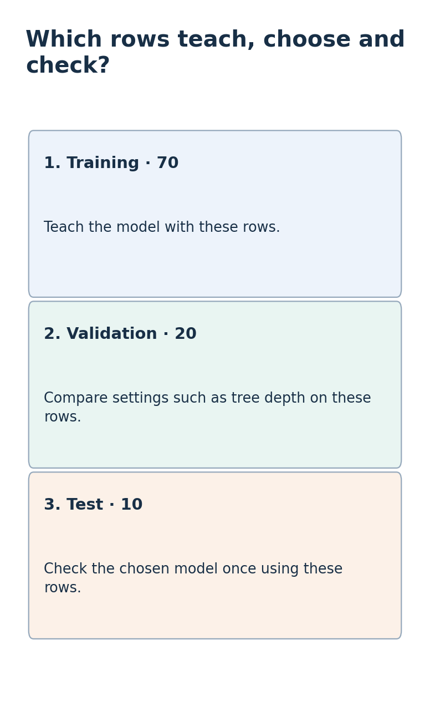

**👀 Read the visual.** This example splits 100 orders before any model learns.

**👉 Use what you see.** If you reuse test results to choose settings, save separate untouched rows for the final check.

<a id="training-set"></a>

#### 🟩 Training set

| Lesson name | What you’ll do | Download |
| --- | --- | --- |
| 180 - Training set **Practice** | Use training rows to teach a decision tree how to flag urgent deliveries. | [Lesson ZIP](sample_code_folder/180-training-set.zip) |

<!-- workbook-teaching:180:start -->
<details>
<summary>Learn, trace and apply this idea</summary>

### Learn and apply: Training set

**Your decision.** Use training rows to teach a decision tree how to flag urgent deliveries.

**Ready check.** Name inputs and answers; count urgent and regular orders. Use [the learning path](LEARNING-PATH.md) and [the word list](GLOSSARY.md) for the earlier skill. Trace the small example on paper before code.

**What it means.** Training learns, validation chooses, and test checks the frozen choice. A split defines which new-case question is being tested.

**Why and when.** Set aside suitable check rows before any data-based preparation or model selection.

**A worked example to follow.** The 70/20/10 recipe uses 70 orders for fitting, 20 for choosing tree depth and 10 for testing. Balanced accuracy averages recall within each class: if 8/10 urgent and 18/20 regular are correct, it is (0.8 + 0.9) ÷ 2 = 0.85. This is a reading aid, not the script’s measured result.

**Input → steps → output.** Open the supplied table. Its fields are `shipment_id`, `distance_km`, `weight_kg`, `urgent`. One original row is shown below in that same field order; `(missing)` marks a blank rather than zero.

```text
D001 | 2.78 | 6.47 | False
```

1. Name the particular field or object involved in this lesson’s decision above. Keep its meaning and units with it.
2. Open the [complete runnable Python example](lessons/180-training-set/lesson.py). Its numbered comments connect reading, preparation and the resulting calculation. Install only the [declared requirements](lessons/180-training-set/requirements.txt) using the same course Python, as shown in Setup.
3. Trace the worked example above through the script. Keep inputs apart from measured answers. Follow this script’s split and fit, then trace the saved preparation into the held-back result and any new request. A request must not supply its own training answer.
4. Read the result by its headings. Compare with [full recorded output](lessons/180-training-set/expected-output.txt); the excerpt below belongs to the original supplied files. Your edits can change it.

```text
Shared shipment IDs across splits: 0
       Set  Rows  Urgent  Urgent (%)
  Training    70      14        20.0
Validation    20       4        20.0
      Test    10       2        20.0

```

**How to interpret it.** Trace the worked case into the result above. Tell a calculated estimate from a measured answer.

**Common mistakes and limits.** A percentage ratio does not establish independence. Keep repeated shipment identity together. Stratification preserves class shares; it does not fix time or customer leakage.

**Use it yourself.** A tree catches 4 of 5 urgent orders and correctly leaves 9 of 10 regular orders unflagged. Calculate balanced accuracy. May you choose its depth from final test answers?

<details>
<summary>Check your choice and reason</summary>

The average of 0.8 and 0.9 is 0.85. Choose depth on validation or inside training cross-validation, then use the final test once for the chosen procedure.

</details>

**A second check later.** Close the notes and explain the same decision using a different row from the supplied table. State one condition that would make this method unsuitable. If you cannot explain the reason, repeat the small worked example before adding more code.

</details>
<!-- workbook-teaching:180:end -->


**Before this lesson.** Understand the three row roles from Start here.

**In simple words.** Training teaches. Validation chooses. Test checks the final choice. Match the split to future use. Equal input numbers do not alone prove copied observations.

**Guess first.** May you choose tree depth using the final test answers? Write your answer before running the example.

<details>
<summary>Read the reason after trying</summary>

No. Use validation. Keep the final test for the frozen choice.

</details>


Like practice questions with answers. The model learns from these rows. Any data step that learns an average or a category list learns it here.

<a id="validation-set"></a>

#### 🟨 Validation set

| Lesson name | What you’ll do | Download |
| --- | --- | --- |
| 181 - Validation set **Practice** | Use validation rows to choose a tree depth. | [Lesson ZIP](sample_code_folder/181-validation-set.zip) |

<!-- workbook-teaching:181:start -->
<details>
<summary>Learn, trace and apply this idea</summary>

### Learn and apply: Validation set

**Your decision.** Use validation rows to choose a tree depth.

**Ready check.** Name inputs and answers; count urgent and regular orders. Use [the learning path](LEARNING-PATH.md) and [the word list](GLOSSARY.md) for the earlier skill. Trace the small example on paper before code.

**What it means.** Training learns, validation chooses, and test checks the frozen choice. A split defines which new-case question is being tested.

**Why and when.** Set aside suitable check rows before any data-based preparation or model selection.

**A worked example to follow.** The 70/20/10 recipe uses 70 orders for fitting, 20 for choosing tree depth and 10 for testing. Balanced accuracy averages recall within each class: if 8/10 urgent and 18/20 regular are correct, it is (0.8 + 0.9) ÷ 2 = 0.85. This is a reading aid, not the script’s measured result.

**Input → steps → output.** Open the supplied table. Its fields are `shipment_id`, `distance_km`, `weight_kg`, `urgent`. One original row is shown below in that same field order; `(missing)` marks a blank rather than zero.

```text
D001 | 2.78 | 6.47 | False
```

1. Name the particular field or object involved in this lesson’s decision above. Keep its meaning and units with it.
2. Open the [complete runnable Python example](lessons/181-validation-set/lesson.py). Its numbered comments connect reading, preparation and the resulting calculation. Install only the [declared requirements](lessons/181-validation-set/requirements.txt) using the same course Python, as shown in Setup.
3. Trace the worked example above through the script. Keep inputs apart from measured answers. Follow this script’s split and fit, then trace the saved preparation into the held-back result and any new request. A request must not supply its own training answer.
4. Read the result by its headings. Compare with [full recorded output](lessons/181-validation-set/expected-output.txt); the excerpt below belongs to the original supplied files. Your edits can change it.

```text
Shared shipment IDs across splits: 0
       Set  Rows  Urgent  Urgent (%)
  Training    70      14        20.0
Validation    20       4        20.0
      Test    10       2        20.0

```

**How to interpret it.** Trace the worked case into the result above. Tell a calculated estimate from a measured answer.

**Common mistakes and limits.** A percentage ratio does not establish independence. Keep repeated shipment identity together. Stratification preserves class shares; it does not fix time or customer leakage.

**Use it yourself.** A tree catches 4 of 5 urgent orders and correctly leaves 9 of 10 regular orders unflagged. Calculate balanced accuracy. May you choose its depth from final test answers?

<details>
<summary>Check your choice and reason</summary>

The average of 0.8 and 0.9 is 0.85. Choose depth on validation or inside training cross-validation, then use the final test once for the chosen procedure.

</details>

**A second check later.** Close the notes and explain the same decision using a different row from the supplied table. State one condition that would make this method unsuitable. If you cannot explain the reason, repeat the small worked example before adding more code.

</details>
<!-- workbook-teaching:181:end -->


**Before this lesson.** Understand the three row roles from Start here.

**In simple words.** Training teaches. Validation chooses. Test checks the final choice. Match the split to future use. Equal input numbers do not alone prove copied observations.

**Guess first.** May you choose tree depth using the final test answers? Write your answer before running the example.

<details>
<summary>Read the reason after trying</summary>

No. Use validation. Keep the final test for the frozen choice.

</details>


Use these separate rows to choose between models or settings. The next exercise uses them to choose how deep a tree may grow.

<a id="test-set"></a>

#### 🟦 Test set

| Lesson name | What you’ll do | Download |
| --- | --- | --- |
| 182 - Test set **Practice** | Check the chosen model once using its untouched test rows. | [Lesson ZIP](sample_code_folder/182-test-set.zip) |

<!-- workbook-teaching:182:start -->
<details>
<summary>Learn, trace and apply this idea</summary>

### Learn and apply: Test set

**Your decision.** Check the chosen model once using its untouched test rows.

**Ready check.** Name inputs and answers; count urgent and regular orders. Use [the learning path](LEARNING-PATH.md) and [the word list](GLOSSARY.md) for the earlier skill. Trace the small example on paper before code.

**What it means.** Training learns, validation chooses, and test checks the frozen choice. A split defines which new-case question is being tested.

**Why and when.** Set aside suitable check rows before any data-based preparation or model selection.

**A worked example to follow.** The 70/20/10 recipe uses 70 orders for fitting, 20 for choosing tree depth and 10 for testing. Balanced accuracy averages recall within each class: if 8/10 urgent and 18/20 regular are correct, it is (0.8 + 0.9) ÷ 2 = 0.85. This is a reading aid, not the script’s measured result.

**Input → steps → output.** Open the supplied table. Its fields are `shipment_id`, `distance_km`, `weight_kg`, `urgent`. One original row is shown below in that same field order; `(missing)` marks a blank rather than zero.

```text
D001 | 2.78 | 6.47 | False
```

1. Name the particular field or object involved in this lesson’s decision above. Keep its meaning and units with it.
2. Open the [complete runnable Python example](lessons/182-test-set/lesson.py). Its numbered comments connect reading, preparation and the resulting calculation. Install only the [declared requirements](lessons/182-test-set/requirements.txt) using the same course Python, as shown in Setup.
3. Trace the worked example above through the script. Keep inputs apart from measured answers. Follow this script’s split and fit, then trace the saved preparation into the held-back result and any new request. A request must not supply its own training answer.
4. Read the result by its headings. Compare with [full recorded output](lessons/182-test-set/expected-output.txt); the excerpt below belongs to the original supplied files. Your edits can change it.

```text
Shared shipment IDs across splits: 0
       Set  Rows  Urgent  Urgent (%)
  Training    70      14        20.0
Validation    20       4        20.0
      Test    10       2        20.0

```

**How to interpret it.** Trace the worked case into the result above. Tell a calculated estimate from a measured answer.

**Common mistakes and limits.** A percentage ratio does not establish independence. Keep repeated shipment identity together. Stratification preserves class shares; it does not fix time or customer leakage.

**Use it yourself.** A tree catches 4 of 5 urgent orders and correctly leaves 9 of 10 regular orders unflagged. Calculate balanced accuracy. May you choose its depth from final test answers?

<details>
<summary>Check your choice and reason</summary>

The average of 0.8 and 0.9 is 0.85. Choose depth on validation or inside training cross-validation, then use the final test once for the chosen procedure.

</details>

**A second check later.** Close the notes and explain the same decision using a different row from the supplied table. State one condition that would make this method unsuitable. If you cannot explain the reason, repeat the small worked example before adding more code.

</details>
<!-- workbook-teaching:182:end -->


**Before this lesson.** Understand the three row roles from Start here.

**In simple words.** Training teaches. Validation chooses. Test checks the final choice. Match the split to future use. Equal input numbers do not alone prove copied observations.

**Guess first.** May you choose tree depth using the final test answers? Write your answer before running the example.

<details>
<summary>Read the reason after trying</summary>

No. Use validation. Keep the final test for the frozen choice.

</details>


Save these rows until the model’s settings are chosen. Evaluate the chosen model on them at the end.

<a id="common-split-ratios"></a>

#### 📐 Common split ratios

| Lesson name | What you’ll do | Download |
| --- | --- | --- |
| 183 - Common split ratios **Practice** | Compare how many rows go into an 80/20 split and a 70/20/10 split. | [Lesson ZIP](sample_code_folder/183-common-split-ratios.zip) |

<!-- workbook-teaching:183:start -->
<details>
<summary>Learn, trace and apply this idea</summary>

### Learn and apply: Common split ratios

**Your decision.** Compare how many rows go into an 80/20 split and a 70/20/10 split.

**Ready check.** Name inputs and answers; count urgent and regular orders. Use [the learning path](LEARNING-PATH.md) and [the word list](GLOSSARY.md) for the earlier skill. Trace the small example on paper before code.

**What it means.** Training learns, validation chooses, and test checks the frozen choice. A split defines which new-case question is being tested.

**Why and when.** Set aside suitable check rows before any data-based preparation or model selection.

**A worked example to follow.** The 70/20/10 recipe uses 70 orders for fitting, 20 for choosing tree depth and 10 for testing. Balanced accuracy averages recall within each class: if 8/10 urgent and 18/20 regular are correct, it is (0.8 + 0.9) ÷ 2 = 0.85. This is a reading aid, not the script’s measured result.

**Input → steps → output.** Open the supplied table. Its fields are `shipment_id`, `distance_km`, `weight_kg`, `urgent`. One original row is shown below in that same field order; `(missing)` marks a blank rather than zero.

```text
D001 | 2.78 | 6.47 | False
```

1. Name the particular field or object involved in this lesson’s decision above. Keep its meaning and units with it.
2. Open the [complete runnable Python example](lessons/183-common-split-ratios/lesson.py). Its numbered comments connect reading, preparation and the resulting calculation. Install only the [declared requirements](lessons/183-common-split-ratios/requirements.txt) using the same course Python, as shown in Setup.
3. Trace the worked example above through the script. Keep inputs apart from measured answers. Follow this script’s split and fit, then trace the saved preparation into the held-back result and any new request. A request must not supply its own training answer.
4. Read the result by its headings. Compare with [full recorded output](lessons/183-common-split-ratios/expected-output.txt); the excerpt below belongs to the original supplied files. Your edits can change it.

```text
Shared shipment IDs across splits: 0
       Set  Rows  Urgent  Urgent (%)
  Training    70      14        20.0
Validation    20       4        20.0
      Test    10       2        20.0

```

**How to interpret it.** Trace the worked case into the result above. Tell a calculated estimate from a measured answer.

**Common mistakes and limits.** A percentage ratio does not establish independence. Keep repeated shipment identity together. Stratification preserves class shares; it does not fix time or customer leakage.

**Use it yourself.** A tree catches 4 of 5 urgent orders and correctly leaves 9 of 10 regular orders unflagged. Calculate balanced accuracy. May you choose its depth from final test answers?

<details>
<summary>Check your choice and reason</summary>

The average of 0.8 and 0.9 is 0.85. Choose depth on validation or inside training cross-validation, then use the final test once for the chosen procedure.

</details>

**A second check later.** Close the notes and explain the same decision using a different row from the supplied table. State one condition that would make this method unsuitable. If you cannot explain the reason, repeat the small worked example before adding more code.

</details>
<!-- workbook-teaching:183:end -->


**Before this lesson.** Understand the three row roles from Start here.

**In simple words.** Training teaches. Validation chooses. Test checks the final choice. Match the split to future use. Equal input numbers do not alone prove copied observations.

**Guess first.** May you choose tree depth using the final test answers? Write your answer before running the example.

<details>
<summary>Read the reason after trying</summary>

No. Use validation. Keep the final test for the frozen choice.

</details>


The split scripts share a checked recipe. Lesson 184 uses 80/20 with a fixed depth. The other split lessons use 70/20/10 so readers can trace training, selection, and testing.

<a id="80-20-train-test"></a>

##### 🟦 80%-20% (Train-Test)

| Lesson name | What you’ll do | Download |
| --- | --- | --- |
| 184 - 80%-20% (Train-Test) **Practice** | Train with 80% of the rows and check the model with the remaining 20%. | [Lesson ZIP](sample_code_folder/184-80-20-train-test.zip) |

<!-- workbook-teaching:184:start -->
<details>
<summary>Learn, trace and apply this idea</summary>

### Learn and apply: 80%-20% (Train-Test)

**Your decision.** Train with 80% of the rows and check the model with the remaining 20%.

**Ready check.** Name inputs and answers; count urgent and regular orders. Use [the learning path](LEARNING-PATH.md) and [the word list](GLOSSARY.md) for the earlier skill. Trace the small example on paper before code.

**What it means.** Training learns, validation chooses, and test checks the frozen choice. A split defines which new-case question is being tested.

**Why and when.** Set aside suitable check rows before any data-based preparation or model selection.

**A worked example to follow.** The 70/20/10 recipe uses 70 orders for fitting, 20 for choosing tree depth and 10 for testing. Balanced accuracy averages recall within each class: if 8/10 urgent and 18/20 regular are correct, it is (0.8 + 0.9) ÷ 2 = 0.85. This is a reading aid, not the script’s measured result.

**Input → steps → output.** Open the supplied table. Its fields are `shipment_id`, `distance_km`, `weight_kg`, `urgent`. One original row is shown below in that same field order; `(missing)` marks a blank rather than zero.

```text
D001 | 2.78 | 6.47 | False
```

1. Name the particular field or object involved in this lesson’s decision above. Keep its meaning and units with it.
2. Open the [complete runnable Python example](lessons/184-80-20-train-test/lesson.py). Its numbered comments connect reading, preparation and the resulting calculation. Install only the [declared requirements](lessons/184-80-20-train-test/requirements.txt) using the same course Python, as shown in Setup.
3. Trace the worked example above through the script. Keep inputs apart from measured answers. Follow this script’s split and fit, then trace the saved preparation into the held-back result and any new request. A request must not supply its own training answer.
4. Read the result by its headings. Compare with [full recorded output](lessons/184-80-20-train-test/expected-output.txt); the excerpt below belongs to the original supplied files. Your edits can change it.

```text
Shared shipment IDs across splits: 0
     Set  Rows  Urgent  Urgent (%)
Training    80      16        20.0
    Test    20       4        20.0
Look for 80 training orders and 20 test orders. The tree depth is fixed before testing.
Chosen depth: 2
```

**How to interpret it.** Trace the worked case into the result above. Tell a calculated estimate from a measured answer.

**Common mistakes and limits.** A percentage ratio does not establish independence. Keep repeated shipment identity together. Stratification preserves class shares; it does not fix time or customer leakage.

**Use it yourself.** A tree catches 4 of 5 urgent orders and correctly leaves 9 of 10 regular orders unflagged. Calculate balanced accuracy. May you choose its depth from final test answers?

<details>
<summary>Check your choice and reason</summary>

The average of 0.8 and 0.9 is 0.85. Choose depth on validation or inside training cross-validation, then use the final test once for the chosen procedure.

</details>

**A second check later.** Close the notes and explain the same decision using a different row from the supplied table. State one condition that would make this method unsuitable. If you cannot explain the reason, repeat the small worked example before adding more code.

</details>
<!-- workbook-teaching:184:end -->


**Before this lesson.** Understand the three row roles from Start here.

**In simple words.** Training teaches. Validation chooses. Test checks the final choice. Match the split to future use. Equal input numbers do not alone prove copied observations.

**Guess first.** May you choose tree depth using the final test answers? Write your answer before running the example.

<details>
<summary>Read the reason after trying</summary>

No. Use validation. Keep the final test for the frozen choice.

</details>


Use 80 rows to train and 20 to check. If you must choose between models, make those choices inside the 80, for example with cross-validation.

<a id="70-20-10-train-validation-test"></a>

##### 🟩 70%-20%-10% (Train-Validation-Test)

| Lesson name | What you’ll do | Download |
| --- | --- | --- |
| 185 - 70%-20%-10% (Train-Validation-Test) **Practice** | Use 70% to learn, 20% to choose tree depth and 10% to check it. | [Lesson ZIP](sample_code_folder/185-70-20-10-train-validation-test.zip) |

<!-- workbook-teaching:185:start -->
<details>
<summary>Learn, trace and apply this idea</summary>

### Learn and apply: 70%-20%-10% (Train-Validation-Test)

**Your decision.** Use 70% to learn, 20% to choose tree depth and 10% to check it.

**Ready check.** Name inputs and answers; count urgent and regular orders. Use [the learning path](LEARNING-PATH.md) and [the word list](GLOSSARY.md) for the earlier skill. Trace the small example on paper before code.

**What it means.** Training learns, validation chooses, and test checks the frozen choice. A split defines which new-case question is being tested.

**Why and when.** Set aside suitable check rows before any data-based preparation or model selection.

**A worked example to follow.** The 70/20/10 recipe uses 70 orders for fitting, 20 for choosing tree depth and 10 for testing. Balanced accuracy averages recall within each class: if 8/10 urgent and 18/20 regular are correct, it is (0.8 + 0.9) ÷ 2 = 0.85. This is a reading aid, not the script’s measured result.

**Input → steps → output.** Open the supplied table. Its fields are `shipment_id`, `distance_km`, `weight_kg`, `urgent`. One original row is shown below in that same field order; `(missing)` marks a blank rather than zero.

```text
D001 | 2.78 | 6.47 | False
```

1. Name the particular field or object involved in this lesson’s decision above. Keep its meaning and units with it.
2. Open the [complete runnable Python example](lessons/185-70-20-10-train-validation-test/lesson.py). Its numbered comments connect reading, preparation and the resulting calculation. Install only the [declared requirements](lessons/185-70-20-10-train-validation-test/requirements.txt) using the same course Python, as shown in Setup.
3. Trace the worked example above through the script. Keep inputs apart from measured answers. Follow this script’s split and fit, then trace the saved preparation into the held-back result and any new request. A request must not supply its own training answer.
4. Read the result by its headings. Compare with [full recorded output](lessons/185-70-20-10-train-validation-test/expected-output.txt); the excerpt below belongs to the original supplied files. Your edits can change it.

```text
Shared shipment IDs across splits: 0
       Set  Rows  Urgent  Urgent (%)
  Training    70      14        20.0
Validation    20       4        20.0
      Test    10       2        20.0

```

**How to interpret it.** Trace the worked case into the result above. Tell a calculated estimate from a measured answer.

**Common mistakes and limits.** A percentage ratio does not establish independence. Keep repeated shipment identity together. Stratification preserves class shares; it does not fix time or customer leakage.

**Use it yourself.** A tree catches 4 of 5 urgent orders and correctly leaves 9 of 10 regular orders unflagged. Calculate balanced accuracy. May you choose its depth from final test answers?

<details>
<summary>Check your choice and reason</summary>

The average of 0.8 and 0.9 is 0.85. Choose depth on validation or inside training cross-validation, then use the final test once for the chosen procedure.

</details>

**A second check later.** Close the notes and explain the same decision using a different row from the supplied table. State one condition that would make this method unsuitable. If you cannot explain the reason, repeat the small worked example before adding more code.

</details>
<!-- workbook-teaching:185:end -->


**Before this lesson.** Understand the three row roles from Start here.

**In simple words.** Training teaches. Validation chooses. Test checks the final choice. Match the split to future use. Equal input numbers do not alone prove copied observations.

**Guess first.** May you choose tree depth using the final test answers? Write your answer before running the example.

<details>
<summary>Read the reason after trying</summary>

No. Use validation. Keep the final test for the frozen choice.

</details>


Use 70 rows to learn, 20 to choose a setting, and 10 to check the chosen model.

<a id="stratified-sampling"></a>

#### 🎯 Stratified Sampling

| Lesson name | What you’ll do | Download |
| --- | --- | --- |
| 186 - Stratified Sampling **Practice** | Keep similar proportions of urgent orders in each group. | [Lesson ZIP](sample_code_folder/186-stratified-sampling.zip) |

<!-- workbook-teaching:186:start -->
<details>
<summary>Learn, trace and apply this idea</summary>

### Learn and apply: Stratified Sampling

**Your decision.** Keep similar proportions of urgent orders in each group.

**Ready check.** Name inputs and answers; count urgent and regular orders. Use [the learning path](LEARNING-PATH.md) and [the word list](GLOSSARY.md) for the earlier skill. Trace the small example on paper before code.

**What it means.** Training learns, validation chooses, and test checks the frozen choice. A split defines which new-case question is being tested.

**Why and when.** Set aside suitable check rows before any data-based preparation or model selection.

**A worked example to follow.** The 70/20/10 recipe uses 70 orders for fitting, 20 for choosing tree depth and 10 for testing. Balanced accuracy averages recall within each class: if 8/10 urgent and 18/20 regular are correct, it is (0.8 + 0.9) ÷ 2 = 0.85. This is a reading aid, not the script’s measured result.

**Input → steps → output.** Open the supplied table. Its fields are `shipment_id`, `distance_km`, `weight_kg`, `urgent`. One original row is shown below in that same field order; `(missing)` marks a blank rather than zero.

```text
D001 | 2.78 | 6.47 | False
```

1. Name the particular field or object involved in this lesson’s decision above. Keep its meaning and units with it.
2. Open the [complete runnable Python example](lessons/186-stratified-sampling/lesson.py). Its numbered comments connect reading, preparation and the resulting calculation. Install only the [declared requirements](lessons/186-stratified-sampling/requirements.txt) using the same course Python, as shown in Setup.
3. Trace the worked example above through the script. Keep inputs apart from measured answers. Follow this script’s split and fit, then trace the saved preparation into the held-back result and any new request. A request must not supply its own training answer.
4. Read the result by its headings. Compare with [full recorded output](lessons/186-stratified-sampling/expected-output.txt); the excerpt below belongs to the original supplied files. Your edits can change it.

```text
Shared shipment IDs across splits: 0
       Set  Rows  Urgent  Urgent (%)
  Training    70      14        20.0
Validation    20       4        20.0
      Test    10       2        20.0

```

**How to interpret it.** Trace the worked case into the result above. Tell a calculated estimate from a measured answer.

**Common mistakes and limits.** A percentage ratio does not establish independence. Keep repeated shipment identity together. Stratification preserves class shares; it does not fix time or customer leakage.

**Use it yourself.** A tree catches 4 of 5 urgent orders and correctly leaves 9 of 10 regular orders unflagged. Calculate balanced accuracy. May you choose its depth from final test answers?

<details>
<summary>Check your choice and reason</summary>

The average of 0.8 and 0.9 is 0.85. Choose depth on validation or inside training cross-validation, then use the final test once for the chosen procedure.

</details>

**A second check later.** Close the notes and explain the same decision using a different row from the supplied table. State one condition that would make this method unsuitable. If you cannot explain the reason, repeat the small worked example before adding more code.

</details>
<!-- workbook-teaching:186:end -->


**Before this lesson.** Understand the three row roles from Start here.

**In simple words.** Training teaches. Validation chooses. Test checks the final choice. Match the split to future use. Equal input numbers do not alone prove copied observations.

**Guess first.** May you choose tree depth using the final test answers? Write your answer before running the example.

<details>
<summary>Read the reason after trying</summary>

No. Use validation. Keep the final test for the frozen choice.

</details>


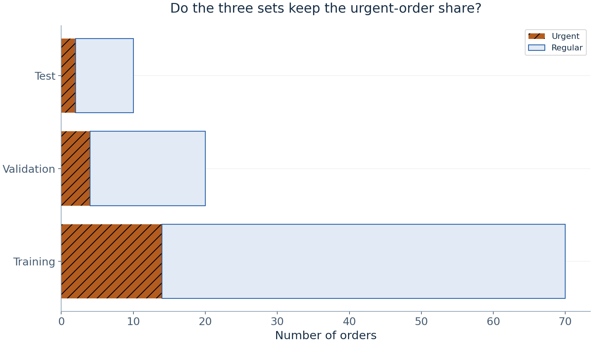

**👀 Read the visual.** Compare both pieces of information. The bars have different lengths, and the urgent share is 20% in each.

**👉 Use what you see.** Check that each shipment ID stays in only one set before using the final test score.

The sample CSV contains **100 different shipments**. Twenty are urgent. The code checks unique shipment IDs and keeps each shipment in one set. Equal input values alone do not mean two records are copies.

| Set | Rows | Urgent orders | Urgent share |
| --- | --- | --- | --- |
| Training | 70 | 14 | 20% |
| Validation | 20 | 4 | 20% |
| Test | 10 | 2 | 20% |

**▶️ Run.** Extract the [⬇️ Lesson ZIP](sample_code_folder/186-stratified-sampling.zip). In the lesson folder, run `python -m pip install -r requirements.txt` once and then `python lesson.py`.

**✅ Check.** Zero shared shipment IDs. Different shipments may have equal input measurements. Depth 3 wins on validation. The model catches both urgent test orders and makes one false alarm. The two urgent cases teach you how to read the test counts. A larger batch is needed to estimate production performance.

**Your small change.** Copy one training CSV row below itself. The script should stop before splitting. Delete the copy and rerun. Save the named CSV before running again.

<a id="1-7-model-selection-training"></a>

### 🤖 1.7. Model Selection & Training

| Lesson name | What you’ll do | Download |
| --- | --- | --- |
| 187 - 1.7. Model Selection & Training **Practice** | Compare candidate models using the same training task and a common error measure. | [Lesson ZIP](sample_code_folder/187-1-7-model-selection-training.zip) |

<!-- workbook-teaching:187:start -->
<details>
<summary>Learn, trace and apply this idea</summary>

### Learn and apply: 1.7. Model Selection & Training

**Your decision.** Compare candidate models using the same training task and a common error measure.

**Ready check.** Calculate a baseline score and explain validation. Use [the learning path](LEARNING-PATH.md) and [the word list](GLOSSARY.md) for the earlier skill. Trace the small example on paper before code.

**What it means.** Model comparison tests candidate learning rules on the same task, rows and metric.

**Why and when.** Use the simplest justified baseline first, then add candidates whose assumptions suit the input and decision.

**A worked example to follow.** The lesson places scaling inside a pipeline and takes the same validation folds for each classifier. A DummyClassifier provides a comparison that learns no useful input relationship.

**Input → steps → output.** Open the supplied table. Its fields are `km`, `kg`, `answer`. One original row is shown below in that same field order; `(missing)` marks a blank rather than zero.

```text
47 | 3 | 1
```

1. Name the particular field or object involved in this lesson’s decision above. Keep its meaning and units with it.
2. Open the [complete runnable Python example](lessons/187-1-7-model-selection-training/lesson.py). Its numbered comments connect reading, preparation and the resulting calculation. Install only the [declared requirements](lessons/187-1-7-model-selection-training/requirements.txt) using the same course Python, as shown in Setup.
3. Trace the worked example above through the script. Keep inputs apart from measured answers. Follow this script’s split and fit, then trace the saved preparation into the held-back result and any new request. A request must not supply its own training answer.
4. Read the result by its headings. Compare with [full recorded output](lessons/187-1-7-model-selection-training/expected-output.txt); the excerpt below belongs to the original supplied files. Your edits can change it.

```text
DummyClassifier 0.687
LogisticRegression 0.908
DecisionTreeClassifier 0.744
RandomForestClassifier 0.825
SVC 0.88
```

**How to interpret it.** Trace the worked case into the result above. Tell a calculated estimate from a measured answer.

**Common mistakes and limits.** A larger model is not automatically better. A validation winner is not a final test estimate. Also compare practical requirements and failure types.

**Use it yourself.** One candidate has slightly better validation F1 but cannot meet the agreed response time. Must it be chosen?

<details>
<summary>Check your choice and reason</summary>

No. Check uncertainty and the project constraints. Choose a usable procedure with documented trade-offs, then evaluate the frozen choice separately.

</details>

**A second check later.** Close the notes and explain the same decision using a different row from the supplied table. State one condition that would make this method unsuitable. If you cannot explain the reason, repeat the small worked example before adding more code.

</details>
<!-- workbook-teaching:187:end -->


**Before this lesson.** Know a baseline, a score and a model setting.

**In simple words.** Compare candidates on the same validation rows. A setting controls learning. Cross-validation repeats checks inside training. Do not call the best validation score a final test.

**Guess first.** Does the smallest training error always win? Write your answer before running the example.

<details>
<summary>Read the reason after trying</summary>

No. It may memorize. Use separate validation results to choose.

</details>


**📌 Before you start.** Find the training and validation sets. Try [the validation curve](#lesson-443) before choosing an advanced tuning method.

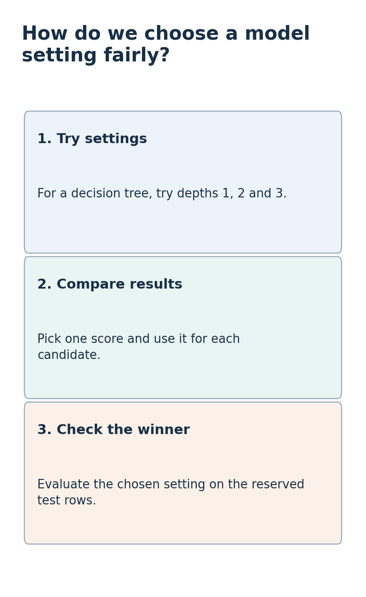

**👀 Read the visual.** Try every candidate on the same validation rows.

**👉 Use what you see.** A deeper tree can memorize the training rows. Use validation results to choose its depth.

<a id="choose-the-best-machine-learning-model"></a>

#### 🏁 Choose the best Machine Learning model

| Lesson name | What you’ll do | Download |
| --- | --- | --- |
| 188 - Choose the best Machine Learning model **Practice** | Check which model works better on the same rows and metric. | [Lesson ZIP](sample_code_folder/188-choose-the-best-machine-learning-model.zip) |

<!-- workbook-teaching:188:start -->
<details>
<summary>Learn, trace and apply this idea</summary>

### Learn and apply: Choose the best Machine Learning model

**Your decision.** Check which model works better on the same rows and metric.

**Ready check.** Calculate a baseline score and explain validation. Use [the learning path](LEARNING-PATH.md) and [the word list](GLOSSARY.md) for the earlier skill. Trace the small example on paper before code.

**What it means.** Model comparison tests candidate learning rules on the same task, rows and metric.

**Why and when.** Use the simplest justified baseline first, then add candidates whose assumptions suit the input and decision.

**A worked example to follow.** The lesson places scaling inside a pipeline and takes the same validation folds for each classifier. A DummyClassifier provides a comparison that learns no useful input relationship.

**Input → steps → output.** Open the supplied table. Its fields are `km`, `kg`, `answer`. One original row is shown below in that same field order; `(missing)` marks a blank rather than zero.

```text
47 | 3 | 1
```

1. Name the particular field or object involved in this lesson’s decision above. Keep its meaning and units with it.
2. Open the [complete runnable Python example](lessons/188-choose-the-best-machine-learning-model/lesson.py). Its numbered comments connect reading, preparation and the resulting calculation. Install only the [declared requirements](lessons/188-choose-the-best-machine-learning-model/requirements.txt) using the same course Python, as shown in Setup.
3. Trace the worked example above through the script. Keep inputs apart from measured answers. Follow this script’s split and fit, then trace the saved preparation into the held-back result and any new request. A request must not supply its own training answer.
4. Read the result by its headings. Compare with [full recorded output](lessons/188-choose-the-best-machine-learning-model/expected-output.txt); the excerpt below belongs to the original supplied files. Your edits can change it.

```text
DummyClassifier 0.687
LogisticRegression 0.908
DecisionTreeClassifier 0.744
RandomForestClassifier 0.825
SVC 0.88
```

**How to interpret it.** Trace the worked case into the result above. Tell a calculated estimate from a measured answer.

**Common mistakes and limits.** A larger model is not automatically better. A validation winner is not a final test estimate. Also compare practical requirements and failure types.

**Use it yourself.** One candidate has slightly better validation F1 but cannot meet the agreed response time. Must it be chosen?

<details>
<summary>Check your choice and reason</summary>

No. Check uncertainty and the project constraints. Choose a usable procedure with documented trade-offs, then evaluate the frozen choice separately.

</details>

**A second check later.** Close the notes and explain the same decision using a different row from the supplied table. State one condition that would make this method unsuitable. If you cannot explain the reason, repeat the small worked example before adding more code.

</details>
<!-- workbook-teaching:188:end -->


**Before this lesson.** Know a baseline, a score and a model setting.

**In simple words.** Compare candidates on the same validation rows. A setting controls learning. Cross-validation repeats checks inside training. Do not call the best validation score a final test.

**Guess first.** Does the smallest training error always win? Write your answer before running the example.

<details>
<summary>Read the reason after trying</summary>

No. It may memorize. Use separate validation results to choose.

</details>


Choose based on the answer. Use regression for a number, classification for a known category, and clustering to find groups when there are no known answers. Here the answer is urgent or not urgent.

<a id="train-the-model-using-the-training-dataset"></a>

#### 🏋️ Train the model using the training dataset

| Lesson name | What you’ll do | Download |
| --- | --- | --- |
| 189 - Train the model using the training dataset **Practice** | Give models the same inputs and known answers before comparing their errors. | [Lesson ZIP](sample_code_folder/189-train-the-model-using-the-training-dataset.zip) |

<!-- workbook-teaching:189:start -->
<details>
<summary>Learn, trace and apply this idea</summary>

### Learn and apply: Train the model using the training dataset

**Your decision.** Give models the same inputs and known answers before comparing their errors.

**Ready check.** Calculate a baseline score and explain validation. Use [the learning path](LEARNING-PATH.md) and [the word list](GLOSSARY.md) for the earlier skill. Trace the small example on paper before code.

**What it means.** Model comparison tests candidate learning rules on the same task, rows and metric.

**Why and when.** Use the simplest justified baseline first, then add candidates whose assumptions suit the input and decision.

**A worked example to follow.** The lesson places scaling inside a pipeline and takes the same validation folds for each classifier. A DummyClassifier provides a comparison that learns no useful input relationship.

**Input → steps → output.** Open the supplied table. Its fields are `km`, `kg`, `answer`. One original row is shown below in that same field order; `(missing)` marks a blank rather than zero.

```text
47 | 3 | 1
```

1. Name the particular field or object involved in this lesson’s decision above. Keep its meaning and units with it.
2. Open the [complete runnable Python example](lessons/189-train-the-model-using-the-training-dataset/lesson.py). Its numbered comments connect reading, preparation and the resulting calculation. Install only the [declared requirements](lessons/189-train-the-model-using-the-training-dataset/requirements.txt) using the same course Python, as shown in Setup.
3. Trace the worked example above through the script. Keep inputs apart from measured answers. Follow this script’s split and fit, then trace the saved preparation into the held-back result and any new request. A request must not supply its own training answer.
4. Read the result by its headings. Compare with [full recorded output](lessons/189-train-the-model-using-the-training-dataset/expected-output.txt); the excerpt below belongs to the original supplied files. Your edits can change it.

```text
DummyClassifier 0.687
LogisticRegression 0.908
DecisionTreeClassifier 0.744
RandomForestClassifier 0.825
SVC 0.88
```

**How to interpret it.** Trace the worked case into the result above. Tell a calculated estimate from a measured answer.

**Common mistakes and limits.** A larger model is not automatically better. A validation winner is not a final test estimate. Also compare practical requirements and failure types.

**Use it yourself.** One candidate has slightly better validation F1 but cannot meet the agreed response time. Must it be chosen?

<details>
<summary>Check your choice and reason</summary>

No. Check uncertainty and the project constraints. Choose a usable procedure with documented trade-offs, then evaluate the frozen choice separately.

</details>

**A second check later.** Close the notes and explain the same decision using a different row from the supplied table. State one condition that would make this method unsuitable. If you cannot explain the reason, repeat the small worked example before adding more code.

</details>
<!-- workbook-teaching:189:end -->


**Before this lesson.** Know a baseline, a score and a model setting.

**In simple words.** Compare candidates on the same validation rows. A setting controls learning. Cross-validation repeats checks inside training. Do not call the best validation score a final test.

**Guess first.** Does the smallest training error always win? Write your answer before running the example.

<details>
<summary>Read the reason after trying</summary>

No. It may memorize. Use separate validation results to choose.

</details>


Generate original delivery measurements and labels. Compare a baseline, logistic regression, a tree, a forest, and SVM on identical validation folds. Use these validation scores to select a model. Evaluate that choice on separate final test rows, as in the [delivery capstone](#lesson-447).

**📋 Sample data.** Preview of the first 5 of 84 rows.

| km | kg | Answer used in training |
| ---: | ---: | ---: |
| 47 | 3 | 1 |
| 31 | 6 | 1 |
| 34 | 11 | 1 |
| 44 | 10 | 1 |
| 29 | 8 | 1 |

**▶️ Run.** Unzip the [lesson files](sample_code_folder/189-train-the-model-using-the-training-dataset.zip) and open a terminal in that folder. Install the lesson’s packages with `python -m pip install -r requirements.txt`, then run `python lesson.py`.

**🔹 Steps in the script**

1. Read the practice deliveries. Use km for distance and kg for parcel weight.
2. Read the mean validation score for each candidate and compare it with the baseline.

**✅ Check.** Look for DummyClassifier 0.687 in the output excerpt below.

```text
DummyClassifier 0.687
LogisticRegression 0.908
DecisionTreeClassifier 0.744
```

**Your small change.** Change an input and its known answer consistently in sample.csv. Rerun the comparison and check what changes. Save the named CSV before running again.


**💡 Takeaway.** Use [Regression Algorithms](#regression-algorithms) for numeric predictions, [XGBoost and LightGBM](#xgboost-and-lightgbm) for boosted trees, and [Clustering Algorithms](#clustering-algorithms) for K-Means and DBSCAN.

<a id="tune-hyperparameters"></a>

#### 🎛️ Tune model settings

| Lesson name | What you’ll do | Download |
| --- | --- | --- |
| 190 - Tune model settings **Practice** | Try different Ridge settings and compare how search methods find them. | [Lesson ZIP](sample_code_folder/190-tune-hyperparameters.zip) |

<!-- workbook-teaching:190:start -->
<details>
<summary>Learn, trace and apply this idea</summary>

### Learn and apply: Tune model settings

**Your decision.** Try different Ridge settings and compare how search methods find them.

**Ready check.** Explain a model setting, validation folds and an error. Use [the learning path](LEARNING-PATH.md) and [the word list](GLOSSARY.md) for the earlier skill. Trace the small example on paper before code.

**What it means.** A search compares settings. Grid tries a list; random search samples it; Bayesian search uses earlier results to suggest a later trial.

**Why and when.** Use a small justified search after a working baseline. Keep each setting’s preparation inside its training folds.

**A worked example to follow.** The script varies Ridge alpha and uses the same folds for error comparisons. Its small Bayesian example fits a helper model to tried settings and estimates which untried setting may improve the score.

**Input → steps → output.** Open the supplied table. Its fields are `input_1`, `input_2`, `input_3`, `answer`. One original row is shown below in that same field order; `(missing)` marks a blank rather than zero.

```text
0.5003818664186679 | 1.588855203878302 | 1.102742760980774 | 1.7477369467801798
```

1. Name the particular field or object involved in this lesson’s decision above. Keep its meaning and units with it.
2. Open the [complete runnable Python example](lessons/190-tune-hyperparameters/lesson.py). Its numbered comments connect reading, preparation and the resulting calculation. Install only the [declared requirements](lessons/190-tune-hyperparameters/requirements.txt) using the same course Python, as shown in Setup.
3. Trace the worked example above through the script. Keep inputs apart from measured answers. Follow this script’s split and fit, then trace the saved preparation into the held-back result and any new request. A request must not supply its own training answer.
4. Read the result by its headings. Compare with [full recorded output](lessons/190-tune-hyperparameters/expected-output.txt); the excerpt below belongs to the original supplied files. Your edits can change it.

```text
GridSearchCV 1 MAE 0.81
RandomizedSearchCV 0.062 MAE 0.837
Bayesian 1.585 MAE 0.802
 input_1  input_2  input_3  prediction
       1        0       -1        5.85
       0        0        0       -0.20
```

**How to interpret it.** Trace the worked case into the result above. Tell a calculated estimate from a measured answer.

**Common mistakes and limits.** More search can overfit the validation process. A winning validation score is optimistic as a final claim. Record the search budget and use separate final evaluation.

**Use it yourself.** You try 100 settings and report the best validation result as guaranteed future error. What is missing?

<details>
<summary>Check your choice and reason</summary>

A separate final assessment of the selected procedure, plus counts and limits. The many comparisons used validation information to make a choice.

</details>

**A second check later.** Close the notes and explain the same decision using a different row from the supplied table. State one condition that would make this method unsuitable. If you cannot explain the reason, repeat the small worked example before adding more code.

</details>
<!-- workbook-teaching:190:end -->


**Before this lesson.** Know a baseline, a score and a model setting.

**In simple words.** Compare candidates on the same validation rows. A setting controls learning. Cross-validation repeats checks inside training. Do not call the best validation score a final test.

**Guess first.** Does the smallest training error always win? Write your answer before running the example.

<details>
<summary>Read the reason after trying</summary>

No. It may memorize. Use separate validation results to choose.

</details>


<a id="grid-search"></a>

##### 🟦 Grid Search

| Lesson name | What you’ll do | Download |
| --- | --- | --- |
| 191 - Grid Search **Practice** | Try every value in a small settings list and keep the best validation score. | [Lesson ZIP](sample_code_folder/191-grid-search.zip) |

<!-- workbook-teaching:191:start -->
<details>
<summary>Learn, trace and apply this idea</summary>

### Learn and apply: Grid Search

**Your decision.** Try every value in a small settings list and keep the best validation score.

**Ready check.** Explain a model setting, validation folds and an error. Use [the learning path](LEARNING-PATH.md) and [the word list](GLOSSARY.md) for the earlier skill. Trace the small example on paper before code.

**What it means.** A search compares settings. Grid tries a list; random search samples it; Bayesian search uses earlier results to suggest a later trial.

**Why and when.** Use a small justified search after a working baseline. Keep each setting’s preparation inside its training folds.

**A worked example to follow.** The script varies Ridge alpha and uses the same folds for error comparisons. Its small Bayesian example fits a helper model to tried settings and estimates which untried setting may improve the score.

**Input → steps → output.** Open the supplied table. Its fields are `input_1`, `input_2`, `input_3`, `answer`. One original row is shown below in that same field order; `(missing)` marks a blank rather than zero.

```text
0.5003818664186679 | 1.588855203878302 | 1.102742760980774 | 1.7477369467801798
```

1. Name the particular field or object involved in this lesson’s decision above. Keep its meaning and units with it.
2. Open the [complete runnable Python example](lessons/191-grid-search/lesson.py). Its numbered comments connect reading, preparation and the resulting calculation. Install only the [declared requirements](lessons/191-grid-search/requirements.txt) using the same course Python, as shown in Setup.
3. Trace the worked example above through the script. Keep inputs apart from measured answers. Follow this script’s split and fit, then trace the saved preparation into the held-back result and any new request. A request must not supply its own training answer.
4. Read the result by its headings. Compare with [full recorded output](lessons/191-grid-search/expected-output.txt); the excerpt below belongs to the original supplied files. Your edits can change it.

```text
GridSearchCV 1 MAE 0.81
 input_1  input_2  input_3  prediction
       1        0       -1        5.93
       0        0        0       -0.19
      -1        1        2       -7.42
```

**How to interpret it.** Trace the worked case into the result above. Tell a calculated estimate from a measured answer.

**Common mistakes and limits.** More search can overfit the validation process. A winning validation score is optimistic as a final claim. Record the search budget and use separate final evaluation.

**Use it yourself.** You try 100 settings and report the best validation result as guaranteed future error. What is missing?

<details>
<summary>Check your choice and reason</summary>

A separate final assessment of the selected procedure, plus counts and limits. The many comparisons used validation information to make a choice.

</details>

**A second check later.** Close the notes and explain the same decision using a different row from the supplied table. State one condition that would make this method unsuitable. If you cannot explain the reason, repeat the small worked example before adding more code.

</details>
<!-- workbook-teaching:191:end -->


**Before this lesson.** Know a baseline, a score and a model setting.

**In simple words.** Compare candidates on the same validation rows. A setting controls learning. Cross-validation repeats checks inside training. Do not call the best validation score a final test.

**Guess first.** Does the smallest training error always win? Write your answer before running the example.

<details>
<summary>Read the reason after trying</summary>

No. It may memorize. Use separate validation results to choose.

</details>


Write a short list of settings. Test every setting on the same check rows. The next exercise tries four values of alpha.

<a id="random-search"></a>

##### 🟩 Random Search

| Lesson name | What you’ll do | Download |
| --- | --- | --- |
| 192 - Random Search **Practice** | Test a random subset of settings when trying every option would take longer. | [Lesson ZIP](sample_code_folder/192-random-search.zip) |

<!-- workbook-teaching:192:start -->
<details>
<summary>Learn, trace and apply this idea</summary>

### Learn and apply: Random Search

**Your decision.** Test a random subset of settings when trying every option would take longer.

**Ready check.** Explain a model setting, validation folds and an error. Use [the learning path](LEARNING-PATH.md) and [the word list](GLOSSARY.md) for the earlier skill. Trace the small example on paper before code.

**What it means.** A search compares settings. Grid tries a list; random search samples it; Bayesian search uses earlier results to suggest a later trial.

**Why and when.** Use a small justified search after a working baseline. Keep each setting’s preparation inside its training folds.

**A worked example to follow.** The script varies Ridge alpha and uses the same folds for error comparisons. Its small Bayesian example fits a helper model to tried settings and estimates which untried setting may improve the score.

**Input → steps → output.** Open the supplied table. Its fields are `input_1`, `input_2`, `input_3`, `answer`. One original row is shown below in that same field order; `(missing)` marks a blank rather than zero.

```text
0.5003818664186679 | 1.588855203878302 | 1.102742760980774 | 1.7477369467801798
```

1. Name the particular field or object involved in this lesson’s decision above. Keep its meaning and units with it.
2. Open the [complete runnable Python example](lessons/192-random-search/lesson.py). Its numbered comments connect reading, preparation and the resulting calculation. Install only the [declared requirements](lessons/192-random-search/requirements.txt) using the same course Python, as shown in Setup.
3. Trace the worked example above through the script. Keep inputs apart from measured answers. Follow this script’s split and fit, then trace the saved preparation into the held-back result and any new request. A request must not supply its own training answer.
4. Read the result by its headings. Compare with [full recorded output](lessons/192-random-search/expected-output.txt); the excerpt below belongs to the original supplied files. Your edits can change it.

```text
RandomizedSearchCV 0.062 MAE 0.837
 input_1  input_2  input_3  prediction
       1        0       -1        6.06
       0        0        0       -0.16
      -1        1        2       -7.51
```

**How to interpret it.** Trace the worked case into the result above. Tell a calculated estimate from a measured answer.

**Common mistakes and limits.** More search can overfit the validation process. A winning validation score is optimistic as a final claim. Record the search budget and use separate final evaluation.

**Use it yourself.** You try 100 settings and report the best validation result as guaranteed future error. What is missing?

<details>
<summary>Check your choice and reason</summary>

A separate final assessment of the selected procedure, plus counts and limits. The many comparisons used validation information to make a choice.

</details>

**A second check later.** Close the notes and explain the same decision using a different row from the supplied table. State one condition that would make this method unsuitable. If you cannot explain the reason, repeat the small worked example before adding more code.

</details>
<!-- workbook-teaching:192:end -->


**Before this lesson.** Know a baseline, a score and a model setting.

**In simple words.** Compare candidates on the same validation rows. A setting controls learning. Cross-validation repeats checks inside training. Do not call the best validation score a final test.

**Guess first.** Does the smallest training error always win? Write your answer before running the example.

<details>
<summary>Read the reason after trying</summary>

No. It may memorize. Use separate validation results to choose.

</details>


Pick several settings from a bigger list at random. This exercise tries four out of twenty possibilities.

<a id="bayesian-optimization"></a>

##### 🟪 Bayesian Optimization

| Lesson name | What you’ll do | Download |
| --- | --- | --- |
| 193 - Bayesian Optimization **Practice** | Use scores from earlier trials to choose another setting to try. | [Lesson ZIP](sample_code_folder/193-bayesian-optimization.zip) |

<!-- workbook-teaching:193:start -->
<details>
<summary>Learn, trace and apply this idea</summary>

### Learn and apply: Bayesian Optimization

**Your decision.** Use scores from earlier trials to choose another setting to try.

**Ready check.** Explain a model setting, validation folds and an error. Use [the learning path](LEARNING-PATH.md) and [the word list](GLOSSARY.md) for the earlier skill. Trace the small example on paper before code.

**What it means.** A search compares settings. Grid tries a list; random search samples it; Bayesian search uses earlier results to suggest a later trial.

**Why and when.** Use a small justified search after a working baseline. Keep each setting’s preparation inside its training folds.

**A worked example to follow.** The script varies Ridge alpha and uses the same folds for error comparisons. Its small Bayesian example fits a helper model to tried settings and estimates which untried setting may improve the score.

**Input → steps → output.** Open the supplied table. Its fields are `input_1`, `input_2`, `input_3`, `answer`. One original row is shown below in that same field order; `(missing)` marks a blank rather than zero.

```text
0.5003818664186679 | 1.588855203878302 | 1.102742760980774 | 1.7477369467801798
```

1. Name the particular field or object involved in this lesson’s decision above. Keep its meaning and units with it.
2. Open the [complete runnable Python example](lessons/193-bayesian-optimization/lesson.py). Its numbered comments connect reading, preparation and the resulting calculation. Install only the [declared requirements](lessons/193-bayesian-optimization/requirements.txt) using the same course Python, as shown in Setup.
3. Trace the worked example above through the script. Keep inputs apart from measured answers. Follow this script’s split and fit, then trace the saved preparation into the held-back result and any new request. A request must not supply its own training answer.
4. Read the result by its headings. Compare with [full recorded output](lessons/193-bayesian-optimization/expected-output.txt); the excerpt below belongs to the original supplied files. Your edits can change it.

```text
GridSearchCV 1 MAE 0.81
RandomizedSearchCV 0.062 MAE 0.837
Bayesian 1.585 MAE 0.802
 input_1  input_2  input_3  prediction
       1        0       -1        5.85
       0        0        0       -0.20
```

**How to interpret it.** Trace the worked case into the result above. Tell a calculated estimate from a measured answer.

**Common mistakes and limits.** More search can overfit the validation process. A winning validation score is optimistic as a final claim. Record the search budget and use separate final evaluation.

**Use it yourself.** You try 100 settings and report the best validation result as guaranteed future error. What is missing?

<details>
<summary>Check your choice and reason</summary>

A separate final assessment of the selected procedure, plus counts and limits. The many comparisons used validation information to make a choice.

</details>

**A second check later.** Close the notes and explain the same decision using a different row from the supplied table. State one condition that would make this method unsuitable. If you cannot explain the reason, repeat the small worked example before adding more code.

</details>
<!-- workbook-teaching:193:end -->


**Before this lesson.** Know a baseline, a score and a model setting.

**In simple words.** Compare candidates on the same validation rows. A setting controls learning. Cross-validation repeats checks inside training. Do not call the best validation score a final test.

**Guess first.** Does the smallest training error always win? Write your answer before running the example.

<details>
<summary>Read the reason after trying</summary>

No. It may memorize. Use separate validation results to choose.

</details>


Generate a training set and search regularization settings using three strategies. Use the same validation folds and compare the chosen setting.

**Advanced.** Try a few values for alpha, a Ridge model setting. Use the scores so far to pick a promising untried value.

**📋 Sample data.** Preview of the first 5 of 42 rows.

| Input 1 | Input 2 | Input 3 |
| ---: | ---: | ---: |
| 0.5004 | 1.5889 | 1.1027 |
| -1.0992 | -0.7993 | 1.4942 |
| -1.9789 | 1.2849 | 1.1883 |
| -0.1283 | -0.7879 | -0.8863 |
| -0.9805 | -0.2197 | 0.0182 |

**▶️ Run.** Unzip the [lesson files](sample_code_folder/193-bayesian-optimization.zip) and open a terminal in that folder. Install the lesson’s packages with `python -m pip install -r requirements.txt`, then run `python lesson.py`.

**🔹 Steps in the script**

1. Read the CSV and check its inputs, including input_1, input_2, input_3.
2. Give each method the same practice data so you can compare the results.
3. Apply the fitted model to the new CSV rows and print a result for each row.

**✅ Check.** Look for GridSearchCV 1 MAE 0.81 in the output excerpt below.

```text
GridSearchCV 1 MAE 0.81
RandomizedSearchCV 0.062 MAE 0.837
Bayesian 1.585 MAE 0.802
```

**Your small change.** Edit new_inputs.csv and rerun the script. Change an input and its known answer consistently in sample.csv. Rerun the comparison and check what changes. Save the named CSV before running again.


<a id="cross-validation"></a>

#### 🔄 Cross-validation

| Lesson name | What you’ll do | Download |
| --- | --- | --- |
| 194 - Cross-validation **Core** | Take turns holding different deliveries back and compare the error on each group. | [Lesson ZIP](sample_code_folder/194-cross-validation.zip) |

<!-- workbook-teaching:194:start -->
<details>
<summary>Learn, trace and apply this idea</summary>

### Learn and apply: Cross-validation

**Your decision.** Take turns holding different deliveries back and compare the error on each group.

**Ready check.** Calculate an average error and distinguish training from check rows. Use [the learning path](LEARNING-PATH.md) and [the word list](GLOSSARY.md) for the earlier skill. Trace the small example on paper before code.

**What it means.** Cross-validation takes turns holding groups back so a procedure is checked on several divisions.

**Why and when.** Use it inside model development when the fold design matches the intended new cases.

**A worked example to follow.** For three folds, each part is held back once while the other parts train a fresh fit. The lesson prints training size, check size and each fold’s average error in minutes.

**Input → steps → output.** Open the supplied table. Its fields are `distance_km`, `weight_kg`, `delivery_minutes`. One original row is shown below in that same field order; `(missing)` marks a blank rather than zero.

```text
2 | 1 | 19
```

1. Name the particular field or object involved in this lesson’s decision above. Keep its meaning and units with it.
2. Open the [complete runnable Python example](lessons/194-cross-validation/lesson.py). Its numbered comments connect reading, preparation and the resulting calculation. Install only the [declared requirements](lessons/194-cross-validation/requirements.txt) using the same course Python, as shown in Setup.
3. Trace the worked example above through the script. Keep inputs apart from measured answers. Follow this script’s split and fit, then trace the saved preparation into the held-back result and any new request. A request must not supply its own training answer.
4. Read the result by its headings. Compare with [full recorded output](lessons/194-cross-validation/expected-output.txt); the excerpt below belongs to the original supplied files. Your edits can change it.

```text
 Fold  Rows to learn  Rows to check  Average error in minutes
    1              4              2                      0.37
    2              4              2                      0.49
    3              4              2                      0.57
```

**How to interpret it.** Trace the worked case into the result above. Tell a calculated estimate from a measured answer.

**Common mistakes and limits.** Refit imputers/scalers inside each training fold. Random folds are unsuitable for some future-time or repeated-customer tasks. Fold variation is not automatically a confidence interval.

**Use it yourself.** May you scale every row first and then cross-validate a classifier using the scaled table?

<details>
<summary>Check your choice and reason</summary>

Fit a preparation/model pipeline separately inside each training fold. Otherwise its check distribution can influence preparation before the check.

</details>

**A second check later.** Close the notes and explain the same decision using a different row from the supplied table. State one condition that would make this method unsuitable. If you cannot explain the reason, repeat the small worked example before adding more code.

</details>
<!-- workbook-teaching:194:end -->


**Before this lesson.** Know a baseline, a score and a model setting.

**In simple words.** Compare candidates on the same validation rows. A setting controls learning. Cross-validation repeats checks inside training. Do not call the best validation score a final test.

**Guess first.** Does the smallest training error always win? Write your answer before running the example.

<details>
<summary>Read the reason after trying</summary>

No. It may memorize. Use separate validation results to choose.

</details>


Print the training and validation sizes and report the variation across folds on original delivery rows.

**📋 Sample data**

| distance_km | weight_kg | delivery_minutes |
| --- | --- | --- |
| 2 | 1 | 19 |
| 4 | 3 | 30 |
| 6 | 2 | 29 |
| 8 | 4 | 40 |
| 10 | 1 | 33 |
| 12 | 3 | 44 |

**▶️ Run.** Unzip the [lesson files](sample_code_folder/194-cross-validation.zip) and open a terminal in that folder. Install the lesson’s packages with `python -m pip install -r requirements.txt`, then run `python lesson.py`.

**🔹 Steps in the script**

1. Read the delivery table. Distance is in km, and weight is in kg.
2. Take turns keeping one group back for a check. Read each group’s average error in minutes.

**✅ Check.** Check the Average error in minutes column. Each row of the table is a different group kept back for checking.

| Fold | Rows to learn | Rows to check | Average error in minutes |
| --- | --- | --- | --- |
| 1 | 4 | 2 | 0.37 |
| 2 | 4 | 2 | 0.49 |

**Your small change.** Change the known time for one delivery. Rerun and find which fold errors change. Save the named CSV before running again.

**🐍 Complete script from the ZIP**

```python
"""
Cross-validation

Take turns holding different deliveries back and compare the error on each group.

Run: python lesson.py
Change the recorded time for one completed delivery. See which three-group check changes its error.
"""

from pathlib import Path
import pandas as pd
from sklearn.linear_model import LinearRegression
from sklearn.model_selection import KFold, cross_val_score

input_path = Path(__file__).resolve().with_name("sample.csv")


# 1. Read the delivery table. Distance is in km, and weight is in kg.
deliveries = pd.read_csv(input_path)


folds = KFold(3, shuffle=True, random_state=7)
X = deliveries[["distance_km", "weight_kg"]]
# 2. Take turns keeping one group back for a check. Read each group’s average error in minutes.
errors = -cross_val_score(
    LinearRegression(),
    X,
    deliveries["delivery_minutes"],
    scoring="neg_mean_absolute_error",
    cv=folds,
)
results = []
for fold_number, (training, checking) in enumerate(folds.split(X), start=1):
    results.append([fold_number, len(training), len(checking), errors[fold_number - 1]])
table = pd.DataFrame(
    results,
    columns=["Fold", "Rows to learn", "Rows to check", "Average error in minutes"],
)
print(table.round(2).to_string(index=False))
```


<a id="1-8-model-evaluation"></a>

### 📏 1.8. Model Evaluation

| Lesson name | What you’ll do | Download |
| --- | --- | --- |
| 195 - 1.8. Model Evaluation **Practice** | Measure prediction errors on check rows and read the chart that explains them. | [Lesson ZIP](sample_code_folder/195-1-8-model-evaluation.zip) |

<!-- workbook-teaching:195:start -->
<details>
<summary>Learn, trace and apply this idea</summary>

### Learn and apply: 1.8. Model Evaluation

**Your decision.** Measure prediction errors on check rows and read the chart that explains them.

**Ready check.** Explain a held-back score and why a target is not an input. Use [the learning path](LEARNING-PATH.md) and [the word list](GLOSSARY.md) for the earlier skill. Trace the small example on paper before code.

**What it means.** Model evaluation measures mistakes; permutation importance asks how a fitted model’s score changes when one input is shuffled.

**Why and when.** Use importance to investigate model reliance on a particular check set, alongside errors and data knowledge.

**A worked example to follow.** The lesson compares classifiers using training folds, checks the chosen rule on kept-back orders, and shuffles distance or weight on separate check rows. A larger score drop suggests more reliance in that check.

**Input → steps → output.** Open the supplied table. Its fields are `distance`, `weight`, `answer`. One original row is shown below in that same field order; `(missing)` marks a blank rather than zero.

```text
37 | 5 | 1
```

1. Name the particular field or object involved in this lesson’s decision above. Keep its meaning and units with it.
2. Open the [complete runnable Python example](lessons/195-1-8-model-evaluation/lesson.py). Its numbered comments connect reading, preparation and the resulting calculation. Install only the [declared requirements](lessons/195-1-8-model-evaluation/requirements.txt) using the same course Python, as shown in Setup.
3. Trace the worked example above through the script. Keep inputs apart from measured answers. Follow this script’s split and fit, then trace the saved preparation into the held-back result and any new request. A request must not supply its own training answer.
4. Read the result by its headings. Compare with [full recorded output](lessons/195-1-8-model-evaluation/expected-output.txt); the excerpt below belongs to the original supplied files. Your edits can change it.

```text
accuracy     0.900
precision    0.895
recall       0.944
F1           0.919
AUC-ROC      0.991
 distance  weight  predicted_urgent
```

**How to interpret it.** Trace the worked case into the result above. Tell a calculated estimate from a measured answer.

**Common mistakes and limits.** Importance is not a cause or a universal property of a field. Correlated inputs can share or hide reliance. A final test is not a repeated feature-selection tool.

**Use it yourself.** Shuffling distance reduces F1. Does this prove making a delivery shorter would cause it to become less urgent?

<details>
<summary>Check your choice and reason</summary>

No. It shows reliance by this fitted model under this check. Causal effects require a suitable design and assumptions, not a shuffled prediction score.

</details>

**A second check later.** Close the notes and explain the same decision using a different row from the supplied table. State one condition that would make this method unsuitable. If you cannot explain the reason, repeat the small worked example before adding more code.

</details>
<!-- workbook-teaching:195:end -->


**Before this lesson.** Count correct and wrong categories before calculating fractions.

**In simple words.** A missed urgent order and a false alarm are different mistakes. Precision counts correct alerts out of alerts. Recall counts caught urgent orders out of real urgent orders.

**Guess first.** Which denominator belongs to recall? Write your answer before running the example.

<details>
<summary>Read the reason after trying</summary>

All truly urgent orders. Write the counts first.

</details>


**📌 Before you start.** Keep test data separate and know the model’s prediction type. Try [classification thresholds](#lesson-444) or [grouped regression errors](#lesson-446).

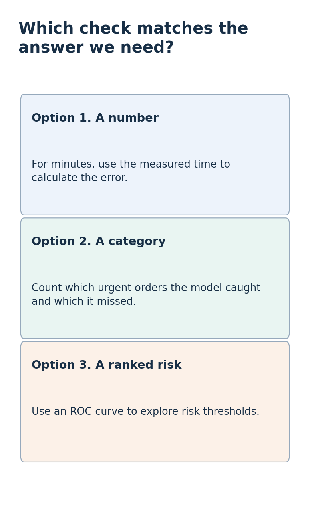

**👀 Read the visual.** Start with what the app actually returns.

**👉 Use what you see.** If missing urgent orders is costly, inspect **recall** and the missed-urgent cell of the confusion matrix.

<a id="visualization-is-used-here-2"></a>

#### 🎨 Visualization is used here!

| Lesson name | What you’ll do | Download |
| --- | --- | --- |
| 196 - Visualization is used here! **Practice** | Use separate charts to see missed cases, thresholds and feature importance. | [Lesson ZIP](sample_code_folder/196-visualization-is-used-here-2.zip) |

<!-- workbook-teaching:196:start -->
<details>
<summary>Learn, trace and apply this idea</summary>

### Learn and apply: Visualization is used here!

**Your decision.** Use separate charts to see missed cases, thresholds and feature importance.

**Ready check.** Explain a held-back score and why a target is not an input. Use [the learning path](LEARNING-PATH.md) and [the word list](GLOSSARY.md) for the earlier skill. Trace the small example on paper before code.

**What it means.** Model evaluation measures mistakes; permutation importance asks how a fitted model’s score changes when one input is shuffled.

**Why and when.** Use importance to investigate model reliance on a particular check set, alongside errors and data knowledge.

**A worked example to follow.** The lesson compares classifiers using training folds, checks the chosen rule on kept-back orders, and shuffles distance or weight on separate check rows. A larger score drop suggests more reliance in that check.

**Input → steps → output.** Open the supplied table. Its fields are `distance`, `weight`, `answer`. One original row is shown below in that same field order; `(missing)` marks a blank rather than zero.

```text
37 | 5 | 1
```

1. Name the particular field or object involved in this lesson’s decision above. Keep its meaning and units with it.
2. Open the [complete runnable Python example](lessons/196-visualization-is-used-here-2/lesson.py). Its numbered comments connect reading, preparation and the resulting calculation. Install only the [declared requirements](lessons/196-visualization-is-used-here-2/requirements.txt) using the same course Python, as shown in Setup.
3. Trace the worked example above through the script. Keep inputs apart from measured answers. Follow this script’s split and fit, then trace the saved preparation into the held-back result and any new request. A request must not supply its own training answer.
4. Read the result by its headings. Compare with [full recorded output](lessons/196-visualization-is-used-here-2/expected-output.txt); the excerpt below belongs to the original supplied files. Your edits can change it.

```text
accuracy     0.900
precision    0.895
recall       0.944
F1           0.919
AUC-ROC      0.991
 distance  weight  predicted_urgent
```

**How to interpret it.** Trace the worked case into the result above. Tell a calculated estimate from a measured answer.

**Common mistakes and limits.** Importance is not a cause or a universal property of a field. Correlated inputs can share or hide reliance. A final test is not a repeated feature-selection tool.

**Use it yourself.** Shuffling distance reduces F1. Does this prove making a delivery shorter would cause it to become less urgent?

<details>
<summary>Check your choice and reason</summary>

No. It shows reliance by this fitted model under this check. Causal effects require a suitable design and assumptions, not a shuffled prediction score.

</details>

**A second check later.** Close the notes and explain the same decision using a different row from the supplied table. State one condition that would make this method unsuitable. If you cannot explain the reason, repeat the small worked example before adding more code.

</details>
<!-- workbook-teaching:196:end -->


**Before this lesson.** Count correct and wrong categories before calculating fractions.

**In simple words.** A missed urgent order and a false alarm are different mistakes. Precision counts correct alerts out of alerts. Recall counts caught urgent orders out of real urgent orders.

**Guess first.** Which denominator belongs to recall? Write your answer before running the example.

<details>
<summary>Read the reason after trying</summary>

All truly urgent orders. Write the counts first.

</details>


<a id="classification-metrics"></a>

#### 🎯 Classification Metrics

| Lesson name | What you’ll do | Download |
| --- | --- | --- |
| 197 - Classification Metrics **Practice** | Check how a classifier handles urgent orders with several scores. | [Lesson ZIP](sample_code_folder/197-classification-metrics.zip) |

<!-- workbook-teaching:197:start -->
<details>
<summary>Learn, trace and apply this idea</summary>

### Learn and apply: Classification Metrics

**Your decision.** Check how a classifier handles urgent orders with several scores.

**Ready check.** Explain a held-back score and why a target is not an input. Use [the learning path](LEARNING-PATH.md) and [the word list](GLOSSARY.md) for the earlier skill. Trace the small example on paper before code.

**What it means.** Model evaluation measures mistakes; permutation importance asks how a fitted model’s score changes when one input is shuffled.

**Why and when.** Use importance to investigate model reliance on a particular check set, alongside errors and data knowledge.

**A worked example to follow.** The lesson compares classifiers using training folds, checks the chosen rule on kept-back orders, and shuffles distance or weight on separate check rows. A larger score drop suggests more reliance in that check.

**Input → steps → output.** Open the supplied table. Its fields are `distance`, `weight`, `answer`. One original row is shown below in that same field order; `(missing)` marks a blank rather than zero.

```text
37 | 5 | 1
```

1. Name the particular field or object involved in this lesson’s decision above. Keep its meaning and units with it.
2. Open the [complete runnable Python example](lessons/197-classification-metrics/lesson.py). Its numbered comments connect reading, preparation and the resulting calculation. Install only the [declared requirements](lessons/197-classification-metrics/requirements.txt) using the same course Python, as shown in Setup.
3. Trace the worked example above through the script. Keep inputs apart from measured answers. Follow this script’s split and fit, then trace the saved preparation into the held-back result and any new request. A request must not supply its own training answer.
4. Read the result by its headings. Compare with [full recorded output](lessons/197-classification-metrics/expected-output.txt); the excerpt below belongs to the original supplied files. Your edits can change it.

```text
accuracy     0.900
precision    0.895
recall       0.944
F1           0.919
AUC-ROC      0.991
 distance  weight  predicted_urgent
```

**How to interpret it.** Trace the worked case into the result above. Tell a calculated estimate from a measured answer.

**Common mistakes and limits.** Importance is not a cause or a universal property of a field. Correlated inputs can share or hide reliance. A final test is not a repeated feature-selection tool.

**Use it yourself.** Shuffling distance reduces F1. Does this prove making a delivery shorter would cause it to become less urgent?

<details>
<summary>Check your choice and reason</summary>

No. It shows reliance by this fitted model under this check. Causal effects require a suitable design and assumptions, not a shuffled prediction score.

</details>

**A second check later.** Close the notes and explain the same decision using a different row from the supplied table. State one condition that would make this method unsuitable. If you cannot explain the reason, repeat the small worked example before adding more code.

</details>
<!-- workbook-teaching:197:end -->


**Before this lesson.** Count correct and wrong categories before calculating fractions.

**In simple words.** A missed urgent order and a false alarm are different mistakes. Precision counts correct alerts out of alerts. Recall counts caught urgent orders out of real urgent orders.

**Guess first.** Which denominator belongs to recall? Write your answer before running the example.

<details>
<summary>Read the reason after trying</summary>

All truly urgent orders. Write the counts first.

</details>


The script reserves 30 test orders. If a distance–weight pair appears in test, it is left out of training. During cross-validation, all training rows with a matching pair stay in the same fold.

<a id="accuracy-precision-recall-f1-score-auc-roc"></a>

##### 🧮 Accuracy, Precision, Recall, F1-score, AUC-ROC

| Lesson name | What you’ll do | Download |
| --- | --- | --- |
| 198 - Accuracy, Precision, Recall, F1-score, AUC-ROC **Practice** | Measure correct answers, false alarms, missed urgent cases and ranking. | [Lesson ZIP](sample_code_folder/198-accuracy-precision-recall-f1-score-auc-roc.zip) |

<!-- workbook-teaching:198:start -->
<details>
<summary>Learn, trace and apply this idea</summary>

### Learn and apply: Accuracy, Precision, Recall, F1-score, AUC-ROC

**Your decision.** Measure correct answers, false alarms, missed urgent cases and ranking.

**Ready check.** Explain a held-back score and why a target is not an input. Use [the learning path](LEARNING-PATH.md) and [the word list](GLOSSARY.md) for the earlier skill. Trace the small example on paper before code.

**What it means.** Model evaluation measures mistakes; permutation importance asks how a fitted model’s score changes when one input is shuffled.

**Why and when.** Use importance to investigate model reliance on a particular check set, alongside errors and data knowledge.

**A worked example to follow.** The lesson compares classifiers using training folds, checks the chosen rule on kept-back orders, and shuffles distance or weight on separate check rows. A larger score drop suggests more reliance in that check.

**Input → steps → output.** Open the supplied table. Its fields are `distance`, `weight`, `answer`. One original row is shown below in that same field order; `(missing)` marks a blank rather than zero.

```text
37 | 5 | 1
```

1. Name the particular field or object involved in this lesson’s decision above. Keep its meaning and units with it.
2. Open the [complete runnable Python example](lessons/198-accuracy-precision-recall-f1-score-auc-roc/lesson.py). Its numbered comments connect reading, preparation and the resulting calculation. Install only the [declared requirements](lessons/198-accuracy-precision-recall-f1-score-auc-roc/requirements.txt) using the same course Python, as shown in Setup.
3. Trace the worked example above through the script. Keep inputs apart from measured answers. Follow this script’s split and fit, then trace the saved preparation into the held-back result and any new request. A request must not supply its own training answer.
4. Read the result by its headings. Compare with [full recorded output](lessons/198-accuracy-precision-recall-f1-score-auc-roc/expected-output.txt); the excerpt below belongs to the original supplied files. Your edits can change it.

```text
accuracy     0.900
precision    0.895
recall       0.944
F1           0.919
AUC-ROC      0.991
 distance  weight  predicted_urgent
```

**How to interpret it.** Trace the worked case into the result above. Tell a calculated estimate from a measured answer.

**Common mistakes and limits.** Importance is not a cause or a universal property of a field. Correlated inputs can share or hide reliance. A final test is not a repeated feature-selection tool.

**Use it yourself.** Shuffling distance reduces F1. Does this prove making a delivery shorter would cause it to become less urgent?

<details>
<summary>Check your choice and reason</summary>

No. It shows reliance by this fitted model under this check. Causal effects require a suitable design and assumptions, not a shuffled prediction score.

</details>

**A second check later.** Close the notes and explain the same decision using a different row from the supplied table. State one condition that would make this method unsuitable. If you cannot explain the reason, repeat the small worked example before adding more code.

</details>
<!-- workbook-teaching:198:end -->


**Before this lesson.** Count correct and wrong categories before calculating fractions.

**In simple words.** A missed urgent order and a false alarm are different mistakes. Precision counts correct alerts out of alerts. Recall counts caught urgent orders out of real urgent orders.

**Guess first.** Which denominator belongs to recall? Write your answer before running the example.

<details>
<summary>Read the reason after trying</summary>

All truly urgent orders. Write the counts first.

</details>


| Metric | How to read it in this example |
| --- | --- |
| Accuracy | Correct guesses divided by all guesses. Here, 27 of 30 are correct. |
| Precision | Of the orders predicted urgent, how many truly were urgent? Here 17 of 19. |
| Recall | Of the orders that truly were urgent, how many did we find? Here 17 of 18. |
| F1-score | A score that combines precision and recall. It falls when either is low. |
| AUC-ROC | How well the model ranks urgent orders above other orders across possible cutoffs. 0.5 is chance-level ranking and 1 is perfect ranking. |

<a id="visualization-techniques-3"></a>

#### 🎨 Visualization Techniques

| Lesson name | What you’ll do | Download |
| --- | --- | --- |
| 204 - Visualization Techniques **Practice** | Choose a chart that answers your question about classifier mistakes. | [Lesson ZIP](sample_code_folder/204-visualization-techniques-3.zip) |

<!-- workbook-teaching:204:start -->
<details>
<summary>Learn, trace and apply this idea</summary>

### Learn and apply: Visualization Techniques

**Your decision.** Choose a chart that answers your question about classifier mistakes.

**Ready check.** Explain a held-back score and why a target is not an input. Use [the learning path](LEARNING-PATH.md) and [the word list](GLOSSARY.md) for the earlier skill. Trace the small example on paper before code.

**What it means.** Model evaluation measures mistakes; permutation importance asks how a fitted model’s score changes when one input is shuffled.

**Why and when.** Use importance to investigate model reliance on a particular check set, alongside errors and data knowledge.

**A worked example to follow.** The lesson compares classifiers using training folds, checks the chosen rule on kept-back orders, and shuffles distance or weight on separate check rows. A larger score drop suggests more reliance in that check.

**Input → steps → output.** Open the supplied table. Its fields are `distance`, `weight`, `answer`. One original row is shown below in that same field order; `(missing)` marks a blank rather than zero.

```text
37 | 5 | 1
```

1. Name the particular field or object involved in this lesson’s decision above. Keep its meaning and units with it.
2. Open the [complete runnable Python example](lessons/204-visualization-techniques-3/lesson.py). Its numbered comments connect reading, preparation and the resulting calculation. Install only the [declared requirements](lessons/204-visualization-techniques-3/requirements.txt) using the same course Python, as shown in Setup.
3. Trace the worked example above through the script. Keep inputs apart from measured answers. Follow this script’s split and fit, then trace the saved preparation into the held-back result and any new request. A request must not supply its own training answer.
4. Read the result by its headings. Compare with [full recorded output](lessons/204-visualization-techniques-3/expected-output.txt); the excerpt below belongs to the original supplied files. Your edits can change it.

```text
accuracy     0.900
precision    0.895
recall       0.944
F1           0.919
AUC-ROC      0.991
 distance  weight  predicted_urgent
```

**How to interpret it.** Trace the worked case into the result above. Tell a calculated estimate from a measured answer.

**Common mistakes and limits.** Importance is not a cause or a universal property of a field. Correlated inputs can share or hide reliance. A final test is not a repeated feature-selection tool.

**Use it yourself.** Shuffling distance reduces F1. Does this prove making a delivery shorter would cause it to become less urgent?

<details>
<summary>Check your choice and reason</summary>

No. It shows reliance by this fitted model under this check. Causal effects require a suitable design and assumptions, not a shuffled prediction score.

</details>

**A second check later.** Close the notes and explain the same decision using a different row from the supplied table. State one condition that would make this method unsuitable. If you cannot explain the reason, repeat the small worked example before adding more code.

</details>
<!-- workbook-teaching:204:end -->


**Before this lesson.** Count correct and wrong categories before calculating fractions.

**In simple words.** A missed urgent order and a false alarm are different mistakes. Precision counts correct alerts out of alerts. Recall counts caught urgent orders out of real urgent orders.

**Guess first.** Which denominator belongs to recall? Write your answer before running the example.

<details>
<summary>Read the reason after trying</summary>

All truly urgent orders. Write the counts first.

</details>


<a id="confusion-matrix"></a>

##### 📋 Confusion Matrix

| Lesson name | What you’ll do | Download |
| --- | --- | --- |
| 205 - Confusion Matrix **Core** | Locate missed urgent orders and false alarms in a labeled matrix. | [Lesson ZIP](sample_code_folder/205-confusion-matrix.zip) |

<!-- workbook-teaching:205:start -->
<details>
<summary>Learn, trace and apply this idea</summary>

### Learn and apply: Confusion Matrix

**Your decision.** Locate missed urgent orders and false alarms in a labeled matrix.

**Ready check.** Distinguish actual classes from predicted classes. Use [the learning path](LEARNING-PATH.md) and [the word list](GLOSSARY.md) for the earlier skill. Trace the small example on paper before code.

**What it means.** A confusion matrix counts each combination of actual and predicted class.

**Why and when.** Use it to make missed cases and false alarms concrete before calculating ratios.

**A worked example to follow.** Read actual urgent along the row and predicted regular down the column: that cell counts misses. Actual regular with predicted urgent counts false alarms. Write the row and column meanings before reading a number.

**Input → steps → output.** Open the supplied table. Its fields are `distance`, `weight`, `answer`. One original row is shown below in that same field order; `(missing)` marks a blank rather than zero.

```text
37 | 5 | 1
```

1. Name the particular field or object involved in this lesson’s decision above. Keep its meaning and units with it.
2. Open the [complete runnable Python example](lessons/205-confusion-matrix/lesson.py). Its numbered comments connect reading, preparation and the resulting calculation. Install only the [declared requirements](lessons/205-confusion-matrix/requirements.txt) using the same course Python, as shown in Setup.
3. Trace the worked example above through the script. Keep inputs apart from measured answers. Follow this script’s split and fit, then trace the saved preparation into the held-back result and any new request. A request must not supply its own training answer.
4. Read the result by its headings. Compare with [full recorded output](lessons/205-confusion-matrix/expected-output.txt); the excerpt below belongs to the original supplied files. Your edits can change it.

```text
                Predicted regular  Predicted urgent
Actual regular                 10                 2
Actual urgent                   1                17
Missed urgent orders: 1. False alarms: 2.
```

**How to interpret it.** Trace the worked case into the result above. Tell a calculated estimate from a measured answer.

**Common mistakes and limits.** Libraries or charts may swap axis conventions. Never infer a cell’s meaning from position or colour alone.

**Use it yourself.** A matrix has actual rows and predicted columns. Where is an urgent order that received no alert?

<details>
<summary>Check your choice and reason</summary>

In actual urgent / predicted regular. Count that cell as a false negative. Explain which class is considered positive.

</details>

**A second check later.** Close the notes and explain the same decision using a different row from the supplied table. State one condition that would make this method unsuitable. If you cannot explain the reason, repeat the small worked example before adding more code.

</details>
<!-- workbook-teaching:205:end -->


**Before this lesson.** Count correct and wrong categories before calculating fractions.

**In simple words.** A missed urgent order and a false alarm are different mistakes. Precision counts correct alerts out of alerts. Recall counts caught urgent orders out of real urgent orders.

**Guess first.** Which denominator belongs to recall? Write your answer before running the example.

<details>
<summary>Read the reason after trying</summary>

All truly urgent orders. Write the counts first.

</details>


**▶️ Run.** Extract the [⬇️ Lesson ZIP](sample_code_folder/205-confusion-matrix.zip). In the lesson folder, run `python -m pip install -r requirements.txt` once and then `python lesson.py`.

| Actual order | Predicted regular | Predicted urgent |
| --- | --- | --- |
| Regular | 10 | 2 |
| Urgent | 1 | 17 |

**✅ Check.** Actual urgent + predicted regular = **one missed urgent order**. Change cutoff in new_inputs.csv to 0.25 and find that cell again.


**👀 Read the visual.** Use the row for orders that really were urgent. Move across to the regular prediction column to find the one urgent order the model missed.

The rows are the real answers. The columns are the guessed answers. With 1 meaning urgent, the top right is a false alarm and the bottom left is a missed urgent order.

<a id="roc-curve"></a>

##### 📈 ROC Curve

| Lesson name | What you’ll do | Download |
| --- | --- | --- |
| 206 - ROC Curve **Practice** | Compare catches and false alarms at two fixed practice cutoffs. | [Lesson ZIP](sample_code_folder/206-roc-curve.zip) |

<!-- workbook-teaching:206:start -->
<details>
<summary>Learn, trace and apply this idea</summary>

### Learn and apply: ROC Curve

**Your decision.** Compare catches and false alarms at two fixed practice cutoffs.

**Ready check.** Explain a false alarm, urgent recall and a score cutoff. Use [the learning path](LEARNING-PATH.md) and [the word list](GLOSSARY.md) for the earlier skill. Trace the small example on paper before code.

**What it means.** ROC plots the share of urgent cases caught against the share of regular cases falsely alerted across cutoffs. AUC summarizes ranking.

**Why and when.** Use it for ranking comparisons; inspect precision-recall and counts when the positive event is rare.

**A worked example to follow.** Lowering a cutoff may catch more urgent orders and create more false alarms. The lesson’s two cutoff points are reading practice on fixed check rows, not an invitation to optimize an app on its final test.

**Input → steps → output.** Open the supplied table. Its fields are `distance`, `weight`, `answer`. One original row is shown below in that same field order; `(missing)` marks a blank rather than zero.

```text
37 | 5 | 1
```

1. Name the particular field or object involved in this lesson’s decision above. Keep its meaning and units with it.
2. Open the [complete runnable Python example](lessons/206-roc-curve/lesson.py). Its numbered comments connect reading, preparation and the resulting calculation. Install only the [declared requirements](lessons/206-roc-curve/requirements.txt) using the same course Python, as shown in Setup.
3. Trace the worked example above through the script. Keep inputs apart from measured answers. Follow this script’s split and fit, then trace the saved preparation into the held-back result and any new request. A request must not supply its own training answer.
4. Read the result by its headings. Compare with [full recorded output](lessons/206-roc-curve/expected-output.txt); the excerpt below belongs to the original supplied files. Your edits can change it.

```text
 Cutoff  Urgent caught  Urgent missed  False alarms  Urgent recall  False alarm rate
   0.25             18              0             2          1.000             0.167
   0.75             17              1             1          0.944             0.083
AUC-ROC: 0.991
Here the test cutoffs are fixed for teaching. Choose an app cutoff on validation data.
```

**How to interpret it.** Trace the worked case into the result above. Tell a calculated estimate from a measured answer.

**Common mistakes and limits.** AUC is not probability calibration or a chosen operating cutoff. A good ranking can still yield an unusable number of alerts.

**Use it yourself.** Can changing a cutoff improve ranking AUC without changing the model’s scores?

<details>
<summary>Check your choice and reason</summary>

No. It changes the decisions at one operating point; ranking scores stay the same. Choose that decision rule using validation and practical constraints.

</details>

**A second check later.** Close the notes and explain the same decision using a different row from the supplied table. State one condition that would make this method unsuitable. If you cannot explain the reason, repeat the small worked example before adding more code.

</details>
<!-- workbook-teaching:206:end -->


**Before this lesson.** Count correct and wrong categories before calculating fractions.

**In simple words.** A missed urgent order and a false alarm are different mistakes. Precision counts correct alerts out of alerts. Recall counts caught urgent orders out of real urgent orders.

**Guess first.** Which denominator belongs to recall? Write your answer before running the example.

<details>
<summary>Read the reason after trying</summary>

All truly urgent orders. Write the counts first.

</details>


**▶️ Run.** Extract the [⬇️ Lesson ZIP](sample_code_folder/206-roc-curve.zip). In the lesson folder, run `python -m pip install -r requirements.txt` once and then `python lesson.py`.

| Cutoff | Urgent caught | Urgent missed | False alarms |
| --- | --- | --- | --- |
| 0.25 | 18 | 0 | 2 |
| 0.75 | 17 | 1 | 1 |

**✅ Check.** In this exercise the lower cutoff finds one more urgent order and raises one more false alarm. Read the horizontal axis to see which fraction of regular orders triggered an alert.

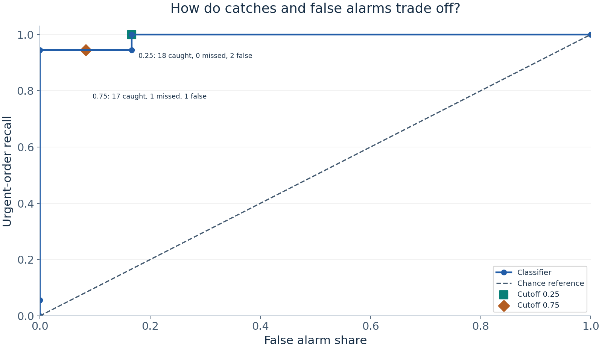

**👀 Read the visual.** Follow the two labeled points. Raising the cutoff to 0.75 avoids one false alarm and misses one additional urgent order.

An urgent probability becomes an urgent prediction when it reaches a chosen cutoff. As you move that cutoff, the curve shows how the share of found urgent orders and the share of false alarms change.

<a id="feature-importance-plot"></a>

##### 🧭 Feature Importance Plot

| Lesson name | What you’ll do | Download |
| --- | --- | --- |
| 207 - Feature Importance Plot **Core** | Shuffle an input to see how much worse the model performs without its original values. | [Lesson ZIP](sample_code_folder/207-feature-importance-plot.zip) |

<!-- workbook-teaching:207:start -->
<details>
<summary>Learn, trace and apply this idea</summary>

### Learn and apply: Feature Importance Plot

**Your decision.** Shuffle an input to see how much worse the model performs without its original values.

**Ready check.** Explain a held-back score and why a target is not an input. Use [the learning path](LEARNING-PATH.md) and [the word list](GLOSSARY.md) for the earlier skill. Trace the small example on paper before code.

**What it means.** Model evaluation measures mistakes; permutation importance asks how a fitted model’s score changes when one input is shuffled.

**Why and when.** Use importance to investigate model reliance on a particular check set, alongside errors and data knowledge.

**A worked example to follow.** The lesson compares classifiers using training folds, checks the chosen rule on kept-back orders, and shuffles distance or weight on separate check rows. A larger score drop suggests more reliance in that check.

**Input → steps → output.** Open the supplied table. Its fields are `distance`, `weight`, `answer`. One original row is shown below in that same field order; `(missing)` marks a blank rather than zero.

```text
37 | 5 | 1
```

1. Name the particular field or object involved in this lesson’s decision above. Keep its meaning and units with it.
2. Open the [complete runnable Python example](lessons/207-feature-importance-plot/lesson.py). Its numbered comments connect reading, preparation and the resulting calculation. Install only the [declared requirements](lessons/207-feature-importance-plot/requirements.txt) using the same course Python, as shown in Setup.
3. Trace the worked example above through the script. Keep inputs apart from measured answers. Follow this script’s split and fit, then trace the saved preparation into the held-back result and any new request. A request must not supply its own training answer.
4. Read the result by its headings. Compare with [full recorded output](lessons/207-feature-importance-plot/expected-output.txt); the excerpt below belongs to the original supplied files. Your edits can change it.

```text
accuracy     0.900
precision    0.895
recall       0.944
F1           0.919
AUC-ROC      0.991
 distance  weight  predicted_urgent
```

**How to interpret it.** Trace the worked case into the result above. Tell a calculated estimate from a measured answer.

**Common mistakes and limits.** Importance is not a cause or a universal property of a field. Correlated inputs can share or hide reliance. A final test is not a repeated feature-selection tool.

**Use it yourself.** Shuffling distance reduces F1. Does this prove making a delivery shorter would cause it to become less urgent?

<details>
<summary>Check your choice and reason</summary>

No. It shows reliance by this fitted model under this check. Causal effects require a suitable design and assumptions, not a shuffled prediction score.

</details>

**A second check later.** Close the notes and explain the same decision using a different row from the supplied table. State one condition that would make this method unsuitable. If you cannot explain the reason, repeat the small worked example before adding more code.

</details>
<!-- workbook-teaching:207:end -->


**Before this lesson.** Count correct and wrong categories before calculating fractions.

**In simple words.** A missed urgent order and a false alarm are different mistakes. Precision counts correct alerts out of alerts. Recall counts caught urgent orders out of real urgent orders.

**Guess first.** Which denominator belongs to recall? Write your answer before running the example.

<details>
<summary>Read the reason after trying</summary>

All truly urgent orders. Write the counts first.

</details>


Shuffle one input at a time and see how the model’s score changes. A larger drop suggests the model depended more on that input in this check. Run the next exercise to draw the three graphs.

Generate original order data, compare candidate classifiers on training folds, and evaluate the chosen model once on a kept-back split. Plot confusion, ROC, and validation-fold feature importance.

**📋 Sample data.** Preview of the first 5 of 120 rows.

| distance | weight | Answer used in training |
| ---: | ---: | ---: |
| 37 | 5 | 1 |
| 25 | 7 | 1 |
| 27 | 5 | 1 |
| 35 | 7 | 1 |
| 23 | 6 | 0 |

**▶️ Run.** Unzip the [lesson files](sample_code_folder/207-feature-importance-plot.zip) and open a terminal in that folder. Install the lesson’s packages with `python -m pip install -r requirements.txt`, then run `python lesson.py`.

**🔹 Steps in the script**

1. Read the CSV and check its inputs, including distance, weight, answer.
2. Set aside the check rows before the model learns.
3. Fit the model on the prepared training rows. Keep it for the checks below.
4. Check how often the model gets the known answers right on the rows you set aside.
5. Plot the values so you can see how they compare.
6. Apply the fitted model to the new CSV rows and print a result for each row.

**✅ Check.** Look for accuracy     0.900 in the output excerpt below.

| accuracy | 0.900 |
| --- | --- |
| precision | 0.895 |
| recall | 0.944 |

**Your small change.** Edit new_inputs.csv and rerun the script. Change an input and its known answer consistently in sample.csv. Rerun the comparison and check what changes. Save the named CSV before running again.


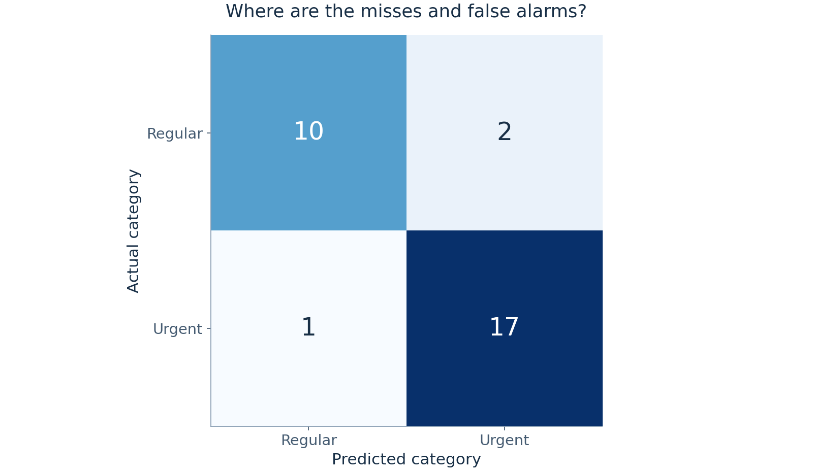

**👀 Read the visual.** Use the row for orders that really were urgent. Move across to the regular prediction column to find the one urgent order the model missed.

**👉 Use what you see.** Compare that cell with the two false alarms. These errors affect an app in different ways.

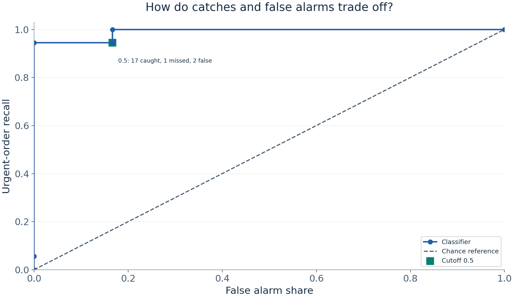

**👀 Read the visual.** The diamond corresponds to the confusion matrix above. Other points summarize different cutoffs on the same test orders.

**👉 Use what you see.** When choosing a cutoff, compare how many urgent orders you catch with how many false alarms your team can handle.

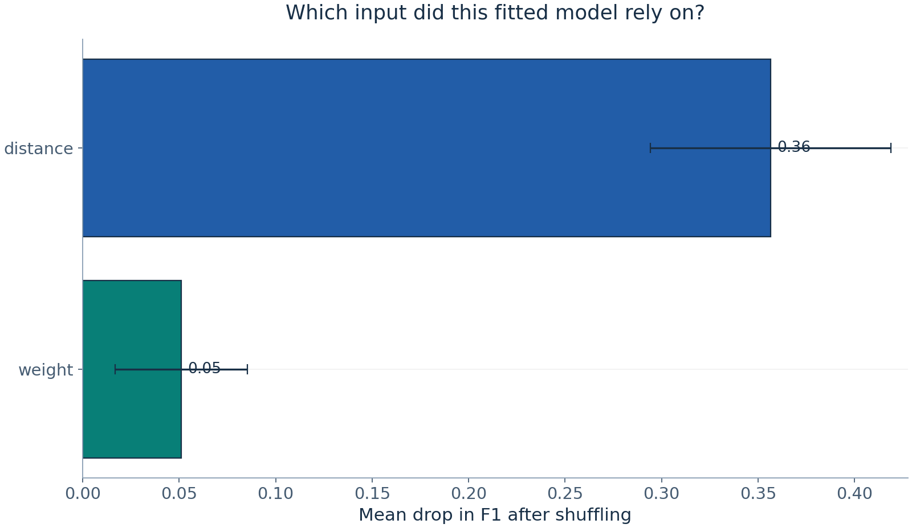

**👀 Read the visual.** A longer positive bar means scrambling the input reduced this model’s F1 more on these check rows.

**👉 Use what you see.** Use this chart to ask what the model relied on. A shuffle result alone does not establish a causal effect.

**💡 Takeaway.** Read the two off-diagonal cells to identify false positives and missed positives. Feature importance measures reliance by this fitted model.

<a id="regression-metrics"></a>

#### 📐 Regression Metrics

| Lesson name | What you’ll do | Download |
| --- | --- | --- |
| 208 - Regression Metrics **Core** | Read prediction errors in minutes and compare them with a simple baseline. Worked calculation using two test trips. | [Lesson ZIP](sample_code_folder/208-regression-metrics.zip) |

<!-- workbook-teaching:208:start -->
<details>
<summary>Learn, trace and apply this idea</summary>

### Learn and apply: Regression Metrics

**Your decision.** Read prediction errors in minutes and compare them with a simple baseline. Worked calculation using two test trips.

**Ready check.** Subtract times and average mistake sizes. Use [the learning path](LEARNING-PATH.md) and [the word list](GLOSSARY.md) for the earlier skill. Trace the small example on paper before code.

**What it means.** A residual is actual minus predicted. MAE averages its size; RMSE gives large errors more weight; R squared compares squared errors with a mean benchmark.

**Why and when.** Use errors in the target’s units to assess number predictions. Inspect counts and individual mistakes beside a summary.

**A worked example to follow.** Actual times 30 and 40 with predictions 28 and 36 have errors 2 and 4 minutes. MAE is 3 minutes; RMSE is √10, about 3.16 minutes. A positive residual means the estimate was too short. These are worked arithmetic values, not a new measured experiment.

**Input → steps → output.** Open the supplied table. Its fields are `distance_km`, `weight_kg`, `delivery_minutes`. One original row is shown below in that same field order; `(missing)` marks a blank rather than zero.

```text
2 | 1 | 19
```

1. Name the particular field or object involved in this lesson’s decision above. Keep its meaning and units with it.
2. Open the [complete runnable Python example](lessons/208-regression-metrics/lesson.py). Its numbered comments connect reading, preparation and the resulting calculation. Install only the [declared requirements](lessons/208-regression-metrics/requirements.txt) using the same course Python, as shown in Setup.
3. Trace the worked example above through the script. Keep inputs apart from measured answers. Follow this script’s split and fit, then trace the saved preparation into the held-back result and any new request. A request must not supply its own training answer.
4. Read the result by its headings. Compare with [full recorded output](lessons/208-regression-metrics/expected-output.txt); the excerpt below belongs to the original supplied files. Your edits can change it.

```text
Worked calculation: two test deliveries. Use lesson 446 for a larger evaluation.
RMSE: 2.0
MAE: 2.0
R²: 0.868
 distance_km  weight_kg  prediction
           5          2        27.5
```

**How to interpret it.** Trace the worked case into the result above. Tell a calculated estimate from a measured answer.

**Common mistakes and limits.** Two rows teach arithmetic, not stable model performance. R squared’s mean benchmark uses the same check outcomes and is not the trained deployment baseline.

**Use it yourself.** Errors 0, 0, 0, 0, 10 and errors 2, 2, 2, 2, 2 both have MAE 2. Why could a customer prefer the second model?

<details>
<summary>Check your choice and reason</summary>

The first has one very large miss. Examine tail errors, limits and how errors affect decisions, not just a matching average.

</details>

**A second check later.** Close the notes and explain the same decision using a different row from the supplied table. State one condition that would make this method unsuitable. If you cannot explain the reason, repeat the small worked example before adding more code.

</details>
<!-- workbook-teaching:208:end -->


**Before this lesson.** Subtract two times and calculate an average.

**In simple words.** An error is actual minus predicted. Its absolute value is the mistake size. MAE averages those sizes. RMSE gives large misses more weight. R squared compares with a mean benchmark.

**Guess first.** Can the same average hide very different large mistakes? Write your answer before running the example.

<details>
<summary>Read the reason after trying</summary>

Yes. Inspect individual errors, counts and the largest misses too.

</details>


<a id="rmse-mae-r-score"></a>

##### 🧮 RMSE, MAE, R² score

| Lesson name | What you’ll do | Download |
| --- | --- | --- |
| 209 - RMSE, MAE, R² score **Practice** | Compare average error, large misses and fit relative to a baseline. Worked calculation using two test trips. | [Lesson ZIP](sample_code_folder/209-rmse-mae-r-score.zip) |

<!-- workbook-teaching:209:start -->
<details>
<summary>Learn, trace and apply this idea</summary>

### Learn and apply: RMSE, MAE, R² score

**Your decision.** Compare average error, large misses and fit relative to a baseline. Worked calculation using two test trips.

**Ready check.** Subtract times and average mistake sizes. Use [the learning path](LEARNING-PATH.md) and [the word list](GLOSSARY.md) for the earlier skill. Trace the small example on paper before code.

**What it means.** A residual is actual minus predicted. MAE averages its size; RMSE gives large errors more weight; R squared compares squared errors with a mean benchmark.

**Why and when.** Use errors in the target’s units to assess number predictions. Inspect counts and individual mistakes beside a summary.

**A worked example to follow.** Actual times 30 and 40 with predictions 28 and 36 have errors 2 and 4 minutes. MAE is 3 minutes; RMSE is √10, about 3.16 minutes. A positive residual means the estimate was too short. These are worked arithmetic values, not a new measured experiment.

**Input → steps → output.** Open the supplied table. Its fields are `distance_km`, `weight_kg`, `delivery_minutes`. One original row is shown below in that same field order; `(missing)` marks a blank rather than zero.

```text
2 | 1 | 19
```

1. Name the particular field or object involved in this lesson’s decision above. Keep its meaning and units with it.
2. Open the [complete runnable Python example](lessons/209-rmse-mae-r-score/lesson.py). Its numbered comments connect reading, preparation and the resulting calculation. Install only the [declared requirements](lessons/209-rmse-mae-r-score/requirements.txt) using the same course Python, as shown in Setup.
3. Trace the worked example above through the script. Keep inputs apart from measured answers. Follow this script’s split and fit, then trace the saved preparation into the held-back result and any new request. A request must not supply its own training answer.
4. Read the result by its headings. Compare with [full recorded output](lessons/209-rmse-mae-r-score/expected-output.txt); the excerpt below belongs to the original supplied files. Your edits can change it.

```text
Worked calculation: two test deliveries. Use lesson 446 for a larger evaluation.
RMSE: 2.0
MAE: 2.0
R²: 0.868
 distance_km  weight_kg  prediction
           5          2        27.5
```

**How to interpret it.** Trace the worked case into the result above. Tell a calculated estimate from a measured answer.

**Common mistakes and limits.** Two rows teach arithmetic, not stable model performance. R squared’s mean benchmark uses the same check outcomes and is not the trained deployment baseline.

**Use it yourself.** Errors 0, 0, 0, 0, 10 and errors 2, 2, 2, 2, 2 both have MAE 2. Why could a customer prefer the second model?

<details>
<summary>Check your choice and reason</summary>

The first has one very large miss. Examine tail errors, limits and how errors affect decisions, not just a matching average.

</details>

**A second check later.** Close the notes and explain the same decision using a different row from the supplied table. State one condition that would make this method unsuitable. If you cannot explain the reason, repeat the small worked example before adding more code.

</details>
<!-- workbook-teaching:209:end -->


**Before this lesson.** Subtract two times and calculate an average.

**In simple words.** An error is actual minus predicted. Its absolute value is the mistake size. MAE averages those sizes. RMSE gives large misses more weight. R squared compares with a mean benchmark.

**Guess first.** Can the same average hide very different large mistakes? Write your answer before running the example.

<details>
<summary>Read the reason after trying</summary>

Yes. Inspect individual errors, counts and the largest misses too.

</details>


**🧮 Worked calculation.** The scores below use two test deliveries so you can see the arithmetic. For an error estimate across routes, weights, and zones, run [lesson 446](#lesson-446).

| Metric | How to read it |
| --- | --- |
| MAE | Average size of the mistake, in minutes here. If the two errors have sizes 2 and 4, the MAE is 3 minutes. |
| RMSE | Another error in minutes that gives large mistakes more weight. For errors of size 2 and 4, RMSE is about 3.16 minutes. Smaller is better for MAE and RMSE. |
| R² | Compare with a simple mean prediction on the same data. 1 is perfect, 0 matches that benchmark, and a negative value does worse. |

<a id="residual-plots"></a>

##### 📉 Residual Plots

| Lesson name | What you’ll do | Download |
| --- | --- | --- |
| 210 - Residual Plots **Practice** | Plot actual minutes minus predicted minutes to see where the model is off. Worked calculation using two test trips. | [Lesson ZIP](sample_code_folder/210-residual-plots.zip) |

<!-- workbook-teaching:210:start -->
<details>
<summary>Learn, trace and apply this idea</summary>

### Learn and apply: Residual Plots

**Your decision.** Plot actual minutes minus predicted minutes to see where the model is off. Worked calculation using two test trips.

**Ready check.** Subtract times and average mistake sizes. Use [the learning path](LEARNING-PATH.md) and [the word list](GLOSSARY.md) for the earlier skill. Trace the small example on paper before code.

**What it means.** A residual is actual minus predicted. MAE averages its size; RMSE gives large errors more weight; R squared compares squared errors with a mean benchmark.

**Why and when.** Use errors in the target’s units to assess number predictions. Inspect counts and individual mistakes beside a summary.

**A worked example to follow.** Actual times 30 and 40 with predictions 28 and 36 have errors 2 and 4 minutes. MAE is 3 minutes; RMSE is √10, about 3.16 minutes. A positive residual means the estimate was too short. These are worked arithmetic values, not a new measured experiment.

**Input → steps → output.** Open the supplied table. Its fields are `distance_km`, `weight_kg`, `delivery_minutes`. One original row is shown below in that same field order; `(missing)` marks a blank rather than zero.

```text
2 | 1 | 19
```

1. Name the particular field or object involved in this lesson’s decision above. Keep its meaning and units with it.
2. Open the [complete runnable Python example](lessons/210-residual-plots/lesson.py). Its numbered comments connect reading, preparation and the resulting calculation. Install only the [declared requirements](lessons/210-residual-plots/requirements.txt) using the same course Python, as shown in Setup.
3. Trace the worked example above through the script. Keep inputs apart from measured answers. Follow this script’s split and fit, then trace the saved preparation into the held-back result and any new request. A request must not supply its own training answer.
4. Read the result by its headings. Compare with [full recorded output](lessons/210-residual-plots/expected-output.txt); the excerpt below belongs to the original supplied files. Your edits can change it.

```text
Worked calculation: two test deliveries. Use lesson 446 for a larger evaluation.
RMSE: 2.0
MAE: 2.0
R²: 0.868
 distance_km  weight_kg  prediction
           5          2        27.5
```

**How to interpret it.** Trace the worked case into the result above. Tell a calculated estimate from a measured answer.

**Common mistakes and limits.** Two rows teach arithmetic, not stable model performance. R squared’s mean benchmark uses the same check outcomes and is not the trained deployment baseline.

**Use it yourself.** Errors 0, 0, 0, 0, 10 and errors 2, 2, 2, 2, 2 both have MAE 2. Why could a customer prefer the second model?

<details>
<summary>Check your choice and reason</summary>

The first has one very large miss. Examine tail errors, limits and how errors affect decisions, not just a matching average.

</details>

**A second check later.** Close the notes and explain the same decision using a different row from the supplied table. State one condition that would make this method unsuitable. If you cannot explain the reason, repeat the small worked example before adding more code.

</details>
<!-- workbook-teaching:210:end -->


**Before this lesson.** Subtract two times and calculate an average.

**In simple words.** An error is actual minus predicted. Its absolute value is the mistake size. MAE averages those sizes. RMSE gives large misses more weight. R squared compares with a mean benchmark.

**Guess first.** Can the same average hide very different large mistakes? Write your answer before running the example.

<details>
<summary>Read the reason after trying</summary>

Yes. Inspect individual errors, counts and the largest misses too.

</details>


The plot has two test points. Treat it as practice reading the direction of an error. Try [lesson 446](#lesson-446) to inspect a larger test batch.

Train on four original deliveries and compare predictions against two kept-back values. Calculate errors in minutes and view the residuals.

**📋 Sample data**

| distance_km | weight_kg | delivery_minutes |
| --- | --- | --- |
| 2 | 1 | 19 |
| 4 | 3 | 30 |
| 6 | 2 | 29 |
| 8 | 4 | 40 |
| 10 | 1 | 33 |
| 12 | 3 | 44 |

**▶️ Run.** Unzip the [lesson files](sample_code_folder/210-residual-plots.zip) and open a terminal in that folder. Install the lesson’s packages with `python -m pip install -r requirements.txt`, then run `python lesson.py`.

**🔹 Steps in the script**

1. Read the delivery table. Distance is in km, and weight is in kg.
2. Set aside the check rows before the model learns.
3. Teach the model from the training inputs and delivery time in minutes.
4. Plot the values so you can see how they compare.
5. Apply the fitted model to the new CSV rows and print a result for each row.

**✅ Check.** Look for RMSE: 2.0 in the output excerpt below.

```text
RMSE: 2.0
MAE: 2.0
R²: 0.868
```

**Your small change.** Edit the input values in new_inputs.csv and compare the displayed predictions. Save the named CSV before running again.


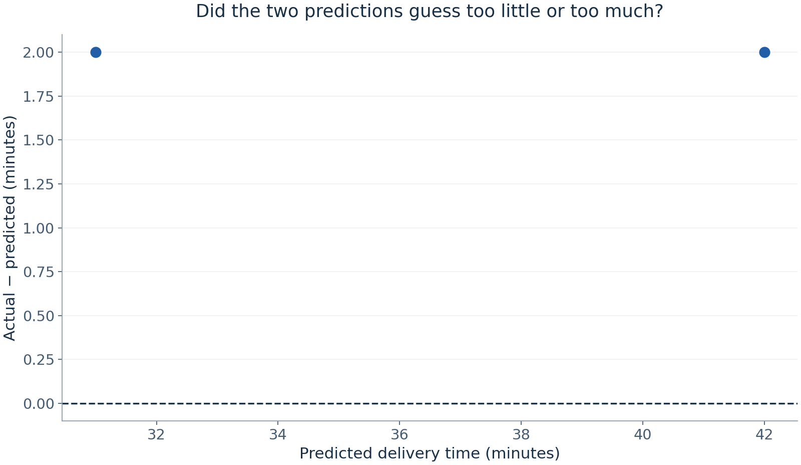

**👀 Read the visual.** Each real delivery took two minutes longer than predicted. Use these two rows to practice the calculation, then use lesson 446 to investigate a larger sample.

**👉 Use what you see.** Look for errors that grow as predicted time increases. Check longer trips separately if the large errors cluster there.

**💡 Takeaway.** Positive residuals are underpredictions. Compare patterns on a larger holdout before drawing conclusions.

<a id="1-9-model-deployment"></a>

### 🚀 1.9. Model Deployment

| Lesson name | What you’ll do | Download |
| --- | --- | --- |
| 215 - 1.9. Model Deployment **Practice** | Serve a delivery model through a local test endpoint. | [Lesson ZIP](sample_code_folder/215-1-9-model-deployment.zip) |

<!-- workbook-teaching:215:start -->
<details>
<summary>Learn, trace and apply this idea</summary>

### Learn and apply: 1.9. Model Deployment

**Your decision.** Serve a delivery model through a local test endpoint.

**Ready check.** Train a small model and identify its required input names and units. Use [the learning path](LEARNING-PATH.md) and [the word list](GLOSSARY.md) for the earlier skill. Trace the small example on paper before code.

**What it means.** A prediction service accepts a request, validates inputs and returns an estimate or a clear error.

**Why and when.** Use a service when another program needs the saved model. Test locally before considering hosting.

**A worked example to follow.** A request supplies distance_km and weight_kg; the response contains minutes. A negative distance should be rejected rather than quietly producing a normal estimate. HTTP status reports success or the kind of failure.

**Input → steps → output.** Open the supplied table. Its fields are `distance_km`, `weight_kg`, `delivery_minutes`. One original row is shown below in that same field order; `(missing)` marks a blank rather than zero.

```text
2 | 1 | 19
```

1. Name the particular field or object involved in this lesson’s decision above. Keep its meaning and units with it.
2. Open the [complete runnable Python example](lessons/215-1-9-model-deployment/lesson.py). Its numbered comments connect reading, preparation and the resulting calculation. Install only the [declared requirements](lessons/215-1-9-model-deployment/requirements.txt) using the same course Python, as shown in Setup.
3. Trace the worked example above through the script. Keep inputs apart from measured answers. Follow this script’s split and fit, then trace the saved preparation into the held-back result and any new request. A request must not supply its own training answer.
4. Read the result by its headings. Compare with [full recorded output](lessons/215-1-9-model-deployment/expected-output.txt); the excerpt below belongs to the original supplied files. Your edits can change it.

```text
200 {'minutes': 27.8}
Invalid distance: 422
{'distance_km': 5, 'weight_kg': 2} 200 {'minutes': 27.8}
{'distance_km': 20, 'weight_kg': 4} 200 {'minutes': 61.4}
{'distance_km': -2, 'weight_kg': 3} 422 {'detail': [{'type': 'greater_than_equal', 'loc': ['body', 'distance_km'], 'msg': 'Input should be greater than or equal to 0', 'input': -2, 'ctx': {'ge': 0.0}}]}
```

**How to interpret it.** Trace the worked case into the result above. Tell a calculated estimate from a measured answer.

**Common mistakes and limits.** Local test-client calls do not deploy a public server. Valid types do not establish in-scope ranges or reliable predictions. Load only model files you created or trust.

**Use it yourself.** A client sends metres in a field named distance_km. Will a numeric type check detect the mistake? What belongs in the input contract?

<details>
<summary>Check your choice and reason</summary>

Not necessarily. Record units, names, ranges, missing-value rules and unfamiliar-category policy, and test examples that violate them.

</details>

**A second check later.** Close the notes and explain the same decision using a different row from the supplied table. State one condition that would make this method unsuitable. If you cannot explain the reason, repeat the small worked example before adding more code.

</details>
<!-- workbook-teaching:215:end -->


**Before this lesson.** Train and save a model. Know an input and a prediction.

**In simple words.** A request gives inputs to a program. A response gives its answer or a clear problem. An HTTP status is a short result code. Local tests do not publish a server.

**Guess first.** Should a negative distance receive a normal estimate? Write your answer before running the example.

<details>
<summary>Read the reason after trying</summary>

No. Reject it with a clear explanation. A valid-looking value can still be outside the tested range.

</details>


**📌 Before you start.** Run a saved model and check the inputs the app expects. Then try [the local service in the capstone](#lesson-447).

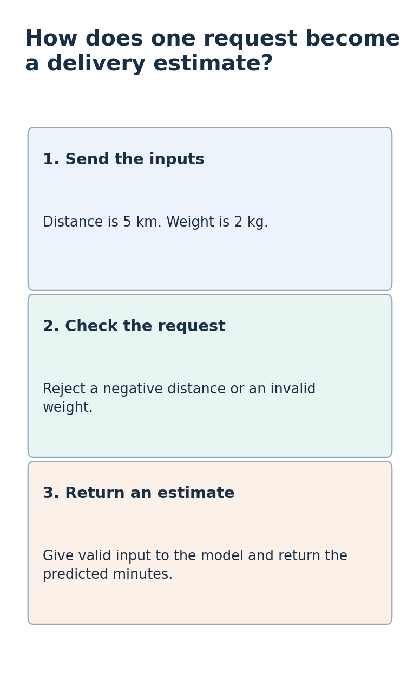

**👀 Read the visual.** Send the app the fields it needs to predict.

**👉 Use what you see.** Try both a normal row and a negative distance. Check the response code and the message in each case.

<a id="apis-web-apps-or-cloud-services"></a>

#### 🌐 APIs, Web Apps, or Cloud Services

| Lesson name | What you’ll do | Download |
| --- | --- | --- |
| 216 - APIs, Web Apps, or Cloud Services **Practice** | Send input data to a local API and inspect what comes back. | [Lesson ZIP](sample_code_folder/216-apis-web-apps-or-cloud-services.zip) |

<!-- workbook-teaching:216:start -->
<details>
<summary>Learn, trace and apply this idea</summary>

### Learn and apply: APIs, Web Apps, or Cloud Services

**Your decision.** Send input data to a local API and inspect what comes back.

**Ready check.** Train a small model and identify its required input names and units. Use [the learning path](LEARNING-PATH.md) and [the word list](GLOSSARY.md) for the earlier skill. Trace the small example on paper before code.

**What it means.** A prediction service accepts a request, validates inputs and returns an estimate or a clear error.

**Why and when.** Use a service when another program needs the saved model. Test locally before considering hosting.

**A worked example to follow.** A request supplies distance_km and weight_kg; the response contains minutes. A negative distance should be rejected rather than quietly producing a normal estimate. HTTP status reports success or the kind of failure.

**Input → steps → output.** Open the supplied table. Its fields are `distance_km`, `weight_kg`, `delivery_minutes`. One original row is shown below in that same field order; `(missing)` marks a blank rather than zero.

```text
2 | 1 | 19
```

1. Name the particular field or object involved in this lesson’s decision above. Keep its meaning and units with it.
2. Open the [complete runnable Python example](lessons/216-apis-web-apps-or-cloud-services/lesson.py). Its numbered comments connect reading, preparation and the resulting calculation. Install only the [declared requirements](lessons/216-apis-web-apps-or-cloud-services/requirements.txt) using the same course Python, as shown in Setup.
3. Trace the worked example above through the script. Keep inputs apart from measured answers. Follow this script’s split and fit, then trace the saved preparation into the held-back result and any new request. A request must not supply its own training answer.
4. Read the result by its headings. Compare with [full recorded output](lessons/216-apis-web-apps-or-cloud-services/expected-output.txt); the excerpt below belongs to the original supplied files. Your edits can change it.

```text
200 {'minutes': 27.8}
Invalid distance: 422
{'distance_km': 5, 'weight_kg': 2} 200 {'minutes': 27.8}
{'distance_km': 20, 'weight_kg': 4} 200 {'minutes': 61.4}
{'distance_km': -2, 'weight_kg': 3} 422 {'detail': [{'type': 'greater_than_equal', 'loc': ['body', 'distance_km'], 'msg': 'Input should be greater than or equal to 0', 'input': -2, 'ctx': {'ge': 0.0}}]}
```

**How to interpret it.** Trace the worked case into the result above. Tell a calculated estimate from a measured answer.

**Common mistakes and limits.** Local test-client calls do not deploy a public server. Valid types do not establish in-scope ranges or reliable predictions. Load only model files you created or trust.

**Use it yourself.** A client sends metres in a field named distance_km. Will a numeric type check detect the mistake? What belongs in the input contract?

<details>
<summary>Check your choice and reason</summary>

Not necessarily. Record units, names, ranges, missing-value rules and unfamiliar-category policy, and test examples that violate them.

</details>

**A second check later.** Close the notes and explain the same decision using a different row from the supplied table. State one condition that would make this method unsuitable. If you cannot explain the reason, repeat the small worked example before adding more code.

</details>
<!-- workbook-teaching:216:end -->


**Before this lesson.** Train and save a model. Know an input and a prediction.

**In simple words.** A request gives inputs to a program. A response gives its answer or a clear problem. An HTTP status is a short result code. Local tests do not publish a server.

**Guess first.** Should a negative distance receive a normal estimate? Write your answer before running the example.

<details>
<summary>Read the reason after trying</summary>

No. Reject it with a clear explanation. A valid-looking value can still be outside the tested range.

</details>


<a id="flask-fastapi-or-streamlit"></a>

#### 🔌 Flask, FastAPI, or Streamlit

| Lesson name | What you’ll do | Download |
| --- | --- | --- |
| 220 - Flask, FastAPI, or Streamlit **Practice** | Run a local API example before comparing Python frameworks. | [Lesson ZIP](sample_code_folder/220-flask-fastapi-or-streamlit.zip) |

<!-- workbook-teaching:220:start -->
<details>
<summary>Learn, trace and apply this idea</summary>

### Learn and apply: Flask, FastAPI, or Streamlit

**Your decision.** Run a local API example before comparing Python frameworks.

**Ready check.** Train a small model and identify its required input names and units. Use [the learning path](LEARNING-PATH.md) and [the word list](GLOSSARY.md) for the earlier skill. Trace the small example on paper before code.

**What it means.** A prediction service accepts a request, validates inputs and returns an estimate or a clear error.

**Why and when.** Use a service when another program needs the saved model. Test locally before considering hosting.

**A worked example to follow.** A request supplies distance_km and weight_kg; the response contains minutes. A negative distance should be rejected rather than quietly producing a normal estimate. HTTP status reports success or the kind of failure.

**Input → steps → output.** Open the supplied table. Its fields are `distance_km`, `weight_kg`, `delivery_minutes`. One original row is shown below in that same field order; `(missing)` marks a blank rather than zero.

```text
2 | 1 | 19
```

1. Name the particular field or object involved in this lesson’s decision above. Keep its meaning and units with it.
2. Open the [complete runnable Python example](lessons/220-flask-fastapi-or-streamlit/lesson.py). Its numbered comments connect reading, preparation and the resulting calculation. Install only the [declared requirements](lessons/220-flask-fastapi-or-streamlit/requirements.txt) using the same course Python, as shown in Setup.
3. Trace the worked example above through the script. Keep inputs apart from measured answers. Follow this script’s split and fit, then trace the saved preparation into the held-back result and any new request. A request must not supply its own training answer.
4. Read the result by its headings. Compare with [full recorded output](lessons/220-flask-fastapi-or-streamlit/expected-output.txt); the excerpt below belongs to the original supplied files. Your edits can change it.

```text
200 {'minutes': 27.8}
Invalid distance: 422
{'distance_km': 5, 'weight_kg': 2} 200 {'minutes': 27.8}
{'distance_km': 20, 'weight_kg': 4} 200 {'minutes': 61.4}
{'distance_km': -2, 'weight_kg': 3} 422 {'detail': [{'type': 'greater_than_equal', 'loc': ['body', 'distance_km'], 'msg': 'Input should be greater than or equal to 0', 'input': -2, 'ctx': {'ge': 0.0}}]}
```

**How to interpret it.** Trace the worked case into the result above. Tell a calculated estimate from a measured answer.

**Common mistakes and limits.** Local test-client calls do not deploy a public server. Valid types do not establish in-scope ranges or reliable predictions. Load only model files you created or trust.

**Use it yourself.** A client sends metres in a field named distance_km. Will a numeric type check detect the mistake? What belongs in the input contract?

<details>
<summary>Check your choice and reason</summary>

Not necessarily. Record units, names, ranges, missing-value rules and unfamiliar-category policy, and test examples that violate them.

</details>

**A second check later.** Close the notes and explain the same decision using a different row from the supplied table. State one condition that would make this method unsuitable. If you cannot explain the reason, repeat the small worked example before adding more code.

</details>
<!-- workbook-teaching:220:end -->


**Before this lesson.** Train and save a model. Know an input and a prediction.

**In simple words.** A request gives inputs to a program. A response gives its answer or a clear problem. An HTTP status is a short result code. Local tests do not publish a server.

**Guess first.** Should a negative distance receive a normal estimate? Write your answer before running the example.

<details>
<summary>Read the reason after trying</summary>

No. Reject it with a clear explanation. A valid-looking value can still be outside the tested range.

</details>


<a id="fastapi"></a>

##### ⚡ FastAPI

| Lesson name | What you’ll do | Download |
| --- | --- | --- |
| 221 - FastAPI **Practice** | Send valid and invalid deliveries to a FastAPI route and read the response. | [Lesson ZIP](sample_code_folder/221-fastapi.zip) |

<!-- workbook-teaching:221:start -->
<details>
<summary>Learn, trace and apply this idea</summary>

### Learn and apply: FastAPI

**Your decision.** Send valid and invalid deliveries to a FastAPI route and read the response.

**Ready check.** Train a small model and identify its required input names and units. Use [the learning path](LEARNING-PATH.md) and [the word list](GLOSSARY.md) for the earlier skill. Trace the small example on paper before code.

**What it means.** A prediction service accepts a request, validates inputs and returns an estimate or a clear error.

**Why and when.** Use a service when another program needs the saved model. Test locally before considering hosting.

**A worked example to follow.** A request supplies distance_km and weight_kg; the response contains minutes. A negative distance should be rejected rather than quietly producing a normal estimate. HTTP status reports success or the kind of failure.

**Input → steps → output.** Open the supplied table. Its fields are `distance_km`, `weight_kg`, `delivery_minutes`. One original row is shown below in that same field order; `(missing)` marks a blank rather than zero.

```text
2 | 1 | 19
```

1. Name the particular field or object involved in this lesson’s decision above. Keep its meaning and units with it.
2. Open the [complete runnable Python example](lessons/221-fastapi/lesson.py). Its numbered comments connect reading, preparation and the resulting calculation. Install only the [declared requirements](lessons/221-fastapi/requirements.txt) using the same course Python, as shown in Setup.
3. Trace the worked example above through the script. Keep inputs apart from measured answers. Follow this script’s split and fit, then trace the saved preparation into the held-back result and any new request. A request must not supply its own training answer.
4. Read the result by its headings. Compare with [full recorded output](lessons/221-fastapi/expected-output.txt); the excerpt below belongs to the original supplied files. Your edits can change it.

```text
200 {'minutes': 27.8}
Invalid distance: 422
{'distance_km': 5, 'weight_kg': 2} 200 {'minutes': 27.8}
{'distance_km': 20, 'weight_kg': 4} 200 {'minutes': 61.4}
{'distance_km': -2, 'weight_kg': 3} 422 {'detail': [{'type': 'greater_than_equal', 'loc': ['body', 'distance_km'], 'msg': 'Input should be greater than or equal to 0', 'input': -2, 'ctx': {'ge': 0.0}}]}
```

**How to interpret it.** Trace the worked case into the result above. Tell a calculated estimate from a measured answer.

**Common mistakes and limits.** Local test-client calls do not deploy a public server. Valid types do not establish in-scope ranges or reliable predictions. Load only model files you created or trust.

**Use it yourself.** A client sends metres in a field named distance_km. Will a numeric type check detect the mistake? What belongs in the input contract?

<details>
<summary>Check your choice and reason</summary>

Not necessarily. Record units, names, ranges, missing-value rules and unfamiliar-category policy, and test examples that violate them.

</details>

**A second check later.** Close the notes and explain the same decision using a different row from the supplied table. State one condition that would make this method unsuitable. If you cannot explain the reason, repeat the small worked example before adding more code.

</details>
<!-- workbook-teaching:221:end -->


**Before this lesson.** Train and save a model. Know an input and a prediction.

**In simple words.** A request gives inputs to a program. A response gives its answer or a clear problem. An HTTP status is a short result code. Local tests do not publish a server.

**Guess first.** Should a negative distance receive a normal estimate? Write your answer before running the example.

<details>
<summary>Read the reason after trying</summary>

No. Reject it with a clear explanation. A valid-looking value can still be outside the tested range.

</details>


Save an original delivery model, reload it, and submit one JSON request to a local FastAPI test client. The request goes through the API contract without starting a public server.

**📋 Sample data**

| distance_km | weight_kg | delivery_minutes |
| --- | --- | --- |
| 2 | 1 | 19 |
| 4 | 3 | 30 |
| 6 | 2 | 29 |
| 8 | 4 | 40 |
| 10 | 1 | 33 |
| 12 | 3 | 44 |

**▶️ Run.** Unzip the [lesson files](sample_code_folder/221-fastapi.zip) and open a terminal in that folder. Install the lesson’s packages with `python -m pip install -r requirements.txt`, then run `python lesson.py`.

**🔹 Steps in the script**

1. Read the delivery table. Distance is in km, and weight is in kg.
2. Send a practice request and read the response code and body.
3. Send each new CSV row to the app and read the response.

**✅ Check.** Find HTTP 200 for a valid request and 422 for the negative distance.

```text
200 {'minutes': 27.8}
Invalid distance: 422
{'distance_km': 5, 'weight_kg': 2} 200 {'minutes': 27.8}
```

**Your small change.** Enter 15 km with 2 kg, then with 0 kg. Check that only the positive weight gives an estimate. Save the named CSV before running again.


<a id="flask"></a>

##### 🧪 Flask

| Lesson name | What you’ll do | Download |
| --- | --- | --- |
| 222 - Flask **Practice** | Send the same delivery fields to a Flask route and read the JSON reply. | [Lesson ZIP](sample_code_folder/222-flask.zip) |

<!-- workbook-teaching:222:start -->
<details>
<summary>Learn, trace and apply this idea</summary>

### Learn and apply: Flask

**Your decision.** Send the same delivery fields to a Flask route and read the JSON reply.

**Ready check.** Train a small model and identify its required input names and units. Use [the learning path](LEARNING-PATH.md) and [the word list](GLOSSARY.md) for the earlier skill. Trace the small example on paper before code.

**What it means.** A prediction service accepts a request, validates inputs and returns an estimate or a clear error.

**Why and when.** Use a service when another program needs the saved model. Test locally before considering hosting.

**A worked example to follow.** A request supplies distance_km and weight_kg; the response contains minutes. A negative distance should be rejected rather than quietly producing a normal estimate. HTTP status reports success or the kind of failure.

**Input → steps → output.** Open the supplied table. Its fields are `distance_km`, `weight_kg`, `delivery_minutes`. One original row is shown below in that same field order; `(missing)` marks a blank rather than zero.

```text
2 | 1 | 19
```

1. Name the particular field or object involved in this lesson’s decision above. Keep its meaning and units with it.
2. Open the [complete runnable Python example](lessons/222-flask/lesson.py). Its numbered comments connect reading, preparation and the resulting calculation. Install only the [declared requirements](lessons/222-flask/requirements.txt) using the same course Python, as shown in Setup.
3. Trace the worked example above through the script. Keep inputs apart from measured answers. Follow this script’s split and fit, then trace the saved preparation into the held-back result and any new request. A request must not supply its own training answer.
4. Read the result by its headings. Compare with [full recorded output](lessons/222-flask/expected-output.txt); the excerpt below belongs to the original supplied files. Your edits can change it.

```text
200 {'minutes': 27.8}
{'distance_km': 5, 'weight_kg': 2} 200 {'minutes': 27.8}
{'distance_km': 20, 'weight_kg': 4} 200 {'minutes': 61.4}
{'distance_km': -2, 'weight_kg': 3} 400 {'error': 'Distance must be finite and nonnegative and weight positive.'}
```

**How to interpret it.** Trace the worked case into the result above. Tell a calculated estimate from a measured answer.

**Common mistakes and limits.** Local test-client calls do not deploy a public server. Valid types do not establish in-scope ranges or reliable predictions. Load only model files you created or trust.

**Use it yourself.** A client sends metres in a field named distance_km. Will a numeric type check detect the mistake? What belongs in the input contract?

<details>
<summary>Check your choice and reason</summary>

Not necessarily. Record units, names, ranges, missing-value rules and unfamiliar-category policy, and test examples that violate them.

</details>

**A second check later.** Close the notes and explain the same decision using a different row from the supplied table. State one condition that would make this method unsuitable. If you cannot explain the reason, repeat the small worked example before adding more code.

</details>
<!-- workbook-teaching:222:end -->


**Before this lesson.** Train and save a model. Know an input and a prediction.

**In simple words.** A request gives inputs to a program. A response gives its answer or a clear problem. An HTTP status is a short result code. Local tests do not publish a server.

**Guess first.** Should a negative distance receive a normal estimate? Write your answer before running the example.

<details>
<summary>Read the reason after trying</summary>

No. Reject it with a clear explanation. A valid-looking value can still be outside the tested range.

</details>


Send the same contract to a local Flask test client using an independently created training table.

**📋 Sample data**

| distance_km | weight_kg | delivery_minutes |
| --- | --- | --- |
| 2 | 1 | 19 |
| 4 | 3 | 30 |
| 6 | 2 | 29 |
| 8 | 4 | 40 |
| 10 | 1 | 33 |
| 12 | 3 | 44 |

**▶️ Run.** Unzip the [lesson files](sample_code_folder/222-flask.zip) and open a terminal in that folder. Install the lesson’s packages with `python -m pip install -r requirements.txt`, then run `python lesson.py`.

**🔹 Steps in the script**

1. Read the delivery table. Distance is in km, and weight is in kg.
2. Teach the model from the training inputs and delivery time in minutes.
3. Send each new CSV row to the app and read the response.

**✅ Check.** Look for 200 {'minutes': 27.8} in the output excerpt below.

```text
200 {'minutes': 27.8}
{'distance_km': 5, 'weight_kg': 2} 200 {'minutes': 27.8}
{'distance_km': 20, 'weight_kg': 4} 200 {'minutes': 61.4}
```

**Your small change.** Try changing distance_km from 5 to -2 in new_inputs.csv. Compare the new output. Save the named CSV before running again.


<a id="streamlit"></a>

##### 🖥️ Streamlit

| Lesson name | What you’ll do | Download |
| --- | --- | --- |
| 223 - Streamlit **Practice** | Fill in a Streamlit form and see the delivery estimate change. | [Lesson ZIP](sample_code_folder/223-streamlit.zip) |

<!-- workbook-teaching:223:start -->
<details>
<summary>Learn, trace and apply this idea</summary>

### Learn and apply: Streamlit

**Your decision.** Fill in a Streamlit form and see the delivery estimate change.

**Ready check.** Explain an input field, a request and a response. Use [the learning path](LEARNING-PATH.md) and [the word list](GLOSSARY.md) for the earlier skill. Trace the small example on paper before code.

**What it means.** A form collects inputs and displays the service response. It is another way to use the same model contract.

**Why and when.** Use it to let a person make a controlled local request after the prediction code works.

**A worked example to follow.** Enter a distance, select Predict and read returned minutes. The endpoint must still validate a negative or missing value, even if the browser provides a numeric input control.

**Input → steps → output.** Open the supplied table. Its fields are `distance_km`, `weight_kg`, `delivery_minutes`. One original row is shown below in that same field order; `(missing)` marks a blank rather than zero.

```text
2 | 1 | 19
```

1. Name the particular field or object involved in this lesson’s decision above. Keep its meaning and units with it.
2. Open the [complete runnable Python example](lessons/223-streamlit/lesson.py). Its numbered comments connect reading, preparation and the resulting calculation. Install only the [declared requirements](lessons/223-streamlit/requirements.txt) using the same course Python, as shown in Setup.
3. Trace the worked example above through the script. Keep inputs apart from measured answers. Follow this script’s split and fit, then trace the saved preparation into the held-back result and any new request. A request must not supply its own training answer.
4. Read the result by its headings. Compare with [full recorded output](lessons/223-streamlit/expected-output.txt); the excerpt below belongs to the original supplied files. Your edits can change it.

```text
Prediction: 27.5 minutes
5 2 Prediction: 27.5 minutes
10 4 Prediction: 43.0 minutes
15 1 Prediction: 38.5 minutes
```

**How to interpret it.** Trace the worked case into the result above. Tell a calculated estimate from a measured answer.

**Common mistakes and limits.** A working server test is not a tested browser layout. The practice app is local; it does not establish deployment security or production reliability.

**Use it yourself.** If someone bypasses the form and sends a negative number directly, should the endpoint accept it because the form normally blocks it?

<details>
<summary>Check your choice and reason</summary>

No. Validate at the service boundary and return a clear problem. Show an understandable message in the form as well.

</details>

**A second check later.** Close the notes and explain the same decision using a different row from the supplied table. State one condition that would make this method unsuitable. If you cannot explain the reason, repeat the small worked example before adding more code.

</details>
<!-- workbook-teaching:223:end -->


**Before this lesson.** Train and save a model. Know an input and a prediction.

**In simple words.** A request gives inputs to a program. A response gives its answer or a clear problem. An HTTP status is a short result code. Local tests do not publish a server.

**Guess first.** Should a negative distance receive a normal estimate? Write your answer before running the example.

<details>
<summary>Read the reason after trying</summary>

No. Reject it with a clear explanation. A valid-looking value can still be outside the tested range.

</details>


Build a two-field web form and verify its displayed prediction with the Streamlit test driver.

**▶️ Run.** Unzip the [lesson files](sample_code_folder/223-streamlit.zip) and open a terminal in that folder. Install the lesson’s packages with `python -m pip install -r requirements.txt`, then run `python lesson.py`.

**🔹 Steps in the script**

1. Read the training data for the form and fit a model in the local Streamlit app.
2. Teach the model from the training inputs and delivery time in minutes.
3. Send each new CSV row to the app and read the response.

**✅ Check.** Look for Prediction: 27.5 minutes in the output excerpt below.

```text
Prediction: 27.5 minutes
5 2 Prediction: 27.5 minutes
10 4 Prediction: 43.0 minutes
```

**Your small change.** Enter distances of 5, 10 and 15 km with positive weights. The script fills out the sample form for each row. Save the named CSV before running again.


**💡 Takeaway.** The ZIP now includes `delivery_app.py`. From its folder run `python -m streamlit run delivery_app.py`. Open the local address shown in the terminal. Stop with Ctrl+C. No code copying is needed.

<a id="aws-google-cloud-or-heroku"></a>

#### ☁️ AWS, Google Cloud, or Heroku

| Lesson name | What you’ll do | Download |
| --- | --- | --- |
| 224 - AWS, Google Cloud, or Heroku **Reference** | Practice a local request check, then use the deployment notes for your platform. | [Lesson ZIP](sample_code_folder/224-aws-google-cloud-or-heroku.zip) |

<!-- workbook-teaching:224:start -->
<details>
<summary>Learn, trace and apply this idea</summary>

### Learn and apply: AWS, Google Cloud, or Heroku

**Your decision.** Practice a local request check, then use the deployment notes for your platform.

**Ready check.** Run the local Flask or FastAPI request example first. Use [the learning path](LEARNING-PATH.md) and [the word list](GLOSSARY.md) for the earlier skill. Trace the small example on paper before code.

**What it means.** Hosting runs an application on another service’s computers. Packaging and access rules are separate from the prediction calculation.

**Why and when.** Use an approved learning account only after local request checks and a cost/removal plan.

**A worked example to follow.** These scripts inspect a local request contract. The companion service notes describe preparing files for a selected platform; they do not mean the platform was deployed or tested.

**Input → steps → output.** Open the supplied table. Its fields are `distance_km`, `weight_kg`. One original row is shown below in that same field order; `(missing)` marks a blank rather than zero.

```text
5 | 2
```

1. Name the particular field or object involved in this lesson’s decision above. Keep its meaning and units with it.
2. Open the [complete runnable Python example](lessons/224-aws-google-cloud-or-heroku/lesson.py). Its numbered comments connect reading, preparation and the resulting calculation. Install only the [declared requirements](lessons/224-aws-google-cloud-or-heroku/requirements.txt) using the same course Python, as shown in Setup.
3. Trace the worked example above through the script. Trace the named source fields into the printed table, file or request result. Check names and counts before interpreting what the program reports.
4. Read the result by its headings. Compare with [full recorded output](lessons/224-aws-google-cloud-or-heroku/expected-output.txt); the excerpt below belongs to the original supplied files. Your edits can change it.

```text
 distance_km  weight_kg  valid  expected_status
           5          2   True              200
          15          6   True              200
          -2          4  False              422
           5          0  False              422
Platform to explore: AWS, Google Cloud, or Heroku
```

**How to interpret it.** Trace the worked case into the result above. Tell a calculated estimate from a measured answer.

**Common mistakes and limits.** Keep credentials out of code and avoid uploading private data. Platform instructions and costs change. Preserve the prediction route, dependencies and input contract when adapting the module.

**Use it yourself.** A script prints expected HTTP 200. Does that prove a hosted endpoint was called successfully?

<details>
<summary>Check your choice and reason</summary>

No. It is a local expected-contract result. Deployment evidence requires the actual approved service, a request to its endpoint and recorded response, with costs and cleanup checked.

</details>

**A second check later.** Close the notes and explain the same decision using a different row from the supplied table. State one condition that would make this method unsuitable. If you cannot explain the reason, repeat the small worked example before adding more code.

</details>
<!-- workbook-teaching:224:end -->


**Before this lesson.** Train and save a model. Know an input and a prediction.

**In simple words.** A request gives inputs to a program. A response gives its answer or a clear problem. An HTTP status is a short result code. Local tests do not publish a server.

**Guess first.** Should a negative distance receive a normal estimate? Write your answer before running the example.

<details>
<summary>Read the reason after trying</summary>

No. Reject it with a clear explanation. A valid-looking value can still be outside the tested range.

</details>


Use the [Cloud deployment walkthrough](#cloud-deployment-walkthrough) once a local request works.

<a id="rest-api-or-integrate-with-mobile-web-apps"></a>

#### 📱 REST API or integrate with mobile/web apps

| Lesson name | What you’ll do | Download |
| --- | --- | --- |
| 228 - REST API or integrate with mobile/web apps **Practice** | Turn CSV rows into JSON request bodies a web or mobile app would send. | [Lesson ZIP](sample_code_folder/228-rest-api-or-integrate-with-mobile-web-apps.zip) |

<!-- workbook-teaching:228:start -->
<details>
<summary>Learn, trace and apply this idea</summary>

### Learn and apply: REST API or integrate with mobile/web apps

**Your decision.** Turn CSV rows into JSON request bodies a web or mobile app would send.

**Ready check.** Train a small model and identify its required input names and units. Use [the learning path](LEARNING-PATH.md) and [the word list](GLOSSARY.md) for the earlier skill. Trace the small example on paper before code.

**What it means.** A prediction service accepts a request, validates inputs and returns an estimate or a clear error.

**Why and when.** Use a service when another program needs the saved model. Test locally before considering hosting.

**A worked example to follow.** A request supplies distance_km and weight_kg; the response contains minutes. A negative distance should be rejected rather than quietly producing a normal estimate. HTTP status reports success or the kind of failure.

**Input → steps → output.** Open the supplied table. Its fields are `distance_km`, `weight_kg`. One original row is shown below in that same field order; `(missing)` marks a blank rather than zero.

```text
5 | 2
```

1. Name the particular field or object involved in this lesson’s decision above. Keep its meaning and units with it.
2. Open the [complete runnable Python example](lessons/228-rest-api-or-integrate-with-mobile-web-apps/lesson.py). Its numbered comments connect reading, preparation and the resulting calculation. Install only the [declared requirements](lessons/228-rest-api-or-integrate-with-mobile-web-apps/requirements.txt) using the same course Python, as shown in Setup.
3. Trace the worked example above through the script. Keep inputs apart from measured answers. Follow this script’s split and fit, then trace the saved preparation into the held-back result and any new request. A request must not supply its own training answer.
4. Read the result by its headings. Compare with [full recorded output](lessons/228-rest-api-or-integrate-with-mobile-web-apps/expected-output.txt); the excerpt below belongs to the original supplied files. Your edits can change it.

```text
POST /predict {"distance_km": 5, "weight_kg": 2}
POST /predict {"distance_km": 10, "weight_kg": 3}
POST /predict {"distance_km": 14, "weight_kg": 4}
```

**How to interpret it.** Trace the worked case into the result above. Tell a calculated estimate from a measured answer.

**Common mistakes and limits.** Local test-client calls do not deploy a public server. Valid types do not establish in-scope ranges or reliable predictions. Load only model files you created or trust.

**Use it yourself.** A client sends metres in a field named distance_km. Will a numeric type check detect the mistake? What belongs in the input contract?

<details>
<summary>Check your choice and reason</summary>

Not necessarily. Record units, names, ranges, missing-value rules and unfamiliar-category policy, and test examples that violate them.

</details>

**A second check later.** Close the notes and explain the same decision using a different row from the supplied table. State one condition that would make this method unsuitable. If you cannot explain the reason, repeat the small worked example before adding more code.

</details>
<!-- workbook-teaching:228:end -->


**Before this lesson.** Train and save a model. Know an input and a prediction.

**In simple words.** A request gives inputs to a program. A response gives its answer or a clear problem. An HTTP status is a short result code. Local tests do not publish a server.

**Guess first.** Should a negative distance receive a normal estimate? Write your answer before running the example.

<details>
<summary>Read the reason after trying</summary>

No. Reject it with a clear explanation. A valid-looking value can still be outside the tested range.

</details>


A request sends the facts the model needs. A response sends its answer. The [web page example](#first-api-call-from-a-web-page) connects the form to that request.

Validate a sample deployment request locally. Reuse this JSON schema when you wire up a mobile or web client. AWS, Google Cloud, and Heroku are hosting options for the same service.

**▶️ Run.** Unzip the [lesson files](sample_code_folder/228-rest-api-or-integrate-with-mobile-web-apps.zip) and open a terminal in that folder. Install the lesson’s packages with `python -m pip install -r requirements.txt`, then run `python lesson.py`.

**🔹 Steps in the script**

1. Read the delivery table. Distance is in km, and weight is in kg.

**✅ Check.** Look for POST /predict {"distance_km": 5, "weight_kg": 2} in the output excerpt below.

```text
POST /predict {"distance_km": 5, "weight_kg": 2}
POST /predict {"distance_km": 10, "weight_kg": 3}
POST /predict {"distance_km": 14, "weight_kg": 4}
```

**Your small change.** Try changing distance_km from 5 to 14 in sample.csv. Compare the new output. Save the named CSV before running again.


**💡 Takeaway.** Deploy only if you have an approved environment. Package the app, its dependencies, and the trusted model. Send this same request to the hosted endpoint and compare the response with the local test. [FastAPI testing](https://fastapi.tiangolo.com/tutorial/testing/)

<a id="first-api-call-from-a-web-page"></a>

#### 🌐 First API call from a web page

| Lesson name | What you’ll do | Download |
| --- | --- | --- |
| 232 - First API call from a web page **Core** | Send a distance to a local model from a web page and read the response. | [Lesson ZIP](sample_code_folder/232-first-api-call-from-a-web-page.zip) |

<!-- workbook-teaching:232:start -->
<details>
<summary>Learn, trace and apply this idea</summary>

### Learn and apply: First API call from a web page

**Your decision.** Send a distance to a local model from a web page and read the response.

**Ready check.** Explain an input field, a request and a response. Use [the learning path](LEARNING-PATH.md) and [the word list](GLOSSARY.md) for the earlier skill. Trace the small example on paper before code.

**What it means.** A form collects inputs and displays the service response. It is another way to use the same model contract.

**Why and when.** Use it to let a person make a controlled local request after the prediction code works.

**A worked example to follow.** Enter a distance, select Predict and read returned minutes. The endpoint must still validate a negative or missing value, even if the browser provides a numeric input control.

**Input → steps → output.** Open the supplied table. Its fields are `distance_km`, `minutes`. One original row is shown below in that same field order; `(missing)` marks a blank rather than zero.

```text
1 | 12
```

1. Name the particular field or object involved in this lesson’s decision above. Keep its meaning and units with it.
2. Open the [complete runnable Python example](lessons/232-first-api-call-from-a-web-page/lesson.py). Its numbered comments connect reading, preparation and the resulting calculation. Install only the [declared requirements](lessons/232-first-api-call-from-a-web-page/requirements.txt) using the same course Python, as shown in Setup.
3. Trace the worked example above through the script. Keep inputs apart from measured answers. Follow this script’s split and fit, then trace the saved preparation into the held-back result and any new request. A request must not supply its own training answer.
4. Read the result by its headings. Compare with [full recorded output](lessons/232-first-api-call-from-a-web-page/expected-output.txt); the excerpt below belongs to the original supplied files. Your edits can change it.

```text
       Action  HTTP status  Predicted minutes
Open the page          200                NaN
 Predict 4 km          200               18.0
Response: {'minutes': 18.0}
8 200 {'minutes': 26.0}
12 200 {'minutes': 34.0}
```

**How to interpret it.** Trace the worked case into the result above. Tell a calculated estimate from a measured answer.

**Common mistakes and limits.** A working server test is not a tested browser layout. The practice app is local; it does not establish deployment security or production reliability.

**Use it yourself.** If someone bypasses the form and sends a negative number directly, should the endpoint accept it because the form normally blocks it?

<details>
<summary>Check your choice and reason</summary>

No. Validate at the service boundary and return a clear problem. Show an understandable message in the form as well.

</details>

**A second check later.** Close the notes and explain the same decision using a different row from the supplied table. State one condition that would make this method unsuitable. If you cannot explain the reason, repeat the small worked example before adding more code.

</details>
<!-- workbook-teaching:232:end -->


**Before this lesson.** Train and save a model. Know an input and a prediction.

**In simple words.** A request gives inputs to a program. A response gives its answer or a clear problem. An HTTP status is a short result code. Local tests do not publish a server.

**Guess first.** Should a negative distance receive a normal estimate? Write your answer before running the example.

<details>
<summary>Read the reason after trying</summary>

No. Reject it with a clear explanation. A valid-looking value can still be outside the tested range.

</details>


**🎯 Goal.** Can a web page give a delivery distance to a model and show its answer? Open the page, type 4, and press Predict. The Python block tests the same request the button makes.

**📋 Sample data**

| distance_km | minutes |
| --- | --- |
| 1 | 12 |
| 2 | 14 |
| 3 | 16 |

**▶️ Run.** Unzip the [lesson files](sample_code_folder/232-first-api-call-from-a-web-page.zip) and open a terminal in that folder. Install the lesson’s packages with `python -m pip install -r requirements.txt`, then run `python lesson.py`.

**🔹 Steps in the script**

1. Read the CSV and check its inputs, including distance_km, minutes.
2. Teach the model from the training inputs and delivery time in minutes.

**✅ Check.** Read 200 for the page and 18.0 minutes for the 4 km request.

| Action | HTTP status | Predicted minutes |
| --- | --- | --- |
| Open the page | 200 | NaN |
| Predict 4 km | 200 | 18.0 |

**Your small change.** Change 4 to 12 in new_inputs.csv. The local test request should report 34.0 minutes. Save the named CSV before running again.


**See the page locally.** The ZIP includes the app in `lesson.py`. From that folder run `python -m uvicorn lesson:app --host 127.0.0.1 --port 8000`, then open `http://127.0.0.1:8000`. The browser sends a distance to the same API. A mobile app can send the same request. This lab checks the endpoint locally.

<a id="cloud-deployment-walkthrough"></a>

#### ☁️ Cloud deployment walkthrough

| Lesson name | What you’ll do | Download |
| --- | --- | --- |
| 233 - Cloud deployment walkthrough **Reference** | Check your request format locally, then follow the deployment steps for your chosen platform. | [Lesson ZIP](sample_code_folder/233-cloud-deployment-walkthrough.zip) |

<!-- workbook-teaching:233:start -->
<details>
<summary>Learn, trace and apply this idea</summary>

### Learn and apply: Cloud deployment walkthrough

**Your decision.** Check your request format locally, then follow the deployment steps for your chosen platform.

**Ready check.** Run the local Flask or FastAPI request example first. Use [the learning path](LEARNING-PATH.md) and [the word list](GLOSSARY.md) for the earlier skill. Trace the small example on paper before code.

**What it means.** Hosting runs an application on another service’s computers. Packaging and access rules are separate from the prediction calculation.

**Why and when.** Use an approved learning account only after local request checks and a cost/removal plan.

**A worked example to follow.** These scripts inspect a local request contract. The companion service notes describe preparing files for a selected platform; they do not mean the platform was deployed or tested.

**Input → steps → output.** Open the supplied table. Its fields are `distance_km`, `weight_kg`. One original row is shown below in that same field order; `(missing)` marks a blank rather than zero.

```text
5 | 2
```

1. Name the particular field or object involved in this lesson’s decision above. Keep its meaning and units with it.
2. Open the [complete runnable Python example](lessons/233-cloud-deployment-walkthrough/lesson.py). Its numbered comments connect reading, preparation and the resulting calculation. Install only the [declared requirements](lessons/233-cloud-deployment-walkthrough/requirements.txt) using the same course Python, as shown in Setup.
3. Trace the worked example above through the script. Trace the named source fields into the printed table, file or request result. Check names and counts before interpreting what the program reports.
4. Read the result by its headings. Compare with [full recorded output](lessons/233-cloud-deployment-walkthrough/expected-output.txt); the excerpt below belongs to the original supplied files. Your edits can change it.

```text
 distance_km  weight_kg  valid  expected_status
           5          2   True              200
          15          6   True              200
          -2          4  False              422
           5          0  False              422
Platform to explore: Cloud deployment walkthrough
```

**How to interpret it.** Trace the worked case into the result above. Tell a calculated estimate from a measured answer.

**Common mistakes and limits.** Keep credentials out of code and avoid uploading private data. Platform instructions and costs change. Preserve the prediction route, dependencies and input contract when adapting the module.

**Use it yourself.** A script prints expected HTTP 200. Does that prove a hosted endpoint was called successfully?

<details>
<summary>Check your choice and reason</summary>

No. It is a local expected-contract result. Deployment evidence requires the actual approved service, a request to its endpoint and recorded response, with costs and cleanup checked.

</details>

**A second check later.** Close the notes and explain the same decision using a different row from the supplied table. State one condition that would make this method unsuitable. If you cannot explain the reason, repeat the small worked example before adding more code.

</details>
<!-- workbook-teaching:233:end -->


**Before this lesson.** Train and save a model. Know an input and a prediction.

**In simple words.** A request gives inputs to a program. A response gives its answer or a clear problem. An HTTP status is a short result code. Local tests do not publish a server.

**Guess first.** Should a negative distance receive a normal estimate? Write your answer before running the example.

<details>
<summary>Read the reason after trying</summary>

No. Reject it with a clear explanation. A valid-looking value can still be outside the tested range.

</details>


Use the same request on a cloud service after the local prediction works. No cloud account is needed for the Python exercise. Hosting below is a separate practice step, and may require billing.

| Service from the PDF | What to do | Check before sharing |
| --- | --- | --- |
| AWS Elastic Beanstalk | Use the [official Flask tutorial](https://docs.aws.amazon.com/elasticbeanstalk/latest/dg/create-deploy-python-flask.html). Use the workbook’s Flask code in `application.py`, expose the Flask app as `application`, and add a `requirements.txt` with `flask`, `pandas`, and `scikit-learn`. Follow the tutorial’s environment creation and deployment steps. | Call `/predict` with the same two fields as your local Flask test. |
| Google Cloud Run | Follow the [Flask quickstart](https://cloud.google.com/run/docs/quickstarts/build-and-deploy/deploy-python-service). Put the workbook’s Flask code in `main.py`, name the Flask object `app`, and list `Flask`, `pandas`, `scikit-learn`, and `gunicorn` in `requirements.txt`. Run the quickstart’s source deployment in your project. | Call `/predict` and compare the response with the local result. Use authenticated access when possible. |
| Heroku | Follow the [Python getting-started guide](https://devcenter.heroku.com/articles/getting-started-with-python). Save the Flask service as `application.py`, list its packages plus `gunicorn`, and add a `Procfile` containing `web: gunicorn application:app`. | Run locally first, deploy from your project, then send the same prediction request. |

Keep API credentials private and delete the practice service when you finish. The deployment commands run only in your own authorized account. The workbook exercises use local requests.

<a id="1-10-model-monitoring-maintenance"></a>

### 📈 1.10. Model Monitoring & Maintenance

| Lesson name | What you’ll do | Download |
| --- | --- | --- |
| 234 - 1.10. Model Monitoring & Maintenance **Practice** | Follow a model over several batches and decide when to investigate or retrain. | [Lesson ZIP](sample_code_folder/234-1-10-model-monitoring-maintenance.zip) |

<!-- workbook-teaching:234:start -->
<details>
<summary>Learn, trace and apply this idea</summary>

### Learn and apply: 1.10. Model Monitoring & Maintenance

**Your decision.** Follow a model over several batches and decide when to investigate or retrain.

**Ready check.** Read an error or category score and distinguish prediction from later outcome. Use [the learning path](LEARNING-PATH.md) and [the word list](GLOSSARY.md) for the earlier skill. Trace the small example on paper before code.

**What it means.** Monitoring watches inputs and measured results over time. Drift means a change worth investigating.

**Why and when.** Use it after a model starts receiving new cases, with a named owner and action for each alert.

**A worked example to follow.** Later trips may be longer than historical trips. Compare their input distributions, then calculate accuracy or error only after outcomes arrive. A candidate retrained on recent labeled rows needs a separate later comparison with the current model.

**Input → steps → output.** Open the supplied table. Its fields are `batch`, `km`, `late`. One original row is shown below in that same field order; `(missing)` marks a blank rather than zero.

```text
historical | 19 | True
```

1. Name the particular field or object involved in this lesson’s decision above. Keep its meaning and units with it.
2. Open the [complete runnable Python example](lessons/234-1-10-model-monitoring-maintenance/lesson.py). Its numbered comments connect reading, preparation and the resulting calculation. Install only the [declared requirements](lessons/234-1-10-model-monitoring-maintenance/requirements.txt) using the same course Python, as shown in Setup.
3. Trace the worked example above through the script. Keep inputs apart from measured answers. Follow this script’s split and fit, then trace the saved preparation into the held-back result and any new request. A request must not supply its own training answer.
4. Read the result by its headings. Compare with [full recorded output](lessons/234-1-10-model-monitoring-maintenance/expected-output.txt); the excerpt below belongs to the original supplied files. Your edits can change it.

```text
Recent accuracy: 0.53 median km change: 7.0
ALERT: investigate before promoting a candidate.
Later batch, live / candidate: 0.5 1.0
```

**How to interpret it.** Trace the worked case into the result above. Tell a calculated estimate from a measured answer.

**Common mistakes and limits.** Input change alone does not prove worse predictions. An alert does not automatically authorize retraining or replacement. Delayed labels limit what is currently measurable.

**Use it yourself.** West-zone error rises. Name three checks before replacing the model.

<details>
<summary>Check your choice and reason</summary>

Verify units/schema and labels, inspect affected cases and counts, and check changes in routes or population. Use the agreed fallback if needed; compare any candidate fairly before promotion.

</details>

**A second check later.** Close the notes and explain the same decision using a different row from the supplied table. State one condition that would make this method unsuitable. If you cannot explain the reason, repeat the small worked example before adding more code.

</details>
<!-- workbook-teaching:234:end -->


**Before this lesson.** Read a model score and wait for actual outcomes.

**In simple words.** Monitoring watches later inputs and results. Drift means change over time. A change is a reason to investigate, not an automatic instruction to replace a model.

**Guess first.** Can we measure new accuracy before the true answers arrive? Write your answer before running the example.

<details>
<summary>Read the reason after trying</summary>

No. Record predictions and wait for outcomes.

</details>


**📌 Before you start.** Know the original test score and how to identify later rows. See [the capstone monitoring step](#lesson-447).

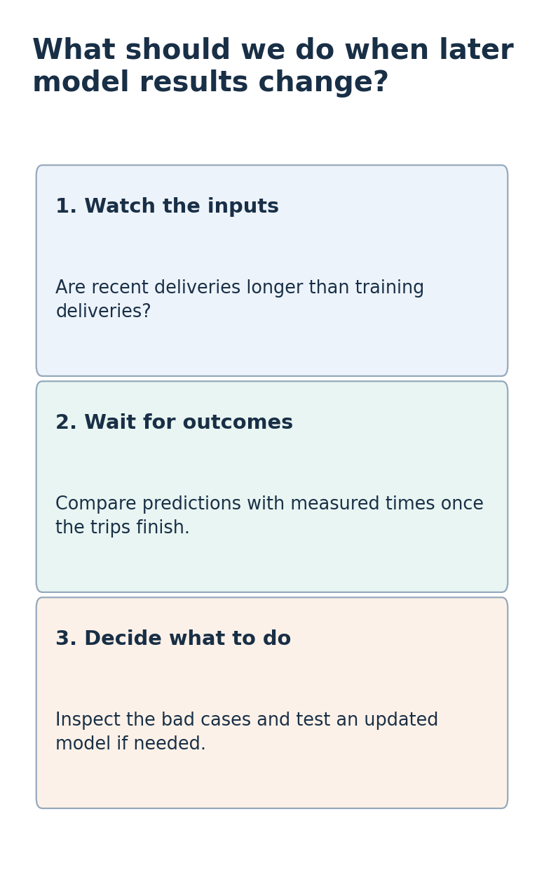

**👀 Read the visual.** Review new inputs and later measured outcomes.

**👉 Use what you see.** A change in trip distances is a reason to check. Use measured results to see whether the predictions got worse.

<a id="visualization-helps-track-model-performance"></a>

#### 📊 Visualization helps track model performance!

| Lesson name | What you’ll do | Download |
| --- | --- | --- |
| 235 - Visualization helps track model performance! **Practice** | Plot how accuracy and input distances change between batches. | [Lesson ZIP](sample_code_folder/235-visualization-helps-track-model-performance.zip) |

<!-- workbook-teaching:235:start -->
<details>
<summary>Learn, trace and apply this idea</summary>

### Learn and apply: Visualization helps track model performance!

**Your decision.** Plot how accuracy and input distances change between batches.

**Ready check.** Read an error or category score and distinguish prediction from later outcome. Use [the learning path](LEARNING-PATH.md) and [the word list](GLOSSARY.md) for the earlier skill. Trace the small example on paper before code.

**What it means.** Monitoring watches inputs and measured results over time. Drift means a change worth investigating.

**Why and when.** Use it after a model starts receiving new cases, with a named owner and action for each alert.

**A worked example to follow.** Later trips may be longer than historical trips. Compare their input distributions, then calculate accuracy or error only after outcomes arrive. A candidate retrained on recent labeled rows needs a separate later comparison with the current model.

**Input → steps → output.** Open the supplied table. Its fields are `batch`, `km`, `late`. One original row is shown below in that same field order; `(missing)` marks a blank rather than zero.

```text
historical | 19 | True
```

1. Name the particular field or object involved in this lesson’s decision above. Keep its meaning and units with it.
2. Open the [complete runnable Python example](lessons/235-visualization-helps-track-model-performance/lesson.py). Its numbered comments connect reading, preparation and the resulting calculation. Install only the [declared requirements](lessons/235-visualization-helps-track-model-performance/requirements.txt) using the same course Python, as shown in Setup.
3. Trace the worked example above through the script. Keep inputs apart from measured answers. Follow this script’s split and fit, then trace the saved preparation into the held-back result and any new request. A request must not supply its own training answer.
4. Read the result by its headings. Compare with [full recorded output](lessons/235-visualization-helps-track-model-performance/expected-output.txt); the excerpt below belongs to the original supplied files. Your edits can change it.

```text
Recent accuracy: 0.53 median km change: 7.0
ALERT: investigate before promoting a candidate.
Later batch, live / candidate: 0.5 1.0
```

**How to interpret it.** Trace the worked case into the result above. Tell a calculated estimate from a measured answer.

**Common mistakes and limits.** Input change alone does not prove worse predictions. An alert does not automatically authorize retraining or replacement. Delayed labels limit what is currently measurable.

**Use it yourself.** West-zone error rises. Name three checks before replacing the model.

<details>
<summary>Check your choice and reason</summary>

Verify units/schema and labels, inspect affected cases and counts, and check changes in routes or population. Use the agreed fallback if needed; compare any candidate fairly before promotion.

</details>

**A second check later.** Close the notes and explain the same decision using a different row from the supplied table. State one condition that would make this method unsuitable. If you cannot explain the reason, repeat the small worked example before adding more code.

</details>
<!-- workbook-teaching:235:end -->


**Before this lesson.** Read a model score and wait for actual outcomes.

**In simple words.** Monitoring watches later inputs and results. Drift means change over time. A change is a reason to investigate, not an automatic instruction to replace a model.

**Guess first.** Can we measure new accuracy before the true answers arrive? Write your answer before running the example.

<details>
<summary>Read the reason after trying</summary>

No. Record predictions and wait for outcomes.

</details>


<a id="monitor-model-accuracy-performance-over-time"></a>

#### 📈 Monitor model accuracy & performance over time

| Lesson name | What you’ll do | Download |
| --- | --- | --- |
| 236 - Monitor model accuracy & performance over time **Practice** | Check model accuracy after new delivery outcomes are recorded. | [Lesson ZIP](sample_code_folder/236-monitor-model-accuracy-performance-over-time.zip) |

<!-- workbook-teaching:236:start -->
<details>
<summary>Learn, trace and apply this idea</summary>

### Learn and apply: Monitor model accuracy & performance over time

**Your decision.** Check model accuracy after new delivery outcomes are recorded.

**Ready check.** Read an error or category score and distinguish prediction from later outcome. Use [the learning path](LEARNING-PATH.md) and [the word list](GLOSSARY.md) for the earlier skill. Trace the small example on paper before code.

**What it means.** Monitoring watches inputs and measured results over time. Drift means a change worth investigating.

**Why and when.** Use it after a model starts receiving new cases, with a named owner and action for each alert.

**A worked example to follow.** Later trips may be longer than historical trips. Compare their input distributions, then calculate accuracy or error only after outcomes arrive. A candidate retrained on recent labeled rows needs a separate later comparison with the current model.

**Input → steps → output.** Open the supplied table. Its fields are `batch`, `km`, `late`. One original row is shown below in that same field order; `(missing)` marks a blank rather than zero.

```text
historical | 19 | True
```

1. Name the particular field or object involved in this lesson’s decision above. Keep its meaning and units with it.
2. Open the [complete runnable Python example](lessons/236-monitor-model-accuracy-performance-over-time/lesson.py). Its numbered comments connect reading, preparation and the resulting calculation. Install only the [declared requirements](lessons/236-monitor-model-accuracy-performance-over-time/requirements.txt) using the same course Python, as shown in Setup.
3. Trace the worked example above through the script. Keep inputs apart from measured answers. Follow this script’s split and fit, then trace the saved preparation into the held-back result and any new request. A request must not supply its own training answer.
4. Read the result by its headings. Compare with [full recorded output](lessons/236-monitor-model-accuracy-performance-over-time/expected-output.txt); the excerpt below belongs to the original supplied files. Your edits can change it.

```text
Recent accuracy: 0.53 median km change: 7.0
ALERT: investigate before promoting a candidate.
Later batch, live / candidate: 0.5 1.0
```

**How to interpret it.** Trace the worked case into the result above. Tell a calculated estimate from a measured answer.

**Common mistakes and limits.** Input change alone does not prove worse predictions. An alert does not automatically authorize retraining or replacement. Delayed labels limit what is currently measurable.

**Use it yourself.** West-zone error rises. Name three checks before replacing the model.

<details>
<summary>Check your choice and reason</summary>

Verify units/schema and labels, inspect affected cases and counts, and check changes in routes or population. Use the agreed fallback if needed; compare any candidate fairly before promotion.

</details>

**A second check later.** Close the notes and explain the same decision using a different row from the supplied table. State one condition that would make this method unsuitable. If you cannot explain the reason, repeat the small worked example before adding more code.

</details>
<!-- workbook-teaching:236:end -->


**Before this lesson.** Read a model score and wait for actual outcomes.

**In simple words.** Monitoring watches later inputs and results. Drift means change over time. A change is a reason to investigate, not an automatic instruction to replace a model.

**Guess first.** Can we measure new accuracy before the true answers arrive? Write your answer before running the example.

<details>
<summary>Read the reason after trying</summary>

No. Record predictions and wait for outcomes.

</details>


Count correct predictions for each batch only after the real answers arrive.

<a id="detect-data-drift"></a>

#### 🌊 Detect data drift

| Lesson name | What you’ll do | Download |
| --- | --- | --- |
| 237 - Detect data drift **Practice** | See whether the new trips cover different distances than the earlier trips. | [Lesson ZIP](sample_code_folder/237-detect-data-drift.zip) |

<!-- workbook-teaching:237:start -->
<details>
<summary>Learn, trace and apply this idea</summary>

### Learn and apply: Detect data drift

**Your decision.** See whether the new trips cover different distances than the earlier trips.

**Ready check.** Read an error or category score and distinguish prediction from later outcome. Use [the learning path](LEARNING-PATH.md) and [the word list](GLOSSARY.md) for the earlier skill. Trace the small example on paper before code.

**What it means.** Monitoring watches inputs and measured results over time. Drift means a change worth investigating.

**Why and when.** Use it after a model starts receiving new cases, with a named owner and action for each alert.

**A worked example to follow.** Later trips may be longer than historical trips. Compare their input distributions, then calculate accuracy or error only after outcomes arrive. A candidate retrained on recent labeled rows needs a separate later comparison with the current model.

**Input → steps → output.** Open the supplied table. Its fields are `batch`, `km`, `late`. One original row is shown below in that same field order; `(missing)` marks a blank rather than zero.

```text
historical | 19 | True
```

1. Name the particular field or object involved in this lesson’s decision above. Keep its meaning and units with it.
2. Open the [complete runnable Python example](lessons/237-detect-data-drift/lesson.py). Its numbered comments connect reading, preparation and the resulting calculation. Install only the [declared requirements](lessons/237-detect-data-drift/requirements.txt) using the same course Python, as shown in Setup.
3. Trace the worked example above through the script. Keep inputs apart from measured answers. Follow this script’s split and fit, then trace the saved preparation into the held-back result and any new request. A request must not supply its own training answer.
4. Read the result by its headings. Compare with [full recorded output](lessons/237-detect-data-drift/expected-output.txt); the excerpt below belongs to the original supplied files. Your edits can change it.

```text
Recent accuracy: 0.53 median km change: 7.0
ALERT: investigate before promoting a candidate.
Later batch, live / candidate: 0.5 1.0
```

**How to interpret it.** Trace the worked case into the result above. Tell a calculated estimate from a measured answer.

**Common mistakes and limits.** Input change alone does not prove worse predictions. An alert does not automatically authorize retraining or replacement. Delayed labels limit what is currently measurable.

**Use it yourself.** West-zone error rises. Name three checks before replacing the model.

<details>
<summary>Check your choice and reason</summary>

Verify units/schema and labels, inspect affected cases and counts, and check changes in routes or population. Use the agreed fallback if needed; compare any candidate fairly before promotion.

</details>

**A second check later.** Close the notes and explain the same decision using a different row from the supplied table. State one condition that would make this method unsuitable. If you cannot explain the reason, repeat the small worked example before adding more code.

</details>
<!-- workbook-teaching:237:end -->


**Before this lesson.** Read a model score and wait for actual outcomes.

**In simple words.** Monitoring watches later inputs and results. Drift means change over time. A change is a reason to investigate, not an automatic instruction to replace a model.

**Guess first.** Can we measure new accuracy before the true answers arrive? Write your answer before running the example.

<details>
<summary>Read the reason after trying</summary>

No. Record predictions and wait for outcomes.

</details>


Compare what the model saw before with what arrives now. Here the recent distances are longer.

<a id="implement-automated-alerts"></a>

#### 🔔 Implement automated alerts

| Lesson name | What you’ll do | Download |
| --- | --- | --- |
| 238 - Implement automated alerts **Practice** | Raise a local alert if accuracy falls or the input data changes too much. | [Lesson ZIP](sample_code_folder/238-implement-automated-alerts.zip) |

<!-- workbook-teaching:238:start -->
<details>
<summary>Learn, trace and apply this idea</summary>

### Learn and apply: Implement automated alerts

**Your decision.** Raise a local alert if accuracy falls or the input data changes too much.

**Ready check.** Read an error or category score and distinguish prediction from later outcome. Use [the learning path](LEARNING-PATH.md) and [the word list](GLOSSARY.md) for the earlier skill. Trace the small example on paper before code.

**What it means.** Monitoring watches inputs and measured results over time. Drift means a change worth investigating.

**Why and when.** Use it after a model starts receiving new cases, with a named owner and action for each alert.

**A worked example to follow.** Later trips may be longer than historical trips. Compare their input distributions, then calculate accuracy or error only after outcomes arrive. A candidate retrained on recent labeled rows needs a separate later comparison with the current model.

**Input → steps → output.** Open the supplied table. Its fields are `batch`, `km`, `late`. One original row is shown below in that same field order; `(missing)` marks a blank rather than zero.

```text
historical | 19 | True
```

1. Name the particular field or object involved in this lesson’s decision above. Keep its meaning and units with it.
2. Open the [complete runnable Python example](lessons/238-implement-automated-alerts/lesson.py). Its numbered comments connect reading, preparation and the resulting calculation. Install only the [declared requirements](lessons/238-implement-automated-alerts/requirements.txt) using the same course Python, as shown in Setup.
3. Trace the worked example above through the script. Keep inputs apart from measured answers. Follow this script’s split and fit, then trace the saved preparation into the held-back result and any new request. A request must not supply its own training answer.
4. Read the result by its headings. Compare with [full recorded output](lessons/238-implement-automated-alerts/expected-output.txt); the excerpt below belongs to the original supplied files. Your edits can change it.

```text
Recent accuracy: 0.53 median km change: 7.0
ALERT: investigate before promoting a candidate.
Later batch, live / candidate: 0.5 1.0
```

**How to interpret it.** Trace the worked case into the result above. Tell a calculated estimate from a measured answer.

**Common mistakes and limits.** Input change alone does not prove worse predictions. An alert does not automatically authorize retraining or replacement. Delayed labels limit what is currently measurable.

**Use it yourself.** West-zone error rises. Name three checks before replacing the model.

<details>
<summary>Check your choice and reason</summary>

Verify units/schema and labels, inspect affected cases and counts, and check changes in routes or population. Use the agreed fallback if needed; compare any candidate fairly before promotion.

</details>

**A second check later.** Close the notes and explain the same decision using a different row from the supplied table. State one condition that would make this method unsuitable. If you cannot explain the reason, repeat the small worked example before adding more code.

</details>
<!-- workbook-teaching:238:end -->


**Before this lesson.** Read a model score and wait for actual outcomes.

**In simple words.** Monitoring watches later inputs and results. Drift means change over time. A change is a reason to investigate, not an automatic instruction to replace a model.

**Guess first.** Can we measure new accuracy before the true answers arrive? Write your answer before running the example.

<details>
<summary>Read the reason after trying</summary>

No. Record predictions and wait for outcomes.

</details>


Choose a lower limit for accuracy and an allowed shift in the inputs. The example prints an alert if either crosses its limit.

<a id="retrain-the-model-periodically-with-new-data"></a>

#### 🔄 Retrain the model periodically with new data

| Lesson name | What you’ll do | Download |
| --- | --- | --- |
| 239 - Retrain the model periodically with new data **Practice** | Train a candidate on newer deliveries and compare it with the running model on a later batch. | [Lesson ZIP](sample_code_folder/239-retrain-the-model-periodically-with-new-data.zip) |

<!-- workbook-teaching:239:start -->
<details>
<summary>Learn, trace and apply this idea</summary>

### Learn and apply: Retrain the model periodically with new data

**Your decision.** Train a candidate on newer deliveries and compare it with the running model on a later batch.

**Ready check.** Read an error or category score and distinguish prediction from later outcome. Use [the learning path](LEARNING-PATH.md) and [the word list](GLOSSARY.md) for the earlier skill. Trace the small example on paper before code.

**What it means.** Monitoring watches inputs and measured results over time. Drift means a change worth investigating.

**Why and when.** Use it after a model starts receiving new cases, with a named owner and action for each alert.

**A worked example to follow.** Later trips may be longer than historical trips. Compare their input distributions, then calculate accuracy or error only after outcomes arrive. A candidate retrained on recent labeled rows needs a separate later comparison with the current model.

**Input → steps → output.** Open the supplied table. Its fields are `batch`, `km`, `late`. One original row is shown below in that same field order; `(missing)` marks a blank rather than zero.

```text
historical | 19 | True
```

1. Name the particular field or object involved in this lesson’s decision above. Keep its meaning and units with it.
2. Open the [complete runnable Python example](lessons/239-retrain-the-model-periodically-with-new-data/lesson.py). Its numbered comments connect reading, preparation and the resulting calculation. Install only the [declared requirements](lessons/239-retrain-the-model-periodically-with-new-data/requirements.txt) using the same course Python, as shown in Setup.
3. Trace the worked example above through the script. Keep inputs apart from measured answers. Follow this script’s split and fit, then trace the saved preparation into the held-back result and any new request. A request must not supply its own training answer.
4. Read the result by its headings. Compare with [full recorded output](lessons/239-retrain-the-model-periodically-with-new-data/expected-output.txt); the excerpt below belongs to the original supplied files. Your edits can change it.

```text
Recent accuracy: 0.53 median km change: 7.0
ALERT: investigate before promoting a candidate.
Later batch, live / candidate: 0.5 1.0
```

**How to interpret it.** Trace the worked case into the result above. Tell a calculated estimate from a measured answer.

**Common mistakes and limits.** Input change alone does not prove worse predictions. An alert does not automatically authorize retraining or replacement. Delayed labels limit what is currently measurable.

**Use it yourself.** West-zone error rises. Name three checks before replacing the model.

<details>
<summary>Check your choice and reason</summary>

Verify units/schema and labels, inspect affected cases and counts, and check changes in routes or population. Use the agreed fallback if needed; compare any candidate fairly before promotion.

</details>

**A second check later.** Close the notes and explain the same decision using a different row from the supplied table. State one condition that would make this method unsuitable. If you cannot explain the reason, repeat the small worked example before adding more code.

</details>
<!-- workbook-teaching:239:end -->


**Before this lesson.** Read a model score and wait for actual outcomes.

**In simple words.** Monitoring watches later inputs and results. Drift means change over time. A change is a reason to investigate, not an automatic instruction to replace a model.

**Guess first.** Can we measure new accuracy before the true answers arrive? Write your answer before running the example.

<details>
<summary>Read the reason after trying</summary>

No. Record predictions and wait for outcomes.

</details>


Fit a new candidate using recent labeled rows, then compare the old and new model on a later batch.

<a id="visualization-techniques-4"></a>

#### 🎨 Visualization Techniques

| Lesson name | What you’ll do | Download |
| --- | --- | --- |
| 240 - Visualization Techniques **Practice** | Use a local dashboard to read the latest accuracy and see an alert. | [Lesson ZIP](sample_code_folder/240-visualization-techniques-4.zip) |

<!-- workbook-teaching:240:start -->
<details>
<summary>Learn, trace and apply this idea</summary>

### Learn and apply: Visualization Techniques

**Your decision.** Use a local dashboard to read the latest accuracy and see an alert.

**Ready check.** Divide correct predictions by checked predictions. Use [the learning path](LEARNING-PATH.md) and [the word list](GLOSSARY.md) for the earlier skill. Trace the small example on paper before code.

**What it means.** A dashboard presents recorded monitoring results; refreshing a view does not retrain a model.

**Why and when.** Use a dashboard to help an owner notice a change and decide what to inspect.

**A worked example to follow.** Sixteen correct out of twenty is 80%, below the example’s 85% alert line. Eighteen out of twenty is 90%. The local display reloads monitoring data; Tableau and Power BI require the documented import/refresh steps.

**Input → steps → output.** Open the supplied table. Its fields are `Batch`, `Correct`, `Checked`. One original row is shown below in that same field order; `(missing)` marks a blank rather than zero.

```text
Morning | 18 | 20
```

1. Name the particular field or object involved in this lesson’s decision above. Keep its meaning and units with it.
2. Open the [complete runnable Python example](lessons/240-visualization-techniques-4/lesson.py). Its numbered comments connect reading, preparation and the resulting calculation. Install only the [declared requirements](lessons/240-visualization-techniques-4/requirements.txt) using the same course Python, as shown in Setup.
3. Trace the worked example above through the script. Trace the named source fields into the printed table, file or request result. Check names and counts before interpreting what the program reports.
4. Read the result by its headings. Compare with [full recorded output](lessons/240-visualization-techniques-4/expected-output.txt); the excerpt below belongs to the original supplied files. Your edits can change it.

```text
        Dashboard field Value
Latest labeled accuracy   80%
        Alert threshold   85%
          Alert visible  True
```

**How to interpret it.** Trace the worked case into the result above. Tell a calculated estimate from a measured answer.

**Common mistakes and limits.** Show counts, units, period and refresh time. A green display or a small batch is not proof of reliability; do not calculate new accuracy without outcomes.

**Use it yourself.** The display refreshes every five seconds but outcomes arrive tomorrow. Can today’s newest accuracy be measured every five seconds?

<details>
<summary>Check your choice and reason</summary>

No. Only the view refreshes. Clearly mark which batches have confirmed outcomes and the age of the latest measured result.

</details>

**A second check later.** Close the notes and explain the same decision using a different row from the supplied table. State one condition that would make this method unsuitable. If you cannot explain the reason, repeat the small worked example before adding more code.

</details>
<!-- workbook-teaching:240:end -->


**Before this lesson.** Read a model score and wait for actual outcomes.

**In simple words.** Monitoring watches later inputs and results. Drift means change over time. A change is a reason to investigate, not an automatic instruction to replace a model.

**Guess first.** Can we measure new accuracy before the true answers arrive? Write your answer before running the example.

<details>
<summary>Read the reason after trying</summary>

No. Record predictions and wait for outcomes.

</details>


<a id="live-dashboards-using-tableau-power-bi-or-matplotlib-seaborn"></a>

##### 🖥️ Live dashboards using Tableau, Power BI, or Matplotlib/Seaborn

| Lesson name | What you’ll do | Download |
| --- | --- | --- |
| 241 - Live dashboards using Tableau, Power BI, or Matplotlib/Seaborn **Practice** | Create a local dashboard and use the companion lessons to prepare BI imports. | [Lesson ZIP](sample_code_folder/241-live-dashboards-using-tableau-power-bi-or-matplotlib-seaborn.zip) |

<!-- workbook-teaching:241:start -->
<details>
<summary>Learn, trace and apply this idea</summary>

### Learn and apply: Live dashboards using Tableau, Power BI, or Matplotlib/Seaborn

**Your decision.** Create a local dashboard and use the companion lessons to prepare BI imports.

**Ready check.** Divide correct predictions by checked predictions. Use [the learning path](LEARNING-PATH.md) and [the word list](GLOSSARY.md) for the earlier skill. Trace the small example on paper before code.

**What it means.** A dashboard presents recorded monitoring results; refreshing a view does not retrain a model.

**Why and when.** Use a dashboard to help an owner notice a change and decide what to inspect.

**A worked example to follow.** Sixteen correct out of twenty is 80%, below the example’s 85% alert line. Eighteen out of twenty is 90%. The local display reloads monitoring data; Tableau and Power BI require the documented import/refresh steps.

**Input → steps → output.** Open the supplied table. Its fields are `Batch`, `Correct`, `Checked`. One original row is shown below in that same field order; `(missing)` marks a blank rather than zero.

```text
Morning | 18 | 20
```

1. Name the particular field or object involved in this lesson’s decision above. Keep its meaning and units with it.
2. Open the [complete runnable Python example](lessons/241-live-dashboards-using-tableau-power-bi-or-matplotlib-seaborn/lesson.py). Its numbered comments connect reading, preparation and the resulting calculation. Install only the [declared requirements](lessons/241-live-dashboards-using-tableau-power-bi-or-matplotlib-seaborn/requirements.txt) using the same course Python, as shown in Setup.
3. Trace the worked example above through the script. Trace the named source fields into the printed table, file or request result. Check names and counts before interpreting what the program reports.
4. Read the result by its headings. Compare with [full recorded output](lessons/241-live-dashboards-using-tableau-power-bi-or-matplotlib-seaborn/expected-output.txt); the excerpt below belongs to the original supplied files. Your edits can change it.

```text
        Dashboard field Value
Latest labeled accuracy   80%
        Alert threshold   85%
          Alert visible  True
```

**How to interpret it.** Trace the worked case into the result above. Tell a calculated estimate from a measured answer.

**Common mistakes and limits.** Show counts, units, period and refresh time. A green display or a small batch is not proof of reliability; do not calculate new accuracy without outcomes.

**Use it yourself.** The display refreshes every five seconds but outcomes arrive tomorrow. Can today’s newest accuracy be measured every five seconds?

<details>
<summary>Check your choice and reason</summary>

No. Only the view refreshes. Clearly mark which batches have confirmed outcomes and the age of the latest measured result.

</details>

**A second check later.** Close the notes and explain the same decision using a different row from the supplied table. State one condition that would make this method unsuitable. If you cannot explain the reason, repeat the small worked example before adding more code.

</details>
<!-- workbook-teaching:241:end -->


**Before this lesson.** Read a model score and wait for actual outcomes.

**In simple words.** Monitoring watches later inputs and results. Drift means change over time. A change is a reason to investigate, not an automatic instruction to replace a model.

**Guess first.** Can we measure new accuracy before the true answers arrive? Write your answer before running the example.

<details>
<summary>Read the reason after trying</summary>

No. Record predictions and wait for outcomes.

</details>


<a id="drift-detection-charts"></a>

##### 🌊 Drift detection charts

| Lesson name | What you’ll do | Download |
| --- | --- | --- |
| 246 - Drift detection charts **Practice** | Compare the old and new distributions to see how delivery distances have shifted. | [Lesson ZIP](sample_code_folder/246-drift-detection-charts.zip) |

<!-- workbook-teaching:246:start -->
<details>
<summary>Learn, trace and apply this idea</summary>

### Learn and apply: Drift detection charts

**Your decision.** Compare the old and new distributions to see how delivery distances have shifted.

**Ready check.** Read an error or category score and distinguish prediction from later outcome. Use [the learning path](LEARNING-PATH.md) and [the word list](GLOSSARY.md) for the earlier skill. Trace the small example on paper before code.

**What it means.** Monitoring watches inputs and measured results over time. Drift means a change worth investigating.

**Why and when.** Use it after a model starts receiving new cases, with a named owner and action for each alert.

**A worked example to follow.** Later trips may be longer than historical trips. Compare their input distributions, then calculate accuracy or error only after outcomes arrive. A candidate retrained on recent labeled rows needs a separate later comparison with the current model.

**Input → steps → output.** Open the supplied table. Its fields are `batch`, `km`, `late`. One original row is shown below in that same field order; `(missing)` marks a blank rather than zero.

```text
historical | 19 | True
```

1. Name the particular field or object involved in this lesson’s decision above. Keep its meaning and units with it.
2. Open the [complete runnable Python example](lessons/246-drift-detection-charts/lesson.py). Its numbered comments connect reading, preparation and the resulting calculation. Install only the [declared requirements](lessons/246-drift-detection-charts/requirements.txt) using the same course Python, as shown in Setup.
3. Trace the worked example above through the script. Keep inputs apart from measured answers. Follow this script’s split and fit, then trace the saved preparation into the held-back result and any new request. A request must not supply its own training answer.
4. Read the result by its headings. Compare with [full recorded output](lessons/246-drift-detection-charts/expected-output.txt); the excerpt below belongs to the original supplied files. Your edits can change it.

```text
Recent accuracy: 0.53 median km change: 7.0
ALERT: investigate before promoting a candidate.
Later batch, live / candidate: 0.5 1.0
```

**How to interpret it.** Trace the worked case into the result above. Tell a calculated estimate from a measured answer.

**Common mistakes and limits.** Input change alone does not prove worse predictions. An alert does not automatically authorize retraining or replacement. Delayed labels limit what is currently measurable.

**Use it yourself.** West-zone error rises. Name three checks before replacing the model.

<details>
<summary>Check your choice and reason</summary>

Verify units/schema and labels, inspect affected cases and counts, and check changes in routes or population. Use the agreed fallback if needed; compare any candidate fairly before promotion.

</details>

**A second check later.** Close the notes and explain the same decision using a different row from the supplied table. State one condition that would make this method unsuitable. If you cannot explain the reason, repeat the small worked example before adding more code.

</details>
<!-- workbook-teaching:246:end -->


**Before this lesson.** Read a model score and wait for actual outcomes.

**In simple words.** Monitoring watches later inputs and results. Drift means change over time. A change is a reason to investigate, not an automatic instruction to replace a model.

**Guess first.** Can we measure new accuracy before the true answers arrive? Write your answer before running the example.

<details>
<summary>Read the reason after trying</summary>

No. Record predictions and wait for outcomes.

</details>


<a id="real-time-model-accuracy-tracking-dashboards"></a>

##### ⏱️ Real-time model accuracy tracking dashboards

| Lesson name | What you’ll do | Download |
| --- | --- | --- |
| 247 - Real-time model accuracy tracking dashboards **Practice** | Watch how accuracy changes as batches with known results arrive. | [Lesson ZIP](sample_code_folder/247-real-time-model-accuracy-tracking-dashboards.zip) |

<!-- workbook-teaching:247:start -->
<details>
<summary>Learn, trace and apply this idea</summary>

### Learn and apply: Real-time model accuracy tracking dashboards

**Your decision.** Watch how accuracy changes as batches with known results arrive.

**Ready check.** Read an error or category score and distinguish prediction from later outcome. Use [the learning path](LEARNING-PATH.md) and [the word list](GLOSSARY.md) for the earlier skill. Trace the small example on paper before code.

**What it means.** Monitoring watches inputs and measured results over time. Drift means a change worth investigating.

**Why and when.** Use it after a model starts receiving new cases, with a named owner and action for each alert.

**A worked example to follow.** Later trips may be longer than historical trips. Compare their input distributions, then calculate accuracy or error only after outcomes arrive. A candidate retrained on recent labeled rows needs a separate later comparison with the current model.

**Input → steps → output.** Open the supplied table. Its fields are `batch`, `km`, `late`. One original row is shown below in that same field order; `(missing)` marks a blank rather than zero.

```text
historical | 19 | True
```

1. Name the particular field or object involved in this lesson’s decision above. Keep its meaning and units with it.
2. Open the [complete runnable Python example](lessons/247-real-time-model-accuracy-tracking-dashboards/lesson.py). Its numbered comments connect reading, preparation and the resulting calculation. Install only the [declared requirements](lessons/247-real-time-model-accuracy-tracking-dashboards/requirements.txt) using the same course Python, as shown in Setup.
3. Trace the worked example above through the script. Keep inputs apart from measured answers. Follow this script’s split and fit, then trace the saved preparation into the held-back result and any new request. A request must not supply its own training answer.
4. Read the result by its headings. Compare with [full recorded output](lessons/247-real-time-model-accuracy-tracking-dashboards/expected-output.txt); the excerpt below belongs to the original supplied files. Your edits can change it.

```text
Recent accuracy: 0.53 median km change: 7.0
ALERT: investigate before promoting a candidate.
Later batch, live / candidate: 0.5 1.0
```

**How to interpret it.** Trace the worked case into the result above. Tell a calculated estimate from a measured answer.

**Common mistakes and limits.** Input change alone does not prove worse predictions. An alert does not automatically authorize retraining or replacement. Delayed labels limit what is currently measurable.

**Use it yourself.** West-zone error rises. Name three checks before replacing the model.

<details>
<summary>Check your choice and reason</summary>

Verify units/schema and labels, inspect affected cases and counts, and check changes in routes or population. Use the agreed fallback if needed; compare any candidate fairly before promotion.

</details>

**A second check later.** Close the notes and explain the same decision using a different row from the supplied table. State one condition that would make this method unsuitable. If you cannot explain the reason, repeat the small worked example before adding more code.

</details>
<!-- workbook-teaching:247:end -->


**Before this lesson.** Read a model score and wait for actual outcomes.

**In simple words.** Monitoring watches later inputs and results. Drift means change over time. A change is a reason to investigate, not an automatic instruction to replace a model.

**Guess first.** Can we measure new accuracy before the true answers arrive? Write your answer before running the example.

<details>
<summary>Read the reason after trying</summary>

No. Record predictions and wait for outcomes.

</details>


Generate historical, recent, and future delivery batches. Compare input distributions, calculate accuracy after labels arrive, trigger an alert, and test a retrained candidate on a later batch.

**📋 Sample data.** Preview of the first 5 of 40 rows.

| km | late |
| ---: | --- |
| 19 | Yes |
| 13 | Yes |
| 14 | Yes |
| 18 | Yes |
| 12 | Yes |

**▶️ Run.** Unzip the [lesson files](sample_code_folder/247-real-time-model-accuracy-tracking-dashboards.zip) and open a terminal in that folder. Install the lesson’s packages with `python -m pip install -r requirements.txt`, then run `python lesson.py`.

**🔹 Steps in the script**

1. Read the labeled batches so you can compare the model’s results over time.
2. Teach the model from the training inputs and whether the delivery was late.
3. Plot the values so you can see how they compare.

**✅ Check.** Look for Recent accuracy: 0.53 median km change: 7.0 in the output excerpt below.

```text
Recent accuracy: 0.53 median km change: 7.0
ALERT: investigate before promoting a candidate.
Later batch, live / candidate: 0.5 1.0
```

**Your small change.** Try changing km from 19 to 14 in sample.csv. Compare the new output. Save the named CSV before running again.


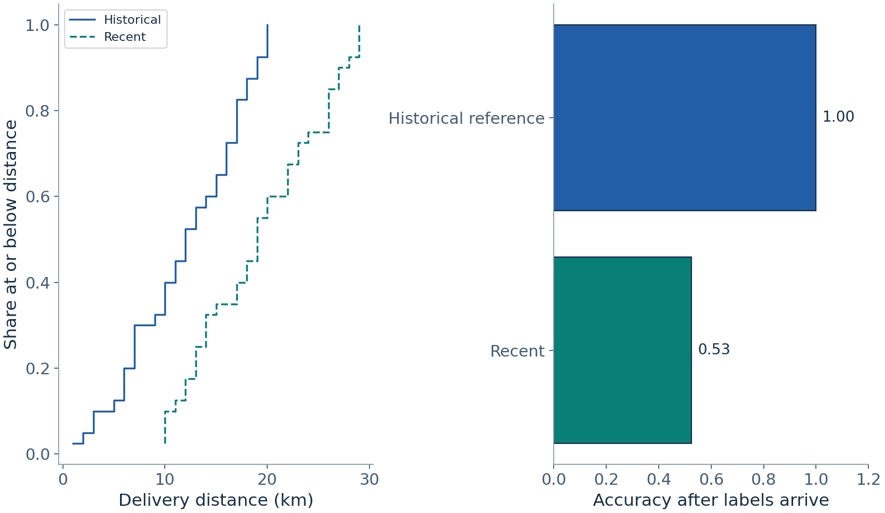

**👀 Read the visual.** Read the distance shift on the left. Use the measured outcomes on the right to find whether accuracy changed.

**👉 Use what you see.** Investigate the actual mistakes before you consider promoting an updated model.

**💡 Takeaway.** Import `monitoring.csv` into Tableau or Power BI, or refresh the charts as batches arrive. The historical reference score uses a fresh batch from the same toy distribution. Update live accuracy only after outcomes arrive.

<a id="a-dashboard-that-refreshes-on-your-computer"></a>

#### 🔄 A dashboard that refreshes on your computer

| Lesson name | What you’ll do | Download |
| --- | --- | --- |
| 248 - A dashboard that refreshes on your computer **Practice** | Run a local dashboard that reads the latest accuracy file. | [Lesson ZIP](sample_code_folder/248-a-dashboard-that-refreshes-on-your-computer.zip) |

<!-- workbook-teaching:248:start -->
<details>
<summary>Learn, trace and apply this idea</summary>

### Learn and apply: A dashboard that refreshes on your computer

**Your decision.** Run a local dashboard that reads the latest accuracy file.

**Ready check.** Divide correct predictions by checked predictions. Use [the learning path](LEARNING-PATH.md) and [the word list](GLOSSARY.md) for the earlier skill. Trace the small example on paper before code.

**What it means.** A dashboard presents recorded monitoring results; refreshing a view does not retrain a model.

**Why and when.** Use a dashboard to help an owner notice a change and decide what to inspect.

**A worked example to follow.** Sixteen correct out of twenty is 80%, below the example’s 85% alert line. Eighteen out of twenty is 90%. The local display reloads monitoring data; Tableau and Power BI require the documented import/refresh steps.

**Input → steps → output.** Open the supplied table. Its fields are `Batch`, `Correct`, `Checked`. One original row is shown below in that same field order; `(missing)` marks a blank rather than zero.

```text
Morning | 18 | 20
```

1. Name the particular field or object involved in this lesson’s decision above. Keep its meaning and units with it.
2. Open the [complete runnable Python example](lessons/248-a-dashboard-that-refreshes-on-your-computer/lesson.py). Its numbered comments connect reading, preparation and the resulting calculation. Install only the [declared requirements](lessons/248-a-dashboard-that-refreshes-on-your-computer/requirements.txt) using the same course Python, as shown in Setup.
3. Trace the worked example above through the script. Trace the named source fields into the printed table, file or request result. Check names and counts before interpreting what the program reports.
4. Read the result by its headings. Compare with [full recorded output](lessons/248-a-dashboard-that-refreshes-on-your-computer/expected-output.txt); the excerpt below belongs to the original supplied files. Your edits can change it.

```text
        Dashboard field Value
Latest labeled accuracy   80%
        Alert threshold   85%
          Alert visible  True
```

**How to interpret it.** Trace the worked case into the result above. Tell a calculated estimate from a measured answer.

**Common mistakes and limits.** Show counts, units, period and refresh time. A green display or a small batch is not proof of reliability; do not calculate new accuracy without outcomes.

**Use it yourself.** The display refreshes every five seconds but outcomes arrive tomorrow. Can today’s newest accuracy be measured every five seconds?

<details>
<summary>Check your choice and reason</summary>

No. Only the view refreshes. Clearly mark which batches have confirmed outcomes and the age of the latest measured result.

</details>

**A second check later.** Close the notes and explain the same decision using a different row from the supplied table. State one condition that would make this method unsuitable. If you cannot explain the reason, repeat the small worked example before adding more code.

</details>
<!-- workbook-teaching:248:end -->


**Before this lesson.** Read a model score and wait for actual outcomes.

**In simple words.** Monitoring watches later inputs and results. Drift means change over time. A change is a reason to investigate, not an automatic instruction to replace a model.

**Guess first.** Can we measure new accuracy before the true answers arrive? Write your answer before running the example.

<details>
<summary>Read the reason after trying</summary>

No. Record predictions and wait for outcomes.

</details>


**🎯 Goal.** What would a dashboard show after a fresh batch of answers arrives? Use a small history of three batches and display the latest labeled accuracy. The dashboard refreshes locally while it is open.

**▶️ Run.** Unzip the [lesson files](sample_code_folder/248-a-dashboard-that-refreshes-on-your-computer.zip) and open a terminal in that folder. Install the lesson’s packages with `python -m pip install -r requirements.txt`, then run `python lesson.py`.

**🔹 Steps in the script**

1. Read the labeled batches so you can compare the model’s results over time.
2. Print the result next to the input values so you can compare them.

**✅ Check.** The latest batch has 16 correct predictions out of 20. That gives 80% accuracy, below the 85% alert threshold, so the alert is visible.

| Dashboard field | Value |
| --- | --- |
| Latest labeled accuracy | 80% |
| Alert threshold | 85% |
| Alert visible | True |

**Your small change.** In the Afternoon row, change Correct from 16 to 18. You should see 90% and Alert visible: False. Save the named CSV before running again.


Run `python -m streamlit run monitoring_dashboard.py` in the folder where the exercise saved the file. While the dashboard is open, add a labeled row to `monitoring.csv` and calculate its Accuracy as Correct divided by Checked. The five-second refresh picks up the change. This refreshes the display. To update the actual model periodically, run the training-and-check code on a schedule, and keep the current model unless the candidate passes the agreed check.

| Dashboard option | Use the generated monitoring.csv |
| --- | --- |
| Tableau Desktop | Connect to a Text File. Put Batch on Columns and Accuracy on Rows, then choose a line mark. Replace the CSV with one that has the same columns and refresh the data source. [Tableau Text File connector](https://help.tableau.com/current/pro/desktop/en-us/examples_text.htm) |
| Power BI Desktop | Choose Get Data, then Text/CSV. Load Batch and Accuracy and place them on a line chart. Choose Refresh after saving a new batch. [Microsoft Text/CSV connector](https://learn.microsoft.com/power-query/connectors/text-csv) |
| Streamlit | Run the local dashboard example above. Its view refreshes while the page is open. [Streamlit fragment reference](https://docs.streamlit.io/develop/api-reference/execution-flow/st.fragment) |

<a id="scheduled-model-checks"></a>

##### 🕒 Scheduled model checks

| Lesson name | What you’ll do | Download |
| --- | --- | --- |
| 249 - Scheduled model checks **Practice** | Reuse the same model check for each batch and see which one raises an alert. | [Lesson ZIP](sample_code_folder/249-scheduled-model-checks.zip) |

<!-- workbook-teaching:249:start -->
<details>
<summary>Learn, trace and apply this idea</summary>

### Learn and apply: Scheduled model checks

**Your decision.** Reuse the same model check for each batch and see which one raises an alert.

**Ready check.** Read an error or category score and distinguish prediction from later outcome. Use [the learning path](LEARNING-PATH.md) and [the word list](GLOSSARY.md) for the earlier skill. Trace the small example on paper before code.

**What it means.** Monitoring watches inputs and measured results over time. Drift means a change worth investigating.

**Why and when.** Use it after a model starts receiving new cases, with a named owner and action for each alert.

**A worked example to follow.** Later trips may be longer than historical trips. Compare their input distributions, then calculate accuracy or error only after outcomes arrive. A candidate retrained on recent labeled rows needs a separate later comparison with the current model.

**Input → steps → output.** Open the supplied table. Its fields are `batch`, `distance`, `minutes`. One original row is shown below in that same field order; `(missing)` marks a blank rather than zero.

```text
History | 1 | 12
```

1. Name the particular field or object involved in this lesson’s decision above. Keep its meaning and units with it.
2. Open the [complete runnable Python example](lessons/249-scheduled-model-checks/lesson.py). Its numbered comments connect reading, preparation and the resulting calculation. Install only the [declared requirements](lessons/249-scheduled-model-checks/requirements.txt) using the same course Python, as shown in Setup.
3. Trace the worked example above through the script. Keep inputs apart from measured answers. Follow this script’s split and fit, then trace the saved preparation into the held-back result and any new request. A request must not supply its own training answer.
4. Read the result by its headings. Compare with [full recorded output](lessons/249-scheduled-model-checks/expected-output.txt); the excerpt below belongs to the original supplied files. Your edits can change it.

```text
  Check  Current error (min)  Candidate error (min)           Decision
 Monday                  0.0                    0.0 Keep current model
Tuesday                  3.0                    0.0   Review candidate
```

**How to interpret it.** Trace the worked case into the result above. Tell a calculated estimate from a measured answer.

**Common mistakes and limits.** Input change alone does not prove worse predictions. An alert does not automatically authorize retraining or replacement. Delayed labels limit what is currently measurable.

**Use it yourself.** West-zone error rises. Name three checks before replacing the model.

<details>
<summary>Check your choice and reason</summary>

Verify units/schema and labels, inspect affected cases and counts, and check changes in routes or population. Use the agreed fallback if needed; compare any candidate fairly before promotion.

</details>

**A second check later.** Close the notes and explain the same decision using a different row from the supplied table. State one condition that would make this method unsuitable. If you cannot explain the reason, repeat the small worked example before adding more code.

</details>
<!-- workbook-teaching:249:end -->


**Before this lesson.** Read a model score and wait for actual outcomes.

**In simple words.** Monitoring watches later inputs and results. Drift means change over time. A change is a reason to investigate, not an automatic instruction to replace a model.

**Guess first.** Can we measure new accuracy before the true answers arrive? Write your answer before running the example.

<details>
<summary>Read the reason after trying</summary>

No. Record predictions and wait for outcomes.

</details>


**🎯 Goal.** What can a recurring model check do? Run the same check on two later batches. For each run, compare a candidate with the current model on rows the candidate did not learn from.

**▶️ Run.** Unzip the [lesson files](sample_code_folder/249-scheduled-model-checks.zip) and open a terminal in that folder. Install the lesson’s packages with `python -m pip install -r requirements.txt`, then run `python lesson.py`.

**🔹 Steps in the script**

1. Read the labeled batches so you can compare the model’s results over time.
2. Print the result next to the input values so you can compare them.

**✅ Check.** Look for Check  Current error (min)  Candidate error (min)           Decision in the output excerpt below.

```text
Check  Current error (min)  Candidate error (min)           Decision
Monday                  0.0                    0.0 Keep current model
Tuesday                  3.0                    0.0   Review candidate
```

**Your small change.** Try changing distance from 1 to 3 in sample.csv. Compare the new output. Save the named CSV before running again.


The exercise runs two simulated check times immediately. To run it at real times, save the script and use your operating system’s scheduler to call `python your_script.py` on a schedule. For real batches, read the labeled CSV for that run and keep a log. Review a candidate on a meaningful, separate test set before replacing the current model.

<a id="2-data-sets"></a>

## 🟪 2. Data Sets

| Lesson name | What you’ll do | Download |
| --- | --- | --- |
| 250 - 2. Data Sets **Practice** | Start the practice datasets with a small table of experience and salary. | [Lesson ZIP](sample_code_folder/250-2-data-sets.zip) |

<!-- workbook-teaching:250:start -->
<details>
<summary>Learn, trace and apply this idea</summary>

### Learn and apply: 2. Data Sets

**Your decision.** Start the practice datasets with a small table of experience and salary.

**Ready check.** Read the named fields and explain the preparation taught earlier. Use [the learning path](LEARNING-PATH.md) and [the word list](GLOSSARY.md) for the earlier skill. Trace the small example on paper before code.

**What it means.** A complete practice pipeline connects input preparation with a fit and a separate check.

**Why and when.** Use this salary exercise to trace one row through the supplied workflow.

**A worked example to follow.** The salary exercise uses experience and department. Its output is salary. A missing salary is a missing training answer, not a blank input to fill. Find one kept-back row and compare its prediction with its recorded answer where a confirmed answer exists.

**Input → steps → output.** Open the supplied table. Its fields are `experience`, `department`, `salary`. One original row is shown below in that same field order; `(missing)` marks a blank rather than zero.

```text
1 | Support | 32000
```

1. Name the particular field or object involved in this lesson’s decision above. Keep its meaning and units with it.
2. Open the [complete runnable Python example](lessons/250-2-data-sets/lesson.py). Its numbered comments connect reading, preparation and the resulting calculation. Install only the [declared requirements](lessons/250-2-data-sets/requirements.txt) using the same course Python, as shown in Setup.
3. Trace the worked example above through the script. Keep inputs apart from measured answers. Follow this script’s split and fit, then trace the saved preparation into the held-back result and any new request. A request must not supply its own training answer.
4. Read the result by its headings. Compare with [full recorded output](lessons/250-2-data-sets/expected-output.txt); the excerpt below belongs to the original supplied files. Your edits can change it.

```text
Missing cells before filling or removing rows: {'experience': 0, 'department': 0, 'salary': 1}
     Field  Rows to review
experience               0
    salary               0
Flagged original rows: []
 Original row  Actual answer  Prediction
```

**How to interpret it.** Trace the worked case into the result above. Tell a calculated estimate from a measured answer.

**Common mistakes and limits.** The tiny invented table illustrates mechanics. Two correct predictions, a cluster assignment or a familiar benchmark name does not establish real-world performance.

**Use it yourself.** Write a three-line handoff for the salary: input contract, result meaning, and one reason the result may fail on new cases.

<details>
<summary>Check your choice and reason</summary>

Name experience and department; explain salary in the appropriate unit or category; state a specific missing population, recording problem or representation limit. Use more suitable independent data before making a general claim.

</details>

**A second check later.** Close the notes and explain the same decision using a different row from the supplied table. State one condition that would make this method unsuitable. If you cannot explain the reason, repeat the small worked example before adding more code.

</details>
<!-- workbook-teaching:250:end -->


**Before this lesson.** Finish the main preparation and checking modules.

**In simple words.** These are small invented practice datasets. Their old famous-dataset headings are historical labels. Use training rows to learn preparation and keep the check rows separate.

**Guess first.** Do two correct examples prove that the model will work for a real population? Write your answer before running the example.

<details>
<summary>Read the reason after trying</summary>

No. They show the calculation. Check more suitable data and describe what is missing.

</details>


**📌 Before you start.** Be able to read a CSV, choose a target, and explain how test rows are kept separate.

These lessons use **invented practice data**. The historical heading names remain in coverage.csv for old references. They are not the published Titanic, Iris, MNIST or other named datasets. The separate independent project uses real UCI Wine data and records its source.

<a id="2-1-salary-experience-dataset"></a>

### 💵 2.1. Invented salary records

| Lesson name | What you’ll do | Download |
| --- | --- | --- |
| 251 - Invented salary records **Practice** | Use years of experience and department from invented employee records to estimate salary. | [Lesson ZIP](sample_code_folder/251-2-1-salary-experience-dataset.zip) |

<!-- workbook-teaching:251:start -->
<details>
<summary>Learn, trace and apply this idea</summary>

### Learn and apply: Invented salary records

**Your decision.** Use years of experience and department from invented employee records to estimate salary.

**Ready check.** Read the named fields and explain the preparation taught earlier. Use [the learning path](LEARNING-PATH.md) and [the word list](GLOSSARY.md) for the earlier skill. Trace the small example on paper before code.

**What it means.** A complete practice pipeline connects input preparation with a fit and a separate check.

**Why and when.** Use this salary exercise to trace one row through the supplied workflow.

**A worked example to follow.** The salary exercise uses experience and department. Its output is salary. A missing salary is a missing training answer, not a blank input to fill. Find one kept-back row and compare its prediction with its recorded answer where a confirmed answer exists.

**Input → steps → output.** Open the supplied table. Its fields are `experience`, `department`, `salary`. One original row is shown below in that same field order; `(missing)` marks a blank rather than zero.

```text
1 | Support | 32000
```

1. Name the particular field or object involved in this lesson’s decision above. Keep its meaning and units with it.
2. Open the [complete runnable Python example](lessons/251-2-1-salary-experience-dataset/lesson.py). Its numbered comments connect reading, preparation and the resulting calculation. Install only the [declared requirements](lessons/251-2-1-salary-experience-dataset/requirements.txt) using the same course Python, as shown in Setup.
3. Trace the worked example above through the script. Keep inputs apart from measured answers. Follow this script’s split and fit, then trace the saved preparation into the held-back result and any new request. A request must not supply its own training answer.
4. Read the result by its headings. Compare with [full recorded output](lessons/251-2-1-salary-experience-dataset/expected-output.txt); the excerpt below belongs to the original supplied files. Your edits can change it.

```text
Missing cells before filling or removing rows: {'experience': 0, 'department': 0, 'salary': 1}
     Field  Rows to review
experience               0
    salary               0
Flagged original rows: []
 Original row  Actual answer  Prediction
```

**How to interpret it.** Trace the worked case into the result above. Tell a calculated estimate from a measured answer.

**Common mistakes and limits.** The tiny invented table illustrates mechanics. Two correct predictions, a cluster assignment or a familiar benchmark name does not establish real-world performance.

**Use it yourself.** Write a three-line handoff for the salary: input contract, result meaning, and one reason the result may fail on new cases.

<details>
<summary>Check your choice and reason</summary>

Name experience and department; explain salary in the appropriate unit or category; state a specific missing population, recording problem or representation limit. Use more suitable independent data before making a general claim.

</details>

**A second check later.** Close the notes and explain the same decision using a different row from the supplied table. State one condition that would make this method unsuitable. If you cannot explain the reason, repeat the small worked example before adding more code.

</details>
<!-- workbook-teaching:251:end -->


**Before this lesson.** Finish the main preparation and checking modules.

**In simple words.** These are small invented practice datasets. Their old famous-dataset headings are historical labels. Use training rows to learn preparation and keep the check rows separate.

**Guess first.** Do two correct examples prove that the model will work for a real population? Write your answer before running the example.

<details>
<summary>Read the reason after trying</summary>

No. They show the calculation. Check more suitable data and describe what is missing.

</details>


<a id="description"></a>

#### 📋 Description

| Lesson name | What you’ll do | Download |
| --- | --- | --- |
| 252 - Description **Reference** | Inspect the columns in the invented employee records and see what each row represents. | [Lesson ZIP](sample_code_folder/252-description.zip) |

<!-- workbook-teaching:252:start -->
<details>
<summary>Learn, trace and apply this idea</summary>

### Learn and apply: Description

**Your decision.** Inspect the columns in the invented employee records and see what each row represents.

**Ready check.** Read the named fields and explain the preparation taught earlier. Use [the learning path](LEARNING-PATH.md) and [the word list](GLOSSARY.md) for the earlier skill. Trace the small example on paper before code.

**What it means.** A source note states where a table came from; a description explains what one row and each field mean.

**Why and when.** Use it before treating the salary as evidence about a real population.

**A worked example to follow.** The salary exercise uses experience and department. Its output is salary. These are original invented practice rows, even where the folder preserves an old benchmark name. A missing salary is a missing training answer, not a blank input to fill.

**Input → steps → output.** Open the supplied table. Its fields are `experience`, `department`, `salary`. One original row is shown below in that same field order; `(missing)` marks a blank rather than zero.

```text
1 | Support | 32000
```

1. Name the particular field or object involved in this lesson’s decision above. Keep its meaning and units with it.
2. Open the [complete runnable Python example](lessons/252-description/lesson.py). Its numbered comments connect reading, preparation and the resulting calculation. Install only the [declared requirements](lessons/252-description/requirements.txt) using the same course Python, as shown in Setup.
3. Trace the worked example above through the script. Trace the named source fields into the printed table, file or request result. Check names and counts before interpreting what the program reports.
4. Read the result by its headings. Compare with [full recorded output](lessons/252-description/expected-output.txt); the excerpt below belongs to the original supplied files. Your edits can change it.

```text
PDF reference: Generated example
Origin of this CSV: original synthetic practice rows
Rows: 9
    Column    Type
experience   int64
department  object
```

**How to interpret it.** Trace the worked case into the result above. Tell a calculated estimate from a measured answer.

**Common mistakes and limits.** Do not claim that a historical benchmark was downloaded or that a made-up label was measured. The separate Wine project has its own real source and licence.

**Use it yourself.** Write a source note for this salary exercise: are the rows invented, what does one row represent, and what does the final answer mean?

<details>
<summary>Check your choice and reason</summary>

Say that the rows were created for this workbook, name the row entity and target, and state the limitation. A familiar folder name is not proof of provenance.

</details>

**A second check later.** Close the notes and explain the same decision using a different row from the supplied table. State one condition that would make this method unsuitable. If you cannot explain the reason, repeat the small worked example before adding more code.

</details>
<!-- workbook-teaching:252:end -->


**Before this lesson.** Finish the main preparation and checking modules.

**In simple words.** These are small invented practice datasets. Their old famous-dataset headings are historical labels. Use training rows to learn preparation and keep the check rows separate.

**Guess first.** Do two correct examples prove that the model will work for a real population? Write your answer before running the example.

<details>
<summary>Read the reason after trying</summary>

No. They show the calculation. Check more suitable data and describe what is missing.

</details>


Predict a fictional employee’s salary from years of experience and department.

<a id="practice"></a>

#### 🧪 Practice

| Lesson name | What you’ll do | Download |
| --- | --- | --- |
| 253 - Practice **Practice** | Use years of experience and department from invented employee records to estimate salary. | [Lesson ZIP](sample_code_folder/253-practice.zip) |

<!-- workbook-teaching:253:start -->
<details>
<summary>Learn, trace and apply this idea</summary>

### Learn and apply: Practice

**Your decision.** Use years of experience and department from invented employee records to estimate salary.

**Ready check.** Read the named fields and explain the preparation taught earlier. Use [the learning path](LEARNING-PATH.md) and [the word list](GLOSSARY.md) for the earlier skill. Trace the small example on paper before code.

**What it means.** A complete practice pipeline connects input preparation with a fit and a separate check.

**Why and when.** Use this salary exercise to trace one row through the supplied workflow.

**A worked example to follow.** The salary exercise uses experience and department. Its output is salary. A missing salary is a missing training answer, not a blank input to fill. Find one kept-back row and compare its prediction with its recorded answer where a confirmed answer exists.

**Input → steps → output.** Open the supplied table. Its fields are `experience`, `department`, `salary`. One original row is shown below in that same field order; `(missing)` marks a blank rather than zero.

```text
1 | Support | 32000
```

1. Name the particular field or object involved in this lesson’s decision above. Keep its meaning and units with it.
2. Open the [complete runnable Python example](lessons/253-practice/lesson.py). Its numbered comments connect reading, preparation and the resulting calculation. Install only the [declared requirements](lessons/253-practice/requirements.txt) using the same course Python, as shown in Setup.
3. Trace the worked example above through the script. Keep inputs apart from measured answers. Follow this script’s split and fit, then trace the saved preparation into the held-back result and any new request. A request must not supply its own training answer.
4. Read the result by its headings. Compare with [full recorded output](lessons/253-practice/expected-output.txt); the excerpt below belongs to the original supplied files. Your edits can change it.

```text
Missing cells before filling or removing rows: {'experience': 0, 'department': 0, 'salary': 1}
     Field  Rows to review
experience               0
    salary               0
Flagged original rows: []
 Original row  Actual answer  Prediction
```

**How to interpret it.** Trace the worked case into the result above. Tell a calculated estimate from a measured answer.

**Common mistakes and limits.** The tiny invented table illustrates mechanics. Two correct predictions, a cluster assignment or a familiar benchmark name does not establish real-world performance.

**Use it yourself.** Write a three-line handoff for the salary: input contract, result meaning, and one reason the result may fail on new cases.

<details>
<summary>Check your choice and reason</summary>

Name experience and department; explain salary in the appropriate unit or category; state a specific missing population, recording problem or representation limit. Use more suitable independent data before making a general claim.

</details>

**A second check later.** Close the notes and explain the same decision using a different row from the supplied table. State one condition that would make this method unsuitable. If you cannot explain the reason, repeat the small worked example before adding more code.

</details>
<!-- workbook-teaching:253:end -->


**Before this lesson.** Finish the main preparation and checking modules.

**In simple words.** These are small invented practice datasets. Their old famous-dataset headings are historical labels. Use training rows to learn preparation and keep the check rows separate.

**Guess first.** Do two correct examples prove that the model will work for a real population? Write your answer before running the example.

<details>
<summary>Read the reason after trying</summary>

No. They show the calculation. Check more suitable data and describe what is missing.

</details>


<a id="practice-2-1-missing-values"></a>

##### 🧪 Missing values

| Lesson name | What you’ll do | Download |
| --- | --- | --- |
| 254 - Missing values **Practice** | Find missing entries in the invented employee records and see how the example prepares them for a model. | [Lesson ZIP](sample_code_folder/254-practice-2-1-missing-values.zip) |

<!-- workbook-teaching:254:start -->
<details>
<summary>Learn, trace and apply this idea</summary>

### Learn and apply: Missing values

**Your decision.** Find missing entries in the invented employee records and see how the example prepares them for a model.

**Ready check.** Read the named fields and explain the preparation taught earlier. Use [the learning path](LEARNING-PATH.md) and [the word list](GLOSSARY.md) for the earlier skill. Trace the small example on paper before code.

**What it means.** A missing-data audit separates missing inputs from missing answers and counts the affected records.

**Why and when.** Use it before fitting this salary exercise; decide which blanks can be recovered or filled.

**A worked example to follow.** The salary exercise uses experience and department. Its output is salary. Inspect the supplied blank cells before the pipeline learns its training fill values. A missing salary is a missing training answer, not a blank input to fill.

**Input → steps → output.** Open the supplied table. Its fields are `experience`, `department`, `salary`. One original row is shown below in that same field order; `(missing)` marks a blank rather than zero.

```text
1 | Support | 32000
```

1. Name the particular field or object involved in this lesson’s decision above. Keep its meaning and units with it.
2. Open the [complete runnable Python example](lessons/254-practice-2-1-missing-values/lesson.py). Its numbered comments connect reading, preparation and the resulting calculation. Install only the [declared requirements](lessons/254-practice-2-1-missing-values/requirements.txt) using the same course Python, as shown in Setup.
3. Trace the worked example above through the script. Keep inputs apart from measured answers. Follow this script’s split and fit, then trace the saved preparation into the held-back result and any new request. A request must not supply its own training answer.
4. Read the result by its headings. Compare with [full recorded output](lessons/254-practice-2-1-missing-values/expected-output.txt); the excerpt below belongs to the original supplied files. Your edits can change it.

```text
Missing cells before filling or removing rows: {'experience': 0, 'department': 0, 'salary': 1}
     Field  Rows to review
experience               0
    salary               0
Flagged original rows: []
 Original row  Actual answer  Prediction
```

**How to interpret it.** Trace the worked case into the result above. Tell a calculated estimate from a measured answer.

**Common mistakes and limits.** Do not fill training targets merely to enlarge the sample. Keep check answers out of fill statistics; a clean table can still omit important cases.

**Use it yourself.** Choose a blank input in this salary exercise. Write which training-only rule would handle it and whether the original fact is recovered.

<details>
<summary>Check your choice and reason</summary>

Identify the actual field and its type. A median or category placeholder supplies an estimate/representation, not a recovered measurement. A missing answer remains excluded from ordinary supervised fitting.

</details>

**A second check later.** Close the notes and explain the same decision using a different row from the supplied table. State one condition that would make this method unsuitable. If you cannot explain the reason, repeat the small worked example before adding more code.

</details>
<!-- workbook-teaching:254:end -->


**Before this lesson.** Finish the main preparation and checking modules.

**In simple words.** These are small invented practice datasets. Their old famous-dataset headings are historical labels. Use training rows to learn preparation and keep the check rows separate.

**Guess first.** Do two correct examples prove that the model will work for a real population? Write your answer before running the example.

<details>
<summary>Read the reason after trying</summary>

No. They show the calculation. Check more suitable data and describe what is missing.

</details>


Run the sample and inspect the missing-value handling before fitting.

<a id="practice-2-1-feature-scaling"></a>

##### 🧪 Feature scaling

| Lesson name | What you’ll do | Download |
| --- | --- | --- |
| 255 - Feature scaling **Practice** | Put the numerical inputs on a common scale before using the invented employee records in a model. | [Lesson ZIP](sample_code_folder/255-practice-2-1-feature-scaling.zip) |

<!-- workbook-teaching:255:start -->
<details>
<summary>Learn, trace and apply this idea</summary>

### Learn and apply: Feature scaling

**Your decision.** Put the numerical inputs on a common scale before using the invented employee records in a model.

**Ready check.** Read the named fields and explain the preparation taught earlier. Use [the learning path](LEARNING-PATH.md) and [the word list](GLOSSARY.md) for the earlier skill. Trace the small example on paper before code.

**What it means.** Scaling changes numerical representation using one saved training rule.

**Why and when.** Use it when units or pixel ranges affect the model in the salary exercise.

**A worked example to follow.** The salary exercise uses experience and department. Its output is salary. Learn numeric scales from training rows and apply them unchanged to the kept-back rows. A missing salary is a missing training answer, not a blank input to fill.

**Input → steps → output.** Open the supplied table. Its fields are `experience`, `department`, `salary`. One original row is shown below in that same field order; `(missing)` marks a blank rather than zero.

```text
1 | Support | 32000
```

1. Name the particular field or object involved in this lesson’s decision above. Keep its meaning and units with it.
2. Open the [complete runnable Python example](lessons/255-practice-2-1-feature-scaling/lesson.py). Its numbered comments connect reading, preparation and the resulting calculation. Install only the [declared requirements](lessons/255-practice-2-1-feature-scaling/requirements.txt) using the same course Python, as shown in Setup.
3. Trace the worked example above through the script. Keep inputs apart from measured answers. Follow this script’s split and fit, then trace the saved preparation into the held-back result and any new request. A request must not supply its own training answer.
4. Read the result by its headings. Compare with [full recorded output](lessons/255-practice-2-1-feature-scaling/expected-output.txt); the excerpt below belongs to the original supplied files. Your edits can change it.

```text
Missing cells before filling or removing rows: {'experience': 0, 'department': 0, 'salary': 1}
     Field  Rows to review
experience               0
    salary               0
Flagged original rows: []
 Original row  Actual answer  Prediction
```

**How to interpret it.** Trace the worked case into the result above. Tell a calculated estimate from a measured answer.

**Common mistakes and limits.** Do not fit a fresh scale to each request. An ordinary linear model may retain its predictions after rescaling; distance models or penalties can behave differently.

**Use it yourself.** Explain one actual scaled input in this salary exercise. Would changing only that input’s unit during prediction preserve the contract?

<details>
<summary>Check your choice and reason</summary>

Name the input, original unit/range and training rule. The same rule and units must prepare later rows. Changing only the request unit makes the saved model interpret a different quantity.

</details>

**A second check later.** Close the notes and explain the same decision using a different row from the supplied table. State one condition that would make this method unsuitable. If you cannot explain the reason, repeat the small worked example before adding more code.

</details>
<!-- workbook-teaching:255:end -->


**Before this lesson.** Finish the main preparation and checking modules.

**In simple words.** These are small invented practice datasets. Their old famous-dataset headings are historical labels. Use training rows to learn preparation and keep the check rows separate.

**Guess first.** Do two correct examples prove that the model will work for a real population? Write your answer before running the example.

<details>
<summary>Read the reason after trying</summary>

No. They show the calculation. Check more suitable data and describe what is missing.

</details>


Inspect the numeric range or pixel range and follow the scaling step in the lab.

<a id="practice-2-1-outliers"></a>

##### 🧪 Outliers

| Lesson name | What you’ll do | Download |
| --- | --- | --- |
| 256 - Outliers **Practice** | Look for unusual measurements in the invented employee records and see which rows need checking. | [Lesson ZIP](sample_code_folder/256-practice-2-1-outliers.zip) |

<!-- workbook-teaching:256:start -->
<details>
<summary>Learn, trace and apply this idea</summary>

### Learn and apply: Outliers

**Your decision.** Look for unusual measurements in the invented employee records and see which rows need checking.

**Ready check.** Read the named fields and explain the preparation taught earlier. Use [the learning path](LEARNING-PATH.md) and [the word list](GLOSSARY.md) for the earlier skill. Trace the small example on paper before code.

**What it means.** An outlier check identifies an unusual recorded value or pattern without establishing that it is wrong.

**Why and when.** Use it to choose source records for review in this salary exercise.

**A worked example to follow.** The salary exercise uses experience and department. Its output is salary. Read the printed flags beside their field names, then return to the original row. A missing salary is a missing training answer, not a blank input to fill.

**Input → steps → output.** Open the supplied table. Its fields are `experience`, `department`, `salary`. One original row is shown below in that same field order; `(missing)` marks a blank rather than zero.

```text
1 | Support | 32000
```

1. Name the particular field or object involved in this lesson’s decision above. Keep its meaning and units with it.
2. Open the [complete runnable Python example](lessons/256-practice-2-1-outliers/lesson.py). Its numbered comments connect reading, preparation and the resulting calculation. Install only the [declared requirements](lessons/256-practice-2-1-outliers/requirements.txt) using the same course Python, as shown in Setup.
3. Trace the worked example above through the script. Keep inputs apart from measured answers. Follow this script’s split and fit, then trace the saved preparation into the held-back result and any new request. A request must not supply its own training answer.
4. Read the result by its headings. Compare with [full recorded output](lessons/256-practice-2-1-outliers/expected-output.txt); the excerpt below belongs to the original supplied files. Your edits can change it.

```text
Missing cells before filling or removing rows: {'experience': 0, 'department': 0, 'salary': 1}
     Field  Rows to review
experience               0
    salary               0
Flagged original rows: []
 Original row  Actual answer  Prediction
```

**How to interpret it.** Trace the worked case into the result above. Tell a calculated estimate from a measured answer.

**Common mistakes and limits.** A rare but valid case should not be deleted just to improve a fit. Pixel outliers need inspection of drawings rather than a parcel-weight rule.

**Use it yourself.** Pick one possibly unusual case in this salary exercise. List evidence that would justify keeping it, correcting it, or leaving it flagged.

<details>
<summary>Check your choice and reason</summary>

Keep a source-confirmed valid case; correct only from a reliable source; preserve uncertainty when evidence is absent. State whether the case belongs within the model’s intended scope.

</details>

**A second check later.** Close the notes and explain the same decision using a different row from the supplied table. State one condition that would make this method unsuitable. If you cannot explain the reason, repeat the small worked example before adding more code.

</details>
<!-- workbook-teaching:256:end -->


**Before this lesson.** Finish the main preparation and checking modules.

**In simple words.** These are small invented practice datasets. Their old famous-dataset headings are historical labels. Use training rows to learn preparation and keep the check rows separate.

**Guess first.** Do two correct examples prove that the model will work for a real population? Write your answer before running the example.

<details>
<summary>Read the reason after trying</summary>

No. They show the calculation. Check more suitable data and describe what is missing.

</details>


Review the extreme values or pixel range. Decide whether each flagged value is possible.

<a id="practice-2-1-categorical-encoding"></a>

##### 🧪 Categorical encoding

| Lesson name | What you’ll do | Download |
| --- | --- | --- |
| 257 - Category encoding **Practice** | Turn categories in the invented employee records into numbers the model can read. | [Lesson ZIP](sample_code_folder/257-practice-2-1-categorical-encoding.zip) |

<!-- workbook-teaching:257:start -->
<details>
<summary>Learn, trace and apply this idea</summary>

### Learn and apply: Category encoding

**Your decision.** Turn categories in the invented employee records into numbers the model can read.

**Ready check.** Read the named fields and explain the preparation taught earlier. Use [the learning path](LEARNING-PATH.md) and [the word list](GLOSSARY.md) for the earlier skill. Trace the small example on paper before code.

**What it means.** Encoding gives a name a consistent numeric representation while preserving whether it is an input category or an answer label.

**Why and when.** Use it before the numeric estimator receives the salary fields.

**A worked example to follow.** The salary exercise uses experience and department. Its output is salary. Read the script’s selected category fields or target encoder. A class ID names a class; it does not turn that class into a measured amount. A missing salary is a missing training answer, not a blank input to fill.

**Input → steps → output.** Open the supplied table. Its fields are `experience`, `department`, `salary`. One original row is shown below in that same field order; `(missing)` marks a blank rather than zero.

```text
1 | Support | 32000
```

1. Name the particular field or object involved in this lesson’s decision above. Keep its meaning and units with it.
2. Open the [complete runnable Python example](lessons/257-practice-2-1-categorical-encoding/lesson.py). Its numbered comments connect reading, preparation and the resulting calculation. Install only the [declared requirements](lessons/257-practice-2-1-categorical-encoding/requirements.txt) using the same course Python, as shown in Setup.
3. Trace the worked example above through the script. Keep inputs apart from measured answers. Follow this script’s split and fit, then trace the saved preparation into the held-back result and any new request. A request must not supply its own training answer.
4. Read the result by its headings. Compare with [full recorded output](lessons/257-practice-2-1-categorical-encoding/expected-output.txt); the excerpt below belongs to the original supplied files. Your edits can change it.

```text
Missing cells before filling or removing rows: {'experience': 0, 'department': 0, 'salary': 1}
     Field  Rows to review
experience               0
    salary               0
Flagged original rows: []
 Original row  Actual answer  Prediction
```

**How to interpret it.** Trace the worked case into the result above. Tell a calculated estimate from a measured answer.

**Common mistakes and limits.** Do not invent a category ranking or fit a separate column list on new rows. One-hot target labels in a drawing demonstration are separate from input encoding.

**Use it yourself.** Find one category or target label in this salary exercise. Is it a model input or the answer? What happens if a new name arrives?

<details>
<summary>Check your choice and reason</summary>

Trace the named field into features or target. Inputs use the saved category schema; unknown names need a stated policy. Targets remain the known classes the classifier was trained to distinguish.

</details>

**A second check later.** Close the notes and explain the same decision using a different row from the supplied table. State one condition that would make this method unsuitable. If you cannot explain the reason, repeat the small worked example before adding more code.

</details>
<!-- workbook-teaching:257:end -->


**Before this lesson.** Finish the main preparation and checking modules.

**In simple words.** These are small invented practice datasets. Their old famous-dataset headings are historical labels. Use training rows to learn preparation and keep the check rows separate.

**Guess first.** Do two correct examples prove that the model will work for a real population? Write your answer before running the example.

<details>
<summary>Read the reason after trying</summary>

No. They show the calculation. Check more suitable data and describe what is missing.

</details>


Inspect the encoded fields and check how the model receives categories or class labels.

Audit missing salaries and extreme experience or salaries. Scale experience, encode department, and examine salary scaling separately as a target transformation.

**🎯 Goal.** Predict a fictional employee’s salary from years of experience and department. The sample table shows the real answers for this exercise. Use the last rows only for checking.

**📋 Sample data**

| experience | department | salary |
| --- | --- | --- |
| 1 | Support | 32000 |
| 2 | Support | 34000 |
| 4 | Engineering | 42000 |
| 5 | Sales | 43000 |
| 6 | Sales | — |
| 8 | Engineering | 54000 |
| 12 | Engineering | 68000 |
| 9 | Sales | 55000 |

Showing the first 8 of 9 rows. The CSV has the full sample.

**▶️ Run.** Unzip the [lesson files](sample_code_folder/257-practice-2-1-categorical-encoding.zip) and open a terminal in that folder. Install the lesson’s packages with `python -m pip install -r requirements.txt`, then run `python lesson.py`.

**🔹 Steps in the script**

1. Read the example records from sample.csv. The table uses the dataset fields shown below.
2. Set aside the check rows before the model learns.
3. Find blanks in the rows you are about to use.
4. Find where the middle values sit, then compare the remaining rows with those limits.
5. Teach the model from the training inputs and salary.
6. Apply the fitted model to the new CSV rows and print a result for each row.

**✅ Check.** Look for Missing cells before filling or removing rows: {'experience': 0, 'department': 0, 'salary': 1} in the output excerpt below.

```text
Missing cells before filling or removing rows: {'experience': 0, 'department': 0, 'salary': 1}
Field  Rows to review
experience               0
```

**Your small change.** Change an input in new_inputs.csv. Compare the predictions with the held-out check above. Save the named CSV before running again.


**💡 Takeaway.** The missing label is dropped for supervised training. The two reported averages compare a median-filled summary and a complete-case summary without treating either as ground truth.

<a id="source"></a>

#### 🧾 Source

| Lesson name | What you’ll do | Download |
| --- | --- | --- |
| 258 - Source **Reference** | Read the dataset name from the PDF and inspect the invented employee records used in this exercise. | [Lesson ZIP](sample_code_folder/258-source.zip) |

<!-- workbook-teaching:258:start -->
<details>
<summary>Learn, trace and apply this idea</summary>

### Learn and apply: Source

**Your decision.** Read the dataset name from the PDF and inspect the invented employee records used in this exercise.

**Ready check.** Read the named fields and explain the preparation taught earlier. Use [the learning path](LEARNING-PATH.md) and [the word list](GLOSSARY.md) for the earlier skill. Trace the small example on paper before code.

**What it means.** A source note states where a table came from; a description explains what one row and each field mean.

**Why and when.** Use it before treating the salary as evidence about a real population.

**A worked example to follow.** The salary exercise uses experience and department. Its output is salary. These are original invented practice rows, even where the folder preserves an old benchmark name. A missing salary is a missing training answer, not a blank input to fill.

**Input → steps → output.** Open the supplied table. Its fields are `experience`, `department`, `salary`. One original row is shown below in that same field order; `(missing)` marks a blank rather than zero.

```text
1 | Support | 32000
```

1. Name the particular field or object involved in this lesson’s decision above. Keep its meaning and units with it.
2. Open the [complete runnable Python example](lessons/258-source/lesson.py). Its numbered comments connect reading, preparation and the resulting calculation. Install only the [declared requirements](lessons/258-source/requirements.txt) using the same course Python, as shown in Setup.
3. Trace the worked example above through the script. Trace the named source fields into the printed table, file or request result. Check names and counts before interpreting what the program reports.
4. Read the result by its headings. Compare with [full recorded output](lessons/258-source/expected-output.txt); the excerpt below belongs to the original supplied files. Your edits can change it.

```text
PDF reference: Generated example
Origin of this CSV: original synthetic practice rows
Rows: 9
    Column    Type
experience   int64
department  object
```

**How to interpret it.** Trace the worked case into the result above. Tell a calculated estimate from a measured answer.

**Common mistakes and limits.** Do not claim that a historical benchmark was downloaded or that a made-up label was measured. The separate Wine project has its own real source and licence.

**Use it yourself.** Write a source note for this salary exercise: are the rows invented, what does one row represent, and what does the final answer mean?

<details>
<summary>Check your choice and reason</summary>

Say that the rows were created for this workbook, name the row entity and target, and state the limitation. A familiar folder name is not proof of provenance.

</details>

**A second check later.** Close the notes and explain the same decision using a different row from the supplied table. State one condition that would make this method unsuitable. If you cannot explain the reason, repeat the small worked example before adding more code.

</details>
<!-- workbook-teaching:258:end -->


**Before this lesson.** Finish the main preparation and checking modules.

**In simple words.** These are small invented practice datasets. Their old famous-dataset headings are historical labels. Use training rows to learn preparation and keep the check rows separate.

**Guess first.** Do two correct examples prove that the model will work for a real population? Write your answer before running the example.

<details>
<summary>Read the reason after trying</summary>

No. They show the calculation. Check more suitable data and describe what is missing.

</details>


Original practice data created for this workbook.

<a id="2-2-titanic-dataset"></a>

### ⛴️ 2.2. Invented ferry boarding records

| Lesson name | What you’ll do | Download |
| --- | --- | --- |
| 259 - Invented ferry boarding records **Practice** | Use age, fare and family details from invented ferry bookings to estimate priority boarding. | [Lesson ZIP](sample_code_folder/259-2-2-titanic-dataset.zip) |

<!-- workbook-teaching:259:start -->
<details>
<summary>Learn, trace and apply this idea</summary>

### Learn and apply: Invented ferry boarding records

**Your decision.** Use age, fare and family details from invented ferry bookings to estimate priority boarding.

**Ready check.** Read the named fields and explain the preparation taught earlier. Use [the learning path](LEARNING-PATH.md) and [the word list](GLOSSARY.md) for the earlier skill. Trace the small example on paper before code.

**What it means.** A complete practice pipeline connects input preparation with a fit and a separate check.

**Why and when.** Use this ferry boarding exercise to trace one row through the supplied workflow.

**A worked example to follow.** The ferry boarding exercise uses age, fare, pass type and family details. Its output is priority. The cabin-recorded flag preserves whether a cabin entry was supplied. Find one kept-back row and compare its prediction with its recorded answer where a confirmed answer exists.

**Input → steps → output.** Open the supplied table. Its fields are `age`, `fare`, `pass_type`, `terminal`, `cabin`, `siblings`, `parents`, `priority`. One original row is shown below in that same field order; `(missing)` marks a blank rather than zero.

```text
18 | 12 | standard | north | (missing) | 0 | 1 | 0
```

1. Name the particular field or object involved in this lesson’s decision above. Keep its meaning and units with it.
2. Open the [complete runnable Python example](lessons/259-2-2-titanic-dataset/lesson.py). Its numbered comments connect reading, preparation and the resulting calculation. Install only the [declared requirements](lessons/259-2-2-titanic-dataset/requirements.txt) using the same course Python, as shown in Setup.
3. Trace the worked example above through the script. Keep inputs apart from measured answers. Follow this script’s split and fit, then trace the saved preparation into the held-back result and any new request. A request must not supply its own training answer.
4. Read the result by its headings. Compare with [full recorded output](lessons/259-2-2-titanic-dataset/expected-output.txt); the excerpt below belongs to the original supplied files. Your edits can change it.

```text
Missing cells before filling or removing rows: {'age': 1, 'fare': 0, 'family_size': 0, 'cabin_recorded': 0, 'pass_type': 0, 'terminal': 1, 'priority': 0}
         Field  Rows to review
           age               0
          fare               1
   family_size               0
cabin_recorded               0
```

**How to interpret it.** Trace the worked case into the result above. Tell a calculated estimate from a measured answer.

**Common mistakes and limits.** The tiny invented table illustrates mechanics. Two correct predictions, a cluster assignment or a familiar benchmark name does not establish real-world performance.

**Use it yourself.** Write a three-line handoff for the ferry boarding: input contract, result meaning, and one reason the result may fail on new cases.

<details>
<summary>Check your choice and reason</summary>

Name age, fare, pass type and family details; explain priority in the appropriate unit or category; state a specific missing population, recording problem or representation limit. Use more suitable independent data before making a general claim.

</details>

**A second check later.** Close the notes and explain the same decision using a different row from the supplied table. State one condition that would make this method unsuitable. If you cannot explain the reason, repeat the small worked example before adding more code.

</details>
<!-- workbook-teaching:259:end -->


**Before this lesson.** Finish the main preparation and checking modules.

**In simple words.** These are small invented practice datasets. Their old famous-dataset headings are historical labels. Use training rows to learn preparation and keep the check rows separate.

**Guess first.** Do two correct examples prove that the model will work for a real population? Write your answer before running the example.

<details>
<summary>Read the reason after trying</summary>

No. They show the calculation. Check more suitable data and describe what is missing.

</details>


<a id="description-2"></a>

#### 📋 Description

| Lesson name | What you’ll do | Download |
| --- | --- | --- |
| 260 - Description **Reference** | Inspect the columns in the invented ferry bookings and see what each row represents. | [Lesson ZIP](sample_code_folder/260-description-2.zip) |

<!-- workbook-teaching:260:start -->
<details>
<summary>Learn, trace and apply this idea</summary>

### Learn and apply: Description

**Your decision.** Inspect the columns in the invented ferry bookings and see what each row represents.

**Ready check.** Read the named fields and explain the preparation taught earlier. Use [the learning path](LEARNING-PATH.md) and [the word list](GLOSSARY.md) for the earlier skill. Trace the small example on paper before code.

**What it means.** A source note states where a table came from; a description explains what one row and each field mean.

**Why and when.** Use it before treating the ferry boarding as evidence about a real population.

**A worked example to follow.** The ferry boarding exercise uses age, fare, pass type and family details. Its output is priority. These are original invented practice rows, even where the folder preserves an old benchmark name. The cabin-recorded flag preserves whether a cabin entry was supplied.

**Input → steps → output.** Open the supplied table. Its fields are `age`, `fare`, `pass_type`, `terminal`, `cabin`, `siblings`, `parents`, `priority`. One original row is shown below in that same field order; `(missing)` marks a blank rather than zero.

```text
18 | 12 | standard | north | (missing) | 0 | 1 | 0
```

1. Name the particular field or object involved in this lesson’s decision above. Keep its meaning and units with it.
2. Open the [complete runnable Python example](lessons/260-description-2/lesson.py). Its numbered comments connect reading, preparation and the resulting calculation. Install only the [declared requirements](lessons/260-description-2/requirements.txt) using the same course Python, as shown in Setup.
3. Trace the worked example above through the script. Trace the named source fields into the printed table, file or request result. Check names and counts before interpreting what the program reports.
4. Read the result by its headings. Compare with [full recorded output](lessons/260-description-2/expected-output.txt); the excerpt below belongs to the original supplied files. Your edits can change it.

```text
PDF reference: Kaggle Titanic Dataset
Origin of this CSV: original synthetic practice rows
Rows: 9
   Column    Type
      age float64
     fare   int64
```

**How to interpret it.** Trace the worked case into the result above. Tell a calculated estimate from a measured answer.

**Common mistakes and limits.** Do not claim that a historical benchmark was downloaded or that a made-up label was measured. The separate Wine project has its own real source and licence.

**Use it yourself.** Write a source note for this ferry boarding exercise: are the rows invented, what does one row represent, and what does the final answer mean?

<details>
<summary>Check your choice and reason</summary>

Say that the rows were created for this workbook, name the row entity and target, and state the limitation. A familiar folder name is not proof of provenance.

</details>

**A second check later.** Close the notes and explain the same decision using a different row from the supplied table. State one condition that would make this method unsuitable. If you cannot explain the reason, repeat the small worked example before adding more code.

</details>
<!-- workbook-teaching:260:end -->


**Before this lesson.** Finish the main preparation and checking modules.

**In simple words.** These are small invented practice datasets. Their old famous-dataset headings are historical labels. Use training rows to learn preparation and keep the check rows separate.

**Guess first.** Do two correct examples prove that the model will work for a real population? Write your answer before running the example.

<details>
<summary>Read the reason after trying</summary>

No. They show the calculation. Check more suitable data and describe what is missing.

</details>


Predict whether a fictional ferry traveler was assigned a priority boarding slot. This is an invented boarding exercise.

<a id="practice-2"></a>

#### 🧪 Practice

| Lesson name | What you’ll do | Download |
| --- | --- | --- |
| 261 - Practice **Practice** | Use age, fare and family details from invented ferry bookings to estimate priority boarding. | [Lesson ZIP](sample_code_folder/261-practice-2.zip) |

<!-- workbook-teaching:261:start -->
<details>
<summary>Learn, trace and apply this idea</summary>

### Learn and apply: Practice

**Your decision.** Use age, fare and family details from invented ferry bookings to estimate priority boarding.

**Ready check.** Read the named fields and explain the preparation taught earlier. Use [the learning path](LEARNING-PATH.md) and [the word list](GLOSSARY.md) for the earlier skill. Trace the small example on paper before code.

**What it means.** A complete practice pipeline connects input preparation with a fit and a separate check.

**Why and when.** Use this ferry boarding exercise to trace one row through the supplied workflow.

**A worked example to follow.** The ferry boarding exercise uses age, fare, pass type and family details. Its output is priority. The cabin-recorded flag preserves whether a cabin entry was supplied. Find one kept-back row and compare its prediction with its recorded answer where a confirmed answer exists.

**Input → steps → output.** Open the supplied table. Its fields are `age`, `fare`, `pass_type`, `terminal`, `cabin`, `siblings`, `parents`, `priority`. One original row is shown below in that same field order; `(missing)` marks a blank rather than zero.

```text
18 | 12 | standard | north | (missing) | 0 | 1 | 0
```

1. Name the particular field or object involved in this lesson’s decision above. Keep its meaning and units with it.
2. Open the [complete runnable Python example](lessons/261-practice-2/lesson.py). Its numbered comments connect reading, preparation and the resulting calculation. Install only the [declared requirements](lessons/261-practice-2/requirements.txt) using the same course Python, as shown in Setup.
3. Trace the worked example above through the script. Keep inputs apart from measured answers. Follow this script’s split and fit, then trace the saved preparation into the held-back result and any new request. A request must not supply its own training answer.
4. Read the result by its headings. Compare with [full recorded output](lessons/261-practice-2/expected-output.txt); the excerpt below belongs to the original supplied files. Your edits can change it.

```text
Missing cells before filling or removing rows: {'age': 1, 'fare': 0, 'family_size': 0, 'cabin_recorded': 0, 'pass_type': 0, 'terminal': 1, 'priority': 0}
         Field  Rows to review
           age               0
          fare               1
   family_size               0
cabin_recorded               0
```

**How to interpret it.** Trace the worked case into the result above. Tell a calculated estimate from a measured answer.

**Common mistakes and limits.** The tiny invented table illustrates mechanics. Two correct predictions, a cluster assignment or a familiar benchmark name does not establish real-world performance.

**Use it yourself.** Write a three-line handoff for the ferry boarding: input contract, result meaning, and one reason the result may fail on new cases.

<details>
<summary>Check your choice and reason</summary>

Name age, fare, pass type and family details; explain priority in the appropriate unit or category; state a specific missing population, recording problem or representation limit. Use more suitable independent data before making a general claim.

</details>

**A second check later.** Close the notes and explain the same decision using a different row from the supplied table. State one condition that would make this method unsuitable. If you cannot explain the reason, repeat the small worked example before adding more code.

</details>
<!-- workbook-teaching:261:end -->


**Before this lesson.** Finish the main preparation and checking modules.

**In simple words.** These are small invented practice datasets. Their old famous-dataset headings are historical labels. Use training rows to learn preparation and keep the check rows separate.

**Guess first.** Do two correct examples prove that the model will work for a real population? Write your answer before running the example.

<details>
<summary>Read the reason after trying</summary>

No. They show the calculation. Check more suitable data and describe what is missing.

</details>


<a id="practice-2-2-missing-values"></a>

##### 🧪 Missing values

| Lesson name | What you’ll do | Download |
| --- | --- | --- |
| 262 - Missing values **Practice** | Find missing entries in the invented ferry bookings and see how the example prepares them for a model. | [Lesson ZIP](sample_code_folder/262-practice-2-2-missing-values.zip) |

<!-- workbook-teaching:262:start -->
<details>
<summary>Learn, trace and apply this idea</summary>

### Learn and apply: Missing values

**Your decision.** Find missing entries in the invented ferry bookings and see how the example prepares them for a model.

**Ready check.** Read the named fields and explain the preparation taught earlier. Use [the learning path](LEARNING-PATH.md) and [the word list](GLOSSARY.md) for the earlier skill. Trace the small example on paper before code.

**What it means.** A missing-data audit separates missing inputs from missing answers and counts the affected records.

**Why and when.** Use it before fitting this ferry boarding exercise; decide which blanks can be recovered or filled.

**A worked example to follow.** The ferry boarding exercise uses age, fare, pass type and family details. Its output is priority. Inspect the supplied blank cells before the pipeline learns its training fill values. The cabin-recorded flag preserves whether a cabin entry was supplied.

**Input → steps → output.** Open the supplied table. Its fields are `age`, `fare`, `pass_type`, `terminal`, `cabin`, `siblings`, `parents`, `priority`. One original row is shown below in that same field order; `(missing)` marks a blank rather than zero.

```text
18 | 12 | standard | north | (missing) | 0 | 1 | 0
```

1. Name the particular field or object involved in this lesson’s decision above. Keep its meaning and units with it.
2. Open the [complete runnable Python example](lessons/262-practice-2-2-missing-values/lesson.py). Its numbered comments connect reading, preparation and the resulting calculation. Install only the [declared requirements](lessons/262-practice-2-2-missing-values/requirements.txt) using the same course Python, as shown in Setup.
3. Trace the worked example above through the script. Keep inputs apart from measured answers. Follow this script’s split and fit, then trace the saved preparation into the held-back result and any new request. A request must not supply its own training answer.
4. Read the result by its headings. Compare with [full recorded output](lessons/262-practice-2-2-missing-values/expected-output.txt); the excerpt below belongs to the original supplied files. Your edits can change it.

```text
Missing cells before filling or removing rows: {'age': 1, 'fare': 0, 'family_size': 0, 'cabin_recorded': 0, 'pass_type': 0, 'terminal': 1, 'priority': 0}
         Field  Rows to review
           age               0
          fare               1
   family_size               0
cabin_recorded               0
```

**How to interpret it.** Trace the worked case into the result above. Tell a calculated estimate from a measured answer.

**Common mistakes and limits.** Do not fill training targets merely to enlarge the sample. Keep check answers out of fill statistics; a clean table can still omit important cases.

**Use it yourself.** Choose a blank input in this ferry boarding exercise. Write which training-only rule would handle it and whether the original fact is recovered.

<details>
<summary>Check your choice and reason</summary>

Identify the actual field and its type. A median or category placeholder supplies an estimate/representation, not a recovered measurement. A missing answer remains excluded from ordinary supervised fitting.

</details>

**A second check later.** Close the notes and explain the same decision using a different row from the supplied table. State one condition that would make this method unsuitable. If you cannot explain the reason, repeat the small worked example before adding more code.

</details>
<!-- workbook-teaching:262:end -->


**Before this lesson.** Finish the main preparation and checking modules.

**In simple words.** These are small invented practice datasets. Their old famous-dataset headings are historical labels. Use training rows to learn preparation and keep the check rows separate.

**Guess first.** Do two correct examples prove that the model will work for a real population? Write your answer before running the example.

<details>
<summary>Read the reason after trying</summary>

No. They show the calculation. Check more suitable data and describe what is missing.

</details>


Run the sample and inspect the missing-value handling before fitting.

<a id="practice-2-2-categorical-encoding"></a>

##### 🧪 Categorical encoding

| Lesson name | What you’ll do | Download |
| --- | --- | --- |
| 263 - Category encoding **Practice** | Turn categories in the invented ferry bookings into numbers the model can read. | [Lesson ZIP](sample_code_folder/263-practice-2-2-categorical-encoding.zip) |

<!-- workbook-teaching:263:start -->
<details>
<summary>Learn, trace and apply this idea</summary>

### Learn and apply: Category encoding

**Your decision.** Turn categories in the invented ferry bookings into numbers the model can read.

**Ready check.** Read the named fields and explain the preparation taught earlier. Use [the learning path](LEARNING-PATH.md) and [the word list](GLOSSARY.md) for the earlier skill. Trace the small example on paper before code.

**What it means.** Encoding gives a name a consistent numeric representation while preserving whether it is an input category or an answer label.

**Why and when.** Use it before the numeric estimator receives the ferry boarding fields.

**A worked example to follow.** The ferry boarding exercise uses age, fare, pass type and family details. Its output is priority. Read the script’s selected category fields or target encoder. A class ID names a class; it does not turn that class into a measured amount. The cabin-recorded flag preserves whether a cabin entry was supplied.

**Input → steps → output.** Open the supplied table. Its fields are `age`, `fare`, `pass_type`, `terminal`, `cabin`, `siblings`, `parents`, `priority`. One original row is shown below in that same field order; `(missing)` marks a blank rather than zero.

```text
18 | 12 | standard | north | (missing) | 0 | 1 | 0
```

1. Name the particular field or object involved in this lesson’s decision above. Keep its meaning and units with it.
2. Open the [complete runnable Python example](lessons/263-practice-2-2-categorical-encoding/lesson.py). Its numbered comments connect reading, preparation and the resulting calculation. Install only the [declared requirements](lessons/263-practice-2-2-categorical-encoding/requirements.txt) using the same course Python, as shown in Setup.
3. Trace the worked example above through the script. Keep inputs apart from measured answers. Follow this script’s split and fit, then trace the saved preparation into the held-back result and any new request. A request must not supply its own training answer.
4. Read the result by its headings. Compare with [full recorded output](lessons/263-practice-2-2-categorical-encoding/expected-output.txt); the excerpt below belongs to the original supplied files. Your edits can change it.

```text
Missing cells before filling or removing rows: {'age': 1, 'fare': 0, 'family_size': 0, 'cabin_recorded': 0, 'pass_type': 0, 'terminal': 1, 'priority': 0}
         Field  Rows to review
           age               0
          fare               1
   family_size               0
cabin_recorded               0
```

**How to interpret it.** Trace the worked case into the result above. Tell a calculated estimate from a measured answer.

**Common mistakes and limits.** Do not invent a category ranking or fit a separate column list on new rows. One-hot target labels in a drawing demonstration are separate from input encoding.

**Use it yourself.** Find one category or target label in this ferry boarding exercise. Is it a model input or the answer? What happens if a new name arrives?

<details>
<summary>Check your choice and reason</summary>

Trace the named field into features or target. Inputs use the saved category schema; unknown names need a stated policy. Targets remain the known classes the classifier was trained to distinguish.

</details>

**A second check later.** Close the notes and explain the same decision using a different row from the supplied table. State one condition that would make this method unsuitable. If you cannot explain the reason, repeat the small worked example before adding more code.

</details>
<!-- workbook-teaching:263:end -->


**Before this lesson.** Finish the main preparation and checking modules.

**In simple words.** These are small invented practice datasets. Their old famous-dataset headings are historical labels. Use training rows to learn preparation and keep the check rows separate.

**Guess first.** Do two correct examples prove that the model will work for a real population? Write your answer before running the example.

<details>
<summary>Read the reason after trying</summary>

No. They show the calculation. Check more suitable data and describe what is missing.

</details>


Inspect the encoded fields and check how the model receives categories or class labels.

<a id="practice-2-2-outliers"></a>

##### 🧪 Outliers

| Lesson name | What you’ll do | Download |
| --- | --- | --- |
| 264 - Outliers **Practice** | Look for unusual measurements in the invented ferry bookings and see which rows need checking. | [Lesson ZIP](sample_code_folder/264-practice-2-2-outliers.zip) |

<!-- workbook-teaching:264:start -->
<details>
<summary>Learn, trace and apply this idea</summary>

### Learn and apply: Outliers

**Your decision.** Look for unusual measurements in the invented ferry bookings and see which rows need checking.

**Ready check.** Read the named fields and explain the preparation taught earlier. Use [the learning path](LEARNING-PATH.md) and [the word list](GLOSSARY.md) for the earlier skill. Trace the small example on paper before code.

**What it means.** An outlier check identifies an unusual recorded value or pattern without establishing that it is wrong.

**Why and when.** Use it to choose source records for review in this ferry boarding exercise.

**A worked example to follow.** The ferry boarding exercise uses age, fare, pass type and family details. Its output is priority. Read the printed flags beside their field names, then return to the original row. The cabin-recorded flag preserves whether a cabin entry was supplied.

**Input → steps → output.** Open the supplied table. Its fields are `age`, `fare`, `pass_type`, `terminal`, `cabin`, `siblings`, `parents`, `priority`. One original row is shown below in that same field order; `(missing)` marks a blank rather than zero.

```text
18 | 12 | standard | north | (missing) | 0 | 1 | 0
```

1. Name the particular field or object involved in this lesson’s decision above. Keep its meaning and units with it.
2. Open the [complete runnable Python example](lessons/264-practice-2-2-outliers/lesson.py). Its numbered comments connect reading, preparation and the resulting calculation. Install only the [declared requirements](lessons/264-practice-2-2-outliers/requirements.txt) using the same course Python, as shown in Setup.
3. Trace the worked example above through the script. Keep inputs apart from measured answers. Follow this script’s split and fit, then trace the saved preparation into the held-back result and any new request. A request must not supply its own training answer.
4. Read the result by its headings. Compare with [full recorded output](lessons/264-practice-2-2-outliers/expected-output.txt); the excerpt below belongs to the original supplied files. Your edits can change it.

```text
Missing cells before filling or removing rows: {'age': 1, 'fare': 0, 'family_size': 0, 'cabin_recorded': 0, 'pass_type': 0, 'terminal': 1, 'priority': 0}
         Field  Rows to review
           age               0
          fare               1
   family_size               0
cabin_recorded               0
```

**How to interpret it.** Trace the worked case into the result above. Tell a calculated estimate from a measured answer.

**Common mistakes and limits.** A rare but valid case should not be deleted just to improve a fit. Pixel outliers need inspection of drawings rather than a parcel-weight rule.

**Use it yourself.** Pick one possibly unusual case in this ferry boarding exercise. List evidence that would justify keeping it, correcting it, or leaving it flagged.

<details>
<summary>Check your choice and reason</summary>

Keep a source-confirmed valid case; correct only from a reliable source; preserve uncertainty when evidence is absent. State whether the case belongs within the model’s intended scope.

</details>

**A second check later.** Close the notes and explain the same decision using a different row from the supplied table. State one condition that would make this method unsuitable. If you cannot explain the reason, repeat the small worked example before adding more code.

</details>
<!-- workbook-teaching:264:end -->


**Before this lesson.** Finish the main preparation and checking modules.

**In simple words.** These are small invented practice datasets. Their old famous-dataset headings are historical labels. Use training rows to learn preparation and keep the check rows separate.

**Guess first.** Do two correct examples prove that the model will work for a real population? Write your answer before running the example.

<details>
<summary>Read the reason after trying</summary>

No. They show the calculation. Check more suitable data and describe what is missing.

</details>


Review the extreme values or pixel range. Decide whether each flagged value is possible.

<a id="practice-2-2-scaling"></a>

##### 🧪 Scaling

| Lesson name | What you’ll do | Download |
| --- | --- | --- |
| 265 - Scaling **Practice** | Put the numerical inputs on a common scale before using the invented ferry bookings in a model. | [Lesson ZIP](sample_code_folder/265-practice-2-2-scaling.zip) |

<!-- workbook-teaching:265:start -->
<details>
<summary>Learn, trace and apply this idea</summary>

### Learn and apply: Scaling

**Your decision.** Put the numerical inputs on a common scale before using the invented ferry bookings in a model.

**Ready check.** Read the named fields and explain the preparation taught earlier. Use [the learning path](LEARNING-PATH.md) and [the word list](GLOSSARY.md) for the earlier skill. Trace the small example on paper before code.

**What it means.** Scaling changes numerical representation using one saved training rule.

**Why and when.** Use it when units or pixel ranges affect the model in the ferry boarding exercise.

**A worked example to follow.** The ferry boarding exercise uses age, fare, pass type and family details. Its output is priority. Learn numeric scales from training rows and apply them unchanged to the kept-back rows. The cabin-recorded flag preserves whether a cabin entry was supplied.

**Input → steps → output.** Open the supplied table. Its fields are `age`, `fare`, `pass_type`, `terminal`, `cabin`, `siblings`, `parents`, `priority`. One original row is shown below in that same field order; `(missing)` marks a blank rather than zero.

```text
18 | 12 | standard | north | (missing) | 0 | 1 | 0
```

1. Name the particular field or object involved in this lesson’s decision above. Keep its meaning and units with it.
2. Open the [complete runnable Python example](lessons/265-practice-2-2-scaling/lesson.py). Its numbered comments connect reading, preparation and the resulting calculation. Install only the [declared requirements](lessons/265-practice-2-2-scaling/requirements.txt) using the same course Python, as shown in Setup.
3. Trace the worked example above through the script. Keep inputs apart from measured answers. Follow this script’s split and fit, then trace the saved preparation into the held-back result and any new request. A request must not supply its own training answer.
4. Read the result by its headings. Compare with [full recorded output](lessons/265-practice-2-2-scaling/expected-output.txt); the excerpt below belongs to the original supplied files. Your edits can change it.

```text
Missing cells before filling or removing rows: {'age': 1, 'fare': 0, 'family_size': 0, 'cabin_recorded': 0, 'pass_type': 0, 'terminal': 1, 'priority': 0}
         Field  Rows to review
           age               0
          fare               1
   family_size               0
cabin_recorded               0
```

**How to interpret it.** Trace the worked case into the result above. Tell a calculated estimate from a measured answer.

**Common mistakes and limits.** Do not fit a fresh scale to each request. An ordinary linear model may retain its predictions after rescaling; distance models or penalties can behave differently.

**Use it yourself.** Explain one actual scaled input in this ferry boarding exercise. Would changing only that input’s unit during prediction preserve the contract?

<details>
<summary>Check your choice and reason</summary>

Name the input, original unit/range and training rule. The same rule and units must prepare later rows. Changing only the request unit makes the saved model interpret a different quantity.

</details>

**A second check later.** Close the notes and explain the same decision using a different row from the supplied table. State one condition that would make this method unsuitable. If you cannot explain the reason, repeat the small worked example before adding more code.

</details>
<!-- workbook-teaching:265:end -->


**Before this lesson.** Finish the main preparation and checking modules.

**In simple words.** These are small invented practice datasets. Their old famous-dataset headings are historical labels. Use training rows to learn preparation and keep the check rows separate.

**Guess first.** Do two correct examples prove that the model will work for a real population? Write your answer before running the example.

<details>
<summary>Read the reason after trying</summary>

No. They show the calculation. Check more suitable data and describe what is missing.

</details>


Check the normalized or standardized model inputs.

<a id="practice-2-2-feature-extraction"></a>

##### 🧪 Feature extraction

| Lesson name | What you’ll do | Download |
| --- | --- | --- |
| 266 - Feature extraction **Practice** | Make a family-size column from siblings and parents before predicting boarding priority. | [Lesson ZIP](sample_code_folder/266-practice-2-2-feature-extraction.zip) |

<!-- workbook-teaching:266:start -->
<details>
<summary>Learn, trace and apply this idea</summary>

### Learn and apply: Feature extraction

**Your decision.** Make a family-size column from siblings and parents before predicting boarding priority.

**Ready check.** Read the named fields and explain the preparation taught earlier. Use [the learning path](LEARNING-PATH.md) and [the word list](GLOSSARY.md) for the earlier skill. Trace the small example on paper before code.

**What it means.** Feature extraction makes a new input from recorded fields, using the same rule for old and new rows.

**Why and when.** Use family size when the source definitions make the combined count meaningful for this boarding task.

**A worked example to follow.** The lesson uses family_size = 1 + siblings + parents. With siblings=1 and parents=2, the value is 4: the traveler plus three recorded accompanying relatives.

**Input → steps → output.** Open the supplied table. Its fields are `age`, `fare`, `pass_type`, `terminal`, `cabin`, `siblings`, `parents`, `priority`. One original row is shown below in that same field order; `(missing)` marks a blank rather than zero.

```text
18 | 12 | standard | north | (missing) | 0 | 1 | 0
```

1. Name the particular field or object involved in this lesson’s decision above. Keep its meaning and units with it.
2. Open the [complete runnable Python example](lessons/266-practice-2-2-feature-extraction/lesson.py). Its numbered comments connect reading, preparation and the resulting calculation. Install only the [declared requirements](lessons/266-practice-2-2-feature-extraction/requirements.txt) using the same course Python, as shown in Setup.
3. Trace the worked example above through the script. Keep inputs apart from measured answers. Follow this script’s split and fit, then trace the saved preparation into the held-back result and any new request. A request must not supply its own training answer.
4. Read the result by its headings. Compare with [full recorded output](lessons/266-practice-2-2-feature-extraction/expected-output.txt); the excerpt below belongs to the original supplied files. Your edits can change it.

```text
Missing cells before filling or removing rows: {'age': 1, 'fare': 0, 'family_size': 0, 'cabin_recorded': 0, 'pass_type': 0, 'terminal': 1, 'priority': 0}
         Field  Rows to review
           age               0
          fare               1
   family_size               0
cabin_recorded               0
```

**How to interpret it.** Trace the worked case into the result above. Tell a calculated estimate from a measured answer.

**Common mistakes and limits.** Confirm the source meaning of each count. Do not count the traveler twice or use relatives learned only after the decision.

**Use it yourself.** A new row has siblings=0 and parents=1. Calculate family_size. Must the rule be relearned from that request?

<details>
<summary>Check your choice and reason</summary>

The value is 2. This fixed definition is applied consistently, not fitted anew. Any learned preparation and model remain trained on the training rows.

</details>

**A second check later.** Close the notes and explain the same decision using a different row from the supplied table. State one condition that would make this method unsuitable. If you cannot explain the reason, repeat the small worked example before adding more code.

</details>
<!-- workbook-teaching:266:end -->


**Before this lesson.** Finish the main preparation and checking modules.

**In simple words.** These are small invented practice datasets. Their old famous-dataset headings are historical labels. Use training rows to learn preparation and keep the check rows separate.

**Guess first.** Do two correct examples prove that the model will work for a real population? Write your answer before running the example.

<details>
<summary>Read the reason after trying</summary>

No. They show the calculation. Check more suitable data and describe what is missing.

</details>


Compare the original counts with the derived family size.

Inspect unusual ages and fares. Fill age and terminal, encode pass type, create family size, and scale fare. Use a cabin-recorded field to preserve missing cabin information.

**🎯 Goal.** Predict whether a fictional ferry traveler was assigned a priority boarding slot. This is an invented boarding exercise. The sample table shows the real answers for this exercise. Use the last rows only for checking.

**📋 Sample data**

| age | fare | pass_type | terminal | cabin | siblings | parents | priority |
| --- | --- | --- | --- | --- | --- | --- | --- |
| 18 | 12 | standard | north | — | 0 | 1 | 0 |
| — | 18 | standard | — | A | 1 | 0 | 0 |
| 52 | 46 | premium | south | B | 0 | 0 | 1 |
| 34 | 24 | standard | north | — | 1 | 1 | 0 |
| 62 | 64 | premium | south | C | 0 | 0 | 1 |
| 65 | 22 | standard | south | B | 0 | 0 | 1 |
| 29 | 120 | premium | north | A | 2 | 0 | 1 |
| 19 | 19 | standard | north | — | 0 | 1 | 0 |

Showing the first 8 of 9 rows. The CSV has the full sample.

**▶️ Run.** Unzip the [lesson files](sample_code_folder/266-practice-2-2-feature-extraction.zip) and open a terminal in that folder. Install the lesson’s packages with `python -m pip install -r requirements.txt`, then run `python lesson.py`.

**🔹 Steps in the script**

1. Read the example records from sample.csv. The table uses the dataset fields shown below.
2. Set aside the check rows before the model learns.
3. Find blanks in the rows you are about to use.
4. Find where the middle values sit, then compare the remaining rows with those limits.
5. Teach the model from the training inputs and the boarding priority.
6. Apply the fitted model to the new CSV rows and print a result for each row.

**✅ Check.** Look for Missing cells before filling or removing rows: {'age': 1, 'fare': 0, 'family_size': 0, 'cabin_recorded': 0, … in the output excerpt below.

```text
Missing cells before filling or removing rows: {'age': 1, 'fare': 0, 'family_size': 0, 'cabin_recorded': 0, 'pass_type': 0, 'terminal': 1, 'priority': 0}
Field  Rows to review
age               0
```

**Your small change.** Change an input in new_inputs.csv. Compare the predictions with the held-out check above. Save the named CSV before running again.


A flag asks you to inspect the original value. Keep it if the record is valid. A model prediction is an estimate.

<a id="source-2"></a>

#### 🧾 Source

| Lesson name | What you’ll do | Download |
| --- | --- | --- |
| 267 - Source **Reference** | Read the dataset name from the PDF and inspect the invented ferry bookings used in this exercise. | [Lesson ZIP](sample_code_folder/267-source-2.zip) |

<!-- workbook-teaching:267:start -->
<details>
<summary>Learn, trace and apply this idea</summary>

### Learn and apply: Source

**Your decision.** Read the dataset name from the PDF and inspect the invented ferry bookings used in this exercise.

**Ready check.** Read the named fields and explain the preparation taught earlier. Use [the learning path](LEARNING-PATH.md) and [the word list](GLOSSARY.md) for the earlier skill. Trace the small example on paper before code.

**What it means.** A source note states where a table came from; a description explains what one row and each field mean.

**Why and when.** Use it before treating the ferry boarding as evidence about a real population.

**A worked example to follow.** The ferry boarding exercise uses age, fare, pass type and family details. Its output is priority. These are original invented practice rows, even where the folder preserves an old benchmark name. The cabin-recorded flag preserves whether a cabin entry was supplied.

**Input → steps → output.** Open the supplied table. Its fields are `age`, `fare`, `pass_type`, `terminal`, `cabin`, `siblings`, `parents`, `priority`. One original row is shown below in that same field order; `(missing)` marks a blank rather than zero.

```text
18 | 12 | standard | north | (missing) | 0 | 1 | 0
```

1. Name the particular field or object involved in this lesson’s decision above. Keep its meaning and units with it.
2. Open the [complete runnable Python example](lessons/267-source-2/lesson.py). Its numbered comments connect reading, preparation and the resulting calculation. Install only the [declared requirements](lessons/267-source-2/requirements.txt) using the same course Python, as shown in Setup.
3. Trace the worked example above through the script. Trace the named source fields into the printed table, file or request result. Check names and counts before interpreting what the program reports.
4. Read the result by its headings. Compare with [full recorded output](lessons/267-source-2/expected-output.txt); the excerpt below belongs to the original supplied files. Your edits can change it.

```text
PDF reference: Kaggle Titanic Dataset
Origin of this CSV: original synthetic practice rows
Rows: 9
   Column    Type
      age float64
     fare   int64
```

**How to interpret it.** Trace the worked case into the result above. Tell a calculated estimate from a measured answer.

**Common mistakes and limits.** Do not claim that a historical benchmark was downloaded or that a made-up label was measured. The separate Wine project has its own real source and licence.

**Use it yourself.** Write a source note for this ferry boarding exercise: are the rows invented, what does one row represent, and what does the final answer mean?

<details>
<summary>Check your choice and reason</summary>

Say that the rows were created for this workbook, name the row entity and target, and state the limitation. A familiar folder name is not proof of provenance.

</details>

**A second check later.** Close the notes and explain the same decision using a different row from the supplied table. State one condition that would make this method unsuitable. If you cannot explain the reason, repeat the small worked example before adding more code.

</details>
<!-- workbook-teaching:267:end -->


**Before this lesson.** Finish the main preparation and checking modules.

**In simple words.** These are small invented practice datasets. Their old famous-dataset headings are historical labels. Use training rows to learn preparation and keep the check rows separate.

**Guess first.** Do two correct examples prove that the model will work for a real population? Write your answer before running the example.

<details>
<summary>Read the reason after trying</summary>

No. They show the calculation. Check more suitable data and describe what is missing.

</details>


Original practice data created for this workbook.

<a id="2-3-house-prices-dataset"></a>

### 🏠 2.3. Invented house listings

| Lesson name | What you’ll do | Download |
| --- | --- | --- |
| 268 - Invented house listings **Practice** | Use floor area, rooms and neighborhood from invented property listings to estimate sale price. | [Lesson ZIP](sample_code_folder/268-2-3-house-prices-dataset.zip) |

<!-- workbook-teaching:268:start -->
<details>
<summary>Learn, trace and apply this idea</summary>

### Learn and apply: Invented house listings

**Your decision.** Use floor area, rooms and neighborhood from invented property listings to estimate sale price.

**Ready check.** Read the named fields and explain the preparation taught earlier. Use [the learning path](LEARNING-PATH.md) and [the word list](GLOSSARY.md) for the earlier skill. Trace the small example on paper before code.

**What it means.** A complete practice pipeline connects input preparation with a fit and a separate check.

**Why and when.** Use this house listings exercise to trace one row through the supplied workflow.

**A worked example to follow.** The house listings exercise uses area, rooms and property categories. Its output is price. An explicit no-pool category differs from an unresolved field. Find one kept-back row and compare its prediction with its recorded answer where a confirmed answer exists.

**Input → steps → output.** Open the supplied table. Its fields are `area`, `rooms`, `neighborhood`, `street`, `exterior`, `pool`, `garage`, `price`. One original row is shown below in that same field order; `(missing)` marks a blank rather than zero.

```text
55 | 2 | North | paved | wood | (missing) | none | 165000
```

1. Name the particular field or object involved in this lesson’s decision above. Keep its meaning and units with it.
2. Open the [complete runnable Python example](lessons/268-2-3-house-prices-dataset/lesson.py). Its numbered comments connect reading, preparation and the resulting calculation. Install only the [declared requirements](lessons/268-2-3-house-prices-dataset/requirements.txt) using the same course Python, as shown in Setup.
3. Trace the worked example above through the script. Keep inputs apart from measured answers. Follow this script’s split and fit, then trace the saved preparation into the held-back result and any new request. A request must not supply its own training answer.
4. Read the result by its headings. Compare with [full recorded output](lessons/268-2-3-house-prices-dataset/expected-output.txt); the excerpt below belongs to the original supplied files. Your edits can change it.

```text
Missing cells before filling or removing rows: {'area': 0, 'rooms': 0, 'neighborhood': 0, 'street': 0, 'exterior': 0, 'pool': 0, 'garage': 0, 'price': 0}
Field  Rows to review
 area               1
price               1
Flagged original rows: [4]
 Original row  Actual answer  Prediction
```

**How to interpret it.** Trace the worked case into the result above. Tell a calculated estimate from a measured answer.

**Common mistakes and limits.** The tiny invented table illustrates mechanics. Two correct predictions, a cluster assignment or a familiar benchmark name does not establish real-world performance.

**Use it yourself.** Write a three-line handoff for the house listings: input contract, result meaning, and one reason the result may fail on new cases.

<details>
<summary>Check your choice and reason</summary>

Name area, rooms and property categories; explain price in the appropriate unit or category; state a specific missing population, recording problem or representation limit. Use more suitable independent data before making a general claim.

</details>

**A second check later.** Close the notes and explain the same decision using a different row from the supplied table. State one condition that would make this method unsuitable. If you cannot explain the reason, repeat the small worked example before adding more code.

</details>
<!-- workbook-teaching:268:end -->


**Before this lesson.** Finish the main preparation and checking modules.

**In simple words.** These are small invented practice datasets. Their old famous-dataset headings are historical labels. Use training rows to learn preparation and keep the check rows separate.

**Guess first.** Do two correct examples prove that the model will work for a real population? Write your answer before running the example.

<details>
<summary>Read the reason after trying</summary>

No. They show the calculation. Check more suitable data and describe what is missing.

</details>


<a id="description-3"></a>

#### 📋 Description

| Lesson name | What you’ll do | Download |
| --- | --- | --- |
| 269 - Description **Reference** | Inspect the columns in the invented property listings and see what each row represents. | [Lesson ZIP](sample_code_folder/269-description-3.zip) |

<!-- workbook-teaching:269:start -->
<details>
<summary>Learn, trace and apply this idea</summary>

### Learn and apply: Description

**Your decision.** Inspect the columns in the invented property listings and see what each row represents.

**Ready check.** Read the named fields and explain the preparation taught earlier. Use [the learning path](LEARNING-PATH.md) and [the word list](GLOSSARY.md) for the earlier skill. Trace the small example on paper before code.

**What it means.** A source note states where a table came from; a description explains what one row and each field mean.

**Why and when.** Use it before treating the house listings as evidence about a real population.

**A worked example to follow.** The house listings exercise uses area, rooms and property categories. Its output is price. These are original invented practice rows, even where the folder preserves an old benchmark name. An explicit no-pool category differs from an unresolved field.

**Input → steps → output.** Open the supplied table. Its fields are `area`, `rooms`, `neighborhood`, `street`, `exterior`, `pool`, `garage`, `price`. One original row is shown below in that same field order; `(missing)` marks a blank rather than zero.

```text
55 | 2 | North | paved | wood | (missing) | none | 165000
```

1. Name the particular field or object involved in this lesson’s decision above. Keep its meaning and units with it.
2. Open the [complete runnable Python example](lessons/269-description-3/lesson.py). Its numbered comments connect reading, preparation and the resulting calculation. Install only the [declared requirements](lessons/269-description-3/requirements.txt) using the same course Python, as shown in Setup.
3. Trace the worked example above through the script. Trace the named source fields into the printed table, file or request result. Check names and counts before interpreting what the program reports.
4. Read the result by its headings. Compare with [full recorded output](lessons/269-description-3/expected-output.txt); the excerpt below belongs to the original supplied files. Your edits can change it.

```text
PDF reference: Kaggle House Prices Dataset
Origin of this CSV: original synthetic practice rows
Rows: 8
      Column   Type
        area  int64
       rooms  int64
```

**How to interpret it.** Trace the worked case into the result above. Tell a calculated estimate from a measured answer.

**Common mistakes and limits.** Do not claim that a historical benchmark was downloaded or that a made-up label was measured. The separate Wine project has its own real source and licence.

**Use it yourself.** Write a source note for this house listings exercise: are the rows invented, what does one row represent, and what does the final answer mean?

<details>
<summary>Check your choice and reason</summary>

Say that the rows were created for this workbook, name the row entity and target, and state the limitation. A familiar folder name is not proof of provenance.

</details>

**A second check later.** Close the notes and explain the same decision using a different row from the supplied table. State one condition that would make this method unsuitable. If you cannot explain the reason, repeat the small worked example before adding more code.

</details>
<!-- workbook-teaching:269:end -->


**Before this lesson.** Finish the main preparation and checking modules.

**In simple words.** These are small invented practice datasets. Their old famous-dataset headings are historical labels. Use training rows to learn preparation and keep the check rows separate.

**Guess first.** Do two correct examples prove that the model will work for a real population? Write your answer before running the example.

<details>
<summary>Read the reason after trying</summary>

No. They show the calculation. Check more suitable data and describe what is missing.

</details>


Predict sale prices for fictional homes using area, room count, neighborhood, street type, exterior, pool, and garage.

<a id="practice-3"></a>

#### 🧪 Practice

| Lesson name | What you’ll do | Download |
| --- | --- | --- |
| 270 - Practice **Practice** | Use floor area, rooms and neighborhood from invented property listings to estimate sale price. | [Lesson ZIP](sample_code_folder/270-practice-3.zip) |

<!-- workbook-teaching:270:start -->
<details>
<summary>Learn, trace and apply this idea</summary>

### Learn and apply: Practice

**Your decision.** Use floor area, rooms and neighborhood from invented property listings to estimate sale price.

**Ready check.** Read the named fields and explain the preparation taught earlier. Use [the learning path](LEARNING-PATH.md) and [the word list](GLOSSARY.md) for the earlier skill. Trace the small example on paper before code.

**What it means.** A complete practice pipeline connects input preparation with a fit and a separate check.

**Why and when.** Use this house listings exercise to trace one row through the supplied workflow.

**A worked example to follow.** The house listings exercise uses area, rooms and property categories. Its output is price. An explicit no-pool category differs from an unresolved field. Find one kept-back row and compare its prediction with its recorded answer where a confirmed answer exists.

**Input → steps → output.** Open the supplied table. Its fields are `area`, `rooms`, `neighborhood`, `street`, `exterior`, `pool`, `garage`, `price`. One original row is shown below in that same field order; `(missing)` marks a blank rather than zero.

```text
55 | 2 | North | paved | wood | (missing) | none | 165000
```

1. Name the particular field or object involved in this lesson’s decision above. Keep its meaning and units with it.
2. Open the [complete runnable Python example](lessons/270-practice-3/lesson.py). Its numbered comments connect reading, preparation and the resulting calculation. Install only the [declared requirements](lessons/270-practice-3/requirements.txt) using the same course Python, as shown in Setup.
3. Trace the worked example above through the script. Keep inputs apart from measured answers. Follow this script’s split and fit, then trace the saved preparation into the held-back result and any new request. A request must not supply its own training answer.
4. Read the result by its headings. Compare with [full recorded output](lessons/270-practice-3/expected-output.txt); the excerpt below belongs to the original supplied files. Your edits can change it.

```text
Missing cells before filling or removing rows: {'area': 0, 'rooms': 0, 'neighborhood': 0, 'street': 0, 'exterior': 0, 'pool': 0, 'garage': 0, 'price': 0}
Field  Rows to review
 area               1
price               1
Flagged original rows: [4]
 Original row  Actual answer  Prediction
```

**How to interpret it.** Trace the worked case into the result above. Tell a calculated estimate from a measured answer.

**Common mistakes and limits.** The tiny invented table illustrates mechanics. Two correct predictions, a cluster assignment or a familiar benchmark name does not establish real-world performance.

**Use it yourself.** Write a three-line handoff for the house listings: input contract, result meaning, and one reason the result may fail on new cases.

<details>
<summary>Check your choice and reason</summary>

Name area, rooms and property categories; explain price in the appropriate unit or category; state a specific missing population, recording problem or representation limit. Use more suitable independent data before making a general claim.

</details>

**A second check later.** Close the notes and explain the same decision using a different row from the supplied table. State one condition that would make this method unsuitable. If you cannot explain the reason, repeat the small worked example before adding more code.

</details>
<!-- workbook-teaching:270:end -->


**Before this lesson.** Finish the main preparation and checking modules.

**In simple words.** These are small invented practice datasets. Their old famous-dataset headings are historical labels. Use training rows to learn preparation and keep the check rows separate.

**Guess first.** Do two correct examples prove that the model will work for a real population? Write your answer before running the example.

<details>
<summary>Read the reason after trying</summary>

No. They show the calculation. Check more suitable data and describe what is missing.

</details>


<a id="practice-2-3-missing-values"></a>

##### 🧪 Missing values

| Lesson name | What you’ll do | Download |
| --- | --- | --- |
| 271 - Missing values **Practice** | Find missing entries in the invented property listings and see how the example prepares them for a model. | [Lesson ZIP](sample_code_folder/271-practice-2-3-missing-values.zip) |

<!-- workbook-teaching:271:start -->
<details>
<summary>Learn, trace and apply this idea</summary>

### Learn and apply: Missing values

**Your decision.** Find missing entries in the invented property listings and see how the example prepares them for a model.

**Ready check.** Read the named fields and explain the preparation taught earlier. Use [the learning path](LEARNING-PATH.md) and [the word list](GLOSSARY.md) for the earlier skill. Trace the small example on paper before code.

**What it means.** A missing-data audit separates missing inputs from missing answers and counts the affected records.

**Why and when.** Use it before fitting this house listings exercise; decide which blanks can be recovered or filled.

**A worked example to follow.** The house listings exercise uses area, rooms and property categories. Its output is price. Inspect the supplied blank cells before the pipeline learns its training fill values. An explicit no-pool category differs from an unresolved field.

**Input → steps → output.** Open the supplied table. Its fields are `area`, `rooms`, `neighborhood`, `street`, `exterior`, `pool`, `garage`, `price`. One original row is shown below in that same field order; `(missing)` marks a blank rather than zero.

```text
55 | 2 | North | paved | wood | (missing) | none | 165000
```

1. Name the particular field or object involved in this lesson’s decision above. Keep its meaning and units with it.
2. Open the [complete runnable Python example](lessons/271-practice-2-3-missing-values/lesson.py). Its numbered comments connect reading, preparation and the resulting calculation. Install only the [declared requirements](lessons/271-practice-2-3-missing-values/requirements.txt) using the same course Python, as shown in Setup.
3. Trace the worked example above through the script. Keep inputs apart from measured answers. Follow this script’s split and fit, then trace the saved preparation into the held-back result and any new request. A request must not supply its own training answer.
4. Read the result by its headings. Compare with [full recorded output](lessons/271-practice-2-3-missing-values/expected-output.txt); the excerpt below belongs to the original supplied files. Your edits can change it.

```text
Missing cells before filling or removing rows: {'area': 0, 'rooms': 0, 'neighborhood': 0, 'street': 0, 'exterior': 0, 'pool': 0, 'garage': 0, 'price': 0}
Field  Rows to review
 area               1
price               1
Flagged original rows: [4]
 Original row  Actual answer  Prediction
```

**How to interpret it.** Trace the worked case into the result above. Tell a calculated estimate from a measured answer.

**Common mistakes and limits.** Do not fill training targets merely to enlarge the sample. Keep check answers out of fill statistics; a clean table can still omit important cases.

**Use it yourself.** Choose a blank input in this house listings exercise. Write which training-only rule would handle it and whether the original fact is recovered.

<details>
<summary>Check your choice and reason</summary>

Identify the actual field and its type. A median or category placeholder supplies an estimate/representation, not a recovered measurement. A missing answer remains excluded from ordinary supervised fitting.

</details>

**A second check later.** Close the notes and explain the same decision using a different row from the supplied table. State one condition that would make this method unsuitable. If you cannot explain the reason, repeat the small worked example before adding more code.

</details>
<!-- workbook-teaching:271:end -->


**Before this lesson.** Finish the main preparation and checking modules.

**In simple words.** These are small invented practice datasets. Their old famous-dataset headings are historical labels. Use training rows to learn preparation and keep the check rows separate.

**Guess first.** Do two correct examples prove that the model will work for a real population? Write your answer before running the example.

<details>
<summary>Read the reason after trying</summary>

No. They show the calculation. Check more suitable data and describe what is missing.

</details>


Run the sample and inspect the missing-value handling before fitting.

<a id="practice-2-3-categorical-encoding"></a>

##### 🧪 Categorical encoding

| Lesson name | What you’ll do | Download |
| --- | --- | --- |
| 272 - Category encoding **Practice** | Turn categories in the invented property listings into numbers the model can read. | [Lesson ZIP](sample_code_folder/272-practice-2-3-categorical-encoding.zip) |

<!-- workbook-teaching:272:start -->
<details>
<summary>Learn, trace and apply this idea</summary>

### Learn and apply: Category encoding

**Your decision.** Turn categories in the invented property listings into numbers the model can read.

**Ready check.** Read the named fields and explain the preparation taught earlier. Use [the learning path](LEARNING-PATH.md) and [the word list](GLOSSARY.md) for the earlier skill. Trace the small example on paper before code.

**What it means.** Encoding gives a name a consistent numeric representation while preserving whether it is an input category or an answer label.

**Why and when.** Use it before the numeric estimator receives the house listings fields.

**A worked example to follow.** The house listings exercise uses area, rooms and property categories. Its output is price. Read the script’s selected category fields or target encoder. A class ID names a class; it does not turn that class into a measured amount. An explicit no-pool category differs from an unresolved field.

**Input → steps → output.** Open the supplied table. Its fields are `area`, `rooms`, `neighborhood`, `street`, `exterior`, `pool`, `garage`, `price`. One original row is shown below in that same field order; `(missing)` marks a blank rather than zero.

```text
55 | 2 | North | paved | wood | (missing) | none | 165000
```

1. Name the particular field or object involved in this lesson’s decision above. Keep its meaning and units with it.
2. Open the [complete runnable Python example](lessons/272-practice-2-3-categorical-encoding/lesson.py). Its numbered comments connect reading, preparation and the resulting calculation. Install only the [declared requirements](lessons/272-practice-2-3-categorical-encoding/requirements.txt) using the same course Python, as shown in Setup.
3. Trace the worked example above through the script. Keep inputs apart from measured answers. Follow this script’s split and fit, then trace the saved preparation into the held-back result and any new request. A request must not supply its own training answer.
4. Read the result by its headings. Compare with [full recorded output](lessons/272-practice-2-3-categorical-encoding/expected-output.txt); the excerpt below belongs to the original supplied files. Your edits can change it.

```text
Missing cells before filling or removing rows: {'area': 0, 'rooms': 0, 'neighborhood': 0, 'street': 0, 'exterior': 0, 'pool': 0, 'garage': 0, 'price': 0}
Field  Rows to review
 area               1
price               1
Flagged original rows: [4]
 Original row  Actual answer  Prediction
```

**How to interpret it.** Trace the worked case into the result above. Tell a calculated estimate from a measured answer.

**Common mistakes and limits.** Do not invent a category ranking or fit a separate column list on new rows. One-hot target labels in a drawing demonstration are separate from input encoding.

**Use it yourself.** Find one category or target label in this house listings exercise. Is it a model input or the answer? What happens if a new name arrives?

<details>
<summary>Check your choice and reason</summary>

Trace the named field into features or target. Inputs use the saved category schema; unknown names need a stated policy. Targets remain the known classes the classifier was trained to distinguish.

</details>

**A second check later.** Close the notes and explain the same decision using a different row from the supplied table. State one condition that would make this method unsuitable. If you cannot explain the reason, repeat the small worked example before adding more code.

</details>
<!-- workbook-teaching:272:end -->


**Before this lesson.** Finish the main preparation and checking modules.

**In simple words.** These are small invented practice datasets. Their old famous-dataset headings are historical labels. Use training rows to learn preparation and keep the check rows separate.

**Guess first.** Do two correct examples prove that the model will work for a real population? Write your answer before running the example.

<details>
<summary>Read the reason after trying</summary>

No. They show the calculation. Check more suitable data and describe what is missing.

</details>


Inspect the encoded fields and check how the model receives categories or class labels.

<a id="practice-2-3-outliers"></a>

##### 🧪 Outliers

| Lesson name | What you’ll do | Download |
| --- | --- | --- |
| 273 - Outliers **Practice** | Look for unusual measurements in the invented property listings and see which rows need checking. | [Lesson ZIP](sample_code_folder/273-practice-2-3-outliers.zip) |

<!-- workbook-teaching:273:start -->
<details>
<summary>Learn, trace and apply this idea</summary>

### Learn and apply: Outliers

**Your decision.** Look for unusual measurements in the invented property listings and see which rows need checking.

**Ready check.** Read the named fields and explain the preparation taught earlier. Use [the learning path](LEARNING-PATH.md) and [the word list](GLOSSARY.md) for the earlier skill. Trace the small example on paper before code.

**What it means.** An outlier check identifies an unusual recorded value or pattern without establishing that it is wrong.

**Why and when.** Use it to choose source records for review in this house listings exercise.

**A worked example to follow.** The house listings exercise uses area, rooms and property categories. Its output is price. Read the printed flags beside their field names, then return to the original row. An explicit no-pool category differs from an unresolved field.

**Input → steps → output.** Open the supplied table. Its fields are `area`, `rooms`, `neighborhood`, `street`, `exterior`, `pool`, `garage`, `price`. One original row is shown below in that same field order; `(missing)` marks a blank rather than zero.

```text
55 | 2 | North | paved | wood | (missing) | none | 165000
```

1. Name the particular field or object involved in this lesson’s decision above. Keep its meaning and units with it.
2. Open the [complete runnable Python example](lessons/273-practice-2-3-outliers/lesson.py). Its numbered comments connect reading, preparation and the resulting calculation. Install only the [declared requirements](lessons/273-practice-2-3-outliers/requirements.txt) using the same course Python, as shown in Setup.
3. Trace the worked example above through the script. Keep inputs apart from measured answers. Follow this script’s split and fit, then trace the saved preparation into the held-back result and any new request. A request must not supply its own training answer.
4. Read the result by its headings. Compare with [full recorded output](lessons/273-practice-2-3-outliers/expected-output.txt); the excerpt below belongs to the original supplied files. Your edits can change it.

```text
Missing cells before filling or removing rows: {'area': 0, 'rooms': 0, 'neighborhood': 0, 'street': 0, 'exterior': 0, 'pool': 0, 'garage': 0, 'price': 0}
Field  Rows to review
 area               1
price               1
Flagged original rows: [4]
 Original row  Actual answer  Prediction
```

**How to interpret it.** Trace the worked case into the result above. Tell a calculated estimate from a measured answer.

**Common mistakes and limits.** A rare but valid case should not be deleted just to improve a fit. Pixel outliers need inspection of drawings rather than a parcel-weight rule.

**Use it yourself.** Pick one possibly unusual case in this house listings exercise. List evidence that would justify keeping it, correcting it, or leaving it flagged.

<details>
<summary>Check your choice and reason</summary>

Keep a source-confirmed valid case; correct only from a reliable source; preserve uncertainty when evidence is absent. State whether the case belongs within the model’s intended scope.

</details>

**A second check later.** Close the notes and explain the same decision using a different row from the supplied table. State one condition that would make this method unsuitable. If you cannot explain the reason, repeat the small worked example before adding more code.

</details>
<!-- workbook-teaching:273:end -->


**Before this lesson.** Finish the main preparation and checking modules.

**In simple words.** These are small invented practice datasets. Their old famous-dataset headings are historical labels. Use training rows to learn preparation and keep the check rows separate.

**Guess first.** Do two correct examples prove that the model will work for a real population? Write your answer before running the example.

<details>
<summary>Read the reason after trying</summary>

No. They show the calculation. Check more suitable data and describe what is missing.

</details>


Review the extreme values or pixel range. Decide whether each flagged value is possible.

<a id="practice-2-3-feature-scaling"></a>

##### 🧪 Feature scaling

| Lesson name | What you’ll do | Download |
| --- | --- | --- |
| 274 - Feature scaling **Practice** | Put the numerical inputs on a common scale before using the invented property listings in a model. | [Lesson ZIP](sample_code_folder/274-practice-2-3-feature-scaling.zip) |

<!-- workbook-teaching:274:start -->
<details>
<summary>Learn, trace and apply this idea</summary>

### Learn and apply: Feature scaling

**Your decision.** Put the numerical inputs on a common scale before using the invented property listings in a model.

**Ready check.** Read the named fields and explain the preparation taught earlier. Use [the learning path](LEARNING-PATH.md) and [the word list](GLOSSARY.md) for the earlier skill. Trace the small example on paper before code.

**What it means.** Scaling changes numerical representation using one saved training rule.

**Why and when.** Use it when units or pixel ranges affect the model in the house listings exercise.

**A worked example to follow.** The house listings exercise uses area, rooms and property categories. Its output is price. Learn numeric scales from training rows and apply them unchanged to the kept-back rows. An explicit no-pool category differs from an unresolved field.

**Input → steps → output.** Open the supplied table. Its fields are `area`, `rooms`, `neighborhood`, `street`, `exterior`, `pool`, `garage`, `price`. One original row is shown below in that same field order; `(missing)` marks a blank rather than zero.

```text
55 | 2 | North | paved | wood | (missing) | none | 165000
```

1. Name the particular field or object involved in this lesson’s decision above. Keep its meaning and units with it.
2. Open the [complete runnable Python example](lessons/274-practice-2-3-feature-scaling/lesson.py). Its numbered comments connect reading, preparation and the resulting calculation. Install only the [declared requirements](lessons/274-practice-2-3-feature-scaling/requirements.txt) using the same course Python, as shown in Setup.
3. Trace the worked example above through the script. Keep inputs apart from measured answers. Follow this script’s split and fit, then trace the saved preparation into the held-back result and any new request. A request must not supply its own training answer.
4. Read the result by its headings. Compare with [full recorded output](lessons/274-practice-2-3-feature-scaling/expected-output.txt); the excerpt below belongs to the original supplied files. Your edits can change it.

```text
Missing cells before filling or removing rows: {'area': 0, 'rooms': 0, 'neighborhood': 0, 'street': 0, 'exterior': 0, 'pool': 0, 'garage': 0, 'price': 0}
Field  Rows to review
 area               1
price               1
Flagged original rows: [4]
 Original row  Actual answer  Prediction
```

**How to interpret it.** Trace the worked case into the result above. Tell a calculated estimate from a measured answer.

**Common mistakes and limits.** Do not fit a fresh scale to each request. An ordinary linear model may retain its predictions after rescaling; distance models or penalties can behave differently.

**Use it yourself.** Explain one actual scaled input in this house listings exercise. Would changing only that input’s unit during prediction preserve the contract?

<details>
<summary>Check your choice and reason</summary>

Name the input, original unit/range and training rule. The same rule and units must prepare later rows. Changing only the request unit makes the saved model interpret a different quantity.

</details>

**A second check later.** Close the notes and explain the same decision using a different row from the supplied table. State one condition that would make this method unsuitable. If you cannot explain the reason, repeat the small worked example before adding more code.

</details>
<!-- workbook-teaching:274:end -->


**Before this lesson.** Finish the main preparation and checking modules.

**In simple words.** These are small invented practice datasets. Their old famous-dataset headings are historical labels. Use training rows to learn preparation and keep the check rows separate.

**Guess first.** Do two correct examples prove that the model will work for a real population? Write your answer before running the example.

<details>
<summary>Read the reason after trying</summary>

No. They show the calculation. Check more suitable data and describe what is missing.

</details>


Inspect the numeric range or pixel range and follow the scaling step in the lab.

<a id="practice-2-3-handling-skewed-data"></a>

##### 🧪 Handling skewed data

| Lesson name | What you’ll do | Download |
| --- | --- | --- |
| 275 - Handling skewed data **Practice** | Use a log on prices so a few very expensive homes have less influence on the scale. | [Lesson ZIP](sample_code_folder/275-practice-2-3-handling-skewed-data.zip) |

<!-- workbook-teaching:275:start -->
<details>
<summary>Learn, trace and apply this idea</summary>

### Learn and apply: Handling skewed data

**Your decision.** Use a log on prices so a few very expensive homes have less influence on the scale.

**Ready check.** Read the named fields and explain the preparation taught earlier. Use [the learning path](LEARNING-PATH.md) and [the word list](GLOSSARY.md) for the earlier skill. Trace the small example on paper before code.

**What it means.** A target transformation changes the answer scale during fitting and reverses that change for reported predictions.

**Why and when.** Try a log target when prices have a long upper tail and the resulting error trade-off fits the decision.

**A worked example to follow.** The lesson wraps a cloned model in TransformedTargetRegressor with log1p and expm1. log1p(price) is used while fitting; expm1 maps the model output back to price units before the kept-back comparison.

**Input → steps → output.** Open the supplied table. Its fields are `area`, `rooms`, `neighborhood`, `street`, `exterior`, `pool`, `garage`, `price`. One original row is shown below in that same field order; `(missing)` marks a blank rather than zero.

```text
55 | 2 | North | paved | wood | (missing) | none | 165000
```

1. Name the particular field or object involved in this lesson’s decision above. Keep its meaning and units with it.
2. Open the [complete runnable Python example](lessons/275-practice-2-3-handling-skewed-data/lesson.py). Its numbered comments connect reading, preparation and the resulting calculation. Install only the [declared requirements](lessons/275-practice-2-3-handling-skewed-data/requirements.txt) using the same course Python, as shown in Setup.
3. Trace the worked example above through the script. Keep inputs apart from measured answers. Follow this script’s split and fit, then trace the saved preparation into the held-back result and any new request. A request must not supply its own training answer.
4. Read the result by its headings. Compare with [full recorded output](lessons/275-practice-2-3-handling-skewed-data/expected-output.txt); the excerpt below belongs to the original supplied files. Your edits can change it.

```text
Missing cells before filling or removing rows: {'area': 0, 'rooms': 0, 'neighborhood': 0, 'street': 0, 'exterior': 0, 'pool': 0, 'garage': 0, 'price': 0}
Field  Rows to review
 area               1
price               1
Flagged original rows: [4]
 Original row  Actual answer  Prediction
```

**How to interpret it.** Trace the worked case into the result above. Tell a calculated estimate from a measured answer.

**Common mistakes and limits.** Do not report a log-price as a price. Reversing a log fit does not automatically estimate the conditional mean price; compare the original-unit errors and the decision need.

**Use it yourself.** A fitted model returns a value on the log1p-price scale. Which operation returns the price scale, and which rows choose whether that fit is useful?

<details>
<summary>Check your choice and reason</summary>

Use expm1, the inverse of log1p, then compare errors in the original price unit on validation. Keep final test answers out of choosing the transformation.

</details>

**A second check later.** Close the notes and explain the same decision using a different row from the supplied table. State one condition that would make this method unsuitable. If you cannot explain the reason, repeat the small worked example before adding more code.

</details>
<!-- workbook-teaching:275:end -->


**Before this lesson.** Finish the main preparation and checking modules.

**In simple words.** These are small invented practice datasets. Their old famous-dataset headings are historical labels. Use training rows to learn preparation and keep the check rows separate.

**Guess first.** Do two correct examples prove that the model will work for a real population? Write your answer before running the example.

<details>
<summary>Read the reason after trying</summary>

No. They show the calculation. Check more suitable data and describe what is missing.

</details>


Compare the raw target with the log-transformed fit and reverse the transform before checking prices.

Inspect large areas and sale prices. Interpret explicit no-pool and no-garage entries, impute unresolved values, and try a log-transformed sale price.

**🎯 Goal.** Predict sale prices for fictional homes using area, room count, neighborhood, street type, exterior, pool, and garage. The sample table shows the real answers for this exercise. Use the last rows only for checking.

**📋 Sample data**

| area | rooms | neighborhood | street | exterior | pool | garage | price |
| --- | --- | --- | --- | --- | --- | --- | --- |
| 55 | 2 | North | paved | wood | — | none | 165000 |
| 72 | 3 | South | paved | brick | — | single | 215000 |
| 105 | 4 | North | gravel | wood | — | single | 280000 |
| 200 | 6 | South | paved | brick | good | double | 760000 |
| 85 | 3 | North | paved | wood | — | single | 220000 |
| 95 | 4 | South | gravel | brick | — | double | 270000 |
| 68 | 3 | North | paved | wood | — | none | 187000 |
| 140 | 5 | South | paved | brick | good | double | 395000 |

**▶️ Run.** Unzip the [lesson files](sample_code_folder/275-practice-2-3-handling-skewed-data.zip) and open a terminal in that folder. Install the lesson’s packages with `python -m pip install -r requirements.txt`, then run `python lesson.py`.

**🔹 Steps in the script**

1. Read the example records from sample.csv. The table uses the dataset fields shown below.
2. Set aside the check rows before the model learns.
3. Find blanks in the rows you are about to use.
4. Find where the middle values sit, then compare the remaining rows with those limits.
5. Fit the model on the prepared training rows. Keep it for the checks below.
6. Apply the fitted model to the new CSV rows and print a result for each row.

**✅ Check.** Look for Missing cells before filling or removing rows: {'area': 0, 'rooms': 0, 'neighborhood': 0, 'street': 0, … in the output excerpt below.

```text
Missing cells before filling or removing rows: {'area': 0, 'rooms': 0, 'neighborhood': 0, 'street': 0, 'exterior': 0, 'pool': 0, 'garage': 0, 'price': 0}
Field  Rows to review
area               1
```

**Your small change.** Change an input in new_inputs.csv. Compare the predictions with the held-out check above. Save the named CSV before running again.


A flag asks you to inspect the original value. Keep it if the record is valid. A model prediction is an estimate.

<a id="source-3"></a>

#### 🧾 Source

| Lesson name | What you’ll do | Download |
| --- | --- | --- |
| 276 - Source **Reference** | Read the dataset name from the PDF and inspect the invented property listings used in this exercise. | [Lesson ZIP](sample_code_folder/276-source-3.zip) |

<!-- workbook-teaching:276:start -->
<details>
<summary>Learn, trace and apply this idea</summary>

### Learn and apply: Source

**Your decision.** Read the dataset name from the PDF and inspect the invented property listings used in this exercise.

**Ready check.** Read the named fields and explain the preparation taught earlier. Use [the learning path](LEARNING-PATH.md) and [the word list](GLOSSARY.md) for the earlier skill. Trace the small example on paper before code.

**What it means.** A source note states where a table came from; a description explains what one row and each field mean.

**Why and when.** Use it before treating the house listings as evidence about a real population.

**A worked example to follow.** The house listings exercise uses area, rooms and property categories. Its output is price. These are original invented practice rows, even where the folder preserves an old benchmark name. An explicit no-pool category differs from an unresolved field.

**Input → steps → output.** Open the supplied table. Its fields are `area`, `rooms`, `neighborhood`, `street`, `exterior`, `pool`, `garage`, `price`. One original row is shown below in that same field order; `(missing)` marks a blank rather than zero.

```text
55 | 2 | North | paved | wood | (missing) | none | 165000
```

1. Name the particular field or object involved in this lesson’s decision above. Keep its meaning and units with it.
2. Open the [complete runnable Python example](lessons/276-source-3/lesson.py). Its numbered comments connect reading, preparation and the resulting calculation. Install only the [declared requirements](lessons/276-source-3/requirements.txt) using the same course Python, as shown in Setup.
3. Trace the worked example above through the script. Trace the named source fields into the printed table, file or request result. Check names and counts before interpreting what the program reports.
4. Read the result by its headings. Compare with [full recorded output](lessons/276-source-3/expected-output.txt); the excerpt below belongs to the original supplied files. Your edits can change it.

```text
PDF reference: Kaggle House Prices Dataset
Origin of this CSV: original synthetic practice rows
Rows: 8
      Column   Type
        area  int64
       rooms  int64
```

**How to interpret it.** Trace the worked case into the result above. Tell a calculated estimate from a measured answer.

**Common mistakes and limits.** Do not claim that a historical benchmark was downloaded or that a made-up label was measured. The separate Wine project has its own real source and licence.

**Use it yourself.** Write a source note for this house listings exercise: are the rows invented, what does one row represent, and what does the final answer mean?

<details>
<summary>Check your choice and reason</summary>

Say that the rows were created for this workbook, name the row entity and target, and state the limitation. A familiar folder name is not proof of provenance.

</details>

**A second check later.** Close the notes and explain the same decision using a different row from the supplied table. State one condition that would make this method unsuitable. If you cannot explain the reason, repeat the small worked example before adding more code.

</details>
<!-- workbook-teaching:276:end -->


**Before this lesson.** Finish the main preparation and checking modules.

**In simple words.** These are small invented practice datasets. Their old famous-dataset headings are historical labels. Use training rows to learn preparation and keep the check rows separate.

**Guess first.** Do two correct examples prove that the model will work for a real population? Write your answer before running the example.

<details>
<summary>Read the reason after trying</summary>

No. They show the calculation. Check more suitable data and describe what is missing.

</details>


Original practice data created for this workbook.

<a id="2-4-iris-dataset"></a>

### 🌸 2.4. Invented flower measurements

| Lesson name | What you’ll do | Download |
| --- | --- | --- |
| 277 - Invented flower measurements **Practice** | Use sepal and petal measurements from invented flower measurements to estimate flower type. | [Lesson ZIP](sample_code_folder/277-2-4-iris-dataset.zip) |

<!-- workbook-teaching:277:start -->
<details>
<summary>Learn, trace and apply this idea</summary>

### Learn and apply: Invented flower measurements

**Your decision.** Use sepal and petal measurements from invented flower measurements to estimate flower type.

**Ready check.** Read the named fields and explain the preparation taught earlier. Use [the learning path](LEARNING-PATH.md) and [the word list](GLOSSARY.md) for the earlier skill. Trace the small example on paper before code.

**What it means.** A complete practice pipeline connects input preparation with a fit and a separate check.

**Why and when.** Use this flower measurements exercise to trace one row through the supplied workflow.

**A worked example to follow.** The flower measurements exercise uses sepal and petal measurements. Its output is species. The flower names star, fan and bell are invented classes with no ranking. Find one kept-back row and compare its prediction with its recorded answer where a confirmed answer exists.

**Input → steps → output.** Open the supplied table. Its fields are `sepal_length`, `sepal_width`, `petal_length`, `petal_width`, `species`. One original row is shown below in that same field order; `(missing)` marks a blank rather than zero.

```text
3 | 2 | 1 | .2 | star
```

1. Name the particular field or object involved in this lesson’s decision above. Keep its meaning and units with it.
2. Open the [complete runnable Python example](lessons/277-2-4-iris-dataset/lesson.py). Its numbered comments connect reading, preparation and the resulting calculation. Install only the [declared requirements](lessons/277-2-4-iris-dataset/requirements.txt) using the same course Python, as shown in Setup.
3. Trace the worked example above through the script. Keep inputs apart from measured answers. Follow this script’s split and fit, then trace the saved preparation into the held-back result and any new request. A request must not supply its own training answer.
4. Read the result by its headings. Compare with [full recorded output](lessons/277-2-4-iris-dataset/expected-output.txt); the excerpt below belongs to the original supplied files. Your edits can change it.

```text
Flower measurements to review: {'sepal_length': 0, 'sepal_width': 0, 'petal_length': 0, 'petal_width': 1}
Actual: ['fan', 'bell']
Predicted: ['fan', 'bell']
 sepal_length  sepal_width  petal_length  petal_width prediction
          3.0          2.0           1.0          0.2       star
          5.9          2.9           4.9          1.9       bell
```

**How to interpret it.** Trace the worked case into the result above. Tell a calculated estimate from a measured answer.

**Common mistakes and limits.** The tiny invented table illustrates mechanics. Two correct predictions, a cluster assignment or a familiar benchmark name does not establish real-world performance.

**Use it yourself.** Write a three-line handoff for the flower measurements: input contract, result meaning, and one reason the result may fail on new cases.

<details>
<summary>Check your choice and reason</summary>

Name sepal and petal measurements; explain species in the appropriate unit or category; state a specific missing population, recording problem or representation limit. Use more suitable independent data before making a general claim.

</details>

**A second check later.** Close the notes and explain the same decision using a different row from the supplied table. State one condition that would make this method unsuitable. If you cannot explain the reason, repeat the small worked example before adding more code.

</details>
<!-- workbook-teaching:277:end -->


**Before this lesson.** Finish the main preparation and checking modules.

**In simple words.** These are small invented practice datasets. Their old famous-dataset headings are historical labels. Use training rows to learn preparation and keep the check rows separate.

**Guess first.** Do two correct examples prove that the model will work for a real population? Write your answer before running the example.

<details>
<summary>Read the reason after trying</summary>

No. They show the calculation. Check more suitable data and describe what is missing.

</details>


<a id="description-4"></a>

#### 📋 Description

| Lesson name | What you’ll do | Download |
| --- | --- | --- |
| 278 - Description **Reference** | Inspect the columns in the invented flower measurements and see what each row represents. | [Lesson ZIP](sample_code_folder/278-description-4.zip) |

<!-- workbook-teaching:278:start -->
<details>
<summary>Learn, trace and apply this idea</summary>

### Learn and apply: Description

**Your decision.** Inspect the columns in the invented flower measurements and see what each row represents.

**Ready check.** Read the named fields and explain the preparation taught earlier. Use [the learning path](LEARNING-PATH.md) and [the word list](GLOSSARY.md) for the earlier skill. Trace the small example on paper before code.

**What it means.** A source note states where a table came from; a description explains what one row and each field mean.

**Why and when.** Use it before treating the flower measurements as evidence about a real population.

**A worked example to follow.** The flower measurements exercise uses sepal and petal measurements. Its output is species. These are original invented practice rows, even where the folder preserves an old benchmark name. The flower names star, fan and bell are invented classes with no ranking.

**Input → steps → output.** Open the supplied table. Its fields are `sepal_length`, `sepal_width`, `petal_length`, `petal_width`, `species`. One original row is shown below in that same field order; `(missing)` marks a blank rather than zero.

```text
3 | 2 | 1 | .2 | star
```

1. Name the particular field or object involved in this lesson’s decision above. Keep its meaning and units with it.
2. Open the [complete runnable Python example](lessons/278-description-4/lesson.py). Its numbered comments connect reading, preparation and the resulting calculation. Install only the [declared requirements](lessons/278-description-4/requirements.txt) using the same course Python, as shown in Setup.
3. Trace the worked example above through the script. Trace the named source fields into the printed table, file or request result. Check names and counts before interpreting what the program reports.
4. Read the result by its headings. Compare with [full recorded output](lessons/278-description-4/expected-output.txt); the excerpt below belongs to the original supplied files. Your edits can change it.

```text
PDF reference: UCI Iris Dataset
Origin of this CSV: original synthetic practice rows
Rows: 8
      Column    Type
sepal_length float64
 sepal_width float64
```

**How to interpret it.** Trace the worked case into the result above. Tell a calculated estimate from a measured answer.

**Common mistakes and limits.** Do not claim that a historical benchmark was downloaded or that a made-up label was measured. The separate Wine project has its own real source and licence.

**Use it yourself.** Write a source note for this flower measurements exercise: are the rows invented, what does one row represent, and what does the final answer mean?

<details>
<summary>Check your choice and reason</summary>

Say that the rows were created for this workbook, name the row entity and target, and state the limitation. A familiar folder name is not proof of provenance.

</details>

**A second check later.** Close the notes and explain the same decision using a different row from the supplied table. State one condition that would make this method unsuitable. If you cannot explain the reason, repeat the small worked example before adding more code.

</details>
<!-- workbook-teaching:278:end -->


**Before this lesson.** Finish the main preparation and checking modules.

**In simple words.** These are small invented practice datasets. Their old famous-dataset headings are historical labels. Use training rows to learn preparation and keep the check rows separate.

**Guess first.** Do two correct examples prove that the model will work for a real population? Write your answer before running the example.

<details>
<summary>Read the reason after trying</summary>

No. They show the calculation. Check more suitable data and describe what is missing.

</details>


Classify original measurements of three imaginary flower types using sepal and petal length and width.

<a id="practice-4"></a>

#### 🧪 Practice

| Lesson name | What you’ll do | Download |
| --- | --- | --- |
| 279 - Practice **Practice** | Use sepal and petal measurements from invented flower measurements to estimate flower type. | [Lesson ZIP](sample_code_folder/279-practice-4.zip) |

<!-- workbook-teaching:279:start -->
<details>
<summary>Learn, trace and apply this idea</summary>

### Learn and apply: Practice

**Your decision.** Use sepal and petal measurements from invented flower measurements to estimate flower type.

**Ready check.** Read the named fields and explain the preparation taught earlier. Use [the learning path](LEARNING-PATH.md) and [the word list](GLOSSARY.md) for the earlier skill. Trace the small example on paper before code.

**What it means.** A complete practice pipeline connects input preparation with a fit and a separate check.

**Why and when.** Use this flower measurements exercise to trace one row through the supplied workflow.

**A worked example to follow.** The flower measurements exercise uses sepal and petal measurements. Its output is species. The flower names star, fan and bell are invented classes with no ranking. Find one kept-back row and compare its prediction with its recorded answer where a confirmed answer exists.

**Input → steps → output.** Open the supplied table. Its fields are `sepal_length`, `sepal_width`, `petal_length`, `petal_width`, `species`. One original row is shown below in that same field order; `(missing)` marks a blank rather than zero.

```text
3 | 2 | 1 | .2 | star
```

1. Name the particular field or object involved in this lesson’s decision above. Keep its meaning and units with it.
2. Open the [complete runnable Python example](lessons/279-practice-4/lesson.py). Its numbered comments connect reading, preparation and the resulting calculation. Install only the [declared requirements](lessons/279-practice-4/requirements.txt) using the same course Python, as shown in Setup.
3. Trace the worked example above through the script. Keep inputs apart from measured answers. Follow this script’s split and fit, then trace the saved preparation into the held-back result and any new request. A request must not supply its own training answer.
4. Read the result by its headings. Compare with [full recorded output](lessons/279-practice-4/expected-output.txt); the excerpt below belongs to the original supplied files. Your edits can change it.

```text
Flower measurements to review: {'sepal_length': 0, 'sepal_width': 0, 'petal_length': 0, 'petal_width': 1}
Actual: ['fan', 'bell']
Predicted: ['fan', 'bell']
 sepal_length  sepal_width  petal_length  petal_width prediction
          3.0          2.0           1.0          0.2       star
          5.9          2.9           4.9          1.9       bell
```

**How to interpret it.** Trace the worked case into the result above. Tell a calculated estimate from a measured answer.

**Common mistakes and limits.** The tiny invented table illustrates mechanics. Two correct predictions, a cluster assignment or a familiar benchmark name does not establish real-world performance.

**Use it yourself.** Write a three-line handoff for the flower measurements: input contract, result meaning, and one reason the result may fail on new cases.

<details>
<summary>Check your choice and reason</summary>

Name sepal and petal measurements; explain species in the appropriate unit or category; state a specific missing population, recording problem or representation limit. Use more suitable independent data before making a general claim.

</details>

**A second check later.** Close the notes and explain the same decision using a different row from the supplied table. State one condition that would make this method unsuitable. If you cannot explain the reason, repeat the small worked example before adding more code.

</details>
<!-- workbook-teaching:279:end -->


**Before this lesson.** Finish the main preparation and checking modules.

**In simple words.** These are small invented practice datasets. Their old famous-dataset headings are historical labels. Use training rows to learn preparation and keep the check rows separate.

**Guess first.** Do two correct examples prove that the model will work for a real population? Write your answer before running the example.

<details>
<summary>Read the reason after trying</summary>

No. They show the calculation. Check more suitable data and describe what is missing.

</details>


<a id="practice-2-4-feature-scaling"></a>

##### 🧪 Feature scaling

| Lesson name | What you’ll do | Download |
| --- | --- | --- |
| 280 - Feature scaling **Practice** | Put the numerical inputs on a common scale before using the invented flower measurements in a model. | [Lesson ZIP](sample_code_folder/280-practice-2-4-feature-scaling.zip) |

<!-- workbook-teaching:280:start -->
<details>
<summary>Learn, trace and apply this idea</summary>

### Learn and apply: Feature scaling

**Your decision.** Put the numerical inputs on a common scale before using the invented flower measurements in a model.

**Ready check.** Read the named fields and explain the preparation taught earlier. Use [the learning path](LEARNING-PATH.md) and [the word list](GLOSSARY.md) for the earlier skill. Trace the small example on paper before code.

**What it means.** Scaling changes numerical representation using one saved training rule.

**Why and when.** Use it when units or pixel ranges affect the model in the flower measurements exercise.

**A worked example to follow.** The flower measurements exercise uses sepal and petal measurements. Its output is species. Learn numeric scales from training rows and apply them unchanged to the kept-back rows. The flower names star, fan and bell are invented classes with no ranking.

**Input → steps → output.** Open the supplied table. Its fields are `sepal_length`, `sepal_width`, `petal_length`, `petal_width`, `species`. One original row is shown below in that same field order; `(missing)` marks a blank rather than zero.

```text
3 | 2 | 1 | .2 | star
```

1. Name the particular field or object involved in this lesson’s decision above. Keep its meaning and units with it.
2. Open the [complete runnable Python example](lessons/280-practice-2-4-feature-scaling/lesson.py). Its numbered comments connect reading, preparation and the resulting calculation. Install only the [declared requirements](lessons/280-practice-2-4-feature-scaling/requirements.txt) using the same course Python, as shown in Setup.
3. Trace the worked example above through the script. Keep inputs apart from measured answers. Follow this script’s split and fit, then trace the saved preparation into the held-back result and any new request. A request must not supply its own training answer.
4. Read the result by its headings. Compare with [full recorded output](lessons/280-practice-2-4-feature-scaling/expected-output.txt); the excerpt below belongs to the original supplied files. Your edits can change it.

```text
Flower measurements to review: {'sepal_length': 0, 'sepal_width': 0, 'petal_length': 0, 'petal_width': 1}
First scaled flower: [-1.28, -0.81, -1.27, -0.83]
Actual: ['fan', 'bell']
Predicted: ['fan', 'bell']
 sepal_length  sepal_width  petal_length  petal_width prediction
          3.0          2.0           1.0          0.2       star
```

**How to interpret it.** Trace the worked case into the result above. Tell a calculated estimate from a measured answer.

**Common mistakes and limits.** Do not fit a fresh scale to each request. An ordinary linear model may retain its predictions after rescaling; distance models or penalties can behave differently.

**Use it yourself.** Explain one actual scaled input in this flower measurements exercise. Would changing only that input’s unit during prediction preserve the contract?

<details>
<summary>Check your choice and reason</summary>

Name the input, original unit/range and training rule. The same rule and units must prepare later rows. Changing only the request unit makes the saved model interpret a different quantity.

</details>

**A second check later.** Close the notes and explain the same decision using a different row from the supplied table. State one condition that would make this method unsuitable. If you cannot explain the reason, repeat the small worked example before adding more code.

</details>
<!-- workbook-teaching:280:end -->


**Before this lesson.** Finish the main preparation and checking modules.

**In simple words.** These are small invented practice datasets. Their old famous-dataset headings are historical labels. Use training rows to learn preparation and keep the check rows separate.

**Guess first.** Do two correct examples prove that the model will work for a real population? Write your answer before running the example.

<details>
<summary>Read the reason after trying</summary>

No. They show the calculation. Check more suitable data and describe what is missing.

</details>


Inspect the numeric range or pixel range and follow the scaling step in the lab.

<a id="practice-2-4-outliers"></a>

##### 🧪 Outliers

| Lesson name | What you’ll do | Download |
| --- | --- | --- |
| 281 - Outliers **Practice** | Look for unusual measurements in the invented flower measurements and see which rows need checking. | [Lesson ZIP](sample_code_folder/281-practice-2-4-outliers.zip) |

<!-- workbook-teaching:281:start -->
<details>
<summary>Learn, trace and apply this idea</summary>

### Learn and apply: Outliers

**Your decision.** Look for unusual measurements in the invented flower measurements and see which rows need checking.

**Ready check.** Read the named fields and explain the preparation taught earlier. Use [the learning path](LEARNING-PATH.md) and [the word list](GLOSSARY.md) for the earlier skill. Trace the small example on paper before code.

**What it means.** An outlier check identifies an unusual recorded value or pattern without establishing that it is wrong.

**Why and when.** Use it to choose source records for review in this flower measurements exercise.

**A worked example to follow.** The flower measurements exercise uses sepal and petal measurements. Its output is species. Read the printed flags beside their field names, then return to the original row. The flower names star, fan and bell are invented classes with no ranking.

**Input → steps → output.** Open the supplied table. Its fields are `sepal_length`, `sepal_width`, `petal_length`, `petal_width`, `species`. One original row is shown below in that same field order; `(missing)` marks a blank rather than zero.

```text
3 | 2 | 1 | .2 | star
```

1. Name the particular field or object involved in this lesson’s decision above. Keep its meaning and units with it.
2. Open the [complete runnable Python example](lessons/281-practice-2-4-outliers/lesson.py). Its numbered comments connect reading, preparation and the resulting calculation. Install only the [declared requirements](lessons/281-practice-2-4-outliers/requirements.txt) using the same course Python, as shown in Setup.
3. Trace the worked example above through the script. Keep inputs apart from measured answers. Follow this script’s split and fit, then trace the saved preparation into the held-back result and any new request. A request must not supply its own training answer.
4. Read the result by its headings. Compare with [full recorded output](lessons/281-practice-2-4-outliers/expected-output.txt); the excerpt below belongs to the original supplied files. Your edits can change it.

```text
Flower measurements to review: {'sepal_length': 0, 'sepal_width': 0, 'petal_length': 0, 'petal_width': 1}
Actual: ['fan', 'bell']
Predicted: ['fan', 'bell']
 sepal_length  sepal_width  petal_length  petal_width prediction
          3.0          2.0           1.0          0.2       star
          5.9          2.9           4.9          1.9       bell
```

**How to interpret it.** Trace the worked case into the result above. Tell a calculated estimate from a measured answer.

**Common mistakes and limits.** A rare but valid case should not be deleted just to improve a fit. Pixel outliers need inspection of drawings rather than a parcel-weight rule.

**Use it yourself.** Pick one possibly unusual case in this flower measurements exercise. List evidence that would justify keeping it, correcting it, or leaving it flagged.

<details>
<summary>Check your choice and reason</summary>

Keep a source-confirmed valid case; correct only from a reliable source; preserve uncertainty when evidence is absent. State whether the case belongs within the model’s intended scope.

</details>

**A second check later.** Close the notes and explain the same decision using a different row from the supplied table. State one condition that would make this method unsuitable. If you cannot explain the reason, repeat the small worked example before adding more code.

</details>
<!-- workbook-teaching:281:end -->


**Before this lesson.** Finish the main preparation and checking modules.

**In simple words.** These are small invented practice datasets. Their old famous-dataset headings are historical labels. Use training rows to learn preparation and keep the check rows separate.

**Guess first.** Do two correct examples prove that the model will work for a real population? Write your answer before running the example.

<details>
<summary>Read the reason after trying</summary>

No. They show the calculation. Check more suitable data and describe what is missing.

</details>


Review the extreme values or pixel range. Decide whether each flagged value is possible.

<a id="practice-2-4-categorical-encoding"></a>

##### 🧪 Categorical encoding

| Lesson name | What you’ll do | Download |
| --- | --- | --- |
| 282 - Category encoding **Practice** | Turn categories in the invented flower measurements into numbers the model can read. | [Lesson ZIP](sample_code_folder/282-practice-2-4-categorical-encoding.zip) |

<!-- workbook-teaching:282:start -->
<details>
<summary>Learn, trace and apply this idea</summary>

### Learn and apply: Category encoding

**Your decision.** Turn categories in the invented flower measurements into numbers the model can read.

**Ready check.** Read the named fields and explain the preparation taught earlier. Use [the learning path](LEARNING-PATH.md) and [the word list](GLOSSARY.md) for the earlier skill. Trace the small example on paper before code.

**What it means.** Encoding gives a name a consistent numeric representation while preserving whether it is an input category or an answer label.

**Why and when.** Use it before the numeric estimator receives the flower measurements fields.

**A worked example to follow.** The flower measurements exercise uses sepal and petal measurements. Its output is species. Read the script’s selected category fields or target encoder. A class ID names a class; it does not turn that class into a measured amount. The flower names star, fan and bell are invented classes with no ranking.

**Input → steps → output.** Open the supplied table. Its fields are `sepal_length`, `sepal_width`, `petal_length`, `petal_width`, `species`. One original row is shown below in that same field order; `(missing)` marks a blank rather than zero.

```text
3 | 2 | 1 | .2 | star
```

1. Name the particular field or object involved in this lesson’s decision above. Keep its meaning and units with it.
2. Open the [complete runnable Python example](lessons/282-practice-2-4-categorical-encoding/lesson.py). Its numbered comments connect reading, preparation and the resulting calculation. Install only the [declared requirements](lessons/282-practice-2-4-categorical-encoding/requirements.txt) using the same course Python, as shown in Setup.
3. Trace the worked example above through the script. Keep inputs apart from measured answers. Follow this script’s split and fit, then trace the saved preparation into the held-back result and any new request. A request must not supply its own training answer.
4. Read the result by its headings. Compare with [full recorded output](lessons/282-practice-2-4-categorical-encoding/expected-output.txt); the excerpt below belongs to the original supplied files. Your edits can change it.

```text
Flower measurements to review: {'sepal_length': 0, 'sepal_width': 0, 'petal_length': 0, 'petal_width': 1}
Actual: ['fan', 'bell']
Predicted: ['fan', 'bell']
 sepal_length  sepal_width  petal_length  petal_width prediction
          3.0          2.0           1.0          0.2       star
          5.9          2.9           4.9          1.9       bell
```

**How to interpret it.** Trace the worked case into the result above. Tell a calculated estimate from a measured answer.

**Common mistakes and limits.** Do not invent a category ranking or fit a separate column list on new rows. One-hot target labels in a drawing demonstration are separate from input encoding.

**Use it yourself.** Find one category or target label in this flower measurements exercise. Is it a model input or the answer? What happens if a new name arrives?

<details>
<summary>Check your choice and reason</summary>

Trace the named field into features or target. Inputs use the saved category schema; unknown names need a stated policy. Targets remain the known classes the classifier was trained to distinguish.

</details>

**A second check later.** Close the notes and explain the same decision using a different row from the supplied table. State one condition that would make this method unsuitable. If you cannot explain the reason, repeat the small worked example before adding more code.

</details>
<!-- workbook-teaching:282:end -->


**Before this lesson.** Finish the main preparation and checking modules.

**In simple words.** These are small invented practice datasets. Their old famous-dataset headings are historical labels. Use training rows to learn preparation and keep the check rows separate.

**Guess first.** Do two correct examples prove that the model will work for a real population? Write your answer before running the example.

<details>
<summary>Read the reason after trying</summary>

No. They show the calculation. Check more suitable data and describe what is missing.

</details>


Inspect the encoded fields and check how the model receives categories or class labels.

<a id="practice-2-4-visualization"></a>

##### 🧪 Visualization

| Lesson name | What you’ll do | Download |
| --- | --- | --- |
| 283 - Visualization **Practice** | Plot petal and sepal measurements to see which flowers look similar. | [Lesson ZIP](sample_code_folder/283-practice-2-4-visualization.zip) |

<!-- workbook-teaching:283:start -->
<details>
<summary>Learn, trace and apply this idea</summary>

### Learn and apply: Visualization

**Your decision.** Plot petal and sepal measurements to see which flowers look similar.

**Ready check.** Read the named fields and explain the preparation taught earlier. Use [the learning path](LEARNING-PATH.md) and [the word list](GLOSSARY.md) for the earlier skill. Trace the small example on paper before code.

**What it means.** Inspect or derive a representation for a stated data question before using it in a fit.

**Why and when.** Use this focused task to explain what the flower measurements representation keeps and changes.

**A worked example to follow.** The flower measurements exercise uses sepal and petal measurements. Its output is species. The flower names star, fan and bell are invented classes with no ranking. Keep the original fields beside the derived value or chart so its meaning can be checked.

**Input → steps → output.** Open the supplied table. Its fields are `sepal_length`, `sepal_width`, `petal_length`, `petal_width`, `species`. One original row is shown below in that same field order; `(missing)` marks a blank rather than zero.

```text
3 | 2 | 1 | .2 | star
```

1. Name the particular field or object involved in this lesson’s decision above. Keep its meaning and units with it.
2. Open the [complete runnable Python example](lessons/283-practice-2-4-visualization/lesson.py). Its numbered comments connect reading, preparation and the resulting calculation. Install only the [declared requirements](lessons/283-practice-2-4-visualization/requirements.txt) using the same course Python, as shown in Setup.
3. Trace the worked example above through the script. Keep inputs apart from measured answers. Follow this script’s split and fit, then trace the saved preparation into the held-back result and any new request. A request must not supply its own training answer.
4. Read the result by its headings. Compare with [full recorded output](lessons/283-practice-2-4-visualization/expected-output.txt); the excerpt below belongs to the original supplied files. Your edits can change it.

```text
Flower measurements to review: {'sepal_length': 0, 'sepal_width': 0, 'petal_length': 0, 'petal_width': 1}
Actual: ['fan', 'bell']
Predicted: ['fan', 'bell']
 sepal_length  sepal_width  petal_length  petal_width prediction
          3.0          2.0           1.0          0.2       star
          5.9          2.9           4.9          1.9       bell
```

**How to interpret it.** Trace the worked case into the result above. Tell a calculated estimate from a measured answer.

**Common mistakes and limits.** A clearer picture or a transformed target is not proof of improved validation. Reverse a target transform before interpreting predictions in original units.

**Use it yourself.** Explain one original field and its derived value or plotted point in the flower measurements. What information could the change lose?

<details>
<summary>Check your choice and reason</summary>

Name the actual field, units and transformation or axis. Identify the retained meaning and any discarded detail; compare a justified alternative using validation rather than appearance alone.

</details>

**A second check later.** Close the notes and explain the same decision using a different row from the supplied table. State one condition that would make this method unsuitable. If you cannot explain the reason, repeat the small worked example before adding more code.

</details>
<!-- workbook-teaching:283:end -->


**Before this lesson.** Finish the main preparation and checking modules.

**In simple words.** These are small invented practice datasets. Their old famous-dataset headings are historical labels. Use training rows to learn preparation and keep the check rows separate.

**Guess first.** Do two correct examples prove that the model will work for a real population? Write your answer before running the example.

<details>
<summary>Read the reason after trying</summary>

No. They show the calculation. Check more suitable data and describe what is missing.

</details>


Inspect the training histograms and pair plots before reading the kept-back predictions.

Inspect measurements, encode target species, standardize the four features, and train a distance-based model.

Read the original flower samples. Use training-only histograms and pair plots, then compare a kept-back prediction with its known label.

**📋 Sample data**

| sepal_length | sepal_width | petal_length | petal_width | species |
| --- | --- | --- | --- | --- |
| 3 | 2 | 1 | .2 | star |
| 3.2 | 2.1 | 1.2 | .3 | star |
| 4.5 | 2 | 3 | .8 | fan |
| 4.6 | 2.1 | 3.1 | .9 | fan |
| 6.1 | 3 | 5 | 2 | bell |
| 6.2 | 3.1 | 5.2 | 4.6 | bell |
| 4.7 | 2.2 | 3.2 | .9 | fan |
| 5.9 | 2.9 | 4.9 | 1.9 | bell |

**▶️ Run.** Unzip the [lesson files](sample_code_folder/283-practice-2-4-visualization.zip) and open a terminal in that folder. Install the lesson’s packages with `python -m pip install -r requirements.txt`, then run `python lesson.py`.

**🔹 Steps in the script**

1. Read the example records from sample.csv. The table uses the dataset fields shown below.
2. Set aside the check rows before the model learns.
3. Find where the middle values sit, then compare the remaining rows with those limits.
4. Plot the values so you can see how they compare.
5. Teach the model from the training inputs and the known flower type.
6. Apply the fitted model to the new CSV rows and print a result for each row.

**✅ Check.** Look for Flower measurements to review: {'sepal_length': 0, 'sepal_width': 0, 'petal_length': 0, 'petal_width': 1} in the output excerpt below.

```text
Flower measurements to review: {'sepal_length': 0, 'sepal_width': 0, 'petal_length': 0, 'petal_width': 1}
Actual: ['fan', 'bell']
Predicted: ['fan', 'bell']
```

**Your small change.** Change an input in new_inputs.csv. Compare the predictions with the held-out check above. Save the named CSV before running again.


**👀 Read the visual.** Start with petal length along the bottom. See how the star, fan and bell groups fall in different areas of the chart.

**👉 Use what you see.** For a new flower, compare its two measurements with these groups, then run the full prediction using all four measurements.

<a id="source-4"></a>

#### 🧾 Source

| Lesson name | What you’ll do | Download |
| --- | --- | --- |
| 284 - Source **Reference** | Read the dataset name from the PDF and inspect the invented flower measurements used in this exercise. | [Lesson ZIP](sample_code_folder/284-source-4.zip) |

<!-- workbook-teaching:284:start -->
<details>
<summary>Learn, trace and apply this idea</summary>

### Learn and apply: Source

**Your decision.** Read the dataset name from the PDF and inspect the invented flower measurements used in this exercise.

**Ready check.** Read the named fields and explain the preparation taught earlier. Use [the learning path](LEARNING-PATH.md) and [the word list](GLOSSARY.md) for the earlier skill. Trace the small example on paper before code.

**What it means.** A source note states where a table came from; a description explains what one row and each field mean.

**Why and when.** Use it before treating the flower measurements as evidence about a real population.

**A worked example to follow.** The flower measurements exercise uses sepal and petal measurements. Its output is species. These are original invented practice rows, even where the folder preserves an old benchmark name. The flower names star, fan and bell are invented classes with no ranking.

**Input → steps → output.** Open the supplied table. Its fields are `sepal_length`, `sepal_width`, `petal_length`, `petal_width`, `species`. One original row is shown below in that same field order; `(missing)` marks a blank rather than zero.

```text
3 | 2 | 1 | .2 | star
```

1. Name the particular field or object involved in this lesson’s decision above. Keep its meaning and units with it.
2. Open the [complete runnable Python example](lessons/284-source-4/lesson.py). Its numbered comments connect reading, preparation and the resulting calculation. Install only the [declared requirements](lessons/284-source-4/requirements.txt) using the same course Python, as shown in Setup.
3. Trace the worked example above through the script. Trace the named source fields into the printed table, file or request result. Check names and counts before interpreting what the program reports.
4. Read the result by its headings. Compare with [full recorded output](lessons/284-source-4/expected-output.txt); the excerpt below belongs to the original supplied files. Your edits can change it.

```text
PDF reference: UCI Iris Dataset
Origin of this CSV: original synthetic practice rows
Rows: 8
      Column    Type
sepal_length float64
 sepal_width float64
```

**How to interpret it.** Trace the worked case into the result above. Tell a calculated estimate from a measured answer.

**Common mistakes and limits.** Do not claim that a historical benchmark was downloaded or that a made-up label was measured. The separate Wine project has its own real source and licence.

**Use it yourself.** Write a source note for this flower measurements exercise: are the rows invented, what does one row represent, and what does the final answer mean?

<details>
<summary>Check your choice and reason</summary>

Say that the rows were created for this workbook, name the row entity and target, and state the limitation. A familiar folder name is not proof of provenance.

</details>

**A second check later.** Close the notes and explain the same decision using a different row from the supplied table. State one condition that would make this method unsuitable. If you cannot explain the reason, repeat the small worked example before adding more code.

</details>
<!-- workbook-teaching:284:end -->


**Before this lesson.** Finish the main preparation and checking modules.

**In simple words.** These are small invented practice datasets. Their old famous-dataset headings are historical labels. Use training rows to learn preparation and keep the check rows separate.

**Guess first.** Do two correct examples prove that the model will work for a real population? Write your answer before running the example.

<details>
<summary>Read the reason after trying</summary>

No. They show the calculation. Check more suitable data and describe what is missing.

</details>


Original practice data created for this workbook.

<a id="2-5-uci-adult-income-dataset"></a>

### 👥 2.5. Invented income records

| Lesson name | What you’ll do | Download |
| --- | --- | --- |
| 285 - Invented income records **Practice** | Use age, education and working hours from invented income records to estimate income group. | [Lesson ZIP](sample_code_folder/285-2-5-uci-adult-income-dataset.zip) |

<!-- workbook-teaching:285:start -->
<details>
<summary>Learn, trace and apply this idea</summary>

### Learn and apply: Invented income records

**Your decision.** Use age, education and working hours from invented income records to estimate income group.

**Ready check.** Read the named fields and explain the preparation taught earlier. Use [the learning path](LEARNING-PATH.md) and [the word list](GLOSSARY.md) for the earlier skill. Trace the small example on paper before code.

**What it means.** A complete practice pipeline connects input preparation with a fit and a separate check.

**Why and when.** Use this income records exercise to trace one row through the supplied workflow.

**A worked example to follow.** The income records exercise uses age, hours and work/education categories. Its output is income_group. A sensitive social outcome in invented rows does not validate real-world decisions about people. Find one kept-back row and compare its prediction with its recorded answer where a confirmed answer exists.

**Input → steps → output.** Open the supplied table. Its fields are `age`, `hours`, `education`, `workclass`, `occupation`, `marital_status`, `income_group`. One original row is shown below in that same field order; `(missing)` marks a blank rather than zero.

```text
22 | 25 | school | private | retail | single | 50k_or_less
```

1. Name the particular field or object involved in this lesson’s decision above. Keep its meaning and units with it.
2. Open the [complete runnable Python example](lessons/285-2-5-uci-adult-income-dataset/lesson.py). Its numbered comments connect reading, preparation and the resulting calculation. Install only the [declared requirements](lessons/285-2-5-uci-adult-income-dataset/requirements.txt) using the same course Python, as shown in Setup.
3. Trace the worked example above through the script. Keep inputs apart from measured answers. Follow this script’s split and fit, then trace the saved preparation into the held-back result and any new request. A request must not supply its own training answer.
4. Read the result by its headings. Compare with [full recorded output](lessons/285-2-5-uci-adult-income-dataset/expected-output.txt); the excerpt below belongs to the original supplied files. Your edits can change it.

```text
Missing cells before filling or removing rows: {'age': 0, 'hours': 0, 'education': 0, 'workclass': 1, 'occupation': 1, 'marital_status': 0, 'income_group': 0}
Field  Rows to review
  age               0
hours               0
Flagged original rows: []
 Original row Actual answer  Prediction
```

**How to interpret it.** Trace the worked case into the result above. Tell a calculated estimate from a measured answer.

**Common mistakes and limits.** The tiny invented table illustrates mechanics. Two correct predictions, a cluster assignment or a familiar benchmark name does not establish real-world performance.

**Use it yourself.** Write a three-line handoff for the income records: input contract, result meaning, and one reason the result may fail on new cases.

<details>
<summary>Check your choice and reason</summary>

Name age, hours and work/education categories; explain income_group in the appropriate unit or category; state a specific missing population, recording problem or representation limit. Use more suitable independent data before making a general claim.

</details>

**A second check later.** Close the notes and explain the same decision using a different row from the supplied table. State one condition that would make this method unsuitable. If you cannot explain the reason, repeat the small worked example before adding more code.

</details>
<!-- workbook-teaching:285:end -->


**Before this lesson.** Finish the main preparation and checking modules.

**In simple words.** These are small invented practice datasets. Their old famous-dataset headings are historical labels. Use training rows to learn preparation and keep the check rows separate.

**Guess first.** Do two correct examples prove that the model will work for a real population? Write your answer before running the example.

<details>
<summary>Read the reason after trying</summary>

No. They show the calculation. Check more suitable data and describe what is missing.

</details>


<a id="description-5"></a>

#### 📋 Description

| Lesson name | What you’ll do | Download |
| --- | --- | --- |
| 286 - Description **Reference** | Inspect the columns in the invented income records and see what each row represents. | [Lesson ZIP](sample_code_folder/286-description-5.zip) |

<!-- workbook-teaching:286:start -->
<details>
<summary>Learn, trace and apply this idea</summary>

### Learn and apply: Description

**Your decision.** Inspect the columns in the invented income records and see what each row represents.

**Ready check.** Read the named fields and explain the preparation taught earlier. Use [the learning path](LEARNING-PATH.md) and [the word list](GLOSSARY.md) for the earlier skill. Trace the small example on paper before code.

**What it means.** A source note states where a table came from; a description explains what one row and each field mean.

**Why and when.** Use it before treating the income records as evidence about a real population.

**A worked example to follow.** The income records exercise uses age, hours and work/education categories. Its output is income_group. These are original invented practice rows, even where the folder preserves an old benchmark name. A sensitive social outcome in invented rows does not validate real-world decisions about people.

**Input → steps → output.** Open the supplied table. Its fields are `age`, `hours`, `education`, `workclass`, `occupation`, `marital_status`, `income_group`. One original row is shown below in that same field order; `(missing)` marks a blank rather than zero.

```text
22 | 25 | school | private | retail | single | 50k_or_less
```

1. Name the particular field or object involved in this lesson’s decision above. Keep its meaning and units with it.
2. Open the [complete runnable Python example](lessons/286-description-5/lesson.py). Its numbered comments connect reading, preparation and the resulting calculation. Install only the [declared requirements](lessons/286-description-5/requirements.txt) using the same course Python, as shown in Setup.
3. Trace the worked example above through the script. Trace the named source fields into the printed table, file or request result. Check names and counts before interpreting what the program reports.
4. Read the result by its headings. Compare with [full recorded output](lessons/286-description-5/expected-output.txt); the excerpt below belongs to the original supplied files. Your edits can change it.

```text
PDF reference: UCI Adult Dataset
Origin of this CSV: original synthetic practice rows
Rows: 8
        Column   Type
           age  int64
         hours  int64
```

**How to interpret it.** Trace the worked case into the result above. Tell a calculated estimate from a measured answer.

**Common mistakes and limits.** Do not claim that a historical benchmark was downloaded or that a made-up label was measured. The separate Wine project has its own real source and licence.

**Use it yourself.** Write a source note for this income records exercise: are the rows invented, what does one row represent, and what does the final answer mean?

<details>
<summary>Check your choice and reason</summary>

Say that the rows were created for this workbook, name the row entity and target, and state the limitation. A familiar folder name is not proof of provenance.

</details>

**A second check later.** Close the notes and explain the same decision using a different row from the supplied table. State one condition that would make this method unsuitable. If you cannot explain the reason, repeat the small worked example before adding more code.

</details>
<!-- workbook-teaching:286:end -->


**Before this lesson.** Finish the main preparation and checking modules.

**In simple words.** These are small invented practice datasets. Their old famous-dataset headings are historical labels. Use training rows to learn preparation and keep the check rows separate.

**Guess first.** Do two correct examples prove that the model will work for a real population? Write your answer before running the example.

<details>
<summary>Read the reason after trying</summary>

No. They show the calculation. Check more suitable data and describe what is missing.

</details>


Predict whether a fictional worker’s annual income is above $50,000.

<a id="practice-5"></a>

#### 🧪 Practice

| Lesson name | What you’ll do | Download |
| --- | --- | --- |
| 287 - Practice **Practice** | Use age, education and working hours from invented income records to estimate income group. | [Lesson ZIP](sample_code_folder/287-practice-5.zip) |

<!-- workbook-teaching:287:start -->
<details>
<summary>Learn, trace and apply this idea</summary>

### Learn and apply: Practice

**Your decision.** Use age, education and working hours from invented income records to estimate income group.

**Ready check.** Read the named fields and explain the preparation taught earlier. Use [the learning path](LEARNING-PATH.md) and [the word list](GLOSSARY.md) for the earlier skill. Trace the small example on paper before code.

**What it means.** A complete practice pipeline connects input preparation with a fit and a separate check.

**Why and when.** Use this income records exercise to trace one row through the supplied workflow.

**A worked example to follow.** The income records exercise uses age, hours and work/education categories. Its output is income_group. A sensitive social outcome in invented rows does not validate real-world decisions about people. Find one kept-back row and compare its prediction with its recorded answer where a confirmed answer exists.

**Input → steps → output.** Open the supplied table. Its fields are `age`, `hours`, `education`, `workclass`, `occupation`, `marital_status`, `income_group`. One original row is shown below in that same field order; `(missing)` marks a blank rather than zero.

```text
22 | 25 | school | private | retail | single | 50k_or_less
```

1. Name the particular field or object involved in this lesson’s decision above. Keep its meaning and units with it.
2. Open the [complete runnable Python example](lessons/287-practice-5/lesson.py). Its numbered comments connect reading, preparation and the resulting calculation. Install only the [declared requirements](lessons/287-practice-5/requirements.txt) using the same course Python, as shown in Setup.
3. Trace the worked example above through the script. Keep inputs apart from measured answers. Follow this script’s split and fit, then trace the saved preparation into the held-back result and any new request. A request must not supply its own training answer.
4. Read the result by its headings. Compare with [full recorded output](lessons/287-practice-5/expected-output.txt); the excerpt below belongs to the original supplied files. Your edits can change it.

```text
Missing cells before filling or removing rows: {'age': 0, 'hours': 0, 'education': 0, 'workclass': 1, 'occupation': 1, 'marital_status': 0, 'income_group': 0}
Field  Rows to review
  age               0
hours               0
Flagged original rows: []
 Original row Actual answer  Prediction
```

**How to interpret it.** Trace the worked case into the result above. Tell a calculated estimate from a measured answer.

**Common mistakes and limits.** The tiny invented table illustrates mechanics. Two correct predictions, a cluster assignment or a familiar benchmark name does not establish real-world performance.

**Use it yourself.** Write a three-line handoff for the income records: input contract, result meaning, and one reason the result may fail on new cases.

<details>
<summary>Check your choice and reason</summary>

Name age, hours and work/education categories; explain income_group in the appropriate unit or category; state a specific missing population, recording problem or representation limit. Use more suitable independent data before making a general claim.

</details>

**A second check later.** Close the notes and explain the same decision using a different row from the supplied table. State one condition that would make this method unsuitable. If you cannot explain the reason, repeat the small worked example before adding more code.

</details>
<!-- workbook-teaching:287:end -->


**Before this lesson.** Finish the main preparation and checking modules.

**In simple words.** These are small invented practice datasets. Their old famous-dataset headings are historical labels. Use training rows to learn preparation and keep the check rows separate.

**Guess first.** Do two correct examples prove that the model will work for a real population? Write your answer before running the example.

<details>
<summary>Read the reason after trying</summary>

No. They show the calculation. Check more suitable data and describe what is missing.

</details>


<a id="practice-2-5-missing-values"></a>

##### 🧪 Missing values

| Lesson name | What you’ll do | Download |
| --- | --- | --- |
| 288 - Missing values **Practice** | Find missing entries in the invented income records and see how the example prepares them for a model. | [Lesson ZIP](sample_code_folder/288-practice-2-5-missing-values.zip) |

<!-- workbook-teaching:288:start -->
<details>
<summary>Learn, trace and apply this idea</summary>

### Learn and apply: Missing values

**Your decision.** Find missing entries in the invented income records and see how the example prepares them for a model.

**Ready check.** Read the named fields and explain the preparation taught earlier. Use [the learning path](LEARNING-PATH.md) and [the word list](GLOSSARY.md) for the earlier skill. Trace the small example on paper before code.

**What it means.** A missing-data audit separates missing inputs from missing answers and counts the affected records.

**Why and when.** Use it before fitting this income records exercise; decide which blanks can be recovered or filled.

**A worked example to follow.** The income records exercise uses age, hours and work/education categories. Its output is income_group. Inspect the supplied blank cells before the pipeline learns its training fill values. A sensitive social outcome in invented rows does not validate real-world decisions about people.

**Input → steps → output.** Open the supplied table. Its fields are `age`, `hours`, `education`, `workclass`, `occupation`, `marital_status`, `income_group`. One original row is shown below in that same field order; `(missing)` marks a blank rather than zero.

```text
22 | 25 | school | private | retail | single | 50k_or_less
```

1. Name the particular field or object involved in this lesson’s decision above. Keep its meaning and units with it.
2. Open the [complete runnable Python example](lessons/288-practice-2-5-missing-values/lesson.py). Its numbered comments connect reading, preparation and the resulting calculation. Install only the [declared requirements](lessons/288-practice-2-5-missing-values/requirements.txt) using the same course Python, as shown in Setup.
3. Trace the worked example above through the script. Keep inputs apart from measured answers. Follow this script’s split and fit, then trace the saved preparation into the held-back result and any new request. A request must not supply its own training answer.
4. Read the result by its headings. Compare with [full recorded output](lessons/288-practice-2-5-missing-values/expected-output.txt); the excerpt below belongs to the original supplied files. Your edits can change it.

```text
Missing cells before filling or removing rows: {'age': 0, 'hours': 0, 'education': 0, 'workclass': 1, 'occupation': 1, 'marital_status': 0, 'income_group': 0}
Field  Rows to review
  age               0
hours               0
Flagged original rows: []
 Original row Actual answer  Prediction
```

**How to interpret it.** Trace the worked case into the result above. Tell a calculated estimate from a measured answer.

**Common mistakes and limits.** Do not fill training targets merely to enlarge the sample. Keep check answers out of fill statistics; a clean table can still omit important cases.

**Use it yourself.** Choose a blank input in this income records exercise. Write which training-only rule would handle it and whether the original fact is recovered.

<details>
<summary>Check your choice and reason</summary>

Identify the actual field and its type. A median or category placeholder supplies an estimate/representation, not a recovered measurement. A missing answer remains excluded from ordinary supervised fitting.

</details>

**A second check later.** Close the notes and explain the same decision using a different row from the supplied table. State one condition that would make this method unsuitable. If you cannot explain the reason, repeat the small worked example before adding more code.

</details>
<!-- workbook-teaching:288:end -->


**Before this lesson.** Finish the main preparation and checking modules.

**In simple words.** These are small invented practice datasets. Their old famous-dataset headings are historical labels. Use training rows to learn preparation and keep the check rows separate.

**Guess first.** Do two correct examples prove that the model will work for a real population? Write your answer before running the example.

<details>
<summary>Read the reason after trying</summary>

No. They show the calculation. Check more suitable data and describe what is missing.

</details>


Run the sample and inspect the missing-value handling before fitting.

<a id="practice-2-5-categorical-encoding"></a>

##### 🧪 Categorical encoding

| Lesson name | What you’ll do | Download |
| --- | --- | --- |
| 289 - Category encoding **Practice** | Turn categories in the invented income records into numbers the model can read. | [Lesson ZIP](sample_code_folder/289-practice-2-5-categorical-encoding.zip) |

<!-- workbook-teaching:289:start -->
<details>
<summary>Learn, trace and apply this idea</summary>

### Learn and apply: Category encoding

**Your decision.** Turn categories in the invented income records into numbers the model can read.

**Ready check.** Read the named fields and explain the preparation taught earlier. Use [the learning path](LEARNING-PATH.md) and [the word list](GLOSSARY.md) for the earlier skill. Trace the small example on paper before code.

**What it means.** Encoding gives a name a consistent numeric representation while preserving whether it is an input category or an answer label.

**Why and when.** Use it before the numeric estimator receives the income records fields.

**A worked example to follow.** The income records exercise uses age, hours and work/education categories. Its output is income_group. Read the script’s selected category fields or target encoder. A class ID names a class; it does not turn that class into a measured amount. A sensitive social outcome in invented rows does not validate real-world decisions about people.

**Input → steps → output.** Open the supplied table. Its fields are `age`, `hours`, `education`, `workclass`, `occupation`, `marital_status`, `income_group`. One original row is shown below in that same field order; `(missing)` marks a blank rather than zero.

```text
22 | 25 | school | private | retail | single | 50k_or_less
```

1. Name the particular field or object involved in this lesson’s decision above. Keep its meaning and units with it.
2. Open the [complete runnable Python example](lessons/289-practice-2-5-categorical-encoding/lesson.py). Its numbered comments connect reading, preparation and the resulting calculation. Install only the [declared requirements](lessons/289-practice-2-5-categorical-encoding/requirements.txt) using the same course Python, as shown in Setup.
3. Trace the worked example above through the script. Keep inputs apart from measured answers. Follow this script’s split and fit, then trace the saved preparation into the held-back result and any new request. A request must not supply its own training answer.
4. Read the result by its headings. Compare with [full recorded output](lessons/289-practice-2-5-categorical-encoding/expected-output.txt); the excerpt below belongs to the original supplied files. Your edits can change it.

```text
Missing cells before filling or removing rows: {'age': 0, 'hours': 0, 'education': 0, 'workclass': 1, 'occupation': 1, 'marital_status': 0, 'income_group': 0}
Field  Rows to review
  age               0
hours               0
Flagged original rows: []
 Original row Actual answer  Prediction
```

**How to interpret it.** Trace the worked case into the result above. Tell a calculated estimate from a measured answer.

**Common mistakes and limits.** Do not invent a category ranking or fit a separate column list on new rows. One-hot target labels in a drawing demonstration are separate from input encoding.

**Use it yourself.** Find one category or target label in this income records exercise. Is it a model input or the answer? What happens if a new name arrives?

<details>
<summary>Check your choice and reason</summary>

Trace the named field into features or target. Inputs use the saved category schema; unknown names need a stated policy. Targets remain the known classes the classifier was trained to distinguish.

</details>

**A second check later.** Close the notes and explain the same decision using a different row from the supplied table. State one condition that would make this method unsuitable. If you cannot explain the reason, repeat the small worked example before adding more code.

</details>
<!-- workbook-teaching:289:end -->


**Before this lesson.** Finish the main preparation and checking modules.

**In simple words.** These are small invented practice datasets. Their old famous-dataset headings are historical labels. Use training rows to learn preparation and keep the check rows separate.

**Guess first.** Do two correct examples prove that the model will work for a real population? Write your answer before running the example.

<details>
<summary>Read the reason after trying</summary>

No. They show the calculation. Check more suitable data and describe what is missing.

</details>


Inspect the encoded fields and check how the model receives categories or class labels.

<a id="practice-2-5-feature-scaling"></a>

##### 🧪 Feature scaling

| Lesson name | What you’ll do | Download |
| --- | --- | --- |
| 290 - Feature scaling **Practice** | Put the numerical inputs on a common scale before using the invented income records in a model. | [Lesson ZIP](sample_code_folder/290-practice-2-5-feature-scaling.zip) |

<!-- workbook-teaching:290:start -->
<details>
<summary>Learn, trace and apply this idea</summary>

### Learn and apply: Feature scaling

**Your decision.** Put the numerical inputs on a common scale before using the invented income records in a model.

**Ready check.** Read the named fields and explain the preparation taught earlier. Use [the learning path](LEARNING-PATH.md) and [the word list](GLOSSARY.md) for the earlier skill. Trace the small example on paper before code.

**What it means.** Scaling changes numerical representation using one saved training rule.

**Why and when.** Use it when units or pixel ranges affect the model in the income records exercise.

**A worked example to follow.** The income records exercise uses age, hours and work/education categories. Its output is income_group. Learn numeric scales from training rows and apply them unchanged to the kept-back rows. A sensitive social outcome in invented rows does not validate real-world decisions about people.

**Input → steps → output.** Open the supplied table. Its fields are `age`, `hours`, `education`, `workclass`, `occupation`, `marital_status`, `income_group`. One original row is shown below in that same field order; `(missing)` marks a blank rather than zero.

```text
22 | 25 | school | private | retail | single | 50k_or_less
```

1. Name the particular field or object involved in this lesson’s decision above. Keep its meaning and units with it.
2. Open the [complete runnable Python example](lessons/290-practice-2-5-feature-scaling/lesson.py). Its numbered comments connect reading, preparation and the resulting calculation. Install only the [declared requirements](lessons/290-practice-2-5-feature-scaling/requirements.txt) using the same course Python, as shown in Setup.
3. Trace the worked example above through the script. Keep inputs apart from measured answers. Follow this script’s split and fit, then trace the saved preparation into the held-back result and any new request. A request must not supply its own training answer.
4. Read the result by its headings. Compare with [full recorded output](lessons/290-practice-2-5-feature-scaling/expected-output.txt); the excerpt below belongs to the original supplied files. Your edits can change it.

```text
Missing cells before filling or removing rows: {'age': 0, 'hours': 0, 'education': 0, 'workclass': 1, 'occupation': 1, 'marital_status': 0, 'income_group': 0}
Field  Rows to review
  age               0
hours               0
Flagged original rows: []
 Original row Actual answer  Prediction
```

**How to interpret it.** Trace the worked case into the result above. Tell a calculated estimate from a measured answer.

**Common mistakes and limits.** Do not fit a fresh scale to each request. An ordinary linear model may retain its predictions after rescaling; distance models or penalties can behave differently.

**Use it yourself.** Explain one actual scaled input in this income records exercise. Would changing only that input’s unit during prediction preserve the contract?

<details>
<summary>Check your choice and reason</summary>

Name the input, original unit/range and training rule. The same rule and units must prepare later rows. Changing only the request unit makes the saved model interpret a different quantity.

</details>

**A second check later.** Close the notes and explain the same decision using a different row from the supplied table. State one condition that would make this method unsuitable. If you cannot explain the reason, repeat the small worked example before adding more code.

</details>
<!-- workbook-teaching:290:end -->


**Before this lesson.** Finish the main preparation and checking modules.

**In simple words.** These are small invented practice datasets. Their old famous-dataset headings are historical labels. Use training rows to learn preparation and keep the check rows separate.

**Guess first.** Do two correct examples prove that the model will work for a real population? Write your answer before running the example.

<details>
<summary>Read the reason after trying</summary>

No. They show the calculation. Check more suitable data and describe what is missing.

</details>


Inspect the numeric range or pixel range and follow the scaling step in the lab.

<a id="practice-2-5-outliers"></a>

##### 🧪 Outliers

| Lesson name | What you’ll do | Download |
| --- | --- | --- |
| 291 - Outliers **Practice** | Look for unusual measurements in the invented income records and see which rows need checking. | [Lesson ZIP](sample_code_folder/291-practice-2-5-outliers.zip) |

<!-- workbook-teaching:291:start -->
<details>
<summary>Learn, trace and apply this idea</summary>

### Learn and apply: Outliers

**Your decision.** Look for unusual measurements in the invented income records and see which rows need checking.

**Ready check.** Read the named fields and explain the preparation taught earlier. Use [the learning path](LEARNING-PATH.md) and [the word list](GLOSSARY.md) for the earlier skill. Trace the small example on paper before code.

**What it means.** An outlier check identifies an unusual recorded value or pattern without establishing that it is wrong.

**Why and when.** Use it to choose source records for review in this income records exercise.

**A worked example to follow.** The income records exercise uses age, hours and work/education categories. Its output is income_group. Read the printed flags beside their field names, then return to the original row. A sensitive social outcome in invented rows does not validate real-world decisions about people.

**Input → steps → output.** Open the supplied table. Its fields are `age`, `hours`, `education`, `workclass`, `occupation`, `marital_status`, `income_group`. One original row is shown below in that same field order; `(missing)` marks a blank rather than zero.

```text
22 | 25 | school | private | retail | single | 50k_or_less
```

1. Name the particular field or object involved in this lesson’s decision above. Keep its meaning and units with it.
2. Open the [complete runnable Python example](lessons/291-practice-2-5-outliers/lesson.py). Its numbered comments connect reading, preparation and the resulting calculation. Install only the [declared requirements](lessons/291-practice-2-5-outliers/requirements.txt) using the same course Python, as shown in Setup.
3. Trace the worked example above through the script. Keep inputs apart from measured answers. Follow this script’s split and fit, then trace the saved preparation into the held-back result and any new request. A request must not supply its own training answer.
4. Read the result by its headings. Compare with [full recorded output](lessons/291-practice-2-5-outliers/expected-output.txt); the excerpt below belongs to the original supplied files. Your edits can change it.

```text
Missing cells before filling or removing rows: {'age': 0, 'hours': 0, 'education': 0, 'workclass': 1, 'occupation': 1, 'marital_status': 0, 'income_group': 0}
Field  Rows to review
  age               0
hours               0
Flagged original rows: []
 Original row Actual answer  Prediction
```

**How to interpret it.** Trace the worked case into the result above. Tell a calculated estimate from a measured answer.

**Common mistakes and limits.** A rare but valid case should not be deleted just to improve a fit. Pixel outliers need inspection of drawings rather than a parcel-weight rule.

**Use it yourself.** Pick one possibly unusual case in this income records exercise. List evidence that would justify keeping it, correcting it, or leaving it flagged.

<details>
<summary>Check your choice and reason</summary>

Keep a source-confirmed valid case; correct only from a reliable source; preserve uncertainty when evidence is absent. State whether the case belongs within the model’s intended scope.

</details>

**A second check later.** Close the notes and explain the same decision using a different row from the supplied table. State one condition that would make this method unsuitable. If you cannot explain the reason, repeat the small worked example before adding more code.

</details>
<!-- workbook-teaching:291:end -->


**Before this lesson.** Finish the main preparation and checking modules.

**In simple words.** These are small invented practice datasets. Their old famous-dataset headings are historical labels. Use training rows to learn preparation and keep the check rows separate.

**Guess first.** Do two correct examples prove that the model will work for a real population? Write your answer before running the example.

<details>
<summary>Read the reason after trying</summary>

No. They show the calculation. Check more suitable data and describe what is missing.

</details>


Review the extreme values or pixel range. Decide whether each flagged value is possible.

Audit missing workclass and occupation. Review extreme ages and hours, scale those inputs, and encode education, workclass, and marital status.

**🎯 Goal.** Predict whether a fictional worker’s annual income is above $50,000. The sample table shows the real answers for this exercise. Use the last rows only for checking.

**📋 Sample data**

| age | hours | education | workclass | occupation | marital_status | income_group |
| --- | --- | --- | --- | --- | --- | --- |
| 22 | 25 | school | private | retail | single | 50k_or_less |
| 30 | 35 | degree | private | analyst | single | 50k_or_less |
| 36 | 45 | degree | public | manager | married | above_50k |
| 49 | 47 | graduate | private | — | married | above_50k |
| 47 | 50 | degree | — | engineer | married | above_50k |
| 73 | 17 | school | private | retail | single | 50k_or_less |
| 28 | 28 | school | public | — | single | 50k_or_less |
| 38 | 45 | degree | public | engineer | married | above_50k |

**▶️ Run.** Unzip the [lesson files](sample_code_folder/291-practice-2-5-outliers.zip) and open a terminal in that folder. Install the lesson’s packages with `python -m pip install -r requirements.txt`, then run `python lesson.py`.

**🔹 Steps in the script**

1. Read the example records from sample.csv. The table uses the dataset fields shown below.
2. Set aside the check rows before the model learns.
3. Find blanks in the rows you are about to use.
4. Find where the middle values sit, then compare the remaining rows with those limits.
5. Fit the model on the prepared training rows. Keep it for the checks below.
6. Apply the fitted model to the new CSV rows and print a result for each row.

**✅ Check.** Look for Missing cells before filling or removing rows: {'age': 0, 'hours': 0, 'education': 0, 'workclass': 1, … in the output excerpt below.

```text
Missing cells before filling or removing rows: {'age': 0, 'hours': 0, 'education': 0, 'workclass': 1, 'occupation': 1, 'marital_status': 0, 'income_group': 0}
Field  Rows to review
age               0
```

**Your small change.** Change an input in new_inputs.csv. Compare the predictions with the held-out check above. Save the named CSV before running again.


A flag asks you to inspect the original value. Keep it if the record is valid. A model prediction is an estimate.

<a id="source-5"></a>

#### 🧾 Source

| Lesson name | What you’ll do | Download |
| --- | --- | --- |
| 292 - Source **Reference** | Read the dataset name from the PDF and inspect the invented income records used in this exercise. | [Lesson ZIP](sample_code_folder/292-source-5.zip) |

<!-- workbook-teaching:292:start -->
<details>
<summary>Learn, trace and apply this idea</summary>

### Learn and apply: Source

**Your decision.** Read the dataset name from the PDF and inspect the invented income records used in this exercise.

**Ready check.** Read the named fields and explain the preparation taught earlier. Use [the learning path](LEARNING-PATH.md) and [the word list](GLOSSARY.md) for the earlier skill. Trace the small example on paper before code.

**What it means.** A source note states where a table came from; a description explains what one row and each field mean.

**Why and when.** Use it before treating the income records as evidence about a real population.

**A worked example to follow.** The income records exercise uses age, hours and work/education categories. Its output is income_group. These are original invented practice rows, even where the folder preserves an old benchmark name. A sensitive social outcome in invented rows does not validate real-world decisions about people.

**Input → steps → output.** Open the supplied table. Its fields are `age`, `hours`, `education`, `workclass`, `occupation`, `marital_status`, `income_group`. One original row is shown below in that same field order; `(missing)` marks a blank rather than zero.

```text
22 | 25 | school | private | retail | single | 50k_or_less
```

1. Name the particular field or object involved in this lesson’s decision above. Keep its meaning and units with it.
2. Open the [complete runnable Python example](lessons/292-source-5/lesson.py). Its numbered comments connect reading, preparation and the resulting calculation. Install only the [declared requirements](lessons/292-source-5/requirements.txt) using the same course Python, as shown in Setup.
3. Trace the worked example above through the script. Trace the named source fields into the printed table, file or request result. Check names and counts before interpreting what the program reports.
4. Read the result by its headings. Compare with [full recorded output](lessons/292-source-5/expected-output.txt); the excerpt below belongs to the original supplied files. Your edits can change it.

```text
PDF reference: UCI Adult Dataset
Origin of this CSV: original synthetic practice rows
Rows: 8
        Column   Type
           age  int64
         hours  int64
```

**How to interpret it.** Trace the worked case into the result above. Tell a calculated estimate from a measured answer.

**Common mistakes and limits.** Do not claim that a historical benchmark was downloaded or that a made-up label was measured. The separate Wine project has its own real source and licence.

**Use it yourself.** Write a source note for this income records exercise: are the rows invented, what does one row represent, and what does the final answer mean?

<details>
<summary>Check your choice and reason</summary>

Say that the rows were created for this workbook, name the row entity and target, and state the limitation. A familiar folder name is not proof of provenance.

</details>

**A second check later.** Close the notes and explain the same decision using a different row from the supplied table. State one condition that would make this method unsuitable. If you cannot explain the reason, repeat the small worked example before adding more code.

</details>
<!-- workbook-teaching:292:end -->


**Before this lesson.** Finish the main preparation and checking modules.

**In simple words.** These are small invented practice datasets. Their old famous-dataset headings are historical labels. Use training rows to learn preparation and keep the check rows separate.

**Guess first.** Do two correct examples prove that the model will work for a real population? Write your answer before running the example.

<details>
<summary>Read the reason after trying</summary>

No. They show the calculation. Check more suitable data and describe what is missing.

</details>


Original practice data created for this workbook.

<a id="2-6-wine-quality-dataset"></a>

### 🍷 2.6. Invented drink measurements

| Lesson name | What you’ll do | Download |
| --- | --- | --- |
| 293 - Invented drink measurements **Practice** | Use alcohol, citric acid and sulphates from invented wine measurements to estimate quality. | [Lesson ZIP](sample_code_folder/293-2-6-wine-quality-dataset.zip) |

<!-- workbook-teaching:293:start -->
<details>
<summary>Learn, trace and apply this idea</summary>

### Learn and apply: Invented drink measurements

**Your decision.** Use alcohol, citric acid and sulphates from invented wine measurements to estimate quality.

**Ready check.** Read the named fields and explain the preparation taught earlier. Use [the learning path](LEARNING-PATH.md) and [the word list](GLOSSARY.md) for the earlier skill. Trace the small example on paper before code.

**What it means.** A complete practice pipeline connects input preparation with a fit and a separate check.

**Why and when.** Use this drink measurements exercise to trace one row through the supplied workflow.

**A worked example to follow.** The drink measurements exercise uses alcohol, citric acid and sulphates. Its output is quality. The exercise explores both a number and a separately defined higher/lower category. Find one kept-back row and compare its prediction with its recorded answer where a confirmed answer exists.

**Input → steps → output.** Open the supplied table. Its fields are `alcohol`, `citric_acid`, `sulphates`, `quality`. One original row is shown below in that same field order; `(missing)` marks a blank rather than zero.

```text
8 | .2 | .3 | 4
```

1. Name the particular field or object involved in this lesson’s decision above. Keep its meaning and units with it.
2. Open the [complete runnable Python example](lessons/293-2-6-wine-quality-dataset/lesson.py). Its numbered comments connect reading, preparation and the resulting calculation. Install only the [declared requirements](lessons/293-2-6-wine-quality-dataset/requirements.txt) using the same course Python, as shown in Setup.
3. Trace the worked example above through the script. Keep inputs apart from measured answers. Follow this script’s split and fit, then trace the saved preparation into the held-back result and any new request. A request must not supply its own training answer.
4. Read the result by its headings. Compare with [full recorded output](lessons/293-2-6-wine-quality-dataset/expected-output.txt); the excerpt below belongs to the original supplied files. Your edits can change it.

```text
Missing cells before filling or removing rows: {'alcohol': 0, 'citric_acid': 0, 'sulphates': 1, 'quality': 0}
      Field  Rows to review
    alcohol               1
citric_acid               0
  sulphates               0
Flagged original rows: [6]
```

**How to interpret it.** Trace the worked case into the result above. Tell a calculated estimate from a measured answer.

**Common mistakes and limits.** The tiny invented table illustrates mechanics. Two correct predictions, a cluster assignment or a familiar benchmark name does not establish real-world performance.

**Use it yourself.** Write a three-line handoff for the drink measurements: input contract, result meaning, and one reason the result may fail on new cases.

<details>
<summary>Check your choice and reason</summary>

Name alcohol, citric acid and sulphates; explain quality in the appropriate unit or category; state a specific missing population, recording problem or representation limit. Use more suitable independent data before making a general claim.

</details>

**A second check later.** Close the notes and explain the same decision using a different row from the supplied table. State one condition that would make this method unsuitable. If you cannot explain the reason, repeat the small worked example before adding more code.

</details>
<!-- workbook-teaching:293:end -->


**Before this lesson.** Finish the main preparation and checking modules.

**In simple words.** These are small invented practice datasets. Their old famous-dataset headings are historical labels. Use training rows to learn preparation and keep the check rows separate.

**Guess first.** Do two correct examples prove that the model will work for a real population? Write your answer before running the example.

<details>
<summary>Read the reason after trying</summary>

No. They show the calculation. Check more suitable data and describe what is missing.

</details>


<a id="description-6"></a>

#### 📋 Description

| Lesson name | What you’ll do | Download |
| --- | --- | --- |
| 294 - Description **Reference** | Inspect the columns in the invented wine measurements and see what each row represents. | [Lesson ZIP](sample_code_folder/294-description-6.zip) |

<!-- workbook-teaching:294:start -->
<details>
<summary>Learn, trace and apply this idea</summary>

### Learn and apply: Description

**Your decision.** Inspect the columns in the invented wine measurements and see what each row represents.

**Ready check.** Read the named fields and explain the preparation taught earlier. Use [the learning path](LEARNING-PATH.md) and [the word list](GLOSSARY.md) for the earlier skill. Trace the small example on paper before code.

**What it means.** A source note states where a table came from; a description explains what one row and each field mean.

**Why and when.** Use it before treating the drink measurements as evidence about a real population.

**A worked example to follow.** The drink measurements exercise uses alcohol, citric acid and sulphates. Its output is quality. These are original invented practice rows, even where the folder preserves an old benchmark name. The exercise explores both a number and a separately defined higher/lower category.

**Input → steps → output.** Open the supplied table. Its fields are `alcohol`, `citric_acid`, `sulphates`, `quality`. One original row is shown below in that same field order; `(missing)` marks a blank rather than zero.

```text
8 | .2 | .3 | 4
```

1. Name the particular field or object involved in this lesson’s decision above. Keep its meaning and units with it.
2. Open the [complete runnable Python example](lessons/294-description-6/lesson.py). Its numbered comments connect reading, preparation and the resulting calculation. Install only the [declared requirements](lessons/294-description-6/requirements.txt) using the same course Python, as shown in Setup.
3. Trace the worked example above through the script. Trace the named source fields into the printed table, file or request result. Check names and counts before interpreting what the program reports.
4. Read the result by its headings. Compare with [full recorded output](lessons/294-description-6/expected-output.txt); the excerpt below belongs to the original supplied files. Your edits can change it.

```text
PDF reference: UCI Wine Quality Dataset
Origin of this CSV: original synthetic practice rows
Rows: 8
     Column    Type
    alcohol float64
citric_acid float64
```

**How to interpret it.** Trace the worked case into the result above. Tell a calculated estimate from a measured answer.

**Common mistakes and limits.** Do not claim that a historical benchmark was downloaded or that a made-up label was measured. The separate Wine project has its own real source and licence.

**Use it yourself.** Write a source note for this drink measurements exercise: are the rows invented, what does one row represent, and what does the final answer mean?

<details>
<summary>Check your choice and reason</summary>

Say that the rows were created for this workbook, name the row entity and target, and state the limitation. A familiar folder name is not proof of provenance.

</details>

**A second check later.** Close the notes and explain the same decision using a different row from the supplied table. State one condition that would make this method unsuitable. If you cannot explain the reason, repeat the small worked example before adding more code.

</details>
<!-- workbook-teaching:294:end -->


**Before this lesson.** Finish the main preparation and checking modules.

**In simple words.** These are small invented practice datasets. Their old famous-dataset headings are historical labels. Use training rows to learn preparation and keep the check rows separate.

**Guess first.** Do two correct examples prove that the model will work for a real population? Write your answer before running the example.

<details>
<summary>Read the reason after trying</summary>

No. They show the calculation. Check more suitable data and describe what is missing.

</details>


Predict the review score of a fictional beverage from measured alcohol, citric acid, and sulphates.

<a id="practice-6"></a>

#### 🧪 Practice

| Lesson name | What you’ll do | Download |
| --- | --- | --- |
| 295 - Practice **Practice** | Use alcohol, citric acid and sulphates from invented wine measurements to estimate quality. | [Lesson ZIP](sample_code_folder/295-practice-6.zip) |

<!-- workbook-teaching:295:start -->
<details>
<summary>Learn, trace and apply this idea</summary>

### Learn and apply: Practice

**Your decision.** Use alcohol, citric acid and sulphates from invented wine measurements to estimate quality.

**Ready check.** Read the named fields and explain the preparation taught earlier. Use [the learning path](LEARNING-PATH.md) and [the word list](GLOSSARY.md) for the earlier skill. Trace the small example on paper before code.

**What it means.** A complete practice pipeline connects input preparation with a fit and a separate check.

**Why and when.** Use this drink measurements exercise to trace one row through the supplied workflow.

**A worked example to follow.** The drink measurements exercise uses alcohol, citric acid and sulphates. Its output is quality. The exercise explores both a number and a separately defined higher/lower category. Find one kept-back row and compare its prediction with its recorded answer where a confirmed answer exists.

**Input → steps → output.** Open the supplied table. Its fields are `alcohol`, `citric_acid`, `sulphates`, `quality`. One original row is shown below in that same field order; `(missing)` marks a blank rather than zero.

```text
8 | .2 | .3 | 4
```

1. Name the particular field or object involved in this lesson’s decision above. Keep its meaning and units with it.
2. Open the [complete runnable Python example](lessons/295-practice-6/lesson.py). Its numbered comments connect reading, preparation and the resulting calculation. Install only the [declared requirements](lessons/295-practice-6/requirements.txt) using the same course Python, as shown in Setup.
3. Trace the worked example above through the script. Keep inputs apart from measured answers. Follow this script’s split and fit, then trace the saved preparation into the held-back result and any new request. A request must not supply its own training answer.
4. Read the result by its headings. Compare with [full recorded output](lessons/295-practice-6/expected-output.txt); the excerpt below belongs to the original supplied files. Your edits can change it.

```text
Missing cells before filling or removing rows: {'alcohol': 0, 'citric_acid': 0, 'sulphates': 1, 'quality': 0}
      Field  Rows to review
    alcohol               1
citric_acid               0
  sulphates               0
Flagged original rows: [6]
```

**How to interpret it.** Trace the worked case into the result above. Tell a calculated estimate from a measured answer.

**Common mistakes and limits.** The tiny invented table illustrates mechanics. Two correct predictions, a cluster assignment or a familiar benchmark name does not establish real-world performance.

**Use it yourself.** Write a three-line handoff for the drink measurements: input contract, result meaning, and one reason the result may fail on new cases.

<details>
<summary>Check your choice and reason</summary>

Name alcohol, citric acid and sulphates; explain quality in the appropriate unit or category; state a specific missing population, recording problem or representation limit. Use more suitable independent data before making a general claim.

</details>

**A second check later.** Close the notes and explain the same decision using a different row from the supplied table. State one condition that would make this method unsuitable. If you cannot explain the reason, repeat the small worked example before adding more code.

</details>
<!-- workbook-teaching:295:end -->


**Before this lesson.** Finish the main preparation and checking modules.

**In simple words.** These are small invented practice datasets. Their old famous-dataset headings are historical labels. Use training rows to learn preparation and keep the check rows separate.

**Guess first.** Do two correct examples prove that the model will work for a real population? Write your answer before running the example.

<details>
<summary>Read the reason after trying</summary>

No. They show the calculation. Check more suitable data and describe what is missing.

</details>


<a id="practice-2-6-missing-values"></a>

##### 🧪 Missing values

| Lesson name | What you’ll do | Download |
| --- | --- | --- |
| 296 - Missing values **Practice** | Find missing entries in the invented wine measurements and see how the example prepares them for a model. | [Lesson ZIP](sample_code_folder/296-practice-2-6-missing-values.zip) |

<!-- workbook-teaching:296:start -->
<details>
<summary>Learn, trace and apply this idea</summary>

### Learn and apply: Missing values

**Your decision.** Find missing entries in the invented wine measurements and see how the example prepares them for a model.

**Ready check.** Read the named fields and explain the preparation taught earlier. Use [the learning path](LEARNING-PATH.md) and [the word list](GLOSSARY.md) for the earlier skill. Trace the small example on paper before code.

**What it means.** A missing-data audit separates missing inputs from missing answers and counts the affected records.

**Why and when.** Use it before fitting this drink measurements exercise; decide which blanks can be recovered or filled.

**A worked example to follow.** The drink measurements exercise uses alcohol, citric acid and sulphates. Its output is quality. Inspect the supplied blank cells before the pipeline learns its training fill values. The exercise explores both a number and a separately defined higher/lower category.

**Input → steps → output.** Open the supplied table. Its fields are `alcohol`, `citric_acid`, `sulphates`, `quality`. One original row is shown below in that same field order; `(missing)` marks a blank rather than zero.

```text
8 | .2 | .3 | 4
```

1. Name the particular field or object involved in this lesson’s decision above. Keep its meaning and units with it.
2. Open the [complete runnable Python example](lessons/296-practice-2-6-missing-values/lesson.py). Its numbered comments connect reading, preparation and the resulting calculation. Install only the [declared requirements](lessons/296-practice-2-6-missing-values/requirements.txt) using the same course Python, as shown in Setup.
3. Trace the worked example above through the script. Keep inputs apart from measured answers. Follow this script’s split and fit, then trace the saved preparation into the held-back result and any new request. A request must not supply its own training answer.
4. Read the result by its headings. Compare with [full recorded output](lessons/296-practice-2-6-missing-values/expected-output.txt); the excerpt below belongs to the original supplied files. Your edits can change it.

```text
Missing cells before filling or removing rows: {'alcohol': 0, 'citric_acid': 0, 'sulphates': 1, 'quality': 0}
      Field  Rows to review
    alcohol               1
citric_acid               0
  sulphates               0
Flagged original rows: [6]
```

**How to interpret it.** Trace the worked case into the result above. Tell a calculated estimate from a measured answer.

**Common mistakes and limits.** Do not fill training targets merely to enlarge the sample. Keep check answers out of fill statistics; a clean table can still omit important cases.

**Use it yourself.** Choose a blank input in this drink measurements exercise. Write which training-only rule would handle it and whether the original fact is recovered.

<details>
<summary>Check your choice and reason</summary>

Identify the actual field and its type. A median or category placeholder supplies an estimate/representation, not a recovered measurement. A missing answer remains excluded from ordinary supervised fitting.

</details>

**A second check later.** Close the notes and explain the same decision using a different row from the supplied table. State one condition that would make this method unsuitable. If you cannot explain the reason, repeat the small worked example before adding more code.

</details>
<!-- workbook-teaching:296:end -->


**Before this lesson.** Finish the main preparation and checking modules.

**In simple words.** These are small invented practice datasets. Their old famous-dataset headings are historical labels. Use training rows to learn preparation and keep the check rows separate.

**Guess first.** Do two correct examples prove that the model will work for a real population? Write your answer before running the example.

<details>
<summary>Read the reason after trying</summary>

No. They show the calculation. Check more suitable data and describe what is missing.

</details>


Run the sample and inspect the missing-value handling before fitting.

<a id="practice-2-6-outliers"></a>

##### 🧪 Outliers

| Lesson name | What you’ll do | Download |
| --- | --- | --- |
| 297 - Outliers **Practice** | Look for unusual measurements in the invented wine measurements and see which rows need checking. | [Lesson ZIP](sample_code_folder/297-practice-2-6-outliers.zip) |

<!-- workbook-teaching:297:start -->
<details>
<summary>Learn, trace and apply this idea</summary>

### Learn and apply: Outliers

**Your decision.** Look for unusual measurements in the invented wine measurements and see which rows need checking.

**Ready check.** Read the named fields and explain the preparation taught earlier. Use [the learning path](LEARNING-PATH.md) and [the word list](GLOSSARY.md) for the earlier skill. Trace the small example on paper before code.

**What it means.** An outlier check identifies an unusual recorded value or pattern without establishing that it is wrong.

**Why and when.** Use it to choose source records for review in this drink measurements exercise.

**A worked example to follow.** The drink measurements exercise uses alcohol, citric acid and sulphates. Its output is quality. Read the printed flags beside their field names, then return to the original row. The exercise explores both a number and a separately defined higher/lower category.

**Input → steps → output.** Open the supplied table. Its fields are `alcohol`, `citric_acid`, `sulphates`, `quality`. One original row is shown below in that same field order; `(missing)` marks a blank rather than zero.

```text
8 | .2 | .3 | 4
```

1. Name the particular field or object involved in this lesson’s decision above. Keep its meaning and units with it.
2. Open the [complete runnable Python example](lessons/297-practice-2-6-outliers/lesson.py). Its numbered comments connect reading, preparation and the resulting calculation. Install only the [declared requirements](lessons/297-practice-2-6-outliers/requirements.txt) using the same course Python, as shown in Setup.
3. Trace the worked example above through the script. Keep inputs apart from measured answers. Follow this script’s split and fit, then trace the saved preparation into the held-back result and any new request. A request must not supply its own training answer.
4. Read the result by its headings. Compare with [full recorded output](lessons/297-practice-2-6-outliers/expected-output.txt); the excerpt below belongs to the original supplied files. Your edits can change it.

```text
Missing cells before filling or removing rows: {'alcohol': 0, 'citric_acid': 0, 'sulphates': 1, 'quality': 0}
      Field  Rows to review
    alcohol               1
citric_acid               0
  sulphates               0
Flagged original rows: [6]
```

**How to interpret it.** Trace the worked case into the result above. Tell a calculated estimate from a measured answer.

**Common mistakes and limits.** A rare but valid case should not be deleted just to improve a fit. Pixel outliers need inspection of drawings rather than a parcel-weight rule.

**Use it yourself.** Pick one possibly unusual case in this drink measurements exercise. List evidence that would justify keeping it, correcting it, or leaving it flagged.

<details>
<summary>Check your choice and reason</summary>

Keep a source-confirmed valid case; correct only from a reliable source; preserve uncertainty when evidence is absent. State whether the case belongs within the model’s intended scope.

</details>

**A second check later.** Close the notes and explain the same decision using a different row from the supplied table. State one condition that would make this method unsuitable. If you cannot explain the reason, repeat the small worked example before adding more code.

</details>
<!-- workbook-teaching:297:end -->


**Before this lesson.** Finish the main preparation and checking modules.

**In simple words.** These are small invented practice datasets. Their old famous-dataset headings are historical labels. Use training rows to learn preparation and keep the check rows separate.

**Guess first.** Do two correct examples prove that the model will work for a real population? Write your answer before running the example.

<details>
<summary>Read the reason after trying</summary>

No. They show the calculation. Check more suitable data and describe what is missing.

</details>


Review the extreme values or pixel range. Decide whether each flagged value is possible.

<a id="practice-2-6-feature-scaling"></a>

##### 🧪 Feature scaling

| Lesson name | What you’ll do | Download |
| --- | --- | --- |
| 298 - Feature scaling **Practice** | Put the numerical inputs on a common scale before using the invented wine measurements in a model. | [Lesson ZIP](sample_code_folder/298-practice-2-6-feature-scaling.zip) |

<!-- workbook-teaching:298:start -->
<details>
<summary>Learn, trace and apply this idea</summary>

### Learn and apply: Feature scaling

**Your decision.** Put the numerical inputs on a common scale before using the invented wine measurements in a model.

**Ready check.** Read the named fields and explain the preparation taught earlier. Use [the learning path](LEARNING-PATH.md) and [the word list](GLOSSARY.md) for the earlier skill. Trace the small example on paper before code.

**What it means.** Scaling changes numerical representation using one saved training rule.

**Why and when.** Use it when units or pixel ranges affect the model in the drink measurements exercise.

**A worked example to follow.** The drink measurements exercise uses alcohol, citric acid and sulphates. Its output is quality. Learn numeric scales from training rows and apply them unchanged to the kept-back rows. The exercise explores both a number and a separately defined higher/lower category.

**Input → steps → output.** Open the supplied table. Its fields are `alcohol`, `citric_acid`, `sulphates`, `quality`. One original row is shown below in that same field order; `(missing)` marks a blank rather than zero.

```text
8 | .2 | .3 | 4
```

1. Name the particular field or object involved in this lesson’s decision above. Keep its meaning and units with it.
2. Open the [complete runnable Python example](lessons/298-practice-2-6-feature-scaling/lesson.py). Its numbered comments connect reading, preparation and the resulting calculation. Install only the [declared requirements](lessons/298-practice-2-6-feature-scaling/requirements.txt) using the same course Python, as shown in Setup.
3. Trace the worked example above through the script. Keep inputs apart from measured answers. Follow this script’s split and fit, then trace the saved preparation into the held-back result and any new request. A request must not supply its own training answer.
4. Read the result by its headings. Compare with [full recorded output](lessons/298-practice-2-6-feature-scaling/expected-output.txt); the excerpt below belongs to the original supplied files. Your edits can change it.

```text
Missing cells before filling or removing rows: {'alcohol': 0, 'citric_acid': 0, 'sulphates': 1, 'quality': 0}
      Field  Rows to review
    alcohol               1
citric_acid               0
  sulphates               0
Flagged original rows: [6]
```

**How to interpret it.** Trace the worked case into the result above. Tell a calculated estimate from a measured answer.

**Common mistakes and limits.** Do not fit a fresh scale to each request. An ordinary linear model may retain its predictions after rescaling; distance models or penalties can behave differently.

**Use it yourself.** Explain one actual scaled input in this drink measurements exercise. Would changing only that input’s unit during prediction preserve the contract?

<details>
<summary>Check your choice and reason</summary>

Name the input, original unit/range and training rule. The same rule and units must prepare later rows. Changing only the request unit makes the saved model interpret a different quantity.

</details>

**A second check later.** Close the notes and explain the same decision using a different row from the supplied table. State one condition that would make this method unsuitable. If you cannot explain the reason, repeat the small worked example before adding more code.

</details>
<!-- workbook-teaching:298:end -->


**Before this lesson.** Finish the main preparation and checking modules.

**In simple words.** These are small invented practice datasets. Their old famous-dataset headings are historical labels. Use training rows to learn preparation and keep the check rows separate.

**Guess first.** Do two correct examples prove that the model will work for a real population? Write your answer before running the example.

<details>
<summary>Read the reason after trying</summary>

No. They show the calculation. Check more suitable data and describe what is missing.

</details>


Inspect the numeric range or pixel range and follow the scaling step in the lab.

<a id="practice-2-6-categorical-encoding"></a>

##### 🧪 Categorical encoding

| Lesson name | What you’ll do | Download |
| --- | --- | --- |
| 299 - Category encoding **Practice** | Turn categories in the invented wine measurements into numbers the model can read. | [Lesson ZIP](sample_code_folder/299-practice-2-6-categorical-encoding.zip) |

<!-- workbook-teaching:299:start -->
<details>
<summary>Learn, trace and apply this idea</summary>

### Learn and apply: Category encoding

**Your decision.** Turn categories in the invented wine measurements into numbers the model can read.

**Ready check.** Read the named fields and explain the preparation taught earlier. Use [the learning path](LEARNING-PATH.md) and [the word list](GLOSSARY.md) for the earlier skill. Trace the small example on paper before code.

**What it means.** Encoding gives a name a consistent numeric representation while preserving whether it is an input category or an answer label.

**Why and when.** Use it before the numeric estimator receives the drink measurements fields.

**A worked example to follow.** The drink measurements exercise uses alcohol, citric acid and sulphates. Its output is quality. Read the script’s selected category fields or target encoder. A class ID names a class; it does not turn that class into a measured amount. The exercise explores both a number and a separately defined higher/lower category.

**Input → steps → output.** Open the supplied table. Its fields are `alcohol`, `citric_acid`, `sulphates`, `quality`. One original row is shown below in that same field order; `(missing)` marks a blank rather than zero.

```text
8 | .2 | .3 | 4
```

1. Name the particular field or object involved in this lesson’s decision above. Keep its meaning and units with it.
2. Open the [complete runnable Python example](lessons/299-practice-2-6-categorical-encoding/lesson.py). Its numbered comments connect reading, preparation and the resulting calculation. Install only the [declared requirements](lessons/299-practice-2-6-categorical-encoding/requirements.txt) using the same course Python, as shown in Setup.
3. Trace the worked example above through the script. Keep inputs apart from measured answers. Follow this script’s split and fit, then trace the saved preparation into the held-back result and any new request. A request must not supply its own training answer.
4. Read the result by its headings. Compare with [full recorded output](lessons/299-practice-2-6-categorical-encoding/expected-output.txt); the excerpt below belongs to the original supplied files. Your edits can change it.

```text
Missing cells before filling or removing rows: {'alcohol': 0, 'citric_acid': 0, 'sulphates': 1, 'quality': 0}
      Field  Rows to review
    alcohol               1
citric_acid               0
  sulphates               0
Flagged original rows: [6]
```

**How to interpret it.** Trace the worked case into the result above. Tell a calculated estimate from a measured answer.

**Common mistakes and limits.** Do not invent a category ranking or fit a separate column list on new rows. One-hot target labels in a drawing demonstration are separate from input encoding.

**Use it yourself.** Find one category or target label in this drink measurements exercise. Is it a model input or the answer? What happens if a new name arrives?

<details>
<summary>Check your choice and reason</summary>

Trace the named field into features or target. Inputs use the saved category schema; unknown names need a stated policy. Targets remain the known classes the classifier was trained to distinguish.

</details>

**A second check later.** Close the notes and explain the same decision using a different row from the supplied table. State one condition that would make this method unsuitable. If you cannot explain the reason, repeat the small worked example before adding more code.

</details>
<!-- workbook-teaching:299:end -->


**Before this lesson.** Finish the main preparation and checking modules.

**In simple words.** These are small invented practice datasets. Their old famous-dataset headings are historical labels. Use training rows to learn preparation and keep the check rows separate.

**Guess first.** Do two correct examples prove that the model will work for a real population? Write your answer before running the example.

<details>
<summary>Read the reason after trying</summary>

No. They show the calculation. Check more suitable data and describe what is missing.

</details>


Inspect the encoded fields and check how the model receives categories or class labels.

<a id="practice-2-6-normalization"></a>

##### 🧪 Normalization

| Lesson name | What you’ll do | Download |
| --- | --- | --- |
| 300 - Normalization **Practice** | Put the numerical inputs on a common scale before using the invented wine measurements in a model. | [Lesson ZIP](sample_code_folder/300-practice-2-6-normalization.zip) |

<!-- workbook-teaching:300:start -->
<details>
<summary>Learn, trace and apply this idea</summary>

### Learn and apply: Normalization

**Your decision.** Put the numerical inputs on a common scale before using the invented wine measurements in a model.

**Ready check.** Read the named fields and explain the preparation taught earlier. Use [the learning path](LEARNING-PATH.md) and [the word list](GLOSSARY.md) for the earlier skill. Trace the small example on paper before code.

**What it means.** Scaling changes numerical representation using one saved training rule.

**Why and when.** Use it when units or pixel ranges affect the model in the drink measurements exercise.

**A worked example to follow.** The drink measurements exercise uses alcohol, citric acid and sulphates. Its output is quality. Learn numeric scales from training rows and apply them unchanged to the kept-back rows. The exercise explores both a number and a separately defined higher/lower category.

**Input → steps → output.** Open the supplied table. Its fields are `alcohol`, `citric_acid`, `sulphates`, `quality`. One original row is shown below in that same field order; `(missing)` marks a blank rather than zero.

```text
8 | .2 | .3 | 4
```

1. Name the particular field or object involved in this lesson’s decision above. Keep its meaning and units with it.
2. Open the [complete runnable Python example](lessons/300-practice-2-6-normalization/lesson.py). Its numbered comments connect reading, preparation and the resulting calculation. Install only the [declared requirements](lessons/300-practice-2-6-normalization/requirements.txt) using the same course Python, as shown in Setup.
3. Trace the worked example above through the script. Keep inputs apart from measured answers. Follow this script’s split and fit, then trace the saved preparation into the held-back result and any new request. A request must not supply its own training answer.
4. Read the result by its headings. Compare with [full recorded output](lessons/300-practice-2-6-normalization/expected-output.txt); the excerpt below belongs to the original supplied files. Your edits can change it.

```text
Missing cells before filling or removing rows: {'alcohol': 0, 'citric_acid': 0, 'sulphates': 1, 'quality': 0}
      Field  Rows to review
    alcohol               1
citric_acid               0
  sulphates               0
Flagged original rows: [6]
```

**How to interpret it.** Trace the worked case into the result above. Tell a calculated estimate from a measured answer.

**Common mistakes and limits.** Do not fit a fresh scale to each request. An ordinary linear model may retain its predictions after rescaling; distance models or penalties can behave differently.

**Use it yourself.** Explain one actual scaled input in this drink measurements exercise. Would changing only that input’s unit during prediction preserve the contract?

<details>
<summary>Check your choice and reason</summary>

Name the input, original unit/range and training rule. The same rule and units must prepare later rows. Changing only the request unit makes the saved model interpret a different quantity.

</details>

**A second check later.** Close the notes and explain the same decision using a different row from the supplied table. State one condition that would make this method unsuitable. If you cannot explain the reason, repeat the small worked example before adding more code.

</details>
<!-- workbook-teaching:300:end -->


**Before this lesson.** Finish the main preparation and checking modules.

**In simple words.** These are small invented practice datasets. Their old famous-dataset headings are historical labels. Use training rows to learn preparation and keep the check rows separate.

**Guess first.** Do two correct examples prove that the model will work for a real population? Write your answer before running the example.

<details>
<summary>Read the reason after trying</summary>

No. They show the calculation. Check more suitable data and describe what is missing.

</details>


Check the 0–1 scaling step used in the relevant model.

Audit missing chemistry and unusual alcohol or sulphates. Standardize for regression and compare min–max scaling and target labels for classification.

**🎯 Goal.** Predict the review score of a fictional beverage from measured alcohol, citric acid, and sulphates. The sample table shows the real answers for this exercise. Use the last rows only for checking.

**📋 Sample data**

| alcohol | citric_acid | sulphates | quality |
| --- | --- | --- | --- |
| 8 | .2 | .3 | 4 |
| 9 | .2 | .4 | 5 |
| 10 | .3 | — | 5 |
| 11 | .3 | .6 | 6 |
| 12 | .4 | .7 | 7 |
| 16 | .3 | 1.1 | 8 |
| 9.5 | .2 | .4 | 5 |
| 12.1 | .4 | .7 | 7 |

**▶️ Run.** Unzip the [lesson files](sample_code_folder/300-practice-2-6-normalization.zip) and open a terminal in that folder. Install the lesson’s packages with `python -m pip install -r requirements.txt`, then run `python lesson.py`.

**🔹 Steps in the script**

1. Read the example records from sample.csv. The table uses the dataset fields shown below.
2. Set aside the check rows before the model learns.
3. Find blanks in the rows you are about to use.
4. Find where the middle values sit, then compare the remaining rows with those limits.
5. Fit the model on the prepared training rows. Keep it for the checks below.
6. Apply the fitted model to the new CSV rows and print a result for each row.

**✅ Check.** Look for Missing cells before filling or removing rows: {'alcohol': 0, 'citric_acid': 0, 'sulphates': 1, 'quality': 0} in the output excerpt below.

```text
Missing cells before filling or removing rows: {'alcohol': 0, 'citric_acid': 0, 'sulphates': 1, 'quality': 0}
Field  Rows to review
alcohol               1
```

**Your small change.** Change an input in new_inputs.csv. Compare the predictions with the held-out check above. Save the named CSV before running again.


A flag asks you to inspect the original value. Keep it if the record is valid. A model prediction is an estimate.

<a id="source-6"></a>

#### 🧾 Source

| Lesson name | What you’ll do | Download |
| --- | --- | --- |
| 301 - Source **Reference** | Read the dataset name from the PDF and inspect the invented wine measurements used in this exercise. | [Lesson ZIP](sample_code_folder/301-source-6.zip) |

<!-- workbook-teaching:301:start -->
<details>
<summary>Learn, trace and apply this idea</summary>

### Learn and apply: Source

**Your decision.** Read the dataset name from the PDF and inspect the invented wine measurements used in this exercise.

**Ready check.** Read the named fields and explain the preparation taught earlier. Use [the learning path](LEARNING-PATH.md) and [the word list](GLOSSARY.md) for the earlier skill. Trace the small example on paper before code.

**What it means.** A source note states where a table came from; a description explains what one row and each field mean.

**Why and when.** Use it before treating the drink measurements as evidence about a real population.

**A worked example to follow.** The drink measurements exercise uses alcohol, citric acid and sulphates. Its output is quality. These are original invented practice rows, even where the folder preserves an old benchmark name. The exercise explores both a number and a separately defined higher/lower category.

**Input → steps → output.** Open the supplied table. Its fields are `alcohol`, `citric_acid`, `sulphates`, `quality`. One original row is shown below in that same field order; `(missing)` marks a blank rather than zero.

```text
8 | .2 | .3 | 4
```

1. Name the particular field or object involved in this lesson’s decision above. Keep its meaning and units with it.
2. Open the [complete runnable Python example](lessons/301-source-6/lesson.py). Its numbered comments connect reading, preparation and the resulting calculation. Install only the [declared requirements](lessons/301-source-6/requirements.txt) using the same course Python, as shown in Setup.
3. Trace the worked example above through the script. Trace the named source fields into the printed table, file or request result. Check names and counts before interpreting what the program reports.
4. Read the result by its headings. Compare with [full recorded output](lessons/301-source-6/expected-output.txt); the excerpt below belongs to the original supplied files. Your edits can change it.

```text
PDF reference: UCI Wine Quality Dataset
Origin of this CSV: original synthetic practice rows
Rows: 8
     Column    Type
    alcohol float64
citric_acid float64
```

**How to interpret it.** Trace the worked case into the result above. Tell a calculated estimate from a measured answer.

**Common mistakes and limits.** Do not claim that a historical benchmark was downloaded or that a made-up label was measured. The separate Wine project has its own real source and licence.

**Use it yourself.** Write a source note for this drink measurements exercise: are the rows invented, what does one row represent, and what does the final answer mean?

<details>
<summary>Check your choice and reason</summary>

Say that the rows were created for this workbook, name the row entity and target, and state the limitation. A familiar folder name is not proof of provenance.

</details>

**A second check later.** Close the notes and explain the same decision using a different row from the supplied table. State one condition that would make this method unsuitable. If you cannot explain the reason, repeat the small worked example before adding more code.

</details>
<!-- workbook-teaching:301:end -->


**Before this lesson.** Finish the main preparation and checking modules.

**In simple words.** These are small invented practice datasets. Their old famous-dataset headings are historical labels. Use training rows to learn preparation and keep the check rows separate.

**Guess first.** Do two correct examples prove that the model will work for a real population? Write your answer before running the example.

<details>
<summary>Read the reason after trying</summary>

No. They show the calculation. Check more suitable data and describe what is missing.

</details>


Original practice data created for this workbook.

<a id="2-7-boston-housing-dataset"></a>

### 🏘️ 2.7. Invented neighbourhood prices

| Lesson name | What you’ll do | Download |
| --- | --- | --- |
| 302 - Invented neighbourhood prices **Practice** | Use room count, crime rate and household income from invented neighborhood records to estimate house price. | [Lesson ZIP](sample_code_folder/302-2-7-boston-housing-dataset.zip) |

<!-- workbook-teaching:302:start -->
<details>
<summary>Learn, trace and apply this idea</summary>

### Learn and apply: Invented neighbourhood prices

**Your decision.** Use room count, crime rate and household income from invented neighborhood records to estimate house price.

**Ready check.** Read the named fields and explain the preparation taught earlier. Use [the learning path](LEARNING-PATH.md) and [the word list](GLOSSARY.md) for the earlier skill. Trace the small example on paper before code.

**What it means.** A complete practice pipeline connects input preparation with a fit and a separate check.

**Why and when.** Use this neighbourhood records exercise to trace one row through the supplied workflow.

**A worked example to follow.** The neighbourhood records exercise uses crime_per_1000, rooms, household_income and zone. Its output is price. These invented fields are not the historical Boston Housing dataset. Find one kept-back row and compare its prediction with its recorded answer where a confirmed answer exists.

**Input → steps → output.** Open the supplied table. Its fields are `crime_per_1000`, `rooms`, `household_income`, `zone`, `price`. One original row is shown below in that same field order; `(missing)` marks a blank rather than zero.

```text
2 | 3 | 38000 | North | 180000
```

1. Name the particular field or object involved in this lesson’s decision above. Keep its meaning and units with it.
2. Open the [complete runnable Python example](lessons/302-2-7-boston-housing-dataset/lesson.py). Its numbered comments connect reading, preparation and the resulting calculation. Install only the [declared requirements](lessons/302-2-7-boston-housing-dataset/requirements.txt) using the same course Python, as shown in Setup.
3. Trace the worked example above through the script. Keep inputs apart from measured answers. Follow this script’s split and fit, then trace the saved preparation into the held-back result and any new request. A request must not supply its own training answer.
4. Read the result by its headings. Compare with [full recorded output](lessons/302-2-7-boston-housing-dataset/expected-output.txt); the excerpt below belongs to the original supplied files. Your edits can change it.

```text
Missing cells before filling or removing rows: {'crime_per_1000': 0, 'rooms': 0, 'household_income': 1, 'zone': 0, 'price': 0}
           Field  Rows to review
  crime_per_1000               1
           rooms               0
household_income               1
Flagged original rows: [5, 6]
```

**How to interpret it.** Trace the worked case into the result above. Tell a calculated estimate from a measured answer.

**Common mistakes and limits.** The tiny invented table illustrates mechanics. Two correct predictions, a cluster assignment or a familiar benchmark name does not establish real-world performance.

**Use it yourself.** Write a three-line handoff for the neighbourhood records: input contract, result meaning, and one reason the result may fail on new cases.

<details>
<summary>Check your choice and reason</summary>

Name crime_per_1000, rooms, household_income and zone; explain price in the appropriate unit or category; state a specific missing population, recording problem or representation limit. Use more suitable independent data before making a general claim.

</details>

**A second check later.** Close the notes and explain the same decision using a different row from the supplied table. State one condition that would make this method unsuitable. If you cannot explain the reason, repeat the small worked example before adding more code.

</details>
<!-- workbook-teaching:302:end -->


**Before this lesson.** Finish the main preparation and checking modules.

**In simple words.** These are small invented practice datasets. Their old famous-dataset headings are historical labels. Use training rows to learn preparation and keep the check rows separate.

**Guess first.** Do two correct examples prove that the model will work for a real population? Write your answer before running the example.

<details>
<summary>Read the reason after trying</summary>

No. They show the calculation. Check more suitable data and describe what is missing.

</details>


<a id="description-7"></a>

#### 📋 Description

| Lesson name | What you’ll do | Download |
| --- | --- | --- |
| 303 - Description **Reference** | Inspect the columns in the invented neighborhood records and see what each row represents. | [Lesson ZIP](sample_code_folder/303-description-7.zip) |

<!-- workbook-teaching:303:start -->
<details>
<summary>Learn, trace and apply this idea</summary>

### Learn and apply: Description

**Your decision.** Inspect the columns in the invented neighborhood records and see what each row represents.

**Ready check.** Read the named fields and explain the preparation taught earlier. Use [the learning path](LEARNING-PATH.md) and [the word list](GLOSSARY.md) for the earlier skill. Trace the small example on paper before code.

**What it means.** A source note states where a table came from; a description explains what one row and each field mean.

**Why and when.** Use it before treating the neighbourhood records as evidence about a real population.

**A worked example to follow.** The neighbourhood records exercise uses crime_per_1000, rooms, household_income and zone. Its output is price. These are original invented practice rows, even where the folder preserves an old benchmark name. These invented fields are not the historical Boston Housing dataset.

**Input → steps → output.** Open the supplied table. Its fields are `crime_per_1000`, `rooms`, `household_income`, `zone`, `price`. One original row is shown below in that same field order; `(missing)` marks a blank rather than zero.

```text
2 | 3 | 38000 | North | 180000
```

1. Name the particular field or object involved in this lesson’s decision above. Keep its meaning and units with it.
2. Open the [complete runnable Python example](lessons/303-description-7/lesson.py). Its numbered comments connect reading, preparation and the resulting calculation. Install only the [declared requirements](lessons/303-description-7/requirements.txt) using the same course Python, as shown in Setup.
3. Trace the worked example above through the script. Trace the named source fields into the printed table, file or request result. Check names and counts before interpreting what the program reports.
4. Read the result by its headings. Compare with [full recorded output](lessons/303-description-7/expected-output.txt); the excerpt below belongs to the original supplied files. Your edits can change it.

```text
PDF reference: UCI Boston Housing Dataset
Origin of this CSV: original synthetic practice rows
Rows: 8
          Column    Type
  crime_per_1000   int64
           rooms   int64
```

**How to interpret it.** Trace the worked case into the result above. Tell a calculated estimate from a measured answer.

**Common mistakes and limits.** Do not claim that a historical benchmark was downloaded or that a made-up label was measured. The separate Wine project has its own real source and licence.

**Use it yourself.** Write a source note for this neighbourhood records exercise: are the rows invented, what does one row represent, and what does the final answer mean?

<details>
<summary>Check your choice and reason</summary>

Say that the rows were created for this workbook, name the row entity and target, and state the limitation. A familiar folder name is not proof of provenance.

</details>

**A second check later.** Close the notes and explain the same decision using a different row from the supplied table. State one condition that would make this method unsuitable. If you cannot explain the reason, repeat the small worked example before adding more code.

</details>
<!-- workbook-teaching:303:end -->


**Before this lesson.** Finish the main preparation and checking modules.

**In simple words.** These are small invented practice datasets. Their old famous-dataset headings are historical labels. Use training rows to learn preparation and keep the check rows separate.

**Guess first.** Do two correct examples prove that the model will work for a real population? Write your answer before running the example.

<details>
<summary>Read the reason after trying</summary>

No. They show the calculation. Check more suitable data and describe what is missing.

</details>


Predict a made-up neighborhood price using fictional crime, room count, income, and zone fields. These fields are the workbook’s own schema.

<a id="practice-7"></a>

#### 🧪 Practice

| Lesson name | What you’ll do | Download |
| --- | --- | --- |
| 304 - Practice **Practice** | Use room count, crime rate and household income from invented neighborhood records to estimate house price. | [Lesson ZIP](sample_code_folder/304-practice-7.zip) |

<!-- workbook-teaching:304:start -->
<details>
<summary>Learn, trace and apply this idea</summary>

### Learn and apply: Practice

**Your decision.** Use room count, crime rate and household income from invented neighborhood records to estimate house price.

**Ready check.** Read the named fields and explain the preparation taught earlier. Use [the learning path](LEARNING-PATH.md) and [the word list](GLOSSARY.md) for the earlier skill. Trace the small example on paper before code.

**What it means.** A complete practice pipeline connects input preparation with a fit and a separate check.

**Why and when.** Use this neighbourhood records exercise to trace one row through the supplied workflow.

**A worked example to follow.** The neighbourhood records exercise uses crime_per_1000, rooms, household_income and zone. Its output is price. These invented fields are not the historical Boston Housing dataset. Find one kept-back row and compare its prediction with its recorded answer where a confirmed answer exists.

**Input → steps → output.** Open the supplied table. Its fields are `crime_per_1000`, `rooms`, `household_income`, `zone`, `price`. One original row is shown below in that same field order; `(missing)` marks a blank rather than zero.

```text
2 | 3 | 38000 | North | 180000
```

1. Name the particular field or object involved in this lesson’s decision above. Keep its meaning and units with it.
2. Open the [complete runnable Python example](lessons/304-practice-7/lesson.py). Its numbered comments connect reading, preparation and the resulting calculation. Install only the [declared requirements](lessons/304-practice-7/requirements.txt) using the same course Python, as shown in Setup.
3. Trace the worked example above through the script. Keep inputs apart from measured answers. Follow this script’s split and fit, then trace the saved preparation into the held-back result and any new request. A request must not supply its own training answer.
4. Read the result by its headings. Compare with [full recorded output](lessons/304-practice-7/expected-output.txt); the excerpt below belongs to the original supplied files. Your edits can change it.

```text
Missing cells before filling or removing rows: {'crime_per_1000': 0, 'rooms': 0, 'household_income': 1, 'zone': 0, 'price': 0}
           Field  Rows to review
  crime_per_1000               1
           rooms               0
household_income               1
Flagged original rows: [5, 6]
```

**How to interpret it.** Trace the worked case into the result above. Tell a calculated estimate from a measured answer.

**Common mistakes and limits.** The tiny invented table illustrates mechanics. Two correct predictions, a cluster assignment or a familiar benchmark name does not establish real-world performance.

**Use it yourself.** Write a three-line handoff for the neighbourhood records: input contract, result meaning, and one reason the result may fail on new cases.

<details>
<summary>Check your choice and reason</summary>

Name crime_per_1000, rooms, household_income and zone; explain price in the appropriate unit or category; state a specific missing population, recording problem or representation limit. Use more suitable independent data before making a general claim.

</details>

**A second check later.** Close the notes and explain the same decision using a different row from the supplied table. State one condition that would make this method unsuitable. If you cannot explain the reason, repeat the small worked example before adding more code.

</details>
<!-- workbook-teaching:304:end -->


**Before this lesson.** Finish the main preparation and checking modules.

**In simple words.** These are small invented practice datasets. Their old famous-dataset headings are historical labels. Use training rows to learn preparation and keep the check rows separate.

**Guess first.** Do two correct examples prove that the model will work for a real population? Write your answer before running the example.

<details>
<summary>Read the reason after trying</summary>

No. They show the calculation. Check more suitable data and describe what is missing.

</details>


<a id="practice-2-7-missing-values"></a>

##### 🧪 Missing values

| Lesson name | What you’ll do | Download |
| --- | --- | --- |
| 305 - Missing values **Practice** | Find missing entries in the invented neighborhood records and see how the example prepares them for a model. | [Lesson ZIP](sample_code_folder/305-practice-2-7-missing-values.zip) |

<!-- workbook-teaching:305:start -->
<details>
<summary>Learn, trace and apply this idea</summary>

### Learn and apply: Missing values

**Your decision.** Find missing entries in the invented neighborhood records and see how the example prepares them for a model.

**Ready check.** Read the named fields and explain the preparation taught earlier. Use [the learning path](LEARNING-PATH.md) and [the word list](GLOSSARY.md) for the earlier skill. Trace the small example on paper before code.

**What it means.** A missing-data audit separates missing inputs from missing answers and counts the affected records.

**Why and when.** Use it before fitting this neighbourhood records exercise; decide which blanks can be recovered or filled.

**A worked example to follow.** The neighbourhood records exercise uses crime_per_1000, rooms, household_income and zone. Its output is price. Inspect the supplied blank cells before the pipeline learns its training fill values. These invented fields are not the historical Boston Housing dataset.

**Input → steps → output.** Open the supplied table. Its fields are `crime_per_1000`, `rooms`, `household_income`, `zone`, `price`. One original row is shown below in that same field order; `(missing)` marks a blank rather than zero.

```text
2 | 3 | 38000 | North | 180000
```

1. Name the particular field or object involved in this lesson’s decision above. Keep its meaning and units with it.
2. Open the [complete runnable Python example](lessons/305-practice-2-7-missing-values/lesson.py). Its numbered comments connect reading, preparation and the resulting calculation. Install only the [declared requirements](lessons/305-practice-2-7-missing-values/requirements.txt) using the same course Python, as shown in Setup.
3. Trace the worked example above through the script. Keep inputs apart from measured answers. Follow this script’s split and fit, then trace the saved preparation into the held-back result and any new request. A request must not supply its own training answer.
4. Read the result by its headings. Compare with [full recorded output](lessons/305-practice-2-7-missing-values/expected-output.txt); the excerpt below belongs to the original supplied files. Your edits can change it.

```text
Missing cells before filling or removing rows: {'crime_per_1000': 0, 'rooms': 0, 'household_income': 1, 'zone': 0, 'price': 0}
           Field  Rows to review
  crime_per_1000               1
           rooms               0
household_income               1
Flagged original rows: [5, 6]
```

**How to interpret it.** Trace the worked case into the result above. Tell a calculated estimate from a measured answer.

**Common mistakes and limits.** Do not fill training targets merely to enlarge the sample. Keep check answers out of fill statistics; a clean table can still omit important cases.

**Use it yourself.** Choose a blank input in this neighbourhood records exercise. Write which training-only rule would handle it and whether the original fact is recovered.

<details>
<summary>Check your choice and reason</summary>

Identify the actual field and its type. A median or category placeholder supplies an estimate/representation, not a recovered measurement. A missing answer remains excluded from ordinary supervised fitting.

</details>

**A second check later.** Close the notes and explain the same decision using a different row from the supplied table. State one condition that would make this method unsuitable. If you cannot explain the reason, repeat the small worked example before adding more code.

</details>
<!-- workbook-teaching:305:end -->


**Before this lesson.** Finish the main preparation and checking modules.

**In simple words.** These are small invented practice datasets. Their old famous-dataset headings are historical labels. Use training rows to learn preparation and keep the check rows separate.

**Guess first.** Do two correct examples prove that the model will work for a real population? Write your answer before running the example.

<details>
<summary>Read the reason after trying</summary>

No. They show the calculation. Check more suitable data and describe what is missing.

</details>


Run the sample and inspect the missing-value handling before fitting.

<a id="practice-2-7-feature-scaling"></a>

##### 🧪 Feature scaling

| Lesson name | What you’ll do | Download |
| --- | --- | --- |
| 306 - Feature scaling **Practice** | Put the numerical inputs on a common scale before using the invented neighborhood records in a model. | [Lesson ZIP](sample_code_folder/306-practice-2-7-feature-scaling.zip) |

<!-- workbook-teaching:306:start -->
<details>
<summary>Learn, trace and apply this idea</summary>

### Learn and apply: Feature scaling

**Your decision.** Put the numerical inputs on a common scale before using the invented neighborhood records in a model.

**Ready check.** Read the named fields and explain the preparation taught earlier. Use [the learning path](LEARNING-PATH.md) and [the word list](GLOSSARY.md) for the earlier skill. Trace the small example on paper before code.

**What it means.** Scaling changes numerical representation using one saved training rule.

**Why and when.** Use it when units or pixel ranges affect the model in the neighbourhood records exercise.

**A worked example to follow.** The neighbourhood records exercise uses crime_per_1000, rooms, household_income and zone. Its output is price. Learn numeric scales from training rows and apply them unchanged to the kept-back rows. These invented fields are not the historical Boston Housing dataset.

**Input → steps → output.** Open the supplied table. Its fields are `crime_per_1000`, `rooms`, `household_income`, `zone`, `price`. One original row is shown below in that same field order; `(missing)` marks a blank rather than zero.

```text
2 | 3 | 38000 | North | 180000
```

1. Name the particular field or object involved in this lesson’s decision above. Keep its meaning and units with it.
2. Open the [complete runnable Python example](lessons/306-practice-2-7-feature-scaling/lesson.py). Its numbered comments connect reading, preparation and the resulting calculation. Install only the [declared requirements](lessons/306-practice-2-7-feature-scaling/requirements.txt) using the same course Python, as shown in Setup.
3. Trace the worked example above through the script. Keep inputs apart from measured answers. Follow this script’s split and fit, then trace the saved preparation into the held-back result and any new request. A request must not supply its own training answer.
4. Read the result by its headings. Compare with [full recorded output](lessons/306-practice-2-7-feature-scaling/expected-output.txt); the excerpt below belongs to the original supplied files. Your edits can change it.

```text
Missing cells before filling or removing rows: {'crime_per_1000': 0, 'rooms': 0, 'household_income': 1, 'zone': 0, 'price': 0}
           Field  Rows to review
  crime_per_1000               1
           rooms               0
household_income               1
Flagged original rows: [5, 6]
```

**How to interpret it.** Trace the worked case into the result above. Tell a calculated estimate from a measured answer.

**Common mistakes and limits.** Do not fit a fresh scale to each request. An ordinary linear model may retain its predictions after rescaling; distance models or penalties can behave differently.

**Use it yourself.** Explain one actual scaled input in this neighbourhood records exercise. Would changing only that input’s unit during prediction preserve the contract?

<details>
<summary>Check your choice and reason</summary>

Name the input, original unit/range and training rule. The same rule and units must prepare later rows. Changing only the request unit makes the saved model interpret a different quantity.

</details>

**A second check later.** Close the notes and explain the same decision using a different row from the supplied table. State one condition that would make this method unsuitable. If you cannot explain the reason, repeat the small worked example before adding more code.

</details>
<!-- workbook-teaching:306:end -->


**Before this lesson.** Finish the main preparation and checking modules.

**In simple words.** These are small invented practice datasets. Their old famous-dataset headings are historical labels. Use training rows to learn preparation and keep the check rows separate.

**Guess first.** Do two correct examples prove that the model will work for a real population? Write your answer before running the example.

<details>
<summary>Read the reason after trying</summary>

No. They show the calculation. Check more suitable data and describe what is missing.

</details>


Inspect the numeric range or pixel range and follow the scaling step in the lab.

<a id="practice-2-7-outliers"></a>

##### 🧪 Outliers

| Lesson name | What you’ll do | Download |
| --- | --- | --- |
| 307 - Outliers **Practice** | Look for unusual measurements in the invented neighborhood records and see which rows need checking. | [Lesson ZIP](sample_code_folder/307-practice-2-7-outliers.zip) |

<!-- workbook-teaching:307:start -->
<details>
<summary>Learn, trace and apply this idea</summary>

### Learn and apply: Outliers

**Your decision.** Look for unusual measurements in the invented neighborhood records and see which rows need checking.

**Ready check.** Read the named fields and explain the preparation taught earlier. Use [the learning path](LEARNING-PATH.md) and [the word list](GLOSSARY.md) for the earlier skill. Trace the small example on paper before code.

**What it means.** An outlier check identifies an unusual recorded value or pattern without establishing that it is wrong.

**Why and when.** Use it to choose source records for review in this neighbourhood records exercise.

**A worked example to follow.** The neighbourhood records exercise uses crime_per_1000, rooms, household_income and zone. Its output is price. Read the printed flags beside their field names, then return to the original row. These invented fields are not the historical Boston Housing dataset.

**Input → steps → output.** Open the supplied table. Its fields are `crime_per_1000`, `rooms`, `household_income`, `zone`, `price`. One original row is shown below in that same field order; `(missing)` marks a blank rather than zero.

```text
2 | 3 | 38000 | North | 180000
```

1. Name the particular field or object involved in this lesson’s decision above. Keep its meaning and units with it.
2. Open the [complete runnable Python example](lessons/307-practice-2-7-outliers/lesson.py). Its numbered comments connect reading, preparation and the resulting calculation. Install only the [declared requirements](lessons/307-practice-2-7-outliers/requirements.txt) using the same course Python, as shown in Setup.
3. Trace the worked example above through the script. Keep inputs apart from measured answers. Follow this script’s split and fit, then trace the saved preparation into the held-back result and any new request. A request must not supply its own training answer.
4. Read the result by its headings. Compare with [full recorded output](lessons/307-practice-2-7-outliers/expected-output.txt); the excerpt below belongs to the original supplied files. Your edits can change it.

```text
Missing cells before filling or removing rows: {'crime_per_1000': 0, 'rooms': 0, 'household_income': 1, 'zone': 0, 'price': 0}
           Field  Rows to review
  crime_per_1000               1
           rooms               0
household_income               1
Flagged original rows: [5, 6]
```

**How to interpret it.** Trace the worked case into the result above. Tell a calculated estimate from a measured answer.

**Common mistakes and limits.** A rare but valid case should not be deleted just to improve a fit. Pixel outliers need inspection of drawings rather than a parcel-weight rule.

**Use it yourself.** Pick one possibly unusual case in this neighbourhood records exercise. List evidence that would justify keeping it, correcting it, or leaving it flagged.

<details>
<summary>Check your choice and reason</summary>

Keep a source-confirmed valid case; correct only from a reliable source; preserve uncertainty when evidence is absent. State whether the case belongs within the model’s intended scope.

</details>

**A second check later.** Close the notes and explain the same decision using a different row from the supplied table. State one condition that would make this method unsuitable. If you cannot explain the reason, repeat the small worked example before adding more code.

</details>
<!-- workbook-teaching:307:end -->


**Before this lesson.** Finish the main preparation and checking modules.

**In simple words.** These are small invented practice datasets. Their old famous-dataset headings are historical labels. Use training rows to learn preparation and keep the check rows separate.

**Guess first.** Do two correct examples prove that the model will work for a real population? Write your answer before running the example.

<details>
<summary>Read the reason after trying</summary>

No. They show the calculation. Check more suitable data and describe what is missing.

</details>


Review the extreme values or pixel range. Decide whether each flagged value is possible.

<a id="practice-2-7-categorical-encoding"></a>

##### 🧪 Categorical encoding

| Lesson name | What you’ll do | Download |
| --- | --- | --- |
| 308 - Category encoding **Practice** | Turn categories in the invented neighborhood records into numbers the model can read. | [Lesson ZIP](sample_code_folder/308-practice-2-7-categorical-encoding.zip) |

<!-- workbook-teaching:308:start -->
<details>
<summary>Learn, trace and apply this idea</summary>

### Learn and apply: Category encoding

**Your decision.** Turn categories in the invented neighborhood records into numbers the model can read.

**Ready check.** Read the named fields and explain the preparation taught earlier. Use [the learning path](LEARNING-PATH.md) and [the word list](GLOSSARY.md) for the earlier skill. Trace the small example on paper before code.

**What it means.** Encoding gives a name a consistent numeric representation while preserving whether it is an input category or an answer label.

**Why and when.** Use it before the numeric estimator receives the neighbourhood records fields.

**A worked example to follow.** The neighbourhood records exercise uses crime_per_1000, rooms, household_income and zone. Its output is price. Read the script’s selected category fields or target encoder. A class ID names a class; it does not turn that class into a measured amount. These invented fields are not the historical Boston Housing dataset.

**Input → steps → output.** Open the supplied table. Its fields are `crime_per_1000`, `rooms`, `household_income`, `zone`, `price`. One original row is shown below in that same field order; `(missing)` marks a blank rather than zero.

```text
2 | 3 | 38000 | North | 180000
```

1. Name the particular field or object involved in this lesson’s decision above. Keep its meaning and units with it.
2. Open the [complete runnable Python example](lessons/308-practice-2-7-categorical-encoding/lesson.py). Its numbered comments connect reading, preparation and the resulting calculation. Install only the [declared requirements](lessons/308-practice-2-7-categorical-encoding/requirements.txt) using the same course Python, as shown in Setup.
3. Trace the worked example above through the script. Keep inputs apart from measured answers. Follow this script’s split and fit, then trace the saved preparation into the held-back result and any new request. A request must not supply its own training answer.
4. Read the result by its headings. Compare with [full recorded output](lessons/308-practice-2-7-categorical-encoding/expected-output.txt); the excerpt below belongs to the original supplied files. Your edits can change it.

```text
Missing cells before filling or removing rows: {'crime_per_1000': 0, 'rooms': 0, 'household_income': 1, 'zone': 0, 'price': 0}
           Field  Rows to review
  crime_per_1000               1
           rooms               0
household_income               1
Flagged original rows: [5, 6]
```

**How to interpret it.** Trace the worked case into the result above. Tell a calculated estimate from a measured answer.

**Common mistakes and limits.** Do not invent a category ranking or fit a separate column list on new rows. One-hot target labels in a drawing demonstration are separate from input encoding.

**Use it yourself.** Find one category or target label in this neighbourhood records exercise. Is it a model input or the answer? What happens if a new name arrives?

<details>
<summary>Check your choice and reason</summary>

Trace the named field into features or target. Inputs use the saved category schema; unknown names need a stated policy. Targets remain the known classes the classifier was trained to distinguish.

</details>

**A second check later.** Close the notes and explain the same decision using a different row from the supplied table. State one condition that would make this method unsuitable. If you cannot explain the reason, repeat the small worked example before adding more code.

</details>
<!-- workbook-teaching:308:end -->


**Before this lesson.** Finish the main preparation and checking modules.

**In simple words.** These are small invented practice datasets. Their old famous-dataset headings are historical labels. Use training rows to learn preparation and keep the check rows separate.

**Guess first.** Do two correct examples prove that the model will work for a real population? Write your answer before running the example.

<details>
<summary>Read the reason after trying</summary>

No. They show the calculation. Check more suitable data and describe what is missing.

</details>


Inspect the encoded fields and check how the model receives categories or class labels.

Impute missing income, compare extreme household income and room counts, standardize numeric inputs, and encode the fictional zones.

**🎯 Goal.** Predict a made-up neighborhood price using fictional crime, room count, income, and zone fields. These fields are the workbook’s own schema. The sample table shows the real answers for this exercise. Use the last rows only for checking.

**📋 Sample data**

| crime_per_1000 | rooms | household_income | zone | price |
| --- | --- | --- | --- | --- |
| 2 | 3 | 38000 | North | 180000 |
| 1 | 5 | 57000 | South | 300000 |
| 4 | 4 | — | Central | 215000 |
| 3 | 4 | 48000 | North | 240000 |
| 1 | 7 | 124000 | South | 620000 |
| 8 | 3 | 41000 | Central | 170000 |
| 2 | 4 | 47000 | North | 230000 |
| 1 | 5 | 61000 | South | 312000 |

**▶️ Run.** Unzip the [lesson files](sample_code_folder/308-practice-2-7-categorical-encoding.zip) and open a terminal in that folder. Install the lesson’s packages with `python -m pip install -r requirements.txt`, then run `python lesson.py`.

**🔹 Steps in the script**

1. Read the example records from sample.csv. The table uses the dataset fields shown below.
2. Set aside the check rows before the model learns.
3. Find blanks in the rows you are about to use.
4. Find where the middle values sit, then compare the remaining rows with those limits.
5. Fit the model on the prepared training rows. Keep it for the checks below.
6. Apply the fitted model to the new CSV rows and print a result for each row.

**✅ Check.** Look for Missing cells before filling or removing rows: {'crime_per_1000': 0, 'rooms': 0, 'household_income': 1, … in the output excerpt below.

```text
Missing cells before filling or removing rows: {'crime_per_1000': 0, 'rooms': 0, 'household_income': 1, 'zone': 0, 'price': 0}
Field  Rows to review
crime_per_1000               1
```

**Your small change.** Change an input in new_inputs.csv. Compare the predictions with the held-out check above. Save the named CSV before running again.


**💡 Takeaway.** The schema follows the learning exercise. The historical dataset’s published variables and assumptions can differ.

<a id="source-7"></a>

#### 🧾 Source

| Lesson name | What you’ll do | Download |
| --- | --- | --- |
| 309 - Source **Reference** | Read the dataset name from the PDF and inspect the invented neighborhood records used in this exercise. | [Lesson ZIP](sample_code_folder/309-source-7.zip) |

<!-- workbook-teaching:309:start -->
<details>
<summary>Learn, trace and apply this idea</summary>

### Learn and apply: Source

**Your decision.** Read the dataset name from the PDF and inspect the invented neighborhood records used in this exercise.

**Ready check.** Read the named fields and explain the preparation taught earlier. Use [the learning path](LEARNING-PATH.md) and [the word list](GLOSSARY.md) for the earlier skill. Trace the small example on paper before code.

**What it means.** A source note states where a table came from; a description explains what one row and each field mean.

**Why and when.** Use it before treating the neighbourhood records as evidence about a real population.

**A worked example to follow.** The neighbourhood records exercise uses crime_per_1000, rooms, household_income and zone. Its output is price. These are original invented practice rows, even where the folder preserves an old benchmark name. These invented fields are not the historical Boston Housing dataset.

**Input → steps → output.** Open the supplied table. Its fields are `crime_per_1000`, `rooms`, `household_income`, `zone`, `price`. One original row is shown below in that same field order; `(missing)` marks a blank rather than zero.

```text
2 | 3 | 38000 | North | 180000
```

1. Name the particular field or object involved in this lesson’s decision above. Keep its meaning and units with it.
2. Open the [complete runnable Python example](lessons/309-source-7/lesson.py). Its numbered comments connect reading, preparation and the resulting calculation. Install only the [declared requirements](lessons/309-source-7/requirements.txt) using the same course Python, as shown in Setup.
3. Trace the worked example above through the script. Trace the named source fields into the printed table, file or request result. Check names and counts before interpreting what the program reports.
4. Read the result by its headings. Compare with [full recorded output](lessons/309-source-7/expected-output.txt); the excerpt below belongs to the original supplied files. Your edits can change it.

```text
PDF reference: UCI Boston Housing Dataset
Origin of this CSV: original synthetic practice rows
Rows: 8
          Column    Type
  crime_per_1000   int64
           rooms   int64
```

**How to interpret it.** Trace the worked case into the result above. Tell a calculated estimate from a measured answer.

**Common mistakes and limits.** Do not claim that a historical benchmark was downloaded or that a made-up label was measured. The separate Wine project has its own real source and licence.

**Use it yourself.** Write a source note for this neighbourhood records exercise: are the rows invented, what does one row represent, and what does the final answer mean?

<details>
<summary>Check your choice and reason</summary>

Say that the rows were created for this workbook, name the row entity and target, and state the limitation. A familiar folder name is not proof of provenance.

</details>

**A second check later.** Close the notes and explain the same decision using a different row from the supplied table. State one condition that would make this method unsuitable. If you cannot explain the reason, repeat the small worked example before adding more code.

</details>
<!-- workbook-teaching:309:end -->


**Before this lesson.** Finish the main preparation and checking modules.

**In simple words.** These are small invented practice datasets. Their old famous-dataset headings are historical labels. Use training rows to learn preparation and keep the check rows separate.

**Guess first.** Do two correct examples prove that the model will work for a real population? Write your answer before running the example.

<details>
<summary>Read the reason after trying</summary>

No. They show the calculation. Check more suitable data and describe what is missing.

</details>


Original practice data created for this workbook.

<a id="2-8-mnist-dataset"></a>

### 🔢 2.8. Hand-drawn digit shapes

| Lesson name | What you’ll do | Download |
| --- | --- | --- |
| 310 - Hand-drawn digits **Practice** | Use pixels in each drawing from hand-drawn digit shapes to estimate digit. | [Lesson ZIP](sample_code_folder/310-2-8-mnist-dataset.zip) |

<!-- workbook-teaching:310:start -->
<details>
<summary>Learn, trace and apply this idea</summary>

### Learn and apply: Hand-drawn digits

**Your decision.** Use pixels in each drawing from hand-drawn digit shapes to estimate digit.

**Ready check.** Read the named fields and explain the preparation taught earlier. Use [the learning path](LEARNING-PATH.md) and [the word list](GLOSSARY.md) for the earlier skill. Trace the small example on paper before code.

**What it means.** A complete practice pipeline connects input preparation with a fit and a separate check.

**Why and when.** Use this digit drawings exercise to trace one row through the supplied workflow.

**A worked example to follow.** The digit drawings exercise uses pixel_rows. Its output is label. A # is a lit pixel, a dot is dark, and / starts a new row. Find one kept-back row and compare its prediction with its recorded answer where a confirmed answer exists.

**Input → steps → output.** Open the supplied table. Its fields are `split`, `pixel_rows`, `label`. One original row is shown below in that same field order; `(missing)` marks a blank rather than zero.

```text
train | ###/#.#/#.#/#.#/### | 0
```

1. Name the particular field or object involved in this lesson’s decision above. Keep its meaning and units with it.
2. Open the [complete runnable Python example](lessons/310-2-8-mnist-dataset/lesson.py). Its numbered comments connect reading, preparation and the resulting calculation. Install only the [declared requirements](lessons/310-2-8-mnist-dataset/requirements.txt) using the same course Python, as shown in Setup.
3. Trace the worked example above through the script. Keep inputs apart from measured answers. Follow this script’s split and fit, then trace the saved preparation into the held-back result and any new request. A request must not supply its own training answer.
4. Read the result by its headings. Compare with [full recorded output](lessons/310-2-8-mnist-dataset/expected-output.txt); the excerpt below belongs to the original supplied files. Your edits can change it.

```text
First raw sketch: ['###', '#.#', '#.#', '#.#', '###']
Blank images to inspect: 0
Model-input shape: (10, 64)
Pixel range: 0.0 1.0
Targets: ['0', '7']
Predictions: ['0', '7']
```

**How to interpret it.** Trace the worked case into the result above. Tell a calculated estimate from a measured answer.

**Common mistakes and limits.** The tiny invented table illustrates mechanics. Two correct predictions, a cluster assignment or a familiar benchmark name does not establish real-world performance.

**Use it yourself.** Write a three-line handoff for the digit drawings: input contract, result meaning, and one reason the result may fail on new cases.

<details>
<summary>Check your choice and reason</summary>

Name pixel_rows; explain label in the appropriate unit or category; state a specific missing population, recording problem or representation limit. Use more suitable independent data before making a general claim.

</details>

**A second check later.** Close the notes and explain the same decision using a different row from the supplied table. State one condition that would make this method unsuitable. If you cannot explain the reason, repeat the small worked example before adding more code.

</details>
<!-- workbook-teaching:310:end -->


**Before this lesson.** Finish the main preparation and checking modules.

**In simple words.** These are small invented practice datasets. Their old famous-dataset headings are historical labels. Use training rows to learn preparation and keep the check rows separate.

**Guess first.** Do two correct examples prove that the model will work for a real population? Write your answer before running the example.

<details>
<summary>Read the reason after trying</summary>

No. They show the calculation. Check more suitable data and describe what is missing.

</details>


<a id="description-8"></a>

#### 📋 Description

| Lesson name | What you’ll do | Download |
| --- | --- | --- |
| 311 - Description **Reference** | Inspect the columns in the hand-drawn digit shapes and see what each row represents. | [Lesson ZIP](sample_code_folder/311-description-8.zip) |

<!-- workbook-teaching:311:start -->
<details>
<summary>Learn, trace and apply this idea</summary>

### Learn and apply: Description

**Your decision.** Inspect the columns in the hand-drawn digit shapes and see what each row represents.

**Ready check.** Read the named fields and explain the preparation taught earlier. Use [the learning path](LEARNING-PATH.md) and [the word list](GLOSSARY.md) for the earlier skill. Trace the small example on paper before code.

**What it means.** A source note states where a table came from; a description explains what one row and each field mean.

**Why and when.** Use it before treating the digit drawings as evidence about a real population.

**A worked example to follow.** The digit drawings exercise uses pixel_rows. Its output is label. These are original invented practice rows, even where the folder preserves an old benchmark name. A # is a lit pixel, a dot is dark, and / starts a new row.

**Input → steps → output.** Open the supplied table. Its fields are `split`, `pixel_rows`, `label`. One original row is shown below in that same field order; `(missing)` marks a blank rather than zero.

```text
train | ###/#.#/#.#/#.#/### | 0
```

1. Name the particular field or object involved in this lesson’s decision above. Keep its meaning and units with it.
2. Open the [complete runnable Python example](lessons/311-description-8/lesson.py). Its numbered comments connect reading, preparation and the resulting calculation. Install only the [declared requirements](lessons/311-description-8/requirements.txt) using the same course Python, as shown in Setup.
3. Trace the worked example above through the script. Trace the named source fields into the printed table, file or request result. Check names and counts before interpreting what the program reports.
4. Read the result by its headings. Compare with [full recorded output](lessons/311-description-8/expected-output.txt); the excerpt below belongs to the original supplied files. Your edits can change it.

```text
PDF reference: MNIST Dataset
Origin of this CSV: original synthetic practice rows
Rows: 12
    Column   Type
     split object
pixel_rows object
```

**How to interpret it.** Trace the worked case into the result above. Tell a calculated estimate from a measured answer.

**Common mistakes and limits.** Do not claim that a historical benchmark was downloaded or that a made-up label was measured. The separate Wine project has its own real source and licence.

**Use it yourself.** Write a source note for this digit drawings exercise: are the rows invented, what does one row represent, and what does the final answer mean?

<details>
<summary>Check your choice and reason</summary>

Say that the rows were created for this workbook, name the row entity and target, and state the limitation. A familiar folder name is not proof of provenance.

</details>

**A second check later.** Close the notes and explain the same decision using a different row from the supplied table. State one condition that would make this method unsuitable. If you cannot explain the reason, repeat the small worked example before adding more code.

</details>
<!-- workbook-teaching:311:end -->


**Before this lesson.** Finish the main preparation and checking modules.

**In simple words.** These are small invented practice datasets. Their old famous-dataset headings are historical labels. Use training rows to learn preparation and keep the check rows separate.

**Guess first.** Do two correct examples prove that the model will work for a real population? Write your answer before running the example.

<details>
<summary>Read the reason after trying</summary>

No. They show the calculation. Check more suitable data and describe what is missing.

</details>


Classify newly drawn digit glyphs. Each shape below uses workbook-designed pixels.

<a id="practice-8"></a>

#### 🧪 Practice

| Lesson name | What you’ll do | Download |
| --- | --- | --- |
| 312 - Practice **Practice** | Use pixels in each drawing from hand-drawn digit shapes to estimate digit. | [Lesson ZIP](sample_code_folder/312-practice-8.zip) |

<!-- workbook-teaching:312:start -->
<details>
<summary>Learn, trace and apply this idea</summary>

### Learn and apply: Practice

**Your decision.** Use pixels in each drawing from hand-drawn digit shapes to estimate digit.

**Ready check.** Read the named fields and explain the preparation taught earlier. Use [the learning path](LEARNING-PATH.md) and [the word list](GLOSSARY.md) for the earlier skill. Trace the small example on paper before code.

**What it means.** A complete practice pipeline connects input preparation with a fit and a separate check.

**Why and when.** Use this digit drawings exercise to trace one row through the supplied workflow.

**A worked example to follow.** The digit drawings exercise uses pixel_rows. Its output is label. A # is a lit pixel, a dot is dark, and / starts a new row. Find one kept-back row and compare its prediction with its recorded answer where a confirmed answer exists.

**Input → steps → output.** Open the supplied table. Its fields are `split`, `pixel_rows`, `label`. One original row is shown below in that same field order; `(missing)` marks a blank rather than zero.

```text
train | ###/#.#/#.#/#.#/### | 0
```

1. Name the particular field or object involved in this lesson’s decision above. Keep its meaning and units with it.
2. Open the [complete runnable Python example](lessons/312-practice-8/lesson.py). Its numbered comments connect reading, preparation and the resulting calculation. Install only the [declared requirements](lessons/312-practice-8/requirements.txt) using the same course Python, as shown in Setup.
3. Trace the worked example above through the script. Keep inputs apart from measured answers. Follow this script’s split and fit, then trace the saved preparation into the held-back result and any new request. A request must not supply its own training answer.
4. Read the result by its headings. Compare with [full recorded output](lessons/312-practice-8/expected-output.txt); the excerpt below belongs to the original supplied files. Your edits can change it.

```text
First raw sketch: ['###', '#.#', '#.#', '#.#', '###']
Blank images to inspect: 0
Model-input shape: (10, 64)
Pixel range: 0.0 1.0
Targets: ['0', '7']
Predictions: ['0', '7']
```

**How to interpret it.** Trace the worked case into the result above. Tell a calculated estimate from a measured answer.

**Common mistakes and limits.** The tiny invented table illustrates mechanics. Two correct predictions, a cluster assignment or a familiar benchmark name does not establish real-world performance.

**Use it yourself.** Write a three-line handoff for the digit drawings: input contract, result meaning, and one reason the result may fail on new cases.

<details>
<summary>Check your choice and reason</summary>

Name pixel_rows; explain label in the appropriate unit or category; state a specific missing population, recording problem or representation limit. Use more suitable independent data before making a general claim.

</details>

**A second check later.** Close the notes and explain the same decision using a different row from the supplied table. State one condition that would make this method unsuitable. If you cannot explain the reason, repeat the small worked example before adding more code.

</details>
<!-- workbook-teaching:312:end -->


**Before this lesson.** Finish the main preparation and checking modules.

**In simple words.** These are small invented practice datasets. Their old famous-dataset headings are historical labels. Use training rows to learn preparation and keep the check rows separate.

**Guess first.** Do two correct examples prove that the model will work for a real population? Write your answer before running the example.

<details>
<summary>Read the reason after trying</summary>

No. They show the calculation. Check more suitable data and describe what is missing.

</details>


<a id="practice-2-8-resizing"></a>

##### 🧪 Resizing

| Lesson name | What you’ll do | Download |
| --- | --- | --- |
| 313 - Resizing **Practice** | Make the hand-drawn digit shapes the same size before using them in a model. | [Lesson ZIP](sample_code_folder/313-practice-2-8-resizing.zip) |

<!-- workbook-teaching:313:start -->
<details>
<summary>Learn, trace and apply this idea</summary>

### Learn and apply: Resizing

**Your decision.** Make the hand-drawn digit shapes the same size before using them in a model.

**Ready check.** Read the named fields and explain the preparation taught earlier. Use [the learning path](LEARNING-PATH.md) and [the word list](GLOSSARY.md) for the earlier skill. Trace the small example on paper before code.

**What it means.** Resizing changes an image’s row and column count.

**Why and when.** Use it when a model expects one fixed image shape.

**A worked example to follow.** The digit drawings exercise uses pixel_rows. Its output is label. An 8-by-8 grayscale image has 64 pixels; a 10-by-10 version has 100. A # is a lit pixel, a dot is dark, and / starts a new row.

**Input → steps → output.** Open the supplied table. Its fields are `split`, `pixel_rows`, `label`. One original row is shown below in that same field order; `(missing)` marks a blank rather than zero.

```text
train | ###/#.#/#.#/#.#/### | 0
```

1. Name the particular field or object involved in this lesson’s decision above. Keep its meaning and units with it.
2. Open the [complete runnable Python example](lessons/313-practice-2-8-resizing/lesson.py). Its numbered comments connect reading, preparation and the resulting calculation. Install only the [declared requirements](lessons/313-practice-2-8-resizing/requirements.txt) using the same course Python, as shown in Setup.
3. Trace the worked example above through the script. Keep inputs apart from measured answers. Follow this script’s split and fit, then trace the saved preparation into the held-back result and any new request. A request must not supply its own training answer.
4. Read the result by its headings. Compare with [full recorded output](lessons/313-practice-2-8-resizing/expected-output.txt); the excerpt below belongs to the original supplied files. Your edits can change it.

```text
First raw sketch: ['###', '#.#', '#.#', '#.#', '###']
Blank images to inspect: 0
Model-input shape: (10, 64)
Pixel range: 0.0 1.0
Targets: ['0', '7']
Predictions: ['0', '7']
```

**How to interpret it.** Trace the worked case into the result above. Tell a calculated estimate from a measured answer.

**Common mistakes and limits.** More pixels do not create new measured detail. Choose an interpolation rule suited to the task and reuse it for all splits.

**Use it yourself.** Resize a copy to 10 by 10. Predict the number of pixels and explain why that is not flattening.

<details>
<summary>Check your choice and reason</summary>

There are 100 pixels. Resizing changes the grid; flattening rearranges an existing grid into one row without changing its element count.

</details>

**A second check later.** Close the notes and explain the same decision using a different row from the supplied table. State one condition that would make this method unsuitable. If you cannot explain the reason, repeat the small worked example before adding more code.

</details>
<!-- workbook-teaching:313:end -->


**Before this lesson.** Finish the main preparation and checking modules.

**In simple words.** These are small invented practice datasets. Their old famous-dataset headings are historical labels. Use training rows to learn preparation and keep the check rows separate.

**Guess first.** Do two correct examples prove that the model will work for a real population? Write your answer before running the example.

<details>
<summary>Read the reason after trying</summary>

No. They show the calculation. Check more suitable data and describe what is missing.

</details>


Print the original shape and watch the grid change before expanding it into features.

<a id="practice-2-8-normalization"></a>

##### 🧪 Normalization

| Lesson name | What you’ll do | Download |
| --- | --- | --- |
| 314 - Normalization **Practice** | Put the pixels on a common scale before using the hand-drawn digit shapes in a model. | [Lesson ZIP](sample_code_folder/314-practice-2-8-normalization.zip) |

<!-- workbook-teaching:314:start -->
<details>
<summary>Learn, trace and apply this idea</summary>

### Learn and apply: Normalization

**Your decision.** Put the pixels on a common scale before using the hand-drawn digit shapes in a model.

**Ready check.** Read the named fields and explain the preparation taught earlier. Use [the learning path](LEARNING-PATH.md) and [the word list](GLOSSARY.md) for the earlier skill. Trace the small example on paper before code.

**What it means.** Scaling changes numerical representation using one saved training rule.

**Why and when.** Use it when units or pixel ranges affect the model in the digit drawings exercise.

**A worked example to follow.** The digit drawings exercise uses pixel_rows. Its output is label. Dividing pixel intensity by 255 maps the known 0–255 representation to 0–1; it does not estimate an image-specific maximum. A # is a lit pixel, a dot is dark, and / starts a new row.

**Input → steps → output.** Open the supplied table. Its fields are `split`, `pixel_rows`, `label`. One original row is shown below in that same field order; `(missing)` marks a blank rather than zero.

```text
train | ###/#.#/#.#/#.#/### | 0
```

1. Name the particular field or object involved in this lesson’s decision above. Keep its meaning and units with it.
2. Open the [complete runnable Python example](lessons/314-practice-2-8-normalization/lesson.py). Its numbered comments connect reading, preparation and the resulting calculation. Install only the [declared requirements](lessons/314-practice-2-8-normalization/requirements.txt) using the same course Python, as shown in Setup.
3. Trace the worked example above through the script. Keep inputs apart from measured answers. Follow this script’s split and fit, then trace the saved preparation into the held-back result and any new request. A request must not supply its own training answer.
4. Read the result by its headings. Compare with [full recorded output](lessons/314-practice-2-8-normalization/expected-output.txt); the excerpt below belongs to the original supplied files. Your edits can change it.

```text
First raw sketch: ['###', '#.#', '#.#', '#.#', '###']
Blank images to inspect: 0
Model-input shape: (10, 64)
Pixel range: 0.0 1.0
Targets: ['0', '7']
Predictions: ['0', '7']
```

**How to interpret it.** Trace the worked case into the result above. Tell a calculated estimate from a measured answer.

**Common mistakes and limits.** Do not fit a fresh scale to each request. An ordinary linear model may retain its predictions after rescaling; distance models or penalties can behave differently.

**Use it yourself.** Explain one actual scaled input in this digit drawings exercise. Would changing only that input’s unit during prediction preserve the contract?

<details>
<summary>Check your choice and reason</summary>

Name the input, original unit/range and training rule. The same rule and units must prepare later rows. Changing only the request unit makes the saved model interpret a different quantity.

</details>

**A second check later.** Close the notes and explain the same decision using a different row from the supplied table. State one condition that would make this method unsuitable. If you cannot explain the reason, repeat the small worked example before adding more code.

</details>
<!-- workbook-teaching:314:end -->


**Before this lesson.** Finish the main preparation and checking modules.

**In simple words.** These are small invented practice datasets. Their old famous-dataset headings are historical labels. Use training rows to learn preparation and keep the check rows separate.

**Guess first.** Do two correct examples prove that the model will work for a real population? Write your answer before running the example.

<details>
<summary>Read the reason after trying</summary>

No. They show the calculation. Check more suitable data and describe what is missing.

</details>


Check the 0–1 scaling step used in the relevant model.

<a id="practice-2-8-feature-scaling"></a>

##### 🧪 Feature scaling

| Lesson name | What you’ll do | Download |
| --- | --- | --- |
| 315 - Feature scaling **Practice** | Put the pixels on a common scale before using the hand-drawn digit shapes in a model. | [Lesson ZIP](sample_code_folder/315-practice-2-8-feature-scaling.zip) |

<!-- workbook-teaching:315:start -->
<details>
<summary>Learn, trace and apply this idea</summary>

### Learn and apply: Feature scaling

**Your decision.** Put the pixels on a common scale before using the hand-drawn digit shapes in a model.

**Ready check.** Read the named fields and explain the preparation taught earlier. Use [the learning path](LEARNING-PATH.md) and [the word list](GLOSSARY.md) for the earlier skill. Trace the small example on paper before code.

**What it means.** Scaling changes numerical representation using one saved training rule.

**Why and when.** Use it when units or pixel ranges affect the model in the digit drawings exercise.

**A worked example to follow.** The digit drawings exercise uses pixel_rows. Its output is label. Dividing pixel intensity by 255 maps the known 0–255 representation to 0–1; it does not estimate an image-specific maximum. A # is a lit pixel, a dot is dark, and / starts a new row.

**Input → steps → output.** Open the supplied table. Its fields are `split`, `pixel_rows`, `label`. One original row is shown below in that same field order; `(missing)` marks a blank rather than zero.

```text
train | ###/#.#/#.#/#.#/### | 0
```

1. Name the particular field or object involved in this lesson’s decision above. Keep its meaning and units with it.
2. Open the [complete runnable Python example](lessons/315-practice-2-8-feature-scaling/lesson.py). Its numbered comments connect reading, preparation and the resulting calculation. Install only the [declared requirements](lessons/315-practice-2-8-feature-scaling/requirements.txt) using the same course Python, as shown in Setup.
3. Trace the worked example above through the script. Keep inputs apart from measured answers. Follow this script’s split and fit, then trace the saved preparation into the held-back result and any new request. A request must not supply its own training answer.
4. Read the result by its headings. Compare with [full recorded output](lessons/315-practice-2-8-feature-scaling/expected-output.txt); the excerpt below belongs to the original supplied files. Your edits can change it.

```text
First raw sketch: ['###', '#.#', '#.#', '#.#', '###']
Blank images to inspect: 0
Model-input shape: (10, 64)
Pixel range: 0.0 1.0
Targets: ['0', '7']
Predictions: ['0', '7']
```

**How to interpret it.** Trace the worked case into the result above. Tell a calculated estimate from a measured answer.

**Common mistakes and limits.** Do not fit a fresh scale to each request. An ordinary linear model may retain its predictions after rescaling; distance models or penalties can behave differently.

**Use it yourself.** Explain one actual scaled input in this digit drawings exercise. Would changing only that input’s unit during prediction preserve the contract?

<details>
<summary>Check your choice and reason</summary>

Name the input, original unit/range and training rule. The same rule and units must prepare later rows. Changing only the request unit makes the saved model interpret a different quantity.

</details>

**A second check later.** Close the notes and explain the same decision using a different row from the supplied table. State one condition that would make this method unsuitable. If you cannot explain the reason, repeat the small worked example before adding more code.

</details>
<!-- workbook-teaching:315:end -->


**Before this lesson.** Finish the main preparation and checking modules.

**In simple words.** These are small invented practice datasets. Their old famous-dataset headings are historical labels. Use training rows to learn preparation and keep the check rows separate.

**Guess first.** Do two correct examples prove that the model will work for a real population? Write your answer before running the example.

<details>
<summary>Read the reason after trying</summary>

No. They show the calculation. Check more suitable data and describe what is missing.

</details>


Inspect the numeric range or pixel range and follow the scaling step in the lab.

<a id="practice-2-8-outliers"></a>

##### 🧪 Outliers

| Lesson name | What you’ll do | Download |
| --- | --- | --- |
| 316 - Outliers **Practice** | Look for blank drawings or unusual pixel patterns in the hand-drawn digit shapes and see which rows need checking. | [Lesson ZIP](sample_code_folder/316-practice-2-8-outliers.zip) |

<!-- workbook-teaching:316:start -->
<details>
<summary>Learn, trace and apply this idea</summary>

### Learn and apply: Outliers

**Your decision.** Look for blank drawings or unusual pixel patterns in the hand-drawn digit shapes and see which rows need checking.

**Ready check.** Read the named fields and explain the preparation taught earlier. Use [the learning path](LEARNING-PATH.md) and [the word list](GLOSSARY.md) for the earlier skill. Trace the small example on paper before code.

**What it means.** An outlier check identifies an unusual recorded value or pattern without establishing that it is wrong.

**Why and when.** Use it to choose source records for review in this digit drawings exercise.

**A worked example to follow.** The digit drawings exercise uses pixel_rows. Its output is label. Read the printed flags beside their field names, then return to the original row. A # is a lit pixel, a dot is dark, and / starts a new row.

**Input → steps → output.** Open the supplied table. Its fields are `split`, `pixel_rows`, `label`. One original row is shown below in that same field order; `(missing)` marks a blank rather than zero.

```text
train | ###/#.#/#.#/#.#/### | 0
```

1. Name the particular field or object involved in this lesson’s decision above. Keep its meaning and units with it.
2. Open the [complete runnable Python example](lessons/316-practice-2-8-outliers/lesson.py). Its numbered comments connect reading, preparation and the resulting calculation. Install only the [declared requirements](lessons/316-practice-2-8-outliers/requirements.txt) using the same course Python, as shown in Setup.
3. Trace the worked example above through the script. Keep inputs apart from measured answers. Follow this script’s split and fit, then trace the saved preparation into the held-back result and any new request. A request must not supply its own training answer.
4. Read the result by its headings. Compare with [full recorded output](lessons/316-practice-2-8-outliers/expected-output.txt); the excerpt below belongs to the original supplied files. Your edits can change it.

```text
First raw sketch: ['###', '#.#', '#.#', '#.#', '###']
Blank images to inspect: 0
Model-input shape: (10, 64)
Pixel range: 0.0 1.0
Targets: ['0', '7']
Predictions: ['0', '7']
```

**How to interpret it.** Trace the worked case into the result above. Tell a calculated estimate from a measured answer.

**Common mistakes and limits.** A rare but valid case should not be deleted just to improve a fit. Pixel outliers need inspection of drawings rather than a parcel-weight rule.

**Use it yourself.** Pick one possibly unusual case in this digit drawings exercise. List evidence that would justify keeping it, correcting it, or leaving it flagged.

<details>
<summary>Check your choice and reason</summary>

Keep a source-confirmed valid case; correct only from a reliable source; preserve uncertainty when evidence is absent. State whether the case belongs within the model’s intended scope.

</details>

**A second check later.** Close the notes and explain the same decision using a different row from the supplied table. State one condition that would make this method unsuitable. If you cannot explain the reason, repeat the small worked example before adding more code.

</details>
<!-- workbook-teaching:316:end -->


**Before this lesson.** Finish the main preparation and checking modules.

**In simple words.** These are small invented practice datasets. Their old famous-dataset headings are historical labels. Use training rows to learn preparation and keep the check rows separate.

**Guess first.** Do two correct examples prove that the model will work for a real population? Write your answer before running the example.

<details>
<summary>Read the reason after trying</summary>

No. They show the calculation. Check more suitable data and describe what is missing.

</details>


Review the extreme values or pixel range. Decide whether each flagged value is possible.

Check the raw grid and pixel range, resize a copy, normalize intensities to 0–1, flatten the image, and predict kept-back labels. Print a one-hot target separately.

Create the glyph dataset in Python and use it in a model.

**📋 Sample data.** Preview of the first 5 of 10 rows.

| Original pixel grid (rows separated by /) | Label |
| --- | ---: |
| ### / #.# / #.# / #.# / ### | 0 |
| .#. / ##. / .#. / .#. / ### | 1 |
| ### / ..# / ### / #.. / ### | 2 |
| ### / ..# / .## / ..# / ### | 3 |
| #.# / #.# / ### / ..# / ..# | 4 |

**▶️ Run.** Unzip the [lesson files](sample_code_folder/316-practice-2-8-outliers.zip) and open a terminal in that folder. Install the lesson’s packages with `python -m pip install -r requirements.txt`, then run `python lesson.py`.

**🔹 Steps in the script**

1. Read the small drawings and their labels. Each slash separates two rows of pixels.
2. Resize each picture and turn it into the same number of pixel values.
3. Fit the model on the prepared training rows. Keep it for the checks below.
4. Apply the fitted model to the new CSV rows and print a result for each row.

**✅ Check.** Look for First raw sketch: ['###', '#.#', '#.#', '#.#', '###'] in the output excerpt below.

```text
First raw sketch: ['###', '#.#', '#.#', '#.#', '###']
Blank images to inspect: 0
Model-input shape: (10, 64)
```

**Your small change.** Edit new_inputs.csv. Within a picture, # is an on pixel, a dot is an off pixel, and / starts the next row. Save the named CSV before running again.


**💡 Takeaway.** Resizing changes the grid. Flattening changes its representation. Keep the grid for a model that uses spatial features.

<a id="source-8"></a>

#### 🧾 Source

| Lesson name | What you’ll do | Download |
| --- | --- | --- |
| 317 - Source **Reference** | Read the dataset name from the PDF and inspect the hand-drawn digit shapes used in this exercise. | [Lesson ZIP](sample_code_folder/317-source-8.zip) |

<!-- workbook-teaching:317:start -->
<details>
<summary>Learn, trace and apply this idea</summary>

### Learn and apply: Source

**Your decision.** Read the dataset name from the PDF and inspect the hand-drawn digit shapes used in this exercise.

**Ready check.** Read the named fields and explain the preparation taught earlier. Use [the learning path](LEARNING-PATH.md) and [the word list](GLOSSARY.md) for the earlier skill. Trace the small example on paper before code.

**What it means.** A source note states where a table came from; a description explains what one row and each field mean.

**Why and when.** Use it before treating the digit drawings as evidence about a real population.

**A worked example to follow.** The digit drawings exercise uses pixel_rows. Its output is label. These are original invented practice rows, even where the folder preserves an old benchmark name. A # is a lit pixel, a dot is dark, and / starts a new row.

**Input → steps → output.** Open the supplied table. Its fields are `split`, `pixel_rows`, `label`. One original row is shown below in that same field order; `(missing)` marks a blank rather than zero.

```text
train | ###/#.#/#.#/#.#/### | 0
```

1. Name the particular field or object involved in this lesson’s decision above. Keep its meaning and units with it.
2. Open the [complete runnable Python example](lessons/317-source-8/lesson.py). Its numbered comments connect reading, preparation and the resulting calculation. Install only the [declared requirements](lessons/317-source-8/requirements.txt) using the same course Python, as shown in Setup.
3. Trace the worked example above through the script. Trace the named source fields into the printed table, file or request result. Check names and counts before interpreting what the program reports.
4. Read the result by its headings. Compare with [full recorded output](lessons/317-source-8/expected-output.txt); the excerpt below belongs to the original supplied files. Your edits can change it.

```text
PDF reference: MNIST Dataset
Origin of this CSV: original synthetic practice rows
Rows: 12
    Column   Type
     split object
pixel_rows object
```

**How to interpret it.** Trace the worked case into the result above. Tell a calculated estimate from a measured answer.

**Common mistakes and limits.** Do not claim that a historical benchmark was downloaded or that a made-up label was measured. The separate Wine project has its own real source and licence.

**Use it yourself.** Write a source note for this digit drawings exercise: are the rows invented, what does one row represent, and what does the final answer mean?

<details>
<summary>Check your choice and reason</summary>

Say that the rows were created for this workbook, name the row entity and target, and state the limitation. A familiar folder name is not proof of provenance.

</details>

**A second check later.** Close the notes and explain the same decision using a different row from the supplied table. State one condition that would make this method unsuitable. If you cannot explain the reason, repeat the small worked example before adding more code.

</details>
<!-- workbook-teaching:317:end -->


**Before this lesson.** Finish the main preparation and checking modules.

**In simple words.** These are small invented practice datasets. Their old famous-dataset headings are historical labels. Use training rows to learn preparation and keep the check rows separate.

**Guess first.** Do two correct examples prove that the model will work for a real population? Write your answer before running the example.

<details>
<summary>Read the reason after trying</summary>

No. They show the calculation. Check more suitable data and describe what is missing.

</details>


Original practice data created for this workbook.

<a id="2-9-customer-segmentation-dataset"></a>

### 🛍️ 2.9. Invented shopper groups

| Lesson name | What you’ll do | Download |
| --- | --- | --- |
| 318 - Invented shopper groups **Practice** | Use age, annual income and spending score from invented shopper records to estimate shopper group. | [Lesson ZIP](sample_code_folder/318-2-9-customer-segmentation-dataset.zip) |

<!-- workbook-teaching:318:start -->
<details>
<summary>Learn, trace and apply this idea</summary>

### Learn and apply: Invented shopper groups

**Your decision.** Use age, annual income and spending score from invented shopper records to estimate shopper group.

**Ready check.** Read the named fields and explain the preparation taught earlier. Use [the learning path](LEARNING-PATH.md) and [the word list](GLOSSARY.md) for the earlier skill. Trace the small example on paper before code.

**What it means.** A complete practice pipeline connects input preparation with a fit and a separate check.

**Why and when.** Use this shopper records exercise to trace one row through the supplied workflow.

**A worked example to follow.** The shopper records exercise uses age, annual_income, score and region. Its output is cluster assignment. There are no supplied correct cluster labels. A numeric group ID is just a name. Find one kept-back row and compare its prediction with its recorded answer where a confirmed answer exists.

**Input → steps → output.** Open the supplied table. Its fields are `age`, `annual_income`, `score`, `region`. One original row is shown below in that same field order; `(missing)` marks a blank rather than zero.

```text
21 | 24000 | 68 | north
```

1. Name the particular field or object involved in this lesson’s decision above. Keep its meaning and units with it.
2. Open the [complete runnable Python example](lessons/318-2-9-customer-segmentation-dataset/lesson.py). Its numbered comments connect reading, preparation and the resulting calculation. Install only the [declared requirements](lessons/318-2-9-customer-segmentation-dataset/requirements.txt) using the same course Python, as shown in Setup.
3. Trace the worked example above through the script. Keep inputs apart from measured answers. Follow this script’s split and fit, then trace the saved preparation into the held-back result and any new request. A request must not supply its own training answer.
4. Read the result by its headings. Compare with [full recorded output](lessons/318-2-9-customer-segmentation-dataset/expected-output.txt); the excerpt below belongs to the original supplied files. Your edits can change it.

```text
       age  annual_income  score
0.05  21.4        25050.0  40.70
0.95  62.4       117400.0  78.95
passthrough         age  annual_income  score
group
0      21.5        25500.0   69.0
```

**How to interpret it.** Trace the worked case into the result above. Tell a calculated estimate from a measured answer.

**Common mistakes and limits.** The tiny invented table illustrates mechanics. Two correct predictions, a cluster assignment or a familiar benchmark name does not establish real-world performance.

**Use it yourself.** Write a three-line handoff for the shopper records: input contract, result meaning, and one reason the result may fail on new cases.

<details>
<summary>Check your choice and reason</summary>

Name age, annual_income, score and region; explain cluster assignment in the appropriate unit or category; state a specific missing population, recording problem or representation limit. Use more suitable independent data before making a general claim.

</details>

**A second check later.** Close the notes and explain the same decision using a different row from the supplied table. State one condition that would make this method unsuitable. If you cannot explain the reason, repeat the small worked example before adding more code.

</details>
<!-- workbook-teaching:318:end -->


**Before this lesson.** Finish the main preparation and checking modules.

**In simple words.** These are small invented practice datasets. Their old famous-dataset headings are historical labels. Use training rows to learn preparation and keep the check rows separate.

**Guess first.** Do two correct examples prove that the model will work for a real population? Write your answer before running the example.

<details>
<summary>Read the reason after trying</summary>

No. They show the calculation. Check more suitable data and describe what is missing.

</details>


<a id="description-9"></a>

#### 📋 Description

| Lesson name | What you’ll do | Download |
| --- | --- | --- |
| 319 - Description **Reference** | Inspect the columns in the invented shopper records and see what each row represents. | [Lesson ZIP](sample_code_folder/319-description-9.zip) |

<!-- workbook-teaching:319:start -->
<details>
<summary>Learn, trace and apply this idea</summary>

### Learn and apply: Description

**Your decision.** Inspect the columns in the invented shopper records and see what each row represents.

**Ready check.** Read the named fields and explain the preparation taught earlier. Use [the learning path](LEARNING-PATH.md) and [the word list](GLOSSARY.md) for the earlier skill. Trace the small example on paper before code.

**What it means.** A source note states where a table came from; a description explains what one row and each field mean.

**Why and when.** Use it before treating the shopper records as evidence about a real population.

**A worked example to follow.** The shopper records exercise uses age, annual_income, score and region. Its output is cluster assignment. These are original invented practice rows, even where the folder preserves an old benchmark name. There are no supplied correct cluster labels. A numeric group ID is just a name.

**Input → steps → output.** Open the supplied table. Its fields are `age`, `annual_income`, `score`, `region`. One original row is shown below in that same field order; `(missing)` marks a blank rather than zero.

```text
21 | 24000 | 68 | north
```

1. Name the particular field or object involved in this lesson’s decision above. Keep its meaning and units with it.
2. Open the [complete runnable Python example](lessons/319-description-9/lesson.py). Its numbered comments connect reading, preparation and the resulting calculation. Install only the [declared requirements](lessons/319-description-9/requirements.txt) using the same course Python, as shown in Setup.
3. Trace the worked example above through the script. Trace the named source fields into the printed table, file or request result. Check names and counts before interpreting what the program reports.
4. Read the result by its headings. Compare with [full recorded output](lessons/319-description-9/expected-output.txt); the excerpt below belongs to the original supplied files. Your edits can change it.

```text
PDF reference: Kaggle Customer Segmentation Dataset
Origin of this CSV: original synthetic practice rows
Rows: 10
       Column    Type
          age   int64
annual_income float64
```

**How to interpret it.** Trace the worked case into the result above. Tell a calculated estimate from a measured answer.

**Common mistakes and limits.** Do not claim that a historical benchmark was downloaded or that a made-up label was measured. The separate Wine project has its own real source and licence.

**Use it yourself.** Write a source note for this shopper records exercise: are the rows invented, what does one row represent, and what does the final answer mean?

<details>
<summary>Check your choice and reason</summary>

Say that the rows were created for this workbook, name the row entity and target, and state the limitation. A familiar folder name is not proof of provenance.

</details>

**A second check later.** Close the notes and explain the same decision using a different row from the supplied table. State one condition that would make this method unsuitable. If you cannot explain the reason, repeat the small worked example before adding more code.

</details>
<!-- workbook-teaching:319:end -->


**Before this lesson.** Finish the main preparation and checking modules.

**In simple words.** These are small invented practice datasets. Their old famous-dataset headings are historical labels. Use training rows to learn preparation and keep the check rows separate.

**Guess first.** Do two correct examples prove that the model will work for a real population? Write your answer before running the example.

<details>
<summary>Read the reason after trying</summary>

No. They show the calculation. Check more suitable data and describe what is missing.

</details>


Group fictional customers based on age, annual income, spending score, and region.

<a id="practice-9"></a>

#### 🧪 Practice

| Lesson name | What you’ll do | Download |
| --- | --- | --- |
| 320 - Practice **Practice** | Use age, annual income and spending score from invented shopper records to estimate shopper group. | [Lesson ZIP](sample_code_folder/320-practice-9.zip) |

<!-- workbook-teaching:320:start -->
<details>
<summary>Learn, trace and apply this idea</summary>

### Learn and apply: Practice

**Your decision.** Use age, annual income and spending score from invented shopper records to estimate shopper group.

**Ready check.** Read the named fields and explain the preparation taught earlier. Use [the learning path](LEARNING-PATH.md) and [the word list](GLOSSARY.md) for the earlier skill. Trace the small example on paper before code.

**What it means.** A complete practice pipeline connects input preparation with a fit and a separate check.

**Why and when.** Use this shopper records exercise to trace one row through the supplied workflow.

**A worked example to follow.** The shopper records exercise uses age, annual_income, score and region. Its output is cluster assignment. There are no supplied correct cluster labels. A numeric group ID is just a name. Find one kept-back row and compare its prediction with its recorded answer where a confirmed answer exists.

**Input → steps → output.** Open the supplied table. Its fields are `age`, `annual_income`, `score`, `region`. One original row is shown below in that same field order; `(missing)` marks a blank rather than zero.

```text
21 | 24000 | 68 | north
```

1. Name the particular field or object involved in this lesson’s decision above. Keep its meaning and units with it.
2. Open the [complete runnable Python example](lessons/320-practice-9/lesson.py). Its numbered comments connect reading, preparation and the resulting calculation. Install only the [declared requirements](lessons/320-practice-9/requirements.txt) using the same course Python, as shown in Setup.
3. Trace the worked example above through the script. Keep inputs apart from measured answers. Follow this script’s split and fit, then trace the saved preparation into the held-back result and any new request. A request must not supply its own training answer.
4. Read the result by its headings. Compare with [full recorded output](lessons/320-practice-9/expected-output.txt); the excerpt below belongs to the original supplied files. Your edits can change it.

```text
       age  annual_income  score
0.05  21.4        25050.0  40.70
0.95  62.4       117400.0  78.95
passthrough         age  annual_income  score
group
0      21.5        25500.0   69.0
```

**How to interpret it.** Trace the worked case into the result above. Tell a calculated estimate from a measured answer.

**Common mistakes and limits.** The tiny invented table illustrates mechanics. Two correct predictions, a cluster assignment or a familiar benchmark name does not establish real-world performance.

**Use it yourself.** Write a three-line handoff for the shopper records: input contract, result meaning, and one reason the result may fail on new cases.

<details>
<summary>Check your choice and reason</summary>

Name age, annual_income, score and region; explain cluster assignment in the appropriate unit or category; state a specific missing population, recording problem or representation limit. Use more suitable independent data before making a general claim.

</details>

**A second check later.** Close the notes and explain the same decision using a different row from the supplied table. State one condition that would make this method unsuitable. If you cannot explain the reason, repeat the small worked example before adding more code.

</details>
<!-- workbook-teaching:320:end -->


**Before this lesson.** Finish the main preparation and checking modules.

**In simple words.** These are small invented practice datasets. Their old famous-dataset headings are historical labels. Use training rows to learn preparation and keep the check rows separate.

**Guess first.** Do two correct examples prove that the model will work for a real population? Write your answer before running the example.

<details>
<summary>Read the reason after trying</summary>

No. They show the calculation. Check more suitable data and describe what is missing.

</details>


<a id="practice-2-9-missing-values"></a>

##### 🧪 Missing values

| Lesson name | What you’ll do | Download |
| --- | --- | --- |
| 321 - Missing values **Practice** | Find missing entries in the invented shopper records and see how the example prepares them for a model. | [Lesson ZIP](sample_code_folder/321-practice-2-9-missing-values.zip) |

<!-- workbook-teaching:321:start -->
<details>
<summary>Learn, trace and apply this idea</summary>

### Learn and apply: Missing values

**Your decision.** Find missing entries in the invented shopper records and see how the example prepares them for a model.

**Ready check.** Read the named fields and explain the preparation taught earlier. Use [the learning path](LEARNING-PATH.md) and [the word list](GLOSSARY.md) for the earlier skill. Trace the small example on paper before code.

**What it means.** A missing-data audit separates missing inputs from missing answers and counts the affected records.

**Why and when.** Use it before fitting this shopper records exercise; decide which blanks can be recovered or filled.

**A worked example to follow.** The shopper records exercise uses age, annual_income, score and region. Its output is cluster assignment. Inspect the supplied blank cells before the pipeline learns its training fill values. There are no supplied correct cluster labels. A numeric group ID is just a name.

**Input → steps → output.** Open the supplied table. Its fields are `age`, `annual_income`, `score`, `region`. One original row is shown below in that same field order; `(missing)` marks a blank rather than zero.

```text
21 | 24000 | 68 | north
```

1. Name the particular field or object involved in this lesson’s decision above. Keep its meaning and units with it.
2. Open the [complete runnable Python example](lessons/321-practice-2-9-missing-values/lesson.py). Its numbered comments connect reading, preparation and the resulting calculation. Install only the [declared requirements](lessons/321-practice-2-9-missing-values/requirements.txt) using the same course Python, as shown in Setup.
3. Trace the worked example above through the script. Keep inputs apart from measured answers. Follow this script’s split and fit, then trace the saved preparation into the held-back result and any new request. A request must not supply its own training answer.
4. Read the result by its headings. Compare with [full recorded output](lessons/321-practice-2-9-missing-values/expected-output.txt); the excerpt below belongs to the original supplied files. Your edits can change it.

```text
       age  annual_income  score
0.05  21.4        25050.0  40.70
0.95  62.4       117400.0  78.95
passthrough         age  annual_income  score
group
0      21.5        25500.0   69.0
```

**How to interpret it.** Trace the worked case into the result above. Tell a calculated estimate from a measured answer.

**Common mistakes and limits.** Do not fill training targets merely to enlarge the sample. Keep check answers out of fill statistics; a clean table can still omit important cases.

**Use it yourself.** Choose a blank input in this shopper records exercise. Write which training-only rule would handle it and whether the original fact is recovered.

<details>
<summary>Check your choice and reason</summary>

Identify the actual field and its type. A median or category placeholder supplies an estimate/representation, not a recovered measurement. A missing answer remains excluded from ordinary supervised fitting.

</details>

**A second check later.** Close the notes and explain the same decision using a different row from the supplied table. State one condition that would make this method unsuitable. If you cannot explain the reason, repeat the small worked example before adding more code.

</details>
<!-- workbook-teaching:321:end -->


**Before this lesson.** Finish the main preparation and checking modules.

**In simple words.** These are small invented practice datasets. Their old famous-dataset headings are historical labels. Use training rows to learn preparation and keep the check rows separate.

**Guess first.** Do two correct examples prove that the model will work for a real population? Write your answer before running the example.

<details>
<summary>Read the reason after trying</summary>

No. They show the calculation. Check more suitable data and describe what is missing.

</details>


Run the sample and inspect the missing-value handling before fitting.

<a id="practice-2-9-feature-scaling"></a>

##### 🧪 Feature scaling

| Lesson name | What you’ll do | Download |
| --- | --- | --- |
| 322 - Feature scaling **Practice** | Put the numerical inputs on a common scale before using the invented shopper records in a model. | [Lesson ZIP](sample_code_folder/322-practice-2-9-feature-scaling.zip) |

<!-- workbook-teaching:322:start -->
<details>
<summary>Learn, trace and apply this idea</summary>

### Learn and apply: Feature scaling

**Your decision.** Put the numerical inputs on a common scale before using the invented shopper records in a model.

**Ready check.** Read the named fields and explain the preparation taught earlier. Use [the learning path](LEARNING-PATH.md) and [the word list](GLOSSARY.md) for the earlier skill. Trace the small example on paper before code.

**What it means.** Scaling changes numerical representation using one saved training rule.

**Why and when.** Use it when units or pixel ranges affect the model in the shopper records exercise.

**A worked example to follow.** The shopper records exercise uses age, annual_income, score and region. Its output is cluster assignment. Learn numeric scales from training rows and apply them unchanged to the kept-back rows. There are no supplied correct cluster labels. A numeric group ID is just a name.

**Input → steps → output.** Open the supplied table. Its fields are `age`, `annual_income`, `score`, `region`. One original row is shown below in that same field order; `(missing)` marks a blank rather than zero.

```text
21 | 24000 | 68 | north
```

1. Name the particular field or object involved in this lesson’s decision above. Keep its meaning and units with it.
2. Open the [complete runnable Python example](lessons/322-practice-2-9-feature-scaling/lesson.py). Its numbered comments connect reading, preparation and the resulting calculation. Install only the [declared requirements](lessons/322-practice-2-9-feature-scaling/requirements.txt) using the same course Python, as shown in Setup.
3. Trace the worked example above through the script. Keep inputs apart from measured answers. Follow this script’s split and fit, then trace the saved preparation into the held-back result and any new request. A request must not supply its own training answer.
4. Read the result by its headings. Compare with [full recorded output](lessons/322-practice-2-9-feature-scaling/expected-output.txt); the excerpt below belongs to the original supplied files. Your edits can change it.

```text
       age  annual_income  score
0.05  21.4        25050.0  40.70
0.95  62.4       117400.0  78.95
passthrough         age  annual_income  score
group
0      21.5        25500.0   69.0
```

**How to interpret it.** Trace the worked case into the result above. Tell a calculated estimate from a measured answer.

**Common mistakes and limits.** Do not fit a fresh scale to each request. An ordinary linear model may retain its predictions after rescaling; distance models or penalties can behave differently.

**Use it yourself.** Explain one actual scaled input in this shopper records exercise. Would changing only that input’s unit during prediction preserve the contract?

<details>
<summary>Check your choice and reason</summary>

Name the input, original unit/range and training rule. The same rule and units must prepare later rows. Changing only the request unit makes the saved model interpret a different quantity.

</details>

**A second check later.** Close the notes and explain the same decision using a different row from the supplied table. State one condition that would make this method unsuitable. If you cannot explain the reason, repeat the small worked example before adding more code.

</details>
<!-- workbook-teaching:322:end -->


**Before this lesson.** Finish the main preparation and checking modules.

**In simple words.** These are small invented practice datasets. Their old famous-dataset headings are historical labels. Use training rows to learn preparation and keep the check rows separate.

**Guess first.** Do two correct examples prove that the model will work for a real population? Write your answer before running the example.

<details>
<summary>Read the reason after trying</summary>

No. They show the calculation. Check more suitable data and describe what is missing.

</details>


Inspect the numeric range or pixel range and follow the scaling step in the lab.

<a id="practice-2-9-categorical-encoding"></a>

##### 🧪 Categorical encoding

| Lesson name | What you’ll do | Download |
| --- | --- | --- |
| 323 - Category encoding **Practice** | Turn categories in the invented shopper records into numbers the model can read. | [Lesson ZIP](sample_code_folder/323-practice-2-9-categorical-encoding.zip) |

<!-- workbook-teaching:323:start -->
<details>
<summary>Learn, trace and apply this idea</summary>

### Learn and apply: Category encoding

**Your decision.** Turn categories in the invented shopper records into numbers the model can read.

**Ready check.** Read the named fields and explain the preparation taught earlier. Use [the learning path](LEARNING-PATH.md) and [the word list](GLOSSARY.md) for the earlier skill. Trace the small example on paper before code.

**What it means.** Encoding gives a name a consistent numeric representation while preserving whether it is an input category or an answer label.

**Why and when.** Use it before the numeric estimator receives the shopper records fields.

**A worked example to follow.** The shopper records exercise uses age, annual_income, score and region. Its output is cluster assignment. Read the script’s selected category fields or target encoder. A class ID names a class; it does not turn that class into a measured amount. There are no supplied correct cluster labels. A numeric group ID is just a name.

**Input → steps → output.** Open the supplied table. Its fields are `age`, `annual_income`, `score`, `region`. One original row is shown below in that same field order; `(missing)` marks a blank rather than zero.

```text
21 | 24000 | 68 | north
```

1. Name the particular field or object involved in this lesson’s decision above. Keep its meaning and units with it.
2. Open the [complete runnable Python example](lessons/323-practice-2-9-categorical-encoding/lesson.py). Its numbered comments connect reading, preparation and the resulting calculation. Install only the [declared requirements](lessons/323-practice-2-9-categorical-encoding/requirements.txt) using the same course Python, as shown in Setup.
3. Trace the worked example above through the script. Keep inputs apart from measured answers. Follow this script’s split and fit, then trace the saved preparation into the held-back result and any new request. A request must not supply its own training answer.
4. Read the result by its headings. Compare with [full recorded output](lessons/323-practice-2-9-categorical-encoding/expected-output.txt); the excerpt below belongs to the original supplied files. Your edits can change it.

```text
       age  annual_income  score
0.05  21.4        25050.0  40.70
0.95  62.4       117400.0  78.95
passthrough         age  annual_income  score
group
0      21.5        25500.0   69.0
```

**How to interpret it.** Trace the worked case into the result above. Tell a calculated estimate from a measured answer.

**Common mistakes and limits.** Do not invent a category ranking or fit a separate column list on new rows. One-hot target labels in a drawing demonstration are separate from input encoding.

**Use it yourself.** Find one category or target label in this shopper records exercise. Is it a model input or the answer? What happens if a new name arrives?

<details>
<summary>Check your choice and reason</summary>

Trace the named field into features or target. Inputs use the saved category schema; unknown names need a stated policy. Targets remain the known classes the classifier was trained to distinguish.

</details>

**A second check later.** Close the notes and explain the same decision using a different row from the supplied table. State one condition that would make this method unsuitable. If you cannot explain the reason, repeat the small worked example before adding more code.

</details>
<!-- workbook-teaching:323:end -->


**Before this lesson.** Finish the main preparation and checking modules.

**In simple words.** These are small invented practice datasets. Their old famous-dataset headings are historical labels. Use training rows to learn preparation and keep the check rows separate.

**Guess first.** Do two correct examples prove that the model will work for a real population? Write your answer before running the example.

<details>
<summary>Read the reason after trying</summary>

No. They show the calculation. Check more suitable data and describe what is missing.

</details>


Inspect the encoded fields and check how the model receives categories or class labels.

<a id="practice-2-9-outliers"></a>

##### 🧪 Outliers

| Lesson name | What you’ll do | Download |
| --- | --- | --- |
| 324 - Outliers **Practice** | Look for unusual measurements in the invented shopper records and see which rows need checking. | [Lesson ZIP](sample_code_folder/324-practice-2-9-outliers.zip) |

<!-- workbook-teaching:324:start -->
<details>
<summary>Learn, trace and apply this idea</summary>

### Learn and apply: Outliers

**Your decision.** Look for unusual measurements in the invented shopper records and see which rows need checking.

**Ready check.** Read the named fields and explain the preparation taught earlier. Use [the learning path](LEARNING-PATH.md) and [the word list](GLOSSARY.md) for the earlier skill. Trace the small example on paper before code.

**What it means.** An outlier check identifies an unusual recorded value or pattern without establishing that it is wrong.

**Why and when.** Use it to choose source records for review in this shopper records exercise.

**A worked example to follow.** The shopper records exercise uses age, annual_income, score and region. Its output is cluster assignment. Read the printed flags beside their field names, then return to the original row. There are no supplied correct cluster labels. A numeric group ID is just a name.

**Input → steps → output.** Open the supplied table. Its fields are `age`, `annual_income`, `score`, `region`. One original row is shown below in that same field order; `(missing)` marks a blank rather than zero.

```text
21 | 24000 | 68 | north
```

1. Name the particular field or object involved in this lesson’s decision above. Keep its meaning and units with it.
2. Open the [complete runnable Python example](lessons/324-practice-2-9-outliers/lesson.py). Its numbered comments connect reading, preparation and the resulting calculation. Install only the [declared requirements](lessons/324-practice-2-9-outliers/requirements.txt) using the same course Python, as shown in Setup.
3. Trace the worked example above through the script. Keep inputs apart from measured answers. Follow this script’s split and fit, then trace the saved preparation into the held-back result and any new request. A request must not supply its own training answer.
4. Read the result by its headings. Compare with [full recorded output](lessons/324-practice-2-9-outliers/expected-output.txt); the excerpt below belongs to the original supplied files. Your edits can change it.

```text
       age  annual_income  score
0.05  21.4        25050.0  40.70
0.95  62.4       117400.0  78.95
passthrough         age  annual_income  score
group
0      21.5        25500.0   69.0
```

**How to interpret it.** Trace the worked case into the result above. Tell a calculated estimate from a measured answer.

**Common mistakes and limits.** A rare but valid case should not be deleted just to improve a fit. Pixel outliers need inspection of drawings rather than a parcel-weight rule.

**Use it yourself.** Pick one possibly unusual case in this shopper records exercise. List evidence that would justify keeping it, correcting it, or leaving it flagged.

<details>
<summary>Check your choice and reason</summary>

Keep a source-confirmed valid case; correct only from a reliable source; preserve uncertainty when evidence is absent. State whether the case belongs within the model’s intended scope.

</details>

**A second check later.** Close the notes and explain the same decision using a different row from the supplied table. State one condition that would make this method unsuitable. If you cannot explain the reason, repeat the small worked example before adding more code.

</details>
<!-- workbook-teaching:324:end -->


**Before this lesson.** Finish the main preparation and checking modules.

**In simple words.** These are small invented practice datasets. Their old famous-dataset headings are historical labels. Use training rows to learn preparation and keep the check rows separate.

**Guess first.** Do two correct examples prove that the model will work for a real population? Write your answer before running the example.

<details>
<summary>Read the reason after trying</summary>

No. They show the calculation. Check more suitable data and describe what is missing.

</details>


Review the extreme values or pixel range. Decide whether each flagged value is possible.

Review unusual values and missing income or scores. Compare scaled and unscaled inputs. Encode region if useful and check resulting profiles.

Read original customer rows, fit an imputation and clustering pipeline, then assign a new row.

**📋 Sample data**

| age | annual_income | score | region |
| --- | --- | --- | --- |
| 21 | 24000 | 68 | north |
| 24 | — | 72 | north |
| 22 | 27000 | 70 | north |
| 42 | 57000 | 40 | south |
| 46 | 60000 | — | south |
| 44 | 56000 | 42 | south |
| 60 | 94000 | 75 | west |
| 58 | 90000 | 77 | west |

Showing the first 8 of 10 rows. The CSV has the full sample.

**▶️ Run.** Unzip the [lesson files](sample_code_folder/324-practice-2-9-outliers.zip) and open a terminal in that folder. Install the lesson’s packages with `python -m pip install -r requirements.txt`, then run `python lesson.py`.

**🔹 Steps in the script**

1. Read the example records from sample.csv. The table uses the dataset fields shown below.
2. Set aside the check rows before the model learns.
3. Read the new CSV rows, then apply the rules from the sample.
4. Give each method the same practice data so you can compare the results.

**✅ Check.** Look for age  annual_income  score in the output excerpt below.

```text
age  annual_income  score
0.05  21.4        25050.0  40.70
0.95  62.4       117400.0  78.95
```

**Your small change.** Change annual_income or score in new_inputs.csv. Compare the new cluster with scaling turned on and off. Save the named CSV before running again.


**💡 Takeaway.** Cluster numbers can change between fits. Compare their profiles and stability rather than the numeric ID.

<a id="source-9"></a>

#### 🧾 Source

| Lesson name | What you’ll do | Download |
| --- | --- | --- |
| 325 - Source **Reference** | Read the dataset name from the PDF and inspect the invented shopper records used in this exercise. | [Lesson ZIP](sample_code_folder/325-source-9.zip) |

<!-- workbook-teaching:325:start -->
<details>
<summary>Learn, trace and apply this idea</summary>

### Learn and apply: Source

**Your decision.** Read the dataset name from the PDF and inspect the invented shopper records used in this exercise.

**Ready check.** Read the named fields and explain the preparation taught earlier. Use [the learning path](LEARNING-PATH.md) and [the word list](GLOSSARY.md) for the earlier skill. Trace the small example on paper before code.

**What it means.** A source note states where a table came from; a description explains what one row and each field mean.

**Why and when.** Use it before treating the shopper records as evidence about a real population.

**A worked example to follow.** The shopper records exercise uses age, annual_income, score and region. Its output is cluster assignment. These are original invented practice rows, even where the folder preserves an old benchmark name. There are no supplied correct cluster labels. A numeric group ID is just a name.

**Input → steps → output.** Open the supplied table. Its fields are `age`, `annual_income`, `score`, `region`. One original row is shown below in that same field order; `(missing)` marks a blank rather than zero.

```text
21 | 24000 | 68 | north
```

1. Name the particular field or object involved in this lesson’s decision above. Keep its meaning and units with it.
2. Open the [complete runnable Python example](lessons/325-source-9/lesson.py). Its numbered comments connect reading, preparation and the resulting calculation. Install only the [declared requirements](lessons/325-source-9/requirements.txt) using the same course Python, as shown in Setup.
3. Trace the worked example above through the script. Trace the named source fields into the printed table, file or request result. Check names and counts before interpreting what the program reports.
4. Read the result by its headings. Compare with [full recorded output](lessons/325-source-9/expected-output.txt); the excerpt below belongs to the original supplied files. Your edits can change it.

```text
PDF reference: Kaggle Customer Segmentation Dataset
Origin of this CSV: original synthetic practice rows
Rows: 10
       Column    Type
          age   int64
annual_income float64
```

**How to interpret it.** Trace the worked case into the result above. Tell a calculated estimate from a measured answer.

**Common mistakes and limits.** Do not claim that a historical benchmark was downloaded or that a made-up label was measured. The separate Wine project has its own real source and licence.

**Use it yourself.** Write a source note for this shopper records exercise: are the rows invented, what does one row represent, and what does the final answer mean?

<details>
<summary>Check your choice and reason</summary>

Say that the rows were created for this workbook, name the row entity and target, and state the limitation. A familiar folder name is not proof of provenance.

</details>

**A second check later.** Close the notes and explain the same decision using a different row from the supplied table. State one condition that would make this method unsuitable. If you cannot explain the reason, repeat the small worked example before adding more code.

</details>
<!-- workbook-teaching:325:end -->


**Before this lesson.** Finish the main preparation and checking modules.

**In simple words.** These are small invented practice datasets. Their old famous-dataset headings are historical labels. Use training rows to learn preparation and keep the check rows separate.

**Guess first.** Do two correct examples prove that the model will work for a real population? Write your answer before running the example.

<details>
<summary>Read the reason after trying</summary>

No. They show the calculation. Check more suitable data and describe what is missing.

</details>


Original practice data created for this workbook.

<a id="2-10-bank-marketing-dataset"></a>

### 🏦 2.10. Invented bank campaign records

| Lesson name | What you’ll do | Download |
| --- | --- | --- |
| 326 - Invented bank campaign records **Practice** | Use balance, duration and job from invented bank campaign records to estimate subscription. | [Lesson ZIP](sample_code_folder/326-2-10-bank-marketing-dataset.zip) |

<!-- workbook-teaching:326:start -->
<details>
<summary>Learn, trace and apply this idea</summary>

### Learn and apply: Invented bank campaign records

**Your decision.** Predict subscription before the call using available customer facts, such as balance and job. Inspect current-call duration only as a descriptive field; it is unavailable to this predictor.

**Ready check.** Read the named fields and explain the preparation taught earlier. Use [the learning path](LEARNING-PATH.md) and [the word list](GLOSSARY.md) for the earlier skill. Trace the small example on paper before code.

**What it means.** A complete practice pipeline connects input preparation with a fit and a separate check.

**Why and when.** Use this bank campaign records exercise to trace one row through the supplied workflow.

**A worked example to follow.** The bank campaign records exercise uses age, balance, job, marital, education and prior. Its output is subscribed. Current-call duration is unavailable before calling and stays outside prediction inputs. Find one kept-back row and compare its prediction with its recorded answer where a confirmed answer exists.

**Input → steps → output.** Open the supplied table. Its fields are `age`, `balance`, `duration`, `job`, `marital`, `education`, `prior`, `subscribed`. One original row is shown below in that same field order; `(missing)` marks a blank rather than zero.

```text
21 | 500 | 60 | student | single | school | none | no
```

1. Name the particular field or object involved in this lesson’s decision above. Keep its meaning and units with it.
2. Open the [complete runnable Python example](lessons/326-2-10-bank-marketing-dataset/lesson.py). Its numbered comments connect reading, preparation and the resulting calculation. Install only the [declared requirements](lessons/326-2-10-bank-marketing-dataset/requirements.txt) using the same course Python, as shown in Setup.
3. Trace the worked example above through the script. Keep inputs apart from measured answers. Follow this script’s split and fit, then trace the saved preparation into the held-back result and any new request. A request must not supply its own training answer.
4. Read the result by its headings. Compare with [full recorded output](lessons/326-2-10-bank-marketing-dataset/expected-output.txt); the excerpt below belongs to the original supplied files. Your edits can change it.

```text
Balance / duration range: {'balance': {'min': 300, 'max': 12000}, 'duration': {'min': 35, 'max': 650}}
Training-only descriptive duration scale: [-0.86, -0.63, -0.19, 0.88, -0.97, 1.77]
Missing cells before filling or removing rows: {'age': 0, 'balance': 0, 'job': 1, 'marital': 1, 'education': 0, 'prior': 0, 'subscribed': 0}
   Field  Rows to review
 balance               0
duration               0
```

**How to interpret it.** Trace the worked case into the result above. Tell a calculated estimate from a measured answer.

**Common mistakes and limits.** The tiny invented table illustrates mechanics. Two correct predictions, a cluster assignment or a familiar benchmark name does not establish real-world performance.

**Use it yourself.** Write a three-line handoff for the bank campaign records: input contract, result meaning, and one reason the result may fail on new cases.

<details>
<summary>Check your choice and reason</summary>

Name age, balance, job, marital, education and prior; explain subscribed in the appropriate unit or category; state a specific missing population, recording problem or representation limit. Use more suitable independent data before making a general claim.

</details>

**A second check later.** Close the notes and explain the same decision using a different row from the supplied table. State one condition that would make this method unsuitable. If you cannot explain the reason, repeat the small worked example before adding more code.

</details>
<!-- workbook-teaching:326:end -->


**Before this lesson.** Finish the main preparation and checking modules.

**In simple words.** These are small invented practice datasets. Their old famous-dataset headings are historical labels. Use training rows to learn preparation and keep the check rows separate.

**Guess first.** Do two correct examples prove that the model will work for a real population? Write your answer before running the example.

<details>
<summary>Read the reason after trying</summary>

No. They show the calculation. Check more suitable data and describe what is missing.

</details>


<a id="description-10"></a>

#### 📋 Description

| Lesson name | What you’ll do | Download |
| --- | --- | --- |
| 327 - Description **Reference** | Inspect the columns in the invented bank campaign records and see what each row represents. | [Lesson ZIP](sample_code_folder/327-description-10.zip) |

<!-- workbook-teaching:327:start -->
<details>
<summary>Learn, trace and apply this idea</summary>

### Learn and apply: Description

**Your decision.** Inspect the columns in the invented bank campaign records and see what each row represents.

**Ready check.** Read the named fields and explain the preparation taught earlier. Use [the learning path](LEARNING-PATH.md) and [the word list](GLOSSARY.md) for the earlier skill. Trace the small example on paper before code.

**What it means.** A source note states where a table came from; a description explains what one row and each field mean.

**Why and when.** Use it before treating the bank campaign records as evidence about a real population.

**A worked example to follow.** The bank campaign records exercise uses age, balance, job, marital, education and prior. Its output is subscribed. These are original invented practice rows, even where the folder preserves an old benchmark name. Current-call duration is unavailable before calling and stays outside prediction inputs.

**Input → steps → output.** Open the supplied table. Its fields are `age`, `balance`, `duration`, `job`, `marital`, `education`, `prior`, `subscribed`. One original row is shown below in that same field order; `(missing)` marks a blank rather than zero.

```text
21 | 500 | 60 | student | single | school | none | no
```

1. Name the particular field or object involved in this lesson’s decision above. Keep its meaning and units with it.
2. Open the [complete runnable Python example](lessons/327-description-10/lesson.py). Its numbered comments connect reading, preparation and the resulting calculation. Install only the [declared requirements](lessons/327-description-10/requirements.txt) using the same course Python, as shown in Setup.
3. Trace the worked example above through the script. Trace the named source fields into the printed table, file or request result. Check names and counts before interpreting what the program reports.
4. Read the result by its headings. Compare with [full recorded output](lessons/327-description-10/expected-output.txt); the excerpt below belongs to the original supplied files. Your edits can change it.

```text
PDF reference: UCI Bank Marketing Dataset
Origin of this CSV: original synthetic practice rows
Rows: 8
    Column   Type
       age  int64
   balance  int64
```

**How to interpret it.** Trace the worked case into the result above. Tell a calculated estimate from a measured answer.

**Common mistakes and limits.** Do not claim that a historical benchmark was downloaded or that a made-up label was measured. The separate Wine project has its own real source and licence.

**Use it yourself.** Write a source note for this bank campaign records exercise: are the rows invented, what does one row represent, and what does the final answer mean?

<details>
<summary>Check your choice and reason</summary>

Say that the rows were created for this workbook, name the row entity and target, and state the limitation. A familiar folder name is not proof of provenance.

</details>

**A second check later.** Close the notes and explain the same decision using a different row from the supplied table. State one condition that would make this method unsuitable. If you cannot explain the reason, repeat the small worked example before adding more code.

</details>
<!-- workbook-teaching:327:end -->


**Before this lesson.** Finish the main preparation and checking modules.

**In simple words.** These are small invented practice datasets. Their old famous-dataset headings are historical labels. Use training rows to learn preparation and keep the check rows separate.

**Guess first.** Do two correct examples prove that the model will work for a real population? Write your answer before running the example.

<details>
<summary>Read the reason after trying</summary>

No. They show the calculation. Check more suitable data and describe what is missing.

</details>


Predict whether a fictional customer will subscribe before the current call begins.

<a id="practice-10"></a>

#### 🧪 Practice

| Lesson name | What you’ll do | Download |
| --- | --- | --- |
| 328 - Practice **Practice** | Use balance, duration and job from invented bank campaign records to estimate subscription. | [Lesson ZIP](sample_code_folder/328-practice-10.zip) |

<!-- workbook-teaching:328:start -->
<details>
<summary>Learn, trace and apply this idea</summary>

### Learn and apply: Practice

**Your decision.** Predict subscription before the call using available customer facts, such as balance and job. Inspect current-call duration only as a descriptive field; it is unavailable to this predictor.

**Ready check.** Read the named fields and explain the preparation taught earlier. Use [the learning path](LEARNING-PATH.md) and [the word list](GLOSSARY.md) for the earlier skill. Trace the small example on paper before code.

**What it means.** A complete practice pipeline connects input preparation with a fit and a separate check.

**Why and when.** Use this bank campaign records exercise to trace one row through the supplied workflow.

**A worked example to follow.** The bank campaign records exercise uses age, balance, job, marital, education and prior. Its output is subscribed. Current-call duration is unavailable before calling and stays outside prediction inputs. Find one kept-back row and compare its prediction with its recorded answer where a confirmed answer exists.

**Input → steps → output.** Open the supplied table. Its fields are `age`, `balance`, `duration`, `job`, `marital`, `education`, `prior`, `subscribed`. One original row is shown below in that same field order; `(missing)` marks a blank rather than zero.

```text
21 | 500 | 60 | student | single | school | none | no
```

1. Name the particular field or object involved in this lesson’s decision above. Keep its meaning and units with it.
2. Open the [complete runnable Python example](lessons/328-practice-10/lesson.py). Its numbered comments connect reading, preparation and the resulting calculation. Install only the [declared requirements](lessons/328-practice-10/requirements.txt) using the same course Python, as shown in Setup.
3. Trace the worked example above through the script. Keep inputs apart from measured answers. Follow this script’s split and fit, then trace the saved preparation into the held-back result and any new request. A request must not supply its own training answer.
4. Read the result by its headings. Compare with [full recorded output](lessons/328-practice-10/expected-output.txt); the excerpt below belongs to the original supplied files. Your edits can change it.

```text
Balance / duration range: {'balance': {'min': 300, 'max': 12000}, 'duration': {'min': 35, 'max': 650}}
Training-only descriptive duration scale: [-0.86, -0.63, -0.19, 0.88, -0.97, 1.77]
Missing cells before filling or removing rows: {'age': 0, 'balance': 0, 'job': 1, 'marital': 1, 'education': 0, 'prior': 0, 'subscribed': 0}
   Field  Rows to review
 balance               0
duration               0
```

**How to interpret it.** Trace the worked case into the result above. Tell a calculated estimate from a measured answer.

**Common mistakes and limits.** The tiny invented table illustrates mechanics. Two correct predictions, a cluster assignment or a familiar benchmark name does not establish real-world performance.

**Use it yourself.** Write a three-line handoff for the bank campaign records: input contract, result meaning, and one reason the result may fail on new cases.

<details>
<summary>Check your choice and reason</summary>

Name age, balance, job, marital, education and prior; explain subscribed in the appropriate unit or category; state a specific missing population, recording problem or representation limit. Use more suitable independent data before making a general claim.

</details>

**A second check later.** Close the notes and explain the same decision using a different row from the supplied table. State one condition that would make this method unsuitable. If you cannot explain the reason, repeat the small worked example before adding more code.

</details>
<!-- workbook-teaching:328:end -->


**Before this lesson.** Finish the main preparation and checking modules.

**In simple words.** These are small invented practice datasets. Their old famous-dataset headings are historical labels. Use training rows to learn preparation and keep the check rows separate.

**Guess first.** Do two correct examples prove that the model will work for a real population? Write your answer before running the example.

<details>
<summary>Read the reason after trying</summary>

No. They show the calculation. Check more suitable data and describe what is missing.

</details>


<a id="practice-2-10-categorical-encoding"></a>

##### 🧪 Categorical encoding

| Lesson name | What you’ll do | Download |
| --- | --- | --- |
| 329 - Category encoding **Practice** | Turn categories in the invented bank campaign records into numbers the model can read. | [Lesson ZIP](sample_code_folder/329-practice-2-10-categorical-encoding.zip) |

<!-- workbook-teaching:329:start -->
<details>
<summary>Learn, trace and apply this idea</summary>

### Learn and apply: Category encoding

**Your decision.** Turn categories in the invented bank campaign records into numbers the model can read.

**Ready check.** Read the named fields and explain the preparation taught earlier. Use [the learning path](LEARNING-PATH.md) and [the word list](GLOSSARY.md) for the earlier skill. Trace the small example on paper before code.

**What it means.** Encoding gives a name a consistent numeric representation while preserving whether it is an input category or an answer label.

**Why and when.** Use it before the numeric estimator receives the bank campaign records fields.

**A worked example to follow.** The bank campaign records exercise uses age, balance, job, marital, education and prior. Its output is subscribed. Read the script’s selected category fields or target encoder. A class ID names a class; it does not turn that class into a measured amount. Current-call duration is unavailable before calling and stays outside prediction inputs.

**Input → steps → output.** Open the supplied table. Its fields are `age`, `balance`, `duration`, `job`, `marital`, `education`, `prior`, `subscribed`. One original row is shown below in that same field order; `(missing)` marks a blank rather than zero.

```text
21 | 500 | 60 | student | single | school | none | no
```

1. Name the particular field or object involved in this lesson’s decision above. Keep its meaning and units with it.
2. Open the [complete runnable Python example](lessons/329-practice-2-10-categorical-encoding/lesson.py). Its numbered comments connect reading, preparation and the resulting calculation. Install only the [declared requirements](lessons/329-practice-2-10-categorical-encoding/requirements.txt) using the same course Python, as shown in Setup.
3. Trace the worked example above through the script. Keep inputs apart from measured answers. Follow this script’s split and fit, then trace the saved preparation into the held-back result and any new request. A request must not supply its own training answer.
4. Read the result by its headings. Compare with [full recorded output](lessons/329-practice-2-10-categorical-encoding/expected-output.txt); the excerpt below belongs to the original supplied files. Your edits can change it.

```text
Balance / duration range: {'balance': {'min': 300, 'max': 12000}, 'duration': {'min': 35, 'max': 650}}
Training-only descriptive duration scale: [-0.86, -0.63, -0.19, 0.88, -0.97, 1.77]
Missing cells before filling or removing rows: {'age': 0, 'balance': 0, 'job': 1, 'marital': 1, 'education': 0, 'prior': 0, 'subscribed': 0}
   Field  Rows to review
 balance               0
duration               0
```

**How to interpret it.** Trace the worked case into the result above. Tell a calculated estimate from a measured answer.

**Common mistakes and limits.** Do not invent a category ranking or fit a separate column list on new rows. One-hot target labels in a drawing demonstration are separate from input encoding.

**Use it yourself.** Find one category or target label in this bank campaign records exercise. Is it a model input or the answer? What happens if a new name arrives?

<details>
<summary>Check your choice and reason</summary>

Trace the named field into features or target. Inputs use the saved category schema; unknown names need a stated policy. Targets remain the known classes the classifier was trained to distinguish.

</details>

**A second check later.** Close the notes and explain the same decision using a different row from the supplied table. State one condition that would make this method unsuitable. If you cannot explain the reason, repeat the small worked example before adding more code.

</details>
<!-- workbook-teaching:329:end -->


**Before this lesson.** Finish the main preparation and checking modules.

**In simple words.** These are small invented practice datasets. Their old famous-dataset headings are historical labels. Use training rows to learn preparation and keep the check rows separate.

**Guess first.** Do two correct examples prove that the model will work for a real population? Write your answer before running the example.

<details>
<summary>Read the reason after trying</summary>

No. They show the calculation. Check more suitable data and describe what is missing.

</details>


Inspect the encoded fields and check how the model receives categories or class labels.

<a id="practice-2-10-feature-scaling"></a>

##### 🧪 Feature scaling

| Lesson name | What you’ll do | Download |
| --- | --- | --- |
| 330 - Feature scaling **Practice** | Put the numerical inputs on a common scale before using the invented bank campaign records in a model. | [Lesson ZIP](sample_code_folder/330-practice-2-10-feature-scaling.zip) |

<!-- workbook-teaching:330:start -->
<details>
<summary>Learn, trace and apply this idea</summary>

### Learn and apply: Feature scaling

**Your decision.** Put the numerical inputs on a common scale before using the invented bank campaign records in a model.

**Ready check.** Read the named fields and explain the preparation taught earlier. Use [the learning path](LEARNING-PATH.md) and [the word list](GLOSSARY.md) for the earlier skill. Trace the small example on paper before code.

**What it means.** Scaling changes numerical representation using one saved training rule.

**Why and when.** Use it when units or pixel ranges affect the model in the bank campaign records exercise.

**A worked example to follow.** The bank campaign records exercise uses age, balance, job, marital, education and prior. Its output is subscribed. Learn numeric scales from training rows and apply them unchanged to the kept-back rows. Current-call duration is unavailable before calling and stays outside prediction inputs.

**Input → steps → output.** Open the supplied table. Its fields are `age`, `balance`, `duration`, `job`, `marital`, `education`, `prior`, `subscribed`. One original row is shown below in that same field order; `(missing)` marks a blank rather than zero.

```text
21 | 500 | 60 | student | single | school | none | no
```

1. Name the particular field or object involved in this lesson’s decision above. Keep its meaning and units with it.
2. Open the [complete runnable Python example](lessons/330-practice-2-10-feature-scaling/lesson.py). Its numbered comments connect reading, preparation and the resulting calculation. Install only the [declared requirements](lessons/330-practice-2-10-feature-scaling/requirements.txt) using the same course Python, as shown in Setup.
3. Trace the worked example above through the script. Keep inputs apart from measured answers. Follow this script’s split and fit, then trace the saved preparation into the held-back result and any new request. A request must not supply its own training answer.
4. Read the result by its headings. Compare with [full recorded output](lessons/330-practice-2-10-feature-scaling/expected-output.txt); the excerpt below belongs to the original supplied files. Your edits can change it.

```text
Balance / duration range: {'balance': {'min': 300, 'max': 12000}, 'duration': {'min': 35, 'max': 650}}
Training-only descriptive duration scale: [-0.86, -0.63, -0.19, 0.88, -0.97, 1.77]
Missing cells before filling or removing rows: {'age': 0, 'balance': 0, 'job': 1, 'marital': 1, 'education': 0, 'prior': 0, 'subscribed': 0}
   Field  Rows to review
 balance               0
duration               0
```

**How to interpret it.** Trace the worked case into the result above. Tell a calculated estimate from a measured answer.

**Common mistakes and limits.** Do not fit a fresh scale to each request. An ordinary linear model may retain its predictions after rescaling; distance models or penalties can behave differently.

**Use it yourself.** Explain one actual scaled input in this bank campaign records exercise. Would changing only that input’s unit during prediction preserve the contract?

<details>
<summary>Check your choice and reason</summary>

Name the input, original unit/range and training rule. The same rule and units must prepare later rows. Changing only the request unit makes the saved model interpret a different quantity.

</details>

**A second check later.** Close the notes and explain the same decision using a different row from the supplied table. State one condition that would make this method unsuitable. If you cannot explain the reason, repeat the small worked example before adding more code.

</details>
<!-- workbook-teaching:330:end -->


**Before this lesson.** Finish the main preparation and checking modules.

**In simple words.** These are small invented practice datasets. Their old famous-dataset headings are historical labels. Use training rows to learn preparation and keep the check rows separate.

**Guess first.** Do two correct examples prove that the model will work for a real population? Write your answer before running the example.

<details>
<summary>Read the reason after trying</summary>

No. They show the calculation. Check more suitable data and describe what is missing.

</details>


Inspect the numeric range or pixel range and follow the scaling step in the lab.

<a id="practice-2-10-outliers"></a>

##### 🧪 Outliers

| Lesson name | What you’ll do | Download |
| --- | --- | --- |
| 331 - Outliers **Practice** | Look for unusual measurements in the invented bank campaign records and see which rows need checking. | [Lesson ZIP](sample_code_folder/331-practice-2-10-outliers.zip) |

<!-- workbook-teaching:331:start -->
<details>
<summary>Learn, trace and apply this idea</summary>

### Learn and apply: Outliers

**Your decision.** Look for unusual measurements in the invented bank campaign records and see which rows need checking.

**Ready check.** Read the named fields and explain the preparation taught earlier. Use [the learning path](LEARNING-PATH.md) and [the word list](GLOSSARY.md) for the earlier skill. Trace the small example on paper before code.

**What it means.** An outlier check identifies an unusual recorded value or pattern without establishing that it is wrong.

**Why and when.** Use it to choose source records for review in this bank campaign records exercise.

**A worked example to follow.** The bank campaign records exercise uses age, balance, job, marital, education and prior. Its output is subscribed. Read the printed flags beside their field names, then return to the original row. Current-call duration is unavailable before calling and stays outside prediction inputs.

**Input → steps → output.** Open the supplied table. Its fields are `age`, `balance`, `duration`, `job`, `marital`, `education`, `prior`, `subscribed`. One original row is shown below in that same field order; `(missing)` marks a blank rather than zero.

```text
21 | 500 | 60 | student | single | school | none | no
```

1. Name the particular field or object involved in this lesson’s decision above. Keep its meaning and units with it.
2. Open the [complete runnable Python example](lessons/331-practice-2-10-outliers/lesson.py). Its numbered comments connect reading, preparation and the resulting calculation. Install only the [declared requirements](lessons/331-practice-2-10-outliers/requirements.txt) using the same course Python, as shown in Setup.
3. Trace the worked example above through the script. Keep inputs apart from measured answers. Follow this script’s split and fit, then trace the saved preparation into the held-back result and any new request. A request must not supply its own training answer.
4. Read the result by its headings. Compare with [full recorded output](lessons/331-practice-2-10-outliers/expected-output.txt); the excerpt below belongs to the original supplied files. Your edits can change it.

```text
Balance / duration range: {'balance': {'min': 300, 'max': 12000}, 'duration': {'min': 35, 'max': 650}}
Training-only descriptive duration scale: [-0.86, -0.63, -0.19, 0.88, -0.97, 1.77]
Missing cells before filling or removing rows: {'age': 0, 'balance': 0, 'job': 1, 'marital': 1, 'education': 0, 'prior': 0, 'subscribed': 0}
   Field  Rows to review
 balance               0
duration               0
```

**How to interpret it.** Trace the worked case into the result above. Tell a calculated estimate from a measured answer.

**Common mistakes and limits.** A rare but valid case should not be deleted just to improve a fit. Pixel outliers need inspection of drawings rather than a parcel-weight rule.

**Use it yourself.** Pick one possibly unusual case in this bank campaign records exercise. List evidence that would justify keeping it, correcting it, or leaving it flagged.

<details>
<summary>Check your choice and reason</summary>

Keep a source-confirmed valid case; correct only from a reliable source; preserve uncertainty when evidence is absent. State whether the case belongs within the model’s intended scope.

</details>

**A second check later.** Close the notes and explain the same decision using a different row from the supplied table. State one condition that would make this method unsuitable. If you cannot explain the reason, repeat the small worked example before adding more code.

</details>
<!-- workbook-teaching:331:end -->


**Before this lesson.** Finish the main preparation and checking modules.

**In simple words.** These are small invented practice datasets. Their old famous-dataset headings are historical labels. Use training rows to learn preparation and keep the check rows separate.

**Guess first.** Do two correct examples prove that the model will work for a real population? Write your answer before running the example.

<details>
<summary>Read the reason after trying</summary>

No. They show the calculation. Check more suitable data and describe what is missing.

</details>


Review the extreme values or pixel range. Decide whether each flagged value is possible.

<a id="practice-2-10-missing-values"></a>

##### 🧪 Missing values

| Lesson name | What you’ll do | Download |
| --- | --- | --- |
| 332 - Missing values **Practice** | Find missing entries in the invented bank campaign records and see how the example prepares them for a model. | [Lesson ZIP](sample_code_folder/332-practice-2-10-missing-values.zip) |

<!-- workbook-teaching:332:start -->
<details>
<summary>Learn, trace and apply this idea</summary>

### Learn and apply: Missing values

**Your decision.** Find missing entries in the invented bank campaign records and see how the example prepares them for a model.

**Ready check.** Read the named fields and explain the preparation taught earlier. Use [the learning path](LEARNING-PATH.md) and [the word list](GLOSSARY.md) for the earlier skill. Trace the small example on paper before code.

**What it means.** A missing-data audit separates missing inputs from missing answers and counts the affected records.

**Why and when.** Use it before fitting this bank campaign records exercise; decide which blanks can be recovered or filled.

**A worked example to follow.** The bank campaign records exercise uses age, balance, job, marital, education and prior. Its output is subscribed. Inspect the supplied blank cells before the pipeline learns its training fill values. Current-call duration is unavailable before calling and stays outside prediction inputs.

**Input → steps → output.** Open the supplied table. Its fields are `age`, `balance`, `duration`, `job`, `marital`, `education`, `prior`, `subscribed`. One original row is shown below in that same field order; `(missing)` marks a blank rather than zero.

```text
21 | 500 | 60 | student | single | school | none | no
```

1. Name the particular field or object involved in this lesson’s decision above. Keep its meaning and units with it.
2. Open the [complete runnable Python example](lessons/332-practice-2-10-missing-values/lesson.py). Its numbered comments connect reading, preparation and the resulting calculation. Install only the [declared requirements](lessons/332-practice-2-10-missing-values/requirements.txt) using the same course Python, as shown in Setup.
3. Trace the worked example above through the script. Keep inputs apart from measured answers. Follow this script’s split and fit, then trace the saved preparation into the held-back result and any new request. A request must not supply its own training answer.
4. Read the result by its headings. Compare with [full recorded output](lessons/332-practice-2-10-missing-values/expected-output.txt); the excerpt below belongs to the original supplied files. Your edits can change it.

```text
Balance / duration range: {'balance': {'min': 300, 'max': 12000}, 'duration': {'min': 35, 'max': 650}}
Training-only descriptive duration scale: [-0.86, -0.63, -0.19, 0.88, -0.97, 1.77]
Missing cells before filling or removing rows: {'age': 0, 'balance': 0, 'job': 1, 'marital': 1, 'education': 0, 'prior': 0, 'subscribed': 0}
   Field  Rows to review
 balance               0
duration               0
```

**How to interpret it.** Trace the worked case into the result above. Tell a calculated estimate from a measured answer.

**Common mistakes and limits.** Do not fill training targets merely to enlarge the sample. Keep check answers out of fill statistics; a clean table can still omit important cases.

**Use it yourself.** Choose a blank input in this bank campaign records exercise. Write which training-only rule would handle it and whether the original fact is recovered.

<details>
<summary>Check your choice and reason</summary>

Identify the actual field and its type. A median or category placeholder supplies an estimate/representation, not a recovered measurement. A missing answer remains excluded from ordinary supervised fitting.

</details>

**A second check later.** Close the notes and explain the same decision using a different row from the supplied table. State one condition that would make this method unsuitable. If you cannot explain the reason, repeat the small worked example before adding more code.

</details>
<!-- workbook-teaching:332:end -->


**Before this lesson.** Finish the main preparation and checking modules.

**In simple words.** These are small invented practice datasets. Their old famous-dataset headings are historical labels. Use training rows to learn preparation and keep the check rows separate.

**Guess first.** Do two correct examples prove that the model will work for a real population? Write your answer before running the example.

<details>
<summary>Read the reason after trying</summary>

No. They show the calculation. Check more suitable data and describe what is missing.

</details>


Run the sample and inspect the missing-value handling before fitting.

Encode job, marital status, and education. Audit balance and duration and inspect unknown categories. Scale balance for predictions. Scale current-call duration only for a descriptive exercise.

**🎯 Goal.** Predict whether a fictional customer will subscribe before the current call begins. The sample table shows the real answers for this exercise. Use the last rows only for checking.

**📋 Sample data**

| age | balance | duration | job | marital | education | prior | subscribed |
| --- | --- | --- | --- | --- | --- | --- | --- |
| 21 | 500 | 60 | student | single | school | none | no |
| 36 | 1200 | 110 | admin | married | degree | none | no |
| 44 | 4200 | 210 | manager | married | degree | success | yes |
| 51 | 6500 | 450 | owner | married | graduate | success | yes |
| 28 | 300 | 35 | — | single | school | none | no |
| 60 | 12000 | 650 | owner | — | graduate | success | yes |
| 30 | 700 | 40 | admin | single | degree | none | no |
| 49 | 5000 | 220 | manager | married | degree | success | yes |

**▶️ Run.** Unzip the [lesson files](sample_code_folder/332-practice-2-10-missing-values.zip) and open a terminal in that folder. Install the lesson’s packages with `python -m pip install -r requirements.txt`, then run `python lesson.py`.

**🔹 Steps in the script**

1. Read the example records from sample.csv. The table uses the dataset fields shown below.
2. Print the result next to the input values so you can compare them.
3. Set aside the check rows before the model learns.
4. Find blanks in the rows you are about to use.
5. Find where the middle values sit, then compare the remaining rows with those limits.
6. Teach the model from the training inputs and whether the customer subscribed.
7. Apply the fitted model to the new CSV rows and print a result for each row.

**✅ Check.** Look for Balance / duration range: {'balance': {'min': 300, 'max': 12000}, 'duration': {'min': 35, 'max': 650}} in the output excerpt below.

```text
Balance / duration range: {'balance': {'min': 300, 'max': 12000}, 'duration': {'min': 35, 'max': 650}}
Training-only descriptive duration scale: [-0.86, -0.63, -0.19, 0.88, -0.97, 1.77]
Missing cells before filling or removing rows: {'age': 0, 'balance': 0, 'job': 1, 'marital': 1, 'education': 0, 'prior': 0, 'subscribed': 0}
```

**Your small change.** Change an input in new_inputs.csv. Compare the predictions with the held-out check above. Save the named CSV before running again.


**💡 Takeaway.** Current-call duration becomes available after the call. Excluding it from the input prevents future information leaking into this before-the-call task.

<a id="source-10"></a>

#### 🧾 Source

| Lesson name | What you’ll do | Download |
| --- | --- | --- |
| 333 - Source **Reference** | Read the dataset name from the PDF and inspect the invented bank campaign records used in this exercise. | [Lesson ZIP](sample_code_folder/333-source-10.zip) |

<!-- workbook-teaching:333:start -->
<details>
<summary>Learn, trace and apply this idea</summary>

### Learn and apply: Source

**Your decision.** Read the dataset name from the PDF and inspect the invented bank campaign records used in this exercise.

**Ready check.** Read the named fields and explain the preparation taught earlier. Use [the learning path](LEARNING-PATH.md) and [the word list](GLOSSARY.md) for the earlier skill. Trace the small example on paper before code.

**What it means.** A source note states where a table came from; a description explains what one row and each field mean.

**Why and when.** Use it before treating the bank campaign records as evidence about a real population.

**A worked example to follow.** The bank campaign records exercise uses age, balance, job, marital, education and prior. Its output is subscribed. These are original invented practice rows, even where the folder preserves an old benchmark name. Current-call duration is unavailable before calling and stays outside prediction inputs.

**Input → steps → output.** Open the supplied table. Its fields are `age`, `balance`, `duration`, `job`, `marital`, `education`, `prior`, `subscribed`. One original row is shown below in that same field order; `(missing)` marks a blank rather than zero.

```text
21 | 500 | 60 | student | single | school | none | no
```

1. Name the particular field or object involved in this lesson’s decision above. Keep its meaning and units with it.
2. Open the [complete runnable Python example](lessons/333-source-10/lesson.py). Its numbered comments connect reading, preparation and the resulting calculation. Install only the [declared requirements](lessons/333-source-10/requirements.txt) using the same course Python, as shown in Setup.
3. Trace the worked example above through the script. Trace the named source fields into the printed table, file or request result. Check names and counts before interpreting what the program reports.
4. Read the result by its headings. Compare with [full recorded output](lessons/333-source-10/expected-output.txt); the excerpt below belongs to the original supplied files. Your edits can change it.

```text
PDF reference: UCI Bank Marketing Dataset
Origin of this CSV: original synthetic practice rows
Rows: 8
    Column   Type
       age  int64
   balance  int64
```

**How to interpret it.** Trace the worked case into the result above. Tell a calculated estimate from a measured answer.

**Common mistakes and limits.** Do not claim that a historical benchmark was downloaded or that a made-up label was measured. The separate Wine project has its own real source and licence.

**Use it yourself.** Write a source note for this bank campaign records exercise: are the rows invented, what does one row represent, and what does the final answer mean?

<details>
<summary>Check your choice and reason</summary>

Say that the rows were created for this workbook, name the row entity and target, and state the limitation. A familiar folder name is not proof of provenance.

</details>

**A second check later.** Close the notes and explain the same decision using a different row from the supplied table. State one condition that would make this method unsuitable. If you cannot explain the reason, repeat the small worked example before adding more code.

</details>
<!-- workbook-teaching:333:end -->


**Before this lesson.** Finish the main preparation and checking modules.

**In simple words.** These are small invented practice datasets. Their old famous-dataset headings are historical labels. Use training rows to learn preparation and keep the check rows separate.

**Guess first.** Do two correct examples prove that the model will work for a real population? Write your answer before running the example.

<details>
<summary>Read the reason after trying</summary>

No. They show the calculation. Check more suitable data and describe what is missing.

</details>


Original practice data created for this workbook.

<a id="2-11-heart-disease-dataset"></a>

### ❤️ 2.11. Invented health-related rows

| Lesson name | What you’ll do | Download |
| --- | --- | --- |
| 334 - Invented health-related practice rows **Practice** | Use age, cholesterol and other practice measurements from invented health-related rows to estimate fabricated label. | [Lesson ZIP](sample_code_folder/334-2-11-heart-disease-dataset.zip) |

<!-- workbook-teaching:334:start -->
<details>
<summary>Learn, trace and apply this idea</summary>

### Learn and apply: Invented health-related practice rows

**Your decision.** Use age, cholesterol and other practice measurements from invented health-related rows to estimate fabricated label.

**Ready check.** Read the named fields and explain the preparation taught earlier. Use [the learning path](LEARNING-PATH.md) and [the word list](GLOSSARY.md) for the earlier skill. Trace the small example on paper before code.

**What it means.** A complete practice pipeline connects input preparation with a fit and a separate check.

**Why and when.** Use this health-related practice rows exercise to trace one row through the supplied workflow.

**A worked example to follow.** The health-related practice rows exercise uses age, cholesterol, blood_pressure, exercise_score and categories. Its output is example_label. The fabricated labels have no diagnostic or clinical use. Find one kept-back row and compare its prediction with its recorded answer where a confirmed answer exists.

**Input → steps → output.** Open the supplied table. Its fields are `age`, `cholesterol`, `blood_pressure`, `exercise_score`, `sex`, `chest_pain`, `example_label`. One original row is shown below in that same field order; `(missing)` marks a blank rather than zero.

```text
29 | 155 | 111 | 80 | F | none | 0
```

1. Name the particular field or object involved in this lesson’s decision above. Keep its meaning and units with it.
2. Open the [complete runnable Python example](lessons/334-2-11-heart-disease-dataset/lesson.py). Its numbered comments connect reading, preparation and the resulting calculation. Install only the [declared requirements](lessons/334-2-11-heart-disease-dataset/requirements.txt) using the same course Python, as shown in Setup.
3. Trace the worked example above through the script. Keep inputs apart from measured answers. Follow this script’s split and fit, then trace the saved preparation into the held-back result and any new request. A request must not supply its own training answer.
4. Read the result by its headings. Compare with [full recorded output](lessons/334-2-11-heart-disease-dataset/expected-output.txt); the excerpt below belongs to the original supplied files. Your edits can change it.

```text
Missing cells before filling or removing rows: {'age': 0, 'cholesterol': 0, 'blood_pressure': 0, 'exercise_score': 0, 'sex': 0, 'chest_pain': 0, 'example_label': 0}
         Field  Rows to review
           age               0
   cholesterol               0
blood_pressure               0
exercise_score               0
```

**How to interpret it.** Trace the worked case into the result above. Tell a calculated estimate from a measured answer.

**Common mistakes and limits.** The tiny invented table illustrates mechanics. Two correct predictions, a cluster assignment or a familiar benchmark name does not establish real-world performance.

**Use it yourself.** Write a three-line handoff for the health-related practice rows: input contract, result meaning, and one reason the result may fail on new cases.

<details>
<summary>Check your choice and reason</summary>

Name age, cholesterol, blood_pressure, exercise_score and categories; explain example_label in the appropriate unit or category; state a specific missing population, recording problem or representation limit. Use more suitable independent data before making a general claim.

</details>

**A second check later.** Close the notes and explain the same decision using a different row from the supplied table. State one condition that would make this method unsuitable. If you cannot explain the reason, repeat the small worked example before adding more code.

</details>
<!-- workbook-teaching:334:end -->


**Before this lesson.** Finish the main preparation and checking modules.

**In simple words.** These are small invented practice datasets. Their old famous-dataset headings are historical labels. Use training rows to learn preparation and keep the check rows separate.

**Guess first.** Do two correct examples prove that the model will work for a real population? Write your answer before running the example.

<details>
<summary>Read the reason after trying</summary>

No. They show the calculation. Check more suitable data and describe what is missing.

</details>


<a id="description-11"></a>

#### 📋 Description

| Lesson name | What you’ll do | Download |
| --- | --- | --- |
| 335 - Description **Reference** | Inspect the columns in the invented health-related rows and see what each row represents. | [Lesson ZIP](sample_code_folder/335-description-11.zip) |

<!-- workbook-teaching:335:start -->
<details>
<summary>Learn, trace and apply this idea</summary>

### Learn and apply: Description

**Your decision.** Inspect the columns in the invented health-related rows and see what each row represents.

**Ready check.** Read the named fields and explain the preparation taught earlier. Use [the learning path](LEARNING-PATH.md) and [the word list](GLOSSARY.md) for the earlier skill. Trace the small example on paper before code.

**What it means.** A source note states where a table came from; a description explains what one row and each field mean.

**Why and when.** Use it before treating the health-related practice rows as evidence about a real population.

**A worked example to follow.** The health-related practice rows exercise uses age, cholesterol, blood_pressure, exercise_score and categories. Its output is example_label. These are original invented practice rows, even where the folder preserves an old benchmark name. The fabricated labels have no diagnostic or clinical use.

**Input → steps → output.** Open the supplied table. Its fields are `age`, `cholesterol`, `blood_pressure`, `exercise_score`, `sex`, `chest_pain`, `example_label`. One original row is shown below in that same field order; `(missing)` marks a blank rather than zero.

```text
29 | 155 | 111 | 80 | F | none | 0
```

1. Name the particular field or object involved in this lesson’s decision above. Keep its meaning and units with it.
2. Open the [complete runnable Python example](lessons/335-description-11/lesson.py). Its numbered comments connect reading, preparation and the resulting calculation. Install only the [declared requirements](lessons/335-description-11/requirements.txt) using the same course Python, as shown in Setup.
3. Trace the worked example above through the script. Trace the named source fields into the printed table, file or request result. Check names and counts before interpreting what the program reports.
4. Read the result by its headings. Compare with [full recorded output](lessons/335-description-11/expected-output.txt); the excerpt below belongs to the original supplied files. Your edits can change it.

```text
PDF reference: UCI Heart Disease Dataset
Origin of this CSV: original synthetic practice rows
Rows: 8
        Column   Type
           age  int64
   cholesterol  int64
```

**How to interpret it.** Trace the worked case into the result above. Tell a calculated estimate from a measured answer.

**Common mistakes and limits.** Do not claim that a historical benchmark was downloaded or that a made-up label was measured. The separate Wine project has its own real source and licence.

**Use it yourself.** Write a source note for this health-related practice rows exercise: are the rows invented, what does one row represent, and what does the final answer mean?

<details>
<summary>Check your choice and reason</summary>

Say that the rows were created for this workbook, name the row entity and target, and state the limitation. A familiar folder name is not proof of provenance.

</details>

**A second check later.** Close the notes and explain the same decision using a different row from the supplied table. State one condition that would make this method unsuitable. If you cannot explain the reason, repeat the small worked example before adding more code.

</details>
<!-- workbook-teaching:335:end -->


**Before this lesson.** Finish the main preparation and checking modules.

**In simple words.** These are small invented practice datasets. Their old famous-dataset headings are historical labels. Use training rows to learn preparation and keep the check rows separate.

**Guess first.** Do two correct examples prove that the model will work for a real population? Write your answer before running the example.

<details>
<summary>Read the reason after trying</summary>

No. They show the calculation. Check more suitable data and describe what is missing.

</details>


Classify an invented label using fictional measurements. The labels are created for a coding exercise.

<a id="practice-11"></a>

#### 🧪 Practice

| Lesson name | What you’ll do | Download |
| --- | --- | --- |
| 336 - Practice **Practice** | Use age, cholesterol and other practice measurements from invented health-related rows to estimate fabricated label. | [Lesson ZIP](sample_code_folder/336-practice-11.zip) |

<!-- workbook-teaching:336:start -->
<details>
<summary>Learn, trace and apply this idea</summary>

### Learn and apply: Practice

**Your decision.** Use age, cholesterol and other practice measurements from invented health-related rows to estimate fabricated label.

**Ready check.** Read the named fields and explain the preparation taught earlier. Use [the learning path](LEARNING-PATH.md) and [the word list](GLOSSARY.md) for the earlier skill. Trace the small example on paper before code.

**What it means.** A complete practice pipeline connects input preparation with a fit and a separate check.

**Why and when.** Use this health-related practice rows exercise to trace one row through the supplied workflow.

**A worked example to follow.** The health-related practice rows exercise uses age, cholesterol, blood_pressure, exercise_score and categories. Its output is example_label. The fabricated labels have no diagnostic or clinical use. Find one kept-back row and compare its prediction with its recorded answer where a confirmed answer exists.

**Input → steps → output.** Open the supplied table. Its fields are `age`, `cholesterol`, `blood_pressure`, `exercise_score`, `sex`, `chest_pain`, `example_label`. One original row is shown below in that same field order; `(missing)` marks a blank rather than zero.

```text
29 | 155 | 111 | 80 | F | none | 0
```

1. Name the particular field or object involved in this lesson’s decision above. Keep its meaning and units with it.
2. Open the [complete runnable Python example](lessons/336-practice-11/lesson.py). Its numbered comments connect reading, preparation and the resulting calculation. Install only the [declared requirements](lessons/336-practice-11/requirements.txt) using the same course Python, as shown in Setup.
3. Trace the worked example above through the script. Keep inputs apart from measured answers. Follow this script’s split and fit, then trace the saved preparation into the held-back result and any new request. A request must not supply its own training answer.
4. Read the result by its headings. Compare with [full recorded output](lessons/336-practice-11/expected-output.txt); the excerpt below belongs to the original supplied files. Your edits can change it.

```text
Missing cells before filling or removing rows: {'age': 0, 'cholesterol': 0, 'blood_pressure': 0, 'exercise_score': 0, 'sex': 0, 'chest_pain': 0, 'example_label': 0}
         Field  Rows to review
           age               0
   cholesterol               0
blood_pressure               0
exercise_score               0
```

**How to interpret it.** Trace the worked case into the result above. Tell a calculated estimate from a measured answer.

**Common mistakes and limits.** The tiny invented table illustrates mechanics. Two correct predictions, a cluster assignment or a familiar benchmark name does not establish real-world performance.

**Use it yourself.** Write a three-line handoff for the health-related practice rows: input contract, result meaning, and one reason the result may fail on new cases.

<details>
<summary>Check your choice and reason</summary>

Name age, cholesterol, blood_pressure, exercise_score and categories; explain example_label in the appropriate unit or category; state a specific missing population, recording problem or representation limit. Use more suitable independent data before making a general claim.

</details>

**A second check later.** Close the notes and explain the same decision using a different row from the supplied table. State one condition that would make this method unsuitable. If you cannot explain the reason, repeat the small worked example before adding more code.

</details>
<!-- workbook-teaching:336:end -->


**Before this lesson.** Finish the main preparation and checking modules.

**In simple words.** These are small invented practice datasets. Their old famous-dataset headings are historical labels. Use training rows to learn preparation and keep the check rows separate.

**Guess first.** Do two correct examples prove that the model will work for a real population? Write your answer before running the example.

<details>
<summary>Read the reason after trying</summary>

No. They show the calculation. Check more suitable data and describe what is missing.

</details>


<a id="practice-2-11-feature-scaling"></a>

##### 🧪 Feature scaling

| Lesson name | What you’ll do | Download |
| --- | --- | --- |
| 337 - Feature scaling **Practice** | Put the numerical inputs on a common scale before using the invented health-related rows in a model. | [Lesson ZIP](sample_code_folder/337-practice-2-11-feature-scaling.zip) |

<!-- workbook-teaching:337:start -->
<details>
<summary>Learn, trace and apply this idea</summary>

### Learn and apply: Feature scaling

**Your decision.** Put the numerical inputs on a common scale before using the invented health-related rows in a model.

**Ready check.** Read the named fields and explain the preparation taught earlier. Use [the learning path](LEARNING-PATH.md) and [the word list](GLOSSARY.md) for the earlier skill. Trace the small example on paper before code.

**What it means.** Scaling changes numerical representation using one saved training rule.

**Why and when.** Use it when units or pixel ranges affect the model in the health-related practice rows exercise.

**A worked example to follow.** The health-related practice rows exercise uses age, cholesterol, blood_pressure, exercise_score and categories. Its output is example_label. Learn numeric scales from training rows and apply them unchanged to the kept-back rows. The fabricated labels have no diagnostic or clinical use.

**Input → steps → output.** Open the supplied table. Its fields are `age`, `cholesterol`, `blood_pressure`, `exercise_score`, `sex`, `chest_pain`, `example_label`. One original row is shown below in that same field order; `(missing)` marks a blank rather than zero.

```text
29 | 155 | 111 | 80 | F | none | 0
```

1. Name the particular field or object involved in this lesson’s decision above. Keep its meaning and units with it.
2. Open the [complete runnable Python example](lessons/337-practice-2-11-feature-scaling/lesson.py). Its numbered comments connect reading, preparation and the resulting calculation. Install only the [declared requirements](lessons/337-practice-2-11-feature-scaling/requirements.txt) using the same course Python, as shown in Setup.
3. Trace the worked example above through the script. Keep inputs apart from measured answers. Follow this script’s split and fit, then trace the saved preparation into the held-back result and any new request. A request must not supply its own training answer.
4. Read the result by its headings. Compare with [full recorded output](lessons/337-practice-2-11-feature-scaling/expected-output.txt); the excerpt below belongs to the original supplied files. Your edits can change it.

```text
Missing cells before filling or removing rows: {'age': 0, 'cholesterol': 0, 'blood_pressure': 0, 'exercise_score': 0, 'sex': 0, 'chest_pain': 0, 'example_label': 0}
         Field  Rows to review
           age               0
   cholesterol               0
blood_pressure               0
exercise_score               0
```

**How to interpret it.** Trace the worked case into the result above. Tell a calculated estimate from a measured answer.

**Common mistakes and limits.** Do not fit a fresh scale to each request. An ordinary linear model may retain its predictions after rescaling; distance models or penalties can behave differently.

**Use it yourself.** Explain one actual scaled input in this health-related practice rows exercise. Would changing only that input’s unit during prediction preserve the contract?

<details>
<summary>Check your choice and reason</summary>

Name the input, original unit/range and training rule. The same rule and units must prepare later rows. Changing only the request unit makes the saved model interpret a different quantity.

</details>

**A second check later.** Close the notes and explain the same decision using a different row from the supplied table. State one condition that would make this method unsuitable. If you cannot explain the reason, repeat the small worked example before adding more code.

</details>
<!-- workbook-teaching:337:end -->


**Before this lesson.** Finish the main preparation and checking modules.

**In simple words.** These are small invented practice datasets. Their old famous-dataset headings are historical labels. Use training rows to learn preparation and keep the check rows separate.

**Guess first.** Do two correct examples prove that the model will work for a real population? Write your answer before running the example.

<details>
<summary>Read the reason after trying</summary>

No. They show the calculation. Check more suitable data and describe what is missing.

</details>


Inspect the numeric range or pixel range and follow the scaling step in the lab.

<a id="practice-2-11-categorical-encoding"></a>

##### 🧪 Categorical encoding

| Lesson name | What you’ll do | Download |
| --- | --- | --- |
| 338 - Category encoding **Practice** | Turn categories in the invented health-related rows into numbers the model can read. | [Lesson ZIP](sample_code_folder/338-practice-2-11-categorical-encoding.zip) |

<!-- workbook-teaching:338:start -->
<details>
<summary>Learn, trace and apply this idea</summary>

### Learn and apply: Category encoding

**Your decision.** Turn categories in the invented health-related rows into numbers the model can read.

**Ready check.** Read the named fields and explain the preparation taught earlier. Use [the learning path](LEARNING-PATH.md) and [the word list](GLOSSARY.md) for the earlier skill. Trace the small example on paper before code.

**What it means.** Encoding gives a name a consistent numeric representation while preserving whether it is an input category or an answer label.

**Why and when.** Use it before the numeric estimator receives the health-related practice rows fields.

**A worked example to follow.** The health-related practice rows exercise uses age, cholesterol, blood_pressure, exercise_score and categories. Its output is example_label. Read the script’s selected category fields or target encoder. A class ID names a class; it does not turn that class into a measured amount. The fabricated labels have no diagnostic or clinical use.

**Input → steps → output.** Open the supplied table. Its fields are `age`, `cholesterol`, `blood_pressure`, `exercise_score`, `sex`, `chest_pain`, `example_label`. One original row is shown below in that same field order; `(missing)` marks a blank rather than zero.

```text
29 | 155 | 111 | 80 | F | none | 0
```

1. Name the particular field or object involved in this lesson’s decision above. Keep its meaning and units with it.
2. Open the [complete runnable Python example](lessons/338-practice-2-11-categorical-encoding/lesson.py). Its numbered comments connect reading, preparation and the resulting calculation. Install only the [declared requirements](lessons/338-practice-2-11-categorical-encoding/requirements.txt) using the same course Python, as shown in Setup.
3. Trace the worked example above through the script. Keep inputs apart from measured answers. Follow this script’s split and fit, then trace the saved preparation into the held-back result and any new request. A request must not supply its own training answer.
4. Read the result by its headings. Compare with [full recorded output](lessons/338-practice-2-11-categorical-encoding/expected-output.txt); the excerpt below belongs to the original supplied files. Your edits can change it.

```text
Missing cells before filling or removing rows: {'age': 0, 'cholesterol': 0, 'blood_pressure': 0, 'exercise_score': 0, 'sex': 0, 'chest_pain': 0, 'example_label': 0}
         Field  Rows to review
           age               0
   cholesterol               0
blood_pressure               0
exercise_score               0
```

**How to interpret it.** Trace the worked case into the result above. Tell a calculated estimate from a measured answer.

**Common mistakes and limits.** Do not invent a category ranking or fit a separate column list on new rows. One-hot target labels in a drawing demonstration are separate from input encoding.

**Use it yourself.** Find one category or target label in this health-related practice rows exercise. Is it a model input or the answer? What happens if a new name arrives?

<details>
<summary>Check your choice and reason</summary>

Trace the named field into features or target. Inputs use the saved category schema; unknown names need a stated policy. Targets remain the known classes the classifier was trained to distinguish.

</details>

**A second check later.** Close the notes and explain the same decision using a different row from the supplied table. State one condition that would make this method unsuitable. If you cannot explain the reason, repeat the small worked example before adding more code.

</details>
<!-- workbook-teaching:338:end -->


**Before this lesson.** Finish the main preparation and checking modules.

**In simple words.** These are small invented practice datasets. Their old famous-dataset headings are historical labels. Use training rows to learn preparation and keep the check rows separate.

**Guess first.** Do two correct examples prove that the model will work for a real population? Write your answer before running the example.

<details>
<summary>Read the reason after trying</summary>

No. They show the calculation. Check more suitable data and describe what is missing.

</details>


Inspect the encoded fields and check how the model receives categories or class labels.

<a id="practice-2-11-outliers"></a>

##### 🧪 Outliers

| Lesson name | What you’ll do | Download |
| --- | --- | --- |
| 339 - Outliers **Practice** | Look for unusual measurements in the invented health-related rows and see which rows need checking. | [Lesson ZIP](sample_code_folder/339-practice-2-11-outliers.zip) |

<!-- workbook-teaching:339:start -->
<details>
<summary>Learn, trace and apply this idea</summary>

### Learn and apply: Outliers

**Your decision.** Look for unusual measurements in the invented health-related rows and see which rows need checking.

**Ready check.** Read the named fields and explain the preparation taught earlier. Use [the learning path](LEARNING-PATH.md) and [the word list](GLOSSARY.md) for the earlier skill. Trace the small example on paper before code.

**What it means.** An outlier check identifies an unusual recorded value or pattern without establishing that it is wrong.

**Why and when.** Use it to choose source records for review in this health-related practice rows exercise.

**A worked example to follow.** The health-related practice rows exercise uses age, cholesterol, blood_pressure, exercise_score and categories. Its output is example_label. Read the printed flags beside their field names, then return to the original row. The fabricated labels have no diagnostic or clinical use.

**Input → steps → output.** Open the supplied table. Its fields are `age`, `cholesterol`, `blood_pressure`, `exercise_score`, `sex`, `chest_pain`, `example_label`. One original row is shown below in that same field order; `(missing)` marks a blank rather than zero.

```text
29 | 155 | 111 | 80 | F | none | 0
```

1. Name the particular field or object involved in this lesson’s decision above. Keep its meaning and units with it.
2. Open the [complete runnable Python example](lessons/339-practice-2-11-outliers/lesson.py). Its numbered comments connect reading, preparation and the resulting calculation. Install only the [declared requirements](lessons/339-practice-2-11-outliers/requirements.txt) using the same course Python, as shown in Setup.
3. Trace the worked example above through the script. Keep inputs apart from measured answers. Follow this script’s split and fit, then trace the saved preparation into the held-back result and any new request. A request must not supply its own training answer.
4. Read the result by its headings. Compare with [full recorded output](lessons/339-practice-2-11-outliers/expected-output.txt); the excerpt below belongs to the original supplied files. Your edits can change it.

```text
Missing cells before filling or removing rows: {'age': 0, 'cholesterol': 0, 'blood_pressure': 0, 'exercise_score': 0, 'sex': 0, 'chest_pain': 0, 'example_label': 0}
         Field  Rows to review
           age               0
   cholesterol               0
blood_pressure               0
exercise_score               0
```

**How to interpret it.** Trace the worked case into the result above. Tell a calculated estimate from a measured answer.

**Common mistakes and limits.** A rare but valid case should not be deleted just to improve a fit. Pixel outliers need inspection of drawings rather than a parcel-weight rule.

**Use it yourself.** Pick one possibly unusual case in this health-related practice rows exercise. List evidence that would justify keeping it, correcting it, or leaving it flagged.

<details>
<summary>Check your choice and reason</summary>

Keep a source-confirmed valid case; correct only from a reliable source; preserve uncertainty when evidence is absent. State whether the case belongs within the model’s intended scope.

</details>

**A second check later.** Close the notes and explain the same decision using a different row from the supplied table. State one condition that would make this method unsuitable. If you cannot explain the reason, repeat the small worked example before adding more code.

</details>
<!-- workbook-teaching:339:end -->


**Before this lesson.** Finish the main preparation and checking modules.

**In simple words.** These are small invented practice datasets. Their old famous-dataset headings are historical labels. Use training rows to learn preparation and keep the check rows separate.

**Guess first.** Do two correct examples prove that the model will work for a real population? Write your answer before running the example.

<details>
<summary>Read the reason after trying</summary>

No. They show the calculation. Check more suitable data and describe what is missing.

</details>


Review the extreme values or pixel range. Decide whether each flagged value is possible.

Scale numeric inputs, inspect extreme cholesterol and blood pressure readings, and encode sex and chest-pain fields.

**🎯 Goal.** Classify an invented label using fictional measurements. The labels are created for a coding exercise. The sample table shows the real answers for this exercise. Use the last rows only for checking.

**📋 Sample data**

| age | cholesterol | blood_pressure | exercise_score | sex | chest_pain | example_label |
| --- | --- | --- | --- | --- | --- | --- |
| 29 | 155 | 111 | 80 | F | none | 0 |
| 38 | 166 | 118 | 72 | M | none | 0 |
| 58 | 250 | 147 | 39 | F | reported | 1 |
| 62 | 273 | 157 | 33 | M | reported | 1 |
| 45 | 172 | 123 | 66 | F | none | 0 |
| 67 | 300 | 163 | 29 | M | reported | 1 |
| 41 | 169 | 122 | 70 | M | none | 0 |
| 65 | 277 | 155 | 34 | F | reported | 1 |

**▶️ Run.** Unzip the [lesson files](sample_code_folder/339-practice-2-11-outliers.zip) and open a terminal in that folder. Install the lesson’s packages with `python -m pip install -r requirements.txt`, then run `python lesson.py`.

**🔹 Steps in the script**

1. Read the example records from sample.csv. The table uses the dataset fields shown below.
2. Set aside the check rows before the model learns.
3. Find blanks in the rows you are about to use.
4. Find where the middle values sit, then compare the remaining rows with those limits.
5. Fit the model on the prepared training rows. Keep it for the checks below.
6. Apply the fitted model to the new CSV rows and print a result for each row.

**✅ Check.** Look for Missing cells before filling or removing rows: {'age': 0, 'cholesterol': 0, 'blood_pressure': 0, … in the output excerpt below.

```text
Missing cells before filling or removing rows: {'age': 0, 'cholesterol': 0, 'blood_pressure': 0, 'exercise_score': 0, 'sex': 0, 'chest_pain': 0, 'example_label': 0}
Field  Rows to review
age               0
```

**Your small change.** Change an input in new_inputs.csv. Compare the predictions with the held-out check above. Save the named CSV before running again.


**💡 Takeaway.** Made-up labels demonstrate preprocessing and classification. They have no clinical use.

<a id="source-11"></a>

#### 🧾 Source

| Lesson name | What you’ll do | Download |
| --- | --- | --- |
| 340 - Source **Reference** | Read the dataset name from the PDF and inspect the invented health-related rows used in this exercise. | [Lesson ZIP](sample_code_folder/340-source-11.zip) |

<!-- workbook-teaching:340:start -->
<details>
<summary>Learn, trace and apply this idea</summary>

### Learn and apply: Source

**Your decision.** Read the dataset name from the PDF and inspect the invented health-related rows used in this exercise.

**Ready check.** Read the named fields and explain the preparation taught earlier. Use [the learning path](LEARNING-PATH.md) and [the word list](GLOSSARY.md) for the earlier skill. Trace the small example on paper before code.

**What it means.** A source note states where a table came from; a description explains what one row and each field mean.

**Why and when.** Use it before treating the health-related practice rows as evidence about a real population.

**A worked example to follow.** The health-related practice rows exercise uses age, cholesterol, blood_pressure, exercise_score and categories. Its output is example_label. These are original invented practice rows, even where the folder preserves an old benchmark name. The fabricated labels have no diagnostic or clinical use.

**Input → steps → output.** Open the supplied table. Its fields are `age`, `cholesterol`, `blood_pressure`, `exercise_score`, `sex`, `chest_pain`, `example_label`. One original row is shown below in that same field order; `(missing)` marks a blank rather than zero.

```text
29 | 155 | 111 | 80 | F | none | 0
```

1. Name the particular field or object involved in this lesson’s decision above. Keep its meaning and units with it.
2. Open the [complete runnable Python example](lessons/340-source-11/lesson.py). Its numbered comments connect reading, preparation and the resulting calculation. Install only the [declared requirements](lessons/340-source-11/requirements.txt) using the same course Python, as shown in Setup.
3. Trace the worked example above through the script. Trace the named source fields into the printed table, file or request result. Check names and counts before interpreting what the program reports.
4. Read the result by its headings. Compare with [full recorded output](lessons/340-source-11/expected-output.txt); the excerpt below belongs to the original supplied files. Your edits can change it.

```text
PDF reference: UCI Heart Disease Dataset
Origin of this CSV: original synthetic practice rows
Rows: 8
        Column   Type
           age  int64
   cholesterol  int64
```

**How to interpret it.** Trace the worked case into the result above. Tell a calculated estimate from a measured answer.

**Common mistakes and limits.** Do not claim that a historical benchmark was downloaded or that a made-up label was measured. The separate Wine project has its own real source and licence.

**Use it yourself.** Write a source note for this health-related practice rows exercise: are the rows invented, what does one row represent, and what does the final answer mean?

<details>
<summary>Check your choice and reason</summary>

Say that the rows were created for this workbook, name the row entity and target, and state the limitation. A familiar folder name is not proof of provenance.

</details>

**A second check later.** Close the notes and explain the same decision using a different row from the supplied table. State one condition that would make this method unsuitable. If you cannot explain the reason, repeat the small worked example before adding more code.

</details>
<!-- workbook-teaching:340:end -->


**Before this lesson.** Finish the main preparation and checking modules.

**In simple words.** These are small invented practice datasets. Their old famous-dataset headings are historical labels. Use training rows to learn preparation and keep the check rows separate.

**Guess first.** Do two correct examples prove that the model will work for a real population? Write your answer before running the example.

<details>
<summary>Read the reason after trying</summary>

No. They show the calculation. Check more suitable data and describe what is missing.

</details>


Original practice data created for this workbook.

<a id="2-12-fashion-mnist"></a>

### 👕 2.12. Hand-drawn clothing shapes

| Lesson name | What you’ll do | Download |
| --- | --- | --- |
| 341 - Hand-drawn clothing shapes **Practice** | Use pixels in each drawing from hand-drawn clothing shapes to estimate clothing type. | [Lesson ZIP](sample_code_folder/341-2-12-fashion-mnist.zip) |

<!-- workbook-teaching:341:start -->
<details>
<summary>Learn, trace and apply this idea</summary>

### Learn and apply: Hand-drawn clothing shapes

**Your decision.** Use pixels in each drawing from hand-drawn clothing shapes to estimate clothing type.

**Ready check.** Read the named fields and explain the preparation taught earlier. Use [the learning path](LEARNING-PATH.md) and [the word list](GLOSSARY.md) for the earlier skill. Trace the small example on paper before code.

**What it means.** A complete practice pipeline connects input preparation with a fit and a separate check.

**Why and when.** Use this clothing drawings exercise to trace one row through the supplied workflow.

**A worked example to follow.** The clothing drawings exercise uses pixel_rows. Its output is label. The drawings are invented pixels, not the published Fashion-MNIST benchmark. Find one kept-back row and compare its prediction with its recorded answer where a confirmed answer exists.

**Input → steps → output.** Open the supplied table. Its fields are `split`, `pixel_rows`, `label`. One original row is shown below in that same field order; `(missing)` marks a blank rather than zero.

```text
train | .###./#####/#.#.#/..#../.###. | T-shirt
```

1. Name the particular field or object involved in this lesson’s decision above. Keep its meaning and units with it.
2. Open the [complete runnable Python example](lessons/341-2-12-fashion-mnist/lesson.py). Its numbered comments connect reading, preparation and the resulting calculation. Install only the [declared requirements](lessons/341-2-12-fashion-mnist/requirements.txt) using the same course Python, as shown in Setup.
3. Trace the worked example above through the script. Keep inputs apart from measured answers. Follow this script’s split and fit, then trace the saved preparation into the held-back result and any new request. A request must not supply its own training answer.
4. Read the result by its headings. Compare with [full recorded output](lessons/341-2-12-fashion-mnist/expected-output.txt); the excerpt below belongs to the original supplied files. Your edits can change it.

```text
First raw sketch: ['.###.', '#####', '#.#.#', '..#..', '.###.']
Blank images to inspect: 0
Model-input shape: (3, 64)
Pixel range: 0.0 1.0
Targets: ['T-shirt', 'dress']
Predictions: ['T-shirt', 'dress']
```

**How to interpret it.** Trace the worked case into the result above. Tell a calculated estimate from a measured answer.

**Common mistakes and limits.** The tiny invented table illustrates mechanics. Two correct predictions, a cluster assignment or a familiar benchmark name does not establish real-world performance.

**Use it yourself.** Write a three-line handoff for the clothing drawings: input contract, result meaning, and one reason the result may fail on new cases.

<details>
<summary>Check your choice and reason</summary>

Name pixel_rows; explain label in the appropriate unit or category; state a specific missing population, recording problem or representation limit. Use more suitable independent data before making a general claim.

</details>

**A second check later.** Close the notes and explain the same decision using a different row from the supplied table. State one condition that would make this method unsuitable. If you cannot explain the reason, repeat the small worked example before adding more code.

</details>
<!-- workbook-teaching:341:end -->


**Before this lesson.** Finish the main preparation and checking modules.

**In simple words.** These are small invented practice datasets. Their old famous-dataset headings are historical labels. Use training rows to learn preparation and keep the check rows separate.

**Guess first.** Do two correct examples prove that the model will work for a real population? Write your answer before running the example.

<details>
<summary>Read the reason after trying</summary>

No. They show the calculation. Check more suitable data and describe what is missing.

</details>


<a id="description-12"></a>

#### 📋 Description

| Lesson name | What you’ll do | Download |
| --- | --- | --- |
| 342 - Description **Reference** | Inspect the columns in the hand-drawn clothing shapes and see what each row represents. | [Lesson ZIP](sample_code_folder/342-description-12.zip) |

<!-- workbook-teaching:342:start -->
<details>
<summary>Learn, trace and apply this idea</summary>

### Learn and apply: Description

**Your decision.** Inspect the columns in the hand-drawn clothing shapes and see what each row represents.

**Ready check.** Read the named fields and explain the preparation taught earlier. Use [the learning path](LEARNING-PATH.md) and [the word list](GLOSSARY.md) for the earlier skill. Trace the small example on paper before code.

**What it means.** A source note states where a table came from; a description explains what one row and each field mean.

**Why and when.** Use it before treating the clothing drawings as evidence about a real population.

**A worked example to follow.** The clothing drawings exercise uses pixel_rows. Its output is label. These are original invented practice rows, even where the folder preserves an old benchmark name. The drawings are invented pixels, not the published Fashion-MNIST benchmark.

**Input → steps → output.** Open the supplied table. Its fields are `split`, `pixel_rows`, `label`. One original row is shown below in that same field order; `(missing)` marks a blank rather than zero.

```text
train | .###./#####/#.#.#/..#../.###. | T-shirt
```

1. Name the particular field or object involved in this lesson’s decision above. Keep its meaning and units with it.
2. Open the [complete runnable Python example](lessons/342-description-12/lesson.py). Its numbered comments connect reading, preparation and the resulting calculation. Install only the [declared requirements](lessons/342-description-12/requirements.txt) using the same course Python, as shown in Setup.
3. Trace the worked example above through the script. Trace the named source fields into the printed table, file or request result. Check names and counts before interpreting what the program reports.
4. Read the result by its headings. Compare with [full recorded output](lessons/342-description-12/expected-output.txt); the excerpt below belongs to the original supplied files. Your edits can change it.

```text
PDF reference: Fashion MNIST Dataset
Origin of this CSV: original synthetic practice rows
Rows: 5
    Column   Type
     split object
pixel_rows object
```

**How to interpret it.** Trace the worked case into the result above. Tell a calculated estimate from a measured answer.

**Common mistakes and limits.** Do not claim that a historical benchmark was downloaded or that a made-up label was measured. The separate Wine project has its own real source and licence.

**Use it yourself.** Write a source note for this clothing drawings exercise: are the rows invented, what does one row represent, and what does the final answer mean?

<details>
<summary>Check your choice and reason</summary>

Say that the rows were created for this workbook, name the row entity and target, and state the limitation. A familiar folder name is not proof of provenance.

</details>

**A second check later.** Close the notes and explain the same decision using a different row from the supplied table. State one condition that would make this method unsuitable. If you cannot explain the reason, repeat the small worked example before adding more code.

</details>
<!-- workbook-teaching:342:end -->


**Before this lesson.** Finish the main preparation and checking modules.

**In simple words.** These are small invented practice datasets. Their old famous-dataset headings are historical labels. Use training rows to learn preparation and keep the check rows separate.

**Guess first.** Do two correct examples prove that the model will work for a real population? Write your answer before running the example.

<details>
<summary>Read the reason after trying</summary>

No. They show the calculation. Check more suitable data and describe what is missing.

</details>


Classify newly drawn clothing glyphs. Each shape below uses workbook-designed pixels.

<a id="practice-12"></a>

#### 🧪 Practice

| Lesson name | What you’ll do | Download |
| --- | --- | --- |
| 343 - Practice **Practice** | Use pixels in each drawing from hand-drawn clothing shapes to estimate clothing type. | [Lesson ZIP](sample_code_folder/343-practice-12.zip) |

<!-- workbook-teaching:343:start -->
<details>
<summary>Learn, trace and apply this idea</summary>

### Learn and apply: Practice

**Your decision.** Use pixels in each drawing from hand-drawn clothing shapes to estimate clothing type.

**Ready check.** Read the named fields and explain the preparation taught earlier. Use [the learning path](LEARNING-PATH.md) and [the word list](GLOSSARY.md) for the earlier skill. Trace the small example on paper before code.

**What it means.** A complete practice pipeline connects input preparation with a fit and a separate check.

**Why and when.** Use this clothing drawings exercise to trace one row through the supplied workflow.

**A worked example to follow.** The clothing drawings exercise uses pixel_rows. Its output is label. The drawings are invented pixels, not the published Fashion-MNIST benchmark. Find one kept-back row and compare its prediction with its recorded answer where a confirmed answer exists.

**Input → steps → output.** Open the supplied table. Its fields are `split`, `pixel_rows`, `label`. One original row is shown below in that same field order; `(missing)` marks a blank rather than zero.

```text
train | .###./#####/#.#.#/..#../.###. | T-shirt
```

1. Name the particular field or object involved in this lesson’s decision above. Keep its meaning and units with it.
2. Open the [complete runnable Python example](lessons/343-practice-12/lesson.py). Its numbered comments connect reading, preparation and the resulting calculation. Install only the [declared requirements](lessons/343-practice-12/requirements.txt) using the same course Python, as shown in Setup.
3. Trace the worked example above through the script. Keep inputs apart from measured answers. Follow this script’s split and fit, then trace the saved preparation into the held-back result and any new request. A request must not supply its own training answer.
4. Read the result by its headings. Compare with [full recorded output](lessons/343-practice-12/expected-output.txt); the excerpt below belongs to the original supplied files. Your edits can change it.

```text
First raw sketch: ['.###.', '#####', '#.#.#', '..#..', '.###.']
Blank images to inspect: 0
Model-input shape: (3, 64)
Pixel range: 0.0 1.0
Targets: ['T-shirt', 'dress']
Predictions: ['T-shirt', 'dress']
```

**How to interpret it.** Trace the worked case into the result above. Tell a calculated estimate from a measured answer.

**Common mistakes and limits.** The tiny invented table illustrates mechanics. Two correct predictions, a cluster assignment or a familiar benchmark name does not establish real-world performance.

**Use it yourself.** Write a three-line handoff for the clothing drawings: input contract, result meaning, and one reason the result may fail on new cases.

<details>
<summary>Check your choice and reason</summary>

Name pixel_rows; explain label in the appropriate unit or category; state a specific missing population, recording problem or representation limit. Use more suitable independent data before making a general claim.

</details>

**A second check later.** Close the notes and explain the same decision using a different row from the supplied table. State one condition that would make this method unsuitable. If you cannot explain the reason, repeat the small worked example before adding more code.

</details>
<!-- workbook-teaching:343:end -->


**Before this lesson.** Finish the main preparation and checking modules.

**In simple words.** These are small invented practice datasets. Their old famous-dataset headings are historical labels. Use training rows to learn preparation and keep the check rows separate.

**Guess first.** Do two correct examples prove that the model will work for a real population? Write your answer before running the example.

<details>
<summary>Read the reason after trying</summary>

No. They show the calculation. Check more suitable data and describe what is missing.

</details>


<a id="practice-2-12-resizing"></a>

##### 🧪 Resizing

| Lesson name | What you’ll do | Download |
| --- | --- | --- |
| 344 - Resizing **Practice** | Resize one clothing drawing and check its dimensions and pixel count. | [Lesson ZIP](sample_code_folder/344-practice-2-12-resizing.zip) |

<!-- workbook-teaching:344:start -->
<details>
<summary>Learn, trace and apply this idea</summary>

### Learn and apply: Resizing

**Your decision.** Resize one clothing drawing and check its dimensions and pixel count.

**Ready check.** Read the named fields and explain the preparation taught earlier. Use [the learning path](LEARNING-PATH.md) and [the word list](GLOSSARY.md) for the earlier skill. Trace the small example on paper before code.

**What it means.** Resizing changes an image’s row and column count.

**Why and when.** Use it when a model expects one fixed image shape.

**A worked example to follow.** The clothing drawings exercise uses pixel_rows. Its output is label. An 8-by-8 grayscale image has 64 pixels; a 10-by-10 version has 100. The drawings are invented pixels, not the published Fashion-MNIST benchmark.

**Input → steps → output.** Open the supplied table. Its fields are `split`, `pixel_rows`, `label`. One original row is shown below in that same field order; `(missing)` marks a blank rather than zero.

```text
train | .###./#####/#.#.#/..#../.###. | T-shirt
```

1. Name the particular field or object involved in this lesson’s decision above. Keep its meaning and units with it.
2. Open the [complete runnable Python example](lessons/344-practice-2-12-resizing/lesson.py). Its numbered comments connect reading, preparation and the resulting calculation. Install only the [declared requirements](lessons/344-practice-2-12-resizing/requirements.txt) using the same course Python, as shown in Setup.
3. Trace the worked example above through the script. Keep inputs apart from measured answers. Follow this script’s split and fit, then trace the saved preparation into the held-back result and any new request. A request must not supply its own training answer.
4. Read the result by its headings. Compare with [full recorded output](lessons/344-practice-2-12-resizing/expected-output.txt); the excerpt below belongs to the original supplied files. Your edits can change it.

```text
Original picture: 5 columns by 5 rows.
Resized picture: 8 columns by 8 rows.
Pixel count: 25 before, 64 after.
```

**How to interpret it.** Trace the worked case into the result above. Tell a calculated estimate from a measured answer.

**Common mistakes and limits.** More pixels do not create new measured detail. Choose an interpolation rule suited to the task and reuse it for all splits.

**Use it yourself.** Resize a copy to 10 by 10. Predict the number of pixels and explain why that is not flattening.

<details>
<summary>Check your choice and reason</summary>

There are 100 pixels. Resizing changes the grid; flattening rearranges an existing grid into one row without changing its element count.

</details>

**A second check later.** Close the notes and explain the same decision using a different row from the supplied table. State one condition that would make this method unsuitable. If you cannot explain the reason, repeat the small worked example before adding more code.

</details>
<!-- workbook-teaching:344:end -->


**Before this lesson.** Finish the main preparation and checking modules.

**In simple words.** These are small invented practice datasets. Their old famous-dataset headings are historical labels. Use training rows to learn preparation and keep the check rows separate.

**Guess first.** Do two correct examples prove that the model will work for a real population? Write your answer before running the example.

<details>
<summary>Read the reason after trying</summary>

No. They show the calculation. Check more suitable data and describe what is missing.

</details>


**✅ Try the dedicated task.** Change side from 8 to 10 and check the output for a 10 by 10 image and 100 pixels.

Print the original shape and watch the grid change before expanding it into features.

<a id="practice-2-12-normalization"></a>

##### 🧪 Normalization

| Lesson name | What you’ll do | Download |
| --- | --- | --- |
| 345 - Normalization **Practice** | Put the pixels on a common scale before using the hand-drawn clothing shapes in a model. | [Lesson ZIP](sample_code_folder/345-practice-2-12-normalization.zip) |

<!-- workbook-teaching:345:start -->
<details>
<summary>Learn, trace and apply this idea</summary>

### Learn and apply: Normalization

**Your decision.** Put the pixels on a common scale before using the hand-drawn clothing shapes in a model.

**Ready check.** Read the named fields and explain the preparation taught earlier. Use [the learning path](LEARNING-PATH.md) and [the word list](GLOSSARY.md) for the earlier skill. Trace the small example on paper before code.

**What it means.** Scaling changes numerical representation using one saved training rule.

**Why and when.** Use it when units or pixel ranges affect the model in the clothing drawings exercise.

**A worked example to follow.** The clothing drawings exercise uses pixel_rows. Its output is label. Dividing pixel intensity by 255 maps the known 0–255 representation to 0–1; it does not estimate an image-specific maximum. The drawings are invented pixels, not the published Fashion-MNIST benchmark.

**Input → steps → output.** Open the supplied table. Its fields are `split`, `pixel_rows`, `label`. One original row is shown below in that same field order; `(missing)` marks a blank rather than zero.

```text
train | .###./#####/#.#.#/..#../.###. | T-shirt
```

1. Name the particular field or object involved in this lesson’s decision above. Keep its meaning and units with it.
2. Open the [complete runnable Python example](lessons/345-practice-2-12-normalization/lesson.py). Its numbered comments connect reading, preparation and the resulting calculation. Install only the [declared requirements](lessons/345-practice-2-12-normalization/requirements.txt) using the same course Python, as shown in Setup.
3. Trace the worked example above through the script. Keep inputs apart from measured answers. Follow this script’s split and fit, then trace the saved preparation into the held-back result and any new request. A request must not supply its own training answer.
4. Read the result by its headings. Compare with [full recorded output](lessons/345-practice-2-12-normalization/expected-output.txt); the excerpt below belongs to the original supplied files. Your edits can change it.

```text
First raw sketch: ['.###.', '#####', '#.#.#', '..#..', '.###.']
Blank images to inspect: 0
Model-input shape: (3, 64)
Pixel range: 0.0 1.0
Targets: ['T-shirt', 'dress']
Predictions: ['T-shirt', 'dress']
```

**How to interpret it.** Trace the worked case into the result above. Tell a calculated estimate from a measured answer.

**Common mistakes and limits.** Do not fit a fresh scale to each request. An ordinary linear model may retain its predictions after rescaling; distance models or penalties can behave differently.

**Use it yourself.** Explain one actual scaled input in this clothing drawings exercise. Would changing only that input’s unit during prediction preserve the contract?

<details>
<summary>Check your choice and reason</summary>

Name the input, original unit/range and training rule. The same rule and units must prepare later rows. Changing only the request unit makes the saved model interpret a different quantity.

</details>

**A second check later.** Close the notes and explain the same decision using a different row from the supplied table. State one condition that would make this method unsuitable. If you cannot explain the reason, repeat the small worked example before adding more code.

</details>
<!-- workbook-teaching:345:end -->


**Before this lesson.** Finish the main preparation and checking modules.

**In simple words.** These are small invented practice datasets. Their old famous-dataset headings are historical labels. Use training rows to learn preparation and keep the check rows separate.

**Guess first.** Do two correct examples prove that the model will work for a real population? Write your answer before running the example.

<details>
<summary>Read the reason after trying</summary>

No. They show the calculation. Check more suitable data and describe what is missing.

</details>


Check the 0–1 scaling step used in the relevant model.

<a id="practice-2-12-one-hot-encoding"></a>

##### 🧪 One-hot encoding

| Lesson name | What you’ll do | Download |
| --- | --- | --- |
| 346 - One-hot encoding **Practice** | Turn categories in the hand-drawn clothing shapes into numbers the model can read. | [Lesson ZIP](sample_code_folder/346-practice-2-12-one-hot-encoding.zip) |

<!-- workbook-teaching:346:start -->
<details>
<summary>Learn, trace and apply this idea</summary>

### Learn and apply: One-hot encoding

**Your decision.** Turn categories in the hand-drawn clothing shapes into numbers the model can read.

**Ready check.** Read the named fields and explain the preparation taught earlier. Use [the learning path](LEARNING-PATH.md) and [the word list](GLOSSARY.md) for the earlier skill. Trace the small example on paper before code.

**What it means.** Encoding gives a name a consistent numeric representation while preserving whether it is an input category or an answer label.

**Why and when.** Use it before the numeric estimator receives the clothing drawings fields.

**A worked example to follow.** The clothing drawings exercise uses pixel_rows. Its output is label. Read the script’s selected category fields or target encoder. A class ID names a class; it does not turn that class into a measured amount. The drawings are invented pixels, not the published Fashion-MNIST benchmark.

**Input → steps → output.** Open the supplied table. Its fields are `split`, `pixel_rows`, `label`. One original row is shown below in that same field order; `(missing)` marks a blank rather than zero.

```text
train | .###./#####/#.#.#/..#../.###. | T-shirt
```

1. Name the particular field or object involved in this lesson’s decision above. Keep its meaning and units with it.
2. Open the [complete runnable Python example](lessons/346-practice-2-12-one-hot-encoding/lesson.py). Its numbered comments connect reading, preparation and the resulting calculation. Install only the [declared requirements](lessons/346-practice-2-12-one-hot-encoding/requirements.txt) using the same course Python, as shown in Setup.
3. Trace the worked example above through the script. Keep inputs apart from measured answers. Follow this script’s split and fit, then trace the saved preparation into the held-back result and any new request. A request must not supply its own training answer.
4. Read the result by its headings. Compare with [full recorded output](lessons/346-practice-2-12-one-hot-encoding/expected-output.txt); the excerpt below belongs to the original supplied files. Your edits can change it.

```text
First raw sketch: ['.###.', '#####', '#.#.#', '..#..', '.###.']
Blank images to inspect: 0
Model-input shape: (3, 64)
Pixel range: 0.0 1.0
Targets: ['T-shirt', 'dress']
Predictions: ['T-shirt', 'dress']
```

**How to interpret it.** Trace the worked case into the result above. Tell a calculated estimate from a measured answer.

**Common mistakes and limits.** Do not invent a category ranking or fit a separate column list on new rows. One-hot target labels in a drawing demonstration are separate from input encoding.

**Use it yourself.** Find one category or target label in this clothing drawings exercise. Is it a model input or the answer? What happens if a new name arrives?

<details>
<summary>Check your choice and reason</summary>

Trace the named field into features or target. Inputs use the saved category schema; unknown names need a stated policy. Targets remain the known classes the classifier was trained to distinguish.

</details>

**A second check later.** Close the notes and explain the same decision using a different row from the supplied table. State one condition that would make this method unsuitable. If you cannot explain the reason, repeat the small worked example before adding more code.

</details>
<!-- workbook-teaching:346:end -->


**Before this lesson.** Finish the main preparation and checking modules.

**In simple words.** These are small invented practice datasets. Their old famous-dataset headings are historical labels. Use training rows to learn preparation and keep the check rows separate.

**Guess first.** Do two correct examples prove that the model will work for a real population? Write your answer before running the example.

<details>
<summary>Read the reason after trying</summary>

No. They show the calculation. Check more suitable data and describe what is missing.

</details>


Print the indicator row for a sample clothing label.

<a id="practice-2-12-flattening"></a>

##### 🧪 Flattening

| Lesson name | What you’ll do | Download |
| --- | --- | --- |
| 347 - Flattening **Practice** | Flatten one clothing drawing and reconstruct the original pixel grid. | [Lesson ZIP](sample_code_folder/347-practice-2-12-flattening.zip) |

<!-- workbook-teaching:347:start -->
<details>
<summary>Learn, trace and apply this idea</summary>

### Learn and apply: Flattening

**Your decision.** Flatten one clothing drawing and reconstruct the original pixel grid.

**Ready check.** Read the named fields and explain the preparation taught earlier. Use [the learning path](LEARNING-PATH.md) and [the word list](GLOSSARY.md) for the earlier skill. Trace the small example on paper before code.

**What it means.** Flattening arranges an existing grid into a one-dimensional sequence.

**Why and when.** Use it for an estimator expecting one feature row per image.

**A worked example to follow.** The clothing drawings exercise uses pixel_rows. Its output is label. A 5-by-5 grid becomes 25 values. C order reads rows first; F order reads columns first.

**Input → steps → output.** Open the supplied table. Its fields are `split`, `pixel_rows`, `label`. One original row is shown below in that same field order; `(missing)` marks a blank rather than zero.

```text
train | .###./#####/#.#.#/..#../.###. | T-shirt
```

1. Name the particular field or object involved in this lesson’s decision above. Keep its meaning and units with it.
2. Open the [complete runnable Python example](lessons/347-practice-2-12-flattening/lesson.py). Its numbered comments connect reading, preparation and the resulting calculation. Install only the [declared requirements](lessons/347-practice-2-12-flattening/requirements.txt) using the same course Python, as shown in Setup.
3. Trace the worked example above through the script. Keep inputs apart from measured answers. Follow this script’s split and fit, then trace the saved preparation into the held-back result and any new request. A request must not supply its own training answer.
4. Read the result by its headings. Compare with [full recorded output](lessons/347-practice-2-12-flattening/expected-output.txt); the excerpt below belongs to the original supplied files. Your edits can change it.

```text
Original shape: (5, 5). Flattened shape: (25,).
First ten values: [0, 255, 255, 255, 0, 255, 255, 255, 255, 255]
Recovered the original grid: True
```

**How to interpret it.** Trace the worked case into the result above. Tell a calculated estimate from a measured answer.

**Common mistakes and limits.** Training and prediction must use the same traversal order. Flattening removes explicit spatial arrangement from the input shape.

**Use it yourself.** Switch the traversal order, then reconstruct using that same order. Should the original grid be recovered?

<details>
<summary>Check your choice and reason</summary>

Yes. Matching flatten and reshape orders recover the grid. Mixing the orders can rearrange pixels and corrupt the representation.

</details>

**A second check later.** Close the notes and explain the same decision using a different row from the supplied table. State one condition that would make this method unsuitable. If you cannot explain the reason, repeat the small worked example before adding more code.

</details>
<!-- workbook-teaching:347:end -->


**Before this lesson.** Finish the main preparation and checking modules.

**In simple words.** These are small invented practice datasets. Their old famous-dataset headings are historical labels. Use training rows to learn preparation and keep the check rows separate.

**Guess first.** Do two correct examples prove that the model will work for a real population? Write your answer before running the example.

<details>
<summary>Read the reason after trying</summary>

No. They show the calculation. Check more suitable data and describe what is missing.

</details>


**✅ Try the dedicated task.** A 5 by 5 drawing becomes 25 values. Change order from C to F, compare the first ten values, and verify that reconstruction still works.

Check that each image becomes one row with one entry per pixel.

Check the raw grid and pixel range, resize a copy, normalize intensities to 0–1, flatten the image, and predict kept-back labels. Print a one-hot target separately.

Create the glyph dataset in Python and use it in a model.

**📋 Sample data**

| split | pixel_rows | label |
| --- | --- | --- |
| train | .###./#####/#.#.#/..#../.###. | T-shirt |
| train | ..#../.###./.###./#####/##### | dress |
| train | .###./.###./.#.#./.#.#./.#.#. | trousers |
| check | .###./#####/#.#.#/.###./.###. | T-shirt |
| check | ..#../.###./#####/#####/##### | dress |

**▶️ Run.** Unzip the [lesson files](sample_code_folder/347-practice-2-12-flattening.zip) and open a terminal in that folder. Install the lesson’s packages with `python -m pip install -r requirements.txt`, then run `python lesson.py`.

**🔹 Steps in the script**

1. Read the small drawings and their labels. Each slash separates two rows of pixels.
2. Resize each picture and turn it into the same number of pixel values.
3. Fit the model on the prepared training rows. Keep it for the checks below.
4. Apply the fitted model to the new CSV rows and print a result for each row.

**✅ Check.** Look for First raw sketch: ['.###.', '#####', '#.#.#', '..#..', '.###.'] in the output excerpt below.

```text
First raw sketch: ['.###.', '#####', '#.#.#', '..#..', '.###.']
Blank images to inspect: 0
Model-input shape: (3, 64)
```

**Your small change.** Change order from C to F. The first ten entries should change while the recovered grid remains the same. Save the named CSV before running again.


**💡 Takeaway.** Resizing changes the grid. Flattening changes its representation. Keep the grid for a model that uses spatial features.

<a id="source-12"></a>

#### 🧾 Source

| Lesson name | What you’ll do | Download |
| --- | --- | --- |
| 348 - Source **Reference** | Read the dataset name from the PDF and inspect the hand-drawn clothing shapes used in this exercise. | [Lesson ZIP](sample_code_folder/348-source-12.zip) |

<!-- workbook-teaching:348:start -->
<details>
<summary>Learn, trace and apply this idea</summary>

### Learn and apply: Source

**Your decision.** Read the dataset name from the PDF and inspect the hand-drawn clothing shapes used in this exercise.

**Ready check.** Read the named fields and explain the preparation taught earlier. Use [the learning path](LEARNING-PATH.md) and [the word list](GLOSSARY.md) for the earlier skill. Trace the small example on paper before code.

**What it means.** A source note states where a table came from; a description explains what one row and each field mean.

**Why and when.** Use it before treating the clothing drawings as evidence about a real population.

**A worked example to follow.** The clothing drawings exercise uses pixel_rows. Its output is label. These are original invented practice rows, even where the folder preserves an old benchmark name. The drawings are invented pixels, not the published Fashion-MNIST benchmark.

**Input → steps → output.** Open the supplied table. Its fields are `split`, `pixel_rows`, `label`. One original row is shown below in that same field order; `(missing)` marks a blank rather than zero.

```text
train | .###./#####/#.#.#/..#../.###. | T-shirt
```

1. Name the particular field or object involved in this lesson’s decision above. Keep its meaning and units with it.
2. Open the [complete runnable Python example](lessons/348-source-12/lesson.py). Its numbered comments connect reading, preparation and the resulting calculation. Install only the [declared requirements](lessons/348-source-12/requirements.txt) using the same course Python, as shown in Setup.
3. Trace the worked example above through the script. Trace the named source fields into the printed table, file or request result. Check names and counts before interpreting what the program reports.
4. Read the result by its headings. Compare with [full recorded output](lessons/348-source-12/expected-output.txt); the excerpt below belongs to the original supplied files. Your edits can change it.

```text
PDF reference: Fashion MNIST Dataset
Origin of this CSV: original synthetic practice rows
Rows: 5
    Column   Type
     split object
pixel_rows object
```

**How to interpret it.** Trace the worked case into the result above. Tell a calculated estimate from a measured answer.

**Common mistakes and limits.** Do not claim that a historical benchmark was downloaded or that a made-up label was measured. The separate Wine project has its own real source and licence.

**Use it yourself.** Write a source note for this clothing drawings exercise: are the rows invented, what does one row represent, and what does the final answer mean?

<details>
<summary>Check your choice and reason</summary>

Say that the rows were created for this workbook, name the row entity and target, and state the limitation. A familiar folder name is not proof of provenance.

</details>

**A second check later.** Close the notes and explain the same decision using a different row from the supplied table. State one condition that would make this method unsuitable. If you cannot explain the reason, repeat the small worked example before adding more code.

</details>
<!-- workbook-teaching:348:end -->


**Before this lesson.** Finish the main preparation and checking modules.

**In simple words.** These are small invented practice datasets. Their old famous-dataset headings are historical labels. Use training rows to learn preparation and keep the check rows separate.

**Guess first.** Do two correct examples prove that the model will work for a real population? Write your answer before running the example.

<details>
<summary>Read the reason after trying</summary>

No. They show the calculation. Check more suitable data and describe what is missing.

</details>


Original practice data created for this workbook.

<a id="2-13-google-play-store-dataset"></a>

### 📱 2.13. Invented app listings

| Lesson name | What you’ll do | Download |
| --- | --- | --- |
| 349 - Invented app listings **Practice** | Use price, rating and category from invented app listings to estimate install count. | [Lesson ZIP](sample_code_folder/349-2-13-google-play-store-dataset.zip) |

<!-- workbook-teaching:349:start -->
<details>
<summary>Learn, trace and apply this idea</summary>

### Learn and apply: Invented app listings

**Your decision.** Use price, rating and category from invented app listings to estimate install count.

**Ready check.** Read the named fields and explain the preparation taught earlier. Use [the learning path](LEARNING-PATH.md) and [the word list](GLOSSARY.md) for the earlier skill. Trace the small example on paper before code.

**What it means.** A complete practice pipeline connects input preparation with a fit and a separate check.

**Why and when.** Use this app listings exercise to trace one row through the supplied workflow.

**A worked example to follow.** The app listings exercise uses price, rating and app categories. Its output is installs. Price and install strings need parsing; a huge made-up install count can dominate a tiny regression fit. Find one kept-back row and compare its prediction with its recorded answer where a confirmed answer exists.

**Input → steps → output.** Open the supplied table. Its fields are `name`, `category`, `rating`, `price`, `installs`. One original row is shown below in that same field order; `(missing)` marks a blank rather than zero.

```text
Meter | tools | 4.1 | $0 | 1,000+
```

1. Name the particular field or object involved in this lesson’s decision above. Keep its meaning and units with it.
2. Open the [complete runnable Python example](lessons/349-2-13-google-play-store-dataset/lesson.py). Its numbered comments connect reading, preparation and the resulting calculation. Install only the [declared requirements](lessons/349-2-13-google-play-store-dataset/requirements.txt) using the same course Python, as shown in Setup.
3. Trace the worked example above through the script. Keep inputs apart from measured answers. Follow this script’s split and fit, then trace the saved preparation into the held-back result and any new request. A request must not supply its own training answer.
4. Read the result by its headings. Compare with [full recorded output](lessons/349-2-13-google-play-store-dataset/expected-output.txt); the excerpt below belongs to the original supplied files. Your edits can change it.

```text
Missing ratings: 1
name  price  installs
Plan     35     80000
 Map      4      2000
Holdout forecast: [661.0]
  name category  rating  price price_band rating_band  predicted_installs
```

**How to interpret it.** Trace the worked case into the result above. Tell a calculated estimate from a measured answer.

**Common mistakes and limits.** The tiny invented table illustrates mechanics. Two correct predictions, a cluster assignment or a familiar benchmark name does not establish real-world performance.

**Use it yourself.** Write a three-line handoff for the app listings: input contract, result meaning, and one reason the result may fail on new cases.

<details>
<summary>Check your choice and reason</summary>

Name price, rating and app categories; explain installs in the appropriate unit or category; state a specific missing population, recording problem or representation limit. Use more suitable independent data before making a general claim.

</details>

**A second check later.** Close the notes and explain the same decision using a different row from the supplied table. State one condition that would make this method unsuitable. If you cannot explain the reason, repeat the small worked example before adding more code.

</details>
<!-- workbook-teaching:349:end -->


**Before this lesson.** Finish the main preparation and checking modules.

**In simple words.** These are small invented practice datasets. Their old famous-dataset headings are historical labels. Use training rows to learn preparation and keep the check rows separate.

**Guess first.** Do two correct examples prove that the model will work for a real population? Write your answer before running the example.

<details>
<summary>Read the reason after trying</summary>

No. They show the calculation. Check more suitable data and describe what is missing.

</details>


<a id="description-13"></a>

#### 📋 Description

| Lesson name | What you’ll do | Download |
| --- | --- | --- |
| 350 - Description **Reference** | Inspect the columns in the invented app listings and see what each row represents. | [Lesson ZIP](sample_code_folder/350-description-13.zip) |

<!-- workbook-teaching:350:start -->
<details>
<summary>Learn, trace and apply this idea</summary>

### Learn and apply: Description

**Your decision.** Inspect the columns in the invented app listings and see what each row represents.

**Ready check.** Read the named fields and explain the preparation taught earlier. Use [the learning path](LEARNING-PATH.md) and [the word list](GLOSSARY.md) for the earlier skill. Trace the small example on paper before code.

**What it means.** A source note states where a table came from; a description explains what one row and each field mean.

**Why and when.** Use it before treating the app listings as evidence about a real population.

**A worked example to follow.** The app listings exercise uses price, rating and app categories. Its output is installs. These are original invented practice rows, even where the folder preserves an old benchmark name. Price and install strings need parsing; a huge made-up install count can dominate a tiny regression fit.

**Input → steps → output.** Open the supplied table. Its fields are `name`, `category`, `rating`, `price`, `installs`. One original row is shown below in that same field order; `(missing)` marks a blank rather than zero.

```text
Meter | tools | 4.1 | $0 | 1,000+
```

1. Name the particular field or object involved in this lesson’s decision above. Keep its meaning and units with it.
2. Open the [complete runnable Python example](lessons/350-description-13/lesson.py). Its numbered comments connect reading, preparation and the resulting calculation. Install only the [declared requirements](lessons/350-description-13/requirements.txt) using the same course Python, as shown in Setup.
3. Trace the worked example above through the script. Trace the named source fields into the printed table, file or request result. Check names and counts before interpreting what the program reports.
4. Read the result by its headings. Compare with [full recorded output](lessons/350-description-13/expected-output.txt); the excerpt below belongs to the original supplied files. Your edits can change it.

```text
PDF reference: Google Play Store Dataset (Kaggle)
Origin of this CSV: original synthetic practice rows
Rows: 7
  Column    Type
    name  object
category  object
```

**How to interpret it.** Trace the worked case into the result above. Tell a calculated estimate from a measured answer.

**Common mistakes and limits.** Do not claim that a historical benchmark was downloaded or that a made-up label was measured. The separate Wine project has its own real source and licence.

**Use it yourself.** Write a source note for this app listings exercise: are the rows invented, what does one row represent, and what does the final answer mean?

<details>
<summary>Check your choice and reason</summary>

Say that the rows were created for this workbook, name the row entity and target, and state the limitation. A familiar folder name is not proof of provenance.

</details>

**A second check later.** Close the notes and explain the same decision using a different row from the supplied table. State one condition that would make this method unsuitable. If you cannot explain the reason, repeat the small worked example before adding more code.

</details>
<!-- workbook-teaching:350:end -->


**Before this lesson.** Finish the main preparation and checking modules.

**In simple words.** These are small invented practice datasets. Their old famous-dataset headings are historical labels. Use training rows to learn preparation and keep the check rows separate.

**Guess first.** Do two correct examples prove that the model will work for a real population? Write your answer before running the example.

<details>
<summary>Read the reason after trying</summary>

No. They show the calculation. Check more suitable data and describe what is missing.

</details>


Analyze fictional app listings with app name, category, rating, price, and install count.

<a id="practice-13"></a>

#### 🧪 Practice

| Lesson name | What you’ll do | Download |
| --- | --- | --- |
| 351 - Practice **Practice** | Use price, rating and category from invented app listings to estimate install count. | [Lesson ZIP](sample_code_folder/351-practice-13.zip) |

<!-- workbook-teaching:351:start -->
<details>
<summary>Learn, trace and apply this idea</summary>

### Learn and apply: Practice

**Your decision.** Use price, rating and category from invented app listings to estimate install count.

**Ready check.** Read the named fields and explain the preparation taught earlier. Use [the learning path](LEARNING-PATH.md) and [the word list](GLOSSARY.md) for the earlier skill. Trace the small example on paper before code.

**What it means.** A complete practice pipeline connects input preparation with a fit and a separate check.

**Why and when.** Use this app listings exercise to trace one row through the supplied workflow.

**A worked example to follow.** The app listings exercise uses price, rating and app categories. Its output is installs. Price and install strings need parsing; a huge made-up install count can dominate a tiny regression fit. Find one kept-back row and compare its prediction with its recorded answer where a confirmed answer exists.

**Input → steps → output.** Open the supplied table. Its fields are `name`, `category`, `rating`, `price`, `installs`. One original row is shown below in that same field order; `(missing)` marks a blank rather than zero.

```text
Meter | tools | 4.1 | $0 | 1,000+
```

1. Name the particular field or object involved in this lesson’s decision above. Keep its meaning and units with it.
2. Open the [complete runnable Python example](lessons/351-practice-13/lesson.py). Its numbered comments connect reading, preparation and the resulting calculation. Install only the [declared requirements](lessons/351-practice-13/requirements.txt) using the same course Python, as shown in Setup.
3. Trace the worked example above through the script. Keep inputs apart from measured answers. Follow this script’s split and fit, then trace the saved preparation into the held-back result and any new request. A request must not supply its own training answer.
4. Read the result by its headings. Compare with [full recorded output](lessons/351-practice-13/expected-output.txt); the excerpt below belongs to the original supplied files. Your edits can change it.

```text
Missing ratings: 1
name  price  installs
Plan     35     80000
 Map      4      2000
Holdout forecast: [661.0]
  name category  rating  price price_band rating_band  predicted_installs
```

**How to interpret it.** Trace the worked case into the result above. Tell a calculated estimate from a measured answer.

**Common mistakes and limits.** The tiny invented table illustrates mechanics. Two correct predictions, a cluster assignment or a familiar benchmark name does not establish real-world performance.

**Use it yourself.** Write a three-line handoff for the app listings: input contract, result meaning, and one reason the result may fail on new cases.

<details>
<summary>Check your choice and reason</summary>

Name price, rating and app categories; explain installs in the appropriate unit or category; state a specific missing population, recording problem or representation limit. Use more suitable independent data before making a general claim.

</details>

**A second check later.** Close the notes and explain the same decision using a different row from the supplied table. State one condition that would make this method unsuitable. If you cannot explain the reason, repeat the small worked example before adding more code.

</details>
<!-- workbook-teaching:351:end -->


**Before this lesson.** Finish the main preparation and checking modules.

**In simple words.** These are small invented practice datasets. Their old famous-dataset headings are historical labels. Use training rows to learn preparation and keep the check rows separate.

**Guess first.** Do two correct examples prove that the model will work for a real population? Write your answer before running the example.

<details>
<summary>Read the reason after trying</summary>

No. They show the calculation. Check more suitable data and describe what is missing.

</details>


<a id="practice-2-13-categorical-encoding"></a>

##### 🧪 Categorical encoding

| Lesson name | What you’ll do | Download |
| --- | --- | --- |
| 352 - Category encoding **Practice** | Turn categories in the invented app listings into numbers the model can read. | [Lesson ZIP](sample_code_folder/352-practice-2-13-categorical-encoding.zip) |

<!-- workbook-teaching:352:start -->
<details>
<summary>Learn, trace and apply this idea</summary>

### Learn and apply: Category encoding

**Your decision.** Turn categories in the invented app listings into numbers the model can read.

**Ready check.** Read the named fields and explain the preparation taught earlier. Use [the learning path](LEARNING-PATH.md) and [the word list](GLOSSARY.md) for the earlier skill. Trace the small example on paper before code.

**What it means.** Encoding gives a name a consistent numeric representation while preserving whether it is an input category or an answer label.

**Why and when.** Use it before the numeric estimator receives the app listings fields.

**A worked example to follow.** The app listings exercise uses price, rating and app categories. Its output is installs. Read the script’s selected category fields or target encoder. A class ID names a class; it does not turn that class into a measured amount. Price and install strings need parsing; a huge made-up install count can dominate a tiny regression fit.

**Input → steps → output.** Open the supplied table. Its fields are `name`, `category`, `rating`, `price`, `installs`. One original row is shown below in that same field order; `(missing)` marks a blank rather than zero.

```text
Meter | tools | 4.1 | $0 | 1,000+
```

1. Name the particular field or object involved in this lesson’s decision above. Keep its meaning and units with it.
2. Open the [complete runnable Python example](lessons/352-practice-2-13-categorical-encoding/lesson.py). Its numbered comments connect reading, preparation and the resulting calculation. Install only the [declared requirements](lessons/352-practice-2-13-categorical-encoding/requirements.txt) using the same course Python, as shown in Setup.
3. Trace the worked example above through the script. Keep inputs apart from measured answers. Follow this script’s split and fit, then trace the saved preparation into the held-back result and any new request. A request must not supply its own training answer.
4. Read the result by its headings. Compare with [full recorded output](lessons/352-practice-2-13-categorical-encoding/expected-output.txt); the excerpt below belongs to the original supplied files. Your edits can change it.

```text
Missing ratings: 1
name  price  installs
Plan     35     80000
 Map      4      2000
Holdout forecast: [661.0]
  name category  rating  price price_band rating_band  predicted_installs
```

**How to interpret it.** Trace the worked case into the result above. Tell a calculated estimate from a measured answer.

**Common mistakes and limits.** Do not invent a category ranking or fit a separate column list on new rows. One-hot target labels in a drawing demonstration are separate from input encoding.

**Use it yourself.** Find one category or target label in this app listings exercise. Is it a model input or the answer? What happens if a new name arrives?

<details>
<summary>Check your choice and reason</summary>

Trace the named field into features or target. Inputs use the saved category schema; unknown names need a stated policy. Targets remain the known classes the classifier was trained to distinguish.

</details>

**A second check later.** Close the notes and explain the same decision using a different row from the supplied table. State one condition that would make this method unsuitable. If you cannot explain the reason, repeat the small worked example before adding more code.

</details>
<!-- workbook-teaching:352:end -->


**Before this lesson.** Finish the main preparation and checking modules.

**In simple words.** These are small invented practice datasets. Their old famous-dataset headings are historical labels. Use training rows to learn preparation and keep the check rows separate.

**Guess first.** Do two correct examples prove that the model will work for a real population? Write your answer before running the example.

<details>
<summary>Read the reason after trying</summary>

No. They show the calculation. Check more suitable data and describe what is missing.

</details>


Inspect the encoded fields and check how the model receives categories or class labels.

<a id="practice-2-13-missing-values"></a>

##### 🧪 Missing values

| Lesson name | What you’ll do | Download |
| --- | --- | --- |
| 353 - Missing values **Practice** | Find missing entries in the invented app listings and see how the example prepares them for a model. | [Lesson ZIP](sample_code_folder/353-practice-2-13-missing-values.zip) |

<!-- workbook-teaching:353:start -->
<details>
<summary>Learn, trace and apply this idea</summary>

### Learn and apply: Missing values

**Your decision.** Find missing entries in the invented app listings and see how the example prepares them for a model.

**Ready check.** Read the named fields and explain the preparation taught earlier. Use [the learning path](LEARNING-PATH.md) and [the word list](GLOSSARY.md) for the earlier skill. Trace the small example on paper before code.

**What it means.** A missing-data audit separates missing inputs from missing answers and counts the affected records.

**Why and when.** Use it before fitting this app listings exercise; decide which blanks can be recovered or filled.

**A worked example to follow.** The app listings exercise uses price, rating and app categories. Its output is installs. Inspect the supplied blank cells before the pipeline learns its training fill values. Price and install strings need parsing; a huge made-up install count can dominate a tiny regression fit.

**Input → steps → output.** Open the supplied table. Its fields are `name`, `category`, `rating`, `price`, `installs`. One original row is shown below in that same field order; `(missing)` marks a blank rather than zero.

```text
Meter | tools | 4.1 | $0 | 1,000+
```

1. Name the particular field or object involved in this lesson’s decision above. Keep its meaning and units with it.
2. Open the [complete runnable Python example](lessons/353-practice-2-13-missing-values/lesson.py). Its numbered comments connect reading, preparation and the resulting calculation. Install only the [declared requirements](lessons/353-practice-2-13-missing-values/requirements.txt) using the same course Python, as shown in Setup.
3. Trace the worked example above through the script. Keep inputs apart from measured answers. Follow this script’s split and fit, then trace the saved preparation into the held-back result and any new request. A request must not supply its own training answer.
4. Read the result by its headings. Compare with [full recorded output](lessons/353-practice-2-13-missing-values/expected-output.txt); the excerpt below belongs to the original supplied files. Your edits can change it.

```text
Missing ratings: 1
name  price  installs
Plan     35     80000
 Map      4      2000
Holdout forecast: [661.0]
  name category  rating  price price_band rating_band  predicted_installs
```

**How to interpret it.** Trace the worked case into the result above. Tell a calculated estimate from a measured answer.

**Common mistakes and limits.** Do not fill training targets merely to enlarge the sample. Keep check answers out of fill statistics; a clean table can still omit important cases.

**Use it yourself.** Choose a blank input in this app listings exercise. Write which training-only rule would handle it and whether the original fact is recovered.

<details>
<summary>Check your choice and reason</summary>

Identify the actual field and its type. A median or category placeholder supplies an estimate/representation, not a recovered measurement. A missing answer remains excluded from ordinary supervised fitting.

</details>

**A second check later.** Close the notes and explain the same decision using a different row from the supplied table. State one condition that would make this method unsuitable. If you cannot explain the reason, repeat the small worked example before adding more code.

</details>
<!-- workbook-teaching:353:end -->


**Before this lesson.** Finish the main preparation and checking modules.

**In simple words.** These are small invented practice datasets. Their old famous-dataset headings are historical labels. Use training rows to learn preparation and keep the check rows separate.

**Guess first.** Do two correct examples prove that the model will work for a real population? Write your answer before running the example.

<details>
<summary>Read the reason after trying</summary>

No. They show the calculation. Check more suitable data and describe what is missing.

</details>


Run the sample and inspect the missing-value handling before fitting.

<a id="practice-2-13-outliers"></a>

##### 🧪 Outliers

| Lesson name | What you’ll do | Download |
| --- | --- | --- |
| 354 - Outliers **Practice** | Look for unusual measurements in the invented app listings and see which rows need checking. | [Lesson ZIP](sample_code_folder/354-practice-2-13-outliers.zip) |

<!-- workbook-teaching:354:start -->
<details>
<summary>Learn, trace and apply this idea</summary>

### Learn and apply: Outliers

**Your decision.** Look for unusual measurements in the invented app listings and see which rows need checking.

**Ready check.** Read the named fields and explain the preparation taught earlier. Use [the learning path](LEARNING-PATH.md) and [the word list](GLOSSARY.md) for the earlier skill. Trace the small example on paper before code.

**What it means.** An outlier check identifies an unusual recorded value or pattern without establishing that it is wrong.

**Why and when.** Use it to choose source records for review in this app listings exercise.

**A worked example to follow.** The app listings exercise uses price, rating and app categories. Its output is installs. Read the printed flags beside their field names, then return to the original row. Price and install strings need parsing; a huge made-up install count can dominate a tiny regression fit.

**Input → steps → output.** Open the supplied table. Its fields are `name`, `category`, `rating`, `price`, `installs`. One original row is shown below in that same field order; `(missing)` marks a blank rather than zero.

```text
Meter | tools | 4.1 | $0 | 1,000+
```

1. Name the particular field or object involved in this lesson’s decision above. Keep its meaning and units with it.
2. Open the [complete runnable Python example](lessons/354-practice-2-13-outliers/lesson.py). Its numbered comments connect reading, preparation and the resulting calculation. Install only the [declared requirements](lessons/354-practice-2-13-outliers/requirements.txt) using the same course Python, as shown in Setup.
3. Trace the worked example above through the script. Keep inputs apart from measured answers. Follow this script’s split and fit, then trace the saved preparation into the held-back result and any new request. A request must not supply its own training answer.
4. Read the result by its headings. Compare with [full recorded output](lessons/354-practice-2-13-outliers/expected-output.txt); the excerpt below belongs to the original supplied files. Your edits can change it.

```text
Missing ratings: 1
name  price  installs
Plan     35     80000
 Map      4      2000
Holdout forecast: [661.0]
  name category  rating  price price_band rating_band  predicted_installs
```

**How to interpret it.** Trace the worked case into the result above. Tell a calculated estimate from a measured answer.

**Common mistakes and limits.** A rare but valid case should not be deleted just to improve a fit. Pixel outliers need inspection of drawings rather than a parcel-weight rule.

**Use it yourself.** Pick one possibly unusual case in this app listings exercise. List evidence that would justify keeping it, correcting it, or leaving it flagged.

<details>
<summary>Check your choice and reason</summary>

Keep a source-confirmed valid case; correct only from a reliable source; preserve uncertainty when evidence is absent. State whether the case belongs within the model’s intended scope.

</details>

**A second check later.** Close the notes and explain the same decision using a different row from the supplied table. State one condition that would make this method unsuitable. If you cannot explain the reason, repeat the small worked example before adding more code.

</details>
<!-- workbook-teaching:354:end -->


**Before this lesson.** Finish the main preparation and checking modules.

**In simple words.** These are small invented practice datasets. Their old famous-dataset headings are historical labels. Use training rows to learn preparation and keep the check rows separate.

**Guess first.** Do two correct examples prove that the model will work for a real population? Write your answer before running the example.

<details>
<summary>Read the reason after trying</summary>

No. They show the calculation. Check more suitable data and describe what is missing.

</details>


Review the extreme values or pixel range. Decide whether each flagged value is possible.

Check missing ratings and categories. Parse the numeric fields, investigate extreme prices and installs, and encode category and explicit price/rating bands.

Create a messy storefront CSV. Inspect before and after cleanup. Use the cleaned fields for an exploratory report and a small install-count regression.

**📋 Sample data**

| name | category | rating | price | installs |
| --- | --- | --- | --- | --- |
| Meter | tools | 4.1 | $0 | 1,000+ |
| Map | travel | 4.8 | $4 | 2,000+ |
| Puzzle | game | 3.9 | $0 | 650+ |
| Notes | tools | — | $1 | 550+ |
| Plan | travel | 4.1 | $35 | 80,000+ |
| Photo | — | 4.0 | $3 | 300+ |
| Quiz | game | 4.2 | $2 | 1,200+ |

**▶️ Run.** Unzip the [lesson files](sample_code_folder/354-practice-2-13-outliers.zip) and open a terminal in that folder. Install the lesson’s packages with `python -m pip install -r requirements.txt`, then run `python lesson.py`.

**🔹 Steps in the script**

1. Read the example records from sample.csv. The table uses the dataset fields shown below.
2. Set aside the check rows before the model learns.
3. Fit the model on the prepared training rows. Keep it for the checks below.
4. Apply the fitted model to the new CSV rows and print a result for each row.

**✅ Check.** Look for Missing ratings: 1 in the output excerpt below.

```text
Missing ratings: 1
name  price  installs
Plan     35     80000
```

**Your small change.** Change price to $5 in new_inputs.csv. Run the same command and compare the result. Save the named CSV before running again.


**💡 Takeaway.** The made-up 80,000-install listing dominates this tiny fit. Compare errors before trusting an extreme prediction or deciding whether to transform the target.

<a id="source-13"></a>

#### 🧾 Source

| Lesson name | What you’ll do | Download |
| --- | --- | --- |
| 355 - Source **Reference** | Read the dataset name from the PDF and inspect the invented app listings used in this exercise. | [Lesson ZIP](sample_code_folder/355-source-13.zip) |

<!-- workbook-teaching:355:start -->
<details>
<summary>Learn, trace and apply this idea</summary>

### Learn and apply: Source

**Your decision.** Read the dataset name from the PDF and inspect the invented app listings used in this exercise.

**Ready check.** Read the named fields and explain the preparation taught earlier. Use [the learning path](LEARNING-PATH.md) and [the word list](GLOSSARY.md) for the earlier skill. Trace the small example on paper before code.

**What it means.** A source note states where a table came from; a description explains what one row and each field mean.

**Why and when.** Use it before treating the app listings as evidence about a real population.

**A worked example to follow.** The app listings exercise uses price, rating and app categories. Its output is installs. These are original invented practice rows, even where the folder preserves an old benchmark name. Price and install strings need parsing; a huge made-up install count can dominate a tiny regression fit.

**Input → steps → output.** Open the supplied table. Its fields are `name`, `category`, `rating`, `price`, `installs`. One original row is shown below in that same field order; `(missing)` marks a blank rather than zero.

```text
Meter | tools | 4.1 | $0 | 1,000+
```

1. Name the particular field or object involved in this lesson’s decision above. Keep its meaning and units with it.
2. Open the [complete runnable Python example](lessons/355-source-13/lesson.py). Its numbered comments connect reading, preparation and the resulting calculation. Install only the [declared requirements](lessons/355-source-13/requirements.txt) using the same course Python, as shown in Setup.
3. Trace the worked example above through the script. Trace the named source fields into the printed table, file or request result. Check names and counts before interpreting what the program reports.
4. Read the result by its headings. Compare with [full recorded output](lessons/355-source-13/expected-output.txt); the excerpt below belongs to the original supplied files. Your edits can change it.

```text
PDF reference: Google Play Store Dataset (Kaggle)
Origin of this CSV: original synthetic practice rows
Rows: 7
  Column    Type
    name  object
category  object
```

**How to interpret it.** Trace the worked case into the result above. Tell a calculated estimate from a measured answer.

**Common mistakes and limits.** Do not claim that a historical benchmark was downloaded or that a made-up label was measured. The separate Wine project has its own real source and licence.

**Use it yourself.** Write a source note for this app listings exercise: are the rows invented, what does one row represent, and what does the final answer mean?

<details>
<summary>Check your choice and reason</summary>

Say that the rows were created for this workbook, name the row entity and target, and state the limitation. A familiar folder name is not proof of provenance.

</details>

**A second check later.** Close the notes and explain the same decision using a different row from the supplied table. State one condition that would make this method unsuitable. If you cannot explain the reason, repeat the small worked example before adding more code.

</details>
<!-- workbook-teaching:355:end -->


**Before this lesson.** Finish the main preparation and checking modules.

**In simple words.** These are small invented practice datasets. Their old famous-dataset headings are historical labels. Use training rows to learn preparation and keep the check rows separate.

**Guess first.** Do two correct examples prove that the model will work for a real population? Write your answer before running the example.

<details>
<summary>Read the reason after trying</summary>

No. They show the calculation. Check more suitable data and describe what is missing.

</details>


Original practice data created for this workbook.

<a id="3-machine-learning-categories"></a>

## 🧠 3. Machine Learning Categories

| Lesson name | What you’ll do | Download |
| --- | --- | --- |
| 356 - 3. Machine Learning Categories **Practice** | Try a delivery prediction, then explore the other types of learning. | [Lesson ZIP](sample_code_folder/356-3-machine-learning-categories.zip) |

<!-- workbook-teaching:356:start -->
<details>
<summary>Learn, trace and apply this idea</summary>

### Learn and apply: 3. Machine Learning Categories

**Your decision.** Try a delivery prediction, then explore the other types of learning.

**Ready check.** Name predictors and a numeric target; calculate an error in minutes. Use [the learning path](LEARNING-PATH.md) and [the word list](GLOSSARY.md) for the earlier skill. Trace the small example on paper before code.

**What it means.** Linear regression learns an intercept and input weights for a numerical prediction. Simple regression uses one input; multiple regression uses several.

**Why and when.** Use it as an interpretable baseline when a straight-line/additive relation is plausible over the supported range.

**A worked example to follow.** A delivery rule might start with a fixed preparation time and add minutes for km and kg. The fitted coefficients describe that model’s associations, not guaranteed real-world effects. The lesson compares predictions with held-back measured times.

**Input → steps → output.** Open the supplied table. Its fields are `km`, `kg`, `minutes`. One original row is shown below in that same field order; `(missing)` marks a blank rather than zero.

```text
48 | 4 | 90.0
```

1. Name the particular field or object involved in this lesson’s decision above. Keep its meaning and units with it.
2. Open the [complete runnable Python example](lessons/356-3-machine-learning-categories/lesson.py). Its numbered comments connect reading, preparation and the resulting calculation. Install only the [declared requirements](lessons/356-3-machine-learning-categories/requirements.txt) using the same course Python, as shown in Setup.
3. Trace the worked example above through the script. Keep inputs apart from measured answers. Follow this script’s split and fit, then trace the saved preparation into the held-back result and any new request. A request must not supply its own training answer.
4. Read the result by its headings. Compare with [full recorded output](lessons/356-3-machine-learning-categories/expected-output.txt); the excerpt below belongs to the original supplied files. Your edits can change it.

```text
LinearRegression MAE: 1.26
First actual / predicted: 72.0 69.9
New inputs and predictions:
 km  kg  predicted_minutes
  5   2              22.02
 16   4              42.33
```

**How to interpret it.** Trace the worked case into the result above. Tell a calculated estimate from a measured answer.

**Common mistakes and limits.** Inputs may overlap, important factors may be absent, and a line can extrapolate implausibly. Good training fit is insufficient.

**Use it yourself.** Does a positive fitted weight for km prove that changing only route length will cause exactly that many extra minutes in the world?

<details>
<summary>Check your choice and reason</summary>

No. It describes the fitted association under this data and model. State the inputs, units, supported range and independent-check errors.

</details>

**A second check later.** Close the notes and explain the same decision using a different row from the supplied table. State one condition that would make this method unsuitable. If you cannot explain the reason, repeat the small worked example before adding more code.

</details>
<!-- workbook-teaching:356:end -->


**Before this lesson.** Finish the main path through overfitting and validation.

**In simple words.** Different algorithms learn different rules. The catalog is practice, not a leaderboard for choosing from final test scores. Use a common validation comparison for your own choice.

**Guess first.** Should you choose a model by opening many final test results? Write your answer before running the example.

<details>
<summary>Read the reason after trying</summary>

No. Use validation first, then one final check.

</details>


**📌 Before you start.** Know the difference between a prediction, a label, and feedback from an action.

<a id="3-1-supervised-learning"></a>

### 🔵 3.1. Supervised Learning

| Lesson name | What you’ll do | Download |
| --- | --- | --- |
| 357 - 3.1. Supervised Learning **Practice** | Use deliveries with known times to train and check a model. | [Lesson ZIP](sample_code_folder/357-3-1-supervised-learning.zip) |

<!-- workbook-teaching:357:start -->
<details>
<summary>Learn, trace and apply this idea</summary>

### Learn and apply: 3.1. Supervised Learning

**Your decision.** Use deliveries with known times to train and check a model.

**Ready check.** Name predictors and a numeric target; calculate an error in minutes. Use [the learning path](LEARNING-PATH.md) and [the word list](GLOSSARY.md) for the earlier skill. Trace the small example on paper before code.

**What it means.** Linear regression learns an intercept and input weights for a numerical prediction. Simple regression uses one input; multiple regression uses several.

**Why and when.** Use it as an interpretable baseline when a straight-line/additive relation is plausible over the supported range.

**A worked example to follow.** A delivery rule might start with a fixed preparation time and add minutes for km and kg. The fitted coefficients describe that model’s associations, not guaranteed real-world effects. The lesson compares predictions with held-back measured times.

**Input → steps → output.** Open the supplied table. Its fields are `km`, `kg`, `minutes`. One original row is shown below in that same field order; `(missing)` marks a blank rather than zero.

```text
48 | 4 | 90.0
```

1. Name the particular field or object involved in this lesson’s decision above. Keep its meaning and units with it.
2. Open the [complete runnable Python example](lessons/357-3-1-supervised-learning/lesson.py). Its numbered comments connect reading, preparation and the resulting calculation. Install only the [declared requirements](lessons/357-3-1-supervised-learning/requirements.txt) using the same course Python, as shown in Setup.
3. Trace the worked example above through the script. Keep inputs apart from measured answers. Follow this script’s split and fit, then trace the saved preparation into the held-back result and any new request. A request must not supply its own training answer.
4. Read the result by its headings. Compare with [full recorded output](lessons/357-3-1-supervised-learning/expected-output.txt); the excerpt below belongs to the original supplied files. Your edits can change it.

```text
LinearRegression MAE: 1.26
First actual / predicted: 72.0 69.9
New inputs and predictions:
 km  kg  predicted_minutes
  5   2              22.02
 16   4              42.33
```

**How to interpret it.** Trace the worked case into the result above. Tell a calculated estimate from a measured answer.

**Common mistakes and limits.** Inputs may overlap, important factors may be absent, and a line can extrapolate implausibly. Good training fit is insufficient.

**Use it yourself.** Does a positive fitted weight for km prove that changing only route length will cause exactly that many extra minutes in the world?

<details>
<summary>Check your choice and reason</summary>

No. It describes the fitted association under this data and model. State the inputs, units, supported range and independent-check errors.

</details>

**A second check later.** Close the notes and explain the same decision using a different row from the supplied table. State one condition that would make this method unsuitable. If you cannot explain the reason, repeat the small worked example before adding more code.

</details>
<!-- workbook-teaching:357:end -->


**Before this lesson.** Finish the main path through overfitting and validation.

**In simple words.** Different algorithms learn different rules. The catalog is practice, not a leaderboard for choosing from final test scores. Use a common validation comparison for your own choice.

**Guess first.** Should you choose a model by opening many final test results? Write your answer before running the example.

<details>
<summary>Read the reason after trying</summary>

No. Use validation first, then one final check.

</details>


**👀 Read the visual.** The known answer is the value you want to predict.

**👉 Use what you see.** Compare predictions with measured times on trips the model did not learn from.

<a id="common-algorithms"></a>

#### 🤖 Common Algorithms

| Lesson name | What you’ll do | Download |
| --- | --- | --- |
| 358 - Common Algorithms **Practice** | Train a first supervised model and use the following lessons to try other algorithms. | [Lesson ZIP](sample_code_folder/358-common-algorithms.zip) |

<!-- workbook-teaching:358:start -->
<details>
<summary>Learn, trace and apply this idea</summary>

### Learn and apply: Common Algorithms

**Your decision.** Train a first supervised model and use the following lessons to try other algorithms.

**Ready check.** Name predictors and a numeric target; calculate an error in minutes. Use [the learning path](LEARNING-PATH.md) and [the word list](GLOSSARY.md) for the earlier skill. Trace the small example on paper before code.

**What it means.** Linear regression learns an intercept and input weights for a numerical prediction. Simple regression uses one input; multiple regression uses several.

**Why and when.** Use it as an interpretable baseline when a straight-line/additive relation is plausible over the supported range.

**A worked example to follow.** A delivery rule might start with a fixed preparation time and add minutes for km and kg. The fitted coefficients describe that model’s associations, not guaranteed real-world effects. The lesson compares predictions with held-back measured times.

**Input → steps → output.** Open the supplied table. Its fields are `km`, `kg`, `minutes`. One original row is shown below in that same field order; `(missing)` marks a blank rather than zero.

```text
48 | 4 | 90.0
```

1. Name the particular field or object involved in this lesson’s decision above. Keep its meaning and units with it.
2. Open the [complete runnable Python example](lessons/358-common-algorithms/lesson.py). Its numbered comments connect reading, preparation and the resulting calculation. Install only the [declared requirements](lessons/358-common-algorithms/requirements.txt) using the same course Python, as shown in Setup.
3. Trace the worked example above through the script. Keep inputs apart from measured answers. Follow this script’s split and fit, then trace the saved preparation into the held-back result and any new request. A request must not supply its own training answer.
4. Read the result by its headings. Compare with [full recorded output](lessons/358-common-algorithms/expected-output.txt); the excerpt below belongs to the original supplied files. Your edits can change it.

```text
LinearRegression MAE: 1.26
First actual / predicted: 72.0 69.9
New inputs and predictions:
 km  kg  predicted_minutes
  5   2              22.02
 16   4              42.33
```

**How to interpret it.** Trace the worked case into the result above. Tell a calculated estimate from a measured answer.

**Common mistakes and limits.** Inputs may overlap, important factors may be absent, and a line can extrapolate implausibly. Good training fit is insufficient.

**Use it yourself.** Does a positive fitted weight for km prove that changing only route length will cause exactly that many extra minutes in the world?

<details>
<summary>Check your choice and reason</summary>

No. It describes the fitted association under this data and model. State the inputs, units, supported range and independent-check errors.

</details>

**A second check later.** Close the notes and explain the same decision using a different row from the supplied table. State one condition that would make this method unsuitable. If you cannot explain the reason, repeat the small worked example before adding more code.

</details>
<!-- workbook-teaching:358:end -->


**Before this lesson.** Finish the main path through overfitting and validation.

**In simple words.** Different algorithms learn different rules. The catalog is practice, not a leaderboard for choosing from final test scores. Use a common validation comparison for your own choice.

**Guess first.** Should you choose a model by opening many final test results? Write your answer before running the example.

<details>
<summary>Read the reason after trying</summary>

No. Use validation first, then one final check.

</details>


<a id="regression-algorithms"></a>

##### 📐 Regression Algorithms

| Lesson name | What you’ll do | Download |
| --- | --- | --- |
| 359 - Regression Algorithms **Practice** | Use known delivery times to learn how to predict a number. | [Lesson ZIP](sample_code_folder/359-regression-algorithms.zip) |

<!-- workbook-teaching:359:start -->
<details>
<summary>Learn, trace and apply this idea</summary>

### Learn and apply: Regression Algorithms

**Your decision.** Use known delivery times to learn how to predict a number.

**Ready check.** Name predictors and a numeric target; calculate an error in minutes. Use [the learning path](LEARNING-PATH.md) and [the word list](GLOSSARY.md) for the earlier skill. Trace the small example on paper before code.

**What it means.** Linear regression learns an intercept and input weights for a numerical prediction. Simple regression uses one input; multiple regression uses several.

**Why and when.** Use it as an interpretable baseline when a straight-line/additive relation is plausible over the supported range.

**A worked example to follow.** A delivery rule might start with a fixed preparation time and add minutes for km and kg. The fitted coefficients describe that model’s associations, not guaranteed real-world effects. The lesson compares predictions with held-back measured times.

**Input → steps → output.** Open the supplied table. Its fields are `km`, `kg`, `minutes`. One original row is shown below in that same field order; `(missing)` marks a blank rather than zero.

```text
48 | 4 | 90.0
```

1. Name the particular field or object involved in this lesson’s decision above. Keep its meaning and units with it.
2. Open the [complete runnable Python example](lessons/359-regression-algorithms/lesson.py). Its numbered comments connect reading, preparation and the resulting calculation. Install only the [declared requirements](lessons/359-regression-algorithms/requirements.txt) using the same course Python, as shown in Setup.
3. Trace the worked example above through the script. Keep inputs apart from measured answers. Follow this script’s split and fit, then trace the saved preparation into the held-back result and any new request. A request must not supply its own training answer.
4. Read the result by its headings. Compare with [full recorded output](lessons/359-regression-algorithms/expected-output.txt); the excerpt below belongs to the original supplied files. Your edits can change it.

```text
LinearRegression MAE: 1.26
First actual / predicted: 72.0 69.9
New inputs and predictions:
 km  kg  predicted_minutes
  5   2              22.02
 16   4              42.33
```

**How to interpret it.** Trace the worked case into the result above. Tell a calculated estimate from a measured answer.

**Common mistakes and limits.** Inputs may overlap, important factors may be absent, and a line can extrapolate implausibly. Good training fit is insufficient.

**Use it yourself.** Does a positive fitted weight for km prove that changing only route length will cause exactly that many extra minutes in the world?

<details>
<summary>Check your choice and reason</summary>

No. It describes the fitted association under this data and model. State the inputs, units, supported range and independent-check errors.

</details>

**A second check later.** Close the notes and explain the same decision using a different row from the supplied table. State one condition that would make this method unsuitable. If you cannot explain the reason, repeat the small worked example before adding more code.

</details>
<!-- workbook-teaching:359:end -->


**Before this lesson.** Finish the main path through overfitting and validation.

**In simple words.** Different algorithms learn different rules. The catalog is practice, not a leaderboard for choosing from final test scores. Use a common validation comparison for your own choice.

**Guess first.** Should you choose a model by opening many final test results? Write your answer before running the example.

<details>
<summary>Read the reason after trying</summary>

No. Use validation first, then one final check.

</details>


<a id="linear-regression"></a>

###### 📏 Linear Regression

| Lesson name | What you’ll do | Download |
| --- | --- | --- |
| 360 - Linear Regression **Practice** | Train a line to distance and weight and estimate delivery minutes. | [Lesson ZIP](sample_code_folder/360-linear-regression.zip) |

<!-- workbook-teaching:360:start -->
<details>
<summary>Learn, trace and apply this idea</summary>

### Learn and apply: Linear Regression

**Your decision.** Train a line to distance and weight and estimate delivery minutes.

**Ready check.** Name predictors and a numeric target; calculate an error in minutes. Use [the learning path](LEARNING-PATH.md) and [the word list](GLOSSARY.md) for the earlier skill. Trace the small example on paper before code.

**What it means.** Linear regression learns an intercept and input weights for a numerical prediction. Simple regression uses one input; multiple regression uses several.

**Why and when.** Use it as an interpretable baseline when a straight-line/additive relation is plausible over the supported range.

**A worked example to follow.** A delivery rule might start with a fixed preparation time and add minutes for km and kg. The fitted coefficients describe that model’s associations, not guaranteed real-world effects. The lesson compares predictions with held-back measured times.

**Input → steps → output.** Open the supplied table. Its fields are `km`, `kg`, `minutes`. One original row is shown below in that same field order; `(missing)` marks a blank rather than zero.

```text
48 | 4 | 90.0
```

1. Name the particular field or object involved in this lesson’s decision above. Keep its meaning and units with it.
2. Open the [complete runnable Python example](lessons/360-linear-regression/lesson.py). Its numbered comments connect reading, preparation and the resulting calculation. Install only the [declared requirements](lessons/360-linear-regression/requirements.txt) using the same course Python, as shown in Setup.
3. Trace the worked example above through the script. Keep inputs apart from measured answers. Follow this script’s split and fit, then trace the saved preparation into the held-back result and any new request. A request must not supply its own training answer.
4. Read the result by its headings. Compare with [full recorded output](lessons/360-linear-regression/expected-output.txt); the excerpt below belongs to the original supplied files. Your edits can change it.

```text
LinearRegression MAE: 1.26
First actual / predicted: 72.0 69.9
New inputs and predictions:
 km  kg  predicted_minutes
  5   2              22.02
 16   4              42.33
```

**How to interpret it.** Trace the worked case into the result above. Tell a calculated estimate from a measured answer.

**Common mistakes and limits.** Inputs may overlap, important factors may be absent, and a line can extrapolate implausibly. Good training fit is insufficient.

**Use it yourself.** Does a positive fitted weight for km prove that changing only route length will cause exactly that many extra minutes in the world?

<details>
<summary>Check your choice and reason</summary>

No. It describes the fitted association under this data and model. State the inputs, units, supported range and independent-check errors.

</details>

**A second check later.** Close the notes and explain the same decision using a different row from the supplied table. State one condition that would make this method unsuitable. If you cannot explain the reason, repeat the small worked example before adding more code.

</details>
<!-- workbook-teaching:360:end -->


**Before this lesson.** Finish the main path through overfitting and validation.

**In simple words.** Different algorithms learn different rules. The catalog is practice, not a leaderboard for choosing from final test scores. Use a common validation comparison for your own choice.

**Guess first.** Should you choose a model by opening many final test results? Write your answer before running the example.

<details>
<summary>Read the reason after trying</summary>

No. Use validation first, then one final check.

</details>


**🎯 Goal.** How many minutes will this delivery take? Give the model distance, weight, and known times in training. Compare predictions with the actual times on rows set aside for checking.

**📋 Sample data.** Preview of the first 5 of 60 rows.

| km | kg | minutes |
| ---: | ---: | ---: |
| 48 | 4 | 90 |
| 32 | 6 | 71 |
| 35 | 5 | 72.5 |
| 45 | 3 | 84.5 |
| 29 | 12 | 77.5 |

**▶️ Run.** Unzip the [lesson files](sample_code_folder/360-linear-regression.zip) and open a terminal in that folder. Install the lesson’s packages with `python -m pip install -r requirements.txt`, then run `python lesson.py`.

**🔹 Steps in the script**

1. Read the practice deliveries. Use km for distance and kg for parcel weight.
2. Set aside the check rows before the model learns.
3. Teach the model from the training inputs and delivery time in minutes.
4. Compare predictions with the measured answers in the check rows.
5. Apply the fitted model to the new CSV rows and print a result for each row.

**✅ Check.** Find the new 5 km, 2 kg delivery. Its estimated time is 22.02 minutes. The kept-back mean absolute error (MAE) is 1.26 minutes.

| Distance | Weight | Estimated time |
| ---: | ---: | ---: |
| 5 km | 2 kg | 22.02 minutes |

**Your small change.** Change km or kg in new_inputs.csv. The model is trained on sample.csv. The new rows only receive predictions. Save the named CSV before running again.


<a id="ridge-lasso-regression"></a>

###### ⚖️ Ridge/Lasso Regression

| Lesson name | What you’ll do | Download |
| --- | --- | --- |
| 361 - Ridge/Lasso Regression **Practice** | Compare two ways to keep a regression model from putting too much weight on an input. | [Lesson ZIP](sample_code_folder/361-ridge-lasso-regression.zip) |

<!-- workbook-teaching:361:start -->
<details>
<summary>Learn, trace and apply this idea</summary>

### Learn and apply: Ridge/Lasso Regression

**Your decision.** Compare two ways to keep a regression model from putting too much weight on an input.

**Ready check.** Read an intercept and input coefficients; explain validation and scaling. Use [the learning path](LEARNING-PATH.md) and [the word list](GLOSSARY.md) for the earlier skill. Trace the small example on paper before code.

**What it means.** Regularization discourages some complex fits. Ridge penalizes squared weights; Lasso uses an absolute-weight penalty and can make some coefficients zero.

**Why and when.** Compare a penalty when noisy, overlapping or numerous inputs make an unpenalized fit unstable.

**A worked example to follow.** Run the companion penalty_lab.py to compare coefficients and validation MAE at several alpha values on the same split. Its scaler is fitted on training only, so a displayed coefficient corresponds to a one-training-standard-deviation input increase. The final test is used after choosing the setting.

**Input → steps → output.** Open the supplied table. Its fields are `km`, `kg`, `minutes`. One original row is shown below in that same field order; `(missing)` marks a blank rather than zero.

```text
48 | 4 | 90.0
```

1. Name the particular field or object involved in this lesson’s decision above. Keep its meaning and units with it.
2. Open the [complete runnable Python example](lessons/361-ridge-lasso-regression/penalty_lab.py). Its numbered comments connect reading, preparation and the resulting calculation. Install only the [declared requirements](lessons/361-ridge-lasso-regression/requirements.txt) using the same course Python, as shown in Setup.
3. Trace the worked example above through the script. Keep inputs apart from measured answers. Follow this script’s split and fit, then trace the saved preparation into the held-back result and any new request. A request must not supply its own training answer.
4. Read the result by its headings. Compare with [full recorded output](lessons/361-ridge-lasso-regression/penalty-expected-output.txt); the excerpt below belongs to the original supplied files. Your edits can change it.

```text
Rows: training 32, validation 12, test 16.
The split asks about new distance/weight combinations.
Coefficients: minutes per one training-standard-deviation input increase.
    method  alpha  km_coefficient  kg_coefficient  validation_mae_minutes
No penalty   0.00          23.541           6.160                   1.019
     Ridge   0.01          23.533           6.156                   1.018
```

**How to interpret it.** Trace the worked case into the result above. Tell a calculated estimate from a measured answer.

**Common mistakes and limits.** Larger alpha can remove useful signal. Individual correlated-feature coefficients need not move monotonically. A zero coefficient does not prove a field never matters. Do not compare penalties across arbitrary input units without checking scaling.

**Use it yourself.** A setting has smaller coefficient magnitudes but worse validation MAE. Is smaller automatically better? Which rows choose alpha?

<details>
<summary>Check your choice and reason</summary>

No. The penalty is a trade-off, not the goal. Choose a useful validation result with its limits; preserve the final test for the frozen choice.

</details>

**A second check later.** Close the notes and explain the same decision using a different row from the supplied table. State one condition that would make this method unsuitable. If you cannot explain the reason, repeat the small worked example before adding more code.

</details>
<!-- workbook-teaching:361:end -->


**Before this lesson.** Finish the main path through overfitting and validation.

**In simple words.** Different algorithms learn different rules. The catalog is practice, not a leaderboard for choosing from final test scores. Use a common validation comparison for your own choice.

**Guess first.** Should you choose a model by opening many final test results? Write your answer before running the example.

<details>
<summary>Read the reason after trying</summary>

No. Use validation first, then one final check.

</details>


**🎯 Goal.** How many minutes will this delivery take? Give the model distance, weight, and known times in training. Compare predictions with the actual times on rows set aside for checking.

**📋 Sample data.** Preview of the first 5 of 60 rows.

| km | kg | minutes |
| ---: | ---: | ---: |
| 48 | 4 | 90 |
| 32 | 6 | 71 |
| 35 | 5 | 72.5 |
| 45 | 3 | 84.5 |
| 29 | 12 | 77.5 |

**▶️ Run.** Unzip the [lesson files](sample_code_folder/361-ridge-lasso-regression.zip) and open a terminal in that folder. Install the lesson’s packages with `python -m pip install -r requirements.txt`, then run `python lesson.py`.

**🔹 Steps in the script**

1. Read the practice deliveries. Use km for distance and kg for parcel weight.
2. Set aside the check rows before the model learns.
3. Read the new CSV rows, then apply the rules from the sample.
4. Give each method the same practice data so you can compare the results.

**✅ Check.** Find the new 5 km, 2 kg delivery. Its estimated time is 22.05 minutes. The first table shows Ridge. Scroll to the next table to compare Lasso.

| Distance | Weight | Estimated time |
| ---: | ---: | ---: |
| 5 km | 2 kg | 22.05 minutes |

**Your small change.** Change km or kg in new_inputs.csv. The model is trained on sample.csv. The new rows only receive predictions. Save the named CSV before running again.


<a id="polynomial-regression"></a>

###### 🌀 Polynomial Regression

| Lesson name | What you’ll do | Download |
| --- | --- | --- |
| 364 - Polynomial Regression **Practice** | Add curved input terms to a model that predicts delivery time. | [Lesson ZIP](sample_code_folder/364-polynomial-regression.zip) |

<!-- workbook-teaching:364:start -->
<details>
<summary>Learn, trace and apply this idea</summary>

### Learn and apply: Polynomial Regression

**Your decision.** Add curved input terms to a model that predicts delivery time.

**Ready check.** Calculate 2 × 2 and 2 × 2 × 2; keep validation separate. Use [the learning path](LEARNING-PATH.md) and [the word list](GLOSSARY.md) for the earlier skill. Trace the small example on paper before code.

**What it means.** Polynomial features add powers and products so a linear model can represent curved relationships.

**Why and when.** Try a small degree when a curve is plausible, then check whether the added flexibility helps on validation rows.

**A worked example to follow.** For one input x = 2, the degree-three row is x, x², x³ = 2, 4, 8. These are three features from one measured input. For x greater than 1, the cubic grows faster than the square. A graph with a logarithmic output axis uses multiplicative spacing, so start with the small table before reading that optional graph.

**Input → steps → output.** Open the supplied table. Its fields are `km`, `kg`, `minutes`. One original row is shown below in that same field order; `(missing)` marks a blank rather than zero.

```text
48 | 4 | 90.0
```

1. Name the particular field or object involved in this lesson’s decision above. Keep its meaning and units with it.
2. Open the [complete runnable Python example](lessons/364-polynomial-regression/lesson.py). Its numbered comments connect reading, preparation and the resulting calculation. Install only the [declared requirements](lessons/364-polynomial-regression/requirements.txt) using the same course Python, as shown in Setup.
3. Trace the worked example above through the script. Keep inputs apart from measured answers. Follow this script’s split and fit, then trace the saved preparation into the held-back result and any new request. A request must not supply its own training answer.
4. Read the result by its headings. Compare with [full recorded output](lessons/364-polynomial-regression/expected-output.txt); the excerpt below belongs to the original supplied files. Your edits can change it.

```text
New inputs and predictions:
 km  kg  predicted_minutes
  5   2              26.01
 16   4              42.68
 42   9              90.83
Pipeline MAE: 1.66
```

**How to interpret it.** Trace the worked case into the result above. Tell a calculated estimate from a measured answer.

**Common mistakes and limits.** High powers can grow rapidly outside training and overfit. More columns are not automatically more evidence. Scaling and regularization may matter.

**Use it yourself.** Write the three features for x = 3. Does the cubic term make predictions safe far outside the observed range?

<details>
<summary>Check your choice and reason</summary>

They are 3, 9 and 27. No: large powers can make extrapolation unstable. Choose degree within validation and state the supported range.

</details>

**A second check later.** Close the notes and explain the same decision using a different row from the supplied table. State one condition that would make this method unsuitable. If you cannot explain the reason, repeat the small worked example before adding more code.

</details>
<!-- workbook-teaching:364:end -->


**Before this lesson.** Finish the main path through overfitting and validation.

**In simple words.** Different algorithms learn different rules. The catalog is practice, not a leaderboard for choosing from final test scores. Use a common validation comparison for your own choice.

**Guess first.** Should you choose a model by opening many final test results? Write your answer before running the example.

<details>
<summary>Read the reason after trying</summary>

No. Use validation first, then one final check.

</details>


**🎯 Goal.** How many minutes will this delivery take? Give the model distance, weight, and known times in training. Compare predictions with the actual times on rows set aside for checking.

**📋 Sample data.** Preview of the first 5 of 60 rows.

| km | kg | minutes |
| ---: | ---: | ---: |
| 48 | 4 | 90 |
| 32 | 6 | 71 |
| 35 | 5 | 72.5 |
| 45 | 3 | 84.5 |
| 29 | 12 | 77.5 |

**▶️ Run.** Unzip the [lesson files](sample_code_folder/364-polynomial-regression.zip) and open a terminal in that folder. Install the lesson’s packages with `python -m pip install -r requirements.txt`, then run `python lesson.py`.

**🔹 Steps in the script**

1. Read the practice deliveries. Use km for distance and kg for parcel weight.
2. Set aside the check rows before the model learns.
3. Read the new CSV rows, then apply the rules from the sample.
4. Give each method the same practice data so you can compare the results.

**✅ Check.** Find the new 5 km, 2 kg delivery. Its estimated time is 26.01 minutes. The kept-back mean absolute error (MAE) is 1.66 minutes.

| Distance | Weight | Estimated time |
| ---: | ---: | ---: |
| 5 km | 2 kg | 26.01 minutes |

**Your small change.** Change km or kg in new_inputs.csv. The model is trained on sample.csv. The new rows only receive predictions. Save the named CSV before running again.


<a id="support-vector-regression-svr"></a>

###### 🟣 Support Vector Regression (SVR)

| Lesson name | What you’ll do | Download |
| --- | --- | --- |
| 365 - Support Vector Regression (SVR) **Practice** | Use support vector regression to estimate a numeric delivery time. | [Lesson ZIP](sample_code_folder/365-support-vector-regression-svr.zip) |

<!-- workbook-teaching:365:start -->
<details>
<summary>Learn, trace and apply this idea</summary>

### Learn and apply: Support Vector Regression (SVR)

**Your decision.** Use support vector regression to estimate a numeric delivery time.

**Ready check.** Explain scaled inputs, a validation error and a model setting. Use [the learning path](LEARNING-PATH.md) and [the word list](GLOSSARY.md) for the earlier skill. Trace the small example on paper before code.

**What it means.** Support vector regression fits a rule with a margin of tolerated error and a penalty for larger deviations.

**Why and when.** Consider it for a numerical target when a suitable kernel and scaling can describe the relation.

**A worked example to follow.** The script scales km and kg before SVR and estimates delivery minutes for new rows. Its C setting controls a fit/penalty trade-off; the model’s predictions are still measured against actual held-back times.

**Input → steps → output.** Open the supplied table. Its fields are `km`, `kg`, `minutes`. One original row is shown below in that same field order; `(missing)` marks a blank rather than zero.

```text
48 | 4 | 90.0
```

1. Name the particular field or object involved in this lesson’s decision above. Keep its meaning and units with it.
2. Open the [complete runnable Python example](lessons/365-support-vector-regression-svr/lesson.py). Its numbered comments connect reading, preparation and the resulting calculation. Install only the [declared requirements](lessons/365-support-vector-regression-svr/requirements.txt) using the same course Python, as shown in Setup.
3. Trace the worked example above through the script. Keep inputs apart from measured answers. Follow this script’s split and fit, then trace the saved preparation into the held-back result and any new request. A request must not supply its own training answer.
4. Read the result by its headings. Compare with [full recorded output](lessons/365-support-vector-regression-svr/expected-output.txt); the excerpt below belongs to the original supplied files. Your edits can change it.

```text
Pipeline MAE: 1.82
First actual / predicted: 72.0 70.5
New inputs and predictions:
 km  kg  predicted_minutes
  5   2              32.28
 16   4              39.67
```

**How to interpret it.** Trace the worked case into the result above. Tell a calculated estimate from a measured answer.

**Common mistakes and limits.** Scaling and settings matter, and extrapolation may be poor. A default setting is not an established best choice.

**Use it yourself.** Should you choose C by rerunning the final test until its error is smallest?

<details>
<summary>Check your choice and reason</summary>

No. Compare justified settings within validation or training cross-validation. Freeze the procedure before the final check.

</details>

**A second check later.** Close the notes and explain the same decision using a different row from the supplied table. State one condition that would make this method unsuitable. If you cannot explain the reason, repeat the small worked example before adding more code.

</details>
<!-- workbook-teaching:365:end -->


**Before this lesson.** Finish the main path through overfitting and validation.

**In simple words.** Different algorithms learn different rules. The catalog is practice, not a leaderboard for choosing from final test scores. Use a common validation comparison for your own choice.

**Guess first.** Should you choose a model by opening many final test results? Write your answer before running the example.

<details>
<summary>Read the reason after trying</summary>

No. Use validation first, then one final check.

</details>


**🎯 Goal.** How many minutes will this delivery take? Give the model distance, weight, and known times in training. Compare predictions with the actual times on rows set aside for checking.

**📋 Sample data.** Preview of the first 5 of 60 rows.

| km | kg | minutes |
| ---: | ---: | ---: |
| 48 | 4 | 90 |
| 32 | 6 | 71 |
| 35 | 5 | 72.5 |
| 45 | 3 | 84.5 |
| 29 | 12 | 77.5 |

**▶️ Run.** Unzip the [lesson files](sample_code_folder/365-support-vector-regression-svr.zip) and open a terminal in that folder. Install the lesson’s packages with `python -m pip install -r requirements.txt`, then run `python lesson.py`.

**🔹 Steps in the script**

1. Read the practice deliveries. Use km for distance and kg for parcel weight.
2. Set aside the check rows before the model learns.
3. Teach the model from the training inputs and delivery time in minutes.
4. Compare predictions with the measured answers in the check rows.
5. Apply the fitted model to the new CSV rows and print a result for each row.

**✅ Check.** Find the new 5 km, 2 kg delivery. Its estimated time is 32.28 minutes. The kept-back mean absolute error (MAE) is 1.82 minutes.

| Distance | Weight | Estimated time |
| ---: | ---: | ---: |
| 5 km | 2 kg | 32.28 minutes |

**Your small change.** Change km or kg in new_inputs.csv. The model is trained on sample.csv. The new rows only receive predictions. Save the named CSV before running again.


<a id="decision-trees-for-regression"></a>

###### 🌳 Decision Trees (for Regression)

| Lesson name | What you’ll do | Download |
| --- | --- | --- |
| 366 - Decision Trees (for Regression) **Practice** | Split deliveries by conditions on distance and weight to predict minutes. | [Lesson ZIP](sample_code_folder/366-decision-trees-for-regression.zip) |

<!-- workbook-teaching:366:start -->
<details>
<summary>Learn, trace and apply this idea</summary>

### Learn and apply: Decision Trees (for Regression)

**Your decision.** Split deliveries by conditions on distance and weight to predict minutes.

**Ready check.** Read a threshold decision and an average. Use [the learning path](LEARNING-PATH.md) and [the word list](GLOSSARY.md) for the earlier skill. Trace the small example on paper before code.

**What it means.** A regression tree divides inputs by conditions and predicts a numerical value within a final region.

**Why and when.** Use it for nonlinear splits and interactions when interpretability and stability are checked.

**A worked example to follow.** A split might ask whether distance is above a learned threshold. Cases reaching a leaf receive its learned value. The script limits depth to reduce how finely the training table is divided.

**Input → steps → output.** Open the supplied table. Its fields are `km`, `kg`, `minutes`. One original row is shown below in that same field order; `(missing)` marks a blank rather than zero.

```text
48 | 4 | 90.0
```

1. Name the particular field or object involved in this lesson’s decision above. Keep its meaning and units with it.
2. Open the [complete runnable Python example](lessons/366-decision-trees-for-regression/lesson.py). Its numbered comments connect reading, preparation and the resulting calculation. Install only the [declared requirements](lessons/366-decision-trees-for-regression/requirements.txt) using the same course Python, as shown in Setup.
3. Trace the worked example above through the script. Keep inputs apart from measured answers. Follow this script’s split and fit, then trace the saved preparation into the held-back result and any new request. A request must not supply its own training answer.
4. Read the result by its headings. Compare with [full recorded output](lessons/366-decision-trees-for-regression/expected-output.txt); the excerpt below belongs to the original supplied files. Your edits can change it.

```text
DecisionTreeRegressor MAE: 5.52
First actual / predicted: 72.0 81.2
New inputs and predictions:
 km  kg  predicted_minutes
  5   2              22.75
 16   4              45.50
```

**How to interpret it.** Trace the worked case into the result above. Tell a calculated estimate from a measured answer.

**Common mistakes and limits.** Deep trees can memorize; small changes can alter splits. Ordinary trees do not extend a trend beyond their training target values.

**Use it yourself.** Two new deliveries fall into the same leaf. Must their predicted times differ because their distances differ?

<details>
<summary>Check your choice and reason</summary>

No. A standard leaf gives the same learned prediction to both. Check whether that coarse behavior suits the task.

</details>

**A second check later.** Close the notes and explain the same decision using a different row from the supplied table. State one condition that would make this method unsuitable. If you cannot explain the reason, repeat the small worked example before adding more code.

</details>
<!-- workbook-teaching:366:end -->


**Before this lesson.** Finish the main path through overfitting and validation.

**In simple words.** Different algorithms learn different rules. The catalog is practice, not a leaderboard for choosing from final test scores. Use a common validation comparison for your own choice.

**Guess first.** Should you choose a model by opening many final test results? Write your answer before running the example.

<details>
<summary>Read the reason after trying</summary>

No. Use validation first, then one final check.

</details>


**🎯 Goal.** How many minutes will this delivery take? Give the model distance, weight, and known times in training. Compare predictions with the actual times on rows set aside for checking.

**📋 Sample data.** Preview of the first 5 of 60 rows.

| km | kg | minutes |
| ---: | ---: | ---: |
| 48 | 4 | 90 |
| 32 | 6 | 71 |
| 35 | 5 | 72.5 |
| 45 | 3 | 84.5 |
| 29 | 12 | 77.5 |

**▶️ Run.** Unzip the [lesson files](sample_code_folder/366-decision-trees-for-regression.zip) and open a terminal in that folder. Install the lesson’s packages with `python -m pip install -r requirements.txt`, then run `python lesson.py`.

**🔹 Steps in the script**

1. Read the practice deliveries. Use km for distance and kg for parcel weight.
2. Set aside the check rows before the model learns.
3. Teach the model from the training inputs and delivery time in minutes.
4. Compare predictions with the measured answers in the check rows.
5. Apply the fitted model to the new CSV rows and print a result for each row.

**✅ Check.** Find the new 5 km, 2 kg delivery. Its estimated time is 22.75 minutes. The kept-back mean absolute error (MAE) is 5.52 minutes.

| Distance | Weight | Estimated time |
| ---: | ---: | ---: |
| 5 km | 2 kg | 22.75 minutes |

**Your small change.** Change km or kg in new_inputs.csv. The model is trained on sample.csv. The new rows only receive predictions. Save the named CSV before running again.


<a id="random-forest-for-regression"></a>

###### 🌲 Random Forest (for Regression)

| Lesson name | What you’ll do | Download |
| --- | --- | --- |
| 367 - Random Forest (for Regression) **Practice** | Average the predictions of several trees for a delivery. | [Lesson ZIP](sample_code_folder/367-random-forest-for-regression.zip) |

<!-- workbook-teaching:367:start -->
<details>
<summary>Learn, trace and apply this idea</summary>

### Learn and apply: Random Forest (for Regression)

**Your decision.** Average the predictions of several trees for a delivery.

**Ready check.** Explain one tree and separate check rows. Use [the learning path](LEARNING-PATH.md) and [the word list](GLOSSARY.md) for the earlier skill. Trace the small example on paper before code.

**What it means.** A random forest combines trees fitted with randomized training samples and input choices.

**Why and when.** Use it to compare an ensemble with a single tree on the same validation problem.

**A worked example to follow.** For regression the trees’ time estimates are averaged. For classification their class probabilities are averaged before a decision. Many trees can reduce some variation without removing every bias.

**Input → steps → output.** Open the supplied table. Its fields are `km`, `kg`, `minutes`. One original row is shown below in that same field order; `(missing)` marks a blank rather than zero.

```text
48 | 4 | 90.0
```

1. Name the particular field or object involved in this lesson’s decision above. Keep its meaning and units with it.
2. Open the [complete runnable Python example](lessons/367-random-forest-for-regression/lesson.py). Its numbered comments connect reading, preparation and the resulting calculation. Install only the [declared requirements](lessons/367-random-forest-for-regression/requirements.txt) using the same course Python, as shown in Setup.
3. Trace the worked example above through the script. Keep inputs apart from measured answers. Follow this script’s split and fit, then trace the saved preparation into the held-back result and any new request. A request must not supply its own training answer.
4. Read the result by its headings. Compare with [full recorded output](lessons/367-random-forest-for-regression/expected-output.txt); the excerpt below belongs to the original supplied files. Your edits can change it.

```text
RandomForestRegressor MAE: 5.05
First actual / predicted: 72.0 71.7
New inputs and predictions:
 km  kg  predicted_minutes
  5   2              28.12
 16   4              50.05
```

**How to interpret it.** Trace the worked case into the result above. Tell a calculated estimate from a measured answer.

**Common mistakes and limits.** More trees do not fix leakage, unrepresentative data or an invalid target. Importance scores do not establish causes.

**Use it yourself.** Every tree learned from a leaked future field. Will averaging hundreds of trees remove that leakage?

<details>
<summary>Check your choice and reason</summary>

No. Fix the prediction-time inputs and fair split first, then compare valid procedures.

</details>

**A second check later.** Close the notes and explain the same decision using a different row from the supplied table. State one condition that would make this method unsuitable. If you cannot explain the reason, repeat the small worked example before adding more code.

</details>
<!-- workbook-teaching:367:end -->


**Before this lesson.** Finish the main path through overfitting and validation.

**In simple words.** Different algorithms learn different rules. The catalog is practice, not a leaderboard for choosing from final test scores. Use a common validation comparison for your own choice.

**Guess first.** Should you choose a model by opening many final test results? Write your answer before running the example.

<details>
<summary>Read the reason after trying</summary>

No. Use validation first, then one final check.

</details>


**🎯 Goal.** How many minutes will this delivery take? Give the model distance, weight, and known times in training. Compare predictions with the actual times on rows set aside for checking.

**📋 Sample data.** Preview of the first 5 of 60 rows.

| km | kg | minutes |
| ---: | ---: | ---: |
| 48 | 4 | 90 |
| 32 | 6 | 71 |
| 35 | 5 | 72.5 |
| 45 | 3 | 84.5 |
| 29 | 12 | 77.5 |

**▶️ Run.** Unzip the [lesson files](sample_code_folder/367-random-forest-for-regression.zip) and open a terminal in that folder. Install the lesson’s packages with `python -m pip install -r requirements.txt`, then run `python lesson.py`.

**🔹 Steps in the script**

1. Read the practice deliveries. Use km for distance and kg for parcel weight.
2. Set aside the check rows before the model learns.
3. Teach the model from the training inputs and delivery time in minutes.
4. Compare predictions with the measured answers in the check rows.
5. Apply the fitted model to the new CSV rows and print a result for each row.

**✅ Check.** Find the new 5 km, 2 kg delivery. Its estimated time is 28.12 minutes. The kept-back mean absolute error (MAE) is 5.05 minutes.

| Distance | Weight | Estimated time |
| ---: | ---: | ---: |
| 5 km | 2 kg | 28.12 minutes |

**Your small change.** Change km or kg in new_inputs.csv. The model is trained on sample.csv. The new rows only receive predictions. Save the named CSV before running again.


<a id="gradient-boosting-gbm"></a>

###### ⚡ Gradient Boosting (GBM)

| Lesson name | What you’ll do | Download |
| --- | --- | --- |
| 368 - Gradient Boosting (GBM) **Practice** | Fit trees in sequence so later trees can correct earlier time errors. | [Lesson ZIP](sample_code_folder/368-gradient-boosting-gbm.zip) |

<!-- workbook-teaching:368:start -->
<details>
<summary>Learn, trace and apply this idea</summary>

### Learn and apply: Gradient Boosting (GBM)

**Your decision.** Fit trees in sequence so later trees can correct earlier time errors.

**Ready check.** Explain a fitted tree, an error and validation. Use [the learning path](LEARNING-PATH.md) and [the word list](GLOSSARY.md) for the earlier skill. Trace the small example on paper before code.

**What it means.** Boosting adds models in sequence so later components address remaining fitting errors under a chosen loss.

**Why and when.** Consider it for structured-table tasks after a simple baseline, with controlled complexity and validation.

**A worked example to follow.** The supplied boosting model receives distance and weight. Read prediction minutes for regression or late/on-time labels for classification, then inspect held-back errors. XGBoost and LightGBM are separate implementations with their own settings.

**Input → steps → output.** Open the supplied table. Its fields are `km`, `kg`, `minutes`. One original row is shown below in that same field order; `(missing)` marks a blank rather than zero.

```text
48 | 4 | 90.0
```

1. Name the particular field or object involved in this lesson’s decision above. Keep its meaning and units with it.
2. Open the [complete runnable Python example](lessons/368-gradient-boosting-gbm/lesson.py). Its numbered comments connect reading, preparation and the resulting calculation. Install only the [declared requirements](lessons/368-gradient-boosting-gbm/requirements.txt) using the same course Python, as shown in Setup.
3. Trace the worked example above through the script. Keep inputs apart from measured answers. Follow this script’s split and fit, then trace the saved preparation into the held-back result and any new request. A request must not supply its own training answer.
4. Read the result by its headings. Compare with [full recorded output](lessons/368-gradient-boosting-gbm/expected-output.txt); the excerpt below belongs to the original supplied files. Your edits can change it.

```text
GradientBoostingRegressor MAE: 3.99
First actual / predicted: 72.0 78.4
New inputs and predictions:
 km  kg  predicted_minutes
  5   2              25.10
 16   4              46.07
```

**How to interpret it.** Trace the worked case into the result above. Tell a calculated estimate from a measured answer.

**Common mistakes and limits.** Sequential fitting can overfit; model size, learning rate and tree complexity need care. Package availability and fast execution are not evidence of better learning.

**Use it yourself.** A boosted model beats a baseline on training but loses on validation. Should it replace the baseline?

<details>
<summary>Check your choice and reason</summary>

Not on that evidence. Keep the stronger validated procedure or investigate a justified simpler setting without using the final test for selection.

</details>

**A second check later.** Close the notes and explain the same decision using a different row from the supplied table. State one condition that would make this method unsuitable. If you cannot explain the reason, repeat the small worked example before adding more code.

</details>
<!-- workbook-teaching:368:end -->


**Before this lesson.** Finish the main path through overfitting and validation.

**In simple words.** Different algorithms learn different rules. The catalog is practice, not a leaderboard for choosing from final test scores. Use a common validation comparison for your own choice.

**Guess first.** Should you choose a model by opening many final test results? Write your answer before running the example.

<details>
<summary>Read the reason after trying</summary>

No. Use validation first, then one final check.

</details>


**🎯 Goal.** How many minutes will this delivery take? Give the model distance, weight, and known times in training. Compare predictions with the actual times on rows set aside for checking.

**📋 Sample data.** Preview of the first 5 of 60 rows.

| km | kg | minutes |
| ---: | ---: | ---: |
| 48 | 4 | 90 |
| 32 | 6 | 71 |
| 35 | 5 | 72.5 |
| 45 | 3 | 84.5 |
| 29 | 12 | 77.5 |

**▶️ Run.** Unzip the [lesson files](sample_code_folder/368-gradient-boosting-gbm.zip) and open a terminal in that folder. Install the lesson’s packages with `python -m pip install -r requirements.txt`, then run `python lesson.py`.

**🔹 Steps in the script**

1. Read the practice deliveries. Use km for distance and kg for parcel weight.
2. Set aside the check rows before the model learns.
3. Teach the model from the training inputs and delivery time in minutes.
4. Compare predictions with the measured answers in the check rows.
5. Apply the fitted model to the new CSV rows and print a result for each row.

**✅ Check.** Find the new 5 km, 2 kg delivery. Its estimated time is 25.10 minutes. The kept-back mean absolute error (MAE) is 3.99 minutes.

| Distance | Weight | Estimated time |
| ---: | ---: | ---: |
| 5 km | 2 kg | 25.10 minutes |

**Your small change.** Change km or kg in new_inputs.csv. The model is trained on sample.csv. The new rows only receive predictions. Save the named CSV before running again.


<a id="xgboost"></a>

###### 🟧 XGBoost

| Lesson name | What you’ll do | Download |
| --- | --- | --- |
| 369 - XGBoost **Practice** | Use XGBoost to predict delivery time and check the error in minutes. | [Lesson ZIP](sample_code_folder/369-xgboost.zip) |

<!-- workbook-teaching:369:start -->
<details>
<summary>Learn, trace and apply this idea</summary>

### Learn and apply: XGBoost

**Your decision.** Use XGBoost to predict delivery time and check the error in minutes.

**Ready check.** Explain a fitted tree, an error and validation. Use [the learning path](LEARNING-PATH.md) and [the word list](GLOSSARY.md) for the earlier skill. Trace the small example on paper before code.

**What it means.** Boosting adds models in sequence so later components address remaining fitting errors under a chosen loss.

**Why and when.** Consider it for structured-table tasks after a simple baseline, with controlled complexity and validation.

**A worked example to follow.** The supplied boosting model receives distance and weight. Read prediction minutes for regression or late/on-time labels for classification, then inspect held-back errors. XGBoost and LightGBM are separate implementations with their own settings.

**Input → steps → output.** Open the supplied table. Its fields are `km`, `kg`, `minutes`. One original row is shown below in that same field order; `(missing)` marks a blank rather than zero.

```text
48 | 4 | 90.0
```

1. Name the particular field or object involved in this lesson’s decision above. Keep its meaning and units with it.
2. Open the [complete runnable Python example](lessons/369-xgboost/lesson.py). Its numbered comments connect reading, preparation and the resulting calculation. Install only the [declared requirements](lessons/369-xgboost/requirements.txt) using the same course Python, as shown in Setup.
3. Trace the worked example above through the script. Keep inputs apart from measured answers. Follow this script’s split and fit, then trace the saved preparation into the held-back result and any new request. A request must not supply its own training answer.
4. Read the result by its headings. Compare with [full recorded output](lessons/369-xgboost/expected-output.txt); the excerpt below belongs to the original supplied files. Your edits can change it.

```text
XGBRegressor MAE: 5.71
First actual / predicted: 72.0 61.7
New inputs and predictions:
 km  kg  predicted_minutes
  5   2          22.840000
 16   4          51.450001
```

**How to interpret it.** Trace the worked case into the result above. Tell a calculated estimate from a measured answer.

**Common mistakes and limits.** Sequential fitting can overfit; model size, learning rate and tree complexity need care. Package availability and fast execution are not evidence of better learning.

**Use it yourself.** A boosted model beats a baseline on training but loses on validation. Should it replace the baseline?

<details>
<summary>Check your choice and reason</summary>

Not on that evidence. Keep the stronger validated procedure or investigate a justified simpler setting without using the final test for selection.

</details>

**A second check later.** Close the notes and explain the same decision using a different row from the supplied table. State one condition that would make this method unsuitable. If you cannot explain the reason, repeat the small worked example before adding more code.

</details>
<!-- workbook-teaching:369:end -->


**Before this lesson.** Finish the main path through overfitting and validation.

**In simple words.** Different algorithms learn different rules. The catalog is practice, not a leaderboard for choosing from final test scores. Use a common validation comparison for your own choice.

**Guess first.** Should you choose a model by opening many final test results? Write your answer before running the example.

<details>
<summary>Read the reason after trying</summary>

No. Use validation first, then one final check.

</details>


**🎯 Goal.** How many minutes will this delivery take? Give the model distance, weight, and known times in training. Compare predictions with the actual times on rows set aside for checking.

**📋 Sample data.** Preview of the first 5 of 60 rows.

| km | kg | minutes |
| ---: | ---: | ---: |
| 48 | 4 | 90 |
| 32 | 6 | 71 |
| 35 | 5 | 72.5 |
| 45 | 3 | 84.5 |
| 29 | 12 | 77.5 |

**▶️ Run.** Unzip the [lesson files](sample_code_folder/369-xgboost.zip) and open a terminal in that folder. Install the lesson’s packages with `python -m pip install -r requirements.txt`, then run `python lesson.py`.

**🔹 Steps in the script**

1. Read the practice deliveries. Use km for distance and kg for parcel weight.
2. Set aside the check rows before the model learns.
3. Teach the model from the training inputs and delivery time in minutes.
4. Compare predictions with the measured answers in the check rows.
5. Apply the fitted model to the new CSV rows and print a result for each row.

**✅ Check.** Find the new 5 km, 2 kg delivery. Its estimated time is 22.84 minutes. The kept-back mean absolute error (MAE) is 5.71 minutes.

| Distance | Weight | Estimated time |
| ---: | ---: | ---: |
| 5 km | 2 kg | 22.84 minutes |

**Your small change.** Change km or kg in new_inputs.csv. The model is trained on sample.csv. The new rows only receive predictions. Save the named CSV before running again.


<a id="lightgbm"></a>

###### 🟨 LightGBM

| Lesson name | What you’ll do | Download |
| --- | --- | --- |
| 370 - LightGBM **Practice** | Use LightGBM to predict delivery time and read the kept-back error. | [Lesson ZIP](sample_code_folder/370-lightgbm.zip) |

<!-- workbook-teaching:370:start -->
<details>
<summary>Learn, trace and apply this idea</summary>

### Learn and apply: LightGBM

**Your decision.** Use LightGBM to predict delivery time and read the kept-back error.

**Ready check.** Explain a fitted tree, an error and validation. Use [the learning path](LEARNING-PATH.md) and [the word list](GLOSSARY.md) for the earlier skill. Trace the small example on paper before code.

**What it means.** Boosting adds models in sequence so later components address remaining fitting errors under a chosen loss.

**Why and when.** Consider it for structured-table tasks after a simple baseline, with controlled complexity and validation.

**A worked example to follow.** The supplied boosting model receives distance and weight. Read prediction minutes for regression or late/on-time labels for classification, then inspect held-back errors. XGBoost and LightGBM are separate implementations with their own settings.

**Input → steps → output.** Open the supplied table. Its fields are `km`, `kg`, `minutes`. One original row is shown below in that same field order; `(missing)` marks a blank rather than zero.

```text
48 | 4 | 90.0
```

1. Name the particular field or object involved in this lesson’s decision above. Keep its meaning and units with it.
2. Open the [complete runnable Python example](lessons/370-lightgbm/lesson.py). Its numbered comments connect reading, preparation and the resulting calculation. Install only the [declared requirements](lessons/370-lightgbm/requirements.txt) using the same course Python, as shown in Setup.
3. Trace the worked example above through the script. Keep inputs apart from measured answers. Follow this script’s split and fit, then trace the saved preparation into the held-back result and any new request. A request must not supply its own training answer.
4. Read the result by its headings. Compare with [full recorded output](lessons/370-lightgbm/expected-output.txt); the excerpt below belongs to the original supplied files. Your edits can change it.

```text
New inputs and predictions:
 km  kg  predicted_minutes
  5   2              28.51
 16   4              48.65
 42   9              90.40
LGBMRegressor MAE: 5.03
```

**How to interpret it.** Trace the worked case into the result above. Tell a calculated estimate from a measured answer.

**Common mistakes and limits.** Sequential fitting can overfit; model size, learning rate and tree complexity need care. Package availability and fast execution are not evidence of better learning.

**Use it yourself.** A boosted model beats a baseline on training but loses on validation. Should it replace the baseline?

<details>
<summary>Check your choice and reason</summary>

Not on that evidence. Keep the stronger validated procedure or investigate a justified simpler setting without using the final test for selection.

</details>

**A second check later.** Close the notes and explain the same decision using a different row from the supplied table. State one condition that would make this method unsuitable. If you cannot explain the reason, repeat the small worked example before adding more code.

</details>
<!-- workbook-teaching:370:end -->


**Before this lesson.** Finish the main path through overfitting and validation.

**In simple words.** Different algorithms learn different rules. The catalog is practice, not a leaderboard for choosing from final test scores. Use a common validation comparison for your own choice.

**Guess first.** Should you choose a model by opening many final test results? Write your answer before running the example.

<details>
<summary>Read the reason after trying</summary>

No. Use validation first, then one final check.

</details>


**🎯 Goal.** How many minutes will this delivery take? Give the model distance, weight, and known times in training. Compare predictions with the actual times on rows set aside for checking.

**📋 Sample data.** Preview of the first 5 of 60 rows.

| km | kg | minutes |
| ---: | ---: | ---: |
| 48 | 4 | 90 |
| 32 | 6 | 71 |
| 35 | 5 | 72.5 |
| 45 | 3 | 84.5 |
| 29 | 12 | 77.5 |

**▶️ Run.** Unzip the [lesson files](sample_code_folder/370-lightgbm.zip) and open a terminal in that folder. Install the lesson’s packages with `python -m pip install -r requirements.txt`, then run `python lesson.py`.

**🔹 Steps in the script**

1. Read the practice deliveries. Use km for distance and kg for parcel weight.
2. Set aside the check rows before the model learns.
3. Read the new CSV rows, then apply the rules from the sample.
4. Give each method the same practice data so you can compare the results.

**✅ Check.** Find the new 5 km, 2 kg delivery. Its estimated time is 28.51 minutes. The kept-back mean absolute error (MAE) is 5.03 minutes.

| Distance | Weight | Estimated time |
| ---: | ---: | ---: |
| 5 km | 2 kg | 28.51 minutes |

**Your small change.** Change km or kg in new_inputs.csv. The model is trained on sample.csv. The new rows only receive predictions. Save the named CSV before running again.


<a id="classification-algorithms"></a>

##### 🎯 Classification Algorithms

| Lesson name | What you’ll do | Download |
| --- | --- | --- |
| 371 - Classification Algorithms **Practice** | Use known late or on-time answers to predict a category for a new delivery. | [Lesson ZIP](sample_code_folder/371-classification-algorithms.zip) |

<!-- workbook-teaching:371:start -->
<details>
<summary>Learn, trace and apply this idea</summary>

### Learn and apply: Classification Algorithms

**Your decision.** Use known late or on-time answers to predict a category for a new delivery.

**Ready check.** Count two classes and explain a probability cutoff. Use [the learning path](LEARNING-PATH.md) and [the word list](GLOSSARY.md) for the earlier skill. Trace the small example on paper before code.

**What it means.** Logistic regression estimates class probabilities from a weighted input score; it is a classifier despite its name.

**Why and when.** Use it as a classification baseline and inspect calibration and threshold trade-offs for the decision.

**A worked example to follow.** The lesson uses km and kg to predict late=1 or on-time=0. A score becomes a class through a decision rule; the measured class checks the prediction.

**Input → steps → output.** Open the supplied table. Its fields are `km`, `kg`, `late`. One original row is shown below in that same field order; `(missing)` marks a blank rather than zero.

```text
48 | 4 | 1
```

1. Name the particular field or object involved in this lesson’s decision above. Keep its meaning and units with it.
2. Open the [complete runnable Python example](lessons/371-classification-algorithms/lesson.py). Its numbered comments connect reading, preparation and the resulting calculation. Install only the [declared requirements](lessons/371-classification-algorithms/requirements.txt) using the same course Python, as shown in Setup.
3. Trace the worked example above through the script. Keep inputs apart from measured answers. Follow this script’s split and fit, then trace the saved preparation into the held-back result and any new request. A request must not supply its own training answer.
4. Read the result by its headings. Compare with [full recorded output](lessons/371-classification-algorithms/expected-output.txt); the excerpt below belongs to the original supplied files. Your edits can change it.

```text
Accuracy: 1.0
Predicted: [0, 1, 0, 1]
Actual: [0, 1, 0, 1]
 km  kg  predicted_late
  5   2               0
 16   4               0
```

**How to interpret it.** Trace the worked case into the result above. Tell a calculated estimate from a measured answer.

**Common mistakes and limits.** A predicted probability is not a promise. Accuracy alone can hide a rare class, and the standard cutoff may not match review costs.

**Use it yourself.** Would a 0.7 late probability guarantee this one delivery will be late?

<details>
<summary>Check your choice and reason</summary>

No. It expresses a model probability whose reliability needs checking across suitable confirmed cases.

</details>

**A second check later.** Close the notes and explain the same decision using a different row from the supplied table. State one condition that would make this method unsuitable. If you cannot explain the reason, repeat the small worked example before adding more code.

</details>
<!-- workbook-teaching:371:end -->


**Before this lesson.** Finish the main path through overfitting and validation.

**In simple words.** Different algorithms learn different rules. The catalog is practice, not a leaderboard for choosing from final test scores. Use a common validation comparison for your own choice.

**Guess first.** Should you choose a model by opening many final test results? Write your answer before running the example.

<details>
<summary>Read the reason after trying</summary>

No. Use validation first, then one final check.

</details>


<a id="logistic-regression"></a>

###### 📈 Logistic Regression

| Lesson name | What you’ll do | Download |
| --- | --- | --- |
| 372 - Logistic Regression **Practice** | Estimate whether a delivery will be late from its distance and weight. | [Lesson ZIP](sample_code_folder/372-logistic-regression.zip) |

<!-- workbook-teaching:372:start -->
<details>
<summary>Learn, trace and apply this idea</summary>

### Learn and apply: Logistic Regression

**Your decision.** Estimate whether a delivery will be late from its distance and weight.

**Ready check.** Count two classes and explain a probability cutoff. Use [the learning path](LEARNING-PATH.md) and [the word list](GLOSSARY.md) for the earlier skill. Trace the small example on paper before code.

**What it means.** Logistic regression estimates class probabilities from a weighted input score; it is a classifier despite its name.

**Why and when.** Use it as a classification baseline and inspect calibration and threshold trade-offs for the decision.

**A worked example to follow.** The lesson uses km and kg to predict late=1 or on-time=0. A score becomes a class through a decision rule; the measured class checks the prediction.

**Input → steps → output.** Open the supplied table. Its fields are `km`, `kg`, `late`. One original row is shown below in that same field order; `(missing)` marks a blank rather than zero.

```text
48 | 4 | 1
```

1. Name the particular field or object involved in this lesson’s decision above. Keep its meaning and units with it.
2. Open the [complete runnable Python example](lessons/372-logistic-regression/lesson.py). Its numbered comments connect reading, preparation and the resulting calculation. Install only the [declared requirements](lessons/372-logistic-regression/requirements.txt) using the same course Python, as shown in Setup.
3. Trace the worked example above through the script. Keep inputs apart from measured answers. Follow this script’s split and fit, then trace the saved preparation into the held-back result and any new request. A request must not supply its own training answer.
4. Read the result by its headings. Compare with [full recorded output](lessons/372-logistic-regression/expected-output.txt); the excerpt below belongs to the original supplied files. Your edits can change it.

```text
Accuracy: 1.0
Predicted: [0, 1, 0, 1]
Actual: [0, 1, 0, 1]
 km  kg  predicted_late
  5   2               0
 16   4               0
```

**How to interpret it.** Trace the worked case into the result above. Tell a calculated estimate from a measured answer.

**Common mistakes and limits.** A predicted probability is not a promise. Accuracy alone can hide a rare class, and the standard cutoff may not match review costs.

**Use it yourself.** Would a 0.7 late probability guarantee this one delivery will be late?

<details>
<summary>Check your choice and reason</summary>

No. It expresses a model probability whose reliability needs checking across suitable confirmed cases.

</details>

**A second check later.** Close the notes and explain the same decision using a different row from the supplied table. State one condition that would make this method unsuitable. If you cannot explain the reason, repeat the small worked example before adding more code.

</details>
<!-- workbook-teaching:372:end -->


**Before this lesson.** Finish the main path through overfitting and validation.

**In simple words.** Different algorithms learn different rules. The catalog is practice, not a leaderboard for choosing from final test scores. Use a common validation comparison for your own choice.

**Guess first.** Should you choose a model by opening many final test results? Write your answer before running the example.

<details>
<summary>Read the reason after trying</summary>

No. Use validation first, then one final check.

</details>


**🎯 Goal.** Was this delivery late? The inputs are distance and weight. The training answer is 1 for late and 0 for on time. Check the predictions on deliveries the model has not seen.

**📋 Sample data.** Preview of the first 5 of 60 rows.

| km | kg | late |
| ---: | ---: | ---: |
| 48 | 4 | 1 |
| 32 | 6 | 1 |
| 35 | 5 | 1 |
| 45 | 3 | 1 |
| 29 | 12 | 1 |

**▶️ Run.** Unzip the [lesson files](sample_code_folder/372-logistic-regression.zip) and open a terminal in that folder. Install the lesson’s packages with `python -m pip install -r requirements.txt`, then run `python lesson.py`.

**🔹 Steps in the script**

1. Read the practice deliveries. Use km for distance and kg for parcel weight.
2. Set aside the check rows before the model learns.
3. Teach the model from the training inputs and whether the delivery was late.
4. Apply the fitted model to the new CSV rows and print a result for each row.

**✅ Check.** This made-up test has accuracy 1.0. Compare each example prediction with the answer at the same position. The example lines below only preview the test.

| Measure | Result |
| --- | --- |
| Test accuracy | 1.0 |
| Predicted classes (preview) | `[0, 1, 0, 1]` |
| Actual classes (preview) | `[0, 1, 0, 1]` |

**Your small change.** Change km or kg in new_inputs.csv. The model is trained on sample.csv. The new rows only receive predictions. Save the named CSV before running again.


<a id="k-nearest-neighbors-knn"></a>

###### 🧩 K-Nearest Neighbors (KNN)

| Lesson name | What you’ll do | Download |
| --- | --- | --- |
| 373 - K-Nearest Neighbors (KNN) **Practice** | Look at nearby deliveries with known answers to predict late or on time. | [Lesson ZIP](sample_code_folder/373-k-nearest-neighbors-knn.zip) |

<!-- workbook-teaching:373:start -->
<details>
<summary>Learn, trace and apply this idea</summary>

### Learn and apply: K-Nearest Neighbors (KNN)

**Your decision.** Look at nearby deliveries with known answers to predict late or on time.

**Ready check.** Read distance between two scaled input rows. Use [the learning path](LEARNING-PATH.md) and [the word list](GLOSSARY.md) for the earlier skill. Trace the small example on paper before code.

**What it means.** K-nearest neighbours classifies using the labels of nearby training cases.

**Why and when.** Use it when the chosen representation and distance make nearby cases meaningfully comparable.

**A worked example to follow.** The script scales km and kg before looking at five neighbours. Their labels supply evidence for the new delivery’s class.

**Input → steps → output.** Open the supplied table. Its fields are `km`, `kg`, `late`. One original row is shown below in that same field order; `(missing)` marks a blank rather than zero.

```text
48 | 4 | 1
```

1. Name the particular field or object involved in this lesson’s decision above. Keep its meaning and units with it.
2. Open the [complete runnable Python example](lessons/373-k-nearest-neighbors-knn/lesson.py). Its numbered comments connect reading, preparation and the resulting calculation. Install only the [declared requirements](lessons/373-k-nearest-neighbors-knn/requirements.txt) using the same course Python, as shown in Setup.
3. Trace the worked example above through the script. Keep inputs apart from measured answers. Follow this script’s split and fit, then trace the saved preparation into the held-back result and any new request. A request must not supply its own training answer.
4. Read the result by its headings. Compare with [full recorded output](lessons/373-k-nearest-neighbors-knn/expected-output.txt); the excerpt below belongs to the original supplied files. Your edits can change it.

```text
Accuracy: 1.0
Predicted: [0, 1, 0, 1]
Actual: [0, 1, 0, 1]
 km  kg  predicted_late
  5   2               0
 16   4               0
```

**How to interpret it.** Trace the worked case into the result above. Tell a calculated estimate from a measured answer.

**Common mistakes and limits.** Unscaled units can dominate distance. Too many irrelevant inputs, few neighbours or a new population can make similarity misleading.

**Use it yourself.** Changing kg to grams without changing the saved preparation changes which neighbours? Why can that matter?

<details>
<summary>Check your choice and reason</summary>

It can make weight dominate a raw distance. Keep consistent units and fit scaling within training, then validate the neighbour rule.

</details>

**A second check later.** Close the notes and explain the same decision using a different row from the supplied table. State one condition that would make this method unsuitable. If you cannot explain the reason, repeat the small worked example before adding more code.

</details>
<!-- workbook-teaching:373:end -->


**Before this lesson.** Finish the main path through overfitting and validation.

**In simple words.** Different algorithms learn different rules. The catalog is practice, not a leaderboard for choosing from final test scores. Use a common validation comparison for your own choice.

**Guess first.** Should you choose a model by opening many final test results? Write your answer before running the example.

<details>
<summary>Read the reason after trying</summary>

No. Use validation first, then one final check.

</details>


**🎯 Goal.** Was this delivery late? The inputs are distance and weight. The training answer is 1 for late and 0 for on time. Check the predictions on deliveries the model has not seen.

**📋 Sample data.** Preview of the first 5 of 60 rows.

| km | kg | late |
| ---: | ---: | ---: |
| 48 | 4 | 1 |
| 32 | 6 | 1 |
| 35 | 5 | 1 |
| 45 | 3 | 1 |
| 29 | 12 | 1 |

**▶️ Run.** Unzip the [lesson files](sample_code_folder/373-k-nearest-neighbors-knn.zip) and open a terminal in that folder. Install the lesson’s packages with `python -m pip install -r requirements.txt`, then run `python lesson.py`.

**🔹 Steps in the script**

1. Read the practice deliveries. Use km for distance and kg for parcel weight.
2. Set aside the check rows before the model learns.
3. Teach the model from the training inputs and whether the delivery was late.
4. Apply the fitted model to the new CSV rows and print a result for each row.

**✅ Check.** This made-up test has accuracy 1.0. Compare each example prediction with the answer at the same position. The example lines below only preview the test.

| Measure | Result |
| --- | --- |
| Test accuracy | 1.0 |
| Predicted classes (preview) | `[0, 1, 0, 1]` |
| Actual classes (preview) | `[0, 1, 0, 1]` |

**Your small change.** Change km or kg in new_inputs.csv. The model is trained on sample.csv. The new rows only receive predictions. Save the named CSV before running again.


<a id="support-vector-machines-svm"></a>

###### 🟣 Support Vector Machines (SVM)

| Lesson name | What you’ll do | Download |
| --- | --- | --- |
| 374 - Support Vector Machines (SVM) **Practice** | Learn a boundary between late and on-time deliveries. | [Lesson ZIP](sample_code_folder/374-support-vector-machines-svm.zip) |

<!-- workbook-teaching:374:start -->
<details>
<summary>Learn, trace and apply this idea</summary>

### Learn and apply: Support Vector Machines (SVM)

**Your decision.** Learn a boundary between late and on-time deliveries.

**Ready check.** Explain a boundary, scaled inputs and two classes. Use [the learning path](LEARNING-PATH.md) and [the word list](GLOSSARY.md) for the earlier skill. Trace the small example on paper before code.

**What it means.** A support vector classifier learns a separating boundary with a margin and penalties for violations.

**Why and when.** Consider it when a suitable scaled representation and kernel can separate the task’s classes.

**A worked example to follow.** The pipeline scales delivery km and kg before fitting SVC. Later rows pass through that same scale and receive a class label.

**Input → steps → output.** Open the supplied table. Its fields are `km`, `kg`, `late`. One original row is shown below in that same field order; `(missing)` marks a blank rather than zero.

```text
48 | 4 | 1
```

1. Name the particular field or object involved in this lesson’s decision above. Keep its meaning and units with it.
2. Open the [complete runnable Python example](lessons/374-support-vector-machines-svm/lesson.py). Its numbered comments connect reading, preparation and the resulting calculation. Install only the [declared requirements](lessons/374-support-vector-machines-svm/requirements.txt) using the same course Python, as shown in Setup.
3. Trace the worked example above through the script. Keep inputs apart from measured answers. Follow this script’s split and fit, then trace the saved preparation into the held-back result and any new request. A request must not supply its own training answer.
4. Read the result by its headings. Compare with [full recorded output](lessons/374-support-vector-machines-svm/expected-output.txt); the excerpt below belongs to the original supplied files. Your edits can change it.

```text
Accuracy: 1.0
Predicted: [0, 1, 0, 1]
Actual: [0, 1, 0, 1]
 km  kg  predicted_late
  5   2               0
 16   4               0
```

**How to interpret it.** Trace the worked case into the result above. Tell a calculated estimate from a measured answer.

**Common mistakes and limits.** A class label alone is not a calibrated probability. Kernel/settings and sample size affect practicality and generalization.

**Use it yourself.** A point far outside the training range receives a class. Does the boundary establish reliable evidence there?

<details>
<summary>Check your choice and reason</summary>

No. Inspect scope and distance from training coverage, and use a stated fallback or new suitable evidence.

</details>

**A second check later.** Close the notes and explain the same decision using a different row from the supplied table. State one condition that would make this method unsuitable. If you cannot explain the reason, repeat the small worked example before adding more code.

</details>
<!-- workbook-teaching:374:end -->


**Before this lesson.** Finish the main path through overfitting and validation.

**In simple words.** Different algorithms learn different rules. The catalog is practice, not a leaderboard for choosing from final test scores. Use a common validation comparison for your own choice.

**Guess first.** Should you choose a model by opening many final test results? Write your answer before running the example.

<details>
<summary>Read the reason after trying</summary>

No. Use validation first, then one final check.

</details>


**🎯 Goal.** Was this delivery late? The inputs are distance and weight. The training answer is 1 for late and 0 for on time. Check the predictions on deliveries the model has not seen.

**📋 Sample data.** Preview of the first 5 of 60 rows.

| km | kg | late |
| ---: | ---: | ---: |
| 48 | 4 | 1 |
| 32 | 6 | 1 |
| 35 | 5 | 1 |
| 45 | 3 | 1 |
| 29 | 12 | 1 |

**▶️ Run.** Unzip the [lesson files](sample_code_folder/374-support-vector-machines-svm.zip) and open a terminal in that folder. Install the lesson’s packages with `python -m pip install -r requirements.txt`, then run `python lesson.py`.

**🔹 Steps in the script**

1. Read the practice deliveries. Use km for distance and kg for parcel weight.
2. Set aside the check rows before the model learns.
3. Teach the model from the training inputs and whether the delivery was late.
4. Apply the fitted model to the new CSV rows and print a result for each row.

**✅ Check.** This made-up test has accuracy 1.0. Compare each example prediction with the answer at the same position. The example lines below only preview the test.

| Measure | Result |
| --- | --- |
| Test accuracy | 1.0 |
| Predicted classes (preview) | `[0, 1, 0, 1]` |
| Actual classes (preview) | `[0, 1, 0, 1]` |

**Your small change.** Change km or kg in new_inputs.csv. The model is trained on sample.csv. The new rows only receive predictions. Save the named CSV before running again.


<a id="decision-trees-for-classification"></a>

###### 🌳 Decision Trees (for Classification)

| Lesson name | What you’ll do | Download |
| --- | --- | --- |
| 375 - Decision Trees (for Classification) **Practice** | Use a tree of yes/no decisions to predict whether a delivery will be late. | [Lesson ZIP](sample_code_folder/375-decision-trees-for-classification.zip) |

<!-- workbook-teaching:375:start -->
<details>
<summary>Learn, trace and apply this idea</summary>

### Learn and apply: Decision Trees (for Classification)

**Your decision.** Use a tree of yes/no decisions to predict whether a delivery will be late.

**Ready check.** Read a yes/no condition and count classes. Use [the learning path](LEARNING-PATH.md) and [the word list](GLOSSARY.md) for the earlier skill. Trace the small example on paper before code.

**What it means.** A classification tree learns conditions that divide rows into regions with class evidence.

**Why and when.** Use it for threshold/interacting patterns while controlling depth and checking separate cases.

**A worked example to follow.** A branch asks about one input, then another. A new delivery follows the same conditions to a leaf; its class comes from the training evidence there.

**Input → steps → output.** Open the supplied table. Its fields are `km`, `kg`, `late`. One original row is shown below in that same field order; `(missing)` marks a blank rather than zero.

```text
48 | 4 | 1
```

1. Name the particular field or object involved in this lesson’s decision above. Keep its meaning and units with it.
2. Open the [complete runnable Python example](lessons/375-decision-trees-for-classification/lesson.py). Its numbered comments connect reading, preparation and the resulting calculation. Install only the [declared requirements](lessons/375-decision-trees-for-classification/requirements.txt) using the same course Python, as shown in Setup.
3. Trace the worked example above through the script. Keep inputs apart from measured answers. Follow this script’s split and fit, then trace the saved preparation into the held-back result and any new request. A request must not supply its own training answer.
4. Read the result by its headings. Compare with [full recorded output](lessons/375-decision-trees-for-classification/expected-output.txt); the excerpt below belongs to the original supplied files. Your edits can change it.

```text
Accuracy: 1.0
Predicted: [0, 1, 0, 1]
Actual: [0, 1, 0, 1]
 km  kg  predicted_late
  5   2               0
 16   4               0
```

**How to interpret it.** Trace the worked case into the result above. Tell a calculated estimate from a measured answer.

**Common mistakes and limits.** Deep leaves can contain very few cases. A readable rule is not automatically a reliable or causal rule.

**Use it yourself.** A leaf contains one urgent training order and no others. Should its apparently perfect training purity establish certainty?

<details>
<summary>Check your choice and reason</summary>

No. One case is weak evidence. Check independent rows, constrain complexity and report the available counts.

</details>

**A second check later.** Close the notes and explain the same decision using a different row from the supplied table. State one condition that would make this method unsuitable. If you cannot explain the reason, repeat the small worked example before adding more code.

</details>
<!-- workbook-teaching:375:end -->


**Before this lesson.** Finish the main path through overfitting and validation.

**In simple words.** Different algorithms learn different rules. The catalog is practice, not a leaderboard for choosing from final test scores. Use a common validation comparison for your own choice.

**Guess first.** Should you choose a model by opening many final test results? Write your answer before running the example.

<details>
<summary>Read the reason after trying</summary>

No. Use validation first, then one final check.

</details>


**🎯 Goal.** Was this delivery late? The inputs are distance and weight. The training answer is 1 for late and 0 for on time. Check the predictions on deliveries the model has not seen.

**📋 Sample data.** Preview of the first 5 of 60 rows.

| km | kg | late |
| ---: | ---: | ---: |
| 48 | 4 | 1 |
| 32 | 6 | 1 |
| 35 | 5 | 1 |
| 45 | 3 | 1 |
| 29 | 12 | 1 |

**▶️ Run.** Unzip the [lesson files](sample_code_folder/375-decision-trees-for-classification.zip) and open a terminal in that folder. Install the lesson’s packages with `python -m pip install -r requirements.txt`, then run `python lesson.py`.

**🔹 Steps in the script**

1. Read the practice deliveries. Use km for distance and kg for parcel weight.
2. Set aside the check rows before the model learns.
3. Teach the model from the training inputs and whether the delivery was late.
4. Apply the fitted model to the new CSV rows and print a result for each row.

**✅ Check.** This made-up test has accuracy 1.0. Compare each example prediction with the answer at the same position. The example lines below only preview the test.

| Measure | Result |
| --- | --- |
| Test accuracy | 1.0 |
| Predicted classes (preview) | `[0, 1, 0, 1]` |
| Actual classes (preview) | `[0, 1, 0, 1]` |

**Your small change.** Change km or kg in new_inputs.csv. The model is trained on sample.csv. The new rows only receive predictions. Save the named CSV before running again.


<a id="random-forest-for-classification"></a>

###### 🌲 Random Forest (for Classification)

| Lesson name | What you’ll do | Download |
| --- | --- | --- |
| 376 - Random Forest (for Classification) **Practice** | Combine votes from several trees to classify a new delivery. | [Lesson ZIP](sample_code_folder/376-random-forest-for-classification.zip) |

<!-- workbook-teaching:376:start -->
<details>
<summary>Learn, trace and apply this idea</summary>

### Learn and apply: Random Forest (for Classification)

**Your decision.** Combine votes from several trees to classify a new delivery.

**Ready check.** Explain one tree and separate check rows. Use [the learning path](LEARNING-PATH.md) and [the word list](GLOSSARY.md) for the earlier skill. Trace the small example on paper before code.

**What it means.** A random forest combines trees fitted with randomized training samples and input choices.

**Why and when.** Use it to compare an ensemble with a single tree on the same validation problem.

**A worked example to follow.** For regression the trees’ time estimates are averaged. For classification their class probabilities are averaged before a decision. Many trees can reduce some variation without removing every bias.

**Input → steps → output.** Open the supplied table. Its fields are `km`, `kg`, `late`. One original row is shown below in that same field order; `(missing)` marks a blank rather than zero.

```text
48 | 4 | 1
```

1. Name the particular field or object involved in this lesson’s decision above. Keep its meaning and units with it.
2. Open the [complete runnable Python example](lessons/376-random-forest-for-classification/lesson.py). Its numbered comments connect reading, preparation and the resulting calculation. Install only the [declared requirements](lessons/376-random-forest-for-classification/requirements.txt) using the same course Python, as shown in Setup.
3. Trace the worked example above through the script. Keep inputs apart from measured answers. Follow this script’s split and fit, then trace the saved preparation into the held-back result and any new request. A request must not supply its own training answer.
4. Read the result by its headings. Compare with [full recorded output](lessons/376-random-forest-for-classification/expected-output.txt); the excerpt below belongs to the original supplied files. Your edits can change it.

```text
Accuracy: 0.933
Predicted: [1, 1, 0, 1]
Actual: [0, 1, 0, 1]
 km  kg  predicted_late
  5   2               0
 16   4               0
```

**How to interpret it.** Trace the worked case into the result above. Tell a calculated estimate from a measured answer.

**Common mistakes and limits.** More trees do not fix leakage, unrepresentative data or an invalid target. Importance scores do not establish causes.

**Use it yourself.** Every tree learned from a leaked future field. Will averaging hundreds of trees remove that leakage?

<details>
<summary>Check your choice and reason</summary>

No. Fix the prediction-time inputs and fair split first, then compare valid procedures.

</details>

**A second check later.** Close the notes and explain the same decision using a different row from the supplied table. State one condition that would make this method unsuitable. If you cannot explain the reason, repeat the small worked example before adding more code.

</details>
<!-- workbook-teaching:376:end -->


**Before this lesson.** Finish the main path through overfitting and validation.

**In simple words.** Different algorithms learn different rules. The catalog is practice, not a leaderboard for choosing from final test scores. Use a common validation comparison for your own choice.

**Guess first.** Should you choose a model by opening many final test results? Write your answer before running the example.

<details>
<summary>Read the reason after trying</summary>

No. Use validation first, then one final check.

</details>


**🎯 Goal.** Was this delivery late? The inputs are distance and weight. The training answer is 1 for late and 0 for on time. Check the predictions on deliveries the model has not seen.

**📋 Sample data.** Preview of the first 5 of 60 rows.

| km | kg | late |
| ---: | ---: | ---: |
| 48 | 4 | 1 |
| 32 | 6 | 1 |
| 35 | 5 | 1 |
| 45 | 3 | 1 |
| 29 | 12 | 1 |

**▶️ Run.** Unzip the [lesson files](sample_code_folder/376-random-forest-for-classification.zip) and open a terminal in that folder. Install the lesson’s packages with `python -m pip install -r requirements.txt`, then run `python lesson.py`.

**🔹 Steps in the script**

1. Read the practice deliveries. Use km for distance and kg for parcel weight.
2. Set aside the check rows before the model learns.
3. Teach the model from the training inputs and whether the delivery was late.
4. Apply the fitted model to the new CSV rows and print a result for each row.

**✅ Check.** This made-up test has accuracy 0.933. Compare each example prediction with the answer at the same position. The example lines below only preview the test.

| Measure | Result |
| --- | --- |
| Test accuracy | 0.933 |
| Predicted classes (preview) | `[1, 1, 0, 1]` |
| Actual classes (preview) | `[0, 1, 0, 1]` |

**Your small change.** Change km or kg in new_inputs.csv. The model is trained on sample.csv. The new rows only receive predictions. Save the named CSV before running again.


<a id="naive-bayes"></a>

###### 🎲 Naive Bayes

| Lesson name | What you’ll do | Download |
| --- | --- | --- |
| 377 - Naive Bayes **Practice** | Use probabilities learned from known late and on-time deliveries. | [Lesson ZIP](sample_code_folder/377-naive-bayes.zip) |

<!-- workbook-teaching:377:start -->
<details>
<summary>Learn, trace and apply this idea</summary>

### Learn and apply: Naive Bayes

**Your decision.** Use probabilities learned from known late and on-time deliveries.

**Ready check.** Read class proportions and a simple probability. Use [the learning path](LEARNING-PATH.md) and [the word list](GLOSSARY.md) for the earlier skill. Trace the small example on paper before code.

**What it means.** Naive Bayes combines class evidence under a conditional-independence assumption; GaussianNB models each numeric input with a class-specific bell-shaped distribution.

**Why and when.** Use it as a simple fast classifier when its assumptions are reasonable enough for the task.

**A worked example to follow.** The lesson learns km and kg distributions within late and on-time classes and combines their evidence for a new delivery.

**Input → steps → output.** Open the supplied table. Its fields are `km`, `kg`, `late`. One original row is shown below in that same field order; `(missing)` marks a blank rather than zero.

```text
48 | 4 | 1
```

1. Name the particular field or object involved in this lesson’s decision above. Keep its meaning and units with it.
2. Open the [complete runnable Python example](lessons/377-naive-bayes/lesson.py). Its numbered comments connect reading, preparation and the resulting calculation. Install only the [declared requirements](lessons/377-naive-bayes/requirements.txt) using the same course Python, as shown in Setup.
3. Trace the worked example above through the script. Keep inputs apart from measured answers. Follow this script’s split and fit, then trace the saved preparation into the held-back result and any new request. A request must not supply its own training answer.
4. Read the result by its headings. Compare with [full recorded output](lessons/377-naive-bayes/expected-output.txt); the excerpt below belongs to the original supplied files. Your edits can change it.

```text
Accuracy: 1.0
Predicted: [0, 1, 0, 1]
Actual: [0, 1, 0, 1]
 km  kg  predicted_late
  5   2               0
 16   4               0
```

**How to interpret it.** Trace the worked case into the result above. Tell a calculated estimate from a measured answer.

**Common mistakes and limits.** Correlated inputs can violate its simplifying assumption. Useful classification does not establish well-calibrated probabilities.

**Use it yourself.** If two input columns duplicate the same measurement, does the model gain two independent pieces of evidence?

<details>
<summary>Check your choice and reason</summary>

No. The repeated information can be counted too strongly under the independence assumption. Inspect redundancy and validate the result.

</details>

**A second check later.** Close the notes and explain the same decision using a different row from the supplied table. State one condition that would make this method unsuitable. If you cannot explain the reason, repeat the small worked example before adding more code.

</details>
<!-- workbook-teaching:377:end -->


**Before this lesson.** Finish the main path through overfitting and validation.

**In simple words.** Different algorithms learn different rules. The catalog is practice, not a leaderboard for choosing from final test scores. Use a common validation comparison for your own choice.

**Guess first.** Should you choose a model by opening many final test results? Write your answer before running the example.

<details>
<summary>Read the reason after trying</summary>

No. Use validation first, then one final check.

</details>


**🎯 Goal.** Was this delivery late? The inputs are distance and weight. The training answer is 1 for late and 0 for on time. Check the predictions on deliveries the model has not seen.

**📋 Sample data.** Preview of the first 5 of 60 rows.

| km | kg | late |
| ---: | ---: | ---: |
| 48 | 4 | 1 |
| 32 | 6 | 1 |
| 35 | 5 | 1 |
| 45 | 3 | 1 |
| 29 | 12 | 1 |

**▶️ Run.** Unzip the [lesson files](sample_code_folder/377-naive-bayes.zip) and open a terminal in that folder. Install the lesson’s packages with `python -m pip install -r requirements.txt`, then run `python lesson.py`.

**🔹 Steps in the script**

1. Read the practice deliveries. Use km for distance and kg for parcel weight.
2. Set aside the check rows before the model learns.
3. Teach the model from the training inputs and whether the delivery was late.
4. Apply the fitted model to the new CSV rows and print a result for each row.

**✅ Check.** This made-up test has accuracy 1.0. Compare each example prediction with the answer at the same position. The example lines below only preview the test.

| Measure | Result |
| --- | --- |
| Test accuracy | 1.0 |
| Predicted classes (preview) | `[0, 1, 0, 1]` |
| Actual classes (preview) | `[0, 1, 0, 1]` |

**Your small change.** Change km or kg in new_inputs.csv. The model is trained on sample.csv. The new rows only receive predictions. Save the named CSV before running again.


<a id="gradient-boosting"></a>

###### ⚡ Gradient Boosting

| Lesson name | What you’ll do | Download |
| --- | --- | --- |
| 378 - Gradient Boosting **Practice** | Add trees in sequence to correct the late/on-time model’s mistakes. | [Lesson ZIP](sample_code_folder/378-gradient-boosting.zip) |

<!-- workbook-teaching:378:start -->
<details>
<summary>Learn, trace and apply this idea</summary>

### Learn and apply: Gradient Boosting

**Your decision.** Add trees in sequence to correct the late/on-time model’s mistakes.

**Ready check.** Explain a fitted tree, an error and validation. Use [the learning path](LEARNING-PATH.md) and [the word list](GLOSSARY.md) for the earlier skill. Trace the small example on paper before code.

**What it means.** Boosting adds models in sequence so later components address remaining fitting errors under a chosen loss.

**Why and when.** Consider it for structured-table tasks after a simple baseline, with controlled complexity and validation.

**A worked example to follow.** The supplied boosting model receives distance and weight. Read prediction minutes for regression or late/on-time labels for classification, then inspect held-back errors. XGBoost and LightGBM are separate implementations with their own settings.

**Input → steps → output.** Open the supplied table. Its fields are `km`, `kg`, `late`. One original row is shown below in that same field order; `(missing)` marks a blank rather than zero.

```text
48 | 4 | 1
```

1. Name the particular field or object involved in this lesson’s decision above. Keep its meaning and units with it.
2. Open the [complete runnable Python example](lessons/378-gradient-boosting/lesson.py). Its numbered comments connect reading, preparation and the resulting calculation. Install only the [declared requirements](lessons/378-gradient-boosting/requirements.txt) using the same course Python, as shown in Setup.
3. Trace the worked example above through the script. Keep inputs apart from measured answers. Follow this script’s split and fit, then trace the saved preparation into the held-back result and any new request. A request must not supply its own training answer.
4. Read the result by its headings. Compare with [full recorded output](lessons/378-gradient-boosting/expected-output.txt); the excerpt below belongs to the original supplied files. Your edits can change it.

```text
Accuracy: 1.0
Predicted: [0, 1, 0, 1]
Actual: [0, 1, 0, 1]
 km  kg  predicted_late
  5   2               0
 16   4               0
```

**How to interpret it.** Trace the worked case into the result above. Tell a calculated estimate from a measured answer.

**Common mistakes and limits.** Sequential fitting can overfit; model size, learning rate and tree complexity need care. Package availability and fast execution are not evidence of better learning.

**Use it yourself.** A boosted model beats a baseline on training but loses on validation. Should it replace the baseline?

<details>
<summary>Check your choice and reason</summary>

Not on that evidence. Keep the stronger validated procedure or investigate a justified simpler setting without using the final test for selection.

</details>

**A second check later.** Close the notes and explain the same decision using a different row from the supplied table. State one condition that would make this method unsuitable. If you cannot explain the reason, repeat the small worked example before adding more code.

</details>
<!-- workbook-teaching:378:end -->


**Before this lesson.** Finish the main path through overfitting and validation.

**In simple words.** Different algorithms learn different rules. The catalog is practice, not a leaderboard for choosing from final test scores. Use a common validation comparison for your own choice.

**Guess first.** Should you choose a model by opening many final test results? Write your answer before running the example.

<details>
<summary>Read the reason after trying</summary>

No. Use validation first, then one final check.

</details>


**🎯 Goal.** Was this delivery late? The inputs are distance and weight. The training answer is 1 for late and 0 for on time. Check the predictions on deliveries the model has not seen.

**📋 Sample data.** Preview of the first 5 of 60 rows.

| km | kg | late |
| ---: | ---: | ---: |
| 48 | 4 | 1 |
| 32 | 6 | 1 |
| 35 | 5 | 1 |
| 45 | 3 | 1 |
| 29 | 12 | 1 |

**▶️ Run.** Unzip the [lesson files](sample_code_folder/378-gradient-boosting.zip) and open a terminal in that folder. Install the lesson’s packages with `python -m pip install -r requirements.txt`, then run `python lesson.py`.

**🔹 Steps in the script**

1. Read the practice deliveries. Use km for distance and kg for parcel weight.
2. Set aside the check rows before the model learns.
3. Teach the model from the training inputs and whether the delivery was late.
4. Apply the fitted model to the new CSV rows and print a result for each row.

**✅ Check.** This made-up test has accuracy 1.0. Compare each example prediction with the answer at the same position. The example lines below only preview the test.

| Measure | Result |
| --- | --- |
| Test accuracy | 1.0 |
| Predicted classes (preview) | `[0, 1, 0, 1]` |
| Actual classes (preview) | `[0, 1, 0, 1]` |

**Your small change.** Change km or kg in new_inputs.csv. The model is trained on sample.csv. The new rows only receive predictions. Save the named CSV before running again.


<a id="xgboost-2"></a>

###### 🟧 XGBoost

| Lesson name | What you’ll do | Download |
| --- | --- | --- |
| 379 - XGBoost **Practice** | Use XGBoost to classify a delivery as late or on time. | [Lesson ZIP](sample_code_folder/379-xgboost-2.zip) |

<!-- workbook-teaching:379:start -->
<details>
<summary>Learn, trace and apply this idea</summary>

### Learn and apply: XGBoost

**Your decision.** Use XGBoost to classify a delivery as late or on time.

**Ready check.** Explain a fitted tree, an error and validation. Use [the learning path](LEARNING-PATH.md) and [the word list](GLOSSARY.md) for the earlier skill. Trace the small example on paper before code.

**What it means.** Boosting adds models in sequence so later components address remaining fitting errors under a chosen loss.

**Why and when.** Consider it for structured-table tasks after a simple baseline, with controlled complexity and validation.

**A worked example to follow.** The supplied boosting model receives distance and weight. Read prediction minutes for regression or late/on-time labels for classification, then inspect held-back errors. XGBoost and LightGBM are separate implementations with their own settings.

**Input → steps → output.** Open the supplied table. Its fields are `km`, `kg`, `late`. One original row is shown below in that same field order; `(missing)` marks a blank rather than zero.

```text
48 | 4 | 1
```

1. Name the particular field or object involved in this lesson’s decision above. Keep its meaning and units with it.
2. Open the [complete runnable Python example](lessons/379-xgboost-2/lesson.py). Its numbered comments connect reading, preparation and the resulting calculation. Install only the [declared requirements](lessons/379-xgboost-2/requirements.txt) using the same course Python, as shown in Setup.
3. Trace the worked example above through the script. Keep inputs apart from measured answers. Follow this script’s split and fit, then trace the saved preparation into the held-back result and any new request. A request must not supply its own training answer.
4. Read the result by its headings. Compare with [full recorded output](lessons/379-xgboost-2/expected-output.txt); the excerpt below belongs to the original supplied files. Your edits can change it.

```text
Accuracy: 1.0
Predicted: [0, 1, 0, 1]
Actual: [0, 1, 0, 1]
 km  kg  predicted_late
  5   2               0
 16   4               0
```

**How to interpret it.** Trace the worked case into the result above. Tell a calculated estimate from a measured answer.

**Common mistakes and limits.** Sequential fitting can overfit; model size, learning rate and tree complexity need care. Package availability and fast execution are not evidence of better learning.

**Use it yourself.** A boosted model beats a baseline on training but loses on validation. Should it replace the baseline?

<details>
<summary>Check your choice and reason</summary>

Not on that evidence. Keep the stronger validated procedure or investigate a justified simpler setting without using the final test for selection.

</details>

**A second check later.** Close the notes and explain the same decision using a different row from the supplied table. State one condition that would make this method unsuitable. If you cannot explain the reason, repeat the small worked example before adding more code.

</details>
<!-- workbook-teaching:379:end -->


**Before this lesson.** Finish the main path through overfitting and validation.

**In simple words.** Different algorithms learn different rules. The catalog is practice, not a leaderboard for choosing from final test scores. Use a common validation comparison for your own choice.

**Guess first.** Should you choose a model by opening many final test results? Write your answer before running the example.

<details>
<summary>Read the reason after trying</summary>

No. Use validation first, then one final check.

</details>


**🎯 Goal.** Was this delivery late? The inputs are distance and weight. The training answer is 1 for late and 0 for on time. Check the predictions on deliveries the model has not seen.

**📋 Sample data.** Preview of the first 5 of 60 rows.

| km | kg | late |
| ---: | ---: | ---: |
| 48 | 4 | 1 |
| 32 | 6 | 1 |
| 35 | 5 | 1 |
| 45 | 3 | 1 |
| 29 | 12 | 1 |

**▶️ Run.** Unzip the [lesson files](sample_code_folder/379-xgboost-2.zip) and open a terminal in that folder. Install the lesson’s packages with `python -m pip install -r requirements.txt`, then run `python lesson.py`.

**🔹 Steps in the script**

1. Read the practice deliveries. Use km for distance and kg for parcel weight.
2. Set aside the check rows before the model learns.
3. Teach the model from the training inputs and whether the delivery was late.
4. Apply the fitted model to the new CSV rows and print a result for each row.

**✅ Check.** This made-up test has accuracy 1.0. Compare each example prediction with the answer at the same position. The example lines below only preview the test.

| Measure | Result |
| --- | --- |
| Test accuracy | 1.0 |
| Predicted classes (preview) | `[0, 1, 0, 1]` |
| Actual classes (preview) | `[0, 1, 0, 1]` |

**Your small change.** Change km or kg in new_inputs.csv. The model is trained on sample.csv. The new rows only receive predictions. Save the named CSV before running again.


<a id="lightgbm-2"></a>

###### 🟨 LightGBM

| Lesson name | What you’ll do | Download |
| --- | --- | --- |
| 380 - LightGBM **Practice** | Use LightGBM to classify a delivery as late or on time. | [Lesson ZIP](sample_code_folder/380-lightgbm-2.zip) |

<!-- workbook-teaching:380:start -->
<details>
<summary>Learn, trace and apply this idea</summary>

### Learn and apply: LightGBM

**Your decision.** Use LightGBM to classify a delivery as late or on time.

**Ready check.** Explain a fitted tree, an error and validation. Use [the learning path](LEARNING-PATH.md) and [the word list](GLOSSARY.md) for the earlier skill. Trace the small example on paper before code.

**What it means.** Boosting adds models in sequence so later components address remaining fitting errors under a chosen loss.

**Why and when.** Consider it for structured-table tasks after a simple baseline, with controlled complexity and validation.

**A worked example to follow.** The supplied boosting model receives distance and weight. Read prediction minutes for regression or late/on-time labels for classification, then inspect held-back errors. XGBoost and LightGBM are separate implementations with their own settings.

**Input → steps → output.** Open the supplied table. Its fields are `km`, `kg`, `late`. One original row is shown below in that same field order; `(missing)` marks a blank rather than zero.

```text
48 | 4 | 1
```

1. Name the particular field or object involved in this lesson’s decision above. Keep its meaning and units with it.
2. Open the [complete runnable Python example](lessons/380-lightgbm-2/lesson.py). Its numbered comments connect reading, preparation and the resulting calculation. Install only the [declared requirements](lessons/380-lightgbm-2/requirements.txt) using the same course Python, as shown in Setup.
3. Trace the worked example above through the script. Keep inputs apart from measured answers. Follow this script’s split and fit, then trace the saved preparation into the held-back result and any new request. A request must not supply its own training answer.
4. Read the result by its headings. Compare with [full recorded output](lessons/380-lightgbm-2/expected-output.txt); the excerpt below belongs to the original supplied files. Your edits can change it.

```text
Accuracy: 1.0
Predicted: [0, 1, 0, 1]
Actual: [0, 1, 0, 1]
 km  kg  predicted_late
  5   2               0
 16   4               0
```

**How to interpret it.** Trace the worked case into the result above. Tell a calculated estimate from a measured answer.

**Common mistakes and limits.** Sequential fitting can overfit; model size, learning rate and tree complexity need care. Package availability and fast execution are not evidence of better learning.

**Use it yourself.** A boosted model beats a baseline on training but loses on validation. Should it replace the baseline?

<details>
<summary>Check your choice and reason</summary>

Not on that evidence. Keep the stronger validated procedure or investigate a justified simpler setting without using the final test for selection.

</details>

**A second check later.** Close the notes and explain the same decision using a different row from the supplied table. State one condition that would make this method unsuitable. If you cannot explain the reason, repeat the small worked example before adding more code.

</details>
<!-- workbook-teaching:380:end -->


**Before this lesson.** Finish the main path through overfitting and validation.

**In simple words.** Different algorithms learn different rules. The catalog is practice, not a leaderboard for choosing from final test scores. Use a common validation comparison for your own choice.

**Guess first.** Should you choose a model by opening many final test results? Write your answer before running the example.

<details>
<summary>Read the reason after trying</summary>

No. Use validation first, then one final check.

</details>


**🎯 Goal.** Was this delivery late? The inputs are distance and weight. The training answer is 1 for late and 0 for on time. Check the predictions on deliveries the model has not seen.

**📋 Sample data.** Preview of the first 5 of 60 rows.

| km | kg | late |
| ---: | ---: | ---: |
| 48 | 4 | 1 |
| 32 | 6 | 1 |
| 35 | 5 | 1 |
| 45 | 3 | 1 |
| 29 | 12 | 1 |

**▶️ Run.** Unzip the [lesson files](sample_code_folder/380-lightgbm-2.zip) and open a terminal in that folder. Install the lesson’s packages with `python -m pip install -r requirements.txt`, then run `python lesson.py`.

**🔹 Steps in the script**

1. Read the practice deliveries. Use km for distance and kg for parcel weight.
2. Set aside the check rows before the model learns.
3. Teach the model from the training inputs and whether the delivery was late.
4. Apply the fitted model to the new CSV rows and print a result for each row.

**✅ Check.** This made-up test has accuracy 1.0. Compare each example prediction with the answer at the same position. The example lines below only preview the test.

| Measure | Result |
| --- | --- |
| Test accuracy | 1.0 |
| Predicted classes (preview) | `[0, 1, 0, 1]` |
| Actual classes (preview) | `[0, 1, 0, 1]` |

**Your small change.** Change km or kg in new_inputs.csv. The model is trained on sample.csv. The new rows only receive predictions. Save the named CSV before running again.


<a id="k-means-classifier"></a>

###### 🧭 K-Means Classifier

| Lesson name | What you’ll do | Download |
| --- | --- | --- |
| 381 - K-Means Classifier **Practice** | Find clusters first, then use known labels to name each cluster. | [Lesson ZIP](sample_code_folder/381-k-means-classifier.zip) |

<!-- workbook-teaching:381:start -->
<details>
<summary>Learn, trace and apply this idea</summary>

### Learn and apply: K-Means Classifier

**Your decision.** Find clusters first, then use known labels to name each cluster.

**Ready check.** Distinguish a discovered cluster ID from a confirmed class. Use [the learning path](LEARNING-PATH.md) and [the word list](GLOSSARY.md) for the earlier skill. Trace the small example on paper before code.

**What it means.** A cluster-to-class mapping adds a supervised decision rule to an unsupervised grouping.

**Why and when.** Use it as a specific constructed baseline, not as a claim that ordinary K-Means is supervised.

**A worked example to follow.** The script forms two clusters from training inputs, then maps each to its most common known training label. New cluster IDs are translated using that saved mapping.

**Input → steps → output.** Open the supplied table. Its fields are `x`, `y`, `label`. One original row is shown below in that same field order; `(missing)` marks a blank rather than zero.

```text
1 | 1 | local
```

1. Name the particular field or object involved in this lesson’s decision above. Keep its meaning and units with it.
2. Open the [complete runnable Python example](lessons/381-k-means-classifier/lesson.py). Its numbered comments connect reading, preparation and the resulting calculation. Install only the [declared requirements](lessons/381-k-means-classifier/requirements.txt) using the same course Python, as shown in Setup.
3. Trace the worked example above through the script. Keep inputs apart from measured answers. Follow this script’s split and fit, then trace the saved preparation into the held-back result and any new request. A request must not supply its own training answer.
4. Read the result by its headings. Compare with [full recorded output](lessons/381-k-means-classifier/expected-output.txt); the excerpt below belongs to the original supplied files. Your edits can change it.

```text
Cluster IDs: [0, 1, 0]
Mapped class predictions: ['local', 'long', 'local']
```

**How to interpret it.** Trace the worked case into the result above. Tell a calculated estimate from a measured answer.

**Common mistakes and limits.** Clusters need not correspond to classes. Do not use test labels to assign the cluster names or choose K.

**Use it yourself.** If cluster 0 mostly contains the class long, can you call every future cluster 0 long after refitting?

<details>
<summary>Check your choice and reason</summary>

Not automatically. Cluster IDs may change between fits. Learn and save the mapping with each training procedure.

</details>

**A second check later.** Close the notes and explain the same decision using a different row from the supplied table. State one condition that would make this method unsuitable. If you cannot explain the reason, repeat the small worked example before adding more code.

</details>
<!-- workbook-teaching:381:end -->


**Before this lesson.** Finish the main path through overfitting and validation.

**In simple words.** Different algorithms learn different rules. The catalog is practice, not a leaderboard for choosing from final test scores. Use a common validation comparison for your own choice.

**Guess first.** Should you choose a model by opening many final test results? Write your answer before running the example.

<details>
<summary>Read the reason after trying</summary>

No. Use validation first, then one final check.

</details>


The PDF uses this label under supervised learning. This exercise shows how to build a particular classifier from a K-Means transform and a label-based mapping learned on training data.

**📋 Sample data.** Preview of the first 5 of 6 rows.

| Input 1 | Input 2 |
| ---: | ---: |
| 1 | 1 |
| 2 | 1 |
| 1 | 2 |
| 8 | 8 |
| 9 | 8 |

**▶️ Run.** Unzip the [lesson files](sample_code_folder/381-k-means-classifier.zip) and open a terminal in that folder. Install the lesson’s packages with `python -m pip install -r requirements.txt`, then run `python lesson.py`.

**🔹 Steps in the script**

1. Read the CSV and check its inputs, including x, y, label.
2. Match each cluster to the most common known label among its training rows.
3. Apply the fitted model to the new CSV rows and print a result for each row.

**✅ Check.** Look for Cluster IDs: [0, 1, 0] in the output excerpt below.

```text
Cluster IDs: [0, 1, 0]
Mapped class predictions: ['local', 'long', 'local']
```

**Your small change.** Try changing x from 1.5 to 4 in new_inputs.csv. Compare the new output. Save the named CSV before running again.


**💡 Takeaway.** Standard K-Means outputs cluster IDs. A label-based mapping like the one above adds a supervised decision rule. Compare it with KNN before choosing a classifier.

**XGBoost and LightGBM.** Use their [regression](#xgboost) or [classification](#xgboost-2) examples on the original delivery dataset. <a id="xgboost-and-lightgbm"></a>

<a id="linear-discriminant-analysis-lda"></a>

###### 🎯 Use labels to make fewer inputs (supervised LDA)

| Lesson name | What you’ll do | Download |
| --- | --- | --- |
| 392 - Use labels to make fewer inputs (supervised LDA) **Practice** | Use known group labels to build a smaller set of measurements that separates the groups. | [Lesson ZIP](sample_code_folder/392-linear-discriminant-analysis-lda.zip) |

<!-- workbook-teaching:392:start -->
<details>
<summary>Learn, trace and apply this idea</summary>

### Learn and apply: Use labels to make fewer inputs (supervised LDA)

**Your decision.** Use known group labels to build a smaller set of measurements that separates the groups.

**Ready check.** Explain supplied labels and a projection. Use [the learning path](LEARNING-PATH.md) and [the word list](GLOSSARY.md) for the earlier skill. Trace the small example on paper before code.

**What it means.** LDA uses known class labels to find separating directions under its assumptions.

**Why and when.** Use it as a supervised projection/classifier with suitable validation.

**A worked example to follow.** The fit receives group labels. New inputs use the saved projection without their true answers. With C classes, the discriminant projection has at most C−1 directions.

**Input → steps → output.** Open the supplied table. Its fields are `long`, `wide`, `score`, `group`. One original row is shown below in that same field order; `(missing)` marks a blank rather than zero.

```text
2 | 1 | 3 | 0
```

1. Name the particular field or object involved in this lesson’s decision above. Keep its meaning and units with it.
2. Open the [complete runnable Python example](lessons/392-linear-discriminant-analysis-lda/lesson.py). Its numbered comments connect reading, preparation and the resulting calculation. Install only the [declared requirements](lessons/392-linear-discriminant-analysis-lda/requirements.txt) using the same course Python, as shown in Setup.
3. Trace the worked example above through the script. Keep inputs apart from measured answers. Follow this script’s split and fit, then trace the saved preparation into the held-back result and any new request. A request must not supply its own training answer.
4. Read the result by its headings. Compare with [full recorded output](lessons/392-linear-discriminant-analysis-lda/expected-output.txt); the excerpt below belongs to the original supplied files. Your edits can change it.

```text
Training class predictions: [0, 0, 0, 1, 1, 1, 1, 1]
Output shape: (8, 1)
First two rows: [[-3.92], [-2.91]]
[2 1 3] -> [-3.92]
[10  9 10] -> [3.76]
[4 1 2] -> [-5.26]
```

**How to interpret it.** Trace the worked case into the result above. Tell a calculated estimate from a measured answer.

**Common mistakes and limits.** This is supervised. A separated training picture does not establish held-back performance.

**Use it yourself.** May final test labels help fit the projection before evaluating a classifier?

<details>
<summary>Check your choice and reason</summary>

No. Fit the supervised projection inside training; otherwise it leaks test answers.

</details>

**A second check later.** Close the notes and explain the same decision using a different row from the supplied table. State one condition that would make this method unsuitable. If you cannot explain the reason, repeat the small worked example before adding more code.

</details>
<!-- workbook-teaching:392:end -->


**Before this lesson.** Read columns, spread and the projection notes in Extra topics.

**In simple words.** A projection combines measurements into fewer columns. PCA keeps spread. LDA uses known labels. t-SNE shows local neighbours and is not a reliable map of distant groups.

**Guess first.** Does every projection ignore labels? Write your answer before running the example.

<details>
<summary>Read the reason after trying</summary>

No. LDA uses them and is supervised.

</details>


Read original measurements, reduce their dimensions, and inspect the first rows of the new representation.

LDA uses known answer labels to make a useful new direction. It is a supervised method. It is not part of unsupervised learning.

**📋 Sample data**

| long | wide | score | group |
| --- | --- | --- | --- |
| 2 | 1 | 3 | 0 |
| 3 | 2 | 4 | 0 |
| 4 | 1 | 2 | 0 |
| 5 | 6 | 7 | 1 |
| 6 | 7 | 8 | 1 |
| 7 | 6 | 9 | 1 |
| 8 | 8 | 7 | 1 |
| 10 | 9 | 10 | 1 |

**▶️ Run.** Unzip the [lesson files](sample_code_folder/392-linear-discriminant-analysis-lda.zip) and open a terminal in that folder. Install the lesson’s packages with `python -m pip install -r requirements.txt`, then run `python lesson.py`.

**🔹 Steps in the script**

1. Read the CSV and check its inputs, including long, wide, score.
2. Learn the conversion on the training inputs before applying it to a new row.
3. Apply the conversion learned from training to each new row.

**✅ Check.** Look for Training class predictions: [0, 0, 0, 1, 1, 1, 1, 1] in the output excerpt below.

```text
Training class predictions: [0, 0, 0, 1, 1, 1, 1, 1]
Output shape: (8, 1)
First two rows: [[-3.92], [-2.91]]
```

**Your small change.** Change long, wide or score in one new row. Compare the resulting projection with the training projections. Save the named CSV before running again.


**💡 Takeaway.** LDA is supervised because it uses the class labels. PCA and t-SNE above do not use them.


<a id="3-2-unsupervised-learning"></a>

### 🟢 3.2. Unsupervised Learning

| Lesson name | What you’ll do | Download |
| --- | --- | --- |
| 382 - 3.2. Unsupervised Learning **Practice** | Group similar shoppers using their measurements without given group labels. | [Lesson ZIP](sample_code_folder/382-3-2-unsupervised-learning.zip) |

<!-- workbook-teaching:382:start -->
<details>
<summary>Learn, trace and apply this idea</summary>

### Learn and apply: 3.2. Unsupervised Learning

**Your decision.** Group similar shoppers using their measurements without given group labels.

**Ready check.** Compare scaled measurements and group means. Use [the learning path](LEARNING-PATH.md) and [the word list](GLOSSARY.md) for the earlier skill. Trace the small example on paper before code.

**What it means.** Clustering groups inputs without supplied group labels. K-Means chooses K centres and assigns cases by its distance rule.

**Why and when.** Explore whether profiles help a decision; compare sensible K values and data without clear groups.

**A worked example to follow.** Scale age, income and spending, then read each of the three groups in original units. A new shopper uses the saved scale and centres.

**Input → steps → output.** Open the supplied table. Its fields are `age`, `income`, `spending`. One original row is shown below in that same field order; `(missing)` marks a blank rather than zero.

```text
21 | 25 | 71
```

1. Name the particular field or object involved in this lesson’s decision above. Keep its meaning and units with it.
2. Open the [complete runnable Python example](lessons/382-3-2-unsupervised-learning/lesson.py). Its numbered comments connect reading, preparation and the resulting calculation. Install only the [declared requirements](lessons/382-3-2-unsupervised-learning/requirements.txt) using the same course Python, as shown in Setup.
3. Trace the worked example above through the script. Follow the chosen measurements through their preparation and fitted grouping, projection or review rule. Read the resulting representation or flag using the explanation above; do not invent confirmed group answers.
4. Read the result by its headings. Compare with [full recorded output](lessons/382-3-2-unsupervised-learning/expected-output.txt); the excerpt below belongs to the original supplied files. Your edits can change it.

```text
Labels: [0, 0, 0, 2, 2, 2, 1, 1, 1]
        age  income  spending
group
0      23.3    28.0      70.7
1      61.7    92.3      79.7
2      43.7    58.7      43.0
```

**How to interpret it.** Trace the worked case into the result above. Tell a calculated estimate from a measured answer.

**Common mistakes and limits.** IDs are arbitrary names. K-Means favours certain shapes and can impose groups where none are useful.

**Use it yourself.** Old group 0 resembles new group 2 after refitting. Must the shoppers have changed?

<details>
<summary>Check your choice and reason</summary>

No. Compare profiles, membership and stability rather than numeric IDs.

</details>

**A second check later.** Close the notes and explain the same decision using a different row from the supplied table. State one condition that would make this method unsuitable. If you cannot explain the reason, repeat the small worked example before adding more code.

</details>
<!-- workbook-teaching:382:end -->


**Before this lesson.** Understand scaling and distance between inputs.

**In simple words.** Grouping has no supplied correct group labels. Inspect group profiles and stability. A group number is only a name. Some data has no useful groups.

**Guess first.** Does group 2 mean better than group 1? Write your answer before running the example.

<details>
<summary>Read the reason after trying</summary>

No. The numbers have no ranking.

</details>


**👀 Read the visual.** Use measurements to compare shoppers.

**👉 Use what you see.** Group numbers are names assigned by the algorithm. Compare the profiles to understand the groups.

<a id="common-algorithms-2"></a>

#### 🧩 Common Algorithms

| Lesson name | What you’ll do | Download |
| --- | --- | --- |
| 383 - Common Algorithms **Practice** | Explore how an algorithm can group shoppers from their measurements. | [Lesson ZIP](sample_code_folder/383-common-algorithms-2.zip) |

<!-- workbook-teaching:383:start -->
<details>
<summary>Learn, trace and apply this idea</summary>

### Learn and apply: Common Algorithms

**Your decision.** Explore how an algorithm can group shoppers from their measurements.

**Ready check.** Compare scaled measurements and group means. Use [the learning path](LEARNING-PATH.md) and [the word list](GLOSSARY.md) for the earlier skill. Trace the small example on paper before code.

**What it means.** Clustering groups inputs without supplied group labels. K-Means chooses K centres and assigns cases by its distance rule.

**Why and when.** Explore whether profiles help a decision; compare sensible K values and data without clear groups.

**A worked example to follow.** Scale age, income and spending, then read each of the three groups in original units. A new shopper uses the saved scale and centres.

**Input → steps → output.** Open the supplied table. Its fields are `age`, `income`, `spending`. One original row is shown below in that same field order; `(missing)` marks a blank rather than zero.

```text
21 | 25 | 71
```

1. Name the particular field or object involved in this lesson’s decision above. Keep its meaning and units with it.
2. Open the [complete runnable Python example](lessons/383-common-algorithms-2/lesson.py). Its numbered comments connect reading, preparation and the resulting calculation. Install only the [declared requirements](lessons/383-common-algorithms-2/requirements.txt) using the same course Python, as shown in Setup.
3. Trace the worked example above through the script. Follow the chosen measurements through their preparation and fitted grouping, projection or review rule. Read the resulting representation or flag using the explanation above; do not invent confirmed group answers.
4. Read the result by its headings. Compare with [full recorded output](lessons/383-common-algorithms-2/expected-output.txt); the excerpt below belongs to the original supplied files. Your edits can change it.

```text
Labels: [0, 0, 0, 2, 2, 2, 1, 1, 1]
        age  income  spending
group
0      23.3    28.0      70.7
1      61.7    92.3      79.7
2      43.7    58.7      43.0
```

**How to interpret it.** Trace the worked case into the result above. Tell a calculated estimate from a measured answer.

**Common mistakes and limits.** IDs are arbitrary names. K-Means favours certain shapes and can impose groups where none are useful.

**Use it yourself.** Old group 0 resembles new group 2 after refitting. Must the shoppers have changed?

<details>
<summary>Check your choice and reason</summary>

No. Compare profiles, membership and stability rather than numeric IDs.

</details>

**A second check later.** Close the notes and explain the same decision using a different row from the supplied table. State one condition that would make this method unsuitable. If you cannot explain the reason, repeat the small worked example before adding more code.

</details>
<!-- workbook-teaching:383:end -->


**Before this lesson.** Understand scaling and distance between inputs.

**In simple words.** Grouping has no supplied correct group labels. Inspect group profiles and stability. A group number is only a name. Some data has no useful groups.

**Guess first.** Does group 2 mean better than group 1? Write your answer before running the example.

<details>
<summary>Read the reason after trying</summary>

No. The numbers have no ranking.

</details>


<a id="clustering-algorithms"></a>

##### 🧩 Clustering Algorithms

| Lesson name | What you’ll do | Download |
| --- | --- | --- |
| 384 - Clustering Algorithms **Practice** | Find groups of shoppers with similar ages, incomes and spending scores. | [Lesson ZIP](sample_code_folder/384-clustering-algorithms.zip) |

<!-- workbook-teaching:384:start -->
<details>
<summary>Learn, trace and apply this idea</summary>

### Learn and apply: Clustering Algorithms

**Your decision.** Find groups of shoppers with similar ages, incomes and spending scores.

**Ready check.** Compare scaled measurements and group means. Use [the learning path](LEARNING-PATH.md) and [the word list](GLOSSARY.md) for the earlier skill. Trace the small example on paper before code.

**What it means.** Clustering groups inputs without supplied group labels. K-Means chooses K centres and assigns cases by its distance rule.

**Why and when.** Explore whether profiles help a decision; compare sensible K values and data without clear groups.

**A worked example to follow.** Scale age, income and spending, then read each of the three groups in original units. A new shopper uses the saved scale and centres.

**Input → steps → output.** Open the supplied table. Its fields are `age`, `income`, `spending`. One original row is shown below in that same field order; `(missing)` marks a blank rather than zero.

```text
21 | 25 | 71
```

1. Name the particular field or object involved in this lesson’s decision above. Keep its meaning and units with it.
2. Open the [complete runnable Python example](lessons/384-clustering-algorithms/lesson.py). Its numbered comments connect reading, preparation and the resulting calculation. Install only the [declared requirements](lessons/384-clustering-algorithms/requirements.txt) using the same course Python, as shown in Setup.
3. Trace the worked example above through the script. Follow the chosen measurements through their preparation and fitted grouping, projection or review rule. Read the resulting representation or flag using the explanation above; do not invent confirmed group answers.
4. Read the result by its headings. Compare with [full recorded output](lessons/384-clustering-algorithms/expected-output.txt); the excerpt below belongs to the original supplied files. Your edits can change it.

```text
Labels: [0, 0, 0, 2, 2, 2, 1, 1, 1]
        age  income  spending
group
0      23.3    28.0      70.7
1      61.7    92.3      79.7
2      43.7    58.7      43.0
```

**How to interpret it.** Trace the worked case into the result above. Tell a calculated estimate from a measured answer.

**Common mistakes and limits.** IDs are arbitrary names. K-Means favours certain shapes and can impose groups where none are useful.

**Use it yourself.** Old group 0 resembles new group 2 after refitting. Must the shoppers have changed?

<details>
<summary>Check your choice and reason</summary>

No. Compare profiles, membership and stability rather than numeric IDs.

</details>

**A second check later.** Close the notes and explain the same decision using a different row from the supplied table. State one condition that would make this method unsuitable. If you cannot explain the reason, repeat the small worked example before adding more code.

</details>
<!-- workbook-teaching:384:end -->


**Before this lesson.** Understand scaling and distance between inputs.

**In simple words.** Grouping has no supplied correct group labels. Inspect group profiles and stability. A group number is only a name. Some data has no useful groups.

**Guess first.** Does group 2 mean better than group 1? Write your answer before running the example.

<details>
<summary>Read the reason after trying</summary>

No. The numbers have no ranking.

</details>


Use measured inputs to find groups when the rows have no known group labels. Group numbers are names assigned by the algorithm. Use the plots to compare the groups’ shapes and profiles.

<a id="k-means"></a>

###### 🟢 K-Means

| Lesson name | What you’ll do | Download |
| --- | --- | --- |
| 385 - K-Means **Practice** | Choose three shopper groups and see where the trained model puts new shoppers. | [Lesson ZIP](sample_code_folder/385-k-means.zip) |

<!-- workbook-teaching:385:start -->
<details>
<summary>Learn, trace and apply this idea</summary>

### Learn and apply: K-Means

**Your decision.** Choose three shopper groups and see where the trained model puts new shoppers.

**Ready check.** Compare scaled measurements and group means. Use [the learning path](LEARNING-PATH.md) and [the word list](GLOSSARY.md) for the earlier skill. Trace the small example on paper before code.

**What it means.** Clustering groups inputs without supplied group labels. K-Means chooses K centres and assigns cases by its distance rule.

**Why and when.** Explore whether profiles help a decision; compare sensible K values and data without clear groups.

**A worked example to follow.** Scale age, income and spending, then read each of the three groups in original units. A new shopper uses the saved scale and centres.

**Input → steps → output.** Open the supplied table. Its fields are `age`, `income`, `spending`. One original row is shown below in that same field order; `(missing)` marks a blank rather than zero.

```text
21 | 25 | 71
```

1. Name the particular field or object involved in this lesson’s decision above. Keep its meaning and units with it.
2. Open the [complete runnable Python example](lessons/385-k-means/lesson.py). Its numbered comments connect reading, preparation and the resulting calculation. Install only the [declared requirements](lessons/385-k-means/requirements.txt) using the same course Python, as shown in Setup.
3. Trace the worked example above through the script. Follow the chosen measurements through their preparation and fitted grouping, projection or review rule. Read the resulting representation or flag using the explanation above; do not invent confirmed group answers.
4. Read the result by its headings. Compare with [full recorded output](lessons/385-k-means/expected-output.txt); the excerpt below belongs to the original supplied files. Your edits can change it.

```text
Labels: [0, 0, 0, 2, 2, 2, 1, 1, 1]
        age  income  spending
group
0      23.3    28.0      70.7
1      61.7    92.3      79.7
2      43.7    58.7      43.0
```

**How to interpret it.** Trace the worked case into the result above. Tell a calculated estimate from a measured answer.

**Common mistakes and limits.** IDs are arbitrary names. K-Means favours certain shapes and can impose groups where none are useful.

**Use it yourself.** Old group 0 resembles new group 2 after refitting. Must the shoppers have changed?

<details>
<summary>Check your choice and reason</summary>

No. Compare profiles, membership and stability rather than numeric IDs.

</details>

**A second check later.** Close the notes and explain the same decision using a different row from the supplied table. State one condition that would make this method unsuitable. If you cannot explain the reason, repeat the small worked example before adding more code.

</details>
<!-- workbook-teaching:385:end -->


**Before this lesson.** Understand scaling and distance between inputs.

**In simple words.** Grouping has no supplied correct group labels. Inspect group profiles and stability. A group number is only a name. Some data has no useful groups.

**Guess first.** Does group 2 mean better than group 1? Write your answer before running the example.

<details>
<summary>Read the reason after trying</summary>

No. The numbers have no ranking.

</details>


Read original customer measurements, scale them, and inspect group memberships and profiles.

**📋 Sample data**

| age | income | spending |
| --- | --- | --- |
| 21 | 25 | 71 |
| 23 | 28 | 73 |
| 26 | 31 | 68 |
| 42 | 55 | 41 |
| 43 | 59 | 45 |
| 46 | 62 | 43 |
| 59 | 89 | 77 |
| 62 | 93 | 80 |

Showing the first 8 of 9 rows. The CSV has the full sample.

**▶️ Run.** Unzip the [lesson files](sample_code_folder/385-k-means.zip) and open a terminal in that folder. Install the lesson’s packages with `python -m pip install -r requirements.txt`, then run `python lesson.py`.

**🔹 Steps in the script**

1. Read the CSV and check its inputs, including age, income, spending.
2. Learn the conversion on the training inputs before applying it to a new row.
3. Fit the model on the prepared training rows. Keep it for the checks below.
4. Apply the fitted model to the new CSV rows and print a result for each row.

**✅ Check.** Look for Labels: [0, 0, 0, 2, 2, 2, 1, 1, 1] in the output excerpt below.

```text
Labels: [0, 0, 0, 2, 2, 2, 1, 1, 1]
age  income  spending
group
```

**Your small change.** Change a measurement in new_inputs.csv. The fitted scaler and algorithm process each row. Save the named CSV before running again.


**👀 Read the visual.** Colors show assigned groups. The clustering also used age, which does not appear on these axes.

**👉 Use what you see.** Read each group’s measurements before giving it a customer label. Try another row and see which group it joins.

**💡 Takeaway.** Choose a number of centers. Group labels have no inherent order.

<a id="hierarchical-clustering"></a>

###### 🌳 Hierarchical Clustering

| Lesson name | What you’ll do | Download |
| --- | --- | --- |
| 386 - Hierarchical Clustering **Practice** | See which shoppers merge first by reading the clustering tree from bottom to top. | [Lesson ZIP](sample_code_folder/386-hierarchical-clustering.zip) |

<!-- workbook-teaching:386:start -->
<details>
<summary>Learn, trace and apply this idea</summary>

### Learn and apply: Hierarchical Clustering

**Your decision.** See which shoppers merge first by reading the clustering tree from bottom to top.

**Ready check.** Read distance and trace a tree from its leaves. Use [the learning path](LEARNING-PATH.md) and [the word list](GLOSSARY.md) for the earlier skill. Trace the small example on paper before code.

**What it means.** Hierarchical clustering joins groups; a dendrogram records join order and distances.

**Why and when.** Explore nested grouping and compare possible cuts.

**A worked example to follow.** Leaves name shoppers. A horizontal cut crossing three branches gives three groups. The paired scatterplot shows only two of the three inputs.

**Input → steps → output.** Open the supplied table. Its fields are `age`, `income`, `spending`. One original row is shown below in that same field order; `(missing)` marks a blank rather than zero.

```text
21 | 25 | 71
```

1. Name the particular field or object involved in this lesson’s decision above. Keep its meaning and units with it.
2. Open the [complete runnable Python example](lessons/386-hierarchical-clustering/lesson.py). Its numbered comments connect reading, preparation and the resulting calculation. Install only the [declared requirements](lessons/386-hierarchical-clustering/requirements.txt) using the same course Python, as shown in Setup.
3. Trace the worked example above through the script. Follow the chosen measurements through their preparation and fitted grouping, projection or review rule. Read the resulting representation or flag using the explanation above; do not invent confirmed group answers.
4. Read the result by its headings. Compare with [full recorded output](lessons/386-hierarchical-clustering/expected-output.txt); the excerpt below belongs to the original supplied files. Your edits can change it.

```text
Labels: [1, 1, 1, 2, 2, 2, 0, 0, 0]
        age  income  spending
group
0      61.7    92.3      79.7
1      23.3    28.0      70.7
2      43.7    58.7      43.0
```

**How to interpret it.** Trace the worked case into the result above. Tell a calculated estimate from a measured answer.

**Common mistakes and limits.** Height depends on scaling and linkage. This example refits the whole table; it has no saved new-row predict method.

**Use it yourself.** Move the cut upward so it crosses fewer branches. What changes?

<details>
<summary>Check your choice and reason</summary>

The number of groups decreases as branches merge. Explain the cut from the joins, not colours alone.

</details>

**A second check later.** Close the notes and explain the same decision using a different row from the supplied table. State one condition that would make this method unsuitable. If you cannot explain the reason, repeat the small worked example before adding more code.

</details>
<!-- workbook-teaching:386:end -->


**Before this lesson.** Understand scaling and distance between inputs.

**In simple words.** Grouping has no supplied correct group labels. Inspect group profiles and stability. A group number is only a name. Some data has no useful groups.

**Guess first.** Does group 2 mean better than group 1? Write your answer before running the example.

<details>
<summary>Read the reason after trying</summary>

No. The numbers have no ranking.

</details>


Read original customer measurements, scale them, and inspect group memberships and profiles.

**📋 Sample data**

| age | income | spending |
| --- | --- | --- |
| 21 | 25 | 71 |
| 23 | 28 | 73 |
| 26 | 31 | 68 |
| 42 | 55 | 41 |
| 43 | 59 | 45 |
| 46 | 62 | 43 |
| 59 | 89 | 77 |
| 62 | 93 | 80 |

Showing the first 8 of 9 rows. The CSV has the full sample.

**▶️ Run.** Unzip the [lesson files](sample_code_folder/386-hierarchical-clustering.zip) and open a terminal in that folder. Install the lesson’s packages with `python -m pip install -r requirements.txt`, then run `python lesson.py`.

**🔹 Steps in the script**

1. Read the CSV and check its inputs, including age, income, spending.
2. Fit the clustering method using the full input table.
3. Plot the values so you can see how they compare.

**✅ Check.** Look for Labels: [1, 1, 1, 2, 2, 2, 0, 0, 0] in the output excerpt below.

```text
Labels: [1, 1, 1, 2, 2, 2, 0, 0, 0]
age  income  spending
group
```

**Your small change.** Add a shopper with age 32, income 40 and spending 57. Regenerate the tree and see which branch joins first. Save the named CSV before running again.


**👀 Read the visual.** Read upward from the shopper IDs. Each bar shows where branches join. Count the three branches the dashed line crosses.

**👉 Use what you see.** Compare the same shopper IDs on the paired income and spending chart.


**👀 Read the visual.** Match a shopper ID in this plot to the tree leaves. The model also uses age, which is absent from these axes.

**👉 Use what you see.** Compare the colored groups with the joins in the tree above. A different cut can produce a different number of groups.

**💡 Takeaway.** Agglomerative clustering builds a tree of groups. Change the cut by changing `n_clusters`.

<a id="dbscan"></a>

###### 🔵 DBSCAN

| Lesson name | What you’ll do | Download |
| --- | --- | --- |
| 387 - DBSCAN **Practice** | Look for dense groups of shoppers and flag isolated points as noise. | [Lesson ZIP](sample_code_folder/387-dbscan.zip) |

<!-- workbook-teaching:387:start -->
<details>
<summary>Learn, trace and apply this idea</summary>

### Learn and apply: DBSCAN

**Your decision.** Look for dense groups of shoppers and flag isolated points as noise.

**Ready check.** Explain nearby points and a dense region. Use [the learning path](LEARNING-PATH.md) and [the word list](GLOSSARY.md) for the earlier skill. Trace the small example on paper before code.

**What it means.** DBSCAN links dense neighborhoods and can leave isolated cases as noise.

**Why and when.** Use it when density is meaningful and fixed K is undesirable; check scaling and density variation.

**A worked example to follow.** eps controls neighborhood distance; min_samples controls the local count. Label −1 means the rule did not assign the case to a dense group.

**Input → steps → output.** Open the supplied table. Its fields are `age`, `income`, `spending`. One original row is shown below in that same field order; `(missing)` marks a blank rather than zero.

```text
21 | 25 | 71
```

1. Name the particular field or object involved in this lesson’s decision above. Keep its meaning and units with it.
2. Open the [complete runnable Python example](lessons/387-dbscan/lesson.py). Its numbered comments connect reading, preparation and the resulting calculation. Install only the [declared requirements](lessons/387-dbscan/requirements.txt) using the same course Python, as shown in Setup.
3. Trace the worked example above through the script. Follow the chosen measurements through their preparation and fitted grouping, projection or review rule. Read the resulting representation or flag using the explanation above; do not invent confirmed group answers.
4. Read the result by its headings. Compare with [full recorded output](lessons/387-dbscan/expected-output.txt); the excerpt below belongs to the original supplied files. Your edits can change it.

```text
Labels: [0, 0, 0, 1, 1, 1, 2, 2, 2]
        age  income  spending
group
0      23.3    28.0      70.7
1      43.7    58.7      43.0
2      61.7    92.3      79.7
```

**How to interpret it.** Trace the worked case into the result above. Tell a calculated estimate from a measured answer.

**Common mistakes and limits.** Noise is not proof of a bad record. One global density rule can struggle with unequal group densities.

**Use it yourself.** An isolated source-confirmed shopper gets −1. Delete the record?

<details>
<summary>Check your choice and reason</summary>

No. Review the density rule and intended analysis; preserve confirmed facts.

</details>

**A second check later.** Close the notes and explain the same decision using a different row from the supplied table. State one condition that would make this method unsuitable. If you cannot explain the reason, repeat the small worked example before adding more code.

</details>
<!-- workbook-teaching:387:end -->


**Before this lesson.** Understand scaling and distance between inputs.

**In simple words.** Grouping has no supplied correct group labels. Inspect group profiles and stability. A group number is only a name. Some data has no useful groups.

**Guess first.** Does group 2 mean better than group 1? Write your answer before running the example.

<details>
<summary>Read the reason after trying</summary>

No. The numbers have no ranking.

</details>


Read original customer measurements, scale them, and inspect group memberships and profiles.

**📋 Sample data**

| age | income | spending |
| --- | --- | --- |
| 21 | 25 | 71 |
| 23 | 28 | 73 |
| 26 | 31 | 68 |
| 42 | 55 | 41 |
| 43 | 59 | 45 |
| 46 | 62 | 43 |
| 59 | 89 | 77 |
| 62 | 93 | 80 |

Showing the first 8 of 9 rows. The CSV has the full sample.

**▶️ Run.** Unzip the [lesson files](sample_code_folder/387-dbscan.zip) and open a terminal in that folder. Install the lesson’s packages with `python -m pip install -r requirements.txt`, then run `python lesson.py`.

**🔹 Steps in the script**

1. Read the CSV and check its inputs, including age, income, spending.
2. Fit the clustering method using the full input table.

**✅ Check.** Look for Labels: [0, 0, 0, 1, 1, 1, 2, 2, 2] in the output excerpt below.

```text
Labels: [0, 0, 0, 1, 1, 1, 2, 2, 2]
age  income  spending
group
```

**Your small change.** Add or edit a row in sample.csv, then rerun to refit. This method works on the whole group of rows. Save the named CSV before running again.


**👀 Read the visual.** These supplied rows all get a group label. An isolated row can get the noise label −1 when you rerun DBSCAN.

**👉 Use what you see.** Add a shopper far from the existing measurements and check whether its label becomes −1.

**💡 Takeaway.** DBSCAN means Density-Based Spatial Clustering of Applications with Noise. Try smaller `eps` to see noise rows labeled −1.

<a id="gaussian-mixture-models-gmm"></a>

###### 🎲 Gaussian Mixture Models (GMM)

| Lesson name | What you’ll do | Download |
| --- | --- | --- |
| 388 - Gaussian Mixture Models (GMM) **Practice** | Give each shopper a probability of belonging to each group. | [Lesson ZIP](sample_code_folder/388-gaussian-mixture-models-gmm.zip) |

<!-- workbook-teaching:388:start -->
<details>
<summary>Learn, trace and apply this idea</summary>

### Learn and apply: Gaussian Mixture Models (GMM)

**Your decision.** Give each shopper a probability of belonging to each group.

**Ready check.** Read a probability and a cluster profile. Use [the learning path](LEARNING-PATH.md) and [the word list](GLOSSARY.md) for the earlier skill. Trace the small example on paper before code.

**What it means.** A Gaussian mixture uses overlapping components and gives membership probabilities under that fitted model.

**Why and when.** Use soft assignments when overlapping groups are a reasonable modeling idea.

**A worked example to follow.** A shopper may have evidence spread across components. Read the printed probabilities as well as the chosen component.

**Input → steps → output.** Open the supplied table. Its fields are `age`, `income`, `spending`. One original row is shown below in that same field order; `(missing)` marks a blank rather than zero.

```text
21 | 25 | 71
```

1. Name the particular field or object involved in this lesson’s decision above. Keep its meaning and units with it.
2. Open the [complete runnable Python example](lessons/388-gaussian-mixture-models-gmm/lesson.py). Its numbered comments connect reading, preparation and the resulting calculation. Install only the [declared requirements](lessons/388-gaussian-mixture-models-gmm/requirements.txt) using the same course Python, as shown in Setup.
3. Trace the worked example above through the script. Follow the chosen measurements through their preparation and fitted grouping, projection or review rule. Read the resulting representation or flag using the explanation above; do not invent confirmed group answers.
4. Read the result by its headings. Compare with [full recorded output](lessons/388-gaussian-mixture-models-gmm/expected-output.txt); the excerpt below belongs to the original supplied files. Your edits can change it.

```text
Labels: [0, 0, 0, 2, 2, 2, 1, 1, 1]
        age  income  spending
group
0      23.3    28.0      70.7
1      61.7    92.3      79.7
2      43.7    58.7      43.0
```

**How to interpret it.** Trace the worked case into the result above. Tell a calculated estimate from a measured answer.

**Common mistakes and limits.** Components are model shapes, not established customer types. Membership probability is not probability of a business outcome.

**Use it yourself.** A case gets 0.51 and 0.49 for two components. What should the report say?

<details>
<summary>Check your choice and reason</summary>

The assignment is weak under this model. Report the ambiguity rather than a certain identity.

</details>

**A second check later.** Close the notes and explain the same decision using a different row from the supplied table. State one condition that would make this method unsuitable. If you cannot explain the reason, repeat the small worked example before adding more code.

</details>
<!-- workbook-teaching:388:end -->


**Before this lesson.** Understand scaling and distance between inputs.

**In simple words.** Grouping has no supplied correct group labels. Inspect group profiles and stability. A group number is only a name. Some data has no useful groups.

**Guess first.** Does group 2 mean better than group 1? Write your answer before running the example.

<details>
<summary>Read the reason after trying</summary>

No. The numbers have no ranking.

</details>


Read original customer measurements, scale them, and inspect group memberships and profiles.

**📋 Sample data**

| age | income | spending |
| --- | --- | --- |
| 21 | 25 | 71 |
| 23 | 28 | 73 |
| 26 | 31 | 68 |
| 42 | 55 | 41 |
| 43 | 59 | 45 |
| 46 | 62 | 43 |
| 59 | 89 | 77 |
| 62 | 93 | 80 |

Showing the first 8 of 9 rows. The CSV has the full sample.

**▶️ Run.** Unzip the [lesson files](sample_code_folder/388-gaussian-mixture-models-gmm.zip) and open a terminal in that folder. Install the lesson’s packages with `python -m pip install -r requirements.txt`, then run `python lesson.py`.

**🔹 Steps in the script**

1. Read the CSV and check its inputs, including age, income, spending.
2. Learn the conversion on the training inputs before applying it to a new row.
3. Fit the model on the prepared training rows. Keep it for the checks below.
4. Apply the fitted model to the new CSV rows and print a result for each row.

**✅ Check.** Look for Labels: [0, 0, 0, 2, 2, 2, 1, 1, 1] in the output excerpt below.

```text
Labels: [0, 0, 0, 2, 2, 2, 1, 1, 1]
age  income  spending
group
```

**Your small change.** Change a measurement in new_inputs.csv. The fitted scaler and algorithm process each row. Save the named CSV before running again.


**👀 Read the visual.** Colors show assigned groups. The clustering also used age, which does not appear on these axes.

**👉 Use what you see.** Look up the membership probabilities when a point falls between two groups. A weak preference can mean the assignment is uncertain.

**💡 Takeaway.** GMM can assign probabilities across several Gaussian components.

<a id="dimensionality-reduction"></a>

##### 📉 Dimensionality Reduction

| Lesson name | What you’ll do | Download |
| --- | --- | --- |
| 389 - Dimensionality Reduction **Practice** | Shrink three input measurements into fewer measurements you can inspect. | [Lesson ZIP](sample_code_folder/389-dimensionality-reduction.zip) |

<!-- workbook-teaching:389:start -->
<details>
<summary>Learn, trace and apply this idea</summary>

### Learn and apply: Dimensionality Reduction

**Your decision.** Shrink three input measurements into fewer measurements you can inspect.

**Ready check.** Explain numerical columns and spread. Use [the learning path](LEARNING-PATH.md) and [the word list](GLOSSARY.md) for the earlier skill. Trace the small example on paper before code.

**What it means.** PCA combines inputs into directions retaining variance.

**Why and when.** Use it for compression or exploration of overlapping measurements, checking whether useful prediction information survives.

**A worked example to follow.** Three scaled inputs become two mixed columns. Explained variance describes retained spread, not accuracy. Later rows use the same scale and projection.

**Input → steps → output.** Open the supplied table. Its fields are `long`, `wide`, `score`, `group`. One original row is shown below in that same field order; `(missing)` marks a blank rather than zero.

```text
2 | 1 | 3 | 0
```

1. Name the particular field or object involved in this lesson’s decision above. Keep its meaning and units with it.
2. Open the [complete runnable Python example](lessons/389-dimensionality-reduction/lesson.py). Its numbered comments connect reading, preparation and the resulting calculation. Install only the [declared requirements](lessons/389-dimensionality-reduction/requirements.txt) using the same course Python, as shown in Setup.
3. Trace the worked example above through the script. Follow the chosen measurements through their preparation and fitted grouping, projection or review rule. Read the resulting representation or flag using the explanation above; do not invent confirmed group answers.
4. Read the result by its headings. Compare with [full recorded output](lessons/389-dimensionality-reduction/expected-output.txt); the excerpt below belongs to the original supplied files. Your edits can change it.

```text
Variance explained: [0.94, 0.05]
Output shape: (8, 2)
First two rows: [[-2.3, -0.19], [-1.66, -0.16]]
[2 1 3] -> [-2.3  -0.19]
[10  9 10] -> [2.57 0.29]
[4 1 2] -> [-2.05  0.65]
```

**How to interpret it.** Trace the worked case into the result above. Tell a calculated estimate from a measured answer.

**Common mistakes and limits.** Large variance need not be useful signal. Scale matters; component signs can reverse without changing information.

**Use it yourself.** Does retaining 95% of input variance retain 95% of information needed for a rare-event prediction?

<details>
<summary>Check your choice and reason</summary>

Not necessarily. Check the complete prediction pipeline on suitable validation rows.

</details>

**A second check later.** Close the notes and explain the same decision using a different row from the supplied table. State one condition that would make this method unsuitable. If you cannot explain the reason, repeat the small worked example before adding more code.

</details>
<!-- workbook-teaching:389:end -->


**Before this lesson.** Read columns, spread and the projection notes in Extra topics.

**In simple words.** A projection combines measurements into fewer columns. PCA keeps spread. LDA uses known labels. t-SNE shows local neighbours and is not a reliable map of distant groups.

**Guess first.** Does every projection ignore labels? Write your answer before running the example.

<details>
<summary>Read the reason after trying</summary>

No. LDA uses them and is supervised.

</details>


<a id="principal-component-analysis-pca"></a>

###### 📊 Principal Component Analysis (PCA)

| Lesson name | What you’ll do | Download |
| --- | --- | --- |
| 390 - Principal Component Analysis (PCA) **Practice** | Combine overlapping measurements into fewer columns and see how much variation they keep. | [Lesson ZIP](sample_code_folder/390-principal-component-analysis-pca.zip) |

<!-- workbook-teaching:390:start -->
<details>
<summary>Learn, trace and apply this idea</summary>

### Learn and apply: Principal Component Analysis (PCA)

**Your decision.** Combine overlapping measurements into fewer columns and see how much variation they keep.

**Ready check.** Explain numerical columns and spread. Use [the learning path](LEARNING-PATH.md) and [the word list](GLOSSARY.md) for the earlier skill. Trace the small example on paper before code.

**What it means.** PCA combines inputs into directions retaining variance.

**Why and when.** Use it for compression or exploration of overlapping measurements, checking whether useful prediction information survives.

**A worked example to follow.** Three scaled inputs become two mixed columns. Explained variance describes retained spread, not accuracy. Later rows use the same scale and projection.

**Input → steps → output.** Open the supplied table. Its fields are `long`, `wide`, `score`, `group`. One original row is shown below in that same field order; `(missing)` marks a blank rather than zero.

```text
2 | 1 | 3 | 0
```

1. Name the particular field or object involved in this lesson’s decision above. Keep its meaning and units with it.
2. Open the [complete runnable Python example](lessons/390-principal-component-analysis-pca/lesson.py). Its numbered comments connect reading, preparation and the resulting calculation. Install only the [declared requirements](lessons/390-principal-component-analysis-pca/requirements.txt) using the same course Python, as shown in Setup.
3. Trace the worked example above through the script. Follow the chosen measurements through their preparation and fitted grouping, projection or review rule. Read the resulting representation or flag using the explanation above; do not invent confirmed group answers.
4. Read the result by its headings. Compare with [full recorded output](lessons/390-principal-component-analysis-pca/expected-output.txt); the excerpt below belongs to the original supplied files. Your edits can change it.

```text
Variance explained: [0.94, 0.05]
Output shape: (8, 2)
First two rows: [[-2.3, -0.19], [-1.66, -0.16]]
[2 1 3] -> [-2.3  -0.19]
[10  9 10] -> [2.57 0.29]
[4 1 2] -> [-2.05  0.65]
```

**How to interpret it.** Trace the worked case into the result above. Tell a calculated estimate from a measured answer.

**Common mistakes and limits.** Large variance need not be useful signal. Scale matters; component signs can reverse without changing information.

**Use it yourself.** Does retaining 95% of input variance retain 95% of information needed for a rare-event prediction?

<details>
<summary>Check your choice and reason</summary>

Not necessarily. Check the complete prediction pipeline on suitable validation rows.

</details>

**A second check later.** Close the notes and explain the same decision using a different row from the supplied table. State one condition that would make this method unsuitable. If you cannot explain the reason, repeat the small worked example before adding more code.

</details>
<!-- workbook-teaching:390:end -->


**Before this lesson.** Read columns, spread and the projection notes in Extra topics.

**In simple words.** A projection combines measurements into fewer columns. PCA keeps spread. LDA uses known labels. t-SNE shows local neighbours and is not a reliable map of distant groups.

**Guess first.** Does every projection ignore labels? Write your answer before running the example.

<details>
<summary>Read the reason after trying</summary>

No. LDA uses them and is supervised.

</details>


Read original measurements, reduce their dimensions, and inspect the first rows of the new representation.

**📋 Sample data**

| long | wide | score | group |
| --- | --- | --- | --- |
| 2 | 1 | 3 | 0 |
| 3 | 2 | 4 | 0 |
| 4 | 1 | 2 | 0 |
| 5 | 6 | 7 | 1 |
| 6 | 7 | 8 | 1 |
| 7 | 6 | 9 | 1 |
| 8 | 8 | 7 | 1 |
| 10 | 9 | 10 | 1 |

**▶️ Run.** Unzip the [lesson files](sample_code_folder/390-principal-component-analysis-pca.zip) and open a terminal in that folder. Install the lesson’s packages with `python -m pip install -r requirements.txt`, then run `python lesson.py`.

**🔹 Steps in the script**

1. Read the CSV and check its inputs, including long, wide, score.
2. Learn the conversion on the training inputs before applying it to a new row.
3. Apply the conversion learned from training to each new row.

**✅ Check.** Look for Variance explained: [0.94, 0.05] in the output excerpt below.

```text
Variance explained: [0.94, 0.05]
Output shape: (8, 2)
First two rows: [[-2.3, -0.19], [-1.66, -0.16]]
```

**Your small change.** Change a measurement in new_inputs.csv. The fitted scaler and algorithm process each row. Save the named CSV before running again.


**💡 Takeaway.** Fit on training rows inside a prediction pipeline when evaluating a model.

Each new column is a mix of the original measurements. The variance values show how much spread the new columns retain.

<a id="t-distributed-stochastic-neighbor-embedding-t-sne"></a>

###### 🎨 t-Distributed Stochastic Neighbor Embedding (t-SNE)

| Lesson name | What you’ll do | Download |
| --- | --- | --- |
| 391 - t-Distributed Stochastic Neighbor Embedding (t-SNE) **Practice** | Draw similar rows near one another in a two-dimensional plot. | [Lesson ZIP](sample_code_folder/391-t-distributed-stochastic-neighbor-embedding-t-sne.zip) |

<!-- workbook-teaching:391:start -->
<details>
<summary>Learn, trace and apply this idea</summary>

### Learn and apply: t-Distributed Stochastic Neighbor Embedding (t-SNE)

**Your decision.** Draw similar rows near one another in a two-dimensional plot.

**Ready check.** Compare nearby rows and read a two-axis plot. Use [the learning path](LEARNING-PATH.md) and [the word list](GLOSSARY.md) for the earlier skill. Trace the small example on paper before code.

**What it means.** t-SNE draws a low-dimensional view emphasizing local neighbors.

**Why and when.** Inspect local structure in the displayed sample and compare settings.

**A worked example to follow.** The lesson projects scaled long, wide and score into two display coordinates. The axes have no original physical unit.

**Input → steps → output.** Open the supplied table. Its fields are `long`, `wide`, `score`, `group`. One original row is shown below in that same field order; `(missing)` marks a blank rather than zero.

```text
2 | 1 | 3 | 0
```

1. Name the particular field or object involved in this lesson’s decision above. Keep its meaning and units with it.
2. Open the [complete runnable Python example](lessons/391-t-distributed-stochastic-neighbor-embedding-t-sne/lesson.py). Its numbered comments connect reading, preparation and the resulting calculation. Install only the [declared requirements](lessons/391-t-distributed-stochastic-neighbor-embedding-t-sne/requirements.txt) using the same course Python, as shown in Setup.
3. Trace the worked example above through the script. Follow the chosen measurements through their preparation and fitted grouping, projection or review rule. Read the resulting representation or flag using the explanation above; do not invent confirmed group answers.
4. Read the result by its headings. Compare with [full recorded output](lessons/391-t-distributed-stochastic-neighbor-embedding-t-sne/expected-output.txt); the excerpt below belongs to the original supplied files. Your edits can change it.

```text
Output shape: (8, 2)
First two rows: [[-0.47999998927116394, 21.760000228881836], [-2.5999999046325684, 13.529999732971191]]
```

**How to interpret it.** Trace the worked case into the result above. Tell a calculated estimate from a measured answer.

**Common mistakes and limits.** Distant gaps, group sizes and orientations can mislead. This example refits the sample rather than transforming separate new rows.

**Use it yourself.** Are far-apart islands a reliable distance in the original units?

<details>
<summary>Check your choice and reason</summary>

No. Inspect original measurements and neighbors before interpreting the gap.

</details>

**A second check later.** Close the notes and explain the same decision using a different row from the supplied table. State one condition that would make this method unsuitable. If you cannot explain the reason, repeat the small worked example before adding more code.

</details>
<!-- workbook-teaching:391:end -->


**Before this lesson.** Read columns, spread and the projection notes in Extra topics.

**In simple words.** A projection combines measurements into fewer columns. PCA keeps spread. LDA uses known labels. t-SNE shows local neighbours and is not a reliable map of distant groups.

**Guess first.** Does every projection ignore labels? Write your answer before running the example.

<details>
<summary>Read the reason after trying</summary>

No. LDA uses them and is supervised.

</details>


Read original measurements, reduce their dimensions, and inspect the first rows of the new representation.

**📋 Sample data**

| long | wide | score | group |
| --- | --- | --- | --- |
| 2 | 1 | 3 | 0 |
| 3 | 2 | 4 | 0 |
| 4 | 1 | 2 | 0 |
| 5 | 6 | 7 | 1 |
| 6 | 7 | 8 | 1 |
| 7 | 6 | 9 | 1 |
| 8 | 8 | 7 | 1 |
| 10 | 9 | 10 | 1 |

**▶️ Run.** Unzip the [lesson files](sample_code_folder/391-t-distributed-stochastic-neighbor-embedding-t-sne.zip) and open a terminal in that folder. Install the lesson’s packages with `python -m pip install -r requirements.txt`, then run `python lesson.py`.

**🔹 Steps in the script**

1. Read the CSV and check its inputs, including long, wide, score.
2. Fit the transformation using all the displayed rows.
3. Plot the values so you can see how they compare.

**✅ Check.** Look for Output shape: (8, 2) in the output excerpt below.

```text
Output shape: (8, 2)
First two rows: [[-0.47999998927116394, 21.760000228881836], [-2.5999999046325684, 13.529999732971191]]
```

**Your small change.** Add or edit a row in sample.csv, then rerun to refit. This method works on the whole group of rows. Save the named CSV before running again.


**👀 Read the visual.** Look for neighboring row numbers. The axes are learned positions, and their signs and units have no fixed meaning.

**👉 Use what you see.** Use nearby points to look for local patterns. Check the original features before assigning meaning to the overall spacing.

**💡 Takeaway.** Use this for inspecting neighborhoods in the given data. Distances between far groups can be misleading.

<a id="independent-component-analysis-ica"></a>

###### 🎛️ Independent Component Analysis (ICA)

| Lesson name | What you’ll do | Download |
| --- | --- | --- |
| 393 - Independent Component Analysis (ICA) **Practice** | Use independent component analysis to separate patterns mixed across the measured columns. | [Lesson ZIP](sample_code_folder/393-independent-component-analysis-ica.zip) |

<!-- workbook-teaching:393:start -->
<details>
<summary>Learn, trace and apply this idea</summary>

### Learn and apply: Independent Component Analysis (ICA)

**Your decision.** Use independent component analysis to separate patterns mixed across the measured columns.

**Ready check.** Explain a mixed signal and vector. Use [the learning path](LEARNING-PATH.md) and [the word list](GLOSSARY.md) for the earlier skill. Trace the small example on paper before code.

**What it means.** ICA seeks components that are statistically more independent under a mixing model.

**Why and when.** Use it when source-separation assumptions and interpretation are plausible.

**A worked example to follow.** Two microphones hearing two speakers illustrate mixing. The lesson projects measured columns; it does not establish that physical sources were recovered.

**Input → steps → output.** Open the supplied table. Its fields are `long`, `wide`, `score`, `group`. One original row is shown below in that same field order; `(missing)` marks a blank rather than zero.

```text
2 | 1 | 3 | 0
```

1. Name the particular field or object involved in this lesson’s decision above. Keep its meaning and units with it.
2. Open the [complete runnable Python example](lessons/393-independent-component-analysis-ica/lesson.py). Its numbered comments connect reading, preparation and the resulting calculation. Install only the [declared requirements](lessons/393-independent-component-analysis-ica/requirements.txt) using the same course Python, as shown in Setup.
3. Trace the worked example above through the script. Follow the chosen measurements through their preparation and fitted grouping, projection or review rule. Read the resulting representation or flag using the explanation above; do not invent confirmed group answers.
4. Read the result by its headings. Compare with [full recorded output](lessons/393-independent-component-analysis-ica/expected-output.txt); the excerpt below belongs to the original supplied files. Your edits can change it.

```text
Output shape: (8, 2)
First two rows: [[-1.21, -0.82], [-0.86, -0.65]]
[2 1 3] -> [-1.21 -0.82]
[10  9 10] -> [1.31 1.12]
[4 1 2] -> [-1.6   1.38]
```

**How to interpret it.** Trace the worked case into the result above. Tell a calculated estimate from a measured answer.

**Common mistakes and limits.** Component order, sign and scale can be ambiguous. Convergence and source meaning need checks.

**Use it yourself.** A component reverses sign between fits. Must its information have changed?

<details>
<summary>Check your choice and reason</summary>

Not necessarily. Compare patterns and reconstructions, accounting for sign/order ambiguity.

</details>

**A second check later.** Close the notes and explain the same decision using a different row from the supplied table. State one condition that would make this method unsuitable. If you cannot explain the reason, repeat the small worked example before adding more code.

</details>
<!-- workbook-teaching:393:end -->


**Before this lesson.** Read columns, spread and the projection notes in Extra topics.

**In simple words.** A projection combines measurements into fewer columns. PCA keeps spread. LDA uses known labels. t-SNE shows local neighbours and is not a reliable map of distant groups.

**Guess first.** Does every projection ignore labels? Write your answer before running the example.

<details>
<summary>Read the reason after trying</summary>

No. LDA uses them and is supervised.

</details>


Read original measurements, reduce their dimensions, and inspect the first rows of the new representation.

**📋 Sample data**

| long | wide | score | group |
| --- | --- | --- | --- |
| 2 | 1 | 3 | 0 |
| 3 | 2 | 4 | 0 |
| 4 | 1 | 2 | 0 |
| 5 | 6 | 7 | 1 |
| 6 | 7 | 8 | 1 |
| 7 | 6 | 9 | 1 |
| 8 | 8 | 7 | 1 |
| 10 | 9 | 10 | 1 |

**▶️ Run.** Unzip the [lesson files](sample_code_folder/393-independent-component-analysis-ica.zip) and open a terminal in that folder. Install the lesson’s packages with `python -m pip install -r requirements.txt`, then run `python lesson.py`.

**🔹 Steps in the script**

1. Read the CSV and check its inputs, including long, wide, score.
2. Learn the conversion on the training inputs before applying it to a new row.
3. Apply the conversion learned from training to each new row.

**✅ Check.** Look for Output shape: (8, 2) in the output excerpt below.

```text
Output shape: (8, 2)
First two rows: [[-1.21, -0.82], [-0.86, -0.65]]
[2 1 3] -> [-1.21 -0.82]
```

**Your small change.** Change a measurement in new_inputs.csv. The fitted scaler and algorithm process each row. Save the named CSV before running again.


**💡 Takeaway.** ICA seeks comparatively independent signals. Component order and sign can vary.

<a id="anomaly-detection"></a>

##### 🚨 Anomaly Detection

| Lesson name | What you’ll do | Download |
| --- | --- | --- |
| 394 - Anomaly Detection **Practice** | Compare a typical parcel with one that needs a closer look. | [Lesson ZIP](sample_code_folder/394-anomaly-detection.zip) |

<!-- workbook-teaching:394:start -->
<details>
<summary>Learn, trace and apply this idea</summary>

### Learn and apply: Anomaly Detection

**Your decision.** Compare a typical parcel with one that needs a closer look.

**Ready check.** Read a training reference and unusual parcel. Use [the learning path](LEARNING-PATH.md) and [the word list](GLOSSARY.md) for the earlier skill. Trace the small example on paper before code.

**What it means.** An anomaly detector flags inputs unlike its reference under a selected rule.

**Why and when.** Prioritize source review using a suitable reference and acceptable alert workload.

**A worked example to follow.** Isolation Forest uses random partitions; One-Class SVM learns a reference boundary. Here −1 flags a new parcel unlike routine training measurements.

**Input → steps → output.** Open the supplied table. Its fields are `minutes`, `kg`. One original row is shown below in that same field order; `(missing)` marks a blank rather than zero.

```text
10.001230153357483 | 4.149372768754235
```

1. Name the particular field or object involved in this lesson’s decision above. Keep its meaning and units with it.
2. Open the [complete runnable Python example](lessons/394-anomaly-detection/lesson.py). Its numbered comments connect reading, preparation and the resulting calculation. Install only the [declared requirements](lessons/394-anomaly-detection/requirements.txt) using the same course Python, as shown in Setup.
3. Trace the worked example above through the script. Follow the chosen measurements through their preparation and fitted grouping, projection or review rule. Read the resulting representation or flag using the explanation above; do not invent confirmed group answers.
4. Read the result by its headings. Compare with [full recorded output](lessons/394-anomaly-detection/expected-output.txt); the excerpt below belongs to the original supplied files. Your edits can change it.

```text
Example training shipments: [[10.0, 4.15], [9.73, 3.55], [9.55, 3.5]]
Typical / unusually large: [1, -1, -1]
```

**How to interpret it.** Trace the worked case into the result above. Tell a calculated estimate from a measured answer.

**Common mistakes and limits.** A flag proves neither harm nor recording error. An incomplete or contaminated reference changes what looks unusual.

**Use it yourself.** A valid new parcel type repeatedly gets flagged. What comes before deleting it?

<details>
<summary>Check your choice and reason</summary>

Verify its source and scope, inspect counts and examples, then validate any reference or service-policy change.

</details>

**A second check later.** Close the notes and explain the same decision using a different row from the supplied table. State one condition that would make this method unsuitable. If you cannot explain the reason, repeat the small worked example before adding more code.

</details>
<!-- workbook-teaching:394:end -->


**Before this lesson.** Understand an unusual value and a source check.

**In simple words.** An anomaly detector flags a row unlike the usual training rows. A flag does not prove an error or harm. Investigate the source before removing it.

**Guess first.** Should every flagged parcel be deleted? Write your answer before running the example.

<details>
<summary>Read the reason after trying</summary>

No. A valid unusual parcel may be important.

</details>


<a id="isolation-forest"></a>

###### 🌲 Isolation Forest

| Lesson name | What you’ll do | Download |
| --- | --- | --- |
| 395 - Isolation Forest **Practice** | Train on regular parcels and see which new measurements are unusual. | [Lesson ZIP](sample_code_folder/395-isolation-forest.zip) |

<!-- workbook-teaching:395:start -->
<details>
<summary>Learn, trace and apply this idea</summary>

### Learn and apply: Isolation Forest

**Your decision.** Train on regular parcels and see which new measurements are unusual.

**Ready check.** Read a training reference and unusual parcel. Use [the learning path](LEARNING-PATH.md) and [the word list](GLOSSARY.md) for the earlier skill. Trace the small example on paper before code.

**What it means.** An anomaly detector flags inputs unlike its reference under a selected rule.

**Why and when.** Prioritize source review using a suitable reference and acceptable alert workload.

**A worked example to follow.** Isolation Forest uses random partitions; One-Class SVM learns a reference boundary. Here −1 flags a new parcel unlike routine training measurements.

**Input → steps → output.** Open the supplied table. Its fields are `minutes`, `kg`. One original row is shown below in that same field order; `(missing)` marks a blank rather than zero.

```text
10.001230153357483 | 4.149372768754235
```

1. Name the particular field or object involved in this lesson’s decision above. Keep its meaning and units with it.
2. Open the [complete runnable Python example](lessons/395-isolation-forest/lesson.py). Its numbered comments connect reading, preparation and the resulting calculation. Install only the [declared requirements](lessons/395-isolation-forest/requirements.txt) using the same course Python, as shown in Setup.
3. Trace the worked example above through the script. Follow the chosen measurements through their preparation and fitted grouping, projection or review rule. Read the resulting representation or flag using the explanation above; do not invent confirmed group answers.
4. Read the result by its headings. Compare with [full recorded output](lessons/395-isolation-forest/expected-output.txt); the excerpt below belongs to the original supplied files. Your edits can change it.

```text
Example training shipments: [[10.0, 4.15], [9.73, 3.55], [9.55, 3.5]]
Typical / unusually large: [1, -1, -1]
```

**How to interpret it.** Trace the worked case into the result above. Tell a calculated estimate from a measured answer.

**Common mistakes and limits.** A flag proves neither harm nor recording error. An incomplete or contaminated reference changes what looks unusual.

**Use it yourself.** A valid new parcel type repeatedly gets flagged. What comes before deleting it?

<details>
<summary>Check your choice and reason</summary>

Verify its source and scope, inspect counts and examples, then validate any reference or service-policy change.

</details>

**A second check later.** Close the notes and explain the same decision using a different row from the supplied table. State one condition that would make this method unsuitable. If you cannot explain the reason, repeat the small worked example before adding more code.

</details>
<!-- workbook-teaching:395:end -->


**Before this lesson.** Understand an unusual value and a source check.

**In simple words.** An anomaly detector flags a row unlike the usual training rows. A flag does not prove an error or harm. Investigate the source before removing it.

**Guess first.** Should every flagged parcel be deleted? Write your answer before running the example.

<details>
<summary>Read the reason after trying</summary>

No. A valid unusual parcel may be important.

</details>


Train an anomaly detector on routine original shipments. Score one typical and one much heavier shipment.

**📋 Sample data.** Preview of the first 5 of 45 rows.

| Input 1 | Input 2 |
| ---: | ---: |
| 10.0012 | 4.1494 |
| 9.7259 | 3.5547 |
| 9.5453 | 3.5042 |
| 10.0601 | 4.6701 |
| 9.5078 | 3.6898 |

**▶️ Run.** Unzip the [lesson files](sample_code_folder/395-isolation-forest.zip) and open a terminal in that folder. Install the lesson’s packages with `python -m pip install -r requirements.txt`, then run `python lesson.py`.

**🔹 Steps in the script**

1. Read the CSV and check its inputs, including minutes, kg.
2. Read the new CSV rows, then apply the rules from the sample.
3. Fit the model on the prepared training rows. Keep it for the checks below.

**✅ Check.** Look for Example training shipments: [[10.0, 4.15], [9.73, 3.55], [9.55, 3.5]] in the output excerpt below.

```text
Example training shipments: [[10.0, 4.15], [9.73, 3.55], [9.55, 3.5]]
Typical / unusually large: [1, -1, -1]
```

**Your small change.** Edit the rows in new_inputs.csv. Compare a typical case with an unusually heavy parcel. A flag means check the original record. Save the named CSV before running again.


**💡 Takeaway.** −1 means the detector flagged the row. Investigate the source before removing anything.

<a id="one-class-svm"></a>

###### 🟣 One-Class SVM

| Lesson name | What you’ll do | Download |
| --- | --- | --- |
| 396 - One-Class SVM **Practice** | Learn a boundary around typical parcels and check which new ones fall outside. | [Lesson ZIP](sample_code_folder/396-one-class-svm.zip) |

<!-- workbook-teaching:396:start -->
<details>
<summary>Learn, trace and apply this idea</summary>

### Learn and apply: One-Class SVM

**Your decision.** Learn a boundary around typical parcels and check which new ones fall outside.

**Ready check.** Read a training reference and unusual parcel. Use [the learning path](LEARNING-PATH.md) and [the word list](GLOSSARY.md) for the earlier skill. Trace the small example on paper before code.

**What it means.** An anomaly detector flags inputs unlike its reference under a selected rule.

**Why and when.** Prioritize source review using a suitable reference and acceptable alert workload.

**A worked example to follow.** Isolation Forest uses random partitions; One-Class SVM learns a reference boundary. Here −1 flags a new parcel unlike routine training measurements.

**Input → steps → output.** Open the supplied table. Its fields are `minutes`, `kg`. One original row is shown below in that same field order; `(missing)` marks a blank rather than zero.

```text
10.001230153357483 | 4.149372768754235
```

1. Name the particular field or object involved in this lesson’s decision above. Keep its meaning and units with it.
2. Open the [complete runnable Python example](lessons/396-one-class-svm/lesson.py). Its numbered comments connect reading, preparation and the resulting calculation. Install only the [declared requirements](lessons/396-one-class-svm/requirements.txt) using the same course Python, as shown in Setup.
3. Trace the worked example above through the script. Follow the chosen measurements through their preparation and fitted grouping, projection or review rule. Read the resulting representation or flag using the explanation above; do not invent confirmed group answers.
4. Read the result by its headings. Compare with [full recorded output](lessons/396-one-class-svm/expected-output.txt); the excerpt below belongs to the original supplied files. Your edits can change it.

```text
Example training shipments: [[10.0, 4.15], [9.73, 3.55], [9.55, 3.5]]
Typical / unusually large: [1, -1, -1]
```

**How to interpret it.** Trace the worked case into the result above. Tell a calculated estimate from a measured answer.

**Common mistakes and limits.** A flag proves neither harm nor recording error. An incomplete or contaminated reference changes what looks unusual.

**Use it yourself.** A valid new parcel type repeatedly gets flagged. What comes before deleting it?

<details>
<summary>Check your choice and reason</summary>

Verify its source and scope, inspect counts and examples, then validate any reference or service-policy change.

</details>

**A second check later.** Close the notes and explain the same decision using a different row from the supplied table. State one condition that would make this method unsuitable. If you cannot explain the reason, repeat the small worked example before adding more code.

</details>
<!-- workbook-teaching:396:end -->


**Before this lesson.** Understand an unusual value and a source check.

**In simple words.** An anomaly detector flags a row unlike the usual training rows. A flag does not prove an error or harm. Investigate the source before removing it.

**Guess first.** Should every flagged parcel be deleted? Write your answer before running the example.

<details>
<summary>Read the reason after trying</summary>

No. A valid unusual parcel may be important.

</details>


Train an anomaly detector on routine original shipments. Score one typical and one much heavier shipment.

**📋 Sample data.** Preview of the first 5 of 45 rows.

| Input 1 | Input 2 |
| ---: | ---: |
| 10.0012 | 4.1494 |
| 9.7259 | 3.5547 |
| 9.5453 | 3.5042 |
| 10.0601 | 4.6701 |
| 9.5078 | 3.6898 |

**▶️ Run.** Unzip the [lesson files](sample_code_folder/396-one-class-svm.zip) and open a terminal in that folder. Install the lesson’s packages with `python -m pip install -r requirements.txt`, then run `python lesson.py`.

**🔹 Steps in the script**

1. Read the CSV and check its inputs, including minutes, kg.
2. Read the new CSV rows, then apply the rules from the sample.
3. Fit the model on the prepared training rows. Keep it for the checks below.

**✅ Check.** Look for Example training shipments: [[10.0, 4.15], [9.73, 3.55], [9.55, 3.5]] in the output excerpt below.

```text
Example training shipments: [[10.0, 4.15], [9.73, 3.55], [9.55, 3.5]]
Typical / unusually large: [1, -1, -1]
```

**Your small change.** Edit the rows in new_inputs.csv. Compare a typical case with an unusually heavy parcel. A flag means check the original record. Save the named CSV before running again.


**💡 Takeaway.** −1 means the detector flagged the row. Investigate the source before removing anything.

<a id="z-score-algorithm"></a>

###### 📏 Z-score Algorithm

| Lesson name | What you’ll do | Download |
| --- | --- | --- |
| 397 - Z-score Algorithm **Practice** | Check how many standard deviations a parcel weight lies from the training average. | [Lesson ZIP](sample_code_folder/397-z-score-algorithm.zip) |

<!-- workbook-teaching:397:start -->
<details>
<summary>Learn, trace and apply this idea</summary>

### Learn and apply: Z-score Algorithm

**Your decision.** Check how many standard deviations a parcel weight lies from the training average.

**Ready check.** Explain a mean and standard deviation. Use [the learning path](LEARNING-PATH.md) and [the word list](GLOSSARY.md) for the earlier skill. Trace the small example on paper before code.

**What it means.** A z-score measures distance from a reference mean in reference standard deviations.

**Why and when.** Use a simple review rule only when reference spread and distribution are meaningful.

**A worked example to follow.** A z-score of 3 means three training standard deviations above the training mean, not a weight of 3 kg.

**Input → steps → output.** Open the supplied table. Its fields are `weight_kg`. One original row is shown below in that same field order; `(missing)` marks a blank rather than zero.

```text
9
```

1. Name the particular field or object involved in this lesson’s decision above. Keep its meaning and units with it.
2. Open the [complete runnable Python example](lessons/397-z-score-algorithm/lesson.py). Its numbered comments connect reading, preparation and the resulting calculation. Install only the [declared requirements](lessons/397-z-score-algorithm/requirements.txt) using the same course Python, as shown in Setup.
3. Trace the worked example above through the script. Follow the chosen measurements through their preparation and fitted grouping, projection or review rule. Read the resulting representation or flag using the explanation above; do not invent confirmed group answers.
4. Read the result by its headings. Compare with [full recorded output](lessons/397-z-score-algorithm/expected-output.txt); the excerpt below belongs to the original supplied files. Your edits can change it.

```text
Z-scores: [0.0, 24.49, 1.63]
Flagged: [False, True, False]
```

**How to interpret it.** Trace the worked case into the result above. Tell a calculated estimate from a measured answer.

**Common mistakes and limits.** Zero spread makes ordinary z-scoring undefined. Skew and extreme reference values affect the rule.

**Use it yourself.** Should a new request change the reference mean used for its own score?

<details>
<summary>Check your choice and reason</summary>

No. Keep the fitted reference; updating it is an explicit monitored training change.

</details>

**A second check later.** Close the notes and explain the same decision using a different row from the supplied table. State one condition that would make this method unsuitable. If you cannot explain the reason, repeat the small worked example before adding more code.

</details>
<!-- workbook-teaching:397:end -->


**Before this lesson.** Understand an unusual value and a source check.

**In simple words.** An anomaly detector flags a row unlike the usual training rows. A flag does not prove an error or harm. Investigate the source before removing it.

**Guess first.** Should every flagged parcel be deleted? Write your answer before running the example.

<details>
<summary>Read the reason after trying</summary>

No. A valid unusual parcel may be important.

</details>


Measure how far three new readings are from the training average. Each z-score uses the training standard deviation as its unit.

**📋 Sample data.** Preview of the first 5 of 8 rows.

| training |
| ---: |
| 9 |
| 8 |
| 10 |
| 11 |
| 11 |

**▶️ Run.** Unzip the [lesson files](sample_code_folder/397-z-score-algorithm.zip) and open a terminal in that folder. Install the lesson’s packages with `python -m pip install -r requirements.txt`, then run `python lesson.py`.

**🔹 Steps in the script**

1. Read the CSV and check its inputs, including weight_kg.
2. Measure each new weight in training standard deviations from the mean.
3. Flag weights more than three training standard deviations from the mean.

**✅ Check.** The 40 kg parcel is 24.49 training standard deviations above the mean. It is the only flagged parcel.

```text
Z-scores: [0.0, 24.49, 1.63]
Flagged: [False, True, False]
```

**Your small change.** Edit the rows in new_inputs.csv. Compare a typical case with an unusually heavy parcel. A flag means check the original record. Save the named CSV before running again.


A flag means the number is far from the training average. Check how it was measured before correcting or removing it.

<a id="association"></a>

##### 🛒 Association

| Lesson name | What you’ll do | Download |
| --- | --- | --- |
| 398 - Association **Practice** | Find which items shoppers put in the same basket. | [Lesson ZIP](sample_code_folder/398-association.zip) |

<!-- workbook-teaching:398:start -->
<details>
<summary>Learn, trace and apply this idea</summary>

### Learn and apply: Association

**Your decision.** Find which items shoppers put in the same basket.

**Ready check.** Count baskets and fractions. Use [the learning path](LEARNING-PATH.md) and [the word list](GLOSSARY.md) for the earlier skill. Trace the small example on paper before code.

**What it means.** Support measures co-occurrence share; confidence conditions on a rule’s starting item.

**Why and when.** Explore item patterns, then check whether they support a useful action.

**A worked example to follow.** Milk and bread in 3 of 5 baskets give 60% pair support. If 4 baskets contain milk, milk→bread confidence is 3/4 = 75%. Apriori and FP-Growth search frequent sets differently.

**Input → steps → output.** Open the supplied table. Its fields are `items`. One original row is shown below in that same field order; `(missing)` marks a blank rather than zero.

```text
milk|bread
```

1. Name the particular field or object involved in this lesson’s decision above. Keep its meaning and units with it.
2. Open the [complete runnable Python example](lessons/398-association/lesson.py). Its numbered comments connect reading, preparation and the resulting calculation. Install only the [declared requirements](lessons/398-association/requirements.txt) using the same course Python, as shown in Setup.
3. Trace the worked example above through the script. Follow the chosen measurements through their preparation and fitted grouping, projection or review rule. Read the resulting representation or flag using the explanation above; do not invent confirmed group answers.
4. Read the result by its headings. Compare with [full recorded output](lessons/398-association/expected-output.txt); the excerpt below belongs to the original supplied files. Your edits can change it.

```text
apriori [(('bread', 'milk'), 0.6)]
fpgrowth [(('bread', 'milk'), 0.6)]
Milk to bread confidence: 0.75
```

**How to interpret it.** Trace the worked case into the result above. Tell a calculated estimate from a measured answer.

**Common mistakes and limits.** Confidence is not cause and may be high for a common consequent. Five baskets cannot establish a stable retail policy.

**Use it yourself.** Must milk→bread and bread→milk have equal confidence?

<details>
<summary>Check your choice and reason</summary>

No. They have different conditional denominators. Their pair support is the same.

</details>

**A second check later.** Close the notes and explain the same decision using a different row from the supplied table. State one condition that would make this method unsuitable. If you cannot explain the reason, repeat the small worked example before adding more code.

</details>
<!-- workbook-teaching:398:end -->


**Before this lesson.** Count baskets and calculate a fraction.

**In simple words.** Support is the share of baskets containing an item set. Confidence asks how often another item appears when one item is present. Neither proves buying one causes the other.

**Guess first.** A pair appears in 3 of 5 baskets. What is support? Write your answer before running the example.

<details>
<summary>Read the reason after trying</summary>

3 divided by 5, or 60%.

</details>


<a id="apriori-algorithm"></a>

###### 🧺 Apriori Algorithm

| Lesson name | What you’ll do | Download |
| --- | --- | --- |
| 399 - Apriori Algorithm **Practice** | Find frequent pairs by testing item combinations and dropping rare candidates. | [Lesson ZIP](sample_code_folder/399-apriori-algorithm.zip) |

<!-- workbook-teaching:399:start -->
<details>
<summary>Learn, trace and apply this idea</summary>

### Learn and apply: Apriori Algorithm

**Your decision.** Find frequent pairs by testing item combinations and dropping rare candidates.

**Ready check.** Count baskets and fractions. Use [the learning path](LEARNING-PATH.md) and [the word list](GLOSSARY.md) for the earlier skill. Trace the small example on paper before code.

**What it means.** Support measures co-occurrence share; confidence conditions on a rule’s starting item.

**Why and when.** Explore item patterns, then check whether they support a useful action.

**A worked example to follow.** Milk and bread in 3 of 5 baskets give 60% pair support. If 4 baskets contain milk, milk→bread confidence is 3/4 = 75%. Apriori and FP-Growth search frequent sets differently.

**Input → steps → output.** Open the supplied table. Its fields are `items`. One original row is shown below in that same field order; `(missing)` marks a blank rather than zero.

```text
milk|bread
```

1. Name the particular field or object involved in this lesson’s decision above. Keep its meaning and units with it.
2. Open the [complete runnable Python example](lessons/399-apriori-algorithm/lesson.py). Its numbered comments connect reading, preparation and the resulting calculation. Install only the [declared requirements](lessons/399-apriori-algorithm/requirements.txt) using the same course Python, as shown in Setup.
3. Trace the worked example above through the script. Follow the chosen measurements through their preparation and fitted grouping, projection or review rule. Read the resulting representation or flag using the explanation above; do not invent confirmed group answers.
4. Read the result by its headings. Compare with [full recorded output](lessons/399-apriori-algorithm/expected-output.txt); the excerpt below belongs to the original supplied files. Your edits can change it.

```text
apriori [(('bread', 'milk'), 0.6)]
Milk to bread confidence: 0.75
```

**How to interpret it.** Trace the worked case into the result above. Tell a calculated estimate from a measured answer.

**Common mistakes and limits.** Confidence is not cause and may be high for a common consequent. Five baskets cannot establish a stable retail policy.

**Use it yourself.** Must milk→bread and bread→milk have equal confidence?

<details>
<summary>Check your choice and reason</summary>

No. They have different conditional denominators. Their pair support is the same.

</details>

**A second check later.** Close the notes and explain the same decision using a different row from the supplied table. State one condition that would make this method unsuitable. If you cannot explain the reason, repeat the small worked example before adding more code.

</details>
<!-- workbook-teaching:399:end -->


**Before this lesson.** Count baskets and calculate a fraction.

**In simple words.** Support is the share of baskets containing an item set. Confidence asks how often another item appears when one item is present. Neither proves buying one causes the other.

**Guess first.** A pair appears in 3 of 5 baskets. What is support? Write your answer before running the example.

<details>
<summary>Read the reason after trying</summary>

3 divided by 5, or 60%.

</details>


<a id="frequent-pattern-growth"></a>

###### 🌳 Frequent Pattern Growth

| Lesson name | What you’ll do | Download |
| --- | --- | --- |
| 400 - Frequent Pattern Growth **Practice** | Find common item pairs by organizing recurring items in a tree. | [Lesson ZIP](sample_code_folder/400-frequent-pattern-growth.zip) |

<!-- workbook-teaching:400:start -->
<details>
<summary>Learn, trace and apply this idea</summary>

### Learn and apply: Frequent Pattern Growth

**Your decision.** Find common item pairs by organizing recurring items in a tree.

**Ready check.** Count baskets and fractions. Use [the learning path](LEARNING-PATH.md) and [the word list](GLOSSARY.md) for the earlier skill. Trace the small example on paper before code.

**What it means.** Support measures co-occurrence share; confidence conditions on a rule’s starting item.

**Why and when.** Explore item patterns, then check whether they support a useful action.

**A worked example to follow.** Milk and bread in 3 of 5 baskets give 60% pair support. If 4 baskets contain milk, milk→bread confidence is 3/4 = 75%. Apriori and FP-Growth search frequent sets differently.

**Input → steps → output.** Open the supplied table. Its fields are `items`. One original row is shown below in that same field order; `(missing)` marks a blank rather than zero.

```text
milk|bread
```

1. Name the particular field or object involved in this lesson’s decision above. Keep its meaning and units with it.
2. Open the [complete runnable Python example](lessons/400-frequent-pattern-growth/lesson.py). Its numbered comments connect reading, preparation and the resulting calculation. Install only the [declared requirements](lessons/400-frequent-pattern-growth/requirements.txt) using the same course Python, as shown in Setup.
3. Trace the worked example above through the script. Follow the chosen measurements through their preparation and fitted grouping, projection or review rule. Read the resulting representation or flag using the explanation above; do not invent confirmed group answers.
4. Read the result by its headings. Compare with [full recorded output](lessons/400-frequent-pattern-growth/expected-output.txt); the excerpt below belongs to the original supplied files. Your edits can change it.

```text
fpgrowth [(('bread', 'milk'), 0.6)]
Milk to bread confidence: 0.75
```

**How to interpret it.** Trace the worked case into the result above. Tell a calculated estimate from a measured answer.

**Common mistakes and limits.** Confidence is not cause and may be high for a common consequent. Five baskets cannot establish a stable retail policy.

**Use it yourself.** Must milk→bread and bread→milk have equal confidence?

<details>
<summary>Check your choice and reason</summary>

No. They have different conditional denominators. Their pair support is the same.

</details>

**A second check later.** Close the notes and explain the same decision using a different row from the supplied table. State one condition that would make this method unsuitable. If you cannot explain the reason, repeat the small worked example before adding more code.

</details>
<!-- workbook-teaching:400:end -->


**Before this lesson.** Count baskets and calculate a fraction.

**In simple words.** Support is the share of baskets containing an item set. Confidence asks how often another item appears when one item is present. Neither proves buying one causes the other.

**Guess first.** A pair appears in 3 of 5 baskets. What is support? Write your answer before running the example.

<details>
<summary>Read the reason after trying</summary>

3 divided by 5, or 60%.

</details>


Read five original baskets. Compare Apriori and FP-Growth on the same Boolean input and calculate the confidence of a rule.

**📋 Sample data**

| items |
| --- |
| milk\|bread |
| milk\|bread\|eggs |
| bread |
| milk\|bread |
| milk\|apples |

**▶️ Run.** Unzip the [lesson files](sample_code_folder/400-frequent-pattern-growth.zip) and open a terminal in that folder. Install the lesson’s packages with `python -m pip install -r requirements.txt`, then run `python lesson.py`.

**🔹 Steps in the script**

1. Read the baskets. A vertical bar separates the items in each basket.
2. Compare the printed output with the original values.

**✅ Check.** Look for fpgrowth [(('bread', 'milk'), 0.6)] in the output excerpt below.

```text
fpgrowth [(('bread', 'milk'), 0.6)]
Milk to bread confidence: 0.75
```

**Your small change.** Add or change a basket in sample.csv. Use | between items. The printed support is the share of baskets that contain the item set. Save the named CSV before running again.


**💡 Takeaway.** The pair appears in 3 of 5 baskets. Bread occurs in 3 of the 4 baskets containing milk.

<a id="3-3-semi-supervised-learning"></a>

### 🟣 3.3. Semi-Supervised Learning

| Lesson name | What you’ll do | Download |
| --- | --- | --- |
| 402 - 3.3. Semi-Supervised Learning **Practice** | Train a small classifier using rows with known and missing labels. | [Lesson ZIP](sample_code_folder/402-3-3-semi-supervised-learning.zip) |

<!-- workbook-teaching:402:start -->
<details>
<summary>Learn, trace and apply this idea</summary>

### Learn and apply: 3.3. Semi-Supervised Learning

**Your decision.** Train a small classifier using rows with known and missing labels.

**Ready check.** Separate confirmed labels from unlabeled inputs. Use [the learning path](LEARNING-PATH.md) and [the word list](GLOSSARY.md) for the earlier skill. Trace the small example on paper before code.

**What it means.** Semi-supervised learning uses confirmed labels and unlabeled training inputs under extra assumptions.

**Why and when.** Consider it when labels are scarce and unlabeled structure plausibly helps.

**A worked example to follow.** This tiny SVM enumerates balanced label assignments for four unlabeled points and compares weighted objectives. New-row guesses have no confirmed answers, so do not measure accuracy.

**Input → steps → output.** Open the supplied table. Its fields are `x`, `y`, `label`. One original row is shown below in that same field order; `(missing)` marks a blank rather than zero.

```text
-2 | -2 | -1
```

1. Name the particular field or object involved in this lesson’s decision above. Keep its meaning and units with it.
2. Open the [complete runnable Python example](lessons/402-3-3-semi-supervised-learning/lesson.py). Its numbered comments connect reading, preparation and the resulting calculation. Install only the [declared requirements](lessons/402-3-3-semi-supervised-learning/requirements.txt) using the same course Python, as shown in Setup.
3. Trace the worked example above through the script. Keep inputs apart from measured answers. Follow this script’s split and fit, then trace the saved preparation into the held-back result and any new request. A request must not supply its own training answer.
4. Read the result by its headings. Compare with [full recorded output](lessons/402-3-3-semi-supervised-learning/expected-output.txt); the excerpt below belongs to the original supplied files. Your edits can change it.

```text
Chosen training pseudo-labels: (-1, -1, 1, 1)
Predictions for new rows: [-1, 1, 1]
```

**How to interpret it.** Trace the worked case into the result above. Tell a calculated estimate from a measured answer.

**Common mistakes and limits.** Guesses are not facts. The search grows exponentially and its balance constraint is an assumption.

**Use it yourself.** May guessed labels count as confirmed evaluation successes?

<details>
<summary>Check your choice and reason</summary>

No. Compare with a labeled-only baseline on separate confirmed answers.

</details>

**A second check later.** Close the notes and explain the same decision using a different row from the supplied table. State one condition that would make this method unsuitable. If you cannot explain the reason, repeat the small worked example before adding more code.

</details>
<!-- workbook-teaching:402:end -->


**Before this lesson.** Finish supervised learning and separate validation first.

**In simple words.** Some training answers are missing. Extra guesses can help or spread mistakes. Use a separate set of confirmed answers to check what happened.

**Guess first.** Is a pseudo-label a confirmed fact? Write your answer before running the example.

<details>
<summary>Read the reason after trying</summary>

No. It is a model guess.

</details>


**👀 Read the visual.** Keep separate known answers to check whether the extra rows helped.

**👉 Use what you see.** If guesses are uncertain or checks get worse, collect more confirmed labels.

<a id="common-algorithms-3"></a>

#### 🧪 Common Algorithms

| Lesson name | What you’ll do | Download |
| --- | --- | --- |
| 403 - Common Algorithms **Practice** | Try one way to use both labeled and unlabeled rows before predicting new cases. | [Lesson ZIP](sample_code_folder/403-common-algorithms-3.zip) |

<!-- workbook-teaching:403:start -->
<details>
<summary>Learn, trace and apply this idea</summary>

### Learn and apply: Common Algorithms

**Your decision.** Try one way to use both labeled and unlabeled rows before predicting new cases.

**Ready check.** Separate confirmed labels from unlabeled inputs. Use [the learning path](LEARNING-PATH.md) and [the word list](GLOSSARY.md) for the earlier skill. Trace the small example on paper before code.

**What it means.** Semi-supervised learning uses confirmed labels and unlabeled training inputs under extra assumptions.

**Why and when.** Consider it when labels are scarce and unlabeled structure plausibly helps.

**A worked example to follow.** This tiny SVM enumerates balanced label assignments for four unlabeled points and compares weighted objectives. New-row guesses have no confirmed answers, so do not measure accuracy.

**Input → steps → output.** Open the supplied table. Its fields are `x`, `y`, `label`. One original row is shown below in that same field order; `(missing)` marks a blank rather than zero.

```text
-2 | -2 | -1
```

1. Name the particular field or object involved in this lesson’s decision above. Keep its meaning and units with it.
2. Open the [complete runnable Python example](lessons/403-common-algorithms-3/lesson.py). Its numbered comments connect reading, preparation and the resulting calculation. Install only the [declared requirements](lessons/403-common-algorithms-3/requirements.txt) using the same course Python, as shown in Setup.
3. Trace the worked example above through the script. Keep inputs apart from measured answers. Follow this script’s split and fit, then trace the saved preparation into the held-back result and any new request. A request must not supply its own training answer.
4. Read the result by its headings. Compare with [full recorded output](lessons/403-common-algorithms-3/expected-output.txt); the excerpt below belongs to the original supplied files. Your edits can change it.

```text
Chosen training pseudo-labels: (-1, -1, 1, 1)
Predictions for new rows: [-1, 1, 1]
```

**How to interpret it.** Trace the worked case into the result above. Tell a calculated estimate from a measured answer.

**Common mistakes and limits.** Guesses are not facts. The search grows exponentially and its balance constraint is an assumption.

**Use it yourself.** May guessed labels count as confirmed evaluation successes?

<details>
<summary>Check your choice and reason</summary>

No. Compare with a labeled-only baseline on separate confirmed answers.

</details>

**A second check later.** Close the notes and explain the same decision using a different row from the supplied table. State one condition that would make this method unsuitable. If you cannot explain the reason, repeat the small worked example before adding more code.

</details>
<!-- workbook-teaching:403:end -->


**Before this lesson.** Finish supervised learning and separate validation first.

**In simple words.** Some training answers are missing. Extra guesses can help or spread mistakes. Use a separate set of confirmed answers to check what happened.

**Guess first.** Is a pseudo-label a confirmed fact? Write your answer before running the example.

<details>
<summary>Read the reason after trying</summary>

No. It is a model guess.

</details>


<a id="semi-supervised-support-vector-machines-s3vm"></a>

##### 🧭 Semi-Supervised Support Vector Machines (S3VM)

| Lesson name | What you’ll do | Download |
| --- | --- | --- |
| 404 - Semi-Supervised Support Vector Machines (S3VM) **Practice** | See how a small support-vector example can choose labels for some unknown rows. | [Lesson ZIP](sample_code_folder/404-semi-supervised-support-vector-machines-s3vm.zip) |

<!-- workbook-teaching:404:start -->
<details>
<summary>Learn, trace and apply this idea</summary>

### Learn and apply: Semi-Supervised Support Vector Machines (S3VM)

**Your decision.** See how a small support-vector example can choose labels for some unknown rows.

**Ready check.** Separate confirmed labels from unlabeled inputs. Use [the learning path](LEARNING-PATH.md) and [the word list](GLOSSARY.md) for the earlier skill. Trace the small example on paper before code.

**What it means.** Semi-supervised learning uses confirmed labels and unlabeled training inputs under extra assumptions.

**Why and when.** Consider it when labels are scarce and unlabeled structure plausibly helps.

**A worked example to follow.** This tiny SVM enumerates balanced label assignments for four unlabeled points and compares weighted objectives. New-row guesses have no confirmed answers, so do not measure accuracy.

**Input → steps → output.** Open the supplied table. Its fields are `x`, `y`, `label`. One original row is shown below in that same field order; `(missing)` marks a blank rather than zero.

```text
-2 | -2 | -1
```

1. Name the particular field or object involved in this lesson’s decision above. Keep its meaning and units with it.
2. Open the [complete runnable Python example](lessons/404-semi-supervised-support-vector-machines-s3vm/lesson.py). Its numbered comments connect reading, preparation and the resulting calculation. Install only the [declared requirements](lessons/404-semi-supervised-support-vector-machines-s3vm/requirements.txt) using the same course Python, as shown in Setup.
3. Trace the worked example above through the script. Keep inputs apart from measured answers. Follow this script’s split and fit, then trace the saved preparation into the held-back result and any new request. A request must not supply its own training answer.
4. Read the result by its headings. Compare with [full recorded output](lessons/404-semi-supervised-support-vector-machines-s3vm/expected-output.txt); the excerpt below belongs to the original supplied files. Your edits can change it.

```text
Chosen training pseudo-labels: (-1, -1, 1, 1)
Predictions for new rows: [-1, 1, 1]
```

**How to interpret it.** Trace the worked case into the result above. Tell a calculated estimate from a measured answer.

**Common mistakes and limits.** Guesses are not facts. The search grows exponentially and its balance constraint is an assumption.

**Use it yourself.** May guessed labels count as confirmed evaluation successes?

<details>
<summary>Check your choice and reason</summary>

No. Compare with a labeled-only baseline on separate confirmed answers.

</details>

**A second check later.** Close the notes and explain the same decision using a different row from the supplied table. State one condition that would make this method unsuitable. If you cannot explain the reason, repeat the small worked example before adding more code.

</details>
<!-- workbook-teaching:404:end -->


**Before this lesson.** Finish supervised learning and separate validation first.

**In simple words.** Some training answers are missing. Extra guesses can help or spread mistakes. Use a separate set of confirmed answers to check what happened.

**Guess first.** Is a pseudo-label a confirmed fact? Write your answer before running the example.

<details>
<summary>Read the reason after trying</summary>

No. It is a model guess.

</details>


Use a small transductive SVM exercise. Try all labelings of four unlabeled points, fit an SVM for each, and keep the lowest weighted objective. The three new inputs come from a separate file and have no known answers. The script accepts four blank training labels and known classes −1 and 1.

**📋 Sample data.** Preview of the first 5 of 8 rows.

| Input 1 | Input 2 |
| ---: | ---: |
| -2 | -2 |
| -1.6 | -1.9 |
| 1.8 | 1.9 |
| 2 | 2 |
| -1.4 | -1.3 |

**▶️ Run.** Unzip the [lesson files](sample_code_folder/404-semi-supervised-support-vector-machines-s3vm.zip) and open a terminal in that folder. Install the lesson’s packages with `python -m pip install -r requirements.txt`, then run `python lesson.py`.

**🔹 Steps in the script**

1. Read the CSV and check its inputs, including x, y, label.
2. Try balanced guesses for the unknown labels and keep the lowest-loss fit.
3. Apply the fitted model to the new CSV rows and print a result for each row.

**✅ Check.** Look for Chosen training pseudo-labels: (-1, -1, 1, 1) in the output excerpt below.

```text
Chosen training pseudo-labels: (-1, -1, 1, 1)
Predictions for new rows: [-1, 1, 1]
```

**Your small change.** Change x or y in new_inputs.csv. Leave four blank labels and both known labels (-1 and 1) in sample.csv. Save the named CSV before running again.


**💡 Takeaway.** The search solves a small balanced semi-supervised SVM formulation. Enumerating labels grows exponentially, so larger problems use an optimization solver.

<a id="label-propagation"></a>

##### 🏷️ Label Propagation

| Lesson name | What you’ll do | Download |
| --- | --- | --- |
| 405 - Label Propagation **Practice** | Pass labels from known points to nearby unknown points. | [Lesson ZIP](sample_code_folder/405-label-propagation.zip) |

<!-- workbook-teaching:405:start -->
<details>
<summary>Learn, trace and apply this idea</summary>

### Learn and apply: Label Propagation

**Your decision.** Pass labels from known points to nearby unknown points.

**Ready check.** Explain similarity and missing labels. Use [the learning path](LEARNING-PATH.md) and [the word list](GLOSSARY.md) for the earlier skill. Trace the small example on paper before code.

**What it means.** Label propagation spreads evidence between nearby training points.

**Why and when.** Use it when neighborhoods reasonably correspond to the wanted classes.

**A worked example to follow.** The lesson retains four confirmed labels per class, masks other training labels, then checks a separate labeled holdout.

**Input → steps → output.** Open the supplied table. Its fields are `x`, `y`, `label`. One original row is shown below in that same field order; `(missing)` marks a blank rather than zero.

```text
-1.9990158773140139 | -1.761003569993224 | 0
```

1. Name the particular field or object involved in this lesson’s decision above. Keep its meaning and units with it.
2. Open the [complete runnable Python example](lessons/405-label-propagation/lesson.py). Its numbered comments connect reading, preparation and the resulting calculation. Install only the [declared requirements](lessons/405-label-propagation/requirements.txt) using the same course Python, as shown in Setup.
3. Trace the worked example above through the script. Keep inputs apart from measured answers. Follow this script’s split and fit, then trace the saved preparation into the held-back result and any new request. A request must not supply its own training answer.
4. Read the result by its headings. Compare with [full recorded output](lessons/405-label-propagation/expected-output.txt); the excerpt below belongs to the original supplied files. Your edits can change it.

```text
Labeled / unlabeled training rows: 8 46
Holdout accuracy: 1.0
Predictions from new feature rows: [0, 1, 1]
```

**How to interpret it.** Trace the worked case into the result above. Tell a calculated estimate from a measured answer.

**Common mistakes and limits.** A wrong seed or unsuitable scale can spread mistakes. Holdout answers must not enter the fitting graph.

**Use it yourself.** Classes overlap under the chosen distance. Does more unlabeled data guarantee improvement?

<details>
<summary>Check your choice and reason</summary>

No. It may strengthen wrong links; compare with a labeled-only baseline and inspect confirmed mistakes.

</details>

**A second check later.** Close the notes and explain the same decision using a different row from the supplied table. State one condition that would make this method unsuitable. If you cannot explain the reason, repeat the small worked example before adding more code.

</details>
<!-- workbook-teaching:405:end -->


**Before this lesson.** Finish supervised learning and separate validation first.

**In simple words.** Some training answers are missing. Extra guesses can help or spread mistakes. Use a separate set of confirmed answers to check what happened.

**Guess first.** Is a pseudo-label a confirmed fact? Write your answer before running the example.

<details>
<summary>Read the reason after trying</summary>

No. It is a model guess.

</details>


Mask all but four labels per class. Propagate those labels across nearby training points, then score a separate labeled holdout.

**📋 Sample data.** Preview of the first 5 of 72 rows.

| Input 1 | Input 2 |
| ---: | ---: |
| -1.999 | -1.761 |
| -2.2193 | -2.7125 |
| -2.3637 | -2.7933 |
| -1.9519 | -0.9278 |
| -2.3938 | -2.4964 |

**▶️ Run.** Unzip the [lesson files](sample_code_folder/405-label-propagation.zip) and open a terminal in that folder. Install the lesson’s packages with `python -m pip install -r requirements.txt`, then run `python lesson.py`.

**🔹 Steps in the script**

1. Read the CSV and check its inputs, including x, y, label.
2. Set aside the check rows before the model learns.
3. Fit the model on the prepared training rows. Keep it for the checks below.
4. Apply the fitted model to the new CSV rows and print a result for each row.

**✅ Check.** Start by reading the count of labeled and unlabeled training rows. This example masks labels in the training set and scores against separate, labeled test rows.

```text
Labeled / unlabeled training rows: 8 46
Holdout accuracy: 1.0
Predictions from new feature rows: [0, 1, 1]
```

**Your small change.** Edit x or y in new_inputs.csv. These rows are kept separate from the rows with masked labels and the labeled check rows. Save the named CSV before running again.


<a id="self-training"></a>

##### 🔄 Self-Training

| Lesson name | What you’ll do | Download |
| --- | --- | --- |
| 406 - Self-Training **Practice** | Use confident guesses as extra training labels and compare with the known check rows. | [Lesson ZIP](sample_code_folder/406-self-training.zip) |

<!-- workbook-teaching:406:start -->
<details>
<summary>Learn, trace and apply this idea</summary>

### Learn and apply: Self-Training

**Your decision.** Use confident guesses as extra training labels and compare with the known check rows.

**Ready check.** Explain confidence and a labeled check. Use [the learning path](LEARNING-PATH.md) and [the word list](GLOSSARY.md) for the earlier skill. Trace the small example on paper before code.

**What it means.** Self-training adds confident model guesses as temporary training labels.

**Why and when.** Experiment only with a justified confidence rule and independent confirmed evaluation.

**A worked example to follow.** Fit from known labels, add sufficiently confident guesses, and compare with the original baseline on the same untouched answers.

**Input → steps → output.** Open the supplied table. Its fields are `x`, `y`, `label`. One original row is shown below in that same field order; `(missing)` marks a blank rather than zero.

```text
-1.9990158773140139 | -1.761003569993224 | 0
```

1. Name the particular field or object involved in this lesson’s decision above. Keep its meaning and units with it.
2. Open the [complete runnable Python example](lessons/406-self-training/lesson.py). Its numbered comments connect reading, preparation and the resulting calculation. Install only the [declared requirements](lessons/406-self-training/requirements.txt) using the same course Python, as shown in Setup.
3. Trace the worked example above through the script. Keep inputs apart from measured answers. Follow this script’s split and fit, then trace the saved preparation into the held-back result and any new request. A request must not supply its own training answer.
4. Read the result by its headings. Compare with [full recorded output](lessons/406-self-training/expected-output.txt); the excerpt below belongs to the original supplied files. Your edits can change it.

```text
Labeled / unlabeled training rows: 8 46
Added pseudo-labels: 46
Labeled-only / self-training: 1.0 1.0
New guesses: [0, 1, 1]
```

**How to interpret it.** Trace the worked case into the result above. Tell a calculated estimate from a measured answer.

**Common mistakes and limits.** Confidence may be wrong or poorly calibrated. Repeating guesses can reinforce early errors.

**Use it yourself.** Many pseudo-labels are added but held-back performance does not improve. Is adding them itself success?

<details>
<summary>Check your choice and reason</summary>

No. Added guesses are a mechanism. Prefer the better justified procedure and report actual evaluation.

</details>

**A second check later.** Close the notes and explain the same decision using a different row from the supplied table. State one condition that would make this method unsuitable. If you cannot explain the reason, repeat the small worked example before adding more code.

</details>
<!-- workbook-teaching:406:end -->


**Before this lesson.** Finish supervised learning and separate validation first.

**In simple words.** Some training answers are missing. Extra guesses can help or spread mistakes. Use a separate set of confirmed answers to check what happened.

**Guess first.** Is a pseudo-label a confirmed fact? Write your answer before running the example.

<details>
<summary>Read the reason after trying</summary>

No. It is a model guess.

</details>


Fit an initial classifier with known labels. Let a self-training classifier add confident pseudo-labels. Compare both on the same untouched rows.

**📋 Sample data.** Preview of the first 5 of 72 rows.

| Input 1 | Input 2 |
| ---: | ---: |
| -1.999 | -1.761 |
| -2.2193 | -2.7125 |
| -2.3637 | -2.7933 |
| -1.9519 | -0.9278 |
| -2.3938 | -2.4964 |

**▶️ Run.** Unzip the [lesson files](sample_code_folder/406-self-training.zip) and open a terminal in that folder. Install the lesson’s packages with `python -m pip install -r requirements.txt`, then run `python lesson.py`.

**🔹 Steps in the script**

1. Read the CSV and check its inputs, including x, y, label.
2. Set aside the check rows before the model learns.
3. Identify the labeled training rows for the baseline.
4. Fit the model on the prepared training rows. Keep it for the checks below.
5. Apply the fitted model to the new CSV rows and print a result for each row.

**✅ Check.** In the supplied run, both methods score 1.0 on the kept-back rows. The model assigned 46 pseudo-labels, and the measured score stayed the same.

```text
Labeled / unlabeled training rows: 8 46
Added pseudo-labels: 46
Labeled-only / self-training: 1.0 1.0
```

**Your small change.** Edit x or y in new_inputs.csv. These rows are kept separate from the rows with masked labels and the labeled check rows. Save the named CSV before running again.


A pseudo-label is the model’s guess. Check the kept-back rows with known answers before deciding whether adding guesses helped.

<a id="co-training"></a>

##### 🤝 Co-Training

| Lesson name | What you’ll do | Download |
| --- | --- | --- |
| 407 - Co-Training **Practice** | Let models trained on different input columns teach each other from unlabeled rows. | [Lesson ZIP](sample_code_folder/407-co-training.zip) |

<!-- workbook-teaching:407:start -->
<details>
<summary>Learn, trace and apply this idea</summary>

### Learn and apply: Co-Training

**Your decision.** Let models trained on different input columns teach each other from unlabeled rows.

**Ready check.** Distinguish two measurements of one case. Use [the learning path](LEARNING-PATH.md) and [the word list](GLOSSARY.md) for the earlier skill. Trace the small example on paper before code.

**What it means.** Co-training exchanges confident guessed labels between models using different views.

**Why and when.** Consider it when views are complementary and label assumptions are defensible.

**A worked example to follow.** One classifier uses x, another y. They exchange a limited number of guesses and combine evidence for held-back cases.

**Input → steps → output.** Open the supplied table. Its fields are `x`, `y`, `label`. One original row is shown below in that same field order; `(missing)` marks a blank rather than zero.

```text
-1.9990158773140139 | -1.761003569993224 | 0
```

1. Name the particular field or object involved in this lesson’s decision above. Keep its meaning and units with it.
2. Open the [complete runnable Python example](lessons/407-co-training/lesson.py). Its numbered comments connect reading, preparation and the resulting calculation. Install only the [declared requirements](lessons/407-co-training/requirements.txt) using the same course Python, as shown in Setup.
3. Trace the worked example above through the script. Keep inputs apart from measured answers. Follow this script’s split and fit, then trace the saved preparation into the held-back result and any new request. A request must not supply its own training answer.
4. Read the result by its headings. Compare with [full recorded output](lessons/407-co-training/expected-output.txt); the excerpt below belongs to the original supplied files. Your edits can change it.

```text
Labeled / unlabeled training rows: 8 46
Labels per view: [13, 13]
Holdout accuracy: 1.0
New guesses: [0, 1, 1]
```

**How to interpret it.** Trace the worked case into the result above. Tell a calculated estimate from a measured answer.

**Common mistakes and limits.** Views can share a bias. Agreement is not independent confirmation of truth.

**Use it yourself.** Both models confidently make the same error on a new population. Does agreement prove correctness?

<details>
<summary>Check your choice and reason</summary>

No. Inspect confirmed answers and coverage assumptions; report agreement separately from accuracy.

</details>

**A second check later.** Close the notes and explain the same decision using a different row from the supplied table. State one condition that would make this method unsuitable. If you cannot explain the reason, repeat the small worked example before adding more code.

</details>
<!-- workbook-teaching:407:end -->


**Before this lesson.** Finish supervised learning and separate validation first.

**In simple words.** Some training answers are missing. Extra guesses can help or spread mistakes. Use a separate set of confirmed answers to check what happened.

**Guess first.** Is a pseudo-label a confirmed fact? Write your answer before running the example.

<details>
<summary>Read the reason after trying</summary>

No. It is a model guess.

</details>


Train two classifiers on separate measurements of the same original rows. Give each model’s most confident guesses to the other view and compare predictions on kept-back rows.

**📋 Sample data.** Preview of the first 5 of 72 rows.

| Input 1 | Input 2 |
| ---: | ---: |
| -1.999 | -1.761 |
| -2.2193 | -2.7125 |
| -2.3637 | -2.7933 |
| -1.9519 | -0.9278 |
| -2.3938 | -2.4964 |

**▶️ Run.** Unzip the [lesson files](sample_code_folder/407-co-training.zip) and open a terminal in that folder. Install the lesson’s packages with `python -m pip install -r requirements.txt`, then run `python lesson.py`.

**🔹 Steps in the script**

1. Read the CSV and check its inputs, including x, y, label.
2. Set aside the check rows before the model learns.
3. Have the two classifiers exchange confident labels on unlabeled training rows.
4. Apply the fitted model to the new CSV rows and print a result for each row.

**✅ Check.** Check **Labels per view**. Both classifiers have 13 labels after exchanging confident guesses. The toy kept-back score is 1.0.

```text
Labeled / unlabeled training rows: 8 46
Labels per view: [13, 13]
Holdout accuracy: 1.0
```

**Your small change.** Edit x or y in new_inputs.csv. These rows are kept separate from the rows with masked labels and the labeled check rows. Save the named CSV before running again.


<a id="regression"></a>

##### 📐 Regression

| Lesson name | What you’ll do | Download |
| --- | --- | --- |
| 408 - Regression **Practice** | Train a model with a few known numbers, then use its confident estimates to add practice rows. | [Lesson ZIP](sample_code_folder/408-regression.zip) |

<!-- workbook-teaching:408:start -->
<details>
<summary>Learn, trace and apply this idea</summary>

### Learn and apply: Regression

**Your decision.** Train a model with a few known numbers, then use its confident estimates to add practice rows.

**Ready check.** Calculate a numeric prediction error. Use [the learning path](LEARNING-PATH.md) and [the word list](GLOSSARY.md) for the earlier skill. Trace the small example on paper before code.

**What it means.** A semi-supervised regression heuristic can add guessed numbers where regressors agree.

**Why and when.** Treat it as an experiment against a confirmed-label baseline.

**A worked example to follow.** The lesson adds values where two regressors agree. Its supplied held-back error worsens after adding guesses, showing why comparison matters.

**Input → steps → output.** Open the supplied table. Its fields are `input`, `answer`. One original row is shown below in that same field order; `(missing)` marks a blank rather than zero.

```text
1 | 19
```

1. Name the particular field or object involved in this lesson’s decision above. Keep its meaning and units with it.
2. Open the [complete runnable Python example](lessons/408-regression/lesson.py). Its numbered comments connect reading, preparation and the resulting calculation. Install only the [declared requirements](lessons/408-regression/requirements.txt) using the same course Python, as shown in Setup.
3. Trace the worked example above through the script. Keep inputs apart from measured answers. Follow this script’s split and fit, then trace the saved preparation into the held-back result and any new request. A request must not supply its own training answer.
4. Read the result by its headings. Compare with [full recorded output](lessons/408-regression/expected-output.txt); the excerpt below belongs to the original supplied files. Your edits can change it.

```text
Added values: 5
Holdout MAE, before / after: 0.47 0.57
Fresh estimates: [27.56, 60.9, 66.96]
```

**How to interpret it.** Trace the worked case into the result above. Tell a calculated estimate from a measured answer.

**Common mistakes and limits.** Agreement does not establish a true answer. Never replace a test answer with the model’s own prediction.

**Use it yourself.** Guessed training values increase held-back MAE. What should you keep and report?

<details>
<summary>Check your choice and reason</summary>

Report the worse error and keep the stronger baseline. More rows do not automatically mean better evidence.

</details>

**A second check later.** Close the notes and explain the same decision using a different row from the supplied table. State one condition that would make this method unsuitable. If you cannot explain the reason, repeat the small worked example before adding more code.

</details>
<!-- workbook-teaching:408:end -->


**Before this lesson.** Finish supervised learning and separate validation first.

**In simple words.** Some training answers are missing. Extra guesses can help or spread mistakes. Use a separate set of confirmed answers to check what happened.

**Guess first.** Is a pseudo-label a confirmed fact? Write your answer before running the example.

<details>
<summary>Read the reason after trying</summary>

No. It is a model guess.

</details>


Hide half the original training prices, add predicted values only where two simple regressors agree, and evaluate the result on an untouched holdout.

**📋 Sample data.** Preview of the first 5 of 10 rows.

| Input 1 |
| ---: |
| 1 |
| 2 |
| 3 |
| 4 |
| 5 |

**▶️ Run.** Unzip the [lesson files](sample_code_folder/408-regression.zip) and open a terminal in that folder. Install the lesson’s packages with `python -m pip install -r requirements.txt`, then run `python lesson.py`.

**🔹 Steps in the script**

1. Read the CSV and check its inputs, including input, answer.
2. Set aside the check rows before the model learns.
3. Keep half the training answers and compare guesses from two regressors.
4. Fit the model on the prepared training rows. Keep it for the checks below.
5. Apply the fitted model to the new CSV rows and print a result for each row.

**✅ Check.** The supplied run adds five predicted training values. Kept-back MAE rises from 0.47 to 0.57 after adding them, so keep the baseline for this comparison.

```text
Added values: 5
Holdout MAE, before / after: 0.47 0.57
Fresh estimates: [27.56, 60.9, 66.96]
```

**Your small change.** Change the input in new_inputs.csv. The model supplies an estimated numeric value. Save the named CSV before running again.


<a id="3-4-reinforcement-learning"></a>

### 🟠 3.4. Reinforcement Learning

| Lesson name | What you’ll do | Download |
| --- | --- | --- |
| 410 - 3.4. Reinforcement Learning **Practice** | Follow a robot’s moves and see the rewards it earns. | [Lesson ZIP](sample_code_folder/410-3-4-reinforcement-learning.zip) |

<!-- workbook-teaching:410:start -->
<details>
<summary>Learn, trace and apply this idea</summary>

### Learn and apply: 3.4. Reinforcement Learning

**Your decision.** Follow a robot’s moves and see the rewards it earns.

**Ready check.** Read state, action and reward on a track. Use [the learning path](LEARNING-PATH.md) and [the word list](GLOSSARY.md) for the earlier skill. Trace the small example on paper before code.

**What it means.** A policy chooses actions. Return adds rewards; a value function is an expected return under a policy.

**Why and when.** Use sequential reasoning when actions affect later situations.

**A worked example to follow.** The five-cell track gives −0.02 for ordinary moves and +1 at the goal. Discounting weights later rewards less. This script follows one fixed route, not a stochastic expectation.

**Input → steps → output.** Open the supplied table. Its fields are `state`, `action`, `next_state`, `reward`, `done`. One original row is shown below in that same field order; `(missing)` marks a blank rather than zero.

```text
0 | 0 | 0 | -0.02 | False
```

1. Name the particular field or object involved in this lesson’s decision above. Keep its meaning and units with it.
2. Open the [complete runnable Python example](lessons/410-3-4-reinforcement-learning/lesson.py). Its numbered comments connect reading, preparation and the resulting calculation. Install only the [declared requirements](lessons/410-3-4-reinforcement-learning/requirements.txt) using the same course Python, as shown in Setup.
3. Trace the worked example above through the script. Find the state/action inputs, follow the transition and reward calculation, then inspect the policy, action values or planned move this particular script produces.
4. Read the result by its headings. Compare with [full recorded output](lessons/410-3-4-reinforcement-learning/expected-output.txt); the excerpt below belongs to the original supplied files. Your edits can change it.

```text
 Move  From cell Action  To cell  Reward
    1          0  Right        1   -0.02
    2          1  Right        2   -0.02
    3          2  Right        3   -0.02
    4          3  Right        4    1.00
Discounted return: 0.8
```

**How to interpret it.** Trace the worked case into the result above. Tell a calculated estimate from a measured answer.

**Common mistakes and limits.** One rewarded move does not establish a reliable policy. A designed reward may miss the real goal.

**Use it yourself.** Can changing move rewards change the preferred policy on an unchanged track?

<details>
<summary>Check your choice and reason</summary>

Yes. Review reward meaning and evaluate behavior across suitable trials.

</details>

**A second check later.** Close the notes and explain the same decision using a different row from the supplied table. State one condition that would make this method unsuitable. If you cannot explain the reason, repeat the small worked example before adding more code.

</details>
<!-- workbook-teaching:410:end -->


**Before this lesson.** Read the robot, reward and network notes in Extra topics.

**In simple words.** An agent chooses an action, sees a result and gets a reward. A policy is its action rule. Return adds rewards, often giving later rewards less weight.

**Guess first.** Does one rewarded move prove a policy is reliable? Write your answer before running the example.

<details>
<summary>Read the reason after trying</summary>

No. Check the whole policy over suitable trials.

</details>


**👀 Read the visual.** Repeat with a new state so an agent can improve.

**👉 Use what you see.** Try both actions from cell 3. Compare the next state and reward before choosing a policy.

<a id="key-concepts"></a>

#### 🎮 Key Concepts

| Lesson name | What you’ll do | Download |
| --- | --- | --- |
| 411 - Key Concepts **Practice** | Connect the robot’s position, chosen move and reward using a short track. | [Lesson ZIP](sample_code_folder/411-key-concepts.zip) |

<!-- workbook-teaching:411:start -->
<details>
<summary>Learn, trace and apply this idea</summary>

### Learn and apply: Key Concepts

**Your decision.** Connect the robot’s position, chosen move and reward using a short track.

**Ready check.** Read state, action and reward on a track. Use [the learning path](LEARNING-PATH.md) and [the word list](GLOSSARY.md) for the earlier skill. Trace the small example on paper before code.

**What it means.** A policy chooses actions. Return adds rewards; a value function is an expected return under a policy.

**Why and when.** Use sequential reasoning when actions affect later situations.

**A worked example to follow.** The five-cell track gives −0.02 for ordinary moves and +1 at the goal. Discounting weights later rewards less. This script follows one fixed route, not a stochastic expectation.

**Input → steps → output.** Open the supplied table. Its fields are `state`, `action`, `next_state`, `reward`, `done`. One original row is shown below in that same field order; `(missing)` marks a blank rather than zero.

```text
0 | 0 | 0 | -0.02 | False
```

1. Name the particular field or object involved in this lesson’s decision above. Keep its meaning and units with it.
2. Open the [complete runnable Python example](lessons/411-key-concepts/lesson.py). Its numbered comments connect reading, preparation and the resulting calculation. Install only the [declared requirements](lessons/411-key-concepts/requirements.txt) using the same course Python, as shown in Setup.
3. Trace the worked example above through the script. Find the state/action inputs, follow the transition and reward calculation, then inspect the policy, action values or planned move this particular script produces.
4. Read the result by its headings. Compare with [full recorded output](lessons/411-key-concepts/expected-output.txt); the excerpt below belongs to the original supplied files. Your edits can change it.

```text
 Move  From cell Action  To cell  Reward
    1          0  Right        1   -0.02
    2          1  Right        2   -0.02
    3          2  Right        3   -0.02
    4          3  Right        4    1.00
Discounted return: 0.8
```

**How to interpret it.** Trace the worked case into the result above. Tell a calculated estimate from a measured answer.

**Common mistakes and limits.** One rewarded move does not establish a reliable policy. A designed reward may miss the real goal.

**Use it yourself.** Can changing move rewards change the preferred policy on an unchanged track?

<details>
<summary>Check your choice and reason</summary>

Yes. Review reward meaning and evaluate behavior across suitable trials.

</details>

**A second check later.** Close the notes and explain the same decision using a different row from the supplied table. State one condition that would make this method unsuitable. If you cannot explain the reason, repeat the small worked example before adding more code.

</details>
<!-- workbook-teaching:411:end -->


**Before this lesson.** Read the robot, reward and network notes in Extra topics.

**In simple words.** An agent chooses an action, sees a result and gets a reward. A policy is its action rule. Return adds rewards, often giving later rewards less weight.

**Guess first.** Does one rewarded move prove a policy is reliable? Write your answer before running the example.

<details>
<summary>Read the reason after trying</summary>

No. Check the whole policy over suitable trials.

</details>


<a id="agent"></a>

##### 🤖 Agent

| Lesson name | What you’ll do | Download |
| --- | --- | --- |
| 412 - Agent **Practice** | See how a robot receives feedback after choosing which way to move. | [Lesson ZIP](sample_code_folder/412-agent.zip) |

<!-- workbook-teaching:412:start -->
<details>
<summary>Learn, trace and apply this idea</summary>

### Learn and apply: Agent

**Your decision.** See how a robot receives feedback after choosing which way to move.

**Ready check.** Trace a move from a known cell. Use [the learning path](LEARNING-PATH.md) and [the word list](GLOSSARY.md) for the earlier skill. Trace the small example on paper before code.

**What it means.** Agent means the learner choosing a move.

**Why and when.** Use this term to explain its particular part of a sequential decision.

**A worked example to follow.** Read state, action, next_state, reward and done in one CSV row; compare it with the requested move.

**Input → steps → output.** Open the supplied table. Its fields are `state`, `action`, `next_state`, `reward`, `done`. One original row is shown below in that same field order; `(missing)` marks a blank rather than zero.

```text
0 | 0 | 0 | -0.02 | False
```

1. Name the particular field or object involved in this lesson’s decision above. Keep its meaning and units with it.
2. Open the [complete runnable Python example](lessons/412-agent/lesson.py). Its numbered comments connect reading, preparation and the resulting calculation. Install only the [declared requirements](lessons/412-agent/requirements.txt) using the same course Python, as shown in Setup.
3. Trace the worked example above through the script. Find the state/action inputs, follow the transition and reward calculation, then inspect the policy, action values or planned move this particular script produces.
4. Read the result by its headings. Compare with [full recorded output](lessons/412-agent/expected-output.txt); the excerpt below belongs to the original supplied files. Your edits can change it.

```text
The agent is the delivery robot. It follows a rule that chooses its next move.
 Start Action  Next cell  Reward  At goal
     0   left          0   -0.02    False
     0  right          1   -0.02    False
     2  right          3   -0.02    False
     3  right          4    1.00     True
```

**How to interpret it.** Trace the worked case into the result above. Tell a calculated estimate from a measured answer.

**Common mistakes and limits.** Codes are conventions. Printing a transition does not establish a learned or reliably evaluated policy.

**Use it yourself.** Who chooses an action?

<details>
<summary>Check your choice and reason</summary>

The agent chooses; the environment decides the resulting transition.

</details>

**A second check later.** Close the notes and explain the same decision using a different row from the supplied table. State one condition that would make this method unsuitable. If you cannot explain the reason, repeat the small worked example before adding more code.

</details>
<!-- workbook-teaching:412:end -->


**Before this lesson.** Read the robot, reward and network notes in Extra topics.

**In simple words.** An agent chooses an action, sees a result and gets a reward. A policy is its action rule. Return adds rewards, often giving later rewards less weight.

**Guess first.** Does one rewarded move prove a policy is reliable? Write your answer before running the example.

<details>
<summary>Read the reason after trying</summary>

No. Check the whole policy over suitable trials.

</details>


The learner that chooses a move. In this exercise, follow the dot on the track.

<a id="environment"></a>

##### 🌍 Environment

| Lesson name | What you’ll do | Download |
| --- | --- | --- |
| 413 - Environment **Practice** | Read the track rules that decide what happens after each move. | [Lesson ZIP](sample_code_folder/413-environment.zip) |

<!-- workbook-teaching:413:start -->
<details>
<summary>Learn, trace and apply this idea</summary>

### Learn and apply: Environment

**Your decision.** Read the track rules that decide what happens after each move.

**Ready check.** Trace a move from a known cell. Use [the learning path](LEARNING-PATH.md) and [the word list](GLOSSARY.md) for the earlier skill. Trace the small example on paper before code.

**What it means.** Environment means the world and transition rules.

**Why and when.** Use this term to explain its particular part of a sequential decision.

**A worked example to follow.** Read state, action, next_state, reward and done in one CSV row; compare it with the requested move.

**Input → steps → output.** Open the supplied table. Its fields are `state`, `action`, `next_state`, `reward`, `done`. One original row is shown below in that same field order; `(missing)` marks a blank rather than zero.

```text
0 | 0 | 0 | -0.02 | False
```

1. Name the particular field or object involved in this lesson’s decision above. Keep its meaning and units with it.
2. Open the [complete runnable Python example](lessons/413-environment/lesson.py). Its numbered comments connect reading, preparation and the resulting calculation. Install only the [declared requirements](lessons/413-environment/requirements.txt) using the same course Python, as shown in Setup.
3. Trace the worked example above through the script. Find the state/action inputs, follow the transition and reward calculation, then inspect the policy, action values or planned move this particular script produces.
4. Read the result by its headings. Compare with [full recorded output](lessons/413-environment/expected-output.txt); the excerpt below belongs to the original supplied files. Your edits can change it.

```text
The CSV describes the track. Each row says what happens after a move.
 Start Action  Next cell  Reward  At goal
     0   left          0   -0.02    False
     0  right          1   -0.02    False
     2  right          3   -0.02    False
     3  right          4    1.00     True
```

**How to interpret it.** Trace the worked case into the result above. Tell a calculated estimate from a measured answer.

**Common mistakes and limits.** Codes are conventions. Printing a transition does not establish a learned or reliably evaluated policy.

**Use it yourself.** Who determines what happens at the track edge?

<details>
<summary>Check your choice and reason</summary>

The environment transition rule determines the next state and reward.

</details>

**A second check later.** Close the notes and explain the same decision using a different row from the supplied table. State one condition that would make this method unsuitable. If you cannot explain the reason, repeat the small worked example before adding more code.

</details>
<!-- workbook-teaching:413:end -->


**Before this lesson.** Read the robot, reward and network notes in Extra topics.

**In simple words.** An agent chooses an action, sees a result and gets a reward. A policy is its action rule. Return adds rewards, often giving later rewards less weight.

**Guess first.** Does one rewarded move prove a policy is reliable? Write your answer before running the example.

<details>
<summary>Read the reason after trying</summary>

No. Check the whole policy over suitable trials.

</details>


The world the learner plays in. It is a track with five cells and a goal at cell 4.

<a id="actions"></a>

##### ↔️ Actions

| Lesson name | What you’ll do | Download |
| --- | --- | --- |
| 414 - Actions **Practice** | Try moving left and right from the same starting cell. | [Lesson ZIP](sample_code_folder/414-actions.zip) |

<!-- workbook-teaching:414:start -->
<details>
<summary>Learn, trace and apply this idea</summary>

### Learn and apply: Actions

**Your decision.** Try moving left and right from the same starting cell.

**Ready check.** Trace a move from a known cell. Use [the learning path](LEARNING-PATH.md) and [the word list](GLOSSARY.md) for the earlier skill. Trace the small example on paper before code.

**What it means.** Action means an available choice, left or right here.

**Why and when.** Use this term to explain its particular part of a sequential decision.

**A worked example to follow.** Read state, action, next_state, reward and done in one CSV row; compare it with the requested move.

**Input → steps → output.** Open the supplied table. Its fields are `state`, `action`, `next_state`, `reward`, `done`. One original row is shown below in that same field order; `(missing)` marks a blank rather than zero.

```text
0 | 0 | 0 | -0.02 | False
```

1. Name the particular field or object involved in this lesson’s decision above. Keep its meaning and units with it.
2. Open the [complete runnable Python example](lessons/414-actions/lesson.py). Its numbered comments connect reading, preparation and the resulting calculation. Install only the [declared requirements](lessons/414-actions/requirements.txt) using the same course Python, as shown in Setup.
3. Trace the worked example above through the script. Find the state/action inputs, follow the transition and reward calculation, then inspect the policy, action values or planned move this particular script produces.
4. Read the result by its headings. Compare with [full recorded output](lessons/414-actions/expected-output.txt); the excerpt below belongs to the original supplied files. Your edits can change it.

```text
Left is 0 and right is 1. Test both from the same cell.
 Start Action  Next cell  Reward  At goal
     0   left          0   -0.02    False
     0  right          1   -0.02    False
     2  right          3   -0.02    False
     3  right          4    1.00     True
```

**How to interpret it.** Trace the worked case into the result above. Tell a calculated estimate from a measured answer.

**Common mistakes and limits.** Codes are conventions. Printing a transition does not establish a learned or reliably evaluated policy.

**Use it yourself.** Must both actions from one cell have the same result?

<details>
<summary>Check your choice and reason</summary>

No. Read each state/action transition. Codes 0 and 1 mean left and right here.

</details>

**A second check later.** Close the notes and explain the same decision using a different row from the supplied table. State one condition that would make this method unsuitable. If you cannot explain the reason, repeat the small worked example before adding more code.

</details>
<!-- workbook-teaching:414:end -->


**Before this lesson.** Read the robot, reward and network notes in Extra topics.

**In simple words.** An agent chooses an action, sees a result and gets a reward. A policy is its action rule. Return adds rewards, often giving later rewards less weight.

**Guess first.** Does one rewarded move prove a policy is reliable? Write your answer before running the example.

<details>
<summary>Read the reason after trying</summary>

No. Check the whole policy over suitable trials.

</details>


The moves the agent can make. In this exercise, 0 means left and 1 means right.

<a id="state"></a>

##### 📍 State

| Lesson name | What you’ll do | Download |
| --- | --- | --- |
| 415 - State **Practice** | Give the robot different starting positions and see its next state. | [Lesson ZIP](sample_code_folder/415-state.zip) |

<!-- workbook-teaching:415:start -->
<details>
<summary>Learn, trace and apply this idea</summary>

### Learn and apply: State

**Your decision.** Give the robot different starting positions and see its next state.

**Ready check.** Trace a move from a known cell. Use [the learning path](LEARNING-PATH.md) and [the word list](GLOSSARY.md) for the earlier skill. Trace the small example on paper before code.

**What it means.** State means the information available now for choosing.

**Why and when.** Use this term to explain its particular part of a sequential decision.

**A worked example to follow.** Read state, action, next_state, reward and done in one CSV row; compare it with the requested move.

**Input → steps → output.** Open the supplied table. Its fields are `state`, `action`, `next_state`, `reward`, `done`. One original row is shown below in that same field order; `(missing)` marks a blank rather than zero.

```text
0 | 0 | 0 | -0.02 | False
```

1. Name the particular field or object involved in this lesson’s decision above. Keep its meaning and units with it.
2. Open the [complete runnable Python example](lessons/415-state/lesson.py). Its numbered comments connect reading, preparation and the resulting calculation. Install only the [declared requirements](lessons/415-state/requirements.txt) using the same course Python, as shown in Setup.
3. Trace the worked example above through the script. Find the state/action inputs, follow the transition and reward calculation, then inspect the policy, action values or planned move this particular script produces.
4. Read the result by its headings. Compare with [full recorded output](lessons/415-state/expected-output.txt); the excerpt below belongs to the original supplied files. Your edits can change it.

```text
The state is the robot's current cell on the track.
 Start Action  Next cell  Reward  At goal
     0   left          0   -0.02    False
     0  right          1   -0.02    False
     2  right          3   -0.02    False
     3  right          4    1.00     True
```

**How to interpret it.** Trace the worked case into the result above. Tell a calculated estimate from a measured answer.

**Common mistakes and limits.** Codes are conventions. Printing a transition does not establish a learned or reliably evaluated policy.

**Use it yourself.** Can the same action differ from two starting cells?

<details>
<summary>Check your choice and reason</summary>

Yes. The transition depends on the current state as well as the action.

</details>

**A second check later.** Close the notes and explain the same decision using a different row from the supplied table. State one condition that would make this method unsuitable. If you cannot explain the reason, repeat the small worked example before adding more code.

</details>
<!-- workbook-teaching:415:end -->


**Before this lesson.** Read the robot, reward and network notes in Extra topics.

**In simple words.** An agent chooses an action, sees a result and gets a reward. A policy is its action rule. Return adds rewards, often giving later rewards less weight.

**Guess first.** Does one rewarded move prove a policy is reliable? Write your answer before running the example.

<details>
<summary>Read the reason after trying</summary>

No. Check the whole policy over suitable trials.

</details>


What the agent knows now. Here it is the number of the cell it is standing in.

<a id="reward"></a>

##### ⭐ Reward

| Lesson name | What you’ll do | Download |
| --- | --- | --- |
| 416 - Reward **Practice** | Compare the rewards for an ordinary move and a move that reaches the goal. | [Lesson ZIP](sample_code_folder/416-reward.zip) |

<!-- workbook-teaching:416:start -->
<details>
<summary>Learn, trace and apply this idea</summary>

### Learn and apply: Reward

**Your decision.** Compare the rewards for an ordinary move and a move that reaches the goal.

**Ready check.** Trace a move from a known cell. Use [the learning path](LEARNING-PATH.md) and [the word list](GLOSSARY.md) for the earlier skill. Trace the small example on paper before code.

**What it means.** Reward means a number received after a move.

**Why and when.** Use this term to explain its particular part of a sequential decision.

**A worked example to follow.** Read state, action, next_state, reward and done in one CSV row; compare it with the requested move.

**Input → steps → output.** Open the supplied table. Its fields are `state`, `action`, `next_state`, `reward`, `done`. One original row is shown below in that same field order; `(missing)` marks a blank rather than zero.

```text
0 | 0 | 0 | -0.02 | False
```

1. Name the particular field or object involved in this lesson’s decision above. Keep its meaning and units with it.
2. Open the [complete runnable Python example](lessons/416-reward/lesson.py). Its numbered comments connect reading, preparation and the resulting calculation. Install only the [declared requirements](lessons/416-reward/requirements.txt) using the same course Python, as shown in Setup.
3. Trace the worked example above through the script. Find the state/action inputs, follow the transition and reward calculation, then inspect the policy, action values or planned move this particular script produces.
4. Read the result by its headings. Compare with [full recorded output](lessons/416-reward/expected-output.txt); the excerpt below belongs to the original supplied files. Your edits can change it.

```text
The reward is the number the robot receives after a move.
 Start Action  Next cell  Reward  At goal
     0   left          0   -0.02    False
     0  right          1   -0.02    False
     2  right          3   -0.02    False
     3  right          4    1.00     True
```

**How to interpret it.** Trace the worked case into the result above. Tell a calculated estimate from a measured answer.

**Common mistakes and limits.** Codes are conventions. Printing a transition does not establish a learned or reliably evaluated policy.

**Use it yourself.** Does a high immediate reward guarantee the best route?

<details>
<summary>Check your choice and reason</summary>

No. Compare later consequences and total or discounted return.

</details>

**A second check later.** Close the notes and explain the same decision using a different row from the supplied table. State one condition that would make this method unsuitable. If you cannot explain the reason, repeat the small worked example before adding more code.

</details>
<!-- workbook-teaching:416:end -->


**Before this lesson.** Read the robot, reward and network notes in Extra topics.

**In simple words.** An agent chooses an action, sees a result and gets a reward. A policy is its action rule. Return adds rewards, often giving later rewards less weight.

**Guess first.** Does one rewarded move prove a policy is reliable? Write your answer before running the example.

<details>
<summary>Read the reason after trying</summary>

No. Check the whole policy over suitable trials.

</details>


A number received after a move. Reaching the goal gives +1. Every other move costs 0.02.

<a id="policy"></a>

##### 🧭 Policy

| Lesson name | What you’ll do | Download |
| --- | --- | --- |
| 417 - Policy **Practice** | Follow a simple rule for choosing moves and compare the resulting rewards. | [Lesson ZIP](sample_code_folder/417-policy.zip) |

<!-- workbook-teaching:417:start -->
<details>
<summary>Learn, trace and apply this idea</summary>

### Learn and apply: Policy

**Your decision.** Follow a simple rule for choosing moves and compare the resulting rewards.

**Ready check.** Trace a move from a known cell. Use [the learning path](LEARNING-PATH.md) and [the word list](GLOSSARY.md) for the earlier skill. Trace the small example on paper before code.

**What it means.** Policy means a rule for choosing actions.

**Why and when.** Use this term to explain its particular part of a sequential decision.

**A worked example to follow.** Read state, action, next_state, reward and done in one CSV row; compare it with the requested move.

**Input → steps → output.** Open the supplied table. Its fields are `state`, `action`, `next_state`, `reward`, `done`. One original row is shown below in that same field order; `(missing)` marks a blank rather than zero.

```text
0 | 0 | 0 | -0.02 | False
```

1. Name the particular field or object involved in this lesson’s decision above. Keep its meaning and units with it.
2. Open the [complete runnable Python example](lessons/417-policy/lesson.py). Its numbered comments connect reading, preparation and the resulting calculation. Install only the [declared requirements](lessons/417-policy/requirements.txt) using the same course Python, as shown in Setup.
3. Trace the worked example above through the script. Find the state/action inputs, follow the transition and reward calculation, then inspect the policy, action values or planned move this particular script produces.
4. Read the result by its headings. Compare with [full recorded output](lessons/417-policy/expected-output.txt); the excerpt below belongs to the original supplied files. Your edits can change it.

```text
A policy is a rule for choosing a move. This rule chooses right until the goal.
 Start Action  Next cell  Reward  At goal
     0   left          0   -0.02    False
     0  right          1   -0.02    False
     2  right          3   -0.02    False
     3  right          4    1.00     True
```

**How to interpret it.** Trace the worked case into the result above. Tell a calculated estimate from a measured answer.

**Common mistakes and limits.** Codes are conventions. Printing a transition does not establish a learned or reliably evaluated policy.

**Use it yourself.** Does this fixed right-moving policy learn its rule?

<details>
<summary>Check your choice and reason</summary>

No. This rule is supplied. The Q-learning lesson later learns action values.

</details>

**A second check later.** Close the notes and explain the same decision using a different row from the supplied table. State one condition that would make this method unsuitable. If you cannot explain the reason, repeat the small worked example before adding more code.

</details>
<!-- workbook-teaching:417:end -->


**Before this lesson.** Read the robot, reward and network notes in Extra topics.

**In simple words.** An agent chooses an action, sees a result and gets a reward. A policy is its action rule. Return adds rewards, often giving later rewards less weight.

**Guess first.** Does one rewarded move prove a policy is reliable? Write your answer before running the example.

<details>
<summary>Read the reason after trying</summary>

No. Check the whole policy over suitable trials.

</details>


A rule for choosing an action. The example’s policy always moves right.

<a id="value-function"></a>

##### 📈 Value Function

| Lesson name | What you’ll do | Download |
| --- | --- | --- |
| 418 - Value Function **Practice** | Add future rewards with more weight on the rewards that come sooner. | [Lesson ZIP](sample_code_folder/418-value-function.zip) |

<!-- workbook-teaching:418:start -->
<details>
<summary>Learn, trace and apply this idea</summary>

### Learn and apply: Value Function

**Your decision.** Add future rewards with more weight on the rewards that come sooner.

**Ready check.** Read state, action and reward on a track. Use [the learning path](LEARNING-PATH.md) and [the word list](GLOSSARY.md) for the earlier skill. Trace the small example on paper before code.

**What it means.** A policy chooses actions. Return adds rewards; a value function is an expected return under a policy.

**Why and when.** Use sequential reasoning when actions affect later situations.

**A worked example to follow.** The five-cell track gives −0.02 for ordinary moves and +1 at the goal. Discounting weights later rewards less. This script follows one fixed route, not a stochastic expectation.

**Input → steps → output.** Open the supplied table. Its fields are `state`, `action`, `next_state`, `reward`, `done`. One original row is shown below in that same field order; `(missing)` marks a blank rather than zero.

```text
0 | 0 | 0 | -0.02 | False
```

1. Name the particular field or object involved in this lesson’s decision above. Keep its meaning and units with it.
2. Open the [complete runnable Python example](lessons/418-value-function/lesson.py). Its numbered comments connect reading, preparation and the resulting calculation. Install only the [declared requirements](lessons/418-value-function/requirements.txt) using the same course Python, as shown in Setup.
3. Trace the worked example above through the script. Find the state/action inputs, follow the transition and reward calculation, then inspect the policy, action values or planned move this particular script produces.
4. Read the result by its headings. Compare with [full recorded output](lessons/418-value-function/expected-output.txt); the excerpt below belongs to the original supplied files. Your edits can change it.

```text
 Move  From cell Action  To cell  Reward
    1          0  Right        1   -0.02
    2          1  Right        2   -0.02
    3          2  Right        3   -0.02
    4          3  Right        4    1.00
Discounted return: 0.8
```

**How to interpret it.** Trace the worked case into the result above. Tell a calculated estimate from a measured answer.

**Common mistakes and limits.** One rewarded move does not establish a reliable policy. A designed reward may miss the real goal.

**Use it yourself.** Can changing move rewards change the preferred policy on an unchanged track?

<details>
<summary>Check your choice and reason</summary>

Yes. Review reward meaning and evaluate behavior across suitable trials.

</details>

**A second check later.** Close the notes and explain the same decision using a different row from the supplied table. State one condition that would make this method unsuitable. If you cannot explain the reason, repeat the small worked example before adding more code.

</details>
<!-- workbook-teaching:418:end -->


**Before this lesson.** Read the robot, reward and network notes in Extra topics.

**In simple words.** An agent chooses an action, sees a result and gets a reward. A policy is its action rule. Return adds rewards, often giving later rewards less weight.

**Guess first.** Does one rewarded move prove a policy is reliable? Write your answer before running the example.

<details>
<summary>Read the reason after trying</summary>

No. Check the whole policy over suitable trials.

</details>


A value function is the expected discounted return when a policy starts from a given state. This lesson follows one fixed sequence and calculates the discounted return for that sequence.

Let a toy agent follow a simple policy on a five-cell track. Print its states, rewards, and discounted return. The policy always moves right, so you can compare the total after changing the starting cell.

**▶️ Run.** Unzip the [lesson files](sample_code_folder/418-value-function.zip) and open a terminal in that folder. Install the lesson’s packages with `python -m pip install -r requirements.txt`, then run `python lesson.py`.

**🔹 Steps in the script**

1. Read the track rules. Each row describes one move and its reward.
2. Read what happens after this move from the track table.
3. Give later rewards less weight, then add them to find the discounted return.

**✅ Check.** Starting at cell 0, the agent moves right four times. The last move gives a reward of 1.00. The discounted return for the whole route rounds to 0.8.

```text
Move  From cell Action  To cell  Reward
1          0  Right        1   -0.02
2          1  Right        2   -0.02
```

**Your small change.** Try changing start from 0 to 3 in new_inputs.csv. Compare the new output. Save the named CSV before running again.


<a id="common-algorithms-4"></a>

#### 🧪 Common Algorithms

| Lesson name | What you’ll do | Download |
| --- | --- | --- |
| 419 - Common Algorithms **Practice** | Learn from trial moves until the robot can choose a better path. | [Lesson ZIP](sample_code_folder/419-common-algorithms-4.zip) |

<!-- workbook-teaching:419:start -->
<details>
<summary>Learn, trace and apply this idea</summary>

### Learn and apply: Common Algorithms

**Your decision.** Learn from trial moves until the robot can choose a better path.

**Ready check.** Explain state, action and discounted return. Use [the learning path](LEARNING-PATH.md) and [the word list](GLOSSARY.md) for the earlier skill. Trace the small example on paper before code.

**What it means.** Q-learning updates a table of action values from observed transitions and later estimated values.

**Why and when.** Use a small table when states/actions are manageable and interaction is appropriate.

**A worked example to follow.** The agent explores sometimes, otherwise choosing its largest value. It updates the observed entry; a terminal goal adds no next-action value.

**Input → steps → output.** Open the supplied table. Its fields are `state`, `action`, `next_state`, `reward`, `done`. One original row is shown below in that same field order; `(missing)` marks a blank rather than zero.

```text
0 | 0 | 0 | -0.02 | False
```

1. Name the particular field or object involved in this lesson’s decision above. Keep its meaning and units with it.
2. Open the [complete runnable Python example](lessons/419-common-algorithms-4/lesson.py). Its numbered comments connect reading, preparation and the resulting calculation. Install only the [declared requirements](lessons/419-common-algorithms-4/requirements.txt) using the same course Python, as shown in Setup.
3. Trace the worked example above through the script. Find the state/action inputs, follow the transition and reward calculation, then inspect the policy, action values or planned move this particular script produces.
4. Read the result by its headings. Compare with [full recorded output](lessons/419-common-algorithms-4/expected-output.txt); the excerpt below belongs to the original supplied files. Your edits can change it.

```text
Best actions (0 left, 1 right): [1, 1, 1, 1]
State values: [0.8, 0.86, 0.93, 1.0]
Moves for test starts: [1, 1, 1]
```

**How to interpret it.** Trace the worked case into the result above. Tell a calculated estimate from a measured answer.

**Common mistakes and limits.** Early greedy choices can prevent discovery. Learning depends on exploration and sufficient suitable experience.

**Use it yourself.** If all values start at zero and the agent never explores, what can remain untested?

<details>
<summary>Check your choice and reason</summary>

Moves not selected by initial tie-breaking can remain untested. Inspect experience coverage and evaluate the policy.

</details>

**A second check later.** Close the notes and explain the same decision using a different row from the supplied table. State one condition that would make this method unsuitable. If you cannot explain the reason, repeat the small worked example before adding more code.

</details>
<!-- workbook-teaching:419:end -->


**Before this lesson.** Read the robot, reward and network notes in Extra topics.

**In simple words.** An agent chooses an action, sees a result and gets a reward. A policy is its action rule. Return adds rewards, often giving later rewards less weight.

**Guess first.** Does one rewarded move prove a policy is reliable? Write your answer before running the example.

<details>
<summary>Read the reason after trying</summary>

No. Check the whole policy over suitable trials.

</details>


<a id="q-learning"></a>

##### 🎯 Q-Learning

| Lesson name | What you’ll do | Download |
| --- | --- | --- |
| 420 - Q-Learning **Practice** | Build a table of expected rewards for each cell and move. | [Lesson ZIP](sample_code_folder/420-q-learning.zip) |

<!-- workbook-teaching:420:start -->
<details>
<summary>Learn, trace and apply this idea</summary>

### Learn and apply: Q-Learning

**Your decision.** Build a table of expected rewards for each cell and move.

**Ready check.** Explain state, action and discounted return. Use [the learning path](LEARNING-PATH.md) and [the word list](GLOSSARY.md) for the earlier skill. Trace the small example on paper before code.

**What it means.** Q-learning updates a table of action values from observed transitions and later estimated values.

**Why and when.** Use a small table when states/actions are manageable and interaction is appropriate.

**A worked example to follow.** The agent explores sometimes, otherwise choosing its largest value. It updates the observed entry; a terminal goal adds no next-action value.

**Input → steps → output.** Open the supplied table. Its fields are `state`, `action`, `next_state`, `reward`, `done`. One original row is shown below in that same field order; `(missing)` marks a blank rather than zero.

```text
0 | 0 | 0 | -0.02 | False
```

1. Name the particular field or object involved in this lesson’s decision above. Keep its meaning and units with it.
2. Open the [complete runnable Python example](lessons/420-q-learning/lesson.py). Its numbered comments connect reading, preparation and the resulting calculation. Install only the [declared requirements](lessons/420-q-learning/requirements.txt) using the same course Python, as shown in Setup.
3. Trace the worked example above through the script. Find the state/action inputs, follow the transition and reward calculation, then inspect the policy, action values or planned move this particular script produces.
4. Read the result by its headings. Compare with [full recorded output](lessons/420-q-learning/expected-output.txt); the excerpt below belongs to the original supplied files. Your edits can change it.

```text
Best actions (0 left, 1 right): [1, 1, 1, 1]
State values: [0.8, 0.86, 0.93, 1.0]
Moves for test starts: [1, 1, 1]
```

**How to interpret it.** Trace the worked case into the result above. Tell a calculated estimate from a measured answer.

**Common mistakes and limits.** Early greedy choices can prevent discovery. Learning depends on exploration and sufficient suitable experience.

**Use it yourself.** If all values start at zero and the agent never explores, what can remain untested?

<details>
<summary>Check your choice and reason</summary>

Moves not selected by initial tie-breaking can remain untested. Inspect experience coverage and evaluate the policy.

</details>

**A second check later.** Close the notes and explain the same decision using a different row from the supplied table. State one condition that would make this method unsuitable. If you cannot explain the reason, repeat the small worked example before adding more code.

</details>
<!-- workbook-teaching:420:end -->


**Before this lesson.** Read the robot, reward and network notes in Extra topics.

**In simple words.** An agent chooses an action, sees a result and gets a reward. A policy is its action rule. Return adds rewards, often giving later rewards less weight.

**Guess first.** Does one rewarded move prove a policy is reliable? Write your answer before running the example.

<details>
<summary>Read the reason after trying</summary>

No. Check the whole policy over suitable trials.

</details>


Start with zero action values. Let the agent explore and update a small Q-table from observed moves and rewards. Print its learned policy.

**▶️ Run.** Unzip the [lesson files](sample_code_folder/420-q-learning.zip) and open a terminal in that folder. Install the lesson’s packages with `python -m pip install -r requirements.txt`, then run `python lesson.py`.

**🔹 Steps in the script**

1. Read the track rules. Each row describes one move and its reward.
2. Read what happens after this move from the track table.
3. Read the new CSV rows, then apply the rules from the sample.

**✅ Check.** Look for Best actions (0 left, 1 right): [1, 1, 1, 1] in the output excerpt below.

```text
Best actions (0 left, 1 right): [1, 1, 1, 1]
State values: [0.8, 0.86, 0.93, 1.0]
Moves for test starts: [1, 1, 1]
```

**Your small change.** Change a starting cell (0–3) in new_inputs.csv. Read the saved-in-memory policy’s preferred move, 0 left or 1 right. Save the named CSV before running again.


**👀 Read the visual.** Compare the two bars at your starting cell. The learned policy chooses the higher-valued move.

**👉 Use what you see.** At the same starting cell, choose the direction with the higher bar, then try it and check the reward.

<a id="deep-q-networks-dqn"></a>

##### 🧠 Deep Q Networks (DQN)

| Lesson name | What you’ll do | Download |
| --- | --- | --- |
| 421 - Deep Q Networks (DQN) **Practice** | Teach a small neural network to score left and right moves. | [Lesson ZIP](sample_code_folder/421-deep-q-networks-dqn.zip) |

<!-- workbook-teaching:421:start -->
<details>
<summary>Learn, trace and apply this idea</summary>

### Learn and apply: Deep Q Networks (DQN)

**Your decision.** Teach a small neural network to score left and right moves.

**Ready check.** Complete the network bridge and one Q update. Use [the learning path](LEARNING-PATH.md) and [the word list](GLOSSARY.md) for the earlier skill. Trace the small example on paper before code.

**What it means.** DQN uses a neural network to approximate action values instead of a separate table entry for each state.

**Why and when.** Study its mechanics on the track before a larger control task.

**A worked example to follow.** A one-hot state yields left/right values. Replay stores transitions; a target copy supplies later values. A terminal mask stops future value being added after the goal.

**Input → steps → output.** Open the supplied table. Its fields are `state`, `action`, `next_state`, `reward`, `done`. One original row is shown below in that same field order; `(missing)` marks a blank rather than zero.

```text
0 | 0 | 0 | -0.02 | False
```

1. Name the particular field or object involved in this lesson’s decision above. Keep its meaning and units with it.
2. Open the [complete runnable Python example](lessons/421-deep-q-networks-dqn/lesson.py). Its numbered comments connect reading, preparation and the resulting calculation. Install only the [declared requirements](lessons/421-deep-q-networks-dqn/requirements.txt) using the same course Python, as shown in Setup.
3. Trace the worked example above through the script. Find the state/action inputs, follow the transition and reward calculation, then inspect the policy, action values or planned move this particular script produces.
4. Read the result by its headings. Compare with [full recorded output](lessons/421-deep-q-networks-dqn/expected-output.txt); the excerpt below belongs to the original supplied files. Your edits can change it.

```text
Replay transitions: 8
DQN policy: [1, 1, 1, 1]
Moves for test starts: [1, 1, 1]
```

**How to interpret it.** Trace the worked case into the result above. Tell a calculated estimate from a measured answer.

**Common mistakes and limits.** This complete tiny replay batch does not establish robust control, safe exploration or image understanding.

**Use it yourself.** Why does a terminal goal target contain no next-state value?

<details>
<summary>Check your choice and reason</summary>

The episode ended, so no later action rewards follow within that return.

</details>

**A second check later.** Close the notes and explain the same decision using a different row from the supplied table. State one condition that would make this method unsuitable. If you cannot explain the reason, repeat the small worked example before adding more code.

</details>
<!-- workbook-teaching:421:end -->


**Before this lesson.** Read the robot, reward and network notes in Extra topics.

**In simple words.** An agent chooses an action, sees a result and gets a reward. A policy is its action rule. Return adds rewards, often giving later rewards less weight.

**Guess first.** Does one rewarded move prove a policy is reliable? Write your answer before running the example.

<details>
<summary>Read the reason after trying</summary>

No. Check the whole policy over suitable trials.

</details>


Replace the Q-table with a small neural network. Train on a generated replay batch and use a separate target copy for the next-state values.

**Advanced.** The model has two outputs. One estimates the value of moving left, and one estimates the value of moving right.

**▶️ Run.** Unzip the [lesson files](sample_code_folder/421-deep-q-networks-dqn.zip) and open a terminal in that folder. Install the lesson’s packages with `python -m pip install -r requirements.txt`, then run `python lesson.py`.

**🔹 Steps in the script**

1. Read the track rules. Each row describes one move and its reward.
2. Read what happens after this move from the track table.
3. Read the new CSV rows, then apply the rules from the sample.

**✅ Check.** Look for Replay transitions: 8 in the output excerpt below.

```text
Replay transitions: 8
DQN policy: [1, 1, 1, 1]
Moves for test starts: [1, 1, 1]
```

**Your small change.** Try changing start from 0 to 3 in new_inputs.csv. Compare the new output. Save the named CSV before running again.


**💡 Takeaway.** The replay batch holds the toy environment’s transitions. In an image task, replace the one-hot state input with an encoder for the pixels.

<a id="policy-gradient-methods"></a>

##### 📈 Policy Gradient Methods

| Lesson name | What you’ll do | Download |
| --- | --- | --- |
| 422 - Policy Gradient Methods **Practice** | Improve the probability of choosing a move that has paid off. | [Lesson ZIP](sample_code_folder/422-policy-gradient-methods.zip) |

<!-- workbook-teaching:422:start -->
<details>
<summary>Learn, trace and apply this idea</summary>

### Learn and apply: Policy Gradient Methods

**Your decision.** Improve the probability of choosing a move that has paid off.

**Ready check.** Read a probability and expected reward. Use [the learning path](LEARNING-PATH.md) and [the word list](GLOSSARY.md) for the earlier skill. Trace the small example on paper before code.

**What it means.** Policy gradient changes action probabilities from rewards. Actor–critic also learns a baseline value.

**Why and when.** Study probabilistic action choice and evaluate the resulting policy separately.

**A worked example to follow.** In the two-button task the actor changes logits. The critic estimates reward, and reward minus that estimate changes the actor update. This is a one-state bandit illustration.

**Input → steps → output.** Open the supplied table. Its fields are `button`, `chance_of_reward`. One original row is shown below in that same field order; `(missing)` marks a blank rather than zero.

```text
left | 0.25
```

1. Name the particular field or object involved in this lesson’s decision above. Keep its meaning and units with it.
2. Open the [complete runnable Python example](lessons/422-policy-gradient-methods/lesson.py). Its numbered comments connect reading, preparation and the resulting calculation. Install only the [declared requirements](lessons/422-policy-gradient-methods/requirements.txt) using the same course Python, as shown in Setup.
3. Trace the worked example above through the script. Find the state/action inputs, follow the transition and reward calculation, then inspect the policy, action values or planned move this particular script produces.
4. Read the result by its headings. Compare with [full recorded output](lessons/422-policy-gradient-methods/expected-output.txt); the excerpt below belongs to the original supplied files. Your edits can change it.

```text
Policy gradient chosen button: 1
```

**How to interpret it.** Trace the worked case into the result above. Tell a calculated estimate from a measured answer.

**Common mistakes and limits.** One lucky reward is not evidence of the better action. Randomness and reward design matter.

**Use it yourself.** Swap reward chances while keeping button order. What should be checked?

<details>
<summary>Check your choice and reason</summary>

Check adaptation toward the more rewarding button across suitable trials, reporting reward and variability rather than one fixed action.

</details>

**A second check later.** Close the notes and explain the same decision using a different row from the supplied table. State one condition that would make this method unsuitable. If you cannot explain the reason, repeat the small worked example before adding more code.

</details>
<!-- workbook-teaching:422:end -->


**Before this lesson.** Read the robot, reward and network notes in Extra topics.

**In simple words.** An agent chooses an action, sees a result and gets a reward. A policy is its action rule. Return adds rewards, often giving later rewards less weight.

**Guess first.** Does one rewarded move prove a policy is reliable? Write your answer before running the example.

<details>
<summary>Read the reason after trying</summary>

No. Check the whole policy over suitable trials.

</details>


<a id="actor-critic"></a>

##### 🎭 Actor-Critic

| Lesson name | What you’ll do | Download |
| --- | --- | --- |
| 423 - Actor-Critic **Practice** | Use one part to choose actions and another to estimate how good they are. | [Lesson ZIP](sample_code_folder/423-actor-critic.zip) |

<!-- workbook-teaching:423:start -->
<details>
<summary>Learn, trace and apply this idea</summary>

### Learn and apply: Actor-Critic

**Your decision.** Use one part to choose actions and another to estimate how good they are.

**Ready check.** Read a probability and expected reward. Use [the learning path](LEARNING-PATH.md) and [the word list](GLOSSARY.md) for the earlier skill. Trace the small example on paper before code.

**What it means.** Policy gradient changes action probabilities from rewards. Actor–critic also learns a baseline value.

**Why and when.** Study probabilistic action choice and evaluate the resulting policy separately.

**A worked example to follow.** In the two-button task the actor changes logits. The critic estimates reward, and reward minus that estimate changes the actor update. This is a one-state bandit illustration.

**Input → steps → output.** Open the supplied table. Its fields are `button`, `chance_of_reward`. One original row is shown below in that same field order; `(missing)` marks a blank rather than zero.

```text
left | 0.25
```

1. Name the particular field or object involved in this lesson’s decision above. Keep its meaning and units with it.
2. Open the [complete runnable Python example](lessons/423-actor-critic/lesson.py). Its numbered comments connect reading, preparation and the resulting calculation. Install only the [declared requirements](lessons/423-actor-critic/requirements.txt) using the same course Python, as shown in Setup.
3. Trace the worked example above through the script. Find the state/action inputs, follow the transition and reward calculation, then inspect the policy, action values or planned move this particular script produces.
4. Read the result by its headings. Compare with [full recorded output](lessons/423-actor-critic/expected-output.txt); the excerpt below belongs to the original supplied files. Your edits can change it.

```text
Policy gradient chosen button: 1
Actor-Critic chosen button: 1
Estimated policy value: 0.72
```

**How to interpret it.** Trace the worked case into the result above. Tell a calculated estimate from a measured answer.

**Common mistakes and limits.** One lucky reward is not evidence of the better action. Randomness and reward design matter.

**Use it yourself.** Swap reward chances while keeping button order. What should be checked?

<details>
<summary>Check your choice and reason</summary>

Check adaptation toward the more rewarding button across suitable trials, reporting reward and variability rather than one fixed action.

</details>

**A second check later.** Close the notes and explain the same decision using a different row from the supplied table. State one condition that would make this method unsuitable. If you cannot explain the reason, repeat the small worked example before adding more code.

</details>
<!-- workbook-teaching:423:end -->


**Before this lesson.** Read the robot, reward and network notes in Extra topics.

**In simple words.** An agent chooses an action, sees a result and gets a reward. A policy is its action rule. Return adds rewards, often giving later rewards less weight.

**Guess first.** Does one rewarded move prove a policy is reliable? Write your answer before running the example.

<details>
<summary>Read the reason after trying</summary>

No. Check the whole policy over suitable trials.

</details>


Run direct policy gradient and actor–critic on a one-state environment. Both learn which button pays more. Actor–critic also learns a baseline value.

**Advanced.** The actor chooses a button. The critic estimates how rewarding the choice is. The actor changes its choices based on how the reward compares with the estimate.

**▶️ Run.** Unzip the [lesson files](sample_code_folder/423-actor-critic.zip) and open a terminal in that folder. Install the lesson’s packages with `python -m pip install -r requirements.txt`, then run `python lesson.py`.

**🔹 Steps in the script**

1. Read the CSV and check its inputs, including button, chance_of_reward.
2. Compare the printed output with the original values.

**✅ Check.** Look for Policy gradient chosen button: 1 in the output excerpt below.

```text
Policy gradient chosen button: 1
Actor-Critic chosen button: 1
Estimated policy value: 0.72
```

**Your small change.** Swap the two reward chances in sample.csv. Rerun and see which button each method prefers. Save the named CSV before running again.


<a id="monte-carlo-tree-search-mcts"></a>

##### 🌳 Monte Carlo Tree Search (MCTS)

| Lesson name | What you’ll do | Download |
| --- | --- | --- |
| 424 - Monte Carlo Tree Search (MCTS) **Practice** | Try several possible future move sequences before choosing a first move. | [Lesson ZIP](sample_code_folder/424-monte-carlo-tree-search-mcts.zip) |

<!-- workbook-teaching:424:start -->
<details>
<summary>Learn, trace and apply this idea</summary>

### Learn and apply: Monte Carlo Tree Search (MCTS)

**Your decision.** Try several possible future move sequences before choosing a first move.

**Ready check.** Trace a tree and route return. Use [the learning path](LEARNING-PATH.md) and [the word list](GLOSSARY.md) for the earlier skill. Trace the small example on paper before code.

**What it means.** MCTS explores simulated futures to guide a current action.

**Why and when.** Use it with an appropriate simulator and acceptable planning cost.

**A worked example to follow.** The track search expands branches, balances return and exploration, rolls out continuations and backs up returns. First-action visits summarize the search.

**Input → steps → output.** Open the supplied table. Its fields are `state`, `action`, `next_state`, `reward`, `done`. One original row is shown below in that same field order; `(missing)` marks a blank rather than zero.

```text
0 | 0 | 0 | -0.02 | False
```

1. Name the particular field or object involved in this lesson’s decision above. Keep its meaning and units with it.
2. Open the [complete runnable Python example](lessons/424-monte-carlo-tree-search-mcts/lesson.py). Its numbered comments connect reading, preparation and the resulting calculation. Install only the [declared requirements](lessons/424-monte-carlo-tree-search-mcts/requirements.txt) using the same course Python, as shown in Setup.
3. Trace the worked example above through the script. Find the state/action inputs, follow the transition and reward calculation, then inspect the policy, action values or planned move this particular script produces.
4. Read the result by its headings. Compare with [full recorded output](lessons/424-monte-carlo-tree-search-mcts/expected-output.txt); the excerpt below belongs to the original supplied files. Your edits can change it.

```text
First-step visits: [17, 223]
Recommended first action: 1
```

**How to interpret it.** Trace the worked case into the result above. Tell a calculated estimate from a measured answer.

**Common mistakes and limits.** A wrong simulator yields misleading plans. Search budget, horizon and reward affect the result.

**Use it yourself.** Does a rarely visited branch alone prove a bad move?

<details>
<summary>Check your choice and reason</summary>

No. It may need exploration; interpret visits with returns and the available simulation budget.

</details>

**A second check later.** Close the notes and explain the same decision using a different row from the supplied table. State one condition that would make this method unsuitable. If you cannot explain the reason, repeat the small worked example before adding more code.

</details>
<!-- workbook-teaching:424:end -->


**Before this lesson.** Read the robot, reward and network notes in Extra topics.

**In simple words.** An agent chooses an action, sees a result and gets a reward. A policy is its action rule. Return adds rewards, often giving later rewards less weight.

**Guess first.** Does one rewarded move prove a policy is reliable? Write your answer before running the example.

<details>
<summary>Read the reason after trying</summary>

No. Check the whole policy over suitable trials.

</details>


Try tree search on the original five-cell track. Expand unvisited branches, choose known branches by an upper confidence bound, and back up a rollout return.

**Advanced.** Try several paths from the first cell. Give a branch more trials if it looks good or has barely been explored.

**▶️ Run.** Unzip the [lesson files](sample_code_folder/424-monte-carlo-tree-search-mcts.zip) and open a terminal in that folder. Install the lesson’s packages with `python -m pip install -r requirements.txt`, then run `python lesson.py`.

**🔹 Steps in the script**

1. Read the track rules. Each row describes one move and its reward.
2. Read what happens after this move from the track table.

**✅ Check.** Look for First-step visits: [17, 223] in the output excerpt below.

```text
First-step visits: [17, 223]
Recommended first action: 1
```

**Your small change.** Change the ordinary move reward in sample.csv. Keep the goal and the list of state/action pairs. See whether the planner's first move changes. Save the named CSV before running again.


<a id="model-free"></a>

##### 🎮 Model-Free

| Lesson name | What you’ll do | Download |
| --- | --- | --- |
| 425 - Model-Free **Practice** | Learn which moves pay off through trial runs without needing a planning model. | [Lesson ZIP](sample_code_folder/425-model-free.zip) |

<!-- workbook-teaching:425:start -->
<details>
<summary>Learn, trace and apply this idea</summary>

### Learn and apply: Model-Free

**Your decision.** Learn which moves pay off through trial runs without needing a planning model.

**Ready check.** Explain state, action and discounted return. Use [the learning path](LEARNING-PATH.md) and [the word list](GLOSSARY.md) for the earlier skill. Trace the small example on paper before code.

**What it means.** Q-learning updates a table of action values from observed transitions and later estimated values.

**Why and when.** Use a small table when states/actions are manageable and interaction is appropriate.

**A worked example to follow.** The agent explores sometimes, otherwise choosing its largest value. It updates the observed entry; a terminal goal adds no next-action value.

**Input → steps → output.** Open the supplied table. Its fields are `state`, `action`, `next_state`, `reward`, `done`. One original row is shown below in that same field order; `(missing)` marks a blank rather than zero.

```text
0 | 0 | 0 | -0.02 | False
```

1. Name the particular field or object involved in this lesson’s decision above. Keep its meaning and units with it.
2. Open the [complete runnable Python example](lessons/425-model-free/lesson.py). Its numbered comments connect reading, preparation and the resulting calculation. Install only the [declared requirements](lessons/425-model-free/requirements.txt) using the same course Python, as shown in Setup.
3. Trace the worked example above through the script. Find the state/action inputs, follow the transition and reward calculation, then inspect the policy, action values or planned move this particular script produces.
4. Read the result by its headings. Compare with [full recorded output](lessons/425-model-free/expected-output.txt); the excerpt below belongs to the original supplied files. Your edits can change it.

```text
Best actions (0 left, 1 right): [1, 1, 1, 1]
State values: [0.8, 0.86, 0.93, 1.0]
Moves for test starts: [1, 1, 1]
```

**How to interpret it.** Trace the worked case into the result above. Tell a calculated estimate from a measured answer.

**Common mistakes and limits.** Early greedy choices can prevent discovery. Learning depends on exploration and sufficient suitable experience.

**Use it yourself.** If all values start at zero and the agent never explores, what can remain untested?

<details>
<summary>Check your choice and reason</summary>

Moves not selected by initial tie-breaking can remain untested. Inspect experience coverage and evaluate the policy.

</details>

**A second check later.** Close the notes and explain the same decision using a different row from the supplied table. State one condition that would make this method unsuitable. If you cannot explain the reason, repeat the small worked example before adding more code.

</details>
<!-- workbook-teaching:425:end -->


**Before this lesson.** Read the robot, reward and network notes in Extra topics.

**In simple words.** An agent chooses an action, sees a result and gets a reward. A policy is its action rule. Return adds rewards, often giving later rewards less weight.

**Guess first.** Does one rewarded move prove a policy is reliable? Write your answer before running the example.

<details>
<summary>Read the reason after trying</summary>

No. Check the whole policy over suitable trials.

</details>


Run [Q-Learning](#q-learning) by changing the per-move penalty, or use [Policy Optimization](#policy-gradient-methods) with different rewards. Both learn from observed feedback.

<a id="model-based"></a>

##### 🗺️ Model-Based

| Lesson name | What you’ll do | Download |
| --- | --- | --- |
| 427 - Model-Based **Practice** | Plan moves using rules that describe what happens next. | [Lesson ZIP](sample_code_folder/427-model-based.zip) |

<!-- workbook-teaching:427:start -->
<details>
<summary>Learn, trace and apply this idea</summary>

### Learn and apply: Model-Based

**Your decision.** Plan moves using rules that describe what happens next.

**Ready check.** Read transitions and distinguish observations from given rules. Use [the learning path](LEARNING-PATH.md) and [the word list](GLOSSARY.md) for the earlier skill. Trace the small example on paper before code.

**What it means.** Model-based planning uses a supplied or learned representation of action consequences.

**Why and when.** Plan when transition predictions and their uncertainty are appropriate for the decision.

**A worked example to follow.** The lesson compares a given deterministic rule with a lookup learned from one observation per state/action pair, then looks ahead through possible moves.

**Input → steps → output.** Open the supplied table. Its fields are `state`, `action`, `next_state`, `reward`, `done`. One original row is shown below in that same field order; `(missing)` marks a blank rather than zero.

```text
0 | 0 | 0 | -0.02 | False
```

1. Name the particular field or object involved in this lesson’s decision above. Keep its meaning and units with it.
2. Open the [complete runnable Python example](lessons/427-model-based/lesson.py). Its numbered comments connect reading, preparation and the resulting calculation. Install only the [declared requirements](lessons/427-model-based/requirements.txt) using the same course Python, as shown in Setup.
3. Trace the worked example above through the script. Find the state/action inputs, follow the transition and reward calculation, then inspect the policy, action values or planned move this particular script produces.
4. Read the result by its headings. Compare with [full recorded output](lessons/427-model-based/expected-output.txt); the excerpt below belongs to the original supplied files. Your edits can change it.

```text
Given first-action values: [0.74, 0.8]
Best action: 1
Learned first-action values: [0.74, 0.8]
Best action: 1
Start 0, planned values: [0.7403087499999998, 0.8003249999999998]
Start 1, planned values: [0.7403087499999998, 0.8634999999999999]
```

**How to interpret it.** Trace the worked case into the result above. Tell a calculated estimate from a measured answer.

**Common mistakes and limits.** One observation per pair suffices only for this deterministic toy. It does not establish probabilities for an uncertain task.

**Use it yourself.** A move sometimes slips left and sometimes right. Store its first result as a certain rule?

<details>
<summary>Check your choice and reason</summary>

No. Gather observations and represent transition uncertainty, then evaluate the planner under those outcomes.

</details>

**A second check later.** Close the notes and explain the same decision using a different row from the supplied table. State one condition that would make this method unsuitable. If you cannot explain the reason, repeat the small worked example before adding more code.

</details>
<!-- workbook-teaching:427:end -->


**Before this lesson.** Read the robot, reward and network notes in Extra topics.

**In simple words.** An agent chooses an action, sees a result and gets a reward. A policy is its action rule. Return adds rewards, often giving later rewards less weight.

**Guess first.** Does one rewarded move prove a policy is reliable? Write your answer before running the example.

<details>
<summary>Read the reason after trying</summary>

No. Check the whole policy over suitable trials.

</details>


<a id="learn-the-model"></a>

###### 🧪 Learn the Model

| Lesson name | What you’ll do | Download |
| --- | --- | --- |
| 428 - Learn the Model **Practice** | Build a small transition table from observed moves and use it to plan. | [Lesson ZIP](sample_code_folder/428-learn-the-model.zip) |

<!-- workbook-teaching:428:start -->
<details>
<summary>Learn, trace and apply this idea</summary>

### Learn and apply: Learn the Model

**Your decision.** Build a small transition table from observed moves and use it to plan.

**Ready check.** Read transitions and distinguish observations from given rules. Use [the learning path](LEARNING-PATH.md) and [the word list](GLOSSARY.md) for the earlier skill. Trace the small example on paper before code.

**What it means.** Model-based planning uses a supplied or learned representation of action consequences.

**Why and when.** Plan when transition predictions and their uncertainty are appropriate for the decision.

**A worked example to follow.** The lesson compares a given deterministic rule with a lookup learned from one observation per state/action pair, then looks ahead through possible moves.

**Input → steps → output.** Open the supplied table. Its fields are `state`, `action`, `next_state`, `reward`, `done`. One original row is shown below in that same field order; `(missing)` marks a blank rather than zero.

```text
0 | 0 | 0 | -0.02 | False
```

1. Name the particular field or object involved in this lesson’s decision above. Keep its meaning and units with it.
2. Open the [complete runnable Python example](lessons/428-learn-the-model/lesson.py). Its numbered comments connect reading, preparation and the resulting calculation. Install only the [declared requirements](lessons/428-learn-the-model/requirements.txt) using the same course Python, as shown in Setup.
3. Trace the worked example above through the script. Find the state/action inputs, follow the transition and reward calculation, then inspect the policy, action values or planned move this particular script produces.
4. Read the result by its headings. Compare with [full recorded output](lessons/428-learn-the-model/expected-output.txt); the excerpt below belongs to the original supplied files. Your edits can change it.

```text
learn-the-model first-action values: [0.74, 0.8]
Best action: 1
Start 0, planned values: [0.7403087499999998, 0.8003249999999998]
Start 1, planned values: [0.7403087499999998, 0.8634999999999999]
Start 3, planned values: [0.8634999999999999, 1.0]
```

**How to interpret it.** Trace the worked case into the result above. Tell a calculated estimate from a measured answer.

**Common mistakes and limits.** One observation per pair suffices only for this deterministic toy. It does not establish probabilities for an uncertain task.

**Use it yourself.** A move sometimes slips left and sometimes right. Store its first result as a certain rule?

<details>
<summary>Check your choice and reason</summary>

No. Gather observations and represent transition uncertainty, then evaluate the planner under those outcomes.

</details>

**A second check later.** Close the notes and explain the same decision using a different row from the supplied table. State one condition that would make this method unsuitable. If you cannot explain the reason, repeat the small worked example before adding more code.

</details>
<!-- workbook-teaching:428:end -->


**Before this lesson.** Read the robot, reward and network notes in Extra topics.

**In simple words.** An agent chooses an action, sees a result and gets a reward. A policy is its action rule. Return adds rewards, often giving later rewards less weight.

**Guess first.** Does one rewarded move prove a policy is reliable? Write your answer before running the example.

<details>
<summary>Read the reason after trying</summary>

No. Check the whole policy over suitable trials.

</details>


<a id="given-the-model"></a>

###### 🎲 Given the Model

| Lesson name | What you’ll do | Download |
| --- | --- | --- |
| 429 - Given the Model **Practice** | Plan the best move using a transition table that is already available. | [Lesson ZIP](sample_code_folder/429-given-the-model.zip) |

<!-- workbook-teaching:429:start -->
<details>
<summary>Learn, trace and apply this idea</summary>

### Learn and apply: Given the Model

**Your decision.** Plan the best move using a transition table that is already available.

**Ready check.** Read transitions and distinguish observations from given rules. Use [the learning path](LEARNING-PATH.md) and [the word list](GLOSSARY.md) for the earlier skill. Trace the small example on paper before code.

**What it means.** Model-based planning uses a supplied or learned representation of action consequences.

**Why and when.** Plan when transition predictions and their uncertainty are appropriate for the decision.

**A worked example to follow.** The lesson compares a given deterministic rule with a lookup learned from one observation per state/action pair, then looks ahead through possible moves.

**Input → steps → output.** Open the supplied table. Its fields are `state`, `action`, `next_state`, `reward`, `done`. One original row is shown below in that same field order; `(missing)` marks a blank rather than zero.

```text
0 | 0 | 0 | -0.02 | False
```

1. Name the particular field or object involved in this lesson’s decision above. Keep its meaning and units with it.
2. Open the [complete runnable Python example](lessons/429-given-the-model/lesson.py). Its numbered comments connect reading, preparation and the resulting calculation. Install only the [declared requirements](lessons/429-given-the-model/requirements.txt) using the same course Python, as shown in Setup.
3. Trace the worked example above through the script. Find the state/action inputs, follow the transition and reward calculation, then inspect the policy, action values or planned move this particular script produces.
4. Read the result by its headings. Compare with [full recorded output](lessons/429-given-the-model/expected-output.txt); the excerpt below belongs to the original supplied files. Your edits can change it.

```text
given-the-model first-action values: [0.74, 0.8]
Best action: 1
Start 0, planned values: [0.7403087499999998, 0.8003249999999998]
Start 1, planned values: [0.7403087499999998, 0.8634999999999999]
Start 3, planned values: [0.8634999999999999, 1.0]
```

**How to interpret it.** Trace the worked case into the result above. Tell a calculated estimate from a measured answer.

**Common mistakes and limits.** One observation per pair suffices only for this deterministic toy. It does not establish probabilities for an uncertain task.

**Use it yourself.** A move sometimes slips left and sometimes right. Store its first result as a certain rule?

<details>
<summary>Check your choice and reason</summary>

No. Gather observations and represent transition uncertainty, then evaluate the planner under those outcomes.

</details>

**A second check later.** Close the notes and explain the same decision using a different row from the supplied table. State one condition that would make this method unsuitable. If you cannot explain the reason, repeat the small worked example before adding more code.

</details>
<!-- workbook-teaching:429:end -->


**Before this lesson.** Read the robot, reward and network notes in Extra topics.

**In simple words.** An agent chooses an action, sees a result and gets a reward. A policy is its action rule. Return adds rewards, often giving later rewards less weight.

**Guess first.** Does one rewarded move prove a policy is reliable? Write your answer before running the example.

<details>
<summary>Read the reason after trying</summary>

No. Check the whole policy over suitable trials.

</details>


Generate one observation for each state-action pair and store the resulting transition as a learned model. Compare a small look-ahead planner with the original rules and with the learned table.

**▶️ Run.** Unzip the [lesson files](sample_code_folder/429-given-the-model.zip) and open a terminal in that folder. Install the lesson’s packages with `python -m pip install -r requirements.txt`, then run `python lesson.py`.

**🔹 Steps in the script**

1. Read the track rules. Each row describes one move and its reward.
2. Read what happens after this move from the track table.
3. Read the new CSV rows, then apply the rules from the sample.

**✅ Check.** Look for given-the-model first-action values: [0.74, 0.8] in the output excerpt below.

```text
given-the-model first-action values: [0.74, 0.8]
Best action: 1
Start 0, planned values: [0.7403087499999998, 0.8003249999999998]
```

**Your small change.** Edit start in new_inputs.csv. The planner reads the supplied transition rules directly. Save the named CSV before running again.


**💡 Takeaway.** The deterministic table has every state-action pair. With incomplete or uncertain observations, quantify the uncertainty before using it for planning.

<a id="summary-of-machine-learning-categories"></a>

#### 🗂️ Summary of Machine Learning Categories

| Lesson name | What you’ll do | Download |
| --- | --- | --- |
| 430 - Summary of Machine Learning Categories **Practice** | Match a delivery problem to one of the four learning categories. | [Lesson ZIP](sample_code_folder/430-summary-of-machine-learning-categories.zip) |

<!-- workbook-teaching:430:start -->
<details>
<summary>Learn, trace and apply this idea</summary>

### Learn and apply: Summary of Machine Learning Categories

**Your decision.** Match a delivery problem to one of the four learning categories.

**Ready check.** Name numbers, categories, groups and rewards. Use [the learning path](LEARNING-PATH.md) and [the word list](GLOSSARY.md) for the earlier skill. Trace the small example on paper before code.

**What it means.** Learning categories describe the available feedback and the learning task.

**Why and when.** Choose a workflow from the question rather than memorize every algorithm.

**A worked example to follow.** Known answers suggest supervised learning; unlabeled grouping is unsupervised; mixed labels can motivate semi-supervised methods; actions and rewards motivate reinforcement learning.

**Input → steps → output.** Open the supplied table. Its fields are `problem`, `target`, `feedback`. One original row is shown below in that same field order; `(missing)` marks a blank rather than zero.

```text
Predict delivery time | minutes | known answers
```

1. Name the particular field or object involved in this lesson’s decision above. Keep its meaning and units with it.
2. Open the [complete runnable Python example](lessons/430-summary-of-machine-learning-categories/lesson.py). Its numbered comments connect reading, preparation and the resulting calculation. Install only the [declared requirements](lessons/430-summary-of-machine-learning-categories/requirements.txt) using the same course Python, as shown in Setup.
3. Trace the worked example above through the script. Trace the named source fields into the printed table, file or request result. Check names and counts before interpreting what the program reports.
4. Read the result by its headings. Compare with [full recorded output](lessons/430-summary-of-machine-learning-categories/expected-output.txt); the excerpt below belongs to the original supplied files. Your edits can change it.

```text
Worked examples
                                      problem      feedback learning_category
                        Predict delivery time known answers        Supervised
          Group routes by distance and weight    no answers      Unsupervised
             Tag the remaining delivery notes  some answers   Semi-supervised
Learn which corridor reaches the loading door       rewards     Reinforcement
```

**How to interpret it.** Trace the worked case into the result above. Tell a calculated estimate from a measured answer.

**Common mistakes and limits.** Numeric class IDs do not turn classification into regression. One product can combine tasks.

**Use it yourself.** A robot classifies pictures and learns routes from rewards. Must it have only one learning category?

<details>
<summary>Check your choice and reason</summary>

No. Its components have different feedback, outputs and evaluation.

</details>

**A second check later.** Close the notes and explain the same decision using a different row from the supplied table. State one condition that would make this method unsuitable. If you cannot explain the reason, repeat the small worked example before adding more code.

</details>
<!-- workbook-teaching:430:end -->


**Before this lesson.** Explain number prediction, categories, groups and rewards.

**In simple words.** Choose a learning task from the answer and feedback available. Multiple regression means several inputs. Multivariate regression can mean several outputs.

**Guess first.** Does the word regression mean the answer is a known category? Write your answer before running the example.

<details>
<summary>Read the reason after trying</summary>

No. Regression predicts numbers.

</details>


**✅ Try the dedicated task.** Match the kind of feedback to the learning category. Edit a row in new_inputs.csv to go from known answers to some answers and compare the category.

| PDF category | Run first | What to check |
| --- | --- | --- |
| 🔵 Supervised | [Regression Algorithms](#regression-algorithms) or [Classification Algorithms](#classification-algorithms) | Compare kept-back predictions with known labels. |
| 🟢 Unsupervised | [Clustering Algorithms](#clustering-algorithms), [Dimensionality Reduction](#dimensionality-reduction), [Anomaly Detection](#anomaly-detection) | Read profiles, projections, or flagged records. |
| 🟣 Semi-Supervised | [Label Propagation](#label-propagation), [Self-Training](#self-training), [Co-Training](#co-training), or [S3VM](#semi-supervised-support-vector-machines-s3vm) | Keep a fully labeled holdout. |
| 🟠 Reinforcement | [Q-Learning](#q-learning), [DQN](#deep-q-networks-dqn), [Policy Gradient Methods](#policy-gradient-methods), [Actor-Critic](#actor-critic), or [MCTS](#monte-carlo-tree-search-mcts) | Watch rewards and measure the final decision policy. |

<a id="machine-learning-algorithms"></a>

#### 🧠 Machine Learning Algorithms

| Lesson name | What you’ll do | Download |
| --- | --- | --- |
| 431 - Machine Learning Algorithms **Practice** | Use delivery data to connect the diagram’s regression branch to a concrete prediction. | [Lesson ZIP](sample_code_folder/431-machine-learning-algorithms.zip) |

<!-- workbook-teaching:431:start -->
<details>
<summary>Learn, trace and apply this idea</summary>

### Learn and apply: Machine Learning Algorithms

**Your decision.** Use delivery data to connect the diagram’s regression branch to a concrete prediction.

**Ready check.** Name predictors and a numeric target; calculate an error in minutes. Use [the learning path](LEARNING-PATH.md) and [the word list](GLOSSARY.md) for the earlier skill. Trace the small example on paper before code.

**What it means.** Linear regression learns an intercept and input weights for a numerical prediction. Simple regression uses one input; multiple regression uses several.

**Why and when.** Use it as an interpretable baseline when a straight-line/additive relation is plausible over the supported range.

**A worked example to follow.** A delivery rule might start with a fixed preparation time and add minutes for km and kg. The fitted coefficients describe that model’s associations, not guaranteed real-world effects. The lesson compares predictions with held-back measured times.

**Input → steps → output.** Open the supplied table. Its fields are `distance_km`, `weight_kg`, `delivery_minutes`. One original row is shown below in that same field order; `(missing)` marks a blank rather than zero.

```text
2 | 1 | 19
```

1. Name the particular field or object involved in this lesson’s decision above. Keep its meaning and units with it.
2. Open the [complete runnable Python example](lessons/431-machine-learning-algorithms/lesson.py). Its numbered comments connect reading, preparation and the resulting calculation. Install only the [declared requirements](lessons/431-machine-learning-algorithms/requirements.txt) using the same course Python, as shown in Setup.
3. Trace the worked example above through the script. Keep inputs apart from measured answers. Follow this script’s split and fit, then trace the saved preparation into the held-back result and any new request. A request must not supply its own training answer.
4. Read the result by its headings. Compare with [full recorded output](lessons/431-machine-learning-algorithms/expected-output.txt); the excerpt below belongs to the original supplied files. Your edits can change it.

```text
Simple predictions: [45.0, 51.2]
Multiple-predictor predictions: [31.0, 42.0]
Two outcomes per row: [[31.0, 1.55], [42.0, 1.95]]
 distance_km  weight_kg   prediction
           5          2 [27.5, 0.85]
          13          3  [43.5, 2.1]
```

**How to interpret it.** Trace the worked case into the result above. Tell a calculated estimate from a measured answer.

**Common mistakes and limits.** Inputs may overlap, important factors may be absent, and a line can extrapolate implausibly. Good training fit is insufficient.

**Use it yourself.** Does a positive fitted weight for km prove that changing only route length will cause exactly that many extra minutes in the world?

<details>
<summary>Check your choice and reason</summary>

No. It describes the fitted association under this data and model. State the inputs, units, supported range and independent-check errors.

</details>

**A second check later.** Close the notes and explain the same decision using a different row from the supplied table. State one condition that would make this method unsuitable. If you cannot explain the reason, repeat the small worked example before adding more code.

</details>
<!-- workbook-teaching:431:end -->


**Before this lesson.** Explain number prediction, categories, groups and rewards.

**In simple words.** Choose a learning task from the answer and feedback available. Multiple regression means several inputs. Multivariate regression can mean several outputs.

**Guess first.** Does the word regression mean the answer is a known category? Write your answer before running the example.

<details>
<summary>Read the reason after trying</summary>

No. Regression predicts numbers.

</details>


The PDF’s closing diagram calls this **Every data scientist must know**. Jump to the worksheet for each branch. PCA and ICA are mapped to dimensionality reduction, and standard K-Means to clustering.

<a id="simple-linear-regression"></a>

##### 📏 Simple Linear Regression

| Lesson name | What you’ll do | Download |
| --- | --- | --- |
| 432 - Simple Linear Regression **Practice** | Use distance alone to predict delivery time. | [Lesson ZIP](sample_code_folder/432-simple-linear-regression.zip) |

<!-- workbook-teaching:432:start -->
<details>
<summary>Learn, trace and apply this idea</summary>

### Learn and apply: Simple Linear Regression

**Your decision.** Use distance alone to predict delivery time.

**Ready check.** Name predictors and a numeric target; calculate an error in minutes. Use [the learning path](LEARNING-PATH.md) and [the word list](GLOSSARY.md) for the earlier skill. Trace the small example on paper before code.

**What it means.** Linear regression learns an intercept and input weights for a numerical prediction. Simple regression uses one input; multiple regression uses several.

**Why and when.** Use it as an interpretable baseline when a straight-line/additive relation is plausible over the supported range.

**A worked example to follow.** A delivery rule might start with a fixed preparation time and add minutes for km and kg. The fitted coefficients describe that model’s associations, not guaranteed real-world effects. The lesson compares predictions with held-back measured times.

**Input → steps → output.** Open the supplied table. Its fields are `distance_km`, `weight_kg`, `delivery_minutes`. One original row is shown below in that same field order; `(missing)` marks a blank rather than zero.

```text
2 | 1 | 19
```

1. Name the particular field or object involved in this lesson’s decision above. Keep its meaning and units with it.
2. Open the [complete runnable Python example](lessons/432-simple-linear-regression/lesson.py). Its numbered comments connect reading, preparation and the resulting calculation. Install only the [declared requirements](lessons/432-simple-linear-regression/requirements.txt) using the same course Python, as shown in Setup.
3. Trace the worked example above through the script. Keep inputs apart from measured answers. Follow this script’s split and fit, then trace the saved preparation into the held-back result and any new request. A request must not supply its own training answer.
4. Read the result by its headings. Compare with [full recorded output](lessons/432-simple-linear-regression/expected-output.txt); the excerpt below belongs to the original supplied files. Your edits can change it.

```text
Simple predictions: [45.0, 51.2]
 distance_km  minutes
           5     29.5
          12     51.2
          20     76.0
```

**How to interpret it.** Trace the worked case into the result above. Tell a calculated estimate from a measured answer.

**Common mistakes and limits.** Inputs may overlap, important factors may be absent, and a line can extrapolate implausibly. Good training fit is insufficient.

**Use it yourself.** Does a positive fitted weight for km prove that changing only route length will cause exactly that many extra minutes in the world?

<details>
<summary>Check your choice and reason</summary>

No. It describes the fitted association under this data and model. State the inputs, units, supported range and independent-check errors.

</details>

**A second check later.** Close the notes and explain the same decision using a different row from the supplied table. State one condition that would make this method unsuitable. If you cannot explain the reason, repeat the small worked example before adding more code.

</details>
<!-- workbook-teaching:432:end -->


**Before this lesson.** Explain number prediction, categories, groups and rewards.

**In simple words.** Choose a learning task from the answer and feedback available. Multiple regression means several inputs. Multivariate regression can mean several outputs.

**Guess first.** Does the word regression mean the answer is a known category? Write your answer before running the example.

<details>
<summary>Read the reason after trying</summary>

No. Regression predicts numbers.

</details>


<a id="multivariate-regression"></a>

##### 📐 Multivariate Regression

| Lesson name | What you’ll do | Download |
| --- | --- | --- |
| 433 - Multivariate Regression **Practice** | Predict delivery minutes and fuel use for each new delivery. | [Lesson ZIP](sample_code_folder/433-multivariate-regression.zip) |

<!-- workbook-teaching:433:start -->
<details>
<summary>Learn, trace and apply this idea</summary>

### Learn and apply: Multivariate Regression

**Your decision.** Predict delivery minutes and fuel use for each new delivery.

**Ready check.** Distinguish several predictors from several outcomes. Use [the learning path](LEARNING-PATH.md) and [the word list](GLOSSARY.md) for the earlier skill. Trace the small example on paper before code.

**What it means.** Multiple regression uses several predictors; multivariate/multioutput regression predicts several numeric targets.

**Why and when.** Use several outputs when each has defined meaning and suitable training/check answers.

**A worked example to follow.** The lesson predicts minutes and a separately constructed fuel value from distance and weight. Each output needs its own unit and error interpretation.

**Input → steps → output.** Open the supplied table. Its fields are `distance_km`, `weight_kg`, `delivery_minutes`. One original row is shown below in that same field order; `(missing)` marks a blank rather than zero.

```text
2 | 1 | 19
```

1. Name the particular field or object involved in this lesson’s decision above. Keep its meaning and units with it.
2. Open the [complete runnable Python example](lessons/433-multivariate-regression/lesson.py). Its numbered comments connect reading, preparation and the resulting calculation. Install only the [declared requirements](lessons/433-multivariate-regression/requirements.txt) using the same course Python, as shown in Setup.
3. Trace the worked example above through the script. Keep inputs apart from measured answers. Follow this script’s split and fit, then trace the saved preparation into the held-back result and any new request. A request must not supply its own training answer.
4. Read the result by its headings. Compare with [full recorded output](lessons/433-multivariate-regression/expected-output.txt); the excerpt below belongs to the original supplied files. Your edits can change it.

```text
Simple predictions: [45.0, 51.2]
Multiple-predictor predictions: [31.0, 42.0]
Two outcomes per row: [[31.0, 1.55], [42.0, 1.95]]
 distance_km  weight_kg  predicted_minutes  predicted_fuel_litres
           5          2               27.5                   0.85
          13          3               43.5                   2.10
```

**How to interpret it.** Trace the worked case into the result above. Tell a calculated estimate from a measured answer.

**Common mistakes and limits.** Fuel is a created teaching rule, not measured consumption. Do not combine litres and minutes into an unexplained score.

**Use it yourself.** Does adding weight as a second input make a single-time-output task multioutput?

<details>
<summary>Check your choice and reason</summary>

No. Multioutput needs multiple target columns, each evaluated meaningfully.

</details>

**A second check later.** Close the notes and explain the same decision using a different row from the supplied table. State one condition that would make this method unsuitable. If you cannot explain the reason, repeat the small worked example before adding more code.

</details>
<!-- workbook-teaching:433:end -->


**Before this lesson.** Explain number prediction, categories, groups and rewards.

**In simple words.** Choose a learning task from the answer and feedback available. Multiple regression means several inputs. Multivariate regression can mean several outputs.

**Guess first.** Does the word regression mean the answer is a known category? Write your answer before running the example.

<details>
<summary>Read the reason after trying</summary>

No. Regression predicts numbers.

</details>


Use one input for a simple regression. Then fit multiple predictors for one target and fit a multivariate model for two targets.

**📋 Sample data**

| distance_km | weight_kg | delivery_minutes |
| --- | --- | --- |
| 2 | 1 | 19 |
| 4 | 3 | 30 |
| 6 | 2 | 29 |
| 8 | 4 | 40 |
| 10 | 1 | 33 |
| 12 | 3 | 44 |

**▶️ Run.** Unzip the [lesson files](sample_code_folder/433-multivariate-regression.zip) and open a terminal in that folder. Install the lesson’s packages with `python -m pip install -r requirements.txt`, then run `python lesson.py`.

**🔹 Steps in the script**

1. Read the delivery table. Distance is in km, and weight is in kg.
2. Set aside the check rows before the model learns.
3. Teach the model from the training inputs and delivery time in minutes.
4. Apply the fitted model to the new CSV rows and print a result for each row.

**✅ Check.** Look for Simple predictions: [45.0, 51.2] in the output excerpt below.

```text
Simple predictions: [45.0, 51.2]
Multiple-predictor predictions: [31.0, 42.0]
Two outcomes per row: [[31.0, 1.55], [42.0, 1.95]]
```

**Your small change.** Enter another distance and weight. Read the separate columns for estimated minutes and fuel litres. Save the named CSV before running again.


**💡 Takeaway.** Multiple linear regression uses more than one predictor. In stricter usage, multivariate regression predicts more than one outcome.

| Branch from the diagram | Workbook links |
| --- | --- |
| **Supervised → Classification** | [Naive Bayes](#naive-bayes), [Logistic Regression](#logistic-regression), [KNN](#k-nearest-neighbors-knn), [SVM](#support-vector-machines-svm), [Random Forest](#random-forest-for-classification), [Decision Trees](#decision-trees-for-classification). |
| **Supervised → Regression** | [Simple Linear Regression](#simple-linear-regression), [Multivariate Regression](#multivariate-regression), [Lasso Regression](#ridge-lasso-regression), [SVR](#support-vector-regression-svr), [Random Forest](#random-forest-for-regression), [Decision Trees](#decision-trees-for-regression). |
| **Unsupervised** | [K-Means and DBSCAN](#clustering-algorithms), [PCA and ICA](#dimensionality-reduction), [Frequently occurring items, Apriori and FP-Growth](#association), [Z-score and Isolation Forest](#anomaly-detection). |
| **Semi-Supervised → Classification and Regression** | [Self-Training](#self-training), [Co-Training](#co-training), [Regression](#regression). |
| **Reinforcement → Model-Free and Model-Based** | [Policy Optimization](#policy-gradient-methods), [Q-Learning](#q-learning), [Learn the Model](#learn-the-model), [Given the Model](#given-the-model). |


<a id="applied-labs"></a>

## 🛠️ Applied model checks and capstone

<a id="lesson-442"></a>

### 🧪 442 · Choose the right data split

| Lesson name | What you’ll do | Download |
| --- | --- | --- |
| 442 - Choose the right data split **Core** | Compare random, customer-grouped, and chronological splits on the same delivery data. | [Lesson ZIP](sample_code_folder/442-choose-the-right-split.zip) |

<!-- workbook-teaching:442:start -->
<details>
<summary>Learn, trace and apply this idea</summary>

### Learn and apply: Choose the right data split

**Your decision.** Compare random, customer-grouped, and chronological splits on the same delivery data.

**Ready check.** Read a held-back row and error in minutes. Use [the learning path](LEARNING-PATH.md) and [the word list](GLOSSARY.md) for the earlier skill. Trace the small example on paper before code.

**What it means.** A split defines the new-case question: comparable orders, unseen customers or later dates.

**Why and when.** Choose the question before inspecting which split produces the best score.

**A worked example to follow.** MAE averages mistake sizes: actual 30 versus prediction 27 is an absolute error of 3 minutes. The script prints shared shipment IDs, shared customer IDs and date order before MAE.

**Input → steps → output.** Open the supplied table. Its fields are `shipment_id`, `customer_id`, `date`, `distance_km`, `weight_kg`, `actual_minutes`. One original row is shown below in that same field order; `(missing)` marks a blank rather than zero.

```text
S0000 | C001 | 2025-01-01 | 5.36 | 17.07 | 35.9
```

1. Name the particular field or object involved in this lesson’s decision above. Keep its meaning and units with it.
2. Open the [complete runnable Python example](lessons/442-choose-the-right-split/lesson.py). Its numbered comments connect reading, preparation and the resulting calculation. Install only the [declared requirements](lessons/442-choose-the-right-split/requirements.txt) using the same course Python, as shown in Setup.
3. Trace the worked example above through the script. Keep inputs apart from measured answers. Follow this script’s split and fit, then trace the saved preparation into the held-back result and any new request. A request must not supply its own training answer.
4. Read the result by its headings. Compare with [full recorded output](lessons/442-choose-the-right-split/expected-output.txt); the excerpt below belongs to the original supplied files. Your edits can change it.

```text
    Plan  Test orders  Shared shipments  Shared customers  Test is entirely later  Test MAE (min)
  random          105                 0                63                   False            2.92
customer          105                 0                 0                   False            5.91
    time          105                 0                84                    True            2.50

Random: independent orders in the same setting. Customer: customers the model has never seen.
```

**How to interpret it.** Trace the worked case into the result above. Tell a calculated estimate from a measured answer.

**Common mistakes and limits.** No shared shipment IDs is not sufficient for every job. Customer ID is deliberately included here to illustrate known versus unseen customers, not as a universal input recommendation.

**Use it yourself.** A model must handle new customers next month. What checks can a random split miss?

<details>
<summary>Check your choice and reason</summary>

Keep customers unseen for the new-customer question, and consider later-time evaluation for future use. Design combined evaluation for the actual job.

</details>

**A second check later.** Close the notes and explain the same decision using a different row from the supplied table. State one condition that would make this method unsuitable. If you cannot explain the reason, repeat the small worked example before adding more code.

</details>
<!-- workbook-teaching:442:end -->


**Before this lesson.** Explain training and test roles.

**In simple words.** Choose a split for the question, not for its best-looking score. Random rows, new customers and later dates are different questions.

**Guess first.** Which split tests new customers? Write your answer before running the example.

<details>
<summary>Read the reason after trying</summary>

Keep customer groups separate.

</details>


**▶️ Run.** Extract the [⬇️ Lesson ZIP](sample_code_folder/442-choose-the-right-split.zip). In the lesson folder, run `python -m pip install -r requirements.txt` once and then `python lesson.py`.

**✅ Check.** All plans share zero shipment IDs. The customer plan shares zero customers. Only the time plan puts all test dates after training. The script includes customer ID to show how known and new customers can change the task. Use that field only if you know it when making a prediction. Each split answers a different question.


**👀 Read the visual.** Choose different customers to test how the app handles people it has never seen. Choose later dates to test how an app trained on past orders handles future orders.

**👉 Use what you see.** Inspect the split check before looking at MAE. All three plans keep shipment IDs disjoint with the supplied data.

**Your small change.** Leave only customer in new_inputs.csv. Check that this plan keeps all rows for an unseen customer together. Save the named CSV before running again.

| What the app will see | Pick this split | Check before fitting |
| --- | --- | --- |
| Independent orders from the same setting | Random | Check that no shipment ID repeats across sets. |
| Customers who were never in training | Customer grouped | Check for zero shared customer IDs. |
| Later deliveries | Time ordered | Check that the last training date is before the first test date. |

**Next step.** Return to [Your learning path](LEARNING-PATH.md) and open the next unfinished module.

<a id="lesson-443"></a>

### 🧪 443 · Spot overfitting with a validation curve

| Lesson name | What you’ll do | Download |
| --- | --- | --- |
| 443 - Spot overfitting with a validation curve **Core** | Vary model complexity, read the training and validation errors, and test the selected setting once. | [Lesson ZIP](sample_code_folder/443-learn-to-spot-overfitting.zip) |

<!-- workbook-teaching:443:start -->
<details>
<summary>Learn, trace and apply this idea</summary>

### Learn and apply: Spot overfitting with a validation curve

**Your decision.** Vary model complexity, read the training and validation errors, and test the selected setting once.

**Ready check.** Read training and validation errors in the same units. Use [the learning path](LEARNING-PATH.md) and [the word list](GLOSSARY.md) for the earlier skill. Trace the small example on paper before code.

**What it means.** Overfitting helps the training fit while harming performance on separate relevant cases.

**Why and when.** Use validation to select complexity before a final test.

**A worked example to follow.** Depth varies while training and validation errors are printed together. A deep tree can nearly memorize training while losing to a shallower tree on validation.

**Input → steps → output.** Open the supplied table. Its fields are `distance_km`, `actual_minutes`, `split`. One original row is shown below in that same field order; `(missing)` marks a blank rather than zero.

```text
6.97 | 26.5 | train
```

1. Name the particular field or object involved in this lesson’s decision above. Keep its meaning and units with it.
2. Open the [complete runnable Python example](lessons/443-learn-to-spot-overfitting/lesson.py). Its numbered comments connect reading, preparation and the resulting calculation. Install only the [declared requirements](lessons/443-learn-to-spot-overfitting/requirements.txt) using the same course Python, as shown in Setup.
3. Trace the worked example above through the script. Keep inputs apart from measured answers. Follow this script’s split and fit, then trace the saved preparation into the held-back result and any new request. A request must not supply its own training answer.
4. Read the result by its headings. Compare with [full recorded output](lessons/443-learn-to-spot-overfitting/expected-output.txt); the excerpt below belongs to the original supplied files. Your edits can change it.

```text
 Depth  Training MAE  Validation MAE
     1          5.44            4.79
     2          3.68            3.24
     3          2.75            2.99
     5          1.92            3.57
    10          0.14            4.21
```

**How to interpret it.** Trace the worked case into the result above. Tell a calculated estimate from a measured answer.

**Common mistakes and limits.** A gap concerns these samples, not every future case. Repeated choices using test results consume that test.

**Use it yourself.** Depth 25 wins training; depth 3 wins validation. Which proceeds to final assessment?

<details>
<summary>Check your choice and reason</summary>

Depth 3 on that evidence. Freeze the procedure, then report separate test errors, counts and limitations.

</details>

**A second check later.** Close the notes and explain the same decision using a different row from the supplied table. State one condition that would make this method unsuitable. If you cannot explain the reason, repeat the small worked example before adding more code.

</details>
<!-- workbook-teaching:443:end -->


**Before this lesson.** Understand a validation score and tree depth.

**In simple words.** A deep tree can remember training details. Read training and validation errors together. Freeze the setting before the final test.

**Guess first.** Why might a lower training error be a bad choice? Write your answer before running the example.

<details>
<summary>Read the reason after trying</summary>

It can come with a worse validation error.

</details>


**▶️ Run.** Extract the [⬇️ Lesson ZIP](sample_code_folder/443-learn-to-spot-overfitting.zip). In the lesson folder, run `python -m pip install -r requirements.txt` once and then `python lesson.py`.

**✅ Check.** A depth-25 tree has almost zero training error but higher validation error. Depth 3 wins on validation.

**Your small change.** Add a deeper tree to new_inputs.csv. Compare its training and validation errors with the shallower tree before checking the winner. Save the named CSV before running again.


**👀 Read the visual.** Compare the gap between the two lines at deeper settings. Use the minimum on the validation line to select the tree, then read test error separately.

<a id="lesson-444"></a>

### 🧪 444 · Choose a cutoff for rare urgent orders

| Lesson name | What you’ll do | Download |
| --- | --- | --- |
| 444 - Choose a cutoff for rare urgent orders **Core** | Compare precision and recall and pick an alert cutoff on validation orders before testing. | [Lesson ZIP](sample_code_folder/444-rare-event-threshold.zip) |

<!-- workbook-teaching:444:start -->
<details>
<summary>Learn, trace and apply this idea</summary>

### Learn and apply: Choose a cutoff for rare urgent orders

**Your decision.** Compare precision and recall and pick an alert cutoff on validation orders before testing.

**Ready check.** Calculate precision and recall from counts. Use [the learning path](LEARNING-PATH.md) and [the word list](GLOSSARY.md) for the earlier skill. Trace the small example on paper before code.

**What it means.** A cutoff converts fixed scores into actions, changing alerts without retraining the model.

**Why and when.** Choose it on validation using misses, false alarms, costs and capacity.

**A worked example to follow.** The script picks highest precision among candidates meeting minimum validation recall. This illustrates one constraint; it does not automatically enforce staffing capacity.

**Input → steps → output.** Open the supplied table. Its fields are `order_id`, `distance_km`, `weight_kg`, `rush_hour`, `vehicle_load`, `urgent`, `split`. One original row is shown below in that same field order; `(missing)` marks a blank rather than zero.

```text
R00000 | 76.01 | 14.8 | 0 | 10 | 1 | train
```

1. Name the particular field or object involved in this lesson’s decision above. Keep its meaning and units with it.
2. Open the [complete runnable Python example](lessons/444-rare-event-threshold/lesson.py). Its numbered comments connect reading, preparation and the resulting calculation. Install only the [declared requirements](lessons/444-rare-event-threshold/requirements.txt) using the same course Python, as shown in Setup.
3. Trace the worked example above through the script. Keep inputs apart from measured answers. Follow this script’s split and fit, then trace the saved preparation into the held-back result and any new request. A request must not supply its own training answer.
4. Read the result by its headings. Compare with [full recorded output](lessons/444-rare-event-threshold/expected-output.txt); the excerpt below belongs to the original supplied files. Your edits can change it.

```text
Validation urgent share: 17.1%. Always silent accuracy: 82.9%; recall: 0%.
Validation choice: cutoff 0.192; precision 40.0%; recall 70.1%.
                Rule  Cutoff  Urgent caught  Urgent missed  False alarms  Precision  Recall
             Default   0.500             38            105            26      0.594   0.266
Chosen on validation   0.192            104             39           199      0.343   0.727
Validation average precision: 0.504
```

**How to interpret it.** Trace the worked case into the result above. Tell a calculated estimate from a measured answer.

**Common mistakes and limits.** Lowering a cutoff can overwhelm reviewers. A validation recall target is not guaranteed on a new population.

**Use it yourself.** A rule creates 100 alerts daily but reviewers can handle 20. Is recall alone enough?

<details>
<summary>Check your choice and reason</summary>

No. Check validation workload and costs against agreed capacity and decide a practical policy or fallback.

</details>

**A second check later.** Close the notes and explain the same decision using a different row from the supplied table. State one condition that would make this method unsuitable. If you cannot explain the reason, repeat the small worked example before adding more code.

</details>
<!-- workbook-teaching:444:end -->


**Before this lesson.** Finish lesson 205 and the error-count practice.

**In simple words.** Choose a cutoff on validation orders. More caught urgent orders may bring more false alarms. Team capacity and costs matter.

**Guess first.** Does changing the cutoff retrain the model? Write your answer before running the example.

<details>
<summary>Read the reason after trying</summary>

No. It changes which scores raise alerts.

</details>


**▶️ Run.** Extract the [⬇️ Lesson ZIP](sample_code_folder/444-rare-event-threshold.zip). In the lesson folder, run `python -m pip install -r requirements.txt` once and then `python lesson.py`.

**✅ Check.** The chosen cutoff catches 104 urgent test orders instead of 38. False alarms rise from 26 to 199.

**Your small change.** Change min_recall from 0.70 to 0.85. Check why the new cutoff is lower and how the alert counts change. Pick a target on validation only. Save the named CSV before running again.


**👀 Read the visual.** Read precision and recall for the diamond, then compare default and chosen cutoffs in the separate test table.

**Next step.** Return to [Your learning path](LEARNING-PATH.md) and open the next unfinished module.

<a id="lesson-445"></a>

### 🧪 445 · Check whether predicted probabilities are reliable

| Lesson name | What you’ll do | Download |
| --- | --- | --- |
| 445 - Check whether predicted probabilities are reliable **Practice** | Train a calibration model using validation rows and compare probability quality on a separate test set. | [Lesson ZIP](sample_code_folder/445-calibrate-probabilities.zip) |

<!-- workbook-teaching:445:start -->
<details>
<summary>Learn, trace and apply this idea</summary>

### Learn and apply: Check whether predicted probabilities are reliable

**Your decision.** Train a calibration model using validation rows and compare probability quality on a separate test set.

**Ready check.** Read probabilities and group outcome fractions. Use [the learning path](LEARNING-PATH.md) and [the word list](GLOSSARY.md) for the earlier skill. Trace the small example on paper before code.

**What it means.** Calibration asks whether similar predicted chances correspond to similar observed event rates.

**Why and when.** Check it when probability values inform decisions, alongside ranking and counts.

**A worked example to follow.** Train the base forest, fit a sigmoid adjustment on separate validation rows, then compare test probabilities. Brier score averages squared probability errors; it reflects more than calibration alone.

**Input → steps → output.** Open the supplied table. Its fields are `order_id`, `distance_km`, `weight_kg`, `rush_hour`, `vehicle_load`, `urgent`, `split`. One original row is shown below in that same field order; `(missing)` marks a blank rather than zero.

```text
R00000 | 76.01 | 14.8 | 0 | 10 | 1 | train
```

1. Name the particular field or object involved in this lesson’s decision above. Keep its meaning and units with it.
2. Open the [complete runnable Python example](lessons/445-calibrate-probabilities/lesson.py). Its numbered comments connect reading, preparation and the resulting calculation. Install only the [declared requirements](lessons/445-calibrate-probabilities/requirements.txt) using the same course Python, as shown in Setup.
3. Trace the worked example above through the script. Keep inputs apart from measured answers. Follow this script’s split and fit, then trace the saved preparation into the held-back result and any new request. A request must not supply its own training answer.
4. Read the result by its headings. Compare with [full recorded output](lessons/445-calibrate-probabilities/expected-output.txt); the excerpt below belongs to the original supplied files. Your edits can change it.

```text
Raw forest test Brier score: 0.1081
Adjusted forest test Brier score: 0.1083
Lower Brier score is better on this probability check. Changing bins changes the visual, not the score.
```

**How to interpret it.** Trace the worked case into the result above. Tell a calculated estimate from a measured answer.

**Common mistakes and limits.** More chart bins change grouping, not the underlying Brier score. Small bins are uncertain and adjustment need not improve a particular test.

**Use it yourself.** Does a 0.7 average predicted chance guarantee seven successes in the next ten cases?

<details>
<summary>Check your choice and reason</summary>

No. Assess rates across suitable groups with counts and uncertainty, not promises for one small batch.

</details>

**A second check later.** Close the notes and explain the same decision using a different row from the supplied table. State one condition that would make this method unsuitable. If you cannot explain the reason, repeat the small worked example before adding more code.

</details>
<!-- workbook-teaching:445:end -->


**Before this lesson.** Understand probability and calibration in Extra topics.

**In simple words.** Calibration compares stated chances with observed shares. More bins only change the picture's grouping, not the saved probability errors.

**Guess first.** Must a probability adjustment improve every test? Write your answer before running the example.

<details>
<summary>Read the reason after trying</summary>

No. Check it on separate rows and inspect counts.

</details>


**▶️ Run.** Extract the [⬇️ Lesson ZIP](sample_code_folder/445-calibrate-probabilities.zip). In the lesson folder, run `python -m pip install -r requirements.txt` once and then `python lesson.py`.

**✅ Check.** The two Brier scores are close. In this test the raw forest scores 0.1081 and the adjusted forest 0.1083. Use the chart to see where the probability estimates differ.

**Your small change.** Change bins from 5 to 10. Compare the chart’s grouping. The Brier scores should stay the same. Save the named CSV before running again.


**👀 Read the visual.** Closer to the diagonal means the group’s predicted rate was closer to what happened. The raw model has the slightly lower Brier score for these test rows.

<a id="lesson-446"></a>

### 🧪 446 · Evaluate delivery errors by route, weight and zone

| Lesson name | What you’ll do | Download |
| --- | --- | --- |
| 446 - Evaluate delivery errors by route, weight and zone **Core** | Compare a delivery model to a median baseline on a larger batch of future deliveries. | [Lesson ZIP](sample_code_folder/446-larger-regression-evaluation.zip) |

<!-- workbook-teaching:446:start -->
<details>
<summary>Learn, trace and apply this idea</summary>

### Learn and apply: Evaluate delivery errors by route, weight and zone

**Your decision.** Compare a delivery model to a median baseline on a larger batch of future deliveries.

**Ready check.** Calculate MAE and a training-median baseline. Use [the learning path](LEARNING-PATH.md) and [the word list](GLOSSARY.md) for the earlier skill. Trace the small example on paper before code.

**What it means.** Group evaluation finds different error behavior hidden by an overall average.

**Why and when.** Inspect meaningful routes, missing inputs and zones with counts beside scores.

**A worked example to follow.** The lesson checks later deliveries, compares model and baseline in minutes, then groups errors. Reporting-boundary changes affect membership, not already-computed predictions.

**Input → steps → output.** Open the supplied table. Its fields are `shipment_id`, `delivery_date`, `distance_km`, `weight_kg`, `zone`, `actual_minutes`. One original row is shown below in that same field order; `(missing)` marks a blank rather than zero.

```text
D00001 | 2025-01-01 | 51.86 | (missing) | North | 89.1
```

1. Name the particular field or object involved in this lesson’s decision above. Keep its meaning and units with it.
2. Open the [complete runnable Python example](lessons/446-larger-regression-evaluation/lesson.py). Its numbered comments connect reading, preparation and the resulting calculation. Install only the [declared requirements](lessons/446-larger-regression-evaluation/requirements.txt) using the same course Python, as shown in Setup.
3. Trace the worked example above through the script. Keep inputs apart from measured answers. Follow this script’s split and fit, then trace the saved preparation into the held-back result and any new request. A request must not supply its own training answer.
4. Read the result by its headings. Compare with [full recorded output](lessons/446-larger-regression-evaluation/expected-output.txt); the excerpt below belongs to the original supplied files. Your edits can change it.

```text
Test deliveries: 180. First test day: 2025-02-24.
  Method  MAE (min)  RMSE (min)  R squared
baseline      23.70       28.43      -0.00
   model       2.89        3.73       0.98

By route
```

**How to interpret it.** Trace the worked case into the result above. Tell a calculated estimate from a measured answer.

**Common mistakes and limits.** Small-group scores are uncertain. Inspect actual cases before claiming a cause or repeatedly selecting from final-test subgroup results.

**Use it yourself.** A missing-weight group has high MAE and few orders. What belongs in the report?

<details>
<summary>Check your choice and reason</summary>

Its count, error, underlying cases, missingness pattern and limitations; investigate source/pipeline behavior and check further suitable examples.

</details>

**A second check later.** Close the notes and explain the same decision using a different row from the supplied table. State one condition that would make this method unsuitable. If you cannot explain the reason, repeat the small worked example before adding more code.

</details>
<!-- workbook-teaching:446:end -->


**Before this lesson.** Calculate MAE and explain a baseline.

**In simple words.** Read overall error and errors by route, weight and zone. Put counts beside scores. A small group is less certain.

**Guess first.** Which matters beside a group's MAE? Write your answer before running the example.

<details>
<summary>Read the reason after trying</summary>

Its size and the actual examples behind its errors.

</details>


**▶️ Run.** Extract the [⬇️ Lesson ZIP](sample_code_folder/446-larger-regression-evaluation.zip). In the lesson folder, run `python -m pip install -r requirements.txt` once and then `python lesson.py`.

**✅ Check.** On 180 later deliveries, model MAE is 2.89 minutes and the median baseline is 23.70. The Missing weight group has 12 orders and 6.39 minutes MAE.


**👀 Read the visual.** The missing-weight group has the largest error and the smallest count. Read both values before drawing a conclusion.

**👉 Use what you see.** Inspect the twelve underlying records to understand why the weight is missing. Check the same group in a later batch.

**Your small change.** Change short_route_max_km from 25 to 20. The route-group counts should change while the overall model MAE stays the same. Save the named CSV before running again.

**Next step.** Return to [Your learning path](LEARNING-PATH.md) and open the next unfinished module.

<a id="lesson-447"></a>

### 🧪 447 · Capstone: From delivery CSV to local model service

| Lesson name | What you’ll do | Download |
| --- | --- | --- |
| 447 - Capstone: From delivery CSV to local model service **Core** | Train, validate, test, and save a model. Send local requests and monitor later labeled deliveries. | [Lesson ZIP](sample_code_folder/447-delivery-model-capstone.zip) |

<!-- workbook-teaching:447:start -->
<details>
<summary>Learn, trace and apply this idea</summary>

### Learn and apply: Capstone: From delivery CSV to local model service

**Your decision.** Train, validate, test, and save a model. Send local requests and monitor later labeled deliveries.

**Ready check.** Complete preparation, fair checks, baseline, API and monitoring. Use [the learning path](LEARNING-PATH.md) and [the word list](GLOSSARY.md) for the earlier skill. Trace the small example on paper before code.

**What it means.** A checked workflow connects an input contract to learning, choice, evaluation, saved preparation and later use.

**Why and when.** Explain the guided workflow before attempting the independent project.

**A worked example to follow.** Split whole dates, compare Ridge with a training-median baseline, save the winner, validate requests, then compare a later labeled batch. Missing weights use the saved training preparation.

**Input → steps → output.** Open the supplied table. Its fields are `shipment_id`, `delivery_date`, `distance_km`, `weight_kg`, `zone`, `actual_minutes`. One original row is shown below in that same field order; `(missing)` marks a blank rather than zero.

```text
D00001 | 2025-01-01 | 51.86 | (missing) | North | 89.1
```

1. Name the particular field or object involved in this lesson’s decision above. Keep its meaning and units with it.
2. Open the [complete runnable Python example](lessons/447-delivery-model-capstone/lesson.py). Its numbered comments connect reading, preparation and the resulting calculation. Install only the [declared requirements](lessons/447-delivery-model-capstone/requirements.txt) using the same course Python, as shown in Setup.
3. Trace the worked example above through the script. Keep inputs apart from measured answers. Follow this script’s split and fit, then trace the saved preparation into the held-back result and any new request. A request must not supply its own training answer.
4. Read the result by its headings. Compare with [full recorded output](lessons/447-delivery-model-capstone/expected-output.txt); the excerpt below belongs to the original supplied files. Your edits can change it.

```text
Train: 430. Validation: 140. Test: 150.
Training median validation MAE: 22.36 minutes.
Ridge validation MAE: 2.98 minutes.
Selected: Ridge. Final test MAE: 2.80 minutes.
Saved delivery_model.joblib and model-info.json. Load the file you generated in this folder.

```

**How to interpret it.** Trace the worked case into the result above. Tell a calculated estimate from a measured answer.

**Common mistakes and limits.** Synthetic results do not prove real-service quality. Valid inputs, accuracy, operational readiness and permission to deploy are separate questions.

**Use it yourself.** A valid request is accepted but West-zone errors rise. Does input validation prove continued usefulness?

<details>
<summary>Check your choice and reason</summary>

No. Inspect measured outcomes, counts and source changes. Apply the agreed fallback and compare any replacement fairly before promotion.

</details>

**A second check later.** Close the notes and explain the same decision using a different row from the supplied table. State one condition that would make this method unsuitable. If you cannot explain the reason, repeat the small worked example before adding more code.

</details>
<!-- workbook-teaching:447:end -->


**Before this lesson.** Finish all earlier main-path modules.

**In simple words.** Connect training, choice, final check, saved rules, requests and later monitoring. Explain each decision rather than only copying printed scores.

**Guess first.** What does the later-batch alert ask you to do? Write your answer before running the example.

<details>
<summary>Read the reason after trying</summary>

Investigate data and changes before replacing the model.

</details>


**▶️ Run.** Extract the [⬇️ Lesson ZIP](sample_code_folder/447-delivery-model-capstone.zip). In the lesson folder, run `python -m pip install -r requirements.txt` once and then `python lesson.py`.

**✅ Check.** Ridge wins validation. Test MAE is 2.80 minutes and later-batch MAE rises to 5.59. Three requests are accepted and three return 422.


**👀 Read the visual.** Compare the later batch with the final test. Using the unrounded errors, the increase is 2.78 minutes. It crosses the lesson’s 2-minute alert threshold.

**👉 Use what you see.** Start with the West orders and verify what changed before fitting or shipping a replacement.

**Your small change.** Change the 90 km request to 60 km. Run python send_requests.py to use your saved model. That request should receive 200 and an estimate. Save the named CSV before running again.

Open the README in the extracted [project ZIP](sample_code_folder/447-delivery-model-capstone.zip). Its data dictionary explains each field. Its ten-point check asks you to explain your work.

Run `python lesson.py`. It trains, checks example requests, then reads a later batch. The request check stays on this computer. The model notes record package versions. Load only a Joblib file you made or trust. [More about saved models](https://scikit-learn.org/stable/model_persistence.html)

<a id="lesson-downloads"></a>

## 📦 Lesson downloads

| File or folder | What it contains |
| --- | --- |
| `lesson.py` | One complete example you can run. Its numbered comments explain what happens at each step. |
| `sample.csv` | Original practice rows. For supervised learning, some rows have measured answers to train or check the model. |
| `new_inputs.csv` | Where available, change these rows to try new inputs with the fitted model or transformation. |
| `README.md` | A small input table, setup instructions, examples of what to change, and what to look for in the output. |
| `requirements.txt` | Packages needed by that lesson. |

Use the badges to find **Core**, **Practice**, and **Reference** lessons. The links open the individual lesson ZIPs in `sample_code_folder`. They work from this Markdown after you extract the full download. The [coverage table](coverage.csv) also lists each lesson’s PDF page and file names. Start with [Your first prediction](#your-first-prediction), or jump to [Min-Max Scaling](#normalization-min-max-scaling), [Outliers](#1-3-4-handle-outliers), [Data Sets](#2-data-sets), or [Machine Learning Categories](#3-machine-learning-categories).


### 🌱 Start here

| Lesson name | What you’ll do | Download |
| --- | --- | --- |
| 001 - Start here **Practice** | Read a delivery table, teach a model with three rows, and ask it for a new delivery time. | [Lesson ZIP](sample_code_folder/001-start-here.zip) |
| 002 - Your first prediction **Core** | Predict how long a 4 km delivery will take, then check the model against two trips with known times. | [Lesson ZIP](sample_code_folder/002-your-first-prediction.zip) |

### 🟩 1. Data Science Pipeline

| Lesson name | What you’ll do | Download |
| --- | --- | --- |
| 003 - 1. Data Science Pipeline **Practice** | Turn a business question into something you can measure before you choose a model. | [Lesson ZIP](sample_code_folder/003-1-data-science-pipeline.zip) |

### 🎯 1.1 Problem Definition

| Lesson name | What you’ll do | Download |
| --- | --- | --- |
| 004 - 1.1 Problem Definition **Core** | Decide what question the model should answer and how you will judge its answers. | [Lesson ZIP](sample_code_folder/004-1-1-problem-definition.zip) |
| 005 - Understand the business problem or use case **Practice** | Name the decision you want to make for a delivery, a support message, or a shopper. | [Lesson ZIP](sample_code_folder/005-understand-the-business-problem-or-use-case.zip) |
| 006 - Define the objective **Practice** | Decide whether the task needs a number, a category, or groups of similar rows. | [Lesson ZIP](sample_code_folder/006-define-the-objective.zip) |
| 007 - Identify key performance metrics **Practice** | Pick a score that fits the question, such as minutes of error or how many urgent cases the model catches. | [Lesson ZIP](sample_code_folder/007-identify-key-performance-metrics.zip) |
| 008 - Understand the domain knowledge related to the data **Practice** | Write down what the data means, including its units and what you know before predicting. | [Lesson ZIP](sample_code_folder/008-understand-the-domain-knowledge-related-to-the-data.zip) |
| 009 - Set constraints & assumptions **Core** | Record the time, hardware and accuracy limits that affect your project. | [Lesson ZIP](sample_code_folder/009-set-constraints-assumptions.zip) |

### 📥 1.2 Data Collection

| Lesson name | What you’ll do | Download |
| --- | --- | --- |
| 010 - 1.2 Data Collection **Practice** | Read orders from a CSV, a small database, a local API, and a sample web page. | [Lesson ZIP](sample_code_folder/010-1-2-data-collection.zip) |
| 011 - Identify data sources **Practice** | Compare four ways to bring order data into Python. | [Lesson ZIP](sample_code_folder/011-identify-data-sources.zip) |
| 012 - Databases **Practice** | Put CSV orders into SQLite and read them back with a query. | [Lesson ZIP](sample_code_folder/012-databases.zip) |
| 013 - APIs **Practice** | Use a local test client to request order rows and read the JSON reply. | [Lesson ZIP](sample_code_folder/013-apis.zip) |
| 014 - Web scraping **Practice** | Read a sample HTML page and pick out order zones from tagged elements. | [Lesson ZIP](sample_code_folder/014-web-scraping.zip) |
| 015 - Files **Practice** | Load a CSV with order IDs and zones, then check its rows. | [Lesson ZIP](sample_code_folder/015-files.zip) |
| 016 - Gather structured and unstructured data **Practice** | Collect a delivery table, a text file, an image, and a short video into one folder. | [Lesson ZIP](sample_code_folder/016-gather-structured-and-unstructured-data.zip) |
| 017 - Structured data (tables, CSVs) **Practice** | Use the table of order times as structured data and save the columns your team needs. | [Lesson ZIP](sample_code_folder/017-structured-data-tables-csvs.zip) |
| 018 - Unstructured data (text, images, videos) **Practice** | Create and read a text file, picture and short video, then check the file list. | [Lesson ZIP](sample_code_folder/018-unstructured-data-text-images-videos.zip) |
| 019 - Store data in a centralized location **Practice** | Save the collected records, media and file list in one location. | [Lesson ZIP](sample_code_folder/019-store-data-in-a-centralized-location.zip) |
| 020 - Local storage **Practice** | Write practice files into a local folder and open them again. | [Lesson ZIP](sample_code_folder/020-local-storage.zip) |
| 021 - Cloud storage **Reference** | Practice grouping files locally before following the cloud storage walkthrough. | [Lesson ZIP](sample_code_folder/021-cloud-storage.zip) |
| 022 - Database storage **Practice** | Store orders in a database table and retrieve them with SQL. | [Lesson ZIP](sample_code_folder/022-database-storage.zip) |
| 023 - Track notes about the data **Practice** | Record where a file came from, how large it is and what its columns contain. | [Lesson ZIP](sample_code_folder/023-track-metadata.zip) |
| 024 - Data type **Practice** | Inspect the column types before sharing the delivery table. | [Lesson ZIP](sample_code_folder/024-data-type.zip) |
| 025 - File size **Practice** | Read the size of the saved delivery file in bytes. | [Lesson ZIP](sample_code_folder/025-file-size.zip) |
| 026 - Collection method **Practice** | Record how the sample file was collected so the next reader can trace it. | [Lesson ZIP](sample_code_folder/026-collection-method.zip) |
| 027 - Handle data privacy & security concerns **Practice** | Export a delivery table with order IDs and times while keeping contact details out of the shared file. | [Lesson ZIP](sample_code_folder/027-handle-data-privacy-security-concerns.zip) |
| 028 - GDPR **Practice** | Practice sharing only the fields the task needs. The sample uses fictitious contact details. | [Lesson ZIP](sample_code_folder/028-gdpr.zip) |
| 029 - HIPAA **Practice** | Practice keeping a contact field out of a shared export using fictitious records. | [Lesson ZIP](sample_code_folder/029-hipaa.zip) |

### 🧼 1.3 Data Cleaning & Preprocessing

| Lesson name | What you’ll do | Download |
| --- | --- | --- |
| 030 - 1.3 Data Cleaning & Preprocessing **Practice** | Start by finding blanks and question marks in your delivery data. | [Lesson ZIP](sample_code_folder/030-1-3-data-cleaning-preprocessing.zip) |

### 🕳️ 1.3.1 Handle Missing Values

| Lesson name | What you’ll do | Download |
| --- | --- | --- |
| 031 - 1.3.1 Handle Missing Values **Practice** | Count missing entries and locate the delivery rows you need to review. | [Lesson ZIP](sample_code_folder/031-1-3-1-handle-missing-values.zip) |
| 032 - Identify missing values **Core** | Find which weights or delivery zones are missing and read the affected rows. | [Lesson ZIP](sample_code_folder/032-identify-missing-values.zip) |
| 033 - Null and NaN indicators **Practice** | Use pandas to count blank cells and question marks as missing. | [Lesson ZIP](sample_code_folder/033-null-and-nan-indicators.zip) |
| 034 - Handle missing values **Practice** | Decide which incomplete delivery rows you can still use to train a model. | [Lesson ZIP](sample_code_folder/034-handle-missing-values.zip) |
| 035 - Remove **Core** | Drop a spare note column and remove rows missing a required distance or known time. | [Lesson ZIP](sample_code_folder/035-remove.zip) |
| 036 - Fill a blank **Practice** | Fill a missing parcel weight before estimating the delivery time. | [Lesson ZIP](sample_code_folder/036-impute.zip) |
| 037 - Numerical Data: Mean, Median, Mode, KNN Imputer **Practice** | Compare four ways of filling the same missing weight and see how each changes the prediction. | [Lesson ZIP](sample_code_folder/037-numerical-data-mean-median-mode-knn-imputer.zip) |
| 038 - Mean **Practice** | Fill an empty weight with the average of the measured training weights. | [Lesson ZIP](sample_code_folder/038-mean.zip) |
| 039 - Median **Core** | Fill an empty weight with the middle training weight after sorting. | [Lesson ZIP](sample_code_folder/039-median.zip) |
| 040 - Mode **Practice** | Fill an empty weight with a value that appears most often in the training data. | [Lesson ZIP](sample_code_folder/040-mode.zip) |
| 041 - KNN Imputer **Practice** | Use two similar training deliveries to estimate a parcel’s missing weight. | [Lesson ZIP](sample_code_folder/041-knn-imputer.zip) |
| 042 - Category Data: Mode, "Unknown" placeholder **Practice** | Try the most common delivery zone and an explicit Unknown label for the same blank cell. | [Lesson ZIP](sample_code_folder/042-categorical-data-mode-unknown-placeholder.zip) |
| 043 - Category Mode **Practice** | Fill a missing zone with the most common zone in the training rows. | [Lesson ZIP](sample_code_folder/043-categorical-mode.zip) |
| 044 - Unknown placeholder **Core** | Keep a blank zone visible to the model by using Unknown as its own category. | [Lesson ZIP](sample_code_folder/044-unknown-placeholder.zip) |
| 045 - Time-Series Data: Forward Fill (ffill), Backward Fill (bfill) **Practice** | Fill a gap in daily counts using the previous day or the next recorded day. | [Lesson ZIP](sample_code_folder/045-time-series-data-forward-fill-ffill-backward-fill-bfill.zip) |
| 046 - Forward Fill (ffill) **Practice** | Carry the most recent known count forward to fill a missing day. | [Lesson ZIP](sample_code_folder/046-forward-fill-ffill.zip) |
| 047 - Backward Fill (bfill) **Practice** | Use the next recorded count to repair a gap in historical data. | [Lesson ZIP](sample_code_folder/047-backward-fill-bfill.zip) |
| 048 - When missing values change the answer **Core** | See how losing the slower trips can make the average delivery time look too low. | [Lesson ZIP](sample_code_folder/048-when-missing-values-change-the-answer.zip) |

### 🔁 1.3.2 Remove Duplicates

| Lesson name | What you’ll do | Download |
| --- | --- | --- |
| 049 - 1.3.2 Remove Duplicates **Practice** | Check whether repeated order records would give some deliveries extra weight in training. | [Lesson ZIP](sample_code_folder/049-1-3-2-remove-duplicates.zip) |
| 050 - Detect & Remove Exact Duplicates **Core** | Keep one copy of each exact row before training on distance and time. | [Lesson ZIP](sample_code_folder/050-detect-remove-exact-duplicates.zip) |
| 051 - Handle Near-Duplicates **Practice** | Compare near-identical names and use the order ID before combining records. | [Lesson ZIP](sample_code_folder/051-handle-near-duplicates.zip) |
| 052 - Standardize text cases and remove spaces **Practice** | Clean up capitalization and spaces so the same name has a consistent comparison key. | [Lesson ZIP](sample_code_folder/052-standardize-text-cases-and-remove-spaces.zip) |
| 053 - Fuzzy matching **Practice** | Score how similar two names are, then use the order details to decide what to keep. | [Lesson ZIP](sample_code_folder/053-fuzzy-matching.zip) |

### 🧰 1.3.3 Fix Inconsistent Data

| Lesson name | What you’ll do | Download |
| --- | --- | --- |
| 054 - 1.3.3 Fix Inconsistent Data **Practice** | Get two systems’ dates, weight units and delivery zones into one shared format. | [Lesson ZIP](sample_code_folder/054-1-3-3-fix-inconsistent-data.zip) |
| 055 - Standardize formats **Core** | Turn dates, pounds and uneven zone names into consistent model inputs, then predict a new delivery. | [Lesson ZIP](sample_code_folder/055-standardize-formats.zip) |
| 056 - Convert date formats (MM/DD/YYYY to YYYY-MM-DD) **Practice** | Read US-style and ISO dates and convert both to YYYY-MM-DD. | [Lesson ZIP](sample_code_folder/056-convert-date-formats-mm-dd-yyyy-to-yyyy-mm-dd.zip) |
| 057 - Convert text to lowercase and remove spaces **Practice** | Trim spaces and turn zone names into lowercase before the model uses them. | [Lesson ZIP](sample_code_folder/057-convert-text-to-lowercase-and-remove-spaces.zip) |
| 058 - Ensure correct units (kg vs. lbs) **Practice** | Convert pounds to kilograms so every weight means the same thing to the model. | [Lesson ZIP](sample_code_folder/058-ensure-correct-units-kg-vs-lbs.zip) |
| 059 - Fix typos and spelling variations **Practice** | Map known spelling variants to a single category before encoding it. | [Lesson ZIP](sample_code_folder/059-fix-typos-and-spelling-variations.zip) |

### 📊 1.3.4 Handle Outliers

| Lesson name | What you’ll do | Download |
| --- | --- | --- |
| 060 - 1.3.4 Handle Outliers **Practice** | Use parcel weights to see which records deserve a closer look. | [Lesson ZIP](sample_code_folder/060-1-3-4-handle-outliers.zip) |
| 061 - Detection Methods **Practice** | Compare two ways to flag unusual parcel weights and inspect the chart. | [Lesson ZIP](sample_code_folder/061-detection-methods.zip) |
| 062 - Boxplots & Visualization **Practice** | Find a weight far from the others on a boxplot. | [Lesson ZIP](sample_code_folder/062-boxplots-visualization.zip) |
| 063 - Z-score Method **Practice** | Flag a parcel that is more than three standard deviations from the average weight. | [Lesson ZIP](sample_code_folder/063-z-score-method.zip) |
| 064 - Interquartile Range (IQR) **Practice** | Use the middle half of the weight distribution to set a review range. | [Lesson ZIP](sample_code_folder/064-interquartile-range-iqr.zip) |
| 065 - Handling Strategies **Practice** | Compare deleting a confirmed error, clipping a value and applying a log. | [Lesson ZIP](sample_code_folder/065-handling-strategies.zip) |
| 066 - Remove **Practice** | Remove an impossible negative parcel weight before fitting a model. | [Lesson ZIP](sample_code_folder/066-remove-2.zip) |
| 067 - Cap/Clip Values **Practice** | Cap very low and very high weights using limits learned from training rows. | [Lesson ZIP](sample_code_folder/067-cap-clip-values.zip) |
| 068 - Transform Data **Practice** | Use a log to shrink the effect of large weights, then compare the predicted time. | [Lesson ZIP](sample_code_folder/068-transform-data.zip) |
| 069 - Spot, check, and handle an outlier **Core** | Investigate the recorded 90 kg parcel using its source slip; choose KEEP, CORRECT or FLAG and compare the same kept-back trip. | [Lesson ZIP](sample_code_folder/069-spot-check-and-handle-an-outlier.zip) |

### ⚖️ 1.3.5 Normalize or Standardize Data

| Lesson name | What you’ll do | Download |
| --- | --- | --- |
| 070 - 1.3.5 Normalize or Standardize Data **Practice** | Learn a scale from training deliveries and reuse it on new rows. | [Lesson ZIP](sample_code_folder/070-1-3-5-normalize-or-standardize-data.zip) |
| 071 - Normalization (Min-Max Scaling) **Core** | Scale known distances, then see what happens when training covers 1–50 km and someone enters 90 km. | [Lesson ZIP](sample_code_folder/071-normalization-min-max-scaling.zip) |
| 072 - Standardization (Z-score Scaling) **Practice** | Measure distance and weight relative to their training averages, then estimate a new delivery time. | [Lesson ZIP](sample_code_folder/072-standardization-z-score-scaling.zip) |
| 073 - When to use? **Practice** | Compare several transformations using the same rows and pick one based on validation error. | [Lesson ZIP](sample_code_folder/073-when-to-use.zip) |

### 🏷️ 1.3.6 Convert Categorical Data

| Lesson name | What you’ll do | Download |
| --- | --- | --- |
| 074 - 1.3.6 Convert Category Data **Practice** | Turn labels such as color into numerical columns a model can read. | [Lesson ZIP](sample_code_folder/074-1-3-6-convert-categorical-data.zip) |
| 075 - One-Hot Encoding (For Unordered Categories) **Core** | Give each known color its own 0-or-1 column and try a new color. | [Lesson ZIP](sample_code_folder/075-one-hot-encoding-for-unordered-categories.zip) |
| 076 - Turn ordered names into numbers (OrdinalEncoder) **Practice** | Turn Low, Medium and High into ordered numbers before predicting a review action. | [Lesson ZIP](sample_code_folder/076-label-encoding-for-ordered-categories.zip) |
| 077 - Target Encoding (For Many Different Categories) **Practice** | Summarize each supplier by its learned delay rate and try a supplier the model has never seen. | [Lesson ZIP](sample_code_folder/077-target-encoding-for-high-cardinality-categories.zip) |

### ✍️ 1.3.7 Text Data Cleaning

| Lesson name | What you’ll do | Download |
| --- | --- | --- |
| 078 - 1.3.7 Text Data Cleaning **Practice** | Clean the capitalization and punctuation in support messages before classifying them. | [Lesson ZIP](sample_code_folder/078-1-3-7-text-data-cleaning.zip) |
| 079 - Convert to lowercase & remove punctuation **Practice** | Compare the original and cleaned message, then see which category the model predicts. | [Lesson ZIP](sample_code_folder/079-convert-to-lowercase-remove-punctuation.zip) |
| 080 - Remove stop words (e.g., "the", "and", "is") **Practice** | Drop selected common words such as the and is, then test a delivery or billing message. | [Lesson ZIP](sample_code_folder/080-remove-stop-words-e-g-the-and-is.zip) |
| 081 - Tokenization & Lemmatization **Practice** | Split sentences into words and bring a few word variants back to the same form. | [Lesson ZIP](sample_code_folder/081-tokenization-lemmatization.zip) |
| 082 - Tokenization **Practice** | Break a support message into words so the model can count them. | [Lesson ZIP](sample_code_folder/082-tokenization.zip) |
| 083 - Lemmatization **Practice** | Bring words such as charges and charged back to charge in the sample vocabulary. | [Lesson ZIP](sample_code_folder/083-lemmatization.zip) |
| 084 - Convert Text to Numerical Representation **Practice** | Compare plain word counts and weighted word counts for short messages. | [Lesson ZIP](sample_code_folder/084-convert-text-to-numerical-representation.zip) |
| 085 - CountVectorizer **Practice** | Make one column for each learned word and count it in a new message. | [Lesson ZIP](sample_code_folder/085-countvectorizer.zip) |
| 086 - TF-IDF **Practice** | Make words that stand out across messages count more than words that appear everywhere. | [Lesson ZIP](sample_code_folder/086-tf-idf.zip) |
| 087 - Word Embeddings (Word2Vec, BERT, etc.) **Practice** | Represent a message with a short list of numbers and feed it into a classifier. | [Lesson ZIP](sample_code_folder/087-word-embeddings-word2vec-bert-etc.zip) |
| 088 - Word2Vec **Practice** | Learn small word vectors from practice messages and average them to represent a new message. | [Lesson ZIP](sample_code_folder/088-word2vec.zip) |
| 089 - BERT **Practice** | Use a tiny BERT model to inspect how token vectors become one message vector. | [Lesson ZIP](sample_code_folder/089-bert.zip) |

### ✅ 1.3.8 Handle Boolean Data

| Lesson name | What you’ll do | Download |
| --- | --- | --- |
| 090 - 1.3.8 Handle Boolean Data **Practice** | Make mixed yes/no entries consistent before a model uses them. | [Lesson ZIP](sample_code_folder/090-1-3-8-handle-boolean-data.zip) |
| 091 - Convert Boolean values to standard format (1 or 0) **Practice** | Change different spellings of yes and no into 1 and 0 and flag unrecognized values. | [Lesson ZIP](sample_code_folder/091-convert-boolean-values-to-standard-format-1-or-0.zip) |
| 092 - Fill missing values with mode **Practice** | Fill an unknown signup flag with the most common training value before making a prediction. | [Lesson ZIP](sample_code_folder/092-fill-missing-values-with-mode.zip) |

### ⏳ 1.3.9 Handle Date/Time Data

| Lesson name | What you’ll do | Download |
| --- | --- | --- |
| 093 - 1.3.9 Handle Date/Time Data **Practice** | Read written dates and timestamps so Python can use them consistently. | [Lesson ZIP](sample_code_folder/093-1-3-9-handle-date-time-data.zip) |
| 094 - Convert to datetime format **Practice** | Parse two date formats and a Unix timestamp, and spot an unreadable value. | [Lesson ZIP](sample_code_folder/094-convert-to-datetime-format.zip) |
| 095 - Extract useful features (Year, Month, Day, Weekday, Hour, etc.) **Practice** | Turn one timestamp into model inputs such as weekday and hour. | [Lesson ZIP](sample_code_folder/095-extract-useful-features-year-month-day-weekday-hour-etc.zip) |
| 096 - Year **Practice** | Pull the year out of each order date. | [Lesson ZIP](sample_code_folder/096-year.zip) |
| 097 - Month **Practice** | Pull the month out of each order date. | [Lesson ZIP](sample_code_folder/097-month.zip) |
| 098 - Day **Practice** | Pull the day of the month out of each order date. | [Lesson ZIP](sample_code_folder/098-day.zip) |
| 099 - Weekday **Practice** | Find the day of the week from each timestamp. | [Lesson ZIP](sample_code_folder/099-weekday.zip) |
| 100 - Hour **Practice** | Get the hour of the day so the model can use time of day. | [Lesson ZIP](sample_code_folder/100-hour.zip) |
| 101 - Handle missing dates using interpolation **Practice** | Estimate a missing time-series reading from the readings on either side. | [Lesson ZIP](sample_code_folder/101-handle-missing-dates-using-interpolation.zip) |

### 🔢 1.3.10 Handle Large Numbers

| Lesson name | What you’ll do | Download |
| --- | --- | --- |
| 102 - 1.3.10 Handle Large Numbers **Practice** | Check how a log makes large numeric values easier to compare. | [Lesson ZIP](sample_code_folder/102-1-3-10-handle-large-numbers.zip) |
| 103 - Apply Log Transformation (if data is highly skewed) **Practice** | Use a log so a few very large readings have less influence on the scale. | [Lesson ZIP](sample_code_folder/103-apply-log-transformation-if-data-is-highly-skewed.zip) |
| 104 - Convert to scientific notation (if values are too large) **Practice** | Display large numbers in compact scientific notation and read the original value alongside them. | [Lesson ZIP](sample_code_folder/104-convert-to-scientific-notation-if-values-are-too-large.zip) |

### 🗂️ Data Types, Issues & Preprocessing Techniques

| Lesson name | What you’ll do | Download |
| --- | --- | --- |
| 105 - Data Types, Issues & Preprocessing Techniques **Practice** | Turn a nested record into a flat row and identify the fields a model can use. | [Lesson ZIP](sample_code_folder/105-data-types-issues-preprocessing-techniques.zip) |
| 106 - Geospatial (Lat/Long, Addresses) **Practice** | Look up coordinates for three depots and use them to estimate delivery time. | [Lesson ZIP](sample_code_folder/106-geospatial-lat-long-addresses.zip) |
| 107 - Convert to coordinates **Practice** | Turn a known depot name into latitude and longitude. | [Lesson ZIP](sample_code_folder/107-convert-to-coordinates.zip) |
| 108 - Geocoding APIs **Reference** | Try a local address lookup and see how it handles an address outside its small list. | [Lesson ZIP](sample_code_folder/108-geocoding-apis.zip) |
| 109 - Complex Data (JSON, XML, Dictionaries) **Practice** | Read the same delivery fields from a nested dictionary, JSON, and XML. | [Lesson ZIP](sample_code_folder/109-complex-data-json-xml-dictionaries.zip) |
| 110 - Flatten JSON **Practice** | Flatten nested parcel details into named table columns. | [Lesson ZIP](sample_code_folder/110-flatten-json.zip) |
| 111 - Extract XML fields **Practice** | Read relevant fields from an XML record and compare them with the tabular version. | [Lesson ZIP](sample_code_folder/111-extract-xml-fields.zip) |
| 112 - Dictionaries and missing keys **Practice** | Handle a dictionary that lacks a parcel weight without losing the other fields. | [Lesson ZIP](sample_code_folder/112-dictionaries-and-missing-keys.zip) |
| 113 - Images (Pixels, Matrices) **Practice** | Turn simple color pictures into a small matrix of numbers. | [Lesson ZIP](sample_code_folder/113-images-pixels-matrices.zip) |
| 114 - Image embeddings **Practice** | Summarize a drawing with two numeric measurements and use them to predict its direction. | [Lesson ZIP](sample_code_folder/114-image-embeddings.zip) |
| 115 - Resize images **Practice** | Resize training and test pictures to the same dimensions. | [Lesson ZIP](sample_code_folder/115-resize-images.zip) |
| 116 - Grayscale **Practice** | Turn RGB pictures into a single brightness channel before classifying them. | [Lesson ZIP](sample_code_folder/116-grayscale.zip) |
| 117 - Image pixels for a nearest-neighbour model **Practice** | Turn a tiny picture into numbers, then predict light or dark with KNN. This is not a CNN. | [Lesson ZIP](sample_code_folder/117-convolutional-neural-networks-cnn.zip) |
| 118 - Audio (Waves, Spectrograms) **Practice** | Create tones, inspect how their pitch looks in a plot, and classify them. | [Lesson ZIP](sample_code_folder/118-audio-waves-spectrograms.zip) |
| 119 - WAV and MP3 **Practice** | Create a WAV tone and compare a converted MP3 with its decoded waveform. | [Lesson ZIP](sample_code_folder/119-wav-and-mp3.zip) |
| 120 - Spectrograms **Practice** | See how a tone’s frequencies appear in a spectrogram. | [Lesson ZIP](sample_code_folder/120-spectrograms.zip) |
| 121 - MFCC features **Practice** | Turn short tones into MFCC features and use them to predict low or high pitch. | [Lesson ZIP](sample_code_folder/121-mfcc-features.zip) |
| 122 - Video (Frames, Sequences) **Practice** | Make a short video from frames and classify which way an object moves. | [Lesson ZIP](sample_code_folder/122-video-frames-sequences.zip) |
| 123 - MP4 and frame extraction **Practice** | Save sample frames as MP4 and read the frames back for a model. | [Lesson ZIP](sample_code_folder/123-mp4-and-frame-extraction.zip) |
| 124 - CNN and LSTM sequence modeling **Practice** | Use a CNN to read each frame and an LSTM to follow the movement over time. | [Lesson ZIP](sample_code_folder/124-cnn-and-lstm-sequence-modeling.zip) |
| 125 - Numeric (int, float) **Practice** | Use whole-number and decimal measurements in a delivery model. | [Lesson ZIP](sample_code_folder/125-numeric-int-float.zip) |
| 126 - Category (enum, labels) **Practice** | Turn category names into separate 0-or-1 columns for a model. | [Lesson ZIP](sample_code_folder/126-categorical-enum-labels.zip) |
| 127 - Text (strings) **Practice** | Clean short text strings and turn their word counts into model inputs. | [Lesson ZIP](sample_code_folder/127-text-strings.zip) |
| 128 - Boolean (True/False) **Practice** | Change a yes/no switch into a numeric input and fill missing values from training. | [Lesson ZIP](sample_code_folder/128-boolean-true-false.zip) |
| 129 - Large Numbers (BigInt, Long Float) **Practice** | Read large values and display them in a shorter format. | [Lesson ZIP](sample_code_folder/129-large-numbers-bigint-long-float.zip) |
| 130 - Datetime (Timestamps, Dates) **Practice** | Read dates and numeric timestamps into a consistent date field. | [Lesson ZIP](sample_code_folder/130-datetime-timestamps-dates.zip) |

### ℹ️ Data transformations

| Lesson name | What you’ll do | Download |
| --- | --- | --- |
| 131 - Data **Practice** | Use original sensor readings to see how a numeric transformation changes model inputs. | [Lesson ZIP](sample_code_folder/131-data.zip) |
| 132 - Min-Max Scaling (Normalization) **Practice** | Rescale the sensor training range to 0–1 and predict the costs of new readings. | [Lesson ZIP](sample_code_folder/132-min-max-scaling-normalization.zip) |
| 133 - Fixed range [0, 1] **Practice** | See how the smallest and largest training readings map to 0 and 1. | [Lesson ZIP](sample_code_folder/133-fixed-range-0-1.zip) |
| 134 - Fixed range [-1, 1] **Practice** | Rescale training readings to −1 through 1 and compare the scaled values. | [Lesson ZIP](sample_code_folder/134-fixed-range-1-1.zip) |
| 135 - Z-Score Standardization (Standardization) **Practice** | Measure sensor readings in standard deviations from the training average. | [Lesson ZIP](sample_code_folder/135-z-score-standardization-standardization.zip) |
| 136 - Log Transformation (Log Scaling) **Practice** | Use a log so large sensor readings have less influence on the scale. | [Lesson ZIP](sample_code_folder/136-log-transformation-log-scaling.zip) |
| 137 - Log1p and base-10 log **Practice** | Compare what happens when you apply log1p to a reading and when you use a base-10 log. | [Lesson ZIP](sample_code_folder/137-log1p-and-base-10-log.zip) |
| 138 - Robust Scaling (Median & IQR Scaling) **Practice** | Scale readings using the middle value and the spread of the middle half. | [Lesson ZIP](sample_code_folder/138-robust-scaling-median-iqr-scaling.zip) |
| 139 - Power Transformations (Box-Cox & Yeo-Johnson) **Practice** | Try two power transformations on the same readings and compare the cost predictions. | [Lesson ZIP](sample_code_folder/139-power-transformations-box-cox-yeo-johnson.zip) |
| 140 - Box-Cox Transformation **Practice** | Use Box-Cox to reshape positive readings before predicting cost. | [Lesson ZIP](sample_code_folder/140-box-cox-transformation.zip) |
| 141 - Yeo-Johnson Transformation **Practice** | Use Yeo-Johnson on negative, zero and positive readings. | [Lesson ZIP](sample_code_folder/141-yeo-johnson-transformation.zip) |
| 142 - Quantile Transformation (Rank Scaling) **Practice** | Use the rank of each reading to place it on a new scale. | [Lesson ZIP](sample_code_folder/142-quantile-transformation-rank-scaling.zip) |
| 143 - Uniform distribution **Practice** | Spread readings across a uniform scale based on their ranks. | [Lesson ZIP](sample_code_folder/143-uniform-distribution.zip) |
| 144 - Normal distribution **Practice** | Map readings to a bell-shaped scale based on their ranks. | [Lesson ZIP](sample_code_folder/144-normal-distribution.zip) |
| 145 - Binning (Discretization) **Practice** | Put continuous sensor readings into bins and use the bins as model inputs. | [Lesson ZIP](sample_code_folder/145-binning-discretization.zip) |
| 146 - Polynomial Features (Feature Expansion) **Practice** | Add squared terms so a linear model can describe a curved pattern. | [Lesson ZIP](sample_code_folder/146-polynomial-features-feature-expansion.zip) |
| 147 - Which Technique Should You Use? **Practice** | Use the same validation folds to compare which transformation makes better predictions. | [Lesson ZIP](sample_code_folder/147-which-technique-should-you-use.zip) |

### 🔍 1.4. Exploratory Data Analysis (EDA)

| Lesson name | What you’ll do | Download |
| --- | --- | --- |
| 148 - 1.4. Exploratory Data Analysis (EDA) **Practice** | Explore a delivery table with charts and numbers before you train. | [Lesson ZIP](sample_code_folder/148-1-4-exploratory-data-analysis-eda.zip) |
| 149 - Visualization is used here! **Practice** | Use charts to see how weights spread and how time changes with distance. | [Lesson ZIP](sample_code_folder/149-visualization-is-used-here.zip) |
| 150 - Data distributions (mean, median, skewness) **Practice** | Compare the mean, middle and skew of delivery measurements. | [Lesson ZIP](sample_code_folder/150-data-distributions-mean-median-skewness.zip) |
| 151 - Trends, correlations, and patterns **Practice** | Look for relationships between distance, weight and time. | [Lesson ZIP](sample_code_folder/151-trends-correlations-and-patterns.zip) |
| 152 - Detecting outliers & anomalies **Practice** | Spot unusually high weights so you can go back to the source rows. | [Lesson ZIP](sample_code_folder/152-detecting-outliers-anomalies.zip) |
| 153 - Feature relationships and overlap between inputs (multicollinearity) **Practice** | Find two columns that tell almost the same story about distance. | [Lesson ZIP](sample_code_folder/153-feature-relationships-and-multicollinearity.zip) |
| 154 - Visualization Techniques **Practice** | Use histograms, scatter plots, box plots, heatmaps and pair plots to explore the same table. | [Lesson ZIP](sample_code_folder/154-visualization-techniques.zip) |
| 155 - Histograms **Practice** | Count how often each range of weights occurs. | [Lesson ZIP](sample_code_folder/155-histograms.zip) |
| 156 - Scatter Plots **Practice** | Put distance on one axis and delivery time on the other. | [Lesson ZIP](sample_code_folder/156-scatter-plots.zip) |
| 157 - Box Plots **Practice** | Find which weights sit far outside the usual group. | [Lesson ZIP](sample_code_folder/157-box-plots.zip) |
| 158 - Heatmaps **Practice** | Compare how strongly pairs of numeric columns move together. | [Lesson ZIP](sample_code_folder/158-heatmaps.zip) |
| 159 - Pair Plots **Practice** | View several pairs of input columns at once. | [Lesson ZIP](sample_code_folder/159-pair-plots.zip) |

### 🛠️ 1.5. Feature Engineering & Feature Selection

| Lesson name | What you’ll do | Download |
| --- | --- | --- |
| 160 - 1.5. Feature Engineering & Feature Selection **Practice** | See how creating or choosing useful input columns helps the model. | [Lesson ZIP](sample_code_folder/160-1-5-feature-engineering-feature-selection.zip) |
| 161 - Visualization helps here! **Practice** | Shuffle model inputs one at a time and plot which one changes the score most. | [Lesson ZIP](sample_code_folder/161-visualization-helps-here.zip) |
| 162 - Feature Engineering **Practice** | Create age and an urgent-word flag from two raw fields. | [Lesson ZIP](sample_code_folder/162-feature-engineering.zip) |
| 163 - Create new features **Practice** | Give the model numbers derived from dates and messages. | [Lesson ZIP](sample_code_folder/163-create-new-features.zip) |
| 164 - Age from Date of Birth **Practice** | Calculate age at a reference date before using it in a prediction. | [Lesson ZIP](sample_code_folder/164-age-from-date-of-birth.zip) |
| 165 - Extracting keywords from text **Practice** | Mark whether a support message contains the word urgent. | [Lesson ZIP](sample_code_folder/165-extracting-keywords-from-text.zip) |
| 166 - Transform features **Practice** | Change the shape of an input so the model can represent a curved pattern. | [Lesson ZIP](sample_code_folder/166-transform-features.zip) |
| 167 - Log transformation **Practice** | Take a log of large sensor readings before predicting cost. | [Lesson ZIP](sample_code_folder/167-log-transformation.zip) |
| 168 - Polynomial features **Practice** | Add powers of an input to capture a curve. | [Lesson ZIP](sample_code_folder/168-polynomial-features.zip) |
| 169 - Feature Selection **Practice** | Choose useful input columns, then see how the choice affects predictions. | [Lesson ZIP](sample_code_folder/169-feature-selection.zip) |
| 170 - Remove irrelevant or redundant features **Practice** | Remove an ID and a duplicate measurement before selecting model inputs. | [Lesson ZIP](sample_code_folder/170-remove-irrelevant-or-redundant-features.zip) |
| 171 - Use statistical tests (ANOVA, Chi-square test) **Practice** | Compare ANOVA and chi-square to see which input each method chooses. | [Lesson ZIP](sample_code_folder/171-use-statistical-tests-anova-chi-square-test.zip) |
| 172 - ANOVA **Practice** | Use ANOVA to ask whether a numeric measurement differs across groups. | [Lesson ZIP](sample_code_folder/172-anova.zip) |
| 173 - Chi-square test **Practice** | Use a chi-square score with nonnegative inputs to choose a model column. | [Lesson ZIP](sample_code_folder/173-chi-square-test.zip) |
| 174 - Encoding category variables **Practice** | Turn category names into input numbers the model can read. | [Lesson ZIP](sample_code_folder/174-encoding-categorical-variables.zip) |
| 175 - Scaling and Normalization **Practice** | Put distance and weight on comparable scales before predicting time. | [Lesson ZIP](sample_code_folder/175-scaling-and-normalization.zip) |
| 176 - Visualization Techniques **Practice** | Plot model importance and compare related inputs. | [Lesson ZIP](sample_code_folder/176-visualization-techniques-2.zip) |
| 177 - Bar plots **Practice** | Use bars to compare how much each input helps the model. | [Lesson ZIP](sample_code_folder/177-bar-plots.zip) |
| 178 - Pair plots **Practice** | Use a pair plot to check relationships before deciding which columns to keep. | [Lesson ZIP](sample_code_folder/178-pair-plots-2.zip) |

### 🏗️ 1.6. Data Splitting

| Lesson name | What you’ll do | Download |
| --- | --- | --- |
| 179 - 1.6. Data Splitting **Core** | Give training, validation and test rows different jobs. | [Lesson ZIP](sample_code_folder/179-1-6-data-splitting.zip) |
| 180 - Training set **Practice** | Use training rows to teach a decision tree how to flag urgent deliveries. | [Lesson ZIP](sample_code_folder/180-training-set.zip) |
| 181 - Validation set **Practice** | Use validation rows to choose a tree depth. | [Lesson ZIP](sample_code_folder/181-validation-set.zip) |
| 182 - Test set **Practice** | Check the chosen model once using its untouched test rows. | [Lesson ZIP](sample_code_folder/182-test-set.zip) |
| 183 - Common split ratios **Practice** | Compare how many rows go into an 80/20 split and a 70/20/10 split. | [Lesson ZIP](sample_code_folder/183-common-split-ratios.zip) |
| 184 - 80%-20% (Train-Test) **Practice** | Train with 80% of the rows and check the model with the remaining 20%. | [Lesson ZIP](sample_code_folder/184-80-20-train-test.zip) |
| 185 - 70%-20%-10% (Train-Validation-Test) **Practice** | Use 70% to learn, 20% to choose tree depth and 10% to check it. | [Lesson ZIP](sample_code_folder/185-70-20-10-train-validation-test.zip) |
| 186 - Stratified Sampling **Practice** | Keep similar proportions of urgent orders in each group. | [Lesson ZIP](sample_code_folder/186-stratified-sampling.zip) |

### 🤖 1.7. Model Selection & Training

| Lesson name | What you’ll do | Download |
| --- | --- | --- |
| 187 - 1.7. Model Selection & Training **Practice** | Compare candidate models using the same training task and a common error measure. | [Lesson ZIP](sample_code_folder/187-1-7-model-selection-training.zip) |
| 188 - Choose the best Machine Learning model **Practice** | Check which model works better on the same rows and metric. | [Lesson ZIP](sample_code_folder/188-choose-the-best-machine-learning-model.zip) |
| 189 - Train the model using the training dataset **Practice** | Give models the same inputs and known answers before comparing their errors. | [Lesson ZIP](sample_code_folder/189-train-the-model-using-the-training-dataset.zip) |
| 190 - Tune model settings **Practice** | Try different Ridge settings and compare how search methods find them. | [Lesson ZIP](sample_code_folder/190-tune-hyperparameters.zip) |
| 191 - Grid Search **Practice** | Try every value in a small settings list and keep the best validation score. | [Lesson ZIP](sample_code_folder/191-grid-search.zip) |
| 192 - Random Search **Practice** | Test a random subset of settings when trying every option would take longer. | [Lesson ZIP](sample_code_folder/192-random-search.zip) |
| 193 - Bayesian Optimization **Practice** | Use scores from earlier trials to choose another setting to try. | [Lesson ZIP](sample_code_folder/193-bayesian-optimization.zip) |
| 194 - Cross-validation **Core** | Take turns holding different deliveries back and compare the error on each group. | [Lesson ZIP](sample_code_folder/194-cross-validation.zip) |

### 📏 1.8. Model Evaluation

| Lesson name | What you’ll do | Download |
| --- | --- | --- |
| 195 - 1.8. Model Evaluation **Practice** | Measure prediction errors on check rows and read the chart that explains them. | [Lesson ZIP](sample_code_folder/195-1-8-model-evaluation.zip) |
| 196 - Visualization is used here! **Practice** | Use separate charts to see missed cases, thresholds and feature importance. | [Lesson ZIP](sample_code_folder/196-visualization-is-used-here-2.zip) |
| 197 - Classification Metrics **Practice** | Check how a classifier handles urgent orders with several scores. | [Lesson ZIP](sample_code_folder/197-classification-metrics.zip) |
| 198 - Accuracy, Precision, Recall, F1-score, AUC-ROC **Practice** | Measure correct answers, false alarms, missed urgent cases and ranking. | [Lesson ZIP](sample_code_folder/198-accuracy-precision-recall-f1-score-auc-roc.zip) |
| 199 - Accuracy **Practice** | Count the share of predictions that match their known answers. | [Lesson ZIP](sample_code_folder/199-accuracy.zip) |
| 200 - Precision **Practice** | Find out how often an order predicted urgent is actually urgent. | [Lesson ZIP](sample_code_folder/200-precision.zip) |
| 201 - Recall **Practice** | Find out how many known urgent orders the model catches. | [Lesson ZIP](sample_code_folder/201-recall.zip) |
| 202 - F1-score **Practice** | Use one score that drops when either precision or recall is low. | [Lesson ZIP](sample_code_folder/202-f1-score.zip) |
| 203 - AUC-ROC **Practice** | Check how well the model ranks urgent orders across thresholds. | [Lesson ZIP](sample_code_folder/203-auc-roc.zip) |
| 204 - Visualization Techniques **Practice** | Choose a chart that answers your question about classifier mistakes. | [Lesson ZIP](sample_code_folder/204-visualization-techniques-3.zip) |
| 205 - Confusion Matrix **Core** | Locate missed urgent orders and false alarms in a labeled matrix. | [Lesson ZIP](sample_code_folder/205-confusion-matrix.zip) |
| 206 - ROC Curve **Practice** | Compare catches and false alarms at two fixed practice cutoffs. | [Lesson ZIP](sample_code_folder/206-roc-curve.zip) |
| 207 - Feature Importance Plot **Core** | Shuffle an input to see how much worse the model performs without its original values. | [Lesson ZIP](sample_code_folder/207-feature-importance-plot.zip) |
| 208 - Regression Metrics **Core** | Read prediction errors in minutes and compare them with a simple baseline. Worked calculation using two test trips. | [Lesson ZIP](sample_code_folder/208-regression-metrics.zip) |
| 209 - RMSE, MAE, R² score **Practice** | Compare average error, large misses and fit relative to a baseline. Worked calculation using two test trips. | [Lesson ZIP](sample_code_folder/209-rmse-mae-r-score.zip) |
| 210 - Residual Plots **Practice** | Plot actual minutes minus predicted minutes to see where the model is off. Worked calculation using two test trips. | [Lesson ZIP](sample_code_folder/210-residual-plots.zip) |
| 211 - RMSE **Practice** | Use RMSE to give bigger errors more weight. Worked calculation using two test trips. | [Lesson ZIP](sample_code_folder/211-rmse.zip) |
| 212 - MAE **Practice** | Read the average size of the error in the original unit, minutes. Worked calculation using two test trips. | [Lesson ZIP](sample_code_folder/212-mae.zip) |
| 213 - R² score **Practice** | Measure how much the model improves on a constant average prediction. Worked calculation using two test trips. | [Lesson ZIP](sample_code_folder/213-r-score.zip) |
| 214 - Compare multiple models **Practice** | Compare a simple baseline and a trained classifier on the same metric. | [Lesson ZIP](sample_code_folder/214-compare-multiple-models.zip) |

### 🚀 1.9. Model Deployment

| Lesson name | What you’ll do | Download |
| --- | --- | --- |
| 215 - 1.9. Model Deployment **Practice** | Serve a delivery model through a local test endpoint. | [Lesson ZIP](sample_code_folder/215-1-9-model-deployment.zip) |
| 216 - APIs, Web Apps, or Cloud Services **Practice** | Send input data to a local API and inspect what comes back. | [Lesson ZIP](sample_code_folder/216-apis-web-apps-or-cloud-services.zip) |
| 217 - API deployment **Practice** | Test a prediction route before deploying it. | [Lesson ZIP](sample_code_folder/217-api-deployment.zip) |
| 218 - Web app deployment **Practice** | Send a request from a small web page and show the estimate. | [Lesson ZIP](sample_code_folder/218-web-app-deployment.zip) |
| 219 - Cloud services **Reference** | Check what an endpoint would accept before following a cloud deployment guide. | [Lesson ZIP](sample_code_folder/219-cloud-services.zip) |
| 220 - Flask, FastAPI, or Streamlit **Practice** | Run a local API example before comparing Python frameworks. | [Lesson ZIP](sample_code_folder/220-flask-fastapi-or-streamlit.zip) |
| 221 - FastAPI **Practice** | Send valid and invalid deliveries to a FastAPI route and read the response. | [Lesson ZIP](sample_code_folder/221-fastapi.zip) |
| 222 - Flask **Practice** | Send the same delivery fields to a Flask route and read the JSON reply. | [Lesson ZIP](sample_code_folder/222-flask.zip) |
| 223 - Streamlit **Practice** | Fill in a Streamlit form and see the delivery estimate change. | [Lesson ZIP](sample_code_folder/223-streamlit.zip) |
| 224 - AWS, Google Cloud, or Heroku **Reference** | Practice a local request check, then use the deployment notes for your platform. | [Lesson ZIP](sample_code_folder/224-aws-google-cloud-or-heroku.zip) |
| 225 - AWS **Reference** | Check sample payloads on your computer before trying the AWS walkthrough. | [Lesson ZIP](sample_code_folder/225-aws.zip) |
| 226 - Google Cloud **Reference** | Check sample payloads on your computer before trying the Google Cloud walkthrough. | [Lesson ZIP](sample_code_folder/226-google-cloud.zip) |
| 227 - Heroku **Reference** | Check sample payloads on your computer before trying the Heroku walkthrough. | [Lesson ZIP](sample_code_folder/227-heroku.zip) |
| 228 - REST API or integrate with mobile/web apps **Practice** | Turn CSV rows into JSON request bodies a web or mobile app would send. | [Lesson ZIP](sample_code_folder/228-rest-api-or-integrate-with-mobile-web-apps.zip) |
| 229 - REST API **Practice** | Try the same delivery API with several JSON inputs. | [Lesson ZIP](sample_code_folder/229-rest-api.zip) |
| 230 - Mobile app integration **Reference** | Send the distance and weight fields a mobile app would send, using a local test client. | [Lesson ZIP](sample_code_folder/230-mobile-app-integration.zip) |
| 231 - Web app integration **Practice** | Pass a distance from a small web page to an API route. | [Lesson ZIP](sample_code_folder/231-web-app-integration.zip) |
| 232 - First API call from a web page **Core** | Send a distance to a local model from a web page and read the response. | [Lesson ZIP](sample_code_folder/232-first-api-call-from-a-web-page.zip) |
| 233 - Cloud deployment walkthrough **Reference** | Check your request format locally, then follow the deployment steps for your chosen platform. | [Lesson ZIP](sample_code_folder/233-cloud-deployment-walkthrough.zip) |

### 📈 1.10. Model Monitoring & Maintenance

| Lesson name | What you’ll do | Download |
| --- | --- | --- |
| 234 - 1.10. Model Monitoring & Maintenance **Practice** | Follow a model over several batches and decide when to investigate or retrain. | [Lesson ZIP](sample_code_folder/234-1-10-model-monitoring-maintenance.zip) |
| 235 - Visualization helps track model performance! **Practice** | Plot how accuracy and input distances change between batches. | [Lesson ZIP](sample_code_folder/235-visualization-helps-track-model-performance.zip) |
| 236 - Monitor model accuracy & performance over time **Practice** | Check model accuracy after new delivery outcomes are recorded. | [Lesson ZIP](sample_code_folder/236-monitor-model-accuracy-performance-over-time.zip) |
| 237 - Detect data drift **Practice** | See whether the new trips cover different distances than the earlier trips. | [Lesson ZIP](sample_code_folder/237-detect-data-drift.zip) |
| 238 - Implement automated alerts **Practice** | Raise a local alert if accuracy falls or the input data changes too much. | [Lesson ZIP](sample_code_folder/238-implement-automated-alerts.zip) |
| 239 - Retrain the model periodically with new data **Practice** | Train a candidate on newer deliveries and compare it with the running model on a later batch. | [Lesson ZIP](sample_code_folder/239-retrain-the-model-periodically-with-new-data.zip) |
| 240 - Visualization Techniques **Practice** | Use a local dashboard to read the latest accuracy and see an alert. | [Lesson ZIP](sample_code_folder/240-visualization-techniques-4.zip) |
| 241 - Live dashboards using Tableau, Power BI, or Matplotlib/Seaborn **Practice** | Create a local dashboard and use the companion lessons to prepare BI imports. | [Lesson ZIP](sample_code_folder/241-live-dashboards-using-tableau-power-bi-or-matplotlib-seaborn.zip) |
| 242 - Tableau **Reference** | Turn batch counts into a CSV that Tableau can plot. | [Lesson ZIP](sample_code_folder/242-tableau.zip) |
| 243 - Power BI **Reference** | Turn batch counts into a CSV that Power BI can plot. | [Lesson ZIP](sample_code_folder/243-power-bi.zip) |
| 244 - Matplotlib **Practice** | Use Matplotlib to set up the comparison charts. | [Lesson ZIP](sample_code_folder/244-matplotlib.zip) |
| 245 - Seaborn **Practice** | Use Seaborn to show how recent inputs compare with earlier ones. | [Lesson ZIP](sample_code_folder/245-seaborn.zip) |
| 246 - Drift detection charts **Practice** | Compare the old and new distributions to see how delivery distances have shifted. | [Lesson ZIP](sample_code_folder/246-drift-detection-charts.zip) |
| 247 - Real-time model accuracy tracking dashboards **Practice** | Watch how accuracy changes as batches with known results arrive. | [Lesson ZIP](sample_code_folder/247-real-time-model-accuracy-tracking-dashboards.zip) |
| 248 - A dashboard that refreshes on your computer **Practice** | Run a local dashboard that reads the latest accuracy file. | [Lesson ZIP](sample_code_folder/248-a-dashboard-that-refreshes-on-your-computer.zip) |
| 249 - Scheduled model checks **Practice** | Reuse the same model check for each batch and see which one raises an alert. | [Lesson ZIP](sample_code_folder/249-scheduled-model-checks.zip) |

### 🟪 2. Data Sets

| Lesson name | What you’ll do | Download |
| --- | --- | --- |
| 250 - 2. Data Sets **Practice** | Start the practice datasets with a small table of experience and salary. | [Lesson ZIP](sample_code_folder/250-2-data-sets.zip) |

### 📘 2.1. Invented salary records

| Lesson name | What you’ll do | Download |
| --- | --- | --- |
| 251 - Invented salary records **Practice** | Use years of experience and department from invented employee records to estimate salary. | [Lesson ZIP](sample_code_folder/251-2-1-salary-experience-dataset.zip) |
| 252 - Description **Reference** | Inspect the columns in the invented employee records and see what each row represents. | [Lesson ZIP](sample_code_folder/252-description.zip) |
| 253 - Practice **Practice** | Use years of experience and department from invented employee records to estimate salary. | [Lesson ZIP](sample_code_folder/253-practice.zip) |
| 254 - Missing values **Practice** | Find missing entries in the invented employee records and see how the example prepares them for a model. | [Lesson ZIP](sample_code_folder/254-practice-2-1-missing-values.zip) |
| 255 - Feature scaling **Practice** | Put the numerical inputs on a common scale before using the invented employee records in a model. | [Lesson ZIP](sample_code_folder/255-practice-2-1-feature-scaling.zip) |
| 256 - Outliers **Practice** | Look for unusual measurements in the invented employee records and see which rows need checking. | [Lesson ZIP](sample_code_folder/256-practice-2-1-outliers.zip) |
| 257 - Category encoding **Practice** | Turn categories in the invented employee records into numbers the model can read. | [Lesson ZIP](sample_code_folder/257-practice-2-1-categorical-encoding.zip) |
| 258 - Source **Reference** | Read the dataset name from the PDF and inspect the invented employee records used in this exercise. | [Lesson ZIP](sample_code_folder/258-source.zip) |

### 📘 2.2. Invented ferry boarding records

| Lesson name | What you’ll do | Download |
| --- | --- | --- |
| 259 - Invented ferry boarding records **Practice** | Use age, fare and family details from invented ferry bookings to estimate priority boarding. | [Lesson ZIP](sample_code_folder/259-2-2-titanic-dataset.zip) |
| 260 - Description **Reference** | Inspect the columns in the invented ferry bookings and see what each row represents. | [Lesson ZIP](sample_code_folder/260-description-2.zip) |
| 261 - Practice **Practice** | Use age, fare and family details from invented ferry bookings to estimate priority boarding. | [Lesson ZIP](sample_code_folder/261-practice-2.zip) |
| 262 - Missing values **Practice** | Find missing entries in the invented ferry bookings and see how the example prepares them for a model. | [Lesson ZIP](sample_code_folder/262-practice-2-2-missing-values.zip) |
| 263 - Category encoding **Practice** | Turn categories in the invented ferry bookings into numbers the model can read. | [Lesson ZIP](sample_code_folder/263-practice-2-2-categorical-encoding.zip) |
| 264 - Outliers **Practice** | Look for unusual measurements in the invented ferry bookings and see which rows need checking. | [Lesson ZIP](sample_code_folder/264-practice-2-2-outliers.zip) |
| 265 - Scaling **Practice** | Put the numerical inputs on a common scale before using the invented ferry bookings in a model. | [Lesson ZIP](sample_code_folder/265-practice-2-2-scaling.zip) |
| 266 - Feature extraction **Practice** | Make a family-size column from siblings and parents before predicting boarding priority. | [Lesson ZIP](sample_code_folder/266-practice-2-2-feature-extraction.zip) |
| 267 - Source **Reference** | Read the dataset name from the PDF and inspect the invented ferry bookings used in this exercise. | [Lesson ZIP](sample_code_folder/267-source-2.zip) |

### 📘 2.3. Invented house listings

| Lesson name | What you’ll do | Download |
| --- | --- | --- |
| 268 - Invented house listings **Practice** | Use floor area, rooms and neighborhood from invented property listings to estimate sale price. | [Lesson ZIP](sample_code_folder/268-2-3-house-prices-dataset.zip) |
| 269 - Description **Reference** | Inspect the columns in the invented property listings and see what each row represents. | [Lesson ZIP](sample_code_folder/269-description-3.zip) |
| 270 - Practice **Practice** | Use floor area, rooms and neighborhood from invented property listings to estimate sale price. | [Lesson ZIP](sample_code_folder/270-practice-3.zip) |
| 271 - Missing values **Practice** | Find missing entries in the invented property listings and see how the example prepares them for a model. | [Lesson ZIP](sample_code_folder/271-practice-2-3-missing-values.zip) |
| 272 - Category encoding **Practice** | Turn categories in the invented property listings into numbers the model can read. | [Lesson ZIP](sample_code_folder/272-practice-2-3-categorical-encoding.zip) |
| 273 - Outliers **Practice** | Look for unusual measurements in the invented property listings and see which rows need checking. | [Lesson ZIP](sample_code_folder/273-practice-2-3-outliers.zip) |
| 274 - Feature scaling **Practice** | Put the numerical inputs on a common scale before using the invented property listings in a model. | [Lesson ZIP](sample_code_folder/274-practice-2-3-feature-scaling.zip) |
| 275 - Handling skewed data **Practice** | Use a log on prices so a few very expensive homes have less influence on the scale. | [Lesson ZIP](sample_code_folder/275-practice-2-3-handling-skewed-data.zip) |
| 276 - Source **Reference** | Read the dataset name from the PDF and inspect the invented property listings used in this exercise. | [Lesson ZIP](sample_code_folder/276-source-3.zip) |

### 📘 2.4. Invented flower measurements

| Lesson name | What you’ll do | Download |
| --- | --- | --- |
| 277 - Invented flower measurements **Practice** | Use sepal and petal measurements from invented flower measurements to estimate flower type. | [Lesson ZIP](sample_code_folder/277-2-4-iris-dataset.zip) |
| 278 - Description **Reference** | Inspect the columns in the invented flower measurements and see what each row represents. | [Lesson ZIP](sample_code_folder/278-description-4.zip) |
| 279 - Practice **Practice** | Use sepal and petal measurements from invented flower measurements to estimate flower type. | [Lesson ZIP](sample_code_folder/279-practice-4.zip) |
| 280 - Feature scaling **Practice** | Put the numerical inputs on a common scale before using the invented flower measurements in a model. | [Lesson ZIP](sample_code_folder/280-practice-2-4-feature-scaling.zip) |
| 281 - Outliers **Practice** | Look for unusual measurements in the invented flower measurements and see which rows need checking. | [Lesson ZIP](sample_code_folder/281-practice-2-4-outliers.zip) |
| 282 - Category encoding **Practice** | Turn categories in the invented flower measurements into numbers the model can read. | [Lesson ZIP](sample_code_folder/282-practice-2-4-categorical-encoding.zip) |
| 283 - Visualization **Practice** | Plot petal and sepal measurements to see which flowers look similar. | [Lesson ZIP](sample_code_folder/283-practice-2-4-visualization.zip) |
| 284 - Source **Reference** | Read the dataset name from the PDF and inspect the invented flower measurements used in this exercise. | [Lesson ZIP](sample_code_folder/284-source-4.zip) |

### 📘 2.5. Invented income records

| Lesson name | What you’ll do | Download |
| --- | --- | --- |
| 285 - Invented income records **Practice** | Use age, education and working hours from invented income records to estimate income group. | [Lesson ZIP](sample_code_folder/285-2-5-uci-adult-income-dataset.zip) |
| 286 - Description **Reference** | Inspect the columns in the invented income records and see what each row represents. | [Lesson ZIP](sample_code_folder/286-description-5.zip) |
| 287 - Practice **Practice** | Use age, education and working hours from invented income records to estimate income group. | [Lesson ZIP](sample_code_folder/287-practice-5.zip) |
| 288 - Missing values **Practice** | Find missing entries in the invented income records and see how the example prepares them for a model. | [Lesson ZIP](sample_code_folder/288-practice-2-5-missing-values.zip) |
| 289 - Category encoding **Practice** | Turn categories in the invented income records into numbers the model can read. | [Lesson ZIP](sample_code_folder/289-practice-2-5-categorical-encoding.zip) |
| 290 - Feature scaling **Practice** | Put the numerical inputs on a common scale before using the invented income records in a model. | [Lesson ZIP](sample_code_folder/290-practice-2-5-feature-scaling.zip) |
| 291 - Outliers **Practice** | Look for unusual measurements in the invented income records and see which rows need checking. | [Lesson ZIP](sample_code_folder/291-practice-2-5-outliers.zip) |
| 292 - Source **Reference** | Read the dataset name from the PDF and inspect the invented income records used in this exercise. | [Lesson ZIP](sample_code_folder/292-source-5.zip) |

### 📘 2.6. Invented drink measurements

| Lesson name | What you’ll do | Download |
| --- | --- | --- |
| 293 - Invented drink measurements **Practice** | Use alcohol, citric acid and sulphates from invented wine measurements to estimate quality. | [Lesson ZIP](sample_code_folder/293-2-6-wine-quality-dataset.zip) |
| 294 - Description **Reference** | Inspect the columns in the invented wine measurements and see what each row represents. | [Lesson ZIP](sample_code_folder/294-description-6.zip) |
| 295 - Practice **Practice** | Use alcohol, citric acid and sulphates from invented wine measurements to estimate quality. | [Lesson ZIP](sample_code_folder/295-practice-6.zip) |
| 296 - Missing values **Practice** | Find missing entries in the invented wine measurements and see how the example prepares them for a model. | [Lesson ZIP](sample_code_folder/296-practice-2-6-missing-values.zip) |
| 297 - Outliers **Practice** | Look for unusual measurements in the invented wine measurements and see which rows need checking. | [Lesson ZIP](sample_code_folder/297-practice-2-6-outliers.zip) |
| 298 - Feature scaling **Practice** | Put the numerical inputs on a common scale before using the invented wine measurements in a model. | [Lesson ZIP](sample_code_folder/298-practice-2-6-feature-scaling.zip) |
| 299 - Category encoding **Practice** | Turn categories in the invented wine measurements into numbers the model can read. | [Lesson ZIP](sample_code_folder/299-practice-2-6-categorical-encoding.zip) |
| 300 - Normalization **Practice** | Put the numerical inputs on a common scale before using the invented wine measurements in a model. | [Lesson ZIP](sample_code_folder/300-practice-2-6-normalization.zip) |
| 301 - Source **Reference** | Read the dataset name from the PDF and inspect the invented wine measurements used in this exercise. | [Lesson ZIP](sample_code_folder/301-source-6.zip) |

### 📘 2.7. Invented neighbourhood prices

| Lesson name | What you’ll do | Download |
| --- | --- | --- |
| 302 - Invented neighbourhood prices **Practice** | Use room count, crime rate and household income from invented neighborhood records to estimate house price. | [Lesson ZIP](sample_code_folder/302-2-7-boston-housing-dataset.zip) |
| 303 - Description **Reference** | Inspect the columns in the invented neighborhood records and see what each row represents. | [Lesson ZIP](sample_code_folder/303-description-7.zip) |
| 304 - Practice **Practice** | Use room count, crime rate and household income from invented neighborhood records to estimate house price. | [Lesson ZIP](sample_code_folder/304-practice-7.zip) |
| 305 - Missing values **Practice** | Find missing entries in the invented neighborhood records and see how the example prepares them for a model. | [Lesson ZIP](sample_code_folder/305-practice-2-7-missing-values.zip) |
| 306 - Feature scaling **Practice** | Put the numerical inputs on a common scale before using the invented neighborhood records in a model. | [Lesson ZIP](sample_code_folder/306-practice-2-7-feature-scaling.zip) |
| 307 - Outliers **Practice** | Look for unusual measurements in the invented neighborhood records and see which rows need checking. | [Lesson ZIP](sample_code_folder/307-practice-2-7-outliers.zip) |
| 308 - Category encoding **Practice** | Turn categories in the invented neighborhood records into numbers the model can read. | [Lesson ZIP](sample_code_folder/308-practice-2-7-categorical-encoding.zip) |
| 309 - Source **Reference** | Read the dataset name from the PDF and inspect the invented neighborhood records used in this exercise. | [Lesson ZIP](sample_code_folder/309-source-7.zip) |

### 📘 2.8. Hand-drawn digit shapes

| Lesson name | What you’ll do | Download |
| --- | --- | --- |
| 310 - Hand-drawn digits **Practice** | Use pixels in each drawing from hand-drawn digit shapes to estimate digit. | [Lesson ZIP](sample_code_folder/310-2-8-mnist-dataset.zip) |
| 311 - Description **Reference** | Inspect the columns in the hand-drawn digit shapes and see what each row represents. | [Lesson ZIP](sample_code_folder/311-description-8.zip) |
| 312 - Practice **Practice** | Use pixels in each drawing from hand-drawn digit shapes to estimate digit. | [Lesson ZIP](sample_code_folder/312-practice-8.zip) |
| 313 - Resizing **Practice** | Make the hand-drawn digit shapes the same size before using them in a model. | [Lesson ZIP](sample_code_folder/313-practice-2-8-resizing.zip) |
| 314 - Normalization **Practice** | Put the pixels on a common scale before using the hand-drawn digit shapes in a model. | [Lesson ZIP](sample_code_folder/314-practice-2-8-normalization.zip) |
| 315 - Feature scaling **Practice** | Put the pixels on a common scale before using the hand-drawn digit shapes in a model. | [Lesson ZIP](sample_code_folder/315-practice-2-8-feature-scaling.zip) |
| 316 - Outliers **Practice** | Look for blank drawings or unusual pixel patterns in the hand-drawn digit shapes and see which rows need checking. | [Lesson ZIP](sample_code_folder/316-practice-2-8-outliers.zip) |
| 317 - Source **Reference** | Read the dataset name from the PDF and inspect the hand-drawn digit shapes used in this exercise. | [Lesson ZIP](sample_code_folder/317-source-8.zip) |

### 📘 2.9. Invented shopper groups

| Lesson name | What you’ll do | Download |
| --- | --- | --- |
| 318 - Invented shopper groups **Practice** | Use age, annual income and spending score from invented shopper records to estimate shopper group. | [Lesson ZIP](sample_code_folder/318-2-9-customer-segmentation-dataset.zip) |
| 319 - Description **Reference** | Inspect the columns in the invented shopper records and see what each row represents. | [Lesson ZIP](sample_code_folder/319-description-9.zip) |
| 320 - Practice **Practice** | Use age, annual income and spending score from invented shopper records to estimate shopper group. | [Lesson ZIP](sample_code_folder/320-practice-9.zip) |
| 321 - Missing values **Practice** | Find missing entries in the invented shopper records and see how the example prepares them for a model. | [Lesson ZIP](sample_code_folder/321-practice-2-9-missing-values.zip) |
| 322 - Feature scaling **Practice** | Put the numerical inputs on a common scale before using the invented shopper records in a model. | [Lesson ZIP](sample_code_folder/322-practice-2-9-feature-scaling.zip) |
| 323 - Category encoding **Practice** | Turn categories in the invented shopper records into numbers the model can read. | [Lesson ZIP](sample_code_folder/323-practice-2-9-categorical-encoding.zip) |
| 324 - Outliers **Practice** | Look for unusual measurements in the invented shopper records and see which rows need checking. | [Lesson ZIP](sample_code_folder/324-practice-2-9-outliers.zip) |
| 325 - Source **Reference** | Read the dataset name from the PDF and inspect the invented shopper records used in this exercise. | [Lesson ZIP](sample_code_folder/325-source-9.zip) |

### 📘 2.10. Invented bank campaign records

| Lesson name | What you’ll do | Download |
| --- | --- | --- |
| 326 - Invented bank campaign records **Practice** | Use balance, duration and job from invented bank campaign records to estimate subscription. | [Lesson ZIP](sample_code_folder/326-2-10-bank-marketing-dataset.zip) |
| 327 - Description **Reference** | Inspect the columns in the invented bank campaign records and see what each row represents. | [Lesson ZIP](sample_code_folder/327-description-10.zip) |
| 328 - Practice **Practice** | Use balance, duration and job from invented bank campaign records to estimate subscription. | [Lesson ZIP](sample_code_folder/328-practice-10.zip) |
| 329 - Category encoding **Practice** | Turn categories in the invented bank campaign records into numbers the model can read. | [Lesson ZIP](sample_code_folder/329-practice-2-10-categorical-encoding.zip) |
| 330 - Feature scaling **Practice** | Put the numerical inputs on a common scale before using the invented bank campaign records in a model. | [Lesson ZIP](sample_code_folder/330-practice-2-10-feature-scaling.zip) |
| 331 - Outliers **Practice** | Look for unusual measurements in the invented bank campaign records and see which rows need checking. | [Lesson ZIP](sample_code_folder/331-practice-2-10-outliers.zip) |
| 332 - Missing values **Practice** | Find missing entries in the invented bank campaign records and see how the example prepares them for a model. | [Lesson ZIP](sample_code_folder/332-practice-2-10-missing-values.zip) |
| 333 - Source **Reference** | Read the dataset name from the PDF and inspect the invented bank campaign records used in this exercise. | [Lesson ZIP](sample_code_folder/333-source-10.zip) |

### 📘 2.11. Invented health-related rows

| Lesson name | What you’ll do | Download |
| --- | --- | --- |
| 334 - Invented health-related practice rows **Practice** | Use age, cholesterol and other practice measurements from invented health-related rows to estimate fabricated label. | [Lesson ZIP](sample_code_folder/334-2-11-heart-disease-dataset.zip) |
| 335 - Description **Reference** | Inspect the columns in the invented health-related rows and see what each row represents. | [Lesson ZIP](sample_code_folder/335-description-11.zip) |
| 336 - Practice **Practice** | Use age, cholesterol and other practice measurements from invented health-related rows to estimate fabricated label. | [Lesson ZIP](sample_code_folder/336-practice-11.zip) |
| 337 - Feature scaling **Practice** | Put the numerical inputs on a common scale before using the invented health-related rows in a model. | [Lesson ZIP](sample_code_folder/337-practice-2-11-feature-scaling.zip) |
| 338 - Category encoding **Practice** | Turn categories in the invented health-related rows into numbers the model can read. | [Lesson ZIP](sample_code_folder/338-practice-2-11-categorical-encoding.zip) |
| 339 - Outliers **Practice** | Look for unusual measurements in the invented health-related rows and see which rows need checking. | [Lesson ZIP](sample_code_folder/339-practice-2-11-outliers.zip) |
| 340 - Source **Reference** | Read the dataset name from the PDF and inspect the invented health-related rows used in this exercise. | [Lesson ZIP](sample_code_folder/340-source-11.zip) |

### 📘 2.12. Hand-drawn clothing shapes

| Lesson name | What you’ll do | Download |
| --- | --- | --- |
| 341 - Hand-drawn clothing shapes **Practice** | Use pixels in each drawing from hand-drawn clothing shapes to estimate clothing type. | [Lesson ZIP](sample_code_folder/341-2-12-fashion-mnist.zip) |
| 342 - Description **Reference** | Inspect the columns in the hand-drawn clothing shapes and see what each row represents. | [Lesson ZIP](sample_code_folder/342-description-12.zip) |
| 343 - Practice **Practice** | Use pixels in each drawing from hand-drawn clothing shapes to estimate clothing type. | [Lesson ZIP](sample_code_folder/343-practice-12.zip) |
| 344 - Resizing **Practice** | Resize one clothing drawing and check its dimensions and pixel count. | [Lesson ZIP](sample_code_folder/344-practice-2-12-resizing.zip) |
| 345 - Normalization **Practice** | Put the pixels on a common scale before using the hand-drawn clothing shapes in a model. | [Lesson ZIP](sample_code_folder/345-practice-2-12-normalization.zip) |
| 346 - One-hot encoding **Practice** | Turn categories in the hand-drawn clothing shapes into numbers the model can read. | [Lesson ZIP](sample_code_folder/346-practice-2-12-one-hot-encoding.zip) |
| 347 - Flattening **Practice** | Flatten one clothing drawing and reconstruct the original pixel grid. | [Lesson ZIP](sample_code_folder/347-practice-2-12-flattening.zip) |
| 348 - Source **Reference** | Read the dataset name from the PDF and inspect the hand-drawn clothing shapes used in this exercise. | [Lesson ZIP](sample_code_folder/348-source-12.zip) |

### 📘 2.13. Invented app listings

| Lesson name | What you’ll do | Download |
| --- | --- | --- |
| 349 - Invented app listings **Practice** | Use price, rating and category from invented app listings to estimate install count. | [Lesson ZIP](sample_code_folder/349-2-13-google-play-store-dataset.zip) |
| 350 - Description **Reference** | Inspect the columns in the invented app listings and see what each row represents. | [Lesson ZIP](sample_code_folder/350-description-13.zip) |
| 351 - Practice **Practice** | Use price, rating and category from invented app listings to estimate install count. | [Lesson ZIP](sample_code_folder/351-practice-13.zip) |
| 352 - Category encoding **Practice** | Turn categories in the invented app listings into numbers the model can read. | [Lesson ZIP](sample_code_folder/352-practice-2-13-categorical-encoding.zip) |
| 353 - Missing values **Practice** | Find missing entries in the invented app listings and see how the example prepares them for a model. | [Lesson ZIP](sample_code_folder/353-practice-2-13-missing-values.zip) |
| 354 - Outliers **Practice** | Look for unusual measurements in the invented app listings and see which rows need checking. | [Lesson ZIP](sample_code_folder/354-practice-2-13-outliers.zip) |
| 355 - Source **Reference** | Read the dataset name from the PDF and inspect the invented app listings used in this exercise. | [Lesson ZIP](sample_code_folder/355-source-13.zip) |

### 🧠 3. Machine Learning Categories

| Lesson name | What you’ll do | Download |
| --- | --- | --- |
| 356 - 3. Machine Learning Categories **Practice** | Try a delivery prediction, then explore the other types of learning. | [Lesson ZIP](sample_code_folder/356-3-machine-learning-categories.zip) |

### 🔵 3.1. Supervised Learning

| Lesson name | What you’ll do | Download |
| --- | --- | --- |
| 357 - 3.1. Supervised Learning **Practice** | Use deliveries with known times to train and check a model. | [Lesson ZIP](sample_code_folder/357-3-1-supervised-learning.zip) |
| 358 - Common Algorithms **Practice** | Train a first supervised model and use the following lessons to try other algorithms. | [Lesson ZIP](sample_code_folder/358-common-algorithms.zip) |
| 359 - Regression Algorithms **Practice** | Use known delivery times to learn how to predict a number. | [Lesson ZIP](sample_code_folder/359-regression-algorithms.zip) |
| 360 - Linear Regression **Practice** | Train a line to distance and weight and estimate delivery minutes. | [Lesson ZIP](sample_code_folder/360-linear-regression.zip) |
| 361 - Ridge/Lasso Regression **Practice** | Compare two ways to keep a regression model from putting too much weight on an input. | [Lesson ZIP](sample_code_folder/361-ridge-lasso-regression.zip) |
| 362 - Ridge Regression **Practice** | Use Ridge to shrink large coefficients before estimating delivery minutes. | [Lesson ZIP](sample_code_folder/362-ridge-regression.zip) |
| 363 - Lasso Regression **Practice** | Use Lasso to shrink coefficients and allow some to become zero. | [Lesson ZIP](sample_code_folder/363-lasso-regression.zip) |
| 364 - Polynomial Regression **Practice** | Add curved input terms to a model that predicts delivery time. | [Lesson ZIP](sample_code_folder/364-polynomial-regression.zip) |
| 365 - Support Vector Regression (SVR) **Practice** | Use support vector regression to estimate a numeric delivery time. | [Lesson ZIP](sample_code_folder/365-support-vector-regression-svr.zip) |
| 366 - Decision Trees (for Regression) **Practice** | Split deliveries by conditions on distance and weight to predict minutes. | [Lesson ZIP](sample_code_folder/366-decision-trees-for-regression.zip) |
| 367 - Random Forest (for Regression) **Practice** | Average the predictions of several trees for a delivery. | [Lesson ZIP](sample_code_folder/367-random-forest-for-regression.zip) |
| 368 - Gradient Boosting (GBM) **Practice** | Fit trees in sequence so later trees can correct earlier time errors. | [Lesson ZIP](sample_code_folder/368-gradient-boosting-gbm.zip) |
| 369 - XGBoost **Practice** | Use XGBoost to predict delivery time and check the error in minutes. | [Lesson ZIP](sample_code_folder/369-xgboost.zip) |
| 370 - LightGBM **Practice** | Use LightGBM to predict delivery time and read the kept-back error. | [Lesson ZIP](sample_code_folder/370-lightgbm.zip) |
| 371 - Classification Algorithms **Practice** | Use known late or on-time answers to predict a category for a new delivery. | [Lesson ZIP](sample_code_folder/371-classification-algorithms.zip) |
| 372 - Logistic Regression **Practice** | Estimate whether a delivery will be late from its distance and weight. | [Lesson ZIP](sample_code_folder/372-logistic-regression.zip) |
| 373 - K-Nearest Neighbors (KNN) **Practice** | Look at nearby deliveries with known answers to predict late or on time. | [Lesson ZIP](sample_code_folder/373-k-nearest-neighbors-knn.zip) |
| 374 - Support Vector Machines (SVM) **Practice** | Learn a boundary between late and on-time deliveries. | [Lesson ZIP](sample_code_folder/374-support-vector-machines-svm.zip) |
| 375 - Decision Trees (for Classification) **Practice** | Use a tree of yes/no decisions to predict whether a delivery will be late. | [Lesson ZIP](sample_code_folder/375-decision-trees-for-classification.zip) |
| 376 - Random Forest (for Classification) **Practice** | Combine votes from several trees to classify a new delivery. | [Lesson ZIP](sample_code_folder/376-random-forest-for-classification.zip) |
| 377 - Naive Bayes **Practice** | Use probabilities learned from known late and on-time deliveries. | [Lesson ZIP](sample_code_folder/377-naive-bayes.zip) |
| 378 - Gradient Boosting **Practice** | Add trees in sequence to correct the late/on-time model’s mistakes. | [Lesson ZIP](sample_code_folder/378-gradient-boosting.zip) |
| 379 - XGBoost **Practice** | Use XGBoost to classify a delivery as late or on time. | [Lesson ZIP](sample_code_folder/379-xgboost-2.zip) |
| 380 - LightGBM **Practice** | Use LightGBM to classify a delivery as late or on time. | [Lesson ZIP](sample_code_folder/380-lightgbm-2.zip) |
| 381 - K-Means Classifier **Practice** | Find clusters first, then use known labels to name each cluster. | [Lesson ZIP](sample_code_folder/381-k-means-classifier.zip) |

### 🟢 3.2. Unsupervised Learning

| Lesson name | What you’ll do | Download |
| --- | --- | --- |
| 382 - 3.2. Unsupervised Learning **Practice** | Group similar shoppers using their measurements without given group labels. | [Lesson ZIP](sample_code_folder/382-3-2-unsupervised-learning.zip) |
| 383 - Common Algorithms **Practice** | Explore how an algorithm can group shoppers from their measurements. | [Lesson ZIP](sample_code_folder/383-common-algorithms-2.zip) |
| 384 - Clustering Algorithms **Practice** | Find groups of shoppers with similar ages, incomes and spending scores. | [Lesson ZIP](sample_code_folder/384-clustering-algorithms.zip) |
| 385 - K-Means **Practice** | Choose three shopper groups and see where the trained model puts new shoppers. | [Lesson ZIP](sample_code_folder/385-k-means.zip) |
| 386 - Hierarchical Clustering **Practice** | See which shoppers merge first by reading the clustering tree from bottom to top. | [Lesson ZIP](sample_code_folder/386-hierarchical-clustering.zip) |
| 387 - DBSCAN **Practice** | Look for dense groups of shoppers and flag isolated points as noise. | [Lesson ZIP](sample_code_folder/387-dbscan.zip) |
| 388 - Gaussian Mixture Models (GMM) **Practice** | Give each shopper a probability of belonging to each group. | [Lesson ZIP](sample_code_folder/388-gaussian-mixture-models-gmm.zip) |
| 389 - Dimensionality Reduction **Practice** | Shrink three input measurements into fewer measurements you can inspect. | [Lesson ZIP](sample_code_folder/389-dimensionality-reduction.zip) |
| 390 - Principal Component Analysis (PCA) **Practice** | Combine overlapping measurements into fewer columns and see how much variation they keep. | [Lesson ZIP](sample_code_folder/390-principal-component-analysis-pca.zip) |
| 391 - t-Distributed Stochastic Neighbor Embedding (t-SNE) **Practice** | Draw similar rows near one another in a two-dimensional plot. | [Lesson ZIP](sample_code_folder/391-t-distributed-stochastic-neighbor-embedding-t-sne.zip) |
| 392 - Use labels to make fewer inputs (supervised LDA) **Practice** | Use known group labels to build a smaller set of measurements that separates the groups. | [Lesson ZIP](sample_code_folder/392-linear-discriminant-analysis-lda.zip) |
| 393 - Independent Component Analysis (ICA) **Practice** | Use independent component analysis to separate patterns mixed across the measured columns. | [Lesson ZIP](sample_code_folder/393-independent-component-analysis-ica.zip) |
| 394 - Anomaly Detection **Practice** | Compare a typical parcel with one that needs a closer look. | [Lesson ZIP](sample_code_folder/394-anomaly-detection.zip) |
| 395 - Isolation Forest **Practice** | Train on regular parcels and see which new measurements are unusual. | [Lesson ZIP](sample_code_folder/395-isolation-forest.zip) |
| 396 - One-Class SVM **Practice** | Learn a boundary around typical parcels and check which new ones fall outside. | [Lesson ZIP](sample_code_folder/396-one-class-svm.zip) |
| 397 - Z-score Algorithm **Practice** | Check how many standard deviations a parcel weight lies from the training average. | [Lesson ZIP](sample_code_folder/397-z-score-algorithm.zip) |
| 398 - Association **Practice** | Find which items shoppers put in the same basket. | [Lesson ZIP](sample_code_folder/398-association.zip) |
| 399 - Apriori Algorithm **Practice** | Find frequent pairs by testing item combinations and dropping rare candidates. | [Lesson ZIP](sample_code_folder/399-apriori-algorithm.zip) |
| 400 - Frequent Pattern Growth **Practice** | Find common item pairs by organizing recurring items in a tree. | [Lesson ZIP](sample_code_folder/400-frequent-pattern-growth.zip) |
| 401 - Frequently occurring items **Practice** | Add a shopping basket and see which item pairs remain common. | [Lesson ZIP](sample_code_folder/401-frequently-occurring-items.zip) |

### 🟣 3.3. Semi-Supervised Learning

| Lesson name | What you’ll do | Download |
| --- | --- | --- |
| 402 - 3.3. Semi-Supervised Learning **Practice** | Train a small classifier using rows with known and missing labels. | [Lesson ZIP](sample_code_folder/402-3-3-semi-supervised-learning.zip) |
| 403 - Common Algorithms **Practice** | Try one way to use both labeled and unlabeled rows before predicting new cases. | [Lesson ZIP](sample_code_folder/403-common-algorithms-3.zip) |
| 404 - Semi-Supervised Support Vector Machines (S3VM) **Practice** | See how a small support-vector example can choose labels for some unknown rows. | [Lesson ZIP](sample_code_folder/404-semi-supervised-support-vector-machines-s3vm.zip) |
| 405 - Label Propagation **Practice** | Pass labels from known points to nearby unknown points. | [Lesson ZIP](sample_code_folder/405-label-propagation.zip) |
| 406 - Self-Training **Practice** | Use confident guesses as extra training labels and compare with the known check rows. | [Lesson ZIP](sample_code_folder/406-self-training.zip) |
| 407 - Co-Training **Practice** | Let models trained on different input columns teach each other from unlabeled rows. | [Lesson ZIP](sample_code_folder/407-co-training.zip) |
| 408 - Regression **Practice** | Train a model with a few known numbers, then use its confident estimates to add practice rows. | [Lesson ZIP](sample_code_folder/408-regression.zip) |
| 409 - Classification (Semi-Supervised) **Practice** | Use labeled and unlabeled examples to predict a class for new points. | [Lesson ZIP](sample_code_folder/409-classification-semi-supervised.zip) |

### 🟠 3.4. Reinforcement Learning

| Lesson name | What you’ll do | Download |
| --- | --- | --- |
| 410 - 3.4. Reinforcement Learning **Practice** | Follow a robot’s moves and see the rewards it earns. | [Lesson ZIP](sample_code_folder/410-3-4-reinforcement-learning.zip) |
| 411 - Key Concepts **Practice** | Connect the robot’s position, chosen move and reward using a short track. | [Lesson ZIP](sample_code_folder/411-key-concepts.zip) |
| 412 - Agent **Practice** | See how a robot receives feedback after choosing which way to move. | [Lesson ZIP](sample_code_folder/412-agent.zip) |
| 413 - Environment **Practice** | Read the track rules that decide what happens after each move. | [Lesson ZIP](sample_code_folder/413-environment.zip) |
| 414 - Actions **Practice** | Try moving left and right from the same starting cell. | [Lesson ZIP](sample_code_folder/414-actions.zip) |
| 415 - State **Practice** | Give the robot different starting positions and see its next state. | [Lesson ZIP](sample_code_folder/415-state.zip) |
| 416 - Reward **Practice** | Compare the rewards for an ordinary move and a move that reaches the goal. | [Lesson ZIP](sample_code_folder/416-reward.zip) |
| 417 - Policy **Practice** | Follow a simple rule for choosing moves and compare the resulting rewards. | [Lesson ZIP](sample_code_folder/417-policy.zip) |
| 418 - Value Function **Practice** | Add future rewards with more weight on the rewards that come sooner. | [Lesson ZIP](sample_code_folder/418-value-function.zip) |
| 419 - Common Algorithms **Practice** | Learn from trial moves until the robot can choose a better path. | [Lesson ZIP](sample_code_folder/419-common-algorithms-4.zip) |
| 420 - Q-Learning **Practice** | Build a table of expected rewards for each cell and move. | [Lesson ZIP](sample_code_folder/420-q-learning.zip) |
| 421 - Deep Q Networks (DQN) **Practice** | Teach a small neural network to score left and right moves. | [Lesson ZIP](sample_code_folder/421-deep-q-networks-dqn.zip) |
| 422 - Policy Gradient Methods **Practice** | Improve the probability of choosing a move that has paid off. | [Lesson ZIP](sample_code_folder/422-policy-gradient-methods.zip) |
| 423 - Actor-Critic **Practice** | Use one part to choose actions and another to estimate how good they are. | [Lesson ZIP](sample_code_folder/423-actor-critic.zip) |
| 424 - Monte Carlo Tree Search (MCTS) **Practice** | Try several possible future move sequences before choosing a first move. | [Lesson ZIP](sample_code_folder/424-monte-carlo-tree-search-mcts.zip) |
| 425 - Model-Free **Practice** | Learn which moves pay off through trial runs without needing a planning model. | [Lesson ZIP](sample_code_folder/425-model-free.zip) |
| 426 - Policy Optimization **Practice** | Adjust the robot’s chances of picking an action based on the rewards it earns. | [Lesson ZIP](sample_code_folder/426-policy-optimization.zip) |
| 427 - Model-Based **Practice** | Plan moves using rules that describe what happens next. | [Lesson ZIP](sample_code_folder/427-model-based.zip) |
| 428 - Learn the Model **Practice** | Build a small transition table from observed moves and use it to plan. | [Lesson ZIP](sample_code_folder/428-learn-the-model.zip) |
| 429 - Given the Model **Practice** | Plan the best move using a transition table that is already available. | [Lesson ZIP](sample_code_folder/429-given-the-model.zip) |

### 📚 Category Summary & Final Algorithm Diagram

| Lesson name | What you’ll do | Download |
| --- | --- | --- |
| 430 - Summary of Machine Learning Categories **Practice** | Match a delivery problem to one of the four learning categories. | [Lesson ZIP](sample_code_folder/430-summary-of-machine-learning-categories.zip) |
| 431 - Machine Learning Algorithms **Practice** | Use delivery data to connect the diagram’s regression branch to a concrete prediction. | [Lesson ZIP](sample_code_folder/431-machine-learning-algorithms.zip) |
| 432 - Simple Linear Regression **Practice** | Use distance alone to predict delivery time. | [Lesson ZIP](sample_code_folder/432-simple-linear-regression.zip) |
| 433 - Multivariate Regression **Practice** | Predict delivery minutes and fuel use for each new delivery. | [Lesson ZIP](sample_code_folder/433-multivariate-regression.zip) |
| 434 - Simple Linear Regression (one input) **Practice** | Teach a model one relationship, from delivery distance to time. | [Lesson ZIP](sample_code_folder/434-simple-linear-regression-one-input.zip) |
| 435 - Multiple Linear Regression **Practice** | Use distance and weight together to estimate one outcome. | [Lesson ZIP](sample_code_folder/435-multiple-linear-regression.zip) |
| 436 - Regression (diagram) **Reference** | Follow the regression branch of the diagram with a prediction measured in minutes. | [Lesson ZIP](sample_code_folder/436-regression-diagram.zip) |
| 437 - Classification (diagram) **Reference** | Follow the classification branch of the diagram and predict late or on time. | [Lesson ZIP](sample_code_folder/437-classification-diagram.zip) |
| 438 - Clustering (diagram) **Reference** | Follow the clustering branch and group shoppers without known labels. | [Lesson ZIP](sample_code_folder/438-clustering-diagram.zip) |
| 439 - Dimensionality Reduction (diagram) **Reference** | Follow the dimensionality-reduction branch and shrink several measurements into two. | [Lesson ZIP](sample_code_folder/439-dimensionality-reduction-diagram.zip) |
| 440 - Anomaly Detection (diagram) **Reference** | Follow the anomaly-detection branch and flag unusual deliveries. | [Lesson ZIP](sample_code_folder/440-anomaly-detection-diagram.zip) |
| 441 - Association (diagram) **Reference** | Follow the association branch and find products that often appear together. | [Lesson ZIP](sample_code_folder/441-association-diagram.zip) |

### 💾 Train once, test many times

| Lesson name | What you’ll do | Download |
| --- | --- | --- |
| Train, save, and test a delivery model | Train once, edit the new CSV, and run only the test script to get fresh estimates. | [⬇️ Lesson ZIP](sample_code_folder/train-and-test.zip) |

### 🛠️ Added exercises

| Lesson name | What you’ll do | Download |
| --- | --- | --- |
| 442 - Choose the right data split **Core** | Compare random, customer-grouped, and chronological splits on the same delivery data. | [Lesson ZIP](sample_code_folder/442-choose-the-right-split.zip) |
| 443 - Spot overfitting with a validation curve **Core** | Vary model complexity, read the training and validation errors, and test the selected setting once. | [Lesson ZIP](sample_code_folder/443-learn-to-spot-overfitting.zip) |
| 444 - Choose a cutoff for rare urgent orders **Core** | Compare precision and recall and pick an alert cutoff on validation orders before testing. | [Lesson ZIP](sample_code_folder/444-rare-event-threshold.zip) |
| 445 - Check whether predicted probabilities are reliable **Practice** | Train a calibration model using validation rows and compare probability quality on a separate test set. | [Lesson ZIP](sample_code_folder/445-calibrate-probabilities.zip) |
| 446 - Evaluate delivery errors by route, weight and zone **Core** | Compare a delivery model to a median baseline on a larger batch of future deliveries. | [Lesson ZIP](sample_code_folder/446-larger-regression-evaluation.zip) |
| 447 - Capstone: From delivery CSV to local model service **Core** | Train, validate, test, and save a model. Send local requests and monitor later labeled deliveries. | [Lesson ZIP](sample_code_folder/447-delivery-model-capstone.zip) |

<a id="train-save-test"></a>

## 💾 Train once, then test with different data

| Lesson name | What you’ll do | Download |
| --- | --- | --- |
| Train, save, and test a delivery model | Choose a model with validation data, check it on test rows, save it, then try another CSV. | [⬇️ Lesson ZIP](sample_code_folder/train-and-test.zip) |


**👀 Read the visual.** The saved model keeps the rules learned from the training CSV.

**👉 Use what you see.** After the first run, change **new_deliveries.csv** and rerun only the test script.

1. Extract the lesson ZIP and open its folder in a terminal.
2. Run `python -m pip install -r requirements.txt` if the packages are missing.
3. Run `python train_delivery_model.py` once. It uses `training_deliveries.csv` and saves `delivery_model.joblib`.
4. Open `new_deliveries.csv`. Try a short distance, a long distance, or a delivery with a blank weight.
5. Run `python test_delivery_model.py`. Read the predicted minutes next to the original inputs. Include an actual time to see how far off the prediction was.

### 🔍 Read the output before changing the requests

The training command uses **16 rows to learn**, **4 to choose a model**, and **4 for the final check**. It saves a fitted model that the second command loads. The request CSV can include a measured time, which lets the script report the absolute error for that row.

| Distance | Weight | Zone | Predicted time | Measured time | Error |
| ---: | ---: | --- | ---: | ---: | ---: |
| 5 km | 2 kg | North | 22.27 min | 23 min | 0.73 min |
| 8 km | 3 kg | South | 33.26 min | 34 min | 0.74 min |
| 11 km | — | North | 35.07 min | 36 min | 0.93 min |
| 6 km | 1 kg | West | 25.45 min | — | — |

**Your small change.** Change the 90 km request to 60 km. Run python send_requests.py to use your saved model. That request should receive 200 and an estimate. Save the named CSV before running again.

<details>
<summary>Read the complete training script (`train_delivery_model.py`)</summary>

```python
"""Train a delivery-time model with training_deliveries.csv.

Run once: python train_delivery_model.py
Then run: python test_delivery_model.py
"""

from pathlib import Path

import joblib
import pandas as pd
from sklearn.compose import ColumnTransformer
from sklearn.dummy import DummyRegressor
from sklearn.impute import SimpleImputer
from sklearn.linear_model import LinearRegression
from sklearn.metrics import mean_absolute_error
from sklearn.pipeline import make_pipeline
from sklearn.preprocessing import OneHotEncoder

# Keep the CSV and saved model next to this Python file.
folder = Path(__file__).resolve().parent
input_columns = ["distance_km", "weight_kg", "zone"]


def main():
    # 1. Read the CSV. Each row is one completed delivery.
    csv_path = folder / "training_deliveries.csv"
    if not csv_path.is_file():
        raise SystemExit("Put training_deliveries.csv next to this Python file.")
    data = pd.read_csv(csv_path)

    # 2. Give each group a job.
    # Train = teach. Validation = choose. Test = check the chosen model.
    train = data[data["split"] == "train"]
    validation = data[data["split"] == "validation"]
    test = data[data["split"] == "test"]
    print(f"Rows to teach: {len(train)}. To choose: {len(validation)}. To check: {len(test)}.")

    # 3. Prepare the inputs. Learn the median weight and zone names
    # only from the training rows. An unfamiliar zone can still be predicted.
    prepare = ColumnTransformer([
        ("weight", SimpleImputer(strategy="median"), ["weight_kg"]),
        ("zone", OneHotEncoder(handle_unknown="ignore"), ["zone"]),
        ("distance", "passthrough", ["distance_km"]),
    ])

    # 4. Teach the model with the inputs and their actual delivery times.
    model = make_pipeline(prepare, LinearRegression())
    model.fit(train[input_columns], train["actual_minutes"])

    # 5. Choose on the validation rows. The baseline is a simple guess:
    # use the middle training time for every delivery.
    baseline = DummyRegressor(strategy="median")
    baseline.fit(train[input_columns], train["actual_minutes"])
    actual = validation["actual_minutes"]
    baseline_error = mean_absolute_error(actual, baseline.predict(validation[input_columns]))
    model_error = mean_absolute_error(actual, model.predict(validation[input_columns]))
    print(f"Average validation error: model {model_error:.2f} min, baseline {baseline_error:.2f} min.")
    if model_error < baseline_error:
        print("Chosen model: linear regression.")
    else:
        print("Chosen model: median baseline.")
        model = baseline

    # 6. Check the chosen model on the rows we kept for the end.
    predictions = model.predict(test[input_columns])
    test_error = mean_absolute_error(test["actual_minutes"], predictions)
    print(f"Average error on the final test rows: {test_error:.2f} minutes.")

    # 7. Save the chosen model and any preparation it learned.
    model_path = folder / "delivery_model.joblib"
    joblib.dump(model, model_path)
    print(f"Saved {model_path.name}. Next run: python test_delivery_model.py")


if __name__ == "__main__":
    main()
```

</details>

<details>
<summary>Read the complete test script (`test_delivery_model.py`)</summary>

```python
"""Predict delivery times from new_deliveries.csv.

1. Train once with: python train_delivery_model.py
2. Edit the rows in new_deliveries.csv and save it.
3. Run this file again each time: python test_delivery_model.py
"""

from pathlib import Path

import joblib
import pandas as pd

folder = Path(__file__).resolve().parent
input_columns = ["distance_km", "weight_kg", "zone"]


def main():
    # 1. Open the model created by the training script.
    model_path = folder / "delivery_model.joblib"
    if not model_path.exists():
        raise SystemExit("Run python train_delivery_model.py first.")
    # Load the file you trained here, or another artifact from a source you trust.
    model = joblib.load(model_path)

    # 2. Read your new deliveries. Keep distance in km and weight in kg.
    # Leave weight blank when unknown. Keep a zone name in every row.
    csv_path = folder / "new_deliveries.csv"
    if not csv_path.is_file():
        raise SystemExit("Put new_deliveries.csv next to this Python file.")
    deliveries = pd.read_csv(csv_path)
    if deliveries.empty:
        raise SystemExit("Add at least one delivery to new_deliveries.csv.")

    # 3. Ask for an estimate. The supplied practice model fills a blank
    # weight using the middle weight it learned during training.
    predictions = model.predict(deliveries[input_columns])
    results = deliveries[input_columns].copy()
    results["predicted_minutes"] = predictions.round(2)

    # 4. If you recorded a real time, show how far off the guess was.
    if "actual_minutes" in deliveries.columns:
        actual = deliveries["actual_minutes"]
        errors = (actual - predictions).abs()
        results["actual_minutes"] = actual
        results["error_minutes"] = errors.round(2)
        if errors.notna().any():
            print(f"Average error where the actual time is known: {errors.mean():.2f} minutes.")

    # 5. Read the table. A dash marks an unknown value.
    print(results.to_string(index=False, na_rep="—"))


if __name__ == "__main__":
    main()
```

</details>

For a local application that also validates requests and monitors a later batch, run the [delivery capstone](#lesson-447).

<a id="pdf-page-map"></a>

## 🧭 PDF page map

| PDF pages | Workbook section |
| --- | --- |
| 1 | [Problem Definition](#1-1-problem-definition) and [Data Collection](#1-2-data-collection) |
| 2–4 | [Ten nested Data Cleaning & Preprocessing topics](#1-3-data-cleaning-preprocessing) |
| 5 | [Data Types, Issues & Preprocessing Techniques](#data-types-issues-preprocessing-techniques) |
| 6–8 | [Eight transformations and selection table](#data) |
| 9 | [Exploratory Data Analysis](#1-4-exploratory-data-analysis-eda) and [Feature Engineering & Feature Selection](#1-5-feature-engineering-feature-selection) |
| 10–11 | [Data Splitting](#1-6-data-splitting) through [Monitoring & Maintenance](#1-10-model-monitoring-maintenance) |
| 11–15 | [All 13 Data Sets headings](#2-data-sets), each with original sample data |
| 16–18 | [Machine Learning Categories](#3-machine-learning-categories), including the summary table |
| 19 | [Machine Learning Algorithms](#machine-learning-algorithms), including diagram-only topics |

**Python references** · [scikit-learn on fitting preprocessing and avoiding leakage](https://scikit-learn.org/stable/common_pitfalls.html) · [TargetEncoder cross-fitting](https://scikit-learn.org/stable/modules/generated/sklearn.preprocessing.TargetEncoder.html) · [MinMaxScaler](https://scikit-learn.org/stable/modules/generated/sklearn.preprocessing.MinMaxScaler.html)


## Focused tasks for shared exercises

These entries share runnable files with related lessons. Each note asks a different teaching question where the goal differs. Open the named entry rather than rerunning every shared script.

<!-- workbook-teaching:12:start -->
<details>
<summary>012: Databases</summary>

### Learn and apply: Databases

**Your decision.** Put CSV orders into SQLite and read them back with a query.

**Ready check.** Read a CSV header and count rows. Use [the learning path](LEARNING-PATH.md) and [the word list](GLOSSARY.md) for the earlier skill. Trace the small example on paper before code.

**What it means.** Collection brings recorded facts into a table. A database query, API request and web-page parser are different ways to obtain rows.

**Why and when.** Use a source whose fields, permissions and update times fit the question. Keep the original source identifiable.

**A worked example to follow.** The three order IDs in sample.csv are copied into an in-memory SQLite table and returned by a local API. The HTML example extracts the same zones from supplied tags. Count IDs at each step: a successful request alone does not prove every row arrived.

**Input → steps → output.** Open the supplied table. Its fields are `order_id`, `zone`. One original row is shown below in that same field order; `(missing)` marks a blank rather than zero.

```text
1 | north
```

1. Name the particular field or object involved in this lesson’s decision above. Keep its meaning and units with it.
2. Open the [complete runnable Python example](lessons/012-databases/lesson.py). Its numbered comments connect reading, preparation and the resulting calculation. Install only the [declared requirements](lessons/012-databases/requirements.txt) using the same course Python, as shown in Setup.
3. Trace the worked example above through the script. Trace the named source fields into the printed table, file or request result. Check names and counts before interpreting what the program reports.
4. Read the result by its headings. Compare with [full recorded output](lessons/012-databases/expected-output.txt); the excerpt below belongs to the original supplied files. Your edits can change it.

```text
Rows from the CSV and database: 3 3

Orders returned by the local API
 order_id  zone
        1 north
        2 south
```

**How to interpret it.** Trace the worked case into the result above. Tell a calculated estimate from a measured answer.

**Common mistakes and limits.** The script uses local fixtures, not a live public API or web scraper. Real APIs may paginate, fail or change their schema. An HTML page can change its tags.

**Use it yourself.** Add one invented order with a unique ID. Before running, predict the CSV, database and local API row counts. Which source would you inspect if they disagree?

<details>
<summary>Check your choice and reason</summary>

Every complete copy should contain the extra order once. Trace its ID from the original CSV through each result. Investigate filtering, paging or parsing rather than silently accepting fewer rows.

</details>

**A second check later.** Close the notes and explain the same decision using a different row from the supplied table. State one condition that would make this method unsuitable. If you cannot explain the reason, repeat the small worked example before adding more code.

</details>
<!-- workbook-teaching:12:end -->

<!-- workbook-teaching:13:start -->
<details>
<summary>013: APIs</summary>

### Learn and apply: APIs

**Your decision.** Use a local test client to request order rows and read the JSON reply.

**Ready check.** Read a CSV header and count rows. Use [the learning path](LEARNING-PATH.md) and [the word list](GLOSSARY.md) for the earlier skill. Trace the small example on paper before code.

**What it means.** Collection brings recorded facts into a table. A database query, API request and web-page parser are different ways to obtain rows.

**Why and when.** Use a source whose fields, permissions and update times fit the question. Keep the original source identifiable.

**A worked example to follow.** The three order IDs in sample.csv are copied into an in-memory SQLite table and returned by a local API. The HTML example extracts the same zones from supplied tags. Count IDs at each step: a successful request alone does not prove every row arrived.

**Input → steps → output.** Open the supplied table. Its fields are `order_id`, `zone`. One original row is shown below in that same field order; `(missing)` marks a blank rather than zero.

```text
1 | north
```

1. Name the particular field or object involved in this lesson’s decision above. Keep its meaning and units with it.
2. Open the [complete runnable Python example](lessons/013-apis/lesson.py). Its numbered comments connect reading, preparation and the resulting calculation. Install only the [declared requirements](lessons/013-apis/requirements.txt) using the same course Python, as shown in Setup.
3. Trace the worked example above through the script. Trace the named source fields into the printed table, file or request result. Check names and counts before interpreting what the program reports.
4. Read the result by its headings. Compare with [full recorded output](lessons/013-apis/expected-output.txt); the excerpt below belongs to the original supplied files. Your edits can change it.

```text
Rows from the CSV and database: 3 3

Orders returned by the local API
 order_id  zone
        1 north
        2 south
```

**How to interpret it.** Trace the worked case into the result above. Tell a calculated estimate from a measured answer.

**Common mistakes and limits.** The script uses local fixtures, not a live public API or web scraper. Real APIs may paginate, fail or change their schema. An HTML page can change its tags.

**Use it yourself.** Add one invented order with a unique ID. Before running, predict the CSV, database and local API row counts. Which source would you inspect if they disagree?

<details>
<summary>Check your choice and reason</summary>

Every complete copy should contain the extra order once. Trace its ID from the original CSV through each result. Investigate filtering, paging or parsing rather than silently accepting fewer rows.

</details>

**A second check later.** Close the notes and explain the same decision using a different row from the supplied table. State one condition that would make this method unsuitable. If you cannot explain the reason, repeat the small worked example before adding more code.

</details>
<!-- workbook-teaching:13:end -->

<!-- workbook-teaching:14:start -->
<details>
<summary>014: Web scraping</summary>

### Learn and apply: Web scraping

**Your decision.** Read a sample HTML page and pick out order zones from tagged elements.

**Ready check.** Read a CSV header and count rows. Use [the learning path](LEARNING-PATH.md) and [the word list](GLOSSARY.md) for the earlier skill. Trace the small example on paper before code.

**What it means.** Collection brings recorded facts into a table. A database query, API request and web-page parser are different ways to obtain rows.

**Why and when.** Use a source whose fields, permissions and update times fit the question. Keep the original source identifiable.

**A worked example to follow.** The three order IDs in sample.csv are copied into an in-memory SQLite table and returned by a local API. The HTML example extracts the same zones from supplied tags. Count IDs at each step: a successful request alone does not prove every row arrived.

**Input → steps → output.** Open the supplied table. Its fields are `order_id`, `zone`. One original row is shown below in that same field order; `(missing)` marks a blank rather than zero.

```text
1 | north
```

1. Name the particular field or object involved in this lesson’s decision above. Keep its meaning and units with it.
2. Open the [complete runnable Python example](lessons/014-web-scraping/lesson.py). Its numbered comments connect reading, preparation and the resulting calculation. Install only the [declared requirements](lessons/014-web-scraping/requirements.txt) using the same course Python, as shown in Setup.
3. Trace the worked example above through the script. Trace the named source fields into the printed table, file or request result. Check names and counts before interpreting what the program reports.
4. Read the result by its headings. Compare with [full recorded output](lessons/014-web-scraping/expected-output.txt); the excerpt below belongs to the original supplied files. Your edits can change it.

```text
Rows from the CSV and database: 3 3

Orders returned by the local API
 order_id  zone
        1 north
        2 south
```

**How to interpret it.** Trace the worked case into the result above. Tell a calculated estimate from a measured answer.

**Common mistakes and limits.** The script uses local fixtures, not a live public API or web scraper. Real APIs may paginate, fail or change their schema. An HTML page can change its tags.

**Use it yourself.** Add one invented order with a unique ID. Before running, predict the CSV, database and local API row counts. Which source would you inspect if they disagree?

<details>
<summary>Check your choice and reason</summary>

Every complete copy should contain the extra order once. Trace its ID from the original CSV through each result. Investigate filtering, paging or parsing rather than silently accepting fewer rows.

</details>

**A second check later.** Close the notes and explain the same decision using a different row from the supplied table. State one condition that would make this method unsuitable. If you cannot explain the reason, repeat the small worked example before adding more code.

</details>
<!-- workbook-teaching:14:end -->

<!-- workbook-teaching:15:start -->
<details>
<summary>015: Files</summary>

### Learn and apply: Files

**Your decision.** Load a CSV with order IDs and zones, then check its rows.

**Ready check.** Read a CSV header and count rows. Use [the learning path](LEARNING-PATH.md) and [the word list](GLOSSARY.md) for the earlier skill. Trace the small example on paper before code.

**What it means.** Collection brings recorded facts into a table. A database query, API request and web-page parser are different ways to obtain rows.

**Why and when.** Use a source whose fields, permissions and update times fit the question. Keep the original source identifiable.

**A worked example to follow.** The three order IDs in sample.csv are copied into an in-memory SQLite table and returned by a local API. The HTML example extracts the same zones from supplied tags. Count IDs at each step: a successful request alone does not prove every row arrived.

**Input → steps → output.** Open the supplied table. Its fields are `order_id`, `zone`. One original row is shown below in that same field order; `(missing)` marks a blank rather than zero.

```text
1 | north
```

1. Name the particular field or object involved in this lesson’s decision above. Keep its meaning and units with it.
2. Open the [complete runnable Python example](lessons/015-files/lesson.py). Its numbered comments connect reading, preparation and the resulting calculation. Install only the [declared requirements](lessons/015-files/requirements.txt) using the same course Python, as shown in Setup.
3. Trace the worked example above through the script. Trace the named source fields into the printed table, file or request result. Check names and counts before interpreting what the program reports.
4. Read the result by its headings. Compare with [full recorded output](lessons/015-files/expected-output.txt); the excerpt below belongs to the original supplied files. Your edits can change it.

```text
Rows from the CSV and database: 3 3

Orders returned by the local API
 order_id  zone
        1 north
        2 south
```

**How to interpret it.** Trace the worked case into the result above. Tell a calculated estimate from a measured answer.

**Common mistakes and limits.** The script uses local fixtures, not a live public API or web scraper. Real APIs may paginate, fail or change their schema. An HTML page can change its tags.

**Use it yourself.** Add one invented order with a unique ID. Before running, predict the CSV, database and local API row counts. Which source would you inspect if they disagree?

<details>
<summary>Check your choice and reason</summary>

Every complete copy should contain the extra order once. Trace its ID from the original CSV through each result. Investigate filtering, paging or parsing rather than silently accepting fewer rows.

</details>

**A second check later.** Close the notes and explain the same decision using a different row from the supplied table. State one condition that would make this method unsuitable. If you cannot explain the reason, repeat the small worked example before adding more code.

</details>
<!-- workbook-teaching:15:end -->

<!-- workbook-teaching:17:start -->
<details>
<summary>017: Structured data (tables, CSVs)</summary>

### Learn and apply: Structured data (tables, CSVs)

**Your decision.** Use the table of order times as structured data and save the columns your team needs.

**Ready check.** Tell a file name, folder and CSV field apart. Use [the learning path](LEARNING-PATH.md) and [the word list](GLOSSARY.md) for the earlier skill. Trace the small example on paper before code.

**What it means.** A file list records where items are. Metadata records how they were obtained and what they mean.

**Why and when.** Use these notes whenever someone else must find, reproduce or safely share the data. Keep only fields needed for the agreed purpose.

**A worked example to follow.** The exercise writes deliveries.csv without the fictional contact field. A manifest lists text, picture and video files. File size is measured in bytes; it does not tell you whether the facts are correct.

**Input → steps → output.** Open the supplied table. Its fields are `order_id`, `minutes`, `contact`. One original row is shown below in that same field order; `(missing)` marks a blank rather than zero.

```text
1 | 22 | sample1@example.invalid
```

1. Name the particular field or object involved in this lesson’s decision above. Keep its meaning and units with it.
2. Open the [complete runnable Python example](lessons/017-structured-data-tables-csvs/lesson.py). Its numbered comments connect reading, preparation and the resulting calculation. Install only the [declared requirements](lessons/017-structured-data-tables-csvs/requirements.txt) using the same course Python, as shown in Setup.
3. Trace the worked example above through the script. Trace the named source fields into the printed table, file or request result. Check names and counts before interpreting what the program reports.
4. Read the result by its headings. Compare with [full recorded output](lessons/017-structured-data-tables-csvs/expected-output.txt); the excerpt below belongs to the original supplied files. Your edits can change it.

```text
{'source': 'original sample', 'method': 'created in Python', 'bytes': 27, 'types': {'order_id': 'int64', 'minutes': 'int64'}}
file_type  collected
     text       True
    image       True
    video       True
Image width and height: (16, 16)
```

**How to interpret it.** Trace the worked case into the result above. Tell a calculated estimate from a measured answer.

**Common mistakes and limits.** A local folder is not a cloud upload. Removing one contact field does not establish legal compliance, consent, access control or a retention policy. The named legal topics illustrate only this small data-sharing step.

**Use it yourself.** Imagine the image file has a name but cannot be opened. Which checks should supplement its entry in the manifest? What should accompany a shared table?

<details>
<summary>Check your choice and reason</summary>

Check that the file exists, can be decoded and has the expected content and dimensions. Share the needed table fields plus source, collection method, meanings, access permission and retention notes. Use the optional service walkthrough for actual cloud practice.

</details>

**A second check later.** Close the notes and explain the same decision using a different row from the supplied table. State one condition that would make this method unsuitable. If you cannot explain the reason, repeat the small worked example before adding more code.

</details>
<!-- workbook-teaching:17:end -->

<!-- workbook-teaching:18:start -->
<details>
<summary>018: Unstructured data (text, images, videos)</summary>

### Learn and apply: Unstructured data (text, images, videos)

**Your decision.** Create and read a text file, picture and short video, then check the file list.

**Ready check.** Tell a file name, folder and CSV field apart. Use [the learning path](LEARNING-PATH.md) and [the word list](GLOSSARY.md) for the earlier skill. Trace the small example on paper before code.

**What it means.** A file list records where items are. Metadata records how they were obtained and what they mean.

**Why and when.** Use these notes whenever someone else must find, reproduce or safely share the data. Keep only fields needed for the agreed purpose.

**A worked example to follow.** The exercise writes deliveries.csv without the fictional contact field. A manifest lists text, picture and video files. File size is measured in bytes; it does not tell you whether the facts are correct.

**Input → steps → output.** Open the supplied table. Its fields are `order_id`, `minutes`, `contact`. One original row is shown below in that same field order; `(missing)` marks a blank rather than zero.

```text
1 | 22 | sample1@example.invalid
```

1. Name the particular field or object involved in this lesson’s decision above. Keep its meaning and units with it.
2. Open the [complete runnable Python example](lessons/018-unstructured-data-text-images-videos/lesson.py). Its numbered comments connect reading, preparation and the resulting calculation. Install only the [declared requirements](lessons/018-unstructured-data-text-images-videos/requirements.txt) using the same course Python, as shown in Setup.
3. Trace the worked example above through the script. Trace the named source fields into the printed table, file or request result. Check names and counts before interpreting what the program reports.
4. Read the result by its headings. Compare with [full recorded output](lessons/018-unstructured-data-text-images-videos/expected-output.txt); the excerpt below belongs to the original supplied files. Your edits can change it.

```text
{'source': 'original sample', 'method': 'created in Python', 'bytes': 27, 'types': {'order_id': 'int64', 'minutes': 'int64'}}
file_type  collected
     text       True
    image       True
    video       True
Image width and height: (16, 16)
```

**How to interpret it.** Trace the worked case into the result above. Tell a calculated estimate from a measured answer.

**Common mistakes and limits.** A local folder is not a cloud upload. Removing one contact field does not establish legal compliance, consent, access control or a retention policy. The named legal topics illustrate only this small data-sharing step.

**Use it yourself.** Imagine the image file has a name but cannot be opened. Which checks should supplement its entry in the manifest? What should accompany a shared table?

<details>
<summary>Check your choice and reason</summary>

Check that the file exists, can be decoded and has the expected content and dimensions. Share the needed table fields plus source, collection method, meanings, access permission and retention notes. Use the optional service walkthrough for actual cloud practice.

</details>

**A second check later.** Close the notes and explain the same decision using a different row from the supplied table. State one condition that would make this method unsuitable. If you cannot explain the reason, repeat the small worked example before adding more code.

</details>
<!-- workbook-teaching:18:end -->

<!-- workbook-teaching:20:start -->
<details>
<summary>020: Local storage</summary>

### Learn and apply: Local storage

**Your decision.** Write practice files into a local folder and open them again.

**Ready check.** Tell a file name, folder and CSV field apart. Use [the learning path](LEARNING-PATH.md) and [the word list](GLOSSARY.md) for the earlier skill. Trace the small example on paper before code.

**What it means.** A file list records where items are. Metadata records how they were obtained and what they mean.

**Why and when.** Use these notes whenever someone else must find, reproduce or safely share the data. Keep only fields needed for the agreed purpose.

**A worked example to follow.** The exercise writes deliveries.csv without the fictional contact field. A manifest lists text, picture and video files. File size is measured in bytes; it does not tell you whether the facts are correct.

**Input → steps → output.** Open the supplied table. Its fields are `order_id`, `minutes`, `contact`. One original row is shown below in that same field order; `(missing)` marks a blank rather than zero.

```text
1 | 22 | sample1@example.invalid
```

1. Name the particular field or object involved in this lesson’s decision above. Keep its meaning and units with it.
2. Open the [complete runnable Python example](lessons/020-local-storage/lesson.py). Its numbered comments connect reading, preparation and the resulting calculation. Install only the [declared requirements](lessons/020-local-storage/requirements.txt) using the same course Python, as shown in Setup.
3. Trace the worked example above through the script. Trace the named source fields into the printed table, file or request result. Check names and counts before interpreting what the program reports.
4. Read the result by its headings. Compare with [full recorded output](lessons/020-local-storage/expected-output.txt); the excerpt below belongs to the original supplied files. Your edits can change it.

```text
{'source': 'original sample', 'method': 'created in Python', 'bytes': 27, 'types': {'order_id': 'int64', 'minutes': 'int64'}}
file_type  collected
     text       True
    image       True
    video       True
Image width and height: (16, 16)
```

**How to interpret it.** Trace the worked case into the result above. Tell a calculated estimate from a measured answer.

**Common mistakes and limits.** A local folder is not a cloud upload. Removing one contact field does not establish legal compliance, consent, access control or a retention policy. The named legal topics illustrate only this small data-sharing step.

**Use it yourself.** Imagine the image file has a name but cannot be opened. Which checks should supplement its entry in the manifest? What should accompany a shared table?

<details>
<summary>Check your choice and reason</summary>

Check that the file exists, can be decoded and has the expected content and dimensions. Share the needed table fields plus source, collection method, meanings, access permission and retention notes. Use the optional service walkthrough for actual cloud practice.

</details>

**A second check later.** Close the notes and explain the same decision using a different row from the supplied table. State one condition that would make this method unsuitable. If you cannot explain the reason, repeat the small worked example before adding more code.

</details>
<!-- workbook-teaching:20:end -->

<!-- workbook-teaching:21:start -->
<details>
<summary>021: Cloud storage</summary>

### Learn and apply: Cloud storage

**Your decision.** Practice grouping files locally before following the cloud storage walkthrough.

**Ready check.** Tell a file name, folder and CSV field apart. Use [the learning path](LEARNING-PATH.md) and [the word list](GLOSSARY.md) for the earlier skill. Trace the small example on paper before code.

**What it means.** A file list records where items are. Metadata records how they were obtained and what they mean.

**Why and when.** Use these notes whenever someone else must find, reproduce or safely share the data. Keep only fields needed for the agreed purpose.

**A worked example to follow.** The exercise writes deliveries.csv without the fictional contact field. A manifest lists text, picture and video files. File size is measured in bytes; it does not tell you whether the facts are correct.

**Input → steps → output.** Open the supplied table. Its fields are `order_id`, `minutes`, `contact`. One original row is shown below in that same field order; `(missing)` marks a blank rather than zero.

```text
1 | 22 | sample1@example.invalid
```

1. Name the particular field or object involved in this lesson’s decision above. Keep its meaning and units with it.
2. Open the [complete runnable Python example](lessons/021-cloud-storage/lesson.py). Its numbered comments connect reading, preparation and the resulting calculation. Install only the [declared requirements](lessons/021-cloud-storage/requirements.txt) using the same course Python, as shown in Setup.
3. Trace the worked example above through the script. Trace the named source fields into the printed table, file or request result. Check names and counts before interpreting what the program reports.
4. Read the result by its headings. Compare with [full recorded output](lessons/021-cloud-storage/expected-output.txt); the excerpt below belongs to the original supplied files. Your edits can change it.

```text
{'source': 'original sample', 'method': 'created in Python', 'bytes': 27, 'types': {'order_id': 'int64', 'minutes': 'int64'}}
file_type  collected
     text       True
    image       True
    video       True
Image width and height: (16, 16)
```

**How to interpret it.** Trace the worked case into the result above. Tell a calculated estimate from a measured answer.

**Common mistakes and limits.** A local folder is not a cloud upload. Removing one contact field does not establish legal compliance, consent, access control or a retention policy. The named legal topics illustrate only this small data-sharing step.

**Use it yourself.** Imagine the image file has a name but cannot be opened. Which checks should supplement its entry in the manifest? What should accompany a shared table?

<details>
<summary>Check your choice and reason</summary>

Check that the file exists, can be decoded and has the expected content and dimensions. Share the needed table fields plus source, collection method, meanings, access permission and retention notes. Use the optional service walkthrough for actual cloud practice.

</details>

**A second check later.** Close the notes and explain the same decision using a different row from the supplied table. State one condition that would make this method unsuitable. If you cannot explain the reason, repeat the small worked example before adding more code.

</details>
<!-- workbook-teaching:21:end -->

<!-- workbook-teaching:22:start -->
<details>
<summary>022: Database storage</summary>

### Learn and apply: Database storage

**Your decision.** Store orders in a database table and retrieve them with SQL.

**Ready check.** Read a CSV header and count rows. Use [the learning path](LEARNING-PATH.md) and [the word list](GLOSSARY.md) for the earlier skill. Trace the small example on paper before code.

**What it means.** Collection brings recorded facts into a table. A database query, API request and web-page parser are different ways to obtain rows.

**Why and when.** Use a source whose fields, permissions and update times fit the question. Keep the original source identifiable.

**A worked example to follow.** The three order IDs in sample.csv are copied into an in-memory SQLite table and returned by a local API. The HTML example extracts the same zones from supplied tags. Count IDs at each step: a successful request alone does not prove every row arrived.

**Input → steps → output.** Open the supplied table. Its fields are `order_id`, `zone`. One original row is shown below in that same field order; `(missing)` marks a blank rather than zero.

```text
1 | north
```

1. Name the particular field or object involved in this lesson’s decision above. Keep its meaning and units with it.
2. Open the [complete runnable Python example](lessons/022-database-storage/lesson.py). Its numbered comments connect reading, preparation and the resulting calculation. Install only the [declared requirements](lessons/022-database-storage/requirements.txt) using the same course Python, as shown in Setup.
3. Trace the worked example above through the script. Trace the named source fields into the printed table, file or request result. Check names and counts before interpreting what the program reports.
4. Read the result by its headings. Compare with [full recorded output](lessons/022-database-storage/expected-output.txt); the excerpt below belongs to the original supplied files. Your edits can change it.

```text
Rows from the CSV and database: 3 3

Orders returned by the local API
 order_id  zone
        1 north
        2 south
```

**How to interpret it.** Trace the worked case into the result above. Tell a calculated estimate from a measured answer.

**Common mistakes and limits.** The script uses local fixtures, not a live public API or web scraper. Real APIs may paginate, fail or change their schema. An HTML page can change its tags.

**Use it yourself.** Add one invented order with a unique ID. Before running, predict the CSV, database and local API row counts. Which source would you inspect if they disagree?

<details>
<summary>Check your choice and reason</summary>

Every complete copy should contain the extra order once. Trace its ID from the original CSV through each result. Investigate filtering, paging or parsing rather than silently accepting fewer rows.

</details>

**A second check later.** Close the notes and explain the same decision using a different row from the supplied table. State one condition that would make this method unsuitable. If you cannot explain the reason, repeat the small worked example before adding more code.

</details>
<!-- workbook-teaching:22:end -->

<!-- workbook-teaching:24:start -->
<details>
<summary>024: Data type</summary>

### Learn and apply: Data type

**Your decision.** Inspect the column types before sharing the delivery table.

**Ready check.** Tell a file name, folder and CSV field apart. Use [the learning path](LEARNING-PATH.md) and [the word list](GLOSSARY.md) for the earlier skill. Trace the small example on paper before code.

**What it means.** A file list records where items are. Metadata records how they were obtained and what they mean.

**Why and when.** Use these notes whenever someone else must find, reproduce or safely share the data. Keep only fields needed for the agreed purpose.

**A worked example to follow.** The exercise writes deliveries.csv without the fictional contact field. A manifest lists text, picture and video files. File size is measured in bytes; it does not tell you whether the facts are correct.

**Input → steps → output.** Open the supplied table. Its fields are `order_id`, `minutes`, `contact`. One original row is shown below in that same field order; `(missing)` marks a blank rather than zero.

```text
1 | 22 | sample1@example.invalid
```

1. Name the particular field or object involved in this lesson’s decision above. Keep its meaning and units with it.
2. Open the [complete runnable Python example](lessons/024-data-type/lesson.py). Its numbered comments connect reading, preparation and the resulting calculation. Install only the [declared requirements](lessons/024-data-type/requirements.txt) using the same course Python, as shown in Setup.
3. Trace the worked example above through the script. Trace the named source fields into the printed table, file or request result. Check names and counts before interpreting what the program reports.
4. Read the result by its headings. Compare with [full recorded output](lessons/024-data-type/expected-output.txt); the excerpt below belongs to the original supplied files. Your edits can change it.

```text
{'source': 'original sample', 'method': 'created in Python', 'bytes': 27, 'types': {'order_id': 'int64', 'minutes': 'int64'}}
file_type  collected
     text       True
    image       True
    video       True
Image width and height: (16, 16)
```

**How to interpret it.** Trace the worked case into the result above. Tell a calculated estimate from a measured answer.

**Common mistakes and limits.** A local folder is not a cloud upload. Removing one contact field does not establish legal compliance, consent, access control or a retention policy. The named legal topics illustrate only this small data-sharing step.

**Use it yourself.** Imagine the image file has a name but cannot be opened. Which checks should supplement its entry in the manifest? What should accompany a shared table?

<details>
<summary>Check your choice and reason</summary>

Check that the file exists, can be decoded and has the expected content and dimensions. Share the needed table fields plus source, collection method, meanings, access permission and retention notes. Use the optional service walkthrough for actual cloud practice.

</details>

**A second check later.** Close the notes and explain the same decision using a different row from the supplied table. State one condition that would make this method unsuitable. If you cannot explain the reason, repeat the small worked example before adding more code.

</details>
<!-- workbook-teaching:24:end -->

<!-- workbook-teaching:25:start -->
<details>
<summary>025: File size</summary>

### Learn and apply: File size

**Your decision.** Read the size of the saved delivery file in bytes.

**Ready check.** Tell a file name, folder and CSV field apart. Use [the learning path](LEARNING-PATH.md) and [the word list](GLOSSARY.md) for the earlier skill. Trace the small example on paper before code.

**What it means.** A file list records where items are. Metadata records how they were obtained and what they mean.

**Why and when.** Use these notes whenever someone else must find, reproduce or safely share the data. Keep only fields needed for the agreed purpose.

**A worked example to follow.** The exercise writes deliveries.csv without the fictional contact field. A manifest lists text, picture and video files. File size is measured in bytes; it does not tell you whether the facts are correct.

**Input → steps → output.** Open the supplied table. Its fields are `order_id`, `minutes`, `contact`. One original row is shown below in that same field order; `(missing)` marks a blank rather than zero.

```text
1 | 22 | sample1@example.invalid
```

1. Name the particular field or object involved in this lesson’s decision above. Keep its meaning and units with it.
2. Open the [complete runnable Python example](lessons/025-file-size/lesson.py). Its numbered comments connect reading, preparation and the resulting calculation. Install only the [declared requirements](lessons/025-file-size/requirements.txt) using the same course Python, as shown in Setup.
3. Trace the worked example above through the script. Trace the named source fields into the printed table, file or request result. Check names and counts before interpreting what the program reports.
4. Read the result by its headings. Compare with [full recorded output](lessons/025-file-size/expected-output.txt); the excerpt below belongs to the original supplied files. Your edits can change it.

```text
{'source': 'original sample', 'method': 'created in Python', 'bytes': 27, 'types': {'order_id': 'int64', 'minutes': 'int64'}}
file_type  collected
     text       True
    image       True
    video       True
Image width and height: (16, 16)
```

**How to interpret it.** Trace the worked case into the result above. Tell a calculated estimate from a measured answer.

**Common mistakes and limits.** A local folder is not a cloud upload. Removing one contact field does not establish legal compliance, consent, access control or a retention policy. The named legal topics illustrate only this small data-sharing step.

**Use it yourself.** Imagine the image file has a name but cannot be opened. Which checks should supplement its entry in the manifest? What should accompany a shared table?

<details>
<summary>Check your choice and reason</summary>

Check that the file exists, can be decoded and has the expected content and dimensions. Share the needed table fields plus source, collection method, meanings, access permission and retention notes. Use the optional service walkthrough for actual cloud practice.

</details>

**A second check later.** Close the notes and explain the same decision using a different row from the supplied table. State one condition that would make this method unsuitable. If you cannot explain the reason, repeat the small worked example before adding more code.

</details>
<!-- workbook-teaching:25:end -->

<!-- workbook-teaching:26:start -->
<details>
<summary>026: Collection method</summary>

### Learn and apply: Collection method

**Your decision.** Record how the sample file was collected so the next reader can trace it.

**Ready check.** Tell a file name, folder and CSV field apart. Use [the learning path](LEARNING-PATH.md) and [the word list](GLOSSARY.md) for the earlier skill. Trace the small example on paper before code.

**What it means.** A file list records where items are. Metadata records how they were obtained and what they mean.

**Why and when.** Use these notes whenever someone else must find, reproduce or safely share the data. Keep only fields needed for the agreed purpose.

**A worked example to follow.** The exercise writes deliveries.csv without the fictional contact field. A manifest lists text, picture and video files. File size is measured in bytes; it does not tell you whether the facts are correct.

**Input → steps → output.** Open the supplied table. Its fields are `order_id`, `minutes`, `contact`. One original row is shown below in that same field order; `(missing)` marks a blank rather than zero.

```text
1 | 22 | sample1@example.invalid
```

1. Name the particular field or object involved in this lesson’s decision above. Keep its meaning and units with it.
2. Open the [complete runnable Python example](lessons/026-collection-method/lesson.py). Its numbered comments connect reading, preparation and the resulting calculation. Install only the [declared requirements](lessons/026-collection-method/requirements.txt) using the same course Python, as shown in Setup.
3. Trace the worked example above through the script. Trace the named source fields into the printed table, file or request result. Check names and counts before interpreting what the program reports.
4. Read the result by its headings. Compare with [full recorded output](lessons/026-collection-method/expected-output.txt); the excerpt below belongs to the original supplied files. Your edits can change it.

```text
{'source': 'original sample', 'method': 'created in Python', 'bytes': 27, 'types': {'order_id': 'int64', 'minutes': 'int64'}}
file_type  collected
     text       True
    image       True
    video       True
Image width and height: (16, 16)
```

**How to interpret it.** Trace the worked case into the result above. Tell a calculated estimate from a measured answer.

**Common mistakes and limits.** A local folder is not a cloud upload. Removing one contact field does not establish legal compliance, consent, access control or a retention policy. The named legal topics illustrate only this small data-sharing step.

**Use it yourself.** Imagine the image file has a name but cannot be opened. Which checks should supplement its entry in the manifest? What should accompany a shared table?

<details>
<summary>Check your choice and reason</summary>

Check that the file exists, can be decoded and has the expected content and dimensions. Share the needed table fields plus source, collection method, meanings, access permission and retention notes. Use the optional service walkthrough for actual cloud practice.

</details>

**A second check later.** Close the notes and explain the same decision using a different row from the supplied table. State one condition that would make this method unsuitable. If you cannot explain the reason, repeat the small worked example before adding more code.

</details>
<!-- workbook-teaching:26:end -->

<!-- workbook-teaching:28:start -->
<details>
<summary>028: GDPR</summary>

### Learn and apply: GDPR

**Your decision.** Practice sharing only the fields the task needs. The sample uses fictitious contact details.

**Ready check.** Tell a file name, folder and CSV field apart. Use [the learning path](LEARNING-PATH.md) and [the word list](GLOSSARY.md) for the earlier skill. Trace the small example on paper before code.

**What it means.** A file list records where items are. Metadata records how they were obtained and what they mean.

**Why and when.** Use these notes whenever someone else must find, reproduce or safely share the data. Keep only fields needed for the agreed purpose.

**A worked example to follow.** The exercise writes deliveries.csv without the fictional contact field. A manifest lists text, picture and video files. File size is measured in bytes; it does not tell you whether the facts are correct.

**Input → steps → output.** Open the supplied table. Its fields are `order_id`, `minutes`, `contact`. One original row is shown below in that same field order; `(missing)` marks a blank rather than zero.

```text
1 | 22 | sample1@example.invalid
```

1. Name the particular field or object involved in this lesson’s decision above. Keep its meaning and units with it.
2. Open the [complete runnable Python example](lessons/028-gdpr/lesson.py). Its numbered comments connect reading, preparation and the resulting calculation. Install only the [declared requirements](lessons/028-gdpr/requirements.txt) using the same course Python, as shown in Setup.
3. Trace the worked example above through the script. Trace the named source fields into the printed table, file or request result. Check names and counts before interpreting what the program reports.
4. Read the result by its headings. Compare with [full recorded output](lessons/028-gdpr/expected-output.txt); the excerpt below belongs to the original supplied files. Your edits can change it.

```text
{'source': 'original sample', 'method': 'created in Python', 'bytes': 27, 'types': {'order_id': 'int64', 'minutes': 'int64'}}
file_type  collected
     text       True
    image       True
    video       True
Image width and height: (16, 16)
```

**How to interpret it.** Trace the worked case into the result above. Tell a calculated estimate from a measured answer.

**Common mistakes and limits.** A local folder is not a cloud upload. Removing one contact field does not establish legal compliance, consent, access control or a retention policy. The named legal topics illustrate only this small data-sharing step.

**Use it yourself.** Imagine the image file has a name but cannot be opened. Which checks should supplement its entry in the manifest? What should accompany a shared table?

<details>
<summary>Check your choice and reason</summary>

Check that the file exists, can be decoded and has the expected content and dimensions. Share the needed table fields plus source, collection method, meanings, access permission and retention notes. Use the optional service walkthrough for actual cloud practice.

</details>

**A second check later.** Close the notes and explain the same decision using a different row from the supplied table. State one condition that would make this method unsuitable. If you cannot explain the reason, repeat the small worked example before adding more code.

</details>
<!-- workbook-teaching:28:end -->

<!-- workbook-teaching:29:start -->
<details>
<summary>029: HIPAA</summary>

### Learn and apply: HIPAA

**Your decision.** Practice keeping a contact field out of a shared export using fictitious records.

**Ready check.** Tell a file name, folder and CSV field apart. Use [the learning path](LEARNING-PATH.md) and [the word list](GLOSSARY.md) for the earlier skill. Trace the small example on paper before code.

**What it means.** A file list records where items are. Metadata records how they were obtained and what they mean.

**Why and when.** Use these notes whenever someone else must find, reproduce or safely share the data. Keep only fields needed for the agreed purpose.

**A worked example to follow.** The exercise writes deliveries.csv without the fictional contact field. A manifest lists text, picture and video files. File size is measured in bytes; it does not tell you whether the facts are correct.

**Input → steps → output.** Open the supplied table. Its fields are `order_id`, `minutes`, `contact`. One original row is shown below in that same field order; `(missing)` marks a blank rather than zero.

```text
1 | 22 | sample1@example.invalid
```

1. Name the particular field or object involved in this lesson’s decision above. Keep its meaning and units with it.
2. Open the [complete runnable Python example](lessons/029-hipaa/lesson.py). Its numbered comments connect reading, preparation and the resulting calculation. Install only the [declared requirements](lessons/029-hipaa/requirements.txt) using the same course Python, as shown in Setup.
3. Trace the worked example above through the script. Trace the named source fields into the printed table, file or request result. Check names and counts before interpreting what the program reports.
4. Read the result by its headings. Compare with [full recorded output](lessons/029-hipaa/expected-output.txt); the excerpt below belongs to the original supplied files. Your edits can change it.

```text
{'source': 'original sample', 'method': 'created in Python', 'bytes': 27, 'types': {'order_id': 'int64', 'minutes': 'int64'}}
file_type  collected
     text       True
    image       True
    video       True
Image width and height: (16, 16)
```

**How to interpret it.** Trace the worked case into the result above. Tell a calculated estimate from a measured answer.

**Common mistakes and limits.** A local folder is not a cloud upload. Removing one contact field does not establish legal compliance, consent, access control or a retention policy. The named legal topics illustrate only this small data-sharing step.

**Use it yourself.** Imagine the image file has a name but cannot be opened. Which checks should supplement its entry in the manifest? What should accompany a shared table?

<details>
<summary>Check your choice and reason</summary>

Check that the file exists, can be decoded and has the expected content and dimensions. Share the needed table fields plus source, collection method, meanings, access permission and retention notes. Use the optional service walkthrough for actual cloud practice.

</details>

**A second check later.** Close the notes and explain the same decision using a different row from the supplied table. State one condition that would make this method unsuitable. If you cannot explain the reason, repeat the small worked example before adding more code.

</details>
<!-- workbook-teaching:29:end -->

<!-- workbook-teaching:33:start -->
<details>
<summary>033: Null and NaN indicators</summary>

### Learn and apply: Null and NaN indicators

**Your decision.** Use pandas to count blank cells and question marks as missing.

**Ready check.** Explain why a blank weight differs from a weight of zero. Use [the learning path](LEARNING-PATH.md) and [the word list](GLOSSARY.md) for the earlier skill. Trace the small example on paper before code.

**What it means.** A missing value means a fact was not recorded. NaN is one marker Python uses for a missing number.

**Why and when.** Count missing cells and inspect their rows before deciding whether to recover, fill or remove them.

**A worked example to follow.** In sample.csv one weight is blank and two zones are missing after treating ? as a missing marker. A row can have a measured time even when one input is missing.

**Input → steps → output.** Open the supplied table. Its fields are `distance_km`, `weight_kg`, `zone`, `delivery_minutes`. One original row is shown below in that same field order; `(missing)` marks a blank rather than zero.

```text
2 | 1 | north | 19
```

1. Name the particular field or object involved in this lesson’s decision above. Keep its meaning and units with it.
2. Open the [complete runnable Python example](lessons/033-null-and-nan-indicators/lesson.py). Its numbered comments connect reading, preparation and the resulting calculation. Install only the [declared requirements](lessons/033-null-and-nan-indicators/requirements.txt) using the same course Python, as shown in Setup.
3. Trace the worked example above through the script. Keep the original field beside the inspected or changed value. Trace the named preparation or review step, and check whether it uses a fixed rule or a value learned from training.
4. Read the result by its headings. Compare with [full recorded output](lessons/033-null-and-nan-indicators/expected-output.txt); the excerpt below belongs to the original supplied files. Your edits can change it.

```text
          Column  Missing cells
     distance_km              0
       weight_kg              1
            zone              2
delivery_minutes              0

```

**How to interpret it.** Trace the worked case into the result above. Tell a calculated estimate from a measured answer.

**Common mistakes and limits.** Zero is a known quantity. Replacing every blank with zero can invent measurements. A question mark becomes missing only because the reader was told to interpret it that way.

**Use it yourself.** Turn the blank weight into a source-confirmed 2 kg. Predict the weight missing-count change. Would writing a guess of 2 recover the fact?

<details>
<summary>Check your choice and reason</summary>

The count falls by one. A confirmed measurement recovers the fact; an invented fill does not. Keep that distinction in the project notes.

</details>

**A second check later.** Close the notes and explain the same decision using a different row from the supplied table. State one condition that would make this method unsuitable. If you cannot explain the reason, repeat the small worked example before adding more code.

</details>
<!-- workbook-teaching:33:end -->

<!-- workbook-teaching:38:start -->
<details>
<summary>038: Mean</summary>

### Learn and apply: Mean

**Your decision.** Fill an empty weight with the average of the measured training weights.

**Ready check.** Sort 1, 2 and 4; calculate their average and identify their middle. Use [the learning path](LEARNING-PATH.md) and [the word list](GLOSSARY.md) for the earlier skill. Trace the small example on paper before code.

**What it means.** Imputation supplies an estimate for a missing input. Mean, median and mode use training summaries; KNN uses similar training rows.

**Why and when.** Use a fill when an input is unavailable but a justified prediction is still possible. Learn the rule on training data and reuse it.

**A worked example to follow.** The observed training weights are 1, 2 and 4 kg. Their mean is about 2.33; median is 2. All occur once, so the most-frequent imputer breaks this tie by taking the smallest value, 1. KNN uses distance and scaled input differences to find two neighbours.

**Input → steps → output.** Open the supplied table. Its fields are `distance_km`, `weight_kg`, `zone`, `delivery_minutes`. One original row is shown below in that same field order; `(missing)` marks a blank rather than zero.

```text
2 | 1 | north | 19
```

1. Name the particular field or object involved in this lesson’s decision above. Keep its meaning and units with it.
2. Open the [complete runnable Python example](lessons/038-mean/lesson.py). Its numbered comments connect reading, preparation and the resulting calculation. Install only the [declared requirements](lessons/038-mean/requirements.txt) using the same course Python, as shown in Setup.
3. Trace the worked example above through the script. Keep inputs apart from measured answers. Follow this script’s split and fit, then trace the saved preparation into the held-back result and any new request. A request must not supply its own training answer.
4. Read the result by its headings. Compare with [full recorded output](lessons/038-mean/expected-output.txt); the excerpt below belongs to the original supplied files. Your edits can change it.

```text
 distance_km  weight_kg  filled_weight_kg  predicted_minutes  actual_minutes
          10          —          2.333333              33.59            33.0
           6        2.0          2.000000              28.56            29.0
          14          —          2.333333              36.85               —
```

**How to interpret it.** Trace the worked case into the result above. Tell a calculated estimate from a measured answer.

**Common mistakes and limits.** A fill is not a recovered measurement. Nearest neighbours depend on scaling. Comparing methods on one case does not establish the best method for future deliveries.

**Use it yourself.** Training weights are 1, 2, 4, 5 and 8 kg. Fill a new blank by median. Does a new 90 kg request change that saved median?

<details>
<summary>Check your choice and reason</summary>

The median is 4 kg. Apply 4 to the blank and keep the saved rule unchanged for the 90 kg request. Only an explicit new training procedure learns a new median.

</details>

**A second check later.** Close the notes and explain the same decision using a different row from the supplied table. State one condition that would make this method unsuitable. If you cannot explain the reason, repeat the small worked example before adding more code.

</details>
<!-- workbook-teaching:38:end -->

<!-- workbook-teaching:39:start -->
<details>
<summary>039: Median</summary>

### Learn and apply: Median

**Your decision.** Fill an empty weight with the middle training weight after sorting.

**Ready check.** Sort 1, 2 and 4; calculate their average and identify their middle. Use [the learning path](LEARNING-PATH.md) and [the word list](GLOSSARY.md) for the earlier skill. Trace the small example on paper before code.

**What it means.** Imputation supplies an estimate for a missing input. Mean, median and mode use training summaries; KNN uses similar training rows.

**Why and when.** Use a fill when an input is unavailable but a justified prediction is still possible. Learn the rule on training data and reuse it.

**A worked example to follow.** The observed training weights are 1, 2 and 4 kg. Their mean is about 2.33; median is 2. All occur once, so the most-frequent imputer breaks this tie by taking the smallest value, 1. KNN uses distance and scaled input differences to find two neighbours.

**Input → steps → output.** Open the supplied table. Its fields are `distance_km`, `weight_kg`, `zone`, `delivery_minutes`. One original row is shown below in that same field order; `(missing)` marks a blank rather than zero.

```text
2 | 1 | north | 19
```

1. Name the particular field or object involved in this lesson’s decision above. Keep its meaning and units with it.
2. Open the [complete runnable Python example](lessons/039-median/lesson.py). Its numbered comments connect reading, preparation and the resulting calculation. Install only the [declared requirements](lessons/039-median/requirements.txt) using the same course Python, as shown in Setup.
3. Trace the worked example above through the script. Keep inputs apart from measured answers. Follow this script’s split and fit, then trace the saved preparation into the held-back result and any new request. A request must not supply its own training answer.
4. Read the result by its headings. Compare with [full recorded output](lessons/039-median/expected-output.txt); the excerpt below belongs to the original supplied files. Your edits can change it.

```text
 distance_km  weight_kg  filled_weight_kg  predicted_minutes  actual_minutes
          10          —               2.0              32.14            33.0
           6        2.0               2.0              29.00            29.0
          14          —               2.0              35.29               —
```

**How to interpret it.** Trace the worked case into the result above. Tell a calculated estimate from a measured answer.

**Common mistakes and limits.** A fill is not a recovered measurement. Nearest neighbours depend on scaling. Comparing methods on one case does not establish the best method for future deliveries.

**Use it yourself.** Training weights are 1, 2, 4, 5 and 8 kg. Fill a new blank by median. Does a new 90 kg request change that saved median?

<details>
<summary>Check your choice and reason</summary>

The median is 4 kg. Apply 4 to the blank and keep the saved rule unchanged for the 90 kg request. Only an explicit new training procedure learns a new median.

</details>

**A second check later.** Close the notes and explain the same decision using a different row from the supplied table. State one condition that would make this method unsuitable. If you cannot explain the reason, repeat the small worked example before adding more code.

</details>
<!-- workbook-teaching:39:end -->

<!-- workbook-teaching:40:start -->
<details>
<summary>040: Mode</summary>

### Learn and apply: Mode

**Your decision.** Fill an empty weight with a value that appears most often in the training data.

**Ready check.** Sort 1, 2 and 4; calculate their average and identify their middle. Use [the learning path](LEARNING-PATH.md) and [the word list](GLOSSARY.md) for the earlier skill. Trace the small example on paper before code.

**What it means.** Imputation supplies an estimate for a missing input. Mean, median and mode use training summaries; KNN uses similar training rows.

**Why and when.** Use a fill when an input is unavailable but a justified prediction is still possible. Learn the rule on training data and reuse it.

**A worked example to follow.** The observed training weights are 1, 2 and 4 kg. Their mean is about 2.33; median is 2. All occur once, so the most-frequent imputer breaks this tie by taking the smallest value, 1. KNN uses distance and scaled input differences to find two neighbours.

**Input → steps → output.** Open the supplied table. Its fields are `distance_km`, `weight_kg`, `zone`, `delivery_minutes`. One original row is shown below in that same field order; `(missing)` marks a blank rather than zero.

```text
2 | 1 | north | 19
```

1. Name the particular field or object involved in this lesson’s decision above. Keep its meaning and units with it.
2. Open the [complete runnable Python example](lessons/040-mode/lesson.py). Its numbered comments connect reading, preparation and the resulting calculation. Install only the [declared requirements](lessons/040-mode/requirements.txt) using the same course Python, as shown in Setup.
3. Trace the worked example above through the script. Keep inputs apart from measured answers. Follow this script’s split and fit, then trace the saved preparation into the held-back result and any new request. A request must not supply its own training answer.
4. Read the result by its headings. Compare with [full recorded output](lessons/040-mode/expected-output.txt); the excerpt below belongs to the original supplied files. Your edits can change it.

```text
 distance_km  weight_kg  filled_weight_kg  predicted_minutes  actual_minutes
          10          —               1.0               45.0            33.0
           6        2.0               2.0               32.6            29.0
          14          —               1.0               57.4               —
```

**How to interpret it.** Trace the worked case into the result above. Tell a calculated estimate from a measured answer.

**Common mistakes and limits.** A fill is not a recovered measurement. Nearest neighbours depend on scaling. Comparing methods on one case does not establish the best method for future deliveries.

**Use it yourself.** Training weights are 1, 2, 4, 5 and 8 kg. Fill a new blank by median. Does a new 90 kg request change that saved median?

<details>
<summary>Check your choice and reason</summary>

The median is 4 kg. Apply 4 to the blank and keep the saved rule unchanged for the 90 kg request. Only an explicit new training procedure learns a new median.

</details>

**A second check later.** Close the notes and explain the same decision using a different row from the supplied table. State one condition that would make this method unsuitable. If you cannot explain the reason, repeat the small worked example before adding more code.

</details>
<!-- workbook-teaching:40:end -->

<!-- workbook-teaching:41:start -->
<details>
<summary>041: KNN Imputer</summary>

### Learn and apply: KNN Imputer

**Your decision.** Use two similar training deliveries to estimate a parcel’s missing weight.

**Ready check.** Sort 1, 2 and 4; calculate their average and identify their middle. Use [the learning path](LEARNING-PATH.md) and [the word list](GLOSSARY.md) for the earlier skill. Trace the small example on paper before code.

**What it means.** Imputation supplies an estimate for a missing input. Mean, median and mode use training summaries; KNN uses similar training rows.

**Why and when.** Use a fill when an input is unavailable but a justified prediction is still possible. Learn the rule on training data and reuse it.

**A worked example to follow.** The observed training weights are 1, 2 and 4 kg. Their mean is about 2.33; median is 2. All occur once, so the most-frequent imputer breaks this tie by taking the smallest value, 1. KNN uses distance and scaled input differences to find two neighbours.

**Input → steps → output.** Open the supplied table. Its fields are `distance_km`, `weight_kg`, `zone`, `delivery_minutes`. One original row is shown below in that same field order; `(missing)` marks a blank rather than zero.

```text
2 | 1 | north | 19
```

1. Name the particular field or object involved in this lesson’s decision above. Keep its meaning and units with it.
2. Open the [complete runnable Python example](lessons/041-knn-imputer/lesson.py). Its numbered comments connect reading, preparation and the resulting calculation. Install only the [declared requirements](lessons/041-knn-imputer/requirements.txt) using the same course Python, as shown in Setup.
3. Trace the worked example above through the script. Keep inputs apart from measured answers. Follow this script’s split and fit, then trace the saved preparation into the held-back result and any new request. A request must not supply its own training answer.
4. Read the result by its headings. Compare with [full recorded output](lessons/041-knn-imputer/expected-output.txt); the excerpt below belongs to the original supplied files. Your edits can change it.

```text
 New row              Method  Filled kg  Prediction in minutes  Actual minutes
       1 KNN (two neighbors)        3.0                  41.00            33.0
       2 KNN (two neighbors)        2.0                  31.00            29.0
       3 KNN (two neighbors)        3.0                  48.33               —
```

**How to interpret it.** Trace the worked case into the result above. Tell a calculated estimate from a measured answer.

**Common mistakes and limits.** A fill is not a recovered measurement. Nearest neighbours depend on scaling. Comparing methods on one case does not establish the best method for future deliveries.

**Use it yourself.** Training weights are 1, 2, 4, 5 and 8 kg. Fill a new blank by median. Does a new 90 kg request change that saved median?

<details>
<summary>Check your choice and reason</summary>

The median is 4 kg. Apply 4 to the blank and keep the saved rule unchanged for the 90 kg request. Only an explicit new training procedure learns a new median.

</details>

**A second check later.** Close the notes and explain the same decision using a different row from the supplied table. State one condition that would make this method unsuitable. If you cannot explain the reason, repeat the small worked example before adding more code.

</details>
<!-- workbook-teaching:41:end -->

<!-- workbook-teaching:43:start -->
<details>
<summary>043: Category Mode</summary>

### Learn and apply: Category Mode

**Your decision.** Fill a missing zone with the most common zone in the training rows.

**Ready check.** Distinguish a missing zone from a new, named zone. Use [the learning path](LEARNING-PATH.md) and [the word list](GLOSSARY.md) for the earlier skill. Trace the small example on paper before code.

**What it means.** A categorical fill replaces a missing name with the most common training name or an explicit Unknown name.

**Why and when.** Use the mode if a common-category assumption is defensible. Preserve Unknown when missingness deserves its own visible category.

**A worked example to follow.** The lesson fits the fill and encoder on the first four rows. It then handles the same blank zone under both choices. An explicit Unknown is a chosen placeholder, not a measurement that the parcel came from a zone called Unknown.

**Input → steps → output.** Open the supplied table. Its fields are `zone`, `minutes`. One original row is shown below in that same field order; `(missing)` marks a blank rather than zero.

```text
north | 19
```

1. Name the particular field or object involved in this lesson’s decision above. Keep its meaning and units with it.
2. Open the [complete runnable Python example](lessons/043-categorical-mode/lesson.py). Its numbered comments connect reading, preparation and the resulting calculation. Install only the [declared requirements](lessons/043-categorical-mode/requirements.txt) using the same course Python, as shown in Setup.
3. Trace the worked example above through the script. Keep inputs apart from measured answers. Follow this script’s split and fit, then trace the saved preparation into the held-back result and any new request. A request must not supply its own training answer.
4. Read the result by its headings. Compare with [full recorded output](lessons/043-categorical-mode/expected-output.txt); the excerpt below belongs to the original supplied files. Your edits can change it.

```text
Mode  zone filled  minutes
  NaN  north     26.0
south  south     40.0
north  north     26.0
 east   east     33.0
Method  Check row Zone sent to encoder  Actual time (min)  Predicted time (min)
```

**How to interpret it.** Trace the worked case into the result above. Tell a calculated estimate from a measured answer.

**Common mistakes and limits.** An Unknown category with no training examples does not gain a learned effect merely because the name is written down. A new east zone and an absent zone are different situations.

**Use it yourself.** A request says east and another leaves zone blank. Which one can a missing-value fill change? What must the service decide separately?

<details>
<summary>Check your choice and reason</summary>

The fill changes the blank. It does not turn the named east zone into the training mode. Unknown-name handling belongs to the encoder and service policy; test it explicitly.

</details>

**A second check later.** Close the notes and explain the same decision using a different row from the supplied table. State one condition that would make this method unsuitable. If you cannot explain the reason, repeat the small worked example before adding more code.

</details>
<!-- workbook-teaching:43:end -->

<!-- workbook-teaching:44:start -->
<details>
<summary>044: Unknown placeholder</summary>

### Learn and apply: Unknown placeholder

**Your decision.** Keep a blank zone visible to the model by using Unknown as its own category.

**Ready check.** Distinguish a missing zone from a new, named zone. Use [the learning path](LEARNING-PATH.md) and [the word list](GLOSSARY.md) for the earlier skill. Trace the small example on paper before code.

**What it means.** A categorical fill replaces a missing name with the most common training name or an explicit Unknown name.

**Why and when.** Use the mode if a common-category assumption is defensible. Preserve Unknown when missingness deserves its own visible category.

**A worked example to follow.** The lesson fits the fill and encoder on the first four rows. It then handles the same blank zone under both choices. An explicit Unknown is a chosen placeholder, not a measurement that the parcel came from a zone called Unknown.

**Input → steps → output.** Open the supplied table. Its fields are `zone`, `minutes`. One original row is shown below in that same field order; `(missing)` marks a blank rather than zero.

```text
north | 19
```

1. Name the particular field or object involved in this lesson’s decision above. Keep its meaning and units with it.
2. Open the [complete runnable Python example](lessons/044-unknown-placeholder/lesson.py). Its numbered comments connect reading, preparation and the resulting calculation. Install only the [declared requirements](lessons/044-unknown-placeholder/requirements.txt) using the same course Python, as shown in Setup.
3. Trace the worked example above through the script. Keep inputs apart from measured answers. Follow this script’s split and fit, then trace the saved preparation into the held-back result and any new request. A request must not supply its own training answer.
4. Read the result by its headings. Compare with [full recorded output](lessons/044-unknown-placeholder/expected-output.txt); the excerpt below belongs to the original supplied files. Your edits can change it.

```text
Explicit Unknown  zone  filled  minutes
  NaN Unknown    29.00
south   south    40.00
north   north    24.50
 east    east    31.17
          Method  Check row Zone sent to encoder  Actual time (min)  Predicted time (min)
```

**How to interpret it.** Trace the worked case into the result above. Tell a calculated estimate from a measured answer.

**Common mistakes and limits.** An Unknown category with no training examples does not gain a learned effect merely because the name is written down. A new east zone and an absent zone are different situations.

**Use it yourself.** A request says east and another leaves zone blank. Which one can a missing-value fill change? What must the service decide separately?

<details>
<summary>Check your choice and reason</summary>

The fill changes the blank. It does not turn the named east zone into the training mode. Unknown-name handling belongs to the encoder and service policy; test it explicitly.

</details>

**A second check later.** Close the notes and explain the same decision using a different row from the supplied table. State one condition that would make this method unsuitable. If you cannot explain the reason, repeat the small worked example before adding more code.

</details>
<!-- workbook-teaching:44:end -->

<!-- workbook-teaching:46:start -->
<details>
<summary>046: Forward Fill (ffill)</summary>

### Learn and apply: Forward Fill (ffill)

**Your decision.** Carry the most recent known count forward to fill a missing day.

**Ready check.** Put days in order and say when a reading becomes available. Use [the learning path](LEARNING-PATH.md) and [the word list](GLOSSARY.md) for the earlier skill. Trace the small example on paper before code.

**What it means.** Forward fill copies the last available reading. Backward fill copies a later reading into an earlier gap.

**Why and when.** Forward fill may suit a value that stays current until replaced. Backward fill is for retrospective repair when the later reading is already known.

**A worked example to follow.** With counts 10, blank, 16 on days 1, 2, 3, forward fill gives day 2 a value of 10 and backward fill gives 16. These are estimates with different timing assumptions.

**Input → steps → output.** Open the supplied table. Its fields are `day`, `requests`. One original row is shown below in that same field order; `(missing)` marks a blank rather than zero.

```text
1 | 10
```

1. Name the particular field or object involved in this lesson’s decision above. Keep its meaning and units with it.
2. Open the [complete runnable Python example](lessons/046-forward-fill-ffill/lesson.py). Its numbered comments connect reading, preparation and the resulting calculation. Install only the [declared requirements](lessons/046-forward-fill-ffill/requirements.txt) using the same course Python, as shown in Setup.
3. Trace the worked example above through the script. Keep inputs apart from measured answers. Follow this script’s split and fit, then trace the saved preparation into the held-back result and any new request. A request must not supply its own training answer.
4. Read the result by its headings. Compare with [full recorded output](lessons/046-forward-fill-ffill/expected-output.txt); the excerpt below belongs to the original supplied files. Your edits can change it.

```text
 day  requests  forward  backward
   1      10.0     10.0      10.0
   2       NaN     10.0      16.0
   3      16.0     16.0      16.0
   4      19.0     19.0      19.0
Day 5 forecast: [22.0]
```

**How to interpret it.** Trace the worked case into the result above. Tell a calculated estimate from a measured answer.

**Common mistakes and limits.** A live day-2 decision cannot use a day-3 reading. Long gaps, resets and rapidly changing measurements may make either fill unsuitable.

**Use it yourself.** Day 3 changes to 18. Which day-2 fill changes? Which fill is available during day 2?

<details>
<summary>Check your choice and reason</summary>

Backward fill changes to 18; forward fill stays 10. Only the past value is available during day 2. Whether carrying it forward is useful still needs validation.

</details>

**A second check later.** Close the notes and explain the same decision using a different row from the supplied table. State one condition that would make this method unsuitable. If you cannot explain the reason, repeat the small worked example before adding more code.

</details>
<!-- workbook-teaching:46:end -->

<!-- workbook-teaching:47:start -->
<details>
<summary>047: Backward Fill (bfill)</summary>

### Learn and apply: Backward Fill (bfill)

**Your decision.** Use the next recorded count to repair a gap in historical data.

**Ready check.** Put days in order and say when a reading becomes available. Use [the learning path](LEARNING-PATH.md) and [the word list](GLOSSARY.md) for the earlier skill. Trace the small example on paper before code.

**What it means.** Forward fill copies the last available reading. Backward fill copies a later reading into an earlier gap.

**Why and when.** Forward fill may suit a value that stays current until replaced. Backward fill is for retrospective repair when the later reading is already known.

**A worked example to follow.** With counts 10, blank, 16 on days 1, 2, 3, forward fill gives day 2 a value of 10 and backward fill gives 16. These are estimates with different timing assumptions.

**Input → steps → output.** Open the supplied table. Its fields are `day`, `requests`. One original row is shown below in that same field order; `(missing)` marks a blank rather than zero.

```text
1 | 10
```

1. Name the particular field or object involved in this lesson’s decision above. Keep its meaning and units with it.
2. Open the [complete runnable Python example](lessons/047-backward-fill-bfill/lesson.py). Its numbered comments connect reading, preparation and the resulting calculation. Install only the [declared requirements](lessons/047-backward-fill-bfill/requirements.txt) using the same course Python, as shown in Setup.
3. Trace the worked example above through the script. Keep inputs apart from measured answers. Follow this script’s split and fit, then trace the saved preparation into the held-back result and any new request. A request must not supply its own training answer.
4. Read the result by its headings. Compare with [full recorded output](lessons/047-backward-fill-bfill/expected-output.txt); the excerpt below belongs to the original supplied files. Your edits can change it.

```text
 day  requests  forward  backward
   1      10.0     10.0      10.0
   2       NaN     10.0      16.0
   3      16.0     16.0      16.0
   4      19.0     19.0      19.0
Day 5 forecast: [22.0]
```

**How to interpret it.** Trace the worked case into the result above. Tell a calculated estimate from a measured answer.

**Common mistakes and limits.** A live day-2 decision cannot use a day-3 reading. Long gaps, resets and rapidly changing measurements may make either fill unsuitable.

**Use it yourself.** Day 3 changes to 18. Which day-2 fill changes? Which fill is available during day 2?

<details>
<summary>Check your choice and reason</summary>

Backward fill changes to 18; forward fill stays 10. Only the past value is available during day 2. Whether carrying it forward is useful still needs validation.

</details>

**A second check later.** Close the notes and explain the same decision using a different row from the supplied table. State one condition that would make this method unsuitable. If you cannot explain the reason, repeat the small worked example before adding more code.

</details>
<!-- workbook-teaching:47:end -->

<!-- workbook-teaching:52:start -->
<details>
<summary>052: Standardize text cases and remove spaces</summary>

### Learn and apply: Standardize text cases and remove spaces

**Your decision.** Clean up capitalization and spaces so the same name has a consistent comparison key.

**Ready check.** Compare names and order identities separately. Use [the learning path](LEARNING-PATH.md) and [the word list](GLOSSARY.md) for the earlier skill. Trace the small example on paper before code.

**What it means.** Text cleanup makes comparison easier; fuzzy matching scores similarity without proving identity.

**Why and when.** Use similarity to find records for review when spelling or spacing differs.

**A worked example to follow.** Maya Jensen and maya   jensen have the same normalized comparison key. Maya Jenson is similar, but the lesson keeps a different order ID separate.

**Input → steps → output.** Open the supplied table. Its fields are `order_id`, `name`, `minutes`. One original row is shown below in that same field order; `(missing)` marks a blank rather than zero.

```text
A | Maya   Jensen  | 19
```

1. Name the particular field or object involved in this lesson’s decision above. Keep its meaning and units with it.
2. Open the [complete runnable Python example](lessons/052-standardize-text-cases-and-remove-spaces/lesson.py). Its numbered comments connect reading, preparation and the resulting calculation. Install only the [declared requirements](lessons/052-standardize-text-cases-and-remove-spaces/requirements.txt) using the same course Python, as shown in Setup.
3. Trace the worked example above through the script. Keep the original field beside the inspected or changed value. Trace the named preparation or review step, and check whether it uses a fixed rule or a value learned from training.
4. Read the result by its headings. Compare with [full recorded output](lessons/052-standardize-text-cases-and-remove-spaces/expected-output.txt); the excerpt below belongs to the original supplied files. Your edits can change it.

```text
Similar names: 0.91
Confirmed distinct orders: ['A', 'B']
```

**How to interpret it.** Trace the worked case into the result above. Tell a calculated estimate from a measured answer.

**Common mistakes and limits.** A high name-match score is not permission to merge people or orders. Different people may share a name, and one person may place several orders.

**Use it yourself.** Two similar names have different order IDs and valid source records. Should a fuzzy score above 0.9 merge them?

<details>
<summary>Check your choice and reason</summary>

No. The score suggests a review candidate. Confirm what one row represents and use reliable identity evidence before merging.

</details>

**A second check later.** Close the notes and explain the same decision using a different row from the supplied table. State one condition that would make this method unsuitable. If you cannot explain the reason, repeat the small worked example before adding more code.

</details>
<!-- workbook-teaching:52:end -->

<!-- workbook-teaching:53:start -->
<details>
<summary>053: Fuzzy matching</summary>

### Learn and apply: Fuzzy matching

**Your decision.** Score how similar two names are, then use the order details to decide what to keep.

**Ready check.** Compare names and order identities separately. Use [the learning path](LEARNING-PATH.md) and [the word list](GLOSSARY.md) for the earlier skill. Trace the small example on paper before code.

**What it means.** Text cleanup makes comparison easier; fuzzy matching scores similarity without proving identity.

**Why and when.** Use similarity to find records for review when spelling or spacing differs.

**A worked example to follow.** Maya Jensen and maya   jensen have the same normalized comparison key. Maya Jenson is similar, but the lesson keeps a different order ID separate.

**Input → steps → output.** Open the supplied table. Its fields are `order_id`, `name`, `minutes`. One original row is shown below in that same field order; `(missing)` marks a blank rather than zero.

```text
A | Maya   Jensen  | 19
```

1. Name the particular field or object involved in this lesson’s decision above. Keep its meaning and units with it.
2. Open the [complete runnable Python example](lessons/053-fuzzy-matching/lesson.py). Its numbered comments connect reading, preparation and the resulting calculation. Install only the [declared requirements](lessons/053-fuzzy-matching/requirements.txt) using the same course Python, as shown in Setup.
3. Trace the worked example above through the script. Keep the original field beside the inspected or changed value. Trace the named preparation or review step, and check whether it uses a fixed rule or a value learned from training.
4. Read the result by its headings. Compare with [full recorded output](lessons/053-fuzzy-matching/expected-output.txt); the excerpt below belongs to the original supplied files. Your edits can change it.

```text
Similar names: 0.91
Confirmed distinct orders: ['A', 'B']
```

**How to interpret it.** Trace the worked case into the result above. Tell a calculated estimate from a measured answer.

**Common mistakes and limits.** A high name-match score is not permission to merge people or orders. Different people may share a name, and one person may place several orders.

**Use it yourself.** Two similar names have different order IDs and valid source records. Should a fuzzy score above 0.9 merge them?

<details>
<summary>Check your choice and reason</summary>

No. The score suggests a review candidate. Confirm what one row represents and use reliable identity evidence before merging.

</details>

**A second check later.** Close the notes and explain the same decision using a different row from the supplied table. State one condition that would make this method unsuitable. If you cannot explain the reason, repeat the small worked example before adding more code.

</details>
<!-- workbook-teaching:53:end -->

<!-- workbook-teaching:56:start -->
<details>
<summary>056: Convert date formats (MM/DD/YYYY to YYYY-MM-DD)</summary>

### Learn and apply: Convert date formats (MM/DD/YYYY to YYYY-MM-DD)

**Your decision.** Read US-style and ISO dates and convert both to YYYY-MM-DD.

**Ready check.** Read a date format and distinguish pounds from kilograms. Use [the learning path](LEARNING-PATH.md) and [the word list](GLOSSARY.md) for the earlier skill. Trace the small example on paper before code.

**What it means.** Standardizing formats gives the same meaning one consistent representation.

**Why and when.** Do this before combining systems whose dates, units or category spellings differ.

**A worked example to follow.** The lesson knows that 01/02/2025 uses month/day/year, so it becomes 2025-01-02. A 10 lb measurement becomes about 4.54 kg. Trimming NORTH gives north; its meaning stays the same.

**Input → steps → output.** Open the supplied table. Its fields are `ship_date`, `weight`, `unit`, `zone`, `minutes`. One original row is shown below in that same field order; `(missing)` marks a blank rather than zero.

```text
01/02/2025 | 10 | lb | NORTH  | 19
```

1. Name the particular field or object involved in this lesson’s decision above. Keep its meaning and units with it.
2. Open the [complete runnable Python example](lessons/056-convert-date-formats-mm-dd-yyyy-to-yyyy-mm-dd/lesson.py). Its numbered comments connect reading, preparation and the resulting calculation. Install only the [declared requirements](lessons/056-convert-date-formats-mm-dd-yyyy-to-yyyy-mm-dd/requirements.txt) using the same course Python, as shown in Setup.
3. Trace the worked example above through the script. Keep the original field beside the inspected or changed value. Trace the named preparation or review step, and check whether it uses a fixed rule or a value learned from training.
4. Read the result by its headings. Compare with [full recorded output](lessons/056-convert-date-formats-mm-dd-yyyy-to-yyyy-mm-dd/expected-output.txt); the excerpt below belongs to the original supplied files. Your edits can change it.

```text
Original date Standard date Original weight  Weight (kg) Original zone Standard zone  South flag
   01/02/2025    2025-01-02           10 lb         4.54         NORTH         north           0
   2025-01-03    2025-01-03            8 kg         8.00         south         south           1
   01/04/2025    2025-01-04          35 lbs        15.88         NORTH         north           0
   2025-01-05    2025-01-05           16 kg        16.00         south         south           1
   2025-01-06    2025-01-06           12 kg        12.00         north         north           0
```

**How to interpret it.** Trace the worked case into the result above. Tell a calculated estimate from a measured answer.

**Common mistakes and limits.** Do not guess an ambiguous date format. A unit conversion is a fixed known rule, unlike a training median learned from data. Check unsupported names rather than silently treating them as a known zone.

**Use it yourself.** A new source says 02/03/2025 but gives no date convention. May you assume the same format? What is 22 lb in kg?

<details>
<summary>Check your choice and reason</summary>

Ask the source about its date convention. The fixed conversion gives about 9.98 kg. Apply the same confirmed conversion rules to training and later requests.

</details>

**A second check later.** Close the notes and explain the same decision using a different row from the supplied table. State one condition that would make this method unsuitable. If you cannot explain the reason, repeat the small worked example before adding more code.

</details>
<!-- workbook-teaching:56:end -->

<!-- workbook-teaching:57:start -->
<details>
<summary>057: Convert text to lowercase and remove spaces</summary>

### Learn and apply: Convert text to lowercase and remove spaces

**Your decision.** Trim spaces and turn zone names into lowercase before the model uses them.

**Ready check.** Read a date format and distinguish pounds from kilograms. Use [the learning path](LEARNING-PATH.md) and [the word list](GLOSSARY.md) for the earlier skill. Trace the small example on paper before code.

**What it means.** Standardizing formats gives the same meaning one consistent representation.

**Why and when.** Do this before combining systems whose dates, units or category spellings differ.

**A worked example to follow.** The lesson knows that 01/02/2025 uses month/day/year, so it becomes 2025-01-02. A 10 lb measurement becomes about 4.54 kg. Trimming NORTH gives north; its meaning stays the same.

**Input → steps → output.** Open the supplied table. Its fields are `ship_date`, `weight`, `unit`, `zone`, `minutes`. One original row is shown below in that same field order; `(missing)` marks a blank rather than zero.

```text
01/02/2025 | 10 | lb | NORTH  | 19
```

1. Name the particular field or object involved in this lesson’s decision above. Keep its meaning and units with it.
2. Open the [complete runnable Python example](lessons/057-convert-text-to-lowercase-and-remove-spaces/lesson.py). Its numbered comments connect reading, preparation and the resulting calculation. Install only the [declared requirements](lessons/057-convert-text-to-lowercase-and-remove-spaces/requirements.txt) using the same course Python, as shown in Setup.
3. Trace the worked example above through the script. Keep the original field beside the inspected or changed value. Trace the named preparation or review step, and check whether it uses a fixed rule or a value learned from training.
4. Read the result by its headings. Compare with [full recorded output](lessons/057-convert-text-to-lowercase-and-remove-spaces/expected-output.txt); the excerpt below belongs to the original supplied files. Your edits can change it.

```text
Original date Standard date Original weight  Weight (kg) Original zone Standard zone  South flag
   01/02/2025    2025-01-02           10 lb         4.54         NORTH         north           0
   2025-01-03    2025-01-03            8 kg         8.00         south         south           1
   01/04/2025    2025-01-04          35 lbs        15.88         NORTH         north           0
   2025-01-05    2025-01-05           16 kg        16.00         south         south           1
   2025-01-06    2025-01-06           12 kg        12.00         north         north           0
```

**How to interpret it.** Trace the worked case into the result above. Tell a calculated estimate from a measured answer.

**Common mistakes and limits.** Do not guess an ambiguous date format. A unit conversion is a fixed known rule, unlike a training median learned from data. Check unsupported names rather than silently treating them as a known zone.

**Use it yourself.** A new source says 02/03/2025 but gives no date convention. May you assume the same format? What is 22 lb in kg?

<details>
<summary>Check your choice and reason</summary>

Ask the source about its date convention. The fixed conversion gives about 9.98 kg. Apply the same confirmed conversion rules to training and later requests.

</details>

**A second check later.** Close the notes and explain the same decision using a different row from the supplied table. State one condition that would make this method unsuitable. If you cannot explain the reason, repeat the small worked example before adding more code.

</details>
<!-- workbook-teaching:57:end -->

<!-- workbook-teaching:58:start -->
<details>
<summary>058: Ensure correct units (kg vs. lbs)</summary>

### Learn and apply: Ensure correct units (kg vs. lbs)

**Your decision.** Convert pounds to kilograms so every weight means the same thing to the model.

**Ready check.** Read a date format and distinguish pounds from kilograms. Use [the learning path](LEARNING-PATH.md) and [the word list](GLOSSARY.md) for the earlier skill. Trace the small example on paper before code.

**What it means.** Standardizing formats gives the same meaning one consistent representation.

**Why and when.** Do this before combining systems whose dates, units or category spellings differ.

**A worked example to follow.** The lesson knows that 01/02/2025 uses month/day/year, so it becomes 2025-01-02. A 10 lb measurement becomes about 4.54 kg. Trimming NORTH gives north; its meaning stays the same.

**Input → steps → output.** Open the supplied table. Its fields are `ship_date`, `weight`, `unit`, `zone`, `minutes`. One original row is shown below in that same field order; `(missing)` marks a blank rather than zero.

```text
01/02/2025 | 10 | lb | NORTH  | 19
```

1. Name the particular field or object involved in this lesson’s decision above. Keep its meaning and units with it.
2. Open the [complete runnable Python example](lessons/058-ensure-correct-units-kg-vs-lbs/lesson.py). Its numbered comments connect reading, preparation and the resulting calculation. Install only the [declared requirements](lessons/058-ensure-correct-units-kg-vs-lbs/requirements.txt) using the same course Python, as shown in Setup.
3. Trace the worked example above through the script. Keep the original field beside the inspected or changed value. Trace the named preparation or review step, and check whether it uses a fixed rule or a value learned from training.
4. Read the result by its headings. Compare with [full recorded output](lessons/058-ensure-correct-units-kg-vs-lbs/expected-output.txt); the excerpt below belongs to the original supplied files. Your edits can change it.

```text
Original date Standard date Original weight  Weight (kg) Original zone Standard zone  South flag
   01/02/2025    2025-01-02           10 lb         4.54         NORTH         north           0
   2025-01-03    2025-01-03            8 kg         8.00         south         south           1
   01/04/2025    2025-01-04          35 lbs        15.88         NORTH         north           0
   2025-01-05    2025-01-05           16 kg        16.00         south         south           1
   2025-01-06    2025-01-06           12 kg        12.00         north         north           0
```

**How to interpret it.** Trace the worked case into the result above. Tell a calculated estimate from a measured answer.

**Common mistakes and limits.** Do not guess an ambiguous date format. A unit conversion is a fixed known rule, unlike a training median learned from data. Check unsupported names rather than silently treating them as a known zone.

**Use it yourself.** A new source says 02/03/2025 but gives no date convention. May you assume the same format? What is 22 lb in kg?

<details>
<summary>Check your choice and reason</summary>

Ask the source about its date convention. The fixed conversion gives about 9.98 kg. Apply the same confirmed conversion rules to training and later requests.

</details>

**A second check later.** Close the notes and explain the same decision using a different row from the supplied table. State one condition that would make this method unsuitable. If you cannot explain the reason, repeat the small worked example before adding more code.

</details>
<!-- workbook-teaching:58:end -->

<!-- workbook-teaching:82:start -->
<details>
<summary>082: Tokenization</summary>

### Learn and apply: Tokenization

**Your decision.** Break a support message into words so the model can count them.

**Ready check.** Identify individual words and their spelling variants. Use [the learning path](LEARNING-PATH.md) and [the word list](GLOSSARY.md) for the earlier skill. Trace the small example on paper before code.

**What it means.** Tokenization splits text into pieces. Lemmatization maps word forms to a base form using language rules or a stated lookup.

**Why and when.** Use tokens to form features; consider base forms when variants should share evidence.

**A worked example to follow.** This small lookup turns charged and charges into charge, then counts the resulting tokens. It is an explicit exercise dictionary rather than a full language system.

**Input → steps → output.** Open the supplied table. Its fields are `message`, `category`. One original row is shown below in that same field order; `(missing)` marks a blank rather than zero.

```text
MY Parcel Is Late!!! | delivery
```

1. Name the particular field or object involved in this lesson’s decision above. Keep its meaning and units with it.
2. Open the [complete runnable Python example](lessons/082-tokenization/lesson.py). Its numbered comments connect reading, preparation and the resulting calculation. Install only the [declared requirements](lessons/082-tokenization/requirements.txt) using the same course Python, as shown in Setup.
3. Trace the worked example above through the script. Keep inputs apart from measured answers. Follow this script’s split and fit, then trace the saved preparation into the held-back result and any new request. A request must not supply its own training answer.
4. Read the result by its headings. Compare with [full recorded output](lessons/082-tokenization/expected-output.txt); the excerpt below belongs to the original supplied files. Your edits can change it.

```text
Tokens: ['late', 'parcel', 'and', 'two', 'charge']
Actual: ['delivery', 'billing']
Predicted: ['delivery', 'billing']
                         message predicted
             The parcel is late!  delivery
I need a refund for two charges.   billing
```

**How to interpret it.** Trace the worked case into the result above. Tell a calculated estimate from a measured answer.

**Common mistakes and limits.** The lookup covers only listed forms. Context, language and ambiguous words can change the correct base form.

**Use it yourself.** An unfamiliar word arrives. Should the lesson’s dictionary invent its base form? What should remain consistent between old and new messages?

<details>
<summary>Check your choice and reason</summary>

Keep an unlisted token unchanged or apply a tested language tool. Reuse exactly the same tokenizer and vocabulary preparation for training and prediction.

</details>

**A second check later.** Close the notes and explain the same decision using a different row from the supplied table. State one condition that would make this method unsuitable. If you cannot explain the reason, repeat the small worked example before adding more code.

</details>
<!-- workbook-teaching:82:end -->

<!-- workbook-teaching:83:start -->
<details>
<summary>083: Lemmatization</summary>

### Learn and apply: Lemmatization

**Your decision.** Bring words such as charges and charged back to charge in the sample vocabulary.

**Ready check.** Identify individual words and their spelling variants. Use [the learning path](LEARNING-PATH.md) and [the word list](GLOSSARY.md) for the earlier skill. Trace the small example on paper before code.

**What it means.** Tokenization splits text into pieces. Lemmatization maps word forms to a base form using language rules or a stated lookup.

**Why and when.** Use tokens to form features; consider base forms when variants should share evidence.

**A worked example to follow.** This small lookup turns charged and charges into charge, then counts the resulting tokens. It is an explicit exercise dictionary rather than a full language system.

**Input → steps → output.** Open the supplied table. Its fields are `message`, `category`. One original row is shown below in that same field order; `(missing)` marks a blank rather than zero.

```text
MY Parcel Is Late!!! | delivery
```

1. Name the particular field or object involved in this lesson’s decision above. Keep its meaning and units with it.
2. Open the [complete runnable Python example](lessons/083-lemmatization/lesson.py). Its numbered comments connect reading, preparation and the resulting calculation. Install only the [declared requirements](lessons/083-lemmatization/requirements.txt) using the same course Python, as shown in Setup.
3. Trace the worked example above through the script. Keep inputs apart from measured answers. Follow this script’s split and fit, then trace the saved preparation into the held-back result and any new request. A request must not supply its own training answer.
4. Read the result by its headings. Compare with [full recorded output](lessons/083-lemmatization/expected-output.txt); the excerpt below belongs to the original supplied files. Your edits can change it.

```text
Tokens: ['late', 'parcel', 'and', 'two', 'charge']
Actual: ['delivery', 'billing']
Predicted: ['delivery', 'billing']
                         message predicted
             The parcel is late!  delivery
I need a refund for two charges.   billing
```

**How to interpret it.** Trace the worked case into the result above. Tell a calculated estimate from a measured answer.

**Common mistakes and limits.** The lookup covers only listed forms. Context, language and ambiguous words can change the correct base form.

**Use it yourself.** An unfamiliar word arrives. Should the lesson’s dictionary invent its base form? What should remain consistent between old and new messages?

<details>
<summary>Check your choice and reason</summary>

Keep an unlisted token unchanged or apply a tested language tool. Reuse exactly the same tokenizer and vocabulary preparation for training and prediction.

</details>

**A second check later.** Close the notes and explain the same decision using a different row from the supplied table. State one condition that would make this method unsuitable. If you cannot explain the reason, repeat the small worked example before adding more code.

</details>
<!-- workbook-teaching:83:end -->

<!-- workbook-teaching:88:start -->
<details>
<summary>088: Word2Vec</summary>

### Learn and apply: Word2Vec

**Your decision.** Learn small word vectors from practice messages and average them to represent a new message.

**Ready check.** Read a list of numbers as a vector; complete the network bridge in Extra topics. Use [the learning path](LEARNING-PATH.md) and [the word list](GLOSSARY.md) for the earlier skill. Trace the small example on paper before code.

**What it means.** An embedding is a list of numbers representing an item. Its usefulness depends on how that representation was constructed or learned.

**Why and when.** Use embeddings when a validated representation captures information useful for your task. Compare with a word-count baseline.

**A worked example to follow.** Word2Vec learns tiny vectors from the supplied training messages and averages known-word vectors. The BERT exercise starts a random small encoder to show token vectors and pooling; it is not a pretrained language model.

**Input → steps → output.** Open the supplied table. Its fields are `message`, `category`. One original row is shown below in that same field order; `(missing)` marks a blank rather than zero.

```text
MY Parcel Is Late!!! | delivery
```

1. Name the particular field or object involved in this lesson’s decision above. Keep its meaning and units with it.
2. Open the [complete runnable Python example](lessons/088-word2vec/lesson.py). Its numbered comments connect reading, preparation and the resulting calculation. Install only the [declared requirements](lessons/088-word2vec/requirements.txt) using the same course Python, as shown in Setup.
3. Trace the worked example above through the script. Keep inputs apart from measured answers. Follow this script’s split and fit, then trace the saved preparation into the held-back result and any new request. A request must not supply its own training answer.
4. Read the result by its headings. Compare with [full recorded output](lessons/088-word2vec/expected-output.txt); the excerpt below belongs to the original supplied files. Your edits can change it.

```text
Training matrix: (6, 8)
Held-out predictions: ['delivery', 'billing']
                         message predicted
             The parcel is late!  delivery
I need a refund for two charges.   billing
          WHERE ARE MY PACKAGES?   billing
```

**How to interpret it.** Trace the worked case into the result above. Tell a calculated estimate from a measured answer.

**Common mistakes and limits.** A returned array does not prove language understanding. The tiny corpus and random BERT weights do not justify claims about real message meaning.

**Use it yourself.** Which evidence would you need before replacing a word-count model with these vectors?

<details>
<summary>Check your choice and reason</summary>

Use the same untouched validation examples, report suitable errors and inspect new words/languages and failures. Check representation provenance. Do not choose from a single convenient prediction.

</details>

**A second check later.** Close the notes and explain the same decision using a different row from the supplied table. State one condition that would make this method unsuitable. If you cannot explain the reason, repeat the small worked example before adding more code.

</details>
<!-- workbook-teaching:88:end -->

<!-- workbook-teaching:89:start -->
<details>
<summary>089: BERT</summary>

### Learn and apply: BERT

**Your decision.** Use a tiny BERT model to inspect how token vectors become one message vector.

**Ready check.** Read a list of numbers as a vector; complete the network bridge in Extra topics. Use [the learning path](LEARNING-PATH.md) and [the word list](GLOSSARY.md) for the earlier skill. Trace the small example on paper before code.

**What it means.** An embedding is a list of numbers representing an item. Its usefulness depends on how that representation was constructed or learned.

**Why and when.** Use embeddings when a validated representation captures information useful for your task. Compare with a word-count baseline.

**A worked example to follow.** Word2Vec learns tiny vectors from the supplied training messages and averages known-word vectors. The BERT exercise starts a random small encoder to show token vectors and pooling; it is not a pretrained language model.

**Input → steps → output.** Open the supplied table. Its fields are `message`, `category`. One original row is shown below in that same field order; `(missing)` marks a blank rather than zero.

```text
MY Parcel Is Late!!! | delivery
```

1. Name the particular field or object involved in this lesson’s decision above. Keep its meaning and units with it.
2. Open the [complete runnable Python example](lessons/089-bert/lesson.py). Its numbered comments connect reading, preparation and the resulting calculation. Install only the [declared requirements](lessons/089-bert/requirements.txt) using the same course Python, as shown in Setup.
3. Trace the worked example above through the script. Keep inputs apart from measured answers. Follow this script’s split and fit, then trace the saved preparation into the held-back result and any new request. A request must not supply its own training answer.
4. Read the result by its headings. Compare with [full recorded output](lessons/089-bert/expected-output.txt); the excerpt below belongs to the original supplied files. Your edits can change it.

```text
Training matrix: (6, 16)
Held-out predictions: ['delivery', 'billing']
                         message predicted
             The parcel is late!  delivery
I need a refund for two charges.  delivery
          WHERE ARE MY PACKAGES?  delivery
```

**How to interpret it.** Trace the worked case into the result above. Tell a calculated estimate from a measured answer.

**Common mistakes and limits.** A returned array does not prove language understanding. The tiny corpus and random BERT weights do not justify claims about real message meaning.

**Use it yourself.** Which evidence would you need before replacing a word-count model with these vectors?

<details>
<summary>Check your choice and reason</summary>

Use the same untouched validation examples, report suitable errors and inspect new words/languages and failures. Check representation provenance. Do not choose from a single convenient prediction.

</details>

**A second check later.** Close the notes and explain the same decision using a different row from the supplied table. State one condition that would make this method unsuitable. If you cannot explain the reason, repeat the small worked example before adding more code.

</details>
<!-- workbook-teaching:89:end -->

<!-- workbook-teaching:96:start -->
<details>
<summary>096: Year</summary>

### Learn and apply: Year

**Your decision.** Pull the year out of each order date.

**Ready check.** Read a calendar date and a clock time. Use [the learning path](LEARNING-PATH.md) and [the word list](GLOSSARY.md) for the earlier skill. Trace the small example on paper before code.

**What it means.** Parsing turns a written time into a date value; feature extraction selects parts such as year, weekday or hour.

**Why and when.** Use a part only if it is known when predicting and relevant to the job. Record the date convention and timezone.

**A worked example to follow.** 2025-02-03 08:00 has year 2025, month 2, day 3, weekday 0 (Monday in pandas) and hour 8. The lesson fits the named date parts and reuses the same parser on later inputs.

**Input → steps → output.** Open the supplied table. Its fields are `timestamp`, `orders`. One original row is shown below in that same field order; `(missing)` marks a blank rather than zero.

```text
2024-01-01 09:00 | 5
```

1. Name the particular field or object involved in this lesson’s decision above. Keep its meaning and units with it.
2. Open the [complete runnable Python example](lessons/096-year/lesson.py). Its numbered comments connect reading, preparation and the resulting calculation. Install only the [declared requirements](lessons/096-year/requirements.txt) using the same course Python, as shown in Setup.
3. Trace the worked example above through the script. Keep the original field beside the inspected or changed value. Trace the named preparation or review step, and check whether it uses a fixed rule or a value learned from training.
4. Read the result by its headings. Compare with [full recorded output](lessons/096-year/expected-output.txt); the excerpt below belongs to the original supplied files. Your edits can change it.

```text
 Year  Month  Day  Weekday  Hour
 2024      1    1        0     9
 2024      2    3        5    17
 2024      3    4        0     9
 2025      1    4        5    17
 2025      2    3        0     9
```

**How to interpret it.** Trace the worked case into the result above. Tell a calculated estimate from a measured answer.

**Common mistakes and limits.** Written hour numbers are not distances around a clock: 23:00 and 00:00 are one hour apart. A Unix timestamp needs a stated unit and time convention. Do not guess ambiguous formats.

**Use it yourself.** Two systems write 02/03/2025. What must be known before combining them? Can using a later correction time leak information?

<details>
<summary>Check your choice and reason</summary>

Confirm month/day versus day/month and the timezone. A later correction time may be unavailable at prediction time; use only fields actually known then.

</details>

**A second check later.** Close the notes and explain the same decision using a different row from the supplied table. State one condition that would make this method unsuitable. If you cannot explain the reason, repeat the small worked example before adding more code.

</details>
<!-- workbook-teaching:96:end -->

<!-- workbook-teaching:97:start -->
<details>
<summary>097: Month</summary>

### Learn and apply: Month

**Your decision.** Pull the month out of each order date.

**Ready check.** Read a calendar date and a clock time. Use [the learning path](LEARNING-PATH.md) and [the word list](GLOSSARY.md) for the earlier skill. Trace the small example on paper before code.

**What it means.** Parsing turns a written time into a date value; feature extraction selects parts such as year, weekday or hour.

**Why and when.** Use a part only if it is known when predicting and relevant to the job. Record the date convention and timezone.

**A worked example to follow.** 2025-02-03 08:00 has year 2025, month 2, day 3, weekday 0 (Monday in pandas) and hour 8. The lesson fits the named date parts and reuses the same parser on later inputs.

**Input → steps → output.** Open the supplied table. Its fields are `timestamp`, `orders`. One original row is shown below in that same field order; `(missing)` marks a blank rather than zero.

```text
2024-01-01 09:00 | 5
```

1. Name the particular field or object involved in this lesson’s decision above. Keep its meaning and units with it.
2. Open the [complete runnable Python example](lessons/097-month/lesson.py). Its numbered comments connect reading, preparation and the resulting calculation. Install only the [declared requirements](lessons/097-month/requirements.txt) using the same course Python, as shown in Setup.
3. Trace the worked example above through the script. Keep the original field beside the inspected or changed value. Trace the named preparation or review step, and check whether it uses a fixed rule or a value learned from training.
4. Read the result by its headings. Compare with [full recorded output](lessons/097-month/expected-output.txt); the excerpt below belongs to the original supplied files. Your edits can change it.

```text
 Year  Month  Day  Weekday  Hour
 2024      1    1        0     9
 2024      2    3        5    17
 2024      3    4        0     9
 2025      1    4        5    17
 2025      2    3        0     9
```

**How to interpret it.** Trace the worked case into the result above. Tell a calculated estimate from a measured answer.

**Common mistakes and limits.** Written hour numbers are not distances around a clock: 23:00 and 00:00 are one hour apart. A Unix timestamp needs a stated unit and time convention. Do not guess ambiguous formats.

**Use it yourself.** Two systems write 02/03/2025. What must be known before combining them? Can using a later correction time leak information?

<details>
<summary>Check your choice and reason</summary>

Confirm month/day versus day/month and the timezone. A later correction time may be unavailable at prediction time; use only fields actually known then.

</details>

**A second check later.** Close the notes and explain the same decision using a different row from the supplied table. State one condition that would make this method unsuitable. If you cannot explain the reason, repeat the small worked example before adding more code.

</details>
<!-- workbook-teaching:97:end -->

<!-- workbook-teaching:98:start -->
<details>
<summary>098: Day</summary>

### Learn and apply: Day

**Your decision.** Pull the day of the month out of each order date.

**Ready check.** Read a calendar date and a clock time. Use [the learning path](LEARNING-PATH.md) and [the word list](GLOSSARY.md) for the earlier skill. Trace the small example on paper before code.

**What it means.** Parsing turns a written time into a date value; feature extraction selects parts such as year, weekday or hour.

**Why and when.** Use a part only if it is known when predicting and relevant to the job. Record the date convention and timezone.

**A worked example to follow.** 2025-02-03 08:00 has year 2025, month 2, day 3, weekday 0 (Monday in pandas) and hour 8. The lesson fits the named date parts and reuses the same parser on later inputs.

**Input → steps → output.** Open the supplied table. Its fields are `timestamp`, `orders`. One original row is shown below in that same field order; `(missing)` marks a blank rather than zero.

```text
2025-02-03 08:00 | 10
```

1. Name the particular field or object involved in this lesson’s decision above. Keep its meaning and units with it.
2. Open the [complete runnable Python example](lessons/098-day/lesson.py). Its numbered comments connect reading, preparation and the resulting calculation. Install only the [declared requirements](lessons/098-day/requirements.txt) using the same course Python, as shown in Setup.
3. Trace the worked example above through the script. Keep the original field beside the inspected or changed value. Trace the named preparation or review step, and check whether it uses a fixed rule or a value learned from training.
4. Read the result by its headings. Compare with [full recorded output](lessons/098-day/expected-output.txt); the excerpt below belongs to the original supplied files. Your edits can change it.

```text
 Year  Month  Day  Weekday  Hour
 2025      2    3        0     8
 2025      2    3        0    10
 2025      2    4        1     8
 2025      2    4        1    10
       timestamp  Day  estimated_orders
```

**How to interpret it.** Trace the worked case into the result above. Tell a calculated estimate from a measured answer.

**Common mistakes and limits.** Written hour numbers are not distances around a clock: 23:00 and 00:00 are one hour apart. A Unix timestamp needs a stated unit and time convention. Do not guess ambiguous formats.

**Use it yourself.** Two systems write 02/03/2025. What must be known before combining them? Can using a later correction time leak information?

<details>
<summary>Check your choice and reason</summary>

Confirm month/day versus day/month and the timezone. A later correction time may be unavailable at prediction time; use only fields actually known then.

</details>

**A second check later.** Close the notes and explain the same decision using a different row from the supplied table. State one condition that would make this method unsuitable. If you cannot explain the reason, repeat the small worked example before adding more code.

</details>
<!-- workbook-teaching:98:end -->

<!-- workbook-teaching:99:start -->
<details>
<summary>099: Weekday</summary>

### Learn and apply: Weekday

**Your decision.** Find the day of the week from each timestamp.

**Ready check.** Read a calendar date and a clock time. Use [the learning path](LEARNING-PATH.md) and [the word list](GLOSSARY.md) for the earlier skill. Trace the small example on paper before code.

**What it means.** Parsing turns a written time into a date value; feature extraction selects parts such as year, weekday or hour.

**Why and when.** Use a part only if it is known when predicting and relevant to the job. Record the date convention and timezone.

**A worked example to follow.** 2025-02-03 08:00 has year 2025, month 2, day 3, weekday 0 (Monday in pandas) and hour 8. The lesson fits the named date parts and reuses the same parser on later inputs.

**Input → steps → output.** Open the supplied table. Its fields are `timestamp`, `orders`. One original row is shown below in that same field order; `(missing)` marks a blank rather than zero.

```text
2025-02-03 08:00 | 10
```

1. Name the particular field or object involved in this lesson’s decision above. Keep its meaning and units with it.
2. Open the [complete runnable Python example](lessons/099-weekday/lesson.py). Its numbered comments connect reading, preparation and the resulting calculation. Install only the [declared requirements](lessons/099-weekday/requirements.txt) using the same course Python, as shown in Setup.
3. Trace the worked example above through the script. Keep the original field beside the inspected or changed value. Trace the named preparation or review step, and check whether it uses a fixed rule or a value learned from training.
4. Read the result by its headings. Compare with [full recorded output](lessons/099-weekday/expected-output.txt); the excerpt below belongs to the original supplied files. Your edits can change it.

```text
 Year  Month  Day  Weekday  Hour
 2025      2    3        0     8
 2025      2    3        0    10
 2025      2    4        1     8
 2025      2    4        1    10
       timestamp  Weekday  estimated_orders
```

**How to interpret it.** Trace the worked case into the result above. Tell a calculated estimate from a measured answer.

**Common mistakes and limits.** Written hour numbers are not distances around a clock: 23:00 and 00:00 are one hour apart. A Unix timestamp needs a stated unit and time convention. Do not guess ambiguous formats.

**Use it yourself.** Two systems write 02/03/2025. What must be known before combining them? Can using a later correction time leak information?

<details>
<summary>Check your choice and reason</summary>

Confirm month/day versus day/month and the timezone. A later correction time may be unavailable at prediction time; use only fields actually known then.

</details>

**A second check later.** Close the notes and explain the same decision using a different row from the supplied table. State one condition that would make this method unsuitable. If you cannot explain the reason, repeat the small worked example before adding more code.

</details>
<!-- workbook-teaching:99:end -->

<!-- workbook-teaching:100:start -->
<details>
<summary>100: Hour</summary>

### Learn and apply: Hour

**Your decision.** Get the hour of the day so the model can use time of day.

**Ready check.** Read a calendar date and a clock time. Use [the learning path](LEARNING-PATH.md) and [the word list](GLOSSARY.md) for the earlier skill. Trace the small example on paper before code.

**What it means.** Parsing turns a written time into a date value; feature extraction selects parts such as year, weekday or hour.

**Why and when.** Use a part only if it is known when predicting and relevant to the job. Record the date convention and timezone.

**A worked example to follow.** 2025-02-03 08:00 has year 2025, month 2, day 3, weekday 0 (Monday in pandas) and hour 8. The lesson fits the named date parts and reuses the same parser on later inputs.

**Input → steps → output.** Open the supplied table. Its fields are `timestamp`, `orders`. One original row is shown below in that same field order; `(missing)` marks a blank rather than zero.

```text
2025-02-03 08:00 | 10
```

1. Name the particular field or object involved in this lesson’s decision above. Keep its meaning and units with it.
2. Open the [complete runnable Python example](lessons/100-hour/lesson.py). Its numbered comments connect reading, preparation and the resulting calculation. Install only the [declared requirements](lessons/100-hour/requirements.txt) using the same course Python, as shown in Setup.
3. Trace the worked example above through the script. Keep the original field beside the inspected or changed value. Trace the named preparation or review step, and check whether it uses a fixed rule or a value learned from training.
4. Read the result by its headings. Compare with [full recorded output](lessons/100-hour/expected-output.txt); the excerpt below belongs to the original supplied files. Your edits can change it.

```text
 Year  Month  Day  Weekday  Hour
 2025      2    3        0     8
 2025      2    3        0    10
 2025      2    4        1     8
 2025      2    4        1    10
       timestamp  Hour  estimated_orders
```

**How to interpret it.** Trace the worked case into the result above. Tell a calculated estimate from a measured answer.

**Common mistakes and limits.** Written hour numbers are not distances around a clock: 23:00 and 00:00 are one hour apart. A Unix timestamp needs a stated unit and time convention. Do not guess ambiguous formats.

**Use it yourself.** Two systems write 02/03/2025. What must be known before combining them? Can using a later correction time leak information?

<details>
<summary>Check your choice and reason</summary>

Confirm month/day versus day/month and the timezone. A later correction time may be unavailable at prediction time; use only fields actually known then.

</details>

**A second check later.** Close the notes and explain the same decision using a different row from the supplied table. State one condition that would make this method unsuitable. If you cannot explain the reason, repeat the small worked example before adding more code.

</details>
<!-- workbook-teaching:100:end -->

<!-- workbook-teaching:110:start -->
<details>
<summary>110: Flatten JSON</summary>

### Learn and apply: Flatten JSON

**Your decision.** Flatten nested parcel details into named table columns.

**Ready check.** Find a field name and value in a row. Use [the learning path](LEARNING-PATH.md) and [the word list](GLOSSARY.md) for the earlier skill. Trace the small example on paper before code.

**What it means.** A nested record holds values inside named groups. Flattening selects those values into columns.

**Why and when.** Use it when JSON, XML or dictionaries must supply a fixed model input table.

**A worked example to follow.** A parcel object with kg inside it becomes parcel.kg after flattening. A missing kg key must remain missing rather than being assumed zero. XML field extraction similarly reads an explicitly named field.

**Input → steps → output.** Open the supplied table. Its fields are `address`, `weight_kg`, `minutes`. One original row is shown below in that same field order; `(missing)` marks a blank rather than zero.

```text
Depot North | 1 | 10
```

1. Name the particular field or object involved in this lesson’s decision above. Keep its meaning and units with it.
2. Open the [complete runnable Python example](lessons/110-flatten-json/lesson.py). Its numbered comments connect reading, preparation and the resulting calculation. Install only the [declared requirements](lessons/110-flatten-json/requirements.txt) using the same course Python, as shown in Setup.
3. Trace the worked example above through the script. Keep the original field beside the inspected or changed value. Trace the named preparation or review step, and check whether it uses a fixed rule or a value learned from training.
4. Read the result by its headings. Compare with [full recorded output](lessons/110-flatten-json/expected-output.txt); the excerpt below belongs to the original supplied files. Your edits can change it.

```text
    address  minutes  parcel.kg  latitude  longitude
Depot North       10        1.0     59.35      18.05
Depot South       16        3.0     59.28      18.02
Depot North       12        NaN     59.35      18.05
    Unknown       15        2.0       NaN        NaN
XML weight: 2.0
```

**How to interpret it.** Trace the worked case into the result above. Tell a calculated estimate from a measured answer.

**Common mistakes and limits.** A flattened table can still contain absent fields, repeated records or mixed units. Do not pass IDs, nested text or unavailable answers to a model by accident.

**Use it yourself.** One parcel has no kg key and another has kg equal to zero. Should flattening make those records identical?

<details>
<summary>Check your choice and reason</summary>

No. One weight is unknown and the other is a recorded zero requiring a domain check. Preserve missingness and validate the expected schema and units.

</details>

**A second check later.** Close the notes and explain the same decision using a different row from the supplied table. State one condition that would make this method unsuitable. If you cannot explain the reason, repeat the small worked example before adding more code.

</details>
<!-- workbook-teaching:110:end -->

<!-- workbook-teaching:111:start -->
<details>
<summary>111: Extract XML fields</summary>

### Learn and apply: Extract XML fields

**Your decision.** Read relevant fields from an XML record and compare them with the tabular version.

**Ready check.** Find a field name and value in a row. Use [the learning path](LEARNING-PATH.md) and [the word list](GLOSSARY.md) for the earlier skill. Trace the small example on paper before code.

**What it means.** A nested record holds values inside named groups. Flattening selects those values into columns.

**Why and when.** Use it when JSON, XML or dictionaries must supply a fixed model input table.

**A worked example to follow.** A parcel object with kg inside it becomes parcel.kg after flattening. A missing kg key must remain missing rather than being assumed zero. XML field extraction similarly reads an explicitly named field.

**Input → steps → output.** Open the supplied table. Its fields are `address`, `weight_kg`, `minutes`. One original row is shown below in that same field order; `(missing)` marks a blank rather than zero.

```text
Depot North | 1 | 10
```

1. Name the particular field or object involved in this lesson’s decision above. Keep its meaning and units with it.
2. Open the [complete runnable Python example](lessons/111-extract-xml-fields/lesson.py). Its numbered comments connect reading, preparation and the resulting calculation. Install only the [declared requirements](lessons/111-extract-xml-fields/requirements.txt) using the same course Python, as shown in Setup.
3. Trace the worked example above through the script. Keep the original field beside the inspected or changed value. Trace the named preparation or review step, and check whether it uses a fixed rule or a value learned from training.
4. Read the result by its headings. Compare with [full recorded output](lessons/111-extract-xml-fields/expected-output.txt); the excerpt below belongs to the original supplied files. Your edits can change it.

```text
    address  minutes  parcel.kg  latitude  longitude
Depot North       10        1.0     59.35      18.05
Depot South       16        3.0     59.28      18.02
Depot North       12        NaN     59.35      18.05
    Unknown       15        2.0       NaN        NaN
XML weight: 2.0
```

**How to interpret it.** Trace the worked case into the result above. Tell a calculated estimate from a measured answer.

**Common mistakes and limits.** A flattened table can still contain absent fields, repeated records or mixed units. Do not pass IDs, nested text or unavailable answers to a model by accident.

**Use it yourself.** One parcel has no kg key and another has kg equal to zero. Should flattening make those records identical?

<details>
<summary>Check your choice and reason</summary>

No. One weight is unknown and the other is a recorded zero requiring a domain check. Preserve missingness and validate the expected schema and units.

</details>

**A second check later.** Close the notes and explain the same decision using a different row from the supplied table. State one condition that would make this method unsuitable. If you cannot explain the reason, repeat the small worked example before adding more code.

</details>
<!-- workbook-teaching:111:end -->

<!-- workbook-teaching:112:start -->
<details>
<summary>112: Dictionaries and missing keys</summary>

### Learn and apply: Dictionaries and missing keys

**Your decision.** Handle a dictionary that lacks a parcel weight without losing the other fields.

**Ready check.** Find a field name and value in a row. Use [the learning path](LEARNING-PATH.md) and [the word list](GLOSSARY.md) for the earlier skill. Trace the small example on paper before code.

**What it means.** A nested record holds values inside named groups. Flattening selects those values into columns.

**Why and when.** Use it when JSON, XML or dictionaries must supply a fixed model input table.

**A worked example to follow.** A parcel object with kg inside it becomes parcel.kg after flattening. A missing kg key must remain missing rather than being assumed zero. XML field extraction similarly reads an explicitly named field.

**Input → steps → output.** Open the supplied table. Its fields are `address`, `weight_kg`, `minutes`. One original row is shown below in that same field order; `(missing)` marks a blank rather than zero.

```text
Depot North | 1 | 10
```

1. Name the particular field or object involved in this lesson’s decision above. Keep its meaning and units with it.
2. Open the [complete runnable Python example](lessons/112-dictionaries-and-missing-keys/lesson.py). Its numbered comments connect reading, preparation and the resulting calculation. Install only the [declared requirements](lessons/112-dictionaries-and-missing-keys/requirements.txt) using the same course Python, as shown in Setup.
3. Trace the worked example above through the script. Keep the original field beside the inspected or changed value. Trace the named preparation or review step, and check whether it uses a fixed rule or a value learned from training.
4. Read the result by its headings. Compare with [full recorded output](lessons/112-dictionaries-and-missing-keys/expected-output.txt); the excerpt below belongs to the original supplied files. Your edits can change it.

```text
    address  minutes  parcel.kg  latitude  longitude
Depot North       10        1.0     59.35      18.05
Depot South       16        3.0     59.28      18.02
Depot North       12        NaN     59.35      18.05
    Unknown       15        2.0       NaN        NaN
XML weight: 2.0
```

**How to interpret it.** Trace the worked case into the result above. Tell a calculated estimate from a measured answer.

**Common mistakes and limits.** A flattened table can still contain absent fields, repeated records or mixed units. Do not pass IDs, nested text or unavailable answers to a model by accident.

**Use it yourself.** One parcel has no kg key and another has kg equal to zero. Should flattening make those records identical?

<details>
<summary>Check your choice and reason</summary>

No. One weight is unknown and the other is a recorded zero requiring a domain check. Preserve missingness and validate the expected schema and units.

</details>

**A second check later.** Close the notes and explain the same decision using a different row from the supplied table. State one condition that would make this method unsuitable. If you cannot explain the reason, repeat the small worked example before adding more code.

</details>
<!-- workbook-teaching:112:end -->

<!-- workbook-teaching:115:start -->
<details>
<summary>115: Resize images</summary>

### Learn and apply: Resize images

**Your decision.** Resize training and test pictures to the same dimensions.

**Ready check.** Draw a small grid and label row and column positions. Use [the learning path](LEARNING-PATH.md) and [the word list](GLOSSARY.md) for the earlier skill. Trace the small example on paper before code.

**What it means.** A digital picture stores pixel values. Resize changes its grid size; grayscale changes colour representation; flatten arranges values in a row.

**Why and when.** Prepare all images with the same rules for a pixel-based model. Keep spatial dimensions for models that use neighborhoods.

**A worked example to follow.** This exercise makes a 6-by-6 RGB image, converts brightness to a 4-by-4 grid and flattens it into 16 values divided by 255. A nearest-neighbour classifier compares those numeric rows; it is not a CNN.

**Input → steps → output.** Open the supplied table. Its fields are `red`, `green`, `blue`, `label`. One original row is shown below in that same field order; `(missing)` marks a blank rather than zero.

```text
15 | 15 | 15 | dark
```

1. Name the particular field or object involved in this lesson’s decision above. Keep its meaning and units with it.
2. Open the [complete runnable Python example](lessons/115-resize-images/lesson.py). Its numbered comments connect reading, preparation and the resulting calculation. Install only the [declared requirements](lessons/115-resize-images/requirements.txt) using the same course Python, as shown in Setup.
3. Trace the worked example above through the script. Keep inputs apart from measured answers. Follow this script’s split and fit, then trace the saved preparation into the held-back result and any new request. A request must not supply its own training answer.
4. Read the result by its headings. Compare with [full recorded output](lessons/115-resize-images/expected-output.txt); the excerpt below belongs to the original supplied files. Your edits can change it.

```text
Image matrix becomes one row: (4, 16)
First normalized pixels: [0.059, 0.059, 0.059, 0.059]
New picture: ['light', 'dark', 'light']
```

**How to interpret it.** Trace the worked case into the result above. Tell a calculated estimate from a measured answer.

**Common mistakes and limits.** Grayscale can discard useful colour information. Resizing and flattening are different operations. A uniform-colour toy image is far simpler than an everyday photograph.

**Use it yourself.** A 4-by-4 grayscale grid becomes how many values after flattening? Could a new 5-by-5 row be sent to the same 16-input model?

<details>
<summary>Check your choice and reason</summary>

It becomes 16 values. Apply the saved resizing/preparation rule first; the model expects the same input count and ordering.

</details>

**A second check later.** Close the notes and explain the same decision using a different row from the supplied table. State one condition that would make this method unsuitable. If you cannot explain the reason, repeat the small worked example before adding more code.

</details>
<!-- workbook-teaching:115:end -->

<!-- workbook-teaching:116:start -->
<details>
<summary>116: Grayscale</summary>

### Learn and apply: Grayscale

**Your decision.** Turn RGB pictures into a single brightness channel before classifying them.

**Ready check.** Draw a small grid and label row and column positions. Use [the learning path](LEARNING-PATH.md) and [the word list](GLOSSARY.md) for the earlier skill. Trace the small example on paper before code.

**What it means.** A digital picture stores pixel values. Resize changes its grid size; grayscale changes colour representation; flatten arranges values in a row.

**Why and when.** Prepare all images with the same rules for a pixel-based model. Keep spatial dimensions for models that use neighborhoods.

**A worked example to follow.** This exercise makes a 6-by-6 RGB image, converts brightness to a 4-by-4 grid and flattens it into 16 values divided by 255. A nearest-neighbour classifier compares those numeric rows; it is not a CNN.

**Input → steps → output.** Open the supplied table. Its fields are `red`, `green`, `blue`, `label`. One original row is shown below in that same field order; `(missing)` marks a blank rather than zero.

```text
15 | 15 | 15 | dark
```

1. Name the particular field or object involved in this lesson’s decision above. Keep its meaning and units with it.
2. Open the [complete runnable Python example](lessons/116-grayscale/lesson.py). Its numbered comments connect reading, preparation and the resulting calculation. Install only the [declared requirements](lessons/116-grayscale/requirements.txt) using the same course Python, as shown in Setup.
3. Trace the worked example above through the script. Keep inputs apart from measured answers. Follow this script’s split and fit, then trace the saved preparation into the held-back result and any new request. A request must not supply its own training answer.
4. Read the result by its headings. Compare with [full recorded output](lessons/116-grayscale/expected-output.txt); the excerpt below belongs to the original supplied files. Your edits can change it.

```text
Image matrix becomes one row: (4, 16)
First normalized pixels: [0.059, 0.059, 0.059, 0.059]
New picture: ['light', 'dark', 'light']
```

**How to interpret it.** Trace the worked case into the result above. Tell a calculated estimate from a measured answer.

**Common mistakes and limits.** Grayscale can discard useful colour information. Resizing and flattening are different operations. A uniform-colour toy image is far simpler than an everyday photograph.

**Use it yourself.** A 4-by-4 grayscale grid becomes how many values after flattening? Could a new 5-by-5 row be sent to the same 16-input model?

<details>
<summary>Check your choice and reason</summary>

It becomes 16 values. Apply the saved resizing/preparation rule first; the model expects the same input count and ordering.

</details>

**A second check later.** Close the notes and explain the same decision using a different row from the supplied table. State one condition that would make this method unsuitable. If you cannot explain the reason, repeat the small worked example before adding more code.

</details>
<!-- workbook-teaching:116:end -->

<!-- workbook-teaching:117:start -->
<details>
<summary>117: Image pixels for a nearest-neighbour model</summary>

### Learn and apply: Image pixels for a nearest-neighbour model

**Your decision.** Turn a tiny picture into numbers, then predict light or dark with KNN. This is not a CNN.

**Ready check.** Draw a small grid and label row and column positions. Use [the learning path](LEARNING-PATH.md) and [the word list](GLOSSARY.md) for the earlier skill. Trace the small example on paper before code.

**What it means.** A digital picture stores pixel values. Resize changes its grid size; grayscale changes colour representation; flatten arranges values in a row.

**Why and when.** Prepare all images with the same rules for a pixel-based model. Keep spatial dimensions for models that use neighborhoods.

**A worked example to follow.** This exercise makes a 6-by-6 RGB image, converts brightness to a 4-by-4 grid and flattens it into 16 values divided by 255. A nearest-neighbour classifier compares those numeric rows; it is not a CNN.

**Input → steps → output.** Open the supplied table. Its fields are `red`, `green`, `blue`, `label`. One original row is shown below in that same field order; `(missing)` marks a blank rather than zero.

```text
15 | 15 | 15 | dark
```

1. Name the particular field or object involved in this lesson’s decision above. Keep its meaning and units with it.
2. Open the [complete runnable Python example](lessons/117-convolutional-neural-networks-cnn/lesson.py). Its numbered comments connect reading, preparation and the resulting calculation. Install only the [declared requirements](lessons/117-convolutional-neural-networks-cnn/requirements.txt) using the same course Python, as shown in Setup.
3. Trace the worked example above through the script. Keep inputs apart from measured answers. Follow this script’s split and fit, then trace the saved preparation into the held-back result and any new request. A request must not supply its own training answer.
4. Read the result by its headings. Compare with [full recorded output](lessons/117-convolutional-neural-networks-cnn/expected-output.txt); the excerpt below belongs to the original supplied files. Your edits can change it.

```text
Image matrix becomes one row: (4, 16)
First normalized pixels: [0.059, 0.059, 0.059, 0.059]
New picture: ['light', 'dark', 'light']
```

**How to interpret it.** Trace the worked case into the result above. Tell a calculated estimate from a measured answer.

**Common mistakes and limits.** Grayscale can discard useful colour information. Resizing and flattening are different operations. A uniform-colour toy image is far simpler than an everyday photograph.

**Use it yourself.** A 4-by-4 grayscale grid becomes how many values after flattening? Could a new 5-by-5 row be sent to the same 16-input model?

<details>
<summary>Check your choice and reason</summary>

It becomes 16 values. Apply the saved resizing/preparation rule first; the model expects the same input count and ordering.

</details>

**A second check later.** Close the notes and explain the same decision using a different row from the supplied table. State one condition that would make this method unsuitable. If you cannot explain the reason, repeat the small worked example before adding more code.

</details>
<!-- workbook-teaching:117:end -->

<!-- workbook-teaching:119:start -->
<details>
<summary>119: WAV and MP3</summary>

### Learn and apply: WAV and MP3

**Your decision.** Create a WAV tone and compare a converted MP3 with its decoded waveform.

**Ready check.** Read a time axis, a frequency in hertz, and a simple wave. Use [the learning path](LEARNING-PATH.md) and [the word list](GLOSSARY.md) for the earlier skill. Trace the small example on paper before code.

**What it means.** Audio samples record a changing signal. A spectrogram shows frequency content over time; MFCCs summarize a transformed frequency representation.

**Why and when.** Use a fixed sample rate and the same feature calculation when comparing recordings.

**A worked example to follow.** The script creates low and high tones, saves WAV, extracts frequency features and classifies pitch. A decoded MP3 is checked through the same feature function rather than treated as identical bytes.

**Input → steps → output.** Open the supplied table. Its fields are `frequency_hz`, `label`. One original row is shown below in that same field order; `(missing)` marks a blank rather than zero.

```text
260 | low
```

1. Name the particular field or object involved in this lesson’s decision above. Keep its meaning and units with it.
2. Open the [complete runnable Python example](lessons/119-wav-and-mp3/lesson.py). Its numbered comments connect reading, preparation and the resulting calculation. Install only the [declared requirements](lessons/119-wav-and-mp3/requirements.txt) using the same course Python, as shown in Setup.
3. Trace the worked example above through the script. Keep inputs apart from measured answers. Follow this script’s split and fit, then trace the saved preparation into the held-back result and any new request. A request must not supply its own training answer.
4. Read the result by its headings. Compare with [full recorded output](lessons/119-wav-and-mp3/expected-output.txt); the excerpt below belongs to the original supplied files. Your edits can change it.

```text
One MFCC row: 8
New WAV sound: ['high']
Decoded MP3 sound: ['high']
285 low
920 high
```

**How to interpret it.** Trace the worked case into the result above. Tell a calculated estimate from a measured answer.

**Common mistakes and limits.** A tone classifier does not recognize speech. Compression and sample rate can change values. Extra FFmpeg/media dependencies must be available before running the audio tasks.

**Use it yourself.** Two recordings have different sample rates. May you compare their feature columns without checking how those columns were constructed?

<details>
<summary>Check your choice and reason</summary>

No. Decode and prepare a consistent sample rate, channels and frame procedure, then check feature shape and validation behavior. The same column position must retain the same meaning.

</details>

**A second check later.** Close the notes and explain the same decision using a different row from the supplied table. State one condition that would make this method unsuitable. If you cannot explain the reason, repeat the small worked example before adding more code.

</details>
<!-- workbook-teaching:119:end -->

<!-- workbook-teaching:120:start -->
<details>
<summary>120: Spectrograms</summary>

### Learn and apply: Spectrograms

**Your decision.** See how a tone’s frequencies appear in a spectrogram.

**Ready check.** Read a time axis, a frequency in hertz, and a simple wave. Use [the learning path](LEARNING-PATH.md) and [the word list](GLOSSARY.md) for the earlier skill. Trace the small example on paper before code.

**What it means.** Audio samples record a changing signal. A spectrogram shows frequency content over time; MFCCs summarize a transformed frequency representation.

**Why and when.** Use a fixed sample rate and the same feature calculation when comparing recordings.

**A worked example to follow.** The script creates low and high tones, saves WAV, extracts frequency features and classifies pitch. A decoded MP3 is checked through the same feature function rather than treated as identical bytes.

**Input → steps → output.** Open the supplied table. Its fields are `frequency_hz`, `label`. One original row is shown below in that same field order; `(missing)` marks a blank rather than zero.

```text
260 | low
```

1. Name the particular field or object involved in this lesson’s decision above. Keep its meaning and units with it.
2. Open the [complete runnable Python example](lessons/120-spectrograms/lesson.py). Its numbered comments connect reading, preparation and the resulting calculation. Install only the [declared requirements](lessons/120-spectrograms/requirements.txt) using the same course Python, as shown in Setup.
3. Trace the worked example above through the script. Keep inputs apart from measured answers. Follow this script’s split and fit, then trace the saved preparation into the held-back result and any new request. A request must not supply its own training answer.
4. Read the result by its headings. Compare with [full recorded output](lessons/120-spectrograms/expected-output.txt); the excerpt below belongs to the original supplied files. Your edits can change it.

```text
One MFCC row: 8
New WAV sound: ['high']
Decoded MP3 sound: ['high']
285 low
920 high
```

**How to interpret it.** Trace the worked case into the result above. Tell a calculated estimate from a measured answer.

**Common mistakes and limits.** A tone classifier does not recognize speech. Compression and sample rate can change values. Extra FFmpeg/media dependencies must be available before running the audio tasks.

**Use it yourself.** Two recordings have different sample rates. May you compare their feature columns without checking how those columns were constructed?

<details>
<summary>Check your choice and reason</summary>

No. Decode and prepare a consistent sample rate, channels and frame procedure, then check feature shape and validation behavior. The same column position must retain the same meaning.

</details>

**A second check later.** Close the notes and explain the same decision using a different row from the supplied table. State one condition that would make this method unsuitable. If you cannot explain the reason, repeat the small worked example before adding more code.

</details>
<!-- workbook-teaching:120:end -->

<!-- workbook-teaching:121:start -->
<details>
<summary>121: MFCC features</summary>

### Learn and apply: MFCC features

**Your decision.** Turn short tones into MFCC features and use them to predict low or high pitch.

**Ready check.** Read a time axis, a frequency in hertz, and a simple wave. Use [the learning path](LEARNING-PATH.md) and [the word list](GLOSSARY.md) for the earlier skill. Trace the small example on paper before code.

**What it means.** Audio samples record a changing signal. A spectrogram shows frequency content over time; MFCCs summarize a transformed frequency representation.

**Why and when.** Use a fixed sample rate and the same feature calculation when comparing recordings.

**A worked example to follow.** The script creates low and high tones, saves WAV, extracts frequency features and classifies pitch. A decoded MP3 is checked through the same feature function rather than treated as identical bytes.

**Input → steps → output.** Open the supplied table. Its fields are `frequency_hz`, `label`. One original row is shown below in that same field order; `(missing)` marks a blank rather than zero.

```text
260 | low
```

1. Name the particular field or object involved in this lesson’s decision above. Keep its meaning and units with it.
2. Open the [complete runnable Python example](lessons/121-mfcc-features/lesson.py). Its numbered comments connect reading, preparation and the resulting calculation. Install only the [declared requirements](lessons/121-mfcc-features/requirements.txt) using the same course Python, as shown in Setup.
3. Trace the worked example above through the script. Keep inputs apart from measured answers. Follow this script’s split and fit, then trace the saved preparation into the held-back result and any new request. A request must not supply its own training answer.
4. Read the result by its headings. Compare with [full recorded output](lessons/121-mfcc-features/expected-output.txt); the excerpt below belongs to the original supplied files. Your edits can change it.

```text
One MFCC row: 8
New WAV sound: ['high']
Decoded MP3 sound: ['high']
285 low
920 high
```

**How to interpret it.** Trace the worked case into the result above. Tell a calculated estimate from a measured answer.

**Common mistakes and limits.** A tone classifier does not recognize speech. Compression and sample rate can change values. Extra FFmpeg/media dependencies must be available before running the audio tasks.

**Use it yourself.** Two recordings have different sample rates. May you compare their feature columns without checking how those columns were constructed?

<details>
<summary>Check your choice and reason</summary>

No. Decode and prepare a consistent sample rate, channels and frame procedure, then check feature shape and validation behavior. The same column position must retain the same meaning.

</details>

**A second check later.** Close the notes and explain the same decision using a different row from the supplied table. State one condition that would make this method unsuitable. If you cannot explain the reason, repeat the small worked example before adding more code.

</details>
<!-- workbook-teaching:121:end -->

<!-- workbook-teaching:123:start -->
<details>
<summary>123: MP4 and frame extraction</summary>

### Learn and apply: MP4 and frame extraction

**Your decision.** Save sample frames as MP4 and read the frames back for a model.

**Ready check.** Complete pixel and small-network bridges; read an array shape. Use [the learning path](LEARNING-PATH.md) and [the word list](GLOSSARY.md) for the earlier skill. Trace the small example on paper before code.

**What it means.** A video is an ordered sequence of frames. Frame features describe pictures; a sequence model can use their order.

**Why and when.** Use a temporal model when motion or order matters rather than a single still image.

**A worked example to follow.** The moving dot appears at the same four columns in opposite time orders. A small CNN reads frames, and an LSTM reads the resulting sequence. The script also decodes an MP4 before prediction.

**Input → steps → output.** Open the supplied table. Its fields are `direction`, `row`. One original row is shown below in that same field order; `(missing)` marks a blank rather than zero.

```text
0 | 1
```

1. Name the particular field or object involved in this lesson’s decision above. Keep its meaning and units with it.
2. Open the [complete runnable Python example](lessons/123-mp4-and-frame-extraction/lesson.py). Its numbered comments connect reading, preparation and the resulting calculation. Install only the [declared requirements](lessons/123-mp4-and-frame-extraction/requirements.txt) using the same course Python, as shown in Setup.
3. Trace the worked example above through the script. Keep inputs apart from measured answers. Follow this script’s split and fit, then trace the saved preparation into the held-back result and any new request. A request must not supply its own training answer.
4. Read the result by its headings. Compare with [full recorded output](lessons/123-mp4-and-frame-extraction/expected-output.txt); the excerpt below belongs to the original supplied files. Your edits can change it.

```text
Clips × frames × channels × height × width: (8, 4, 1, 6, 6)
Decoded MP4 direction: [1]
Directions for all new clips: [1, 0]
```

**How to interpret it.** Trace the worked case into the result above. Tell a calculated estimate from a measured answer.

**Common mistakes and limits.** Keep frames from one source clip in the same evaluation group. Toy dot motion is not evidence for reliable recognition in real videos.

**Use it yourself.** If you reverse all frames of a right-moving dot, what changes? Could random frame splitting exaggerate performance?

<details>
<summary>Check your choice and reason</summary>

The direction reverses although the set of frames is unchanged. Splitting related frames can leak clip information; split by independent source clip or recording session as needed.

</details>

**A second check later.** Close the notes and explain the same decision using a different row from the supplied table. State one condition that would make this method unsuitable. If you cannot explain the reason, repeat the small worked example before adding more code.

</details>
<!-- workbook-teaching:123:end -->

<!-- workbook-teaching:124:start -->
<details>
<summary>124: CNN and LSTM sequence modeling</summary>

### Learn and apply: CNN and LSTM sequence modeling

**Your decision.** Use a CNN to read each frame and an LSTM to follow the movement over time.

**Ready check.** Complete pixel and small-network bridges; read an array shape. Use [the learning path](LEARNING-PATH.md) and [the word list](GLOSSARY.md) for the earlier skill. Trace the small example on paper before code.

**What it means.** A video is an ordered sequence of frames. Frame features describe pictures; a sequence model can use their order.

**Why and when.** Use a temporal model when motion or order matters rather than a single still image.

**A worked example to follow.** The moving dot appears at the same four columns in opposite time orders. A small CNN reads frames, and an LSTM reads the resulting sequence. The script also decodes an MP4 before prediction.

**Input → steps → output.** Open the supplied table. Its fields are `direction`, `row`. One original row is shown below in that same field order; `(missing)` marks a blank rather than zero.

```text
0 | 1
```

1. Name the particular field or object involved in this lesson’s decision above. Keep its meaning and units with it.
2. Open the [complete runnable Python example](lessons/124-cnn-and-lstm-sequence-modeling/lesson.py). Its numbered comments connect reading, preparation and the resulting calculation. Install only the [declared requirements](lessons/124-cnn-and-lstm-sequence-modeling/requirements.txt) using the same course Python, as shown in Setup.
3. Trace the worked example above through the script. Keep inputs apart from measured answers. Follow this script’s split and fit, then trace the saved preparation into the held-back result and any new request. A request must not supply its own training answer.
4. Read the result by its headings. Compare with [full recorded output](lessons/124-cnn-and-lstm-sequence-modeling/expected-output.txt); the excerpt below belongs to the original supplied files. Your edits can change it.

```text
Clips × frames × channels × height × width: (8, 4, 1, 6, 6)
Decoded MP4 direction: [1]
Directions for all new clips: [1, 0]
```

**How to interpret it.** Trace the worked case into the result above. Tell a calculated estimate from a measured answer.

**Common mistakes and limits.** Keep frames from one source clip in the same evaluation group. Toy dot motion is not evidence for reliable recognition in real videos.

**Use it yourself.** If you reverse all frames of a right-moving dot, what changes? Could random frame splitting exaggerate performance?

<details>
<summary>Check your choice and reason</summary>

The direction reverses although the set of frames is unchanged. Splitting related frames can leak clip information; split by independent source clip or recording session as needed.

</details>

**A second check later.** Close the notes and explain the same decision using a different row from the supplied table. State one condition that would make this method unsuitable. If you cannot explain the reason, repeat the small worked example before adding more code.

</details>
<!-- workbook-teaching:124:end -->

<!-- workbook-teaching:125:start -->
<details>
<summary>125: Numeric (int, float)</summary>

### Learn and apply: Numeric (int, float)

**Your decision.** Use whole-number and decimal measurements in a delivery model.

**Ready check.** Read a minimum, maximum, average and spread. Use [the learning path](LEARNING-PATH.md) and [the word list](GLOSSARY.md) for the earlier skill. Trace the small example on paper before code.

**What it means.** Scaling changes the numbers passed to a model, using a rule fitted on training values.

**Why and when.** Use it when input units affect distances or penalties. Compare with unchanged inputs; trees often do not need ordinary linear scaling.

**A worked example to follow.** Min-max uses (value − training minimum) ÷ training range. With limits 1 and 50 km, 90 km becomes 89 ÷ 49, about 1.8163. Standard scaling subtracts the training mean and divides by its standard deviation. Robust scaling uses the training median and IQR.

**Input → steps → output.** Open the supplied table. Its fields are `distance_km`, `weight_kg`, `delivery_minutes`. One original row is shown below in that same field order; `(missing)` marks a blank rather than zero.

```text
2 | 1 | 19
```

1. Name the particular field or object involved in this lesson’s decision above. Keep its meaning and units with it.
2. Open the [complete runnable Python example](lessons/125-numeric-int-float/lesson.py). Its numbered comments connect reading, preparation and the resulting calculation. Install only the [declared requirements](lessons/125-numeric-int-float/requirements.txt) using the same course Python, as shown in Setup.
3. Trace the worked example above through the script. Keep inputs apart from measured answers. Follow this script’s split and fit, then trace the saved preparation into the held-back result and any new request. A request must not supply its own training answer.
4. Read the result by its headings. Compare with [full recorded output](lessons/125-numeric-int-float/expected-output.txt); the excerpt below belongs to the original supplied files. Your edits can change it.

```text
Training rows before and after scaling
 distance_km  weight_kg  scaled_distance  scaled_weight
           2          1             0.00           0.00
           4          3             0.33           0.67
           6          2             0.67           0.33
           8          4             1.00           1.00
```

**How to interpret it.** Trace the worked case into the result above. Tell a calculated estimate from a measured answer.

**Common mistakes and limits.** New values can fall outside a fitted 0–1 range. Do not refit on each request. Scaling is not a guarantee of better predictions or a way to make a distribution normal.

**Use it yourself.** The fitted range is 1–50 km. What does 25 km become? Does an out-of-range number automatically mean an invalid measurement?

<details>
<summary>Check your choice and reason</summary>

25 becomes 24 ÷ 49, about 0.4898. An out-of-range number may be physically possible but outside the evidence for a service. Keep the fitted rule and apply a stated acceptance/fallback policy.

</details>

**A second check later.** Close the notes and explain the same decision using a different row from the supplied table. State one condition that would make this method unsuitable. If you cannot explain the reason, repeat the small worked example before adding more code.

</details>
<!-- workbook-teaching:125:end -->

<!-- workbook-teaching:126:start -->
<details>
<summary>126: Category (enum, labels)</summary>

### Learn and apply: Category (enum, labels)

**Your decision.** Turn category names into separate 0-or-1 columns for a model.

**Ready check.** Tell a category name from a measured amount. Use [the learning path](LEARNING-PATH.md) and [the word list](GLOSSARY.md) for the earlier skill. Trace the small example on paper before code.

**What it means.** One-hot encoding gives each known category a separate 0-or-1 column. It avoids inventing an order between names.

**Why and when.** Use it for a modest set of unordered names when the chosen model requires numeric inputs.

**A worked example to follow.** This script explicitly declares the column order Red, Blue, Green. Green becomes 0, 0, 1. Fit the encoder using training inputs, then transform check rows and new requests with that same encoder. The order and number of columns stay fixed.

**Input → steps → output.** Open the supplied table. Its fields are `color`, `orders`. One original row is shown below in that same field order; `(missing)` marks a blank rather than zero.

```text
Red | 20
```

1. Name the particular field or object involved in this lesson’s decision above. Keep its meaning and units with it.
2. Open the [complete runnable Python example](lessons/126-categorical-enum-labels/lesson.py). Its numbered comments connect reading, preparation and the resulting calculation. Install only the [declared requirements](lessons/126-categorical-enum-labels/requirements.txt) using the same course Python, as shown in Setup.
3. Trace the worked example above through the script. Keep inputs apart from measured answers. Follow this script’s split and fit, then trace the saved preparation into the held-back result and any new request. A request must not supply its own training answer.
4. Read the result by its headings. Compare with [full recorded output](lessons/126-categorical-enum-labels/expected-output.txt); the excerpt below belongs to the original supplied files. Your edits can change it.

```text
Check actual / predicted: [23] [21.0]
Original color  Red  Blue  Green
           Red    1     0      0
          Blue    0     1      0
         Green    0     0      1
        Purple    0     0      0
```

**How to interpret it.** Trace the worked case into the result above. Tell a calculated estimate from a measured answer.

**Common mistakes and limits.** Purple becomes 0, 0, 0 here because handle_unknown is ignore. That is an allowed representation, not evidence about Purple-specific demand. Do not fit a separate encoder on new requests. Thousands of categories may need a different, validated approach.

**Use it yourself.** Encode Blue on paper. A new request says Yellow. Add a Yellow column only to that request, or keep the saved three-column schema? Explain what the service must decide.

<details>
<summary>Check your choice and reason</summary>

Blue is 0, 1, 0. Keep the saved schema; changing only the request columns breaks the model contract. This demonstration maps Yellow to all zeros. A real service must explicitly reject, review or use a tested fallback for unfamiliar names.

</details>

**A second check later.** Close the notes and explain the same decision using a different row from the supplied table. State one condition that would make this method unsuitable. If you cannot explain the reason, repeat the small worked example before adding more code.

</details>
<!-- workbook-teaching:126:end -->

<!-- workbook-teaching:127:start -->
<details>
<summary>127: Text (strings)</summary>

### Learn and apply: Text (strings)

**Your decision.** Clean short text strings and turn their word counts into model inputs.

**Ready check.** Read a message and distinguish its words from its category. Use [the learning path](LEARNING-PATH.md) and [the word list](GLOSSARY.md) for the earlier skill. Trace the small example on paper before code.

**What it means.** Text cleaning gives messages a consistent representation before words are counted.

**Why and when.** Lowercase or remove punctuation only when doing so preserves information useful to the task.

**A worked example to follow.** WHERE IS MY PARCEL!!! becomes where is my parcel in this exercise. The fitted vocabulary gives a word-count column to known words; the trained classifier turns those numbers into a delivery or billing guess.

**Input → steps → output.** Open the supplied table. Its fields are `message`, `category`. One original row is shown below in that same field order; `(missing)` marks a blank rather than zero.

```text
MY Parcel Is Late!!! | delivery
```

1. Name the particular field or object involved in this lesson’s decision above. Keep its meaning and units with it.
2. Open the [complete runnable Python example](lessons/127-text-strings/lesson.py). Its numbered comments connect reading, preparation and the resulting calculation. Install only the [declared requirements](lessons/127-text-strings/requirements.txt) using the same course Python, as shown in Setup.
3. Trace the worked example above through the script. Keep inputs apart from measured answers. Follow this script’s split and fit, then trace the saved preparation into the held-back result and any new request. A request must not supply its own training answer.
4. Read the result by its headings. Compare with [full recorded output](lessons/127-text-strings/expected-output.txt); the excerpt below belongs to the original supplied files. Your edits can change it.

```text
    Original message   Cleaned message
MY Parcel Is Late!!! my parcel is late
Check actual / predicted: ['delivery', 'billing'] ['delivery', 'billing']
               Raw message             Clean message Prediction
     WHERE IS MY PARCEL!!!        where is my parcel   delivery
    REFUND my card charge!     refund my card charge    billing
```

**How to interpret it.** Trace the worked case into the result above. Tell a calculated estimate from a measured answer.

**Common mistakes and limits.** NOT LATE differs from LATE. Case and punctuation may matter for names, product codes or sentiment. Unknown words do not receive new columns at prediction time.

**Use it yourself.** Try not late and late. If your cleanup makes them identical, what information was lost? Should every language use the same cleanup?

<details>
<summary>Check your choice and reason</summary>

Negation was lost. Retain it or change the representation and validate it. Languages and tasks need their own tested tokenization and cleanup rules.

</details>

**A second check later.** Close the notes and explain the same decision using a different row from the supplied table. State one condition that would make this method unsuitable. If you cannot explain the reason, repeat the small worked example before adding more code.

</details>
<!-- workbook-teaching:127:end -->

<!-- workbook-teaching:128:start -->
<details>
<summary>128: Boolean (True/False)</summary>

### Learn and apply: Boolean (True/False)

**Your decision.** Change a yes/no switch into a numeric input and fill missing values from training.

**Ready check.** Tell known yes, known no and unknown apart. Use [the learning path](LEARNING-PATH.md) and [the word list](GLOSSARY.md) for the earlier skill. Trace the small example on paper before code.

**What it means.** Boolean preparation converts agreed yes/no spellings into two known values while preserving unknowns.

**Why and when.** Use it when a source really records a two-state field. Fill an absent value only through a stated training rule.

**A worked example to follow.** Yes, true and 1 map to 1; no, false and 0 map to 0. Unknown remains missing. The imputation variant learns the most frequent training flag rather than claiming the missing person answered no.

**Input → steps → output.** Open the supplied table. Its fields are `signed_up`, `clicked`. One original row is shown below in that same field order; `(missing)` marks a blank rather than zero.

```text
Yes | 1
```

1. Name the particular field or object involved in this lesson’s decision above. Keep its meaning and units with it.
2. Open the [complete runnable Python example](lessons/128-boolean-true-false/lesson.py). Its numbered comments connect reading, preparation and the resulting calculation. Install only the [declared requirements](lessons/128-boolean-true-false/requirements.txt) using the same course Python, as shown in Setup.
3. Trace the worked example above through the script. Keep inputs apart from measured answers. Follow this script’s split and fit, then trace the saved preparation into the held-back result and any new request. A request must not supply its own training answer.
4. Read the result by its headings. Compare with [full recorded output](lessons/128-boolean-true-false/expected-output.txt); the excerpt below belongs to the original supplied files. Your edits can change it.

```text
signed_up  flag
      Yes   1.0
       No   0.0
     True   1.0
        0   0.0
        1   1.0
```

**How to interpret it.** Trace the worked case into the result above. Tell a calculated estimate from a measured answer.

**Common mistakes and limits.** Do not treat every nonempty string as true or every unknown as false. Verify source spellings; some fields have more than two real states.

**Use it yourself.** A signup field contains false, 1 and undecided. Which values are known under this lesson’s mapping?

<details>
<summary>Check your choice and reason</summary>

false is known 0 and 1 is known 1. undecided is unmapped/missing under this mapping. Review its meaning rather than inventing a confirmed answer.

</details>

**A second check later.** Close the notes and explain the same decision using a different row from the supplied table. State one condition that would make this method unsuitable. If you cannot explain the reason, repeat the small worked example before adding more code.

</details>
<!-- workbook-teaching:128:end -->

<!-- workbook-teaching:129:start -->
<details>
<summary>129: Large Numbers (BigInt, Long Float)</summary>

### Learn and apply: Large Numbers (BigInt, Long Float)

**Your decision.** Read large values and display them in a shorter format.

**Ready check.** Distinguish an identifier from a measured count. Use [the learning path](LEARNING-PATH.md) and [the word list](GLOSSARY.md) for the earlier skill. Trace the small example on paper before code.

**What it means.** Scientific notation writes the same value compactly. An ID remains a name even when all its characters are digits.

**Why and when.** Use compact notation to display large measurements, and exact strings to preserve long IDs.

**A worked example to follow.** 1000 and 1e3 mean the same number. The script preserves event_id as text and separately passes log-transformed visits to the cost model.

**Input → steps → output.** Open the supplied table. Its fields are `event_id`, `visits`, `server_cost`. One original row is shown below in that same field order; `(missing)` marks a blank rather than zero.

```text
123456789012345 | 100 | 8
```

1. Name the particular field or object involved in this lesson’s decision above. Keep its meaning and units with it.
2. Open the [complete runnable Python example](lessons/129-large-numbers-bigint-long-float/lesson.py). Its numbered comments connect reading, preparation and the resulting calculation. Install only the [declared requirements](lessons/129-large-numbers-bigint-long-float/requirements.txt) using the same course Python, as shown in Setup.
3. Trace the worked example above through the script. Keep the original field beside the inspected or changed value. Trace the named preparation or review step, and check whether it uses a fixed rule or a value learned from training.
4. Read the result by its headings. Compare with [full recorded output](lessons/129-large-numbers-bigint-long-float/expected-output.txt); the excerpt below belongs to the original supplied files. Your edits can change it.

```text
First ID: 123456789012345
Traffic display: ['1.000e+02', '1.000e+04', '1.000e+06', '1.250e+10']
Numeric log features: [4.62, 9.21, 13.82, 23.25]
Held-out cost estimate: [30.8]
```

**How to interpret it.** Trace the worked case into the result above. Tell a calculated estimate from a measured answer.

**Common mistakes and limits.** Rounding an ID or treating its magnitude as a useful measurement can destroy identity or invent a relationship.

**Use it yourself.** A table has an account ID 000123 and a count of 1000000. Which may be formatted as 1e6 and which should preserve characters?

<details>
<summary>Check your choice and reason</summary>

The count may be displayed as 1e6. Preserve 000123 exactly as text; its leading zeros can be part of its identity.

</details>

**A second check later.** Close the notes and explain the same decision using a different row from the supplied table. State one condition that would make this method unsuitable. If you cannot explain the reason, repeat the small worked example before adding more code.

</details>
<!-- workbook-teaching:129:end -->

<!-- workbook-teaching:130:start -->
<details>
<summary>130: Datetime (Timestamps, Dates)</summary>

### Learn and apply: Datetime (Timestamps, Dates)

**Your decision.** Read dates and numeric timestamps into a consistent date field.

**Ready check.** Read a calendar date and a clock time. Use [the learning path](LEARNING-PATH.md) and [the word list](GLOSSARY.md) for the earlier skill. Trace the small example on paper before code.

**What it means.** Parsing turns a written time into a date value; feature extraction selects parts such as year, weekday or hour.

**Why and when.** Use a part only if it is known when predicting and relevant to the job. Record the date convention and timezone.

**A worked example to follow.** 2025-02-03 08:00 has year 2025, month 2, day 3, weekday 0 (Monday in pandas) and hour 8. The lesson fits the named date parts and reuses the same parser on later inputs.

**Input → steps → output.** Open the supplied table. Its fields are `raw_date`. One original row is shown below in that same field order; `(missing)` marks a blank rather than zero.

```text
02/03/2025
```

1. Name the particular field or object involved in this lesson’s decision above. Keep its meaning and units with it.
2. Open the [complete runnable Python example](lessons/130-datetime-timestamps-dates/lesson.py). Its numbered comments connect reading, preparation and the resulting calculation. Install only the [declared requirements](lessons/130-datetime-timestamps-dates/requirements.txt) using the same course Python, as shown in Setup.
3. Trace the worked example above through the script. Keep the original field beside the inspected or changed value. Trace the named preparation or review step, and check whether it uses a fixed rule or a value learned from training.
4. Read the result by its headings. Compare with [full recorded output](lessons/130-datetime-timestamps-dates/expected-output.txt); the excerpt below belongs to the original supplied files. Your edits can change it.

```text
['2025-02-03', '2025-02-04', 'invalid date', '2023-02-10']
```

**How to interpret it.** Trace the worked case into the result above. Tell a calculated estimate from a measured answer.

**Common mistakes and limits.** Written hour numbers are not distances around a clock: 23:00 and 00:00 are one hour apart. A Unix timestamp needs a stated unit and time convention. Do not guess ambiguous formats.

**Use it yourself.** Two systems write 02/03/2025. What must be known before combining them? Can using a later correction time leak information?

<details>
<summary>Check your choice and reason</summary>

Confirm month/day versus day/month and the timezone. A later correction time may be unavailable at prediction time; use only fields actually known then.

</details>

**A second check later.** Close the notes and explain the same decision using a different row from the supplied table. State one condition that would make this method unsuitable. If you cannot explain the reason, repeat the small worked example before adding more code.

</details>
<!-- workbook-teaching:130:end -->

<!-- workbook-teaching:133:start -->
<details>
<summary>133: Fixed range [0, 1]</summary>

### Learn and apply: Fixed range [0, 1]

**Your decision.** See how the smallest and largest training readings map to 0 and 1.

**Ready check.** Read a minimum, maximum, average and spread. Use [the learning path](LEARNING-PATH.md) and [the word list](GLOSSARY.md) for the earlier skill. Trace the small example on paper before code.

**What it means.** Scaling changes the numbers passed to a model, using a rule fitted on training values.

**Why and when.** Use it when input units affect distances or penalties. Compare with unchanged inputs; trees often do not need ordinary linear scaling.

**A worked example to follow.** Min-max uses (value − training minimum) ÷ training range. With limits 1 and 50 km, 90 km becomes 89 ÷ 49, about 1.8163. Standard scaling subtracts the training mean and divides by its standard deviation. Robust scaling uses the training median and IQR.

**Input → steps → output.** Open the supplied table. Its fields are `signal`, `cost`. One original row is shown below in that same field order; `(missing)` marks a blank rather than zero.

```text
1 | 10
```

1. Name the particular field or object involved in this lesson’s decision above. Keep its meaning and units with it.
2. Open the [complete runnable Python example](lessons/133-fixed-range-0-1/lesson.py). Its numbered comments connect reading, preparation and the resulting calculation. Install only the [declared requirements](lessons/133-fixed-range-0-1/requirements.txt) using the same course Python, as shown in Setup.
3. Trace the worked example above through the script. Keep inputs apart from measured answers. Follow this script’s split and fit, then trace the saved preparation into the held-back result and any new request. A request must not supply its own training answer.
4. Read the result by its headings. Compare with [full recorded output](lessons/133-fixed-range-0-1/expected-output.txt); the excerpt below belongs to the original supplied files. Your edits can change it.

```text
Min-Max Scaling first two training rows: [[0.0], [0.03]]
Actual costs: [23, 48]
Predicted costs: [23.9, 37.7]
 signal  predicted_cost
      3           21.69
     15           25.40
```

**How to interpret it.** Trace the worked case into the result above. Tell a calculated estimate from a measured answer.

**Common mistakes and limits.** New values can fall outside a fitted 0–1 range. Do not refit on each request. Scaling is not a guarantee of better predictions or a way to make a distribution normal.

**Use it yourself.** The fitted range is 1–50 km. What does 25 km become? Does an out-of-range number automatically mean an invalid measurement?

<details>
<summary>Check your choice and reason</summary>

25 becomes 24 ÷ 49, about 0.4898. An out-of-range number may be physically possible but outside the evidence for a service. Keep the fitted rule and apply a stated acceptance/fallback policy.

</details>

**A second check later.** Close the notes and explain the same decision using a different row from the supplied table. State one condition that would make this method unsuitable. If you cannot explain the reason, repeat the small worked example before adding more code.

</details>
<!-- workbook-teaching:133:end -->

<!-- workbook-teaching:134:start -->
<details>
<summary>134: Fixed range [-1, 1]</summary>

### Learn and apply: Fixed range [-1, 1]

**Your decision.** Rescale training readings to −1 through 1 and compare the scaled values.

**Ready check.** Read a minimum, maximum, average and spread. Use [the learning path](LEARNING-PATH.md) and [the word list](GLOSSARY.md) for the earlier skill. Trace the small example on paper before code.

**What it means.** Scaling changes the numbers passed to a model, using a rule fitted on training values.

**Why and when.** Use it when input units affect distances or penalties. Compare with unchanged inputs; trees often do not need ordinary linear scaling.

**A worked example to follow.** Min-max uses (value − training minimum) ÷ training range. With limits 1 and 50 km, 90 km becomes 89 ÷ 49, about 1.8163. Standard scaling subtracts the training mean and divides by its standard deviation. Robust scaling uses the training median and IQR.

**Input → steps → output.** Open the supplied table. Its fields are `signal`, `cost`. One original row is shown below in that same field order; `(missing)` marks a blank rather than zero.

```text
1 | 10
```

1. Name the particular field or object involved in this lesson’s decision above. Keep its meaning and units with it.
2. Open the [complete runnable Python example](lessons/134-fixed-range-1-1/lesson.py). Its numbered comments connect reading, preparation and the resulting calculation. Install only the [declared requirements](lessons/134-fixed-range-1-1/requirements.txt) using the same course Python, as shown in Setup.
3. Trace the worked example above through the script. Keep inputs apart from measured answers. Follow this script’s split and fit, then trace the saved preparation into the held-back result and any new request. A request must not supply its own training answer.
4. Read the result by its headings. Compare with [full recorded output](lessons/134-fixed-range-1-1/expected-output.txt); the excerpt below belongs to the original supplied files. Your edits can change it.

```text
Min-Max Scaling first two training rows: [[-1.0], [-0.95]]
Actual costs: [23, 48]
Predicted costs: [23.9, 37.7]
 signal  predicted_cost
      3           21.69
     15           25.40
```

**How to interpret it.** Trace the worked case into the result above. Tell a calculated estimate from a measured answer.

**Common mistakes and limits.** New values can fall outside a fitted 0–1 range. Do not refit on each request. Scaling is not a guarantee of better predictions or a way to make a distribution normal.

**Use it yourself.** The fitted range is 1–50 km. What does 25 km become? Does an out-of-range number automatically mean an invalid measurement?

<details>
<summary>Check your choice and reason</summary>

25 becomes 24 ÷ 49, about 0.4898. An out-of-range number may be physically possible but outside the evidence for a service. Keep the fitted rule and apply a stated acceptance/fallback policy.

</details>

**A second check later.** Close the notes and explain the same decision using a different row from the supplied table. State one condition that would make this method unsuitable. If you cannot explain the reason, repeat the small worked example before adding more code.

</details>
<!-- workbook-teaching:134:end -->

<!-- workbook-teaching:137:start -->
<details>
<summary>137: Log1p and base-10 log</summary>

### Learn and apply: Log1p and base-10 log

**Your decision.** Compare what happens when you apply log1p to a reading and when you use a base-10 log.

**Ready check.** Compare 10, 100 and 1000 and explain a zero. Use [the learning path](LEARNING-PATH.md) and [the word list](GLOSSARY.md) for the earlier skill. Trace the small example on paper before code.

**What it means.** A logarithm compresses large positive gaps; log1p applies natural log to 1 + value.

**Why and when.** Try a log for a skewed measurement or a multiplicative relationship, then compare validation results with unchanged input.

**A worked example to follow.** Base-10 log maps 1, 10, 100, 1000 to 0, 1, 2, 3. log1p keeps zero valid and uses a different base. The lesson trains on the transformed signal and predicts cost in its original unit.

**Input → steps → output.** Open the supplied table. Its fields are `signal`, `cost`. One original row is shown below in that same field order; `(missing)` marks a blank rather than zero.

```text
1 | 10
```

1. Name the particular field or object involved in this lesson’s decision above. Keep its meaning and units with it.
2. Open the [complete runnable Python example](lessons/137-log1p-and-base-10-log/lesson.py). Its numbered comments connect reading, preparation and the resulting calculation. Install only the [declared requirements](lessons/137-log1p-and-base-10-log/requirements.txt) using the same course Python, as shown in Setup.
3. Trace the worked example above through the script. Keep inputs apart from measured answers. Follow this script’s split and fit, then trace the saved preparation into the held-back result and any new request. A request must not supply its own training answer.
4. Read the result by its headings. Compare with [full recorded output](lessons/137-log1p-and-base-10-log/expected-output.txt); the excerpt below belongs to the original supplied files. Your edits can change it.

```text
 signal  log1p  log10
      1  0.693  0.000
      5  1.792  0.699
     12  2.565  1.079
     20  3.045  1.301
     35  3.584  1.544
```

**How to interpret it.** Trace the worked case into the result above. Tell a calculated estimate from a measured answer.

**Common mistakes and limits.** Scientific notation is only a display choice. A log actually changes the numeric feature. Check the domain; logging negative values can fail, and a target log needs its inverse before interpreting predictions.

**Use it yourself.** Does writing 1000 as 1e3 make it a log feature? What happens to zero under log10 and log1p?

<details>
<summary>Check your choice and reason</summary>

1e3 is still 1000. log10(0) is not finite, while log1p(0) is 0. Choose a justified valid transformation and reuse it consistently.

</details>

**A second check later.** Close the notes and explain the same decision using a different row from the supplied table. State one condition that would make this method unsuitable. If you cannot explain the reason, repeat the small worked example before adding more code.

</details>
<!-- workbook-teaching:137:end -->

<!-- workbook-teaching:140:start -->
<details>
<summary>140: Box-Cox Transformation</summary>

### Learn and apply: Box-Cox Transformation

**Your decision.** Use Box-Cox to reshape positive readings before predicting cost.

**Ready check.** Read a graph and distinguish zero from a positive value. Use [the learning path](LEARNING-PATH.md) and [the word list](GLOSSARY.md) for the earlier skill. Trace the small example on paper before code.

**What it means.** Power transformations reshape numerical gaps using parameters learned from training data.

**Why and when.** Try them when a skewed feature or model assumptions suggest a reason, and compare validation evidence.

**A worked example to follow.** Box–Cox requires strictly positive values. Yeo–Johnson accepts zero and negative values. The fitted transformation is reused for new signal readings before the cost model.

**Input → steps → output.** Open the supplied table. Its fields are `signal`, `cost`. One original row is shown below in that same field order; `(missing)` marks a blank rather than zero.

```text
1 | 10
```

1. Name the particular field or object involved in this lesson’s decision above. Keep its meaning and units with it.
2. Open the [complete runnable Python example](lessons/140-box-cox-transformation/lesson.py). Its numbered comments connect reading, preparation and the resulting calculation. Install only the [declared requirements](lessons/140-box-cox-transformation/requirements.txt) using the same course Python, as shown in Setup.
3. Trace the worked example above through the script. Keep inputs apart from measured answers. Follow this script’s split and fit, then trace the saved preparation into the held-back result and any new request. A request must not supply its own training answer.
4. Read the result by its headings. Compare with [full recorded output](lessons/140-box-cox-transformation/expected-output.txt); the excerpt below belongs to the original supplied files. Your edits can change it.

```text
Box-Cox first two training rows: [[-1.64], [-0.85]]
Actual costs: [23, 48]
Predicted costs: [26.5, 46.6]
 signal  predicted_cost
      3           14.76
     15           30.88
```

**How to interpret it.** Trace the worked case into the result above. Tell a calculated estimate from a measured answer.

**Common mistakes and limits.** A more symmetric-looking histogram is not proof of better predictions. Fit parameters within training, and do not shift inputs arbitrarily merely to make a command run.

**Use it yourself.** A feature contains −4, 0 and 14. Which of these two methods can accept it directly?

<details>
<summary>Check your choice and reason</summary>

Yeo–Johnson. Box–Cox cannot directly accept its nonpositive entries. Suitability and validation still decide whether transforming is useful.

</details>

**A second check later.** Close the notes and explain the same decision using a different row from the supplied table. State one condition that would make this method unsuitable. If you cannot explain the reason, repeat the small worked example before adding more code.

</details>
<!-- workbook-teaching:140:end -->

<!-- workbook-teaching:141:start -->
<details>
<summary>141: Yeo-Johnson Transformation</summary>

### Learn and apply: Yeo-Johnson Transformation

**Your decision.** Use Yeo-Johnson on negative, zero and positive readings.

**Ready check.** Read a graph and distinguish zero from a positive value. Use [the learning path](LEARNING-PATH.md) and [the word list](GLOSSARY.md) for the earlier skill. Trace the small example on paper before code.

**What it means.** Power transformations reshape numerical gaps using parameters learned from training data.

**Why and when.** Try them when a skewed feature or model assumptions suggest a reason, and compare validation evidence.

**A worked example to follow.** Box–Cox requires strictly positive values. Yeo–Johnson accepts zero and negative values. The fitted transformation is reused for new signal readings before the cost model.

**Input → steps → output.** Open the supplied table. Its fields are `signal`, `cost`. One original row is shown below in that same field order; `(missing)` marks a blank rather than zero.

```text
1 | 10
```

1. Name the particular field or object involved in this lesson’s decision above. Keep its meaning and units with it.
2. Open the [complete runnable Python example](lessons/141-yeo-johnson-transformation/lesson.py). Its numbered comments connect reading, preparation and the resulting calculation. Install only the [declared requirements](lessons/141-yeo-johnson-transformation/requirements.txt) using the same course Python, as shown in Setup.
3. Trace the worked example above through the script. Keep inputs apart from measured answers. Follow this script’s split and fit, then trace the saved preparation into the held-back result and any new request. A request must not supply its own training answer.
4. Read the result by its headings. Compare with [full recorded output](lessons/141-yeo-johnson-transformation/expected-output.txt); the excerpt below belongs to the original supplied files. Your edits can change it.

```text
Yeo-Johnson first two training rows: [[-1.6], [-0.9]]
Actual costs: [23, 48]
Predicted costs: [26.0, 47.0]
 signal  predicted_cost
     -4         -118.07
      0           -1.23
```

**How to interpret it.** Trace the worked case into the result above. Tell a calculated estimate from a measured answer.

**Common mistakes and limits.** A more symmetric-looking histogram is not proof of better predictions. Fit parameters within training, and do not shift inputs arbitrarily merely to make a command run.

**Use it yourself.** A feature contains −4, 0 and 14. Which of these two methods can accept it directly?

<details>
<summary>Check your choice and reason</summary>

Yeo–Johnson. Box–Cox cannot directly accept its nonpositive entries. Suitability and validation still decide whether transforming is useful.

</details>

**A second check later.** Close the notes and explain the same decision using a different row from the supplied table. State one condition that would make this method unsuitable. If you cannot explain the reason, repeat the small worked example before adding more code.

</details>
<!-- workbook-teaching:141:end -->

<!-- workbook-teaching:143:start -->
<details>
<summary>143: Uniform distribution</summary>

### Learn and apply: Uniform distribution

**Your decision.** Spread readings across a uniform scale based on their ranks.

**Ready check.** Sort numbers and explain rank. Use [the learning path](LEARNING-PATH.md) and [the word list](GLOSSARY.md) for the earlier skill. Trace the small example on paper before code.

**What it means.** A quantile transformation maps training ranks to a chosen output distribution.

**Why and when.** Use it when a model benefits from the changed spacing and the distortion is acceptable.

**A worked example to follow.** Training readings can be mapped across a uniform scale or a normal-shaped scale. The distances between original readings change; new rows use the saved training mapping.

**Input → steps → output.** Open the supplied table. Its fields are `signal`, `cost`. One original row is shown below in that same field order; `(missing)` marks a blank rather than zero.

```text
1 | 10
```

1. Name the particular field or object involved in this lesson’s decision above. Keep its meaning and units with it.
2. Open the [complete runnable Python example](lessons/143-uniform-distribution/lesson.py). Its numbered comments connect reading, preparation and the resulting calculation. Install only the [declared requirements](lessons/143-uniform-distribution/requirements.txt) using the same course Python, as shown in Setup.
3. Trace the worked example above through the script. Keep inputs apart from measured answers. Follow this script’s split and fit, then trace the saved preparation into the held-back result and any new request. A request must not supply its own training answer.
4. Read the result by its headings. Compare with [full recorded output](lessons/143-uniform-distribution/expected-output.txt); the excerpt below belongs to the original supplied files. Your edits can change it.

```text
uniform first two training rows: [[0.0], [0.13]]
Actual costs: [23, 48]
Predicted costs: [24.0, 48.1]
 signal  predicted_cost
      3           12.39
     15           29.78
```

**How to interpret it.** Trace the worked case into the result above. Tell a calculated estimate from a measured answer.

**Common mistakes and limits.** The method does not recover a true normal-generating process. Ties and values beyond the training range need inspection; an inverse can only reflect the fitted mapping.

**Use it yourself.** If two different readings are close in rank but far apart in original units, will rank scaling preserve that large physical gap?

<details>
<summary>Check your choice and reason</summary>

Not necessarily. It changes spacing based on ranks. Keep original units available for interpretation and validate whether losing gap information helps the task.

</details>

**A second check later.** Close the notes and explain the same decision using a different row from the supplied table. State one condition that would make this method unsuitable. If you cannot explain the reason, repeat the small worked example before adding more code.

</details>
<!-- workbook-teaching:143:end -->

<!-- workbook-teaching:144:start -->
<details>
<summary>144: Normal distribution</summary>

### Learn and apply: Normal distribution

**Your decision.** Map readings to a bell-shaped scale based on their ranks.

**Ready check.** Sort numbers and explain rank. Use [the learning path](LEARNING-PATH.md) and [the word list](GLOSSARY.md) for the earlier skill. Trace the small example on paper before code.

**What it means.** A quantile transformation maps training ranks to a chosen output distribution.

**Why and when.** Use it when a model benefits from the changed spacing and the distortion is acceptable.

**A worked example to follow.** Training readings can be mapped across a uniform scale or a normal-shaped scale. The distances between original readings change; new rows use the saved training mapping.

**Input → steps → output.** Open the supplied table. Its fields are `signal`, `cost`. One original row is shown below in that same field order; `(missing)` marks a blank rather than zero.

```text
1 | 10
```

1. Name the particular field or object involved in this lesson’s decision above. Keep its meaning and units with it.
2. Open the [complete runnable Python example](lessons/144-normal-distribution/lesson.py). Its numbered comments connect reading, preparation and the resulting calculation. Install only the [declared requirements](lessons/144-normal-distribution/requirements.txt) using the same course Python, as shown in Setup.
3. Trace the worked example above through the script. Keep inputs apart from measured answers. Follow this script’s split and fit, then trace the saved preparation into the held-back result and any new request. A request must not supply its own training answer.
4. Read the result by its headings. Compare with [full recorded output](lessons/144-normal-distribution/expected-output.txt); the excerpt below belongs to the original supplied files. Your edits can change it.

```text
normal first two training rows: [[-5.2], [-1.11]]
Actual costs: [23, 48]
Predicted costs: [31.7, 38.5]
 signal  predicted_cost
      3           26.38
     15           33.36
```

**How to interpret it.** Trace the worked case into the result above. Tell a calculated estimate from a measured answer.

**Common mistakes and limits.** The method does not recover a true normal-generating process. Ties and values beyond the training range need inspection; an inverse can only reflect the fitted mapping.

**Use it yourself.** If two different readings are close in rank but far apart in original units, will rank scaling preserve that large physical gap?

<details>
<summary>Check your choice and reason</summary>

Not necessarily. It changes spacing based on ranks. Keep original units available for interpretation and validate whether losing gap information helps the task.

</details>

**A second check later.** Close the notes and explain the same decision using a different row from the supplied table. State one condition that would make this method unsuitable. If you cannot explain the reason, repeat the small worked example before adding more code.

</details>
<!-- workbook-teaching:144:end -->

<!-- workbook-teaching:150:start -->
<details>
<summary>150: Data distributions (mean, median, skewness)</summary>

### Learn and apply: Data distributions (mean, median, skewness)

**Your decision.** Compare the mean, middle and skew of delivery measurements.

**Ready check.** Read horizontal and vertical axes and identify one record. Use [the learning path](LEARNING-PATH.md) and [the word list](GLOSSARY.md) for the earlier skill. Trace the small example on paper before code.

**What it means.** Exploration asks questions of recorded data using summaries and charts.

**Why and when.** Use a chart that answers a particular question before making a modeling decision.

**A worked example to follow.** A histogram counts records in weight ranges; a scatterplot puts one delivery at distance and time; a heatmap summarizes correlations; a pair plot shows several pairs. The duplicate route_distance column moves exactly with distance in the tiny sample.

**Input → steps → output.** Open the supplied table. Its fields are `distance`, `route_distance`, `weight`, `minutes`. One original row is shown below in that same field order; `(missing)` marks a blank rather than zero.

```text
2 | 2.2 | 1 | 19
```

1. Name the particular field or object involved in this lesson’s decision above. Keep its meaning and units with it.
2. Open the [complete runnable Python example](lessons/150-data-distributions-mean-median-skewness/lesson.py). Its numbered comments connect reading, preparation and the resulting calculation. Install only the [declared requirements](lessons/150-data-distributions-mean-median-skewness/requirements.txt) using the same course Python, as shown in Setup.
3. Trace the worked example above through the script. Keep the original field beside the inspected or changed value. Trace the named preparation or review step, and check whether it uses a fixed rule or a value learned from training.
4. Read the result by its headings. Compare with [full recorded output](lessons/150-data-distributions-mean-median-skewness/expected-output.txt); the excerpt below belongs to the original supplied files. Your edits can change it.

```text
        distance  route_distance  weight  minutes
mean         7.0             7.7    4.33    35.33
median       7.0             7.7    2.50    31.50
skew         0.0            -0.0    2.20     1.26
Distance overlap: 1.0
```

**How to interpret it.** Trace the worked case into the result above. Tell a calculated estimate from a measured answer.

**Common mistakes and limits.** Correlation does not establish cause. Axis scales, missing rows and small counts can change a story. Use training data when exploration guides model choices.

**Use it yourself.** Which chart would show whether longer trips tend to take longer? Which chart would show how often a weight range occurs?

<details>
<summary>Check your choice and reason</summary>

Use a distance-versus-time scatterplot for the relationship and a weight histogram for frequency. Name units and counts; do not infer causation from a sloping cloud.

</details>

**A second check later.** Close the notes and explain the same decision using a different row from the supplied table. State one condition that would make this method unsuitable. If you cannot explain the reason, repeat the small worked example before adding more code.

</details>
<!-- workbook-teaching:150:end -->

<!-- workbook-teaching:151:start -->
<details>
<summary>151: Trends, correlations, and patterns</summary>

### Learn and apply: Trends, correlations, and patterns

**Your decision.** Look for relationships between distance, weight and time.

**Ready check.** Read horizontal and vertical axes and identify one record. Use [the learning path](LEARNING-PATH.md) and [the word list](GLOSSARY.md) for the earlier skill. Trace the small example on paper before code.

**What it means.** Exploration asks questions of recorded data using summaries and charts.

**Why and when.** Use a chart that answers a particular question before making a modeling decision.

**A worked example to follow.** A histogram counts records in weight ranges; a scatterplot puts one delivery at distance and time; a heatmap summarizes correlations; a pair plot shows several pairs. The duplicate route_distance column moves exactly with distance in the tiny sample.

**Input → steps → output.** Open the supplied table. Its fields are `distance`, `route_distance`, `weight`, `minutes`. One original row is shown below in that same field order; `(missing)` marks a blank rather than zero.

```text
2 | 2.2 | 1 | 19
```

1. Name the particular field or object involved in this lesson’s decision above. Keep its meaning and units with it.
2. Open the [complete runnable Python example](lessons/151-trends-correlations-and-patterns/lesson.py). Its numbered comments connect reading, preparation and the resulting calculation. Install only the [declared requirements](lessons/151-trends-correlations-and-patterns/requirements.txt) using the same course Python, as shown in Setup.
3. Trace the worked example above through the script. Keep the original field beside the inspected or changed value. Trace the named preparation or review step, and check whether it uses a fixed rule or a value learned from training.
4. Read the result by its headings. Compare with [full recorded output](lessons/151-trends-correlations-and-patterns/expected-output.txt); the excerpt below belongs to the original supplied files. Your edits can change it.

```text
        distance  route_distance  weight  minutes
mean         7.0             7.7    4.33    35.33
median       7.0             7.7    2.50    31.50
skew         0.0            -0.0    2.20     1.26
Distance overlap: 1.0
```

**How to interpret it.** Trace the worked case into the result above. Tell a calculated estimate from a measured answer.

**Common mistakes and limits.** Correlation does not establish cause. Axis scales, missing rows and small counts can change a story. Use training data when exploration guides model choices.

**Use it yourself.** Which chart would show whether longer trips tend to take longer? Which chart would show how often a weight range occurs?

<details>
<summary>Check your choice and reason</summary>

Use a distance-versus-time scatterplot for the relationship and a weight histogram for frequency. Name units and counts; do not infer causation from a sloping cloud.

</details>

**A second check later.** Close the notes and explain the same decision using a different row from the supplied table. State one condition that would make this method unsuitable. If you cannot explain the reason, repeat the small worked example before adding more code.

</details>
<!-- workbook-teaching:151:end -->

<!-- workbook-teaching:152:start -->
<details>
<summary>152: Detecting outliers & anomalies</summary>

### Learn and apply: Detecting outliers & anomalies

**Your decision.** Spot unusually high weights so you can go back to the source rows.

**Ready check.** Sort weights and read graph axes in kg. Use [the learning path](LEARNING-PATH.md) and [the word list](GLOSSARY.md) for the earlier skill. Trace the small example on paper before code.

**What it means.** An outlier is unusual under a stated comparison rule. A flag asks for investigation.

**Why and when.** Use plots and numerical rules to find records that deserve attention before fitting or reporting.

**A worked example to follow.** The 80 kg value lies far from most weights. A z-score compares it with the average and standard deviation. IQR compares it with the middle half. On a box plot, read kg on the value axis; a whisker limit is a review rule, not a physical weight limit.

**Input → steps → output.** Open the supplied table. Its fields are `weight_kg`. One original row is shown below in that same field order; `(missing)` marks a blank rather than zero.

```text
2
```

1. Name the particular field or object involved in this lesson’s decision above. Keep its meaning and units with it.
2. Open the [complete runnable Python example](lessons/152-detecting-outliers-anomalies/lesson.py). Its numbered comments connect reading, preparation and the resulting calculation. Install only the [declared requirements](lessons/152-detecting-outliers-anomalies/requirements.txt) using the same course Python, as shown in Setup.
3. Trace the worked example above through the script. Keep the original field beside the inspected or changed value. Trace the named preparation or review step, and check whether it uses a fixed rule or a value learned from training.
4. Read the result by its headings. Compare with [full recorded output](lessons/152-detecting-outliers-anomalies/expected-output.txt); the excerpt below belongs to the original supplied files. Your edits can change it.

```text
 weight_kg  Z-score  IQR
        80     True True
```

**How to interpret it.** Trace the worked case into the result above. Tell a calculated estimate from a measured answer.

**Common mistakes and limits.** Do not delete every flagged value. Large valid deliveries may be exactly the cases a service must support. Small samples and skew affect the rules.

**Use it yourself.** A weighing slip confirms an unusual 80 kg shipment. What should you do before choosing a model that cannot handle it?

<details>
<summary>Check your choice and reason</summary>

Keep the confirmed fact, check whether such shipments are in scope, gather suitable training/check examples, or state a service limit. Do not edit a real value merely to improve a score.

</details>

**A second check later.** Close the notes and explain the same decision using a different row from the supplied table. State one condition that would make this method unsuitable. If you cannot explain the reason, repeat the small worked example before adding more code.

</details>
<!-- workbook-teaching:152:end -->

<!-- workbook-teaching:153:start -->
<details>
<summary>153: Feature relationships and overlap between inputs (multicollinearity)</summary>

### Learn and apply: Feature relationships and overlap between inputs (multicollinearity)

**Your decision.** Find two columns that tell almost the same story about distance.

**Ready check.** Read horizontal and vertical axes and identify one record. Use [the learning path](LEARNING-PATH.md) and [the word list](GLOSSARY.md) for the earlier skill. Trace the small example on paper before code.

**What it means.** Exploration asks questions of recorded data using summaries and charts.

**Why and when.** Use a chart that answers a particular question before making a modeling decision.

**A worked example to follow.** A histogram counts records in weight ranges; a scatterplot puts one delivery at distance and time; a heatmap summarizes correlations; a pair plot shows several pairs. The duplicate route_distance column moves exactly with distance in the tiny sample.

**Input → steps → output.** Open the supplied table. Its fields are `distance`, `route_distance`, `weight`, `minutes`. One original row is shown below in that same field order; `(missing)` marks a blank rather than zero.

```text
2 | 2.2 | 1 | 19
```

1. Name the particular field or object involved in this lesson’s decision above. Keep its meaning and units with it.
2. Open the [complete runnable Python example](lessons/153-feature-relationships-and-multicollinearity/lesson.py). Its numbered comments connect reading, preparation and the resulting calculation. Install only the [declared requirements](lessons/153-feature-relationships-and-multicollinearity/requirements.txt) using the same course Python, as shown in Setup.
3. Trace the worked example above through the script. Keep the original field beside the inspected or changed value. Trace the named preparation or review step, and check whether it uses a fixed rule or a value learned from training.
4. Read the result by its headings. Compare with [full recorded output](lessons/153-feature-relationships-and-multicollinearity/expected-output.txt); the excerpt below belongs to the original supplied files. Your edits can change it.

```text
        distance  route_distance  weight  minutes
mean         7.0             7.7    4.33    35.33
median       7.0             7.7    2.50    31.50
skew         0.0            -0.0    2.20     1.26
Distance overlap: 1.0
```

**How to interpret it.** Trace the worked case into the result above. Tell a calculated estimate from a measured answer.

**Common mistakes and limits.** Correlation does not establish cause. Axis scales, missing rows and small counts can change a story. Use training data when exploration guides model choices.

**Use it yourself.** Which chart would show whether longer trips tend to take longer? Which chart would show how often a weight range occurs?

<details>
<summary>Check your choice and reason</summary>

Use a distance-versus-time scatterplot for the relationship and a weight histogram for frequency. Name units and counts; do not infer causation from a sloping cloud.

</details>

**A second check later.** Close the notes and explain the same decision using a different row from the supplied table. State one condition that would make this method unsuitable. If you cannot explain the reason, repeat the small worked example before adding more code.

</details>
<!-- workbook-teaching:153:end -->

<!-- workbook-teaching:164:start -->
<details>
<summary>164: Age from Date of Birth</summary>

### Learn and apply: Age from Date of Birth

**Your decision.** Calculate age at a reference date before using it in a prediction.

**Ready check.** Read dates and messages; know when the prediction happens. Use [the learning path](LEARNING-PATH.md) and [the word list](GLOSSARY.md) for the earlier skill. Trace the small example on paper before code.

**What it means.** Feature engineering derives a useful input from recorded information.

**Why and when.** Create a feature when its meaning is justified and its source is available at prediction time.

**A worked example to follow.** Age is computed at the stated reference date with a birthday check. A separate flag marks the complete word urgent in a message. The same function prepares old and new rows.

**Input → steps → output.** Open the supplied table. Its fields are `birth`, `message`, `review`. One original row is shown below in that same field order; `(missing)` marks a blank rather than zero.

```text
1990-11-16 | please help urgently | 1
```

1. Name the particular field or object involved in this lesson’s decision above. Keep its meaning and units with it.
2. Open the [complete runnable Python example](lessons/164-age-from-date-of-birth/lesson.py). Its numbered comments connect reading, preparation and the resulting calculation. Install only the [declared requirements](lessons/164-age-from-date-of-birth/requirements.txt) using the same course Python, as shown in Setup.
3. Trace the worked example above through the script. Keep inputs apart from measured answers. Follow this script’s split and fit, then trace the saved preparation into the held-back result and any new request. A request must not supply its own training answer.
4. Read the result by its headings. Compare with [full recorded output](lessons/164-age-from-date-of-birth/expected-output.txt); the excerpt below belongs to the original supplied files. Your edits can change it.

```text
 age  urgent
  34       0
  24       0
  42       1
  32       0
  27       1
```

**How to interpret it.** Trace the worked case into the result above. Tell a calculated estimate from a measured answer.

**Common mistakes and limits.** A keyword can miss negation or other languages. Age depends on the reference date; using a future reference or later field can introduce unavailable information.

**Use it yourself.** On a date before someone’s birthday, should subtracting birth year alone give their age? Does not urgent mean the same thing as urgent?

<details>
<summary>Check your choice and reason</summary>

Subtract one when the birthday is still ahead. The keyword flag alone does not distinguish not urgent, so inspect and validate that failure rather than treating the flag as meaning.

</details>

**A second check later.** Close the notes and explain the same decision using a different row from the supplied table. State one condition that would make this method unsuitable. If you cannot explain the reason, repeat the small worked example before adding more code.

</details>
<!-- workbook-teaching:164:end -->

<!-- workbook-teaching:165:start -->
<details>
<summary>165: Extracting keywords from text</summary>

### Learn and apply: Extracting keywords from text

**Your decision.** Mark whether a support message contains the word urgent.

**Ready check.** Read dates and messages; know when the prediction happens. Use [the learning path](LEARNING-PATH.md) and [the word list](GLOSSARY.md) for the earlier skill. Trace the small example on paper before code.

**What it means.** Feature engineering derives a useful input from recorded information.

**Why and when.** Create a feature when its meaning is justified and its source is available at prediction time.

**A worked example to follow.** Age is computed at the stated reference date with a birthday check. A separate flag marks the complete word urgent in a message. The same function prepares old and new rows.

**Input → steps → output.** Open the supplied table. Its fields are `birth`, `message`, `review`. One original row is shown below in that same field order; `(missing)` marks a blank rather than zero.

```text
1990-11-16 | please help urgently | 1
```

1. Name the particular field or object involved in this lesson’s decision above. Keep its meaning and units with it.
2. Open the [complete runnable Python example](lessons/165-extracting-keywords-from-text/lesson.py). Its numbered comments connect reading, preparation and the resulting calculation. Install only the [declared requirements](lessons/165-extracting-keywords-from-text/requirements.txt) using the same course Python, as shown in Setup.
3. Trace the worked example above through the script. Keep inputs apart from measured answers. Follow this script’s split and fit, then trace the saved preparation into the held-back result and any new request. A request must not supply its own training answer.
4. Read the result by its headings. Compare with [full recorded output](lessons/165-extracting-keywords-from-text/expected-output.txt); the excerpt below belongs to the original supplied files. Your edits can change it.

```text
 age  urgent
  34       0
  24       0
  42       1
  32       0
  27       1
```

**How to interpret it.** Trace the worked case into the result above. Tell a calculated estimate from a measured answer.

**Common mistakes and limits.** A keyword can miss negation or other languages. Age depends on the reference date; using a future reference or later field can introduce unavailable information.

**Use it yourself.** On a date before someone’s birthday, should subtracting birth year alone give their age? Does not urgent mean the same thing as urgent?

<details>
<summary>Check your choice and reason</summary>

Subtract one when the birthday is still ahead. The keyword flag alone does not distinguish not urgent, so inspect and validate that failure rather than treating the flag as meaning.

</details>

**A second check later.** Close the notes and explain the same decision using a different row from the supplied table. State one condition that would make this method unsuitable. If you cannot explain the reason, repeat the small worked example before adding more code.

</details>
<!-- workbook-teaching:165:end -->

<!-- workbook-teaching:167:start -->
<details>
<summary>167: Log transformation</summary>

### Learn and apply: Log transformation

**Your decision.** Take a log of large sensor readings before predicting cost.

**Ready check.** Compare 10, 100 and 1000 and explain a zero. Use [the learning path](LEARNING-PATH.md) and [the word list](GLOSSARY.md) for the earlier skill. Trace the small example on paper before code.

**What it means.** A logarithm compresses large positive gaps; log1p applies natural log to 1 + value.

**Why and when.** Try a log for a skewed measurement or a multiplicative relationship, then compare validation results with unchanged input.

**A worked example to follow.** Base-10 log maps 1, 10, 100, 1000 to 0, 1, 2, 3. log1p keeps zero valid and uses a different base. The lesson trains on the transformed signal and predicts cost in its original unit.

**Input → steps → output.** Open the supplied table. Its fields are `signal`, `cost`. One original row is shown below in that same field order; `(missing)` marks a blank rather than zero.

```text
1 | 10
```

1. Name the particular field or object involved in this lesson’s decision above. Keep its meaning and units with it.
2. Open the [complete runnable Python example](lessons/167-log-transformation/lesson.py). Its numbered comments connect reading, preparation and the resulting calculation. Install only the [declared requirements](lessons/167-log-transformation/requirements.txt) using the same course Python, as shown in Setup.
3. Trace the worked example above through the script. Keep inputs apart from measured answers. Follow this script’s split and fit, then trace the saved preparation into the held-back result and any new request. A request must not supply its own training answer.
4. Read the result by its headings. Compare with [full recorded output](lessons/167-log-transformation/expected-output.txt); the excerpt below belongs to the original supplied files. Your edits can change it.

```text
Log Transformation first two training rows: [[0.69], [1.79]]
Actual costs: [23, 48]
Predicted costs: [26.7, 47.2]
 signal  predicted_cost
      3           13.94
     15           31.43
```

**How to interpret it.** Trace the worked case into the result above. Tell a calculated estimate from a measured answer.

**Common mistakes and limits.** Scientific notation is only a display choice. A log actually changes the numeric feature. Check the domain; logging negative values can fail, and a target log needs its inverse before interpreting predictions.

**Use it yourself.** Does writing 1000 as 1e3 make it a log feature? What happens to zero under log10 and log1p?

<details>
<summary>Check your choice and reason</summary>

1e3 is still 1000. log10(0) is not finite, while log1p(0) is 0. Choose a justified valid transformation and reuse it consistently.

</details>

**A second check later.** Close the notes and explain the same decision using a different row from the supplied table. State one condition that would make this method unsuitable. If you cannot explain the reason, repeat the small worked example before adding more code.

</details>
<!-- workbook-teaching:167:end -->

<!-- workbook-teaching:168:start -->
<details>
<summary>168: Polynomial features</summary>

### Learn and apply: Polynomial features

**Your decision.** Add powers of an input to capture a curve.

**Ready check.** Calculate 2 × 2 and 2 × 2 × 2; keep validation separate. Use [the learning path](LEARNING-PATH.md) and [the word list](GLOSSARY.md) for the earlier skill. Trace the small example on paper before code.

**What it means.** Polynomial features add powers and products so a linear model can represent curved relationships.

**Why and when.** Try a small degree when a curve is plausible, then check whether the added flexibility helps on validation rows.

**A worked example to follow.** For one input x = 2, the degree-three row is x, x², x³ = 2, 4, 8. These are three features from one measured input. For x greater than 1, the cubic grows faster than the square. A graph with a logarithmic output axis uses multiplicative spacing, so start with the small table before reading that optional graph.

**Input → steps → output.** Open the supplied table. Its fields are `signal`, `cost`. One original row is shown below in that same field order; `(missing)` marks a blank rather than zero.

```text
1 | 10
```

1. Name the particular field or object involved in this lesson’s decision above. Keep its meaning and units with it.
2. Open the [complete runnable Python example](lessons/168-polynomial-features/lesson.py). Its numbered comments connect reading, preparation and the resulting calculation. Install only the [declared requirements](lessons/168-polynomial-features/requirements.txt) using the same course Python, as shown in Setup.
3. Trace the worked example above through the script. Keep inputs apart from measured answers. Follow this script’s split and fit, then trace the saved preparation into the held-back result and any new request. A request must not supply its own training answer.
4. Read the result by its headings. Compare with [full recorded output](lessons/168-polynomial-features/expected-output.txt); the excerpt below belongs to the original supplied files. Your edits can change it.

```text
Polynomial Features first two training rows: [[1.0, 1.0, 1.0], [5.0, 25.0, 125.0]]
Actual costs: [23, 48]
Predicted costs: [22.0, 49.4]
 signal  predicted_cost
      3           14.10
     15           26.99
```

**How to interpret it.** Trace the worked case into the result above. Tell a calculated estimate from a measured answer.

**Common mistakes and limits.** High powers can grow rapidly outside training and overfit. More columns are not automatically more evidence. Scaling and regularization may matter.

**Use it yourself.** Write the three features for x = 3. Does the cubic term make predictions safe far outside the observed range?

<details>
<summary>Check your choice and reason</summary>

They are 3, 9 and 27. No: large powers can make extrapolation unstable. Choose degree within validation and state the supported range.

</details>

**A second check later.** Close the notes and explain the same decision using a different row from the supplied table. State one condition that would make this method unsuitable. If you cannot explain the reason, repeat the small worked example before adding more code.

</details>
<!-- workbook-teaching:168:end -->

<!-- workbook-teaching:172:start -->
<details>
<summary>172: ANOVA</summary>

### Learn and apply: ANOVA

**Your decision.** Use ANOVA to ask whether a numeric measurement differs across groups.

**Ready check.** Distinguish a measurement, an ID and a known answer. Use [the learning path](LEARNING-PATH.md) and [the word list](GLOSSARY.md) for the earlier skill. Trace the small example on paper before code.

**What it means.** Feature selection chooses a subset of inputs using a stated rule.

**Why and when.** Use it to remove unusable/redundant fields or compare a smaller representation, while learning selection inside training.

**A worked example to follow.** The script excludes id and duplicate_minutes. ANOVA compares class-related variation in candidate inputs. The chi-square example uses the nonnegative keyword indicator; mere positivity does not make every measurement suitable for that test.

**Input → steps → output.** Open the supplied table. Its fields are `id`, `minutes`, `duplicate_minutes`, `keyword`, `review`. One original row is shown below in that same field order; `(missing)` marks a blank rather than zero.

```text
0 | 2 | 2 | 0 | 0
```

1. Name the particular field or object involved in this lesson’s decision above. Keep its meaning and units with it.
2. Open the [complete runnable Python example](lessons/172-anova/lesson.py). Its numbered comments connect reading, preparation and the resulting calculation. Install only the [declared requirements](lessons/172-anova/requirements.txt) using the same course Python, as shown in Setup.
3. Trace the worked example above through the script. Keep inputs apart from measured answers. Follow this script’s split and fit, then trace the saved preparation into the held-back result and any new request. A request must not supply its own training answer.
4. Read the result by its headings. Compare with [full recorded output](lessons/172-anova/expected-output.txt); the excerpt below belongs to the original supplied files. Your edits can change it.

```text
ANOVA selected: ['minutes']
Held-out labels: [0, 1]
```

**How to interpret it.** Trace the worked case into the result above. Tell a calculated estimate from a measured answer.

**Common mistakes and limits.** A high score is not causality. Selecting from the full dataset before cross-validation leaks check information. Respect assumptions and check whether selection improves actual validation behavior.

**Use it yourself.** An ID column changes when records are sorted. Should its statistical association automatically make it a good input?

<details>
<summary>Check your choice and reason</summary>

No. Investigate how it was assigned and whether its apparent relationship will exist at prediction time. An accidental identifier association can fail on later records.

</details>

**A second check later.** Close the notes and explain the same decision using a different row from the supplied table. State one condition that would make this method unsuitable. If you cannot explain the reason, repeat the small worked example before adding more code.

</details>
<!-- workbook-teaching:172:end -->

<!-- workbook-teaching:173:start -->
<details>
<summary>173: Chi-square test</summary>

### Learn and apply: Chi-square test

**Your decision.** Use a chi-square score with nonnegative inputs to choose a model column.

**Ready check.** Distinguish a measurement, an ID and a known answer. Use [the learning path](LEARNING-PATH.md) and [the word list](GLOSSARY.md) for the earlier skill. Trace the small example on paper before code.

**What it means.** Feature selection chooses a subset of inputs using a stated rule.

**Why and when.** Use it to remove unusable/redundant fields or compare a smaller representation, while learning selection inside training.

**A worked example to follow.** The script excludes id and duplicate_minutes. ANOVA compares class-related variation in candidate inputs. The chi-square example uses the nonnegative keyword indicator; mere positivity does not make every measurement suitable for that test.

**Input → steps → output.** Open the supplied table. Its fields are `id`, `minutes`, `duplicate_minutes`, `keyword`, `review`. One original row is shown below in that same field order; `(missing)` marks a blank rather than zero.

```text
0 | 2 | 2 | 0 | 0
```

1. Name the particular field or object involved in this lesson’s decision above. Keep its meaning and units with it.
2. Open the [complete runnable Python example](lessons/173-chi-square-test/lesson.py). Its numbered comments connect reading, preparation and the resulting calculation. Install only the [declared requirements](lessons/173-chi-square-test/requirements.txt) using the same course Python, as shown in Setup.
3. Trace the worked example above through the script. Keep inputs apart from measured answers. Follow this script’s split and fit, then trace the saved preparation into the held-back result and any new request. A request must not supply its own training answer.
4. Read the result by its headings. Compare with [full recorded output](lessons/173-chi-square-test/expected-output.txt); the excerpt below belongs to the original supplied files. Your edits can change it.

```text
Chi-square selected: ['keyword']
Held-out labels: [0, 1]
```

**How to interpret it.** Trace the worked case into the result above. Tell a calculated estimate from a measured answer.

**Common mistakes and limits.** A high score is not causality. Selecting from the full dataset before cross-validation leaks check information. Respect assumptions and check whether selection improves actual validation behavior.

**Use it yourself.** An ID column changes when records are sorted. Should its statistical association automatically make it a good input?

<details>
<summary>Check your choice and reason</summary>

No. Investigate how it was assigned and whether its apparent relationship will exist at prediction time. An accidental identifier association can fail on later records.

</details>

**A second check later.** Close the notes and explain the same decision using a different row from the supplied table. State one condition that would make this method unsuitable. If you cannot explain the reason, repeat the small worked example before adding more code.

</details>
<!-- workbook-teaching:173:end -->

<!-- workbook-teaching:199:start -->
<details>
<summary>199: Accuracy</summary>

### Learn and apply: Accuracy

**Your decision.** Count the share of predictions that match their known answers.

**Ready check.** Count correct and incorrect category guesses. Use [the learning path](LEARNING-PATH.md) and [the word list](GLOSSARY.md) for the earlier skill. Trace the small example on paper before code.

**What it means.** Accuracy is correct predictions divided by all predictions.

**Why and when.** Use it when correct classifications have a useful common meaning; inspect class counts and error costs too.

**A worked example to follow.** If 27 of 30 orders are classified correctly, accuracy is 27 ÷ 30 = 90%. It does not say which three orders were wrong.

**Input → steps → output.** Open the supplied table. Its fields are `distance`, `weight`, `answer`. One original row is shown below in that same field order; `(missing)` marks a blank rather than zero.

```text
37 | 5 | 1
```

1. Name the particular field or object involved in this lesson’s decision above. Keep its meaning and units with it.
2. Open the [complete runnable Python example](lessons/199-accuracy/lesson.py). Its numbered comments connect reading, preparation and the resulting calculation. Install only the [declared requirements](lessons/199-accuracy/requirements.txt) using the same course Python, as shown in Setup.
3. Trace the worked example above through the script. Keep inputs apart from measured answers. Follow this script’s split and fit, then trace the saved preparation into the held-back result and any new request. A request must not supply its own training answer.
4. Read the result by its headings. Compare with [full recorded output](lessons/199-accuracy/expected-output.txt); the excerpt below belongs to the original supplied files. Your edits can change it.

```text
Fraction of all rows the model classified correctly.
accuracy 0.9
 distance  weight  predicted_urgent
        5       2                 0
       28       7                 1
       40       5                 1
```

**How to interpret it.** Trace the worked case into the result above. Tell a calculated estimate from a measured answer.

**Common mistakes and limits.** Rare urgent orders can be missed while overall accuracy remains high.

**Use it yourself.** There are 99 regular orders and one urgent order. A model always says regular. Is its 99% accuracy enough?

<details>
<summary>Check your choice and reason</summary>

No. It misses the only urgent order. Report the confusion counts, recall and the decision costs.

</details>

**A second check later.** Close the notes and explain the same decision using a different row from the supplied table. State one condition that would make this method unsuitable. If you cannot explain the reason, repeat the small worked example before adding more code.

</details>
<!-- workbook-teaching:199:end -->

<!-- workbook-teaching:200:start -->
<details>
<summary>200: Precision</summary>

### Learn and apply: Precision

**Your decision.** Find out how often an order predicted urgent is actually urgent.

**Ready check.** Count alerts and truly urgent alerts. Use [the learning path](LEARNING-PATH.md) and [the word list](GLOSSARY.md) for the earlier skill. Trace the small example on paper before code.

**What it means.** Precision is truly urgent alerts divided by all alerts.

**Why and when.** Use it to assess how often a review team’s alerts are useful, together with missed cases and capacity.

**A worked example to follow.** If 17 of 19 alerts are urgent, precision is 17 ÷ 19, about 89.5%. Two alerts are false alarms.

**Input → steps → output.** Open the supplied table. Its fields are `distance`, `weight`, `answer`. One original row is shown below in that same field order; `(missing)` marks a blank rather than zero.

```text
37 | 5 | 1
```

1. Name the particular field or object involved in this lesson’s decision above. Keep its meaning and units with it.
2. Open the [complete runnable Python example](lessons/200-precision/lesson.py). Its numbered comments connect reading, preparation and the resulting calculation. Install only the [declared requirements](lessons/200-precision/requirements.txt) using the same course Python, as shown in Setup.
3. Trace the worked example above through the script. Keep inputs apart from measured answers. Follow this script’s split and fit, then trace the saved preparation into the held-back result and any new request. A request must not supply its own training answer.
4. Read the result by its headings. Compare with [full recorded output](lessons/200-precision/expected-output.txt); the excerpt below belongs to the original supplied files. Your edits can change it.

```text
Among rows the model called urgent, how many really were urgent?
precision 0.895
 distance  weight  predicted_urgent
        5       2                 0
       28       7                 1
       40       5                 1
```

**How to interpret it.** Trace the worked case into the result above. Tell a calculated estimate from a measured answer.

**Common mistakes and limits.** High precision alone can hide many missed urgent cases. It changes with prevalence and the cutoff.

**Use it yourself.** Eight alerts include six urgent orders. What is precision, and what additional count is needed for recall?

<details>
<summary>Check your choice and reason</summary>

Precision is 6 ÷ 8 = 75%. Recall also needs the total number of truly urgent orders, including missed ones.

</details>

**A second check later.** Close the notes and explain the same decision using a different row from the supplied table. State one condition that would make this method unsuitable. If you cannot explain the reason, repeat the small worked example before adding more code.

</details>
<!-- workbook-teaching:200:end -->

<!-- workbook-teaching:201:start -->
<details>
<summary>201: Recall</summary>

### Learn and apply: Recall

**Your decision.** Find out how many known urgent orders the model catches.

**Ready check.** Count all truly urgent orders and those detected. Use [the learning path](LEARNING-PATH.md) and [the word list](GLOSSARY.md) for the earlier skill. Trace the small example on paper before code.

**What it means.** Recall is detected urgent orders divided by all truly urgent orders.

**Why and when.** Use it when missed cases matter, while also checking false alarms and team capacity.

**A worked example to follow.** If 17 of 18 urgent orders are caught, recall is 17 ÷ 18, about 94.4%. One was missed.

**Input → steps → output.** Open the supplied table. Its fields are `distance`, `weight`, `answer`. One original row is shown below in that same field order; `(missing)` marks a blank rather than zero.

```text
37 | 5 | 1
```

1. Name the particular field or object involved in this lesson’s decision above. Keep its meaning and units with it.
2. Open the [complete runnable Python example](lessons/201-recall/lesson.py). Its numbered comments connect reading, preparation and the resulting calculation. Install only the [declared requirements](lessons/201-recall/requirements.txt) using the same course Python, as shown in Setup.
3. Trace the worked example above through the script. Keep inputs apart from measured answers. Follow this script’s split and fit, then trace the saved preparation into the held-back result and any new request. A request must not supply its own training answer.
4. Read the result by its headings. Compare with [full recorded output](lessons/201-recall/expected-output.txt); the excerpt below belongs to the original supplied files. Your edits can change it.

```text
Among truly urgent rows, how many did the model catch?
recall 0.944
 distance  weight  predicted_urgent
        5       2                 0
       28       7                 1
       40       5                 1
```

**How to interpret it.** Trace the worked case into the result above. Tell a calculated estimate from a measured answer.

**Common mistakes and limits.** Flagging every order can achieve full recall but overwhelm a team with false alarms.

**Use it yourself.** Six of ten urgent orders are caught. What is recall? Is catching ten by flagging every order necessarily useful?

<details>
<summary>Check your choice and reason</summary>

Recall is 60%. Full recall is only part of the decision; count false alarms and whether reviewers can act on them.

</details>

**A second check later.** Close the notes and explain the same decision using a different row from the supplied table. State one condition that would make this method unsuitable. If you cannot explain the reason, repeat the small worked example before adding more code.

</details>
<!-- workbook-teaching:201:end -->

<!-- workbook-teaching:202:start -->
<details>
<summary>202: F1-score</summary>

### Learn and apply: F1-score

**Your decision.** Use one score that drops when either precision or recall is low.

**Ready check.** Explain precision and recall. Use [the learning path](LEARNING-PATH.md) and [the word list](GLOSSARY.md) for the earlier skill. Trace the small example on paper before code.

**What it means.** F1 combines precision and recall with their harmonic mean.

**Why and when.** Use it when that balance suits the class of interest, but still report the underlying counts.

**A worked example to follow.** When precision and recall are both 0.5, F1 is 0.5. When one is low, F1 is pulled down rather than taking a simple arithmetic average.

**Input → steps → output.** Open the supplied table. Its fields are `distance`, `weight`, `answer`. One original row is shown below in that same field order; `(missing)` marks a blank rather than zero.

```text
37 | 5 | 1
```

1. Name the particular field or object involved in this lesson’s decision above. Keep its meaning and units with it.
2. Open the [complete runnable Python example](lessons/202-f1-score/lesson.py). Its numbered comments connect reading, preparation and the resulting calculation. Install only the [declared requirements](lessons/202-f1-score/requirements.txt) using the same course Python, as shown in Setup.
3. Trace the worked example above through the script. Keep inputs apart from measured answers. Follow this script’s split and fit, then trace the saved preparation into the held-back result and any new request. A request must not supply its own training answer.
4. Read the result by its headings. Compare with [full recorded output](lessons/202-f1-score/expected-output.txt); the excerpt below belongs to the original supplied files. Your edits can change it.

```text
Combines precision and recall. It falls when either score is low.
F1 0.919
 distance  weight  predicted_urgent
        5       2                 0
       28       7                 1
       40       5                 1
```

**How to interpret it.** Trace the worked case into the result above. Tell a calculated estimate from a measured answer.

**Common mistakes and limits.** F1 ignores true negatives and does not encode every business cost. Zero-denominator handling needs a stated rule.

**Use it yourself.** A business considers misses ten times more costly than false alarms. Does maximizing F1 automatically express that policy?

<details>
<summary>Check your choice and reason</summary>

No. Define the costs and capacity explicitly and choose a cutoff using validation. Report precision and recall beside F1.

</details>

**A second check later.** Close the notes and explain the same decision using a different row from the supplied table. State one condition that would make this method unsuitable. If you cannot explain the reason, repeat the small worked example before adding more code.

</details>
<!-- workbook-teaching:202:end -->

<!-- workbook-teaching:203:start -->
<details>
<summary>203: AUC-ROC</summary>

### Learn and apply: AUC-ROC

**Your decision.** Check how well the model ranks urgent orders across thresholds.

**Ready check.** Explain a false alarm, urgent recall and a score cutoff. Use [the learning path](LEARNING-PATH.md) and [the word list](GLOSSARY.md) for the earlier skill. Trace the small example on paper before code.

**What it means.** ROC plots the share of urgent cases caught against the share of regular cases falsely alerted across cutoffs. AUC summarizes ranking.

**Why and when.** Use it for ranking comparisons; inspect precision-recall and counts when the positive event is rare.

**A worked example to follow.** Lowering a cutoff may catch more urgent orders and create more false alarms. The lesson’s two cutoff points are reading practice on fixed check rows, not an invitation to optimize an app on its final test.

**Input → steps → output.** Open the supplied table. Its fields are `distance`, `weight`, `answer`. One original row is shown below in that same field order; `(missing)` marks a blank rather than zero.

```text
37 | 5 | 1
```

1. Name the particular field or object involved in this lesson’s decision above. Keep its meaning and units with it.
2. Open the [complete runnable Python example](lessons/203-auc-roc/lesson.py). Its numbered comments connect reading, preparation and the resulting calculation. Install only the [declared requirements](lessons/203-auc-roc/requirements.txt) using the same course Python, as shown in Setup.
3. Trace the worked example above through the script. Keep inputs apart from measured answers. Follow this script’s split and fit, then trace the saved preparation into the held-back result and any new request. A request must not supply its own training answer.
4. Read the result by its headings. Compare with [full recorded output](lessons/203-auc-roc/expected-output.txt); the excerpt below belongs to the original supplied files. Your edits can change it.

```text
Measures ranking across thresholds. A random ranker is about 0.50.
AUC-ROC 0.991
 distance  weight  predicted_urgent
        5       2                 0
       28       7                 1
       40       5                 1
```

**How to interpret it.** Trace the worked case into the result above. Tell a calculated estimate from a measured answer.

**Common mistakes and limits.** AUC is not probability calibration or a chosen operating cutoff. A good ranking can still yield an unusable number of alerts.

**Use it yourself.** Can changing a cutoff improve ranking AUC without changing the model’s scores?

<details>
<summary>Check your choice and reason</summary>

No. It changes the decisions at one operating point; ranking scores stay the same. Choose that decision rule using validation and practical constraints.

</details>

**A second check later.** Close the notes and explain the same decision using a different row from the supplied table. State one condition that would make this method unsuitable. If you cannot explain the reason, repeat the small worked example before adding more code.

</details>
<!-- workbook-teaching:203:end -->

<!-- workbook-teaching:211:start -->
<details>
<summary>211: RMSE</summary>

### Learn and apply: RMSE

**Your decision.** Use RMSE to give bigger errors more weight. Worked calculation using two test trips.

**Ready check.** Subtract times and average mistake sizes. Use [the learning path](LEARNING-PATH.md) and [the word list](GLOSSARY.md) for the earlier skill. Trace the small example on paper before code.

**What it means.** A residual is actual minus predicted. MAE averages its size; RMSE gives large errors more weight; R squared compares squared errors with a mean benchmark.

**Why and when.** Use errors in the target’s units to assess number predictions. Inspect counts and individual mistakes beside a summary.

**A worked example to follow.** Actual times 30 and 40 with predictions 28 and 36 have errors 2 and 4 minutes. MAE is 3 minutes; RMSE is √10, about 3.16 minutes. A positive residual means the estimate was too short. These are worked arithmetic values, not a new measured experiment.

**Input → steps → output.** Open the supplied table. Its fields are `distance_km`, `weight_kg`, `delivery_minutes`. One original row is shown below in that same field order; `(missing)` marks a blank rather than zero.

```text
2 | 1 | 19
```

1. Name the particular field or object involved in this lesson’s decision above. Keep its meaning and units with it.
2. Open the [complete runnable Python example](lessons/211-rmse/lesson.py). Its numbered comments connect reading, preparation and the resulting calculation. Install only the [declared requirements](lessons/211-rmse/requirements.txt) using the same course Python, as shown in Setup.
3. Trace the worked example above through the script. Keep inputs apart from measured answers. Follow this script’s split and fit, then trace the saved preparation into the held-back result and any new request. A request must not supply its own training answer.
4. Read the result by its headings. Compare with [full recorded output](lessons/211-rmse/expected-output.txt); the excerpt below belongs to the original supplied files. Your edits can change it.

```text
Worked calculation: two test deliveries. Use lesson 446 for a larger evaluation.
Typical error in minutes, with extra weight on large misses.
2.0
 distance_km  weight_kg  prediction
           5          2        27.5
          13          3        43.5
```

**How to interpret it.** Trace the worked case into the result above. Tell a calculated estimate from a measured answer.

**Common mistakes and limits.** Two rows teach arithmetic, not stable model performance. R squared’s mean benchmark uses the same check outcomes and is not the trained deployment baseline.

**Use it yourself.** Errors 0, 0, 0, 0, 10 and errors 2, 2, 2, 2, 2 both have MAE 2. Why could a customer prefer the second model?

<details>
<summary>Check your choice and reason</summary>

The first has one very large miss. Examine tail errors, limits and how errors affect decisions, not just a matching average.

</details>

**A second check later.** Close the notes and explain the same decision using a different row from the supplied table. State one condition that would make this method unsuitable. If you cannot explain the reason, repeat the small worked example before adding more code.

</details>
<!-- workbook-teaching:211:end -->

<!-- workbook-teaching:212:start -->
<details>
<summary>212: MAE</summary>

### Learn and apply: MAE

**Your decision.** Read the average size of the error in the original unit, minutes. Worked calculation using two test trips.

**Ready check.** Subtract times and average mistake sizes. Use [the learning path](LEARNING-PATH.md) and [the word list](GLOSSARY.md) for the earlier skill. Trace the small example on paper before code.

**What it means.** A residual is actual minus predicted. MAE averages its size; RMSE gives large errors more weight; R squared compares squared errors with a mean benchmark.

**Why and when.** Use errors in the target’s units to assess number predictions. Inspect counts and individual mistakes beside a summary.

**A worked example to follow.** Actual times 30 and 40 with predictions 28 and 36 have errors 2 and 4 minutes. MAE is 3 minutes; RMSE is √10, about 3.16 minutes. A positive residual means the estimate was too short. These are worked arithmetic values, not a new measured experiment.

**Input → steps → output.** Open the supplied table. Its fields are `distance_km`, `weight_kg`, `delivery_minutes`. One original row is shown below in that same field order; `(missing)` marks a blank rather than zero.

```text
2 | 1 | 19
```

1. Name the particular field or object involved in this lesson’s decision above. Keep its meaning and units with it.
2. Open the [complete runnable Python example](lessons/212-mae/lesson.py). Its numbered comments connect reading, preparation and the resulting calculation. Install only the [declared requirements](lessons/212-mae/requirements.txt) using the same course Python, as shown in Setup.
3. Trace the worked example above through the script. Keep inputs apart from measured answers. Follow this script’s split and fit, then trace the saved preparation into the held-back result and any new request. A request must not supply its own training answer.
4. Read the result by its headings. Compare with [full recorded output](lessons/212-mae/expected-output.txt); the excerpt below belongs to the original supplied files. Your edits can change it.

```text
Worked calculation: two test deliveries. Use lesson 446 for a larger evaluation.
Average absolute error in minutes.
2.0
 distance_km  weight_kg  prediction
           5          2        27.5
          13          3        43.5
```

**How to interpret it.** Trace the worked case into the result above. Tell a calculated estimate from a measured answer.

**Common mistakes and limits.** Two rows teach arithmetic, not stable model performance. R squared’s mean benchmark uses the same check outcomes and is not the trained deployment baseline.

**Use it yourself.** Errors 0, 0, 0, 0, 10 and errors 2, 2, 2, 2, 2 both have MAE 2. Why could a customer prefer the second model?

<details>
<summary>Check your choice and reason</summary>

The first has one very large miss. Examine tail errors, limits and how errors affect decisions, not just a matching average.

</details>

**A second check later.** Close the notes and explain the same decision using a different row from the supplied table. State one condition that would make this method unsuitable. If you cannot explain the reason, repeat the small worked example before adding more code.

</details>
<!-- workbook-teaching:212:end -->

<!-- workbook-teaching:213:start -->
<details>
<summary>213: R² score</summary>

### Learn and apply: R² score

**Your decision.** Measure how much the model improves on a constant average prediction. Worked calculation using two test trips.

**Ready check.** Subtract times and average mistake sizes. Use [the learning path](LEARNING-PATH.md) and [the word list](GLOSSARY.md) for the earlier skill. Trace the small example on paper before code.

**What it means.** A residual is actual minus predicted. MAE averages its size; RMSE gives large errors more weight; R squared compares squared errors with a mean benchmark.

**Why and when.** Use errors in the target’s units to assess number predictions. Inspect counts and individual mistakes beside a summary.

**A worked example to follow.** Actual times 30 and 40 with predictions 28 and 36 have errors 2 and 4 minutes. MAE is 3 minutes; RMSE is √10, about 3.16 minutes. A positive residual means the estimate was too short. These are worked arithmetic values, not a new measured experiment.

**Input → steps → output.** Open the supplied table. Its fields are `distance_km`, `weight_kg`, `delivery_minutes`. One original row is shown below in that same field order; `(missing)` marks a blank rather than zero.

```text
2 | 1 | 19
```

1. Name the particular field or object involved in this lesson’s decision above. Keep its meaning and units with it.
2. Open the [complete runnable Python example](lessons/213-r-score/lesson.py). Its numbered comments connect reading, preparation and the resulting calculation. Install only the [declared requirements](lessons/213-r-score/requirements.txt) using the same course Python, as shown in Setup.
3. Trace the worked example above through the script. Keep inputs apart from measured answers. Follow this script’s split and fit, then trace the saved preparation into the held-back result and any new request. A request must not supply its own training answer.
4. Read the result by its headings. Compare with [full recorded output](lessons/213-r-score/expected-output.txt); the excerpt below belongs to the original supplied files. Your edits can change it.

```text
Worked calculation: two test deliveries. Use lesson 446 for a larger evaluation.
Compares errors with a simple average baseline. 1 is perfect and negative is worse than that baseline.
0.868
 distance_km  weight_kg  prediction
           5          2        27.5
          13          3        43.5
```

**How to interpret it.** Trace the worked case into the result above. Tell a calculated estimate from a measured answer.

**Common mistakes and limits.** Two rows teach arithmetic, not stable model performance. R squared’s mean benchmark uses the same check outcomes and is not the trained deployment baseline.

**Use it yourself.** Errors 0, 0, 0, 0, 10 and errors 2, 2, 2, 2, 2 both have MAE 2. Why could a customer prefer the second model?

<details>
<summary>Check your choice and reason</summary>

The first has one very large miss. Examine tail errors, limits and how errors affect decisions, not just a matching average.

</details>

**A second check later.** Close the notes and explain the same decision using a different row from the supplied table. State one condition that would make this method unsuitable. If you cannot explain the reason, repeat the small worked example before adding more code.

</details>
<!-- workbook-teaching:213:end -->

<!-- workbook-teaching:214:start -->
<details>
<summary>214: Compare multiple models</summary>

### Learn and apply: Compare multiple models

**Your decision.** Compare a simple baseline and a trained classifier on the same metric.

**Ready check.** Explain a held-back score and why a target is not an input. Use [the learning path](LEARNING-PATH.md) and [the word list](GLOSSARY.md) for the earlier skill. Trace the small example on paper before code.

**What it means.** Model evaluation measures mistakes; permutation importance asks how a fitted model’s score changes when one input is shuffled.

**Why and when.** Use importance to investigate model reliance on a particular check set, alongside errors and data knowledge.

**A worked example to follow.** The lesson compares classifiers using training folds, checks the chosen rule on kept-back orders, and shuffles distance or weight on separate check rows. A larger score drop suggests more reliance in that check.

**Input → steps → output.** Open the supplied table. Its fields are `distance`, `weight`, `answer`. One original row is shown below in that same field order; `(missing)` marks a blank rather than zero.

```text
37 | 5 | 1
```

1. Name the particular field or object involved in this lesson’s decision above. Keep its meaning and units with it.
2. Open the [complete runnable Python example](lessons/214-compare-multiple-models/lesson.py). Its numbered comments connect reading, preparation and the resulting calculation. Install only the [declared requirements](lessons/214-compare-multiple-models/requirements.txt) using the same course Python, as shown in Setup.
3. Trace the worked example above through the script. Keep inputs apart from measured answers. Follow this script’s split and fit, then trace the saved preparation into the held-back result and any new request. A request must not supply its own training answer.
4. Read the result by its headings. Compare with [full recorded output](lessons/214-compare-multiple-models/expected-output.txt); the excerpt below belongs to the original supplied files. Your edits can change it.

```text
accuracy     0.900
precision    0.895
recall       0.944
F1           0.919
AUC-ROC      0.991
 distance  weight  predicted_urgent
```

**How to interpret it.** Trace the worked case into the result above. Tell a calculated estimate from a measured answer.

**Common mistakes and limits.** Importance is not a cause or a universal property of a field. Correlated inputs can share or hide reliance. A final test is not a repeated feature-selection tool.

**Use it yourself.** Shuffling distance reduces F1. Does this prove making a delivery shorter would cause it to become less urgent?

<details>
<summary>Check your choice and reason</summary>

No. It shows reliance by this fitted model under this check. Causal effects require a suitable design and assumptions, not a shuffled prediction score.

</details>

**A second check later.** Close the notes and explain the same decision using a different row from the supplied table. State one condition that would make this method unsuitable. If you cannot explain the reason, repeat the small worked example before adding more code.

</details>
<!-- workbook-teaching:214:end -->

<!-- workbook-teaching:217:start -->
<details>
<summary>217: API deployment</summary>

### Learn and apply: API deployment

**Your decision.** Test a prediction route before deploying it.

**Ready check.** Train a small model and identify its required input names and units. Use [the learning path](LEARNING-PATH.md) and [the word list](GLOSSARY.md) for the earlier skill. Trace the small example on paper before code.

**What it means.** A prediction service accepts a request, validates inputs and returns an estimate or a clear error.

**Why and when.** Use a service when another program needs the saved model. Test locally before considering hosting.

**A worked example to follow.** A request supplies distance_km and weight_kg; the response contains minutes. A negative distance should be rejected rather than quietly producing a normal estimate. HTTP status reports success or the kind of failure.

**Input → steps → output.** Open the supplied table. Its fields are `distance_km`, `weight_kg`, `delivery_minutes`. One original row is shown below in that same field order; `(missing)` marks a blank rather than zero.

```text
2 | 1 | 19
```

1. Name the particular field or object involved in this lesson’s decision above. Keep its meaning and units with it.
2. Open the [complete runnable Python example](lessons/217-api-deployment/lesson.py). Its numbered comments connect reading, preparation and the resulting calculation. Install only the [declared requirements](lessons/217-api-deployment/requirements.txt) using the same course Python, as shown in Setup.
3. Trace the worked example above through the script. Keep inputs apart from measured answers. Follow this script’s split and fit, then trace the saved preparation into the held-back result and any new request. A request must not supply its own training answer.
4. Read the result by its headings. Compare with [full recorded output](lessons/217-api-deployment/expected-output.txt); the excerpt below belongs to the original supplied files. Your edits can change it.

```text
200 {'minutes': 27.8}
Invalid distance: 422
{'distance_km': 5, 'weight_kg': 2} 200 {'minutes': 27.8}
{'distance_km': 20, 'weight_kg': 4} 200 {'minutes': 61.4}
{'distance_km': -2, 'weight_kg': 3} 422 {'detail': [{'type': 'greater_than_equal', 'loc': ['body', 'distance_km'], 'msg': 'Input should be greater than or equal to 0', 'input': -2, 'ctx': {'ge': 0.0}}]}
```

**How to interpret it.** Trace the worked case into the result above. Tell a calculated estimate from a measured answer.

**Common mistakes and limits.** Local test-client calls do not deploy a public server. Valid types do not establish in-scope ranges or reliable predictions. Load only model files you created or trust.

**Use it yourself.** A client sends metres in a field named distance_km. Will a numeric type check detect the mistake? What belongs in the input contract?

<details>
<summary>Check your choice and reason</summary>

Not necessarily. Record units, names, ranges, missing-value rules and unfamiliar-category policy, and test examples that violate them.

</details>

**A second check later.** Close the notes and explain the same decision using a different row from the supplied table. State one condition that would make this method unsuitable. If you cannot explain the reason, repeat the small worked example before adding more code.

</details>
<!-- workbook-teaching:217:end -->

<!-- workbook-teaching:218:start -->
<details>
<summary>218: Web app deployment</summary>

### Learn and apply: Web app deployment

**Your decision.** Send a request from a small web page and show the estimate.

**Ready check.** Explain an input field, a request and a response. Use [the learning path](LEARNING-PATH.md) and [the word list](GLOSSARY.md) for the earlier skill. Trace the small example on paper before code.

**What it means.** A form collects inputs and displays the service response. It is another way to use the same model contract.

**Why and when.** Use it to let a person make a controlled local request after the prediction code works.

**A worked example to follow.** Enter a distance, select Predict and read returned minutes. The endpoint must still validate a negative or missing value, even if the browser provides a numeric input control.

**Input → steps → output.** Open the supplied table. Its fields are `distance_km`, `minutes`. One original row is shown below in that same field order; `(missing)` marks a blank rather than zero.

```text
1 | 12
```

1. Name the particular field or object involved in this lesson’s decision above. Keep its meaning and units with it.
2. Open the [complete runnable Python example](lessons/218-web-app-deployment/lesson.py). Its numbered comments connect reading, preparation and the resulting calculation. Install only the [declared requirements](lessons/218-web-app-deployment/requirements.txt) using the same course Python, as shown in Setup.
3. Trace the worked example above through the script. Keep inputs apart from measured answers. Follow this script’s split and fit, then trace the saved preparation into the held-back result and any new request. A request must not supply its own training answer.
4. Read the result by its headings. Compare with [full recorded output](lessons/218-web-app-deployment/expected-output.txt); the excerpt below belongs to the original supplied files. Your edits can change it.

```text
       Action  HTTP status  Predicted minutes
Open the page          200                NaN
 Predict 4 km          200               18.0
Response: {'minutes': 18.0}
8 200 {'minutes': 26.0}
12 200 {'minutes': 34.0}
```

**How to interpret it.** Trace the worked case into the result above. Tell a calculated estimate from a measured answer.

**Common mistakes and limits.** A working server test is not a tested browser layout. The practice app is local; it does not establish deployment security or production reliability.

**Use it yourself.** If someone bypasses the form and sends a negative number directly, should the endpoint accept it because the form normally blocks it?

<details>
<summary>Check your choice and reason</summary>

No. Validate at the service boundary and return a clear problem. Show an understandable message in the form as well.

</details>

**A second check later.** Close the notes and explain the same decision using a different row from the supplied table. State one condition that would make this method unsuitable. If you cannot explain the reason, repeat the small worked example before adding more code.

</details>
<!-- workbook-teaching:218:end -->

<!-- workbook-teaching:219:start -->
<details>
<summary>219: Cloud services</summary>

### Learn and apply: Cloud services

**Your decision.** Check what an endpoint would accept before following a cloud deployment guide.

**Ready check.** Run the local Flask or FastAPI request example first. Use [the learning path](LEARNING-PATH.md) and [the word list](GLOSSARY.md) for the earlier skill. Trace the small example on paper before code.

**What it means.** Hosting runs an application on another service’s computers. Packaging and access rules are separate from the prediction calculation.

**Why and when.** Use an approved learning account only after local request checks and a cost/removal plan.

**A worked example to follow.** These scripts inspect a local request contract. The companion service notes describe preparing files for a selected platform; they do not mean the platform was deployed or tested.

**Input → steps → output.** Open the supplied table. Its fields are `distance_km`, `weight_kg`. One original row is shown below in that same field order; `(missing)` marks a blank rather than zero.

```text
5 | 2
```

1. Name the particular field or object involved in this lesson’s decision above. Keep its meaning and units with it.
2. Open the [complete runnable Python example](lessons/219-cloud-services/lesson.py). Its numbered comments connect reading, preparation and the resulting calculation. Install only the [declared requirements](lessons/219-cloud-services/requirements.txt) using the same course Python, as shown in Setup.
3. Trace the worked example above through the script. Trace the named source fields into the printed table, file or request result. Check names and counts before interpreting what the program reports.
4. Read the result by its headings. Compare with [full recorded output](lessons/219-cloud-services/expected-output.txt); the excerpt below belongs to the original supplied files. Your edits can change it.

```text
 distance_km  weight_kg  valid  expected_status
           5          2   True              200
          15          6   True              200
          -2          4  False              422
           5          0  False              422
Platform to explore: Cloud services
```

**How to interpret it.** Trace the worked case into the result above. Tell a calculated estimate from a measured answer.

**Common mistakes and limits.** Keep credentials out of code and avoid uploading private data. Platform instructions and costs change. Preserve the prediction route, dependencies and input contract when adapting the module.

**Use it yourself.** A script prints expected HTTP 200. Does that prove a hosted endpoint was called successfully?

<details>
<summary>Check your choice and reason</summary>

No. It is a local expected-contract result. Deployment evidence requires the actual approved service, a request to its endpoint and recorded response, with costs and cleanup checked.

</details>

**A second check later.** Close the notes and explain the same decision using a different row from the supplied table. State one condition that would make this method unsuitable. If you cannot explain the reason, repeat the small worked example before adding more code.

</details>
<!-- workbook-teaching:219:end -->

<!-- workbook-teaching:225:start -->
<details>
<summary>225: AWS</summary>

### Learn and apply: AWS

**Your decision.** Check sample payloads on your computer before trying the AWS walkthrough.

**Ready check.** Run the local Flask or FastAPI request example first. Use [the learning path](LEARNING-PATH.md) and [the word list](GLOSSARY.md) for the earlier skill. Trace the small example on paper before code.

**What it means.** Hosting runs an application on another service’s computers. Packaging and access rules are separate from the prediction calculation.

**Why and when.** Use an approved learning account only after local request checks and a cost/removal plan.

**A worked example to follow.** These scripts inspect a local request contract. The companion service notes describe preparing files for a selected platform; they do not mean the platform was deployed or tested.

**Input → steps → output.** Open the supplied table. Its fields are `distance_km`, `weight_kg`. One original row is shown below in that same field order; `(missing)` marks a blank rather than zero.

```text
5 | 2
```

1. Name the particular field or object involved in this lesson’s decision above. Keep its meaning and units with it.
2. Open the [complete runnable Python example](lessons/225-aws/lesson.py). Its numbered comments connect reading, preparation and the resulting calculation. Install only the [declared requirements](lessons/225-aws/requirements.txt) using the same course Python, as shown in Setup.
3. Trace the worked example above through the script. Trace the named source fields into the printed table, file or request result. Check names and counts before interpreting what the program reports.
4. Read the result by its headings. Compare with [full recorded output](lessons/225-aws/expected-output.txt); the excerpt below belongs to the original supplied files. Your edits can change it.

```text
 distance_km  weight_kg  valid  expected_status
           5          2   True              200
          15          6   True              200
          -2          4  False              422
           5          0  False              422
Platform to explore: AWS
```

**How to interpret it.** Trace the worked case into the result above. Tell a calculated estimate from a measured answer.

**Common mistakes and limits.** Keep credentials out of code and avoid uploading private data. Platform instructions and costs change. Preserve the prediction route, dependencies and input contract when adapting the module.

**Use it yourself.** A script prints expected HTTP 200. Does that prove a hosted endpoint was called successfully?

<details>
<summary>Check your choice and reason</summary>

No. It is a local expected-contract result. Deployment evidence requires the actual approved service, a request to its endpoint and recorded response, with costs and cleanup checked.

</details>

**A second check later.** Close the notes and explain the same decision using a different row from the supplied table. State one condition that would make this method unsuitable. If you cannot explain the reason, repeat the small worked example before adding more code.

</details>
<!-- workbook-teaching:225:end -->

<!-- workbook-teaching:226:start -->
<details>
<summary>226: Google Cloud</summary>

### Learn and apply: Google Cloud

**Your decision.** Check sample payloads on your computer before trying the Google Cloud walkthrough.

**Ready check.** Run the local Flask or FastAPI request example first. Use [the learning path](LEARNING-PATH.md) and [the word list](GLOSSARY.md) for the earlier skill. Trace the small example on paper before code.

**What it means.** Hosting runs an application on another service’s computers. Packaging and access rules are separate from the prediction calculation.

**Why and when.** Use an approved learning account only after local request checks and a cost/removal plan.

**A worked example to follow.** These scripts inspect a local request contract. The companion service notes describe preparing files for a selected platform; they do not mean the platform was deployed or tested.

**Input → steps → output.** Open the supplied table. Its fields are `distance_km`, `weight_kg`. One original row is shown below in that same field order; `(missing)` marks a blank rather than zero.

```text
5 | 2
```

1. Name the particular field or object involved in this lesson’s decision above. Keep its meaning and units with it.
2. Open the [complete runnable Python example](lessons/226-google-cloud/lesson.py). Its numbered comments connect reading, preparation and the resulting calculation. Install only the [declared requirements](lessons/226-google-cloud/requirements.txt) using the same course Python, as shown in Setup.
3. Trace the worked example above through the script. Trace the named source fields into the printed table, file or request result. Check names and counts before interpreting what the program reports.
4. Read the result by its headings. Compare with [full recorded output](lessons/226-google-cloud/expected-output.txt); the excerpt below belongs to the original supplied files. Your edits can change it.

```text
 distance_km  weight_kg  valid  expected_status
           5          2   True              200
          15          6   True              200
          -2          4  False              422
           5          0  False              422
Platform to explore: Google Cloud
```

**How to interpret it.** Trace the worked case into the result above. Tell a calculated estimate from a measured answer.

**Common mistakes and limits.** Keep credentials out of code and avoid uploading private data. Platform instructions and costs change. Preserve the prediction route, dependencies and input contract when adapting the module.

**Use it yourself.** A script prints expected HTTP 200. Does that prove a hosted endpoint was called successfully?

<details>
<summary>Check your choice and reason</summary>

No. It is a local expected-contract result. Deployment evidence requires the actual approved service, a request to its endpoint and recorded response, with costs and cleanup checked.

</details>

**A second check later.** Close the notes and explain the same decision using a different row from the supplied table. State one condition that would make this method unsuitable. If you cannot explain the reason, repeat the small worked example before adding more code.

</details>
<!-- workbook-teaching:226:end -->

<!-- workbook-teaching:227:start -->
<details>
<summary>227: Heroku</summary>

### Learn and apply: Heroku

**Your decision.** Check sample payloads on your computer before trying the Heroku walkthrough.

**Ready check.** Run the local Flask or FastAPI request example first. Use [the learning path](LEARNING-PATH.md) and [the word list](GLOSSARY.md) for the earlier skill. Trace the small example on paper before code.

**What it means.** Hosting runs an application on another service’s computers. Packaging and access rules are separate from the prediction calculation.

**Why and when.** Use an approved learning account only after local request checks and a cost/removal plan.

**A worked example to follow.** These scripts inspect a local request contract. The companion service notes describe preparing files for a selected platform; they do not mean the platform was deployed or tested.

**Input → steps → output.** Open the supplied table. Its fields are `distance_km`, `weight_kg`. One original row is shown below in that same field order; `(missing)` marks a blank rather than zero.

```text
5 | 2
```

1. Name the particular field or object involved in this lesson’s decision above. Keep its meaning and units with it.
2. Open the [complete runnable Python example](lessons/227-heroku/lesson.py). Its numbered comments connect reading, preparation and the resulting calculation. Install only the [declared requirements](lessons/227-heroku/requirements.txt) using the same course Python, as shown in Setup.
3. Trace the worked example above through the script. Trace the named source fields into the printed table, file or request result. Check names and counts before interpreting what the program reports.
4. Read the result by its headings. Compare with [full recorded output](lessons/227-heroku/expected-output.txt); the excerpt below belongs to the original supplied files. Your edits can change it.

```text
 distance_km  weight_kg  valid  expected_status
           5          2   True              200
          15          6   True              200
          -2          4  False              422
           5          0  False              422
Platform to explore: Heroku
```

**How to interpret it.** Trace the worked case into the result above. Tell a calculated estimate from a measured answer.

**Common mistakes and limits.** Keep credentials out of code and avoid uploading private data. Platform instructions and costs change. Preserve the prediction route, dependencies and input contract when adapting the module.

**Use it yourself.** A script prints expected HTTP 200. Does that prove a hosted endpoint was called successfully?

<details>
<summary>Check your choice and reason</summary>

No. It is a local expected-contract result. Deployment evidence requires the actual approved service, a request to its endpoint and recorded response, with costs and cleanup checked.

</details>

**A second check later.** Close the notes and explain the same decision using a different row from the supplied table. State one condition that would make this method unsuitable. If you cannot explain the reason, repeat the small worked example before adding more code.

</details>
<!-- workbook-teaching:227:end -->

<!-- workbook-teaching:229:start -->
<details>
<summary>229: REST API</summary>

### Learn and apply: REST API

**Your decision.** Try the same delivery API with several JSON inputs.

**Ready check.** Train a small model and identify its required input names and units. Use [the learning path](LEARNING-PATH.md) and [the word list](GLOSSARY.md) for the earlier skill. Trace the small example on paper before code.

**What it means.** A prediction service accepts a request, validates inputs and returns an estimate or a clear error.

**Why and when.** Use a service when another program needs the saved model. Test locally before considering hosting.

**A worked example to follow.** A request supplies distance_km and weight_kg; the response contains minutes. A negative distance should be rejected rather than quietly producing a normal estimate. HTTP status reports success or the kind of failure.

**Input → steps → output.** Open the supplied table. Its fields are `distance_km`, `weight_kg`, `delivery_minutes`. One original row is shown below in that same field order; `(missing)` marks a blank rather than zero.

```text
2 | 1 | 19
```

1. Name the particular field or object involved in this lesson’s decision above. Keep its meaning and units with it.
2. Open the [complete runnable Python example](lessons/229-rest-api/lesson.py). Its numbered comments connect reading, preparation and the resulting calculation. Install only the [declared requirements](lessons/229-rest-api/requirements.txt) using the same course Python, as shown in Setup.
3. Trace the worked example above through the script. Keep inputs apart from measured answers. Follow this script’s split and fit, then trace the saved preparation into the held-back result and any new request. A request must not supply its own training answer.
4. Read the result by its headings. Compare with [full recorded output](lessons/229-rest-api/expected-output.txt); the excerpt below belongs to the original supplied files. Your edits can change it.

```text
200 {'minutes': 27.8}
Invalid distance: 422
{'distance_km': 5, 'weight_kg': 2} 200 {'minutes': 27.8}
{'distance_km': 20, 'weight_kg': 4} 200 {'minutes': 61.4}
{'distance_km': -2, 'weight_kg': 3} 422 {'detail': [{'type': 'greater_than_equal', 'loc': ['body', 'distance_km'], 'msg': 'Input should be greater than or equal to 0', 'input': -2, 'ctx': {'ge': 0.0}}]}
```

**How to interpret it.** Trace the worked case into the result above. Tell a calculated estimate from a measured answer.

**Common mistakes and limits.** Local test-client calls do not deploy a public server. Valid types do not establish in-scope ranges or reliable predictions. Load only model files you created or trust.

**Use it yourself.** A client sends metres in a field named distance_km. Will a numeric type check detect the mistake? What belongs in the input contract?

<details>
<summary>Check your choice and reason</summary>

Not necessarily. Record units, names, ranges, missing-value rules and unfamiliar-category policy, and test examples that violate them.

</details>

**A second check later.** Close the notes and explain the same decision using a different row from the supplied table. State one condition that would make this method unsuitable. If you cannot explain the reason, repeat the small worked example before adding more code.

</details>
<!-- workbook-teaching:229:end -->

<!-- workbook-teaching:230:start -->
<details>
<summary>230: Mobile app integration</summary>

### Learn and apply: Mobile app integration

**Your decision.** Send the distance and weight fields a mobile app would send, using a local test client.

**Ready check.** Train a small model and identify its required input names and units. Use [the learning path](LEARNING-PATH.md) and [the word list](GLOSSARY.md) for the earlier skill. Trace the small example on paper before code.

**What it means.** A prediction service accepts a request, validates inputs and returns an estimate or a clear error.

**Why and when.** Use a service when another program needs the saved model. Test locally before considering hosting.

**A worked example to follow.** A request supplies distance_km and weight_kg; the response contains minutes. A negative distance should be rejected rather than quietly producing a normal estimate. HTTP status reports success or the kind of failure.

**Input → steps → output.** Open the supplied table. Its fields are `distance_km`, `weight_kg`, `delivery_minutes`. One original row is shown below in that same field order; `(missing)` marks a blank rather than zero.

```text
2 | 1 | 19
```

1. Name the particular field or object involved in this lesson’s decision above. Keep its meaning and units with it.
2. Open the [complete runnable Python example](lessons/230-mobile-app-integration/lesson.py). Its numbered comments connect reading, preparation and the resulting calculation. Install only the [declared requirements](lessons/230-mobile-app-integration/requirements.txt) using the same course Python, as shown in Setup.
3. Trace the worked example above through the script. Keep inputs apart from measured answers. Follow this script’s split and fit, then trace the saved preparation into the held-back result and any new request. A request must not supply its own training answer.
4. Read the result by its headings. Compare with [full recorded output](lessons/230-mobile-app-integration/expected-output.txt); the excerpt below belongs to the original supplied files. Your edits can change it.

```text
200 {'minutes': 27.8}
Invalid distance: 422
{'distance_km': 5, 'weight_kg': 2} 200 {'minutes': 27.8}
{'distance_km': 20, 'weight_kg': 4} 200 {'minutes': 61.4}
{'distance_km': -2, 'weight_kg': 3} 422 {'detail': [{'type': 'greater_than_equal', 'loc': ['body', 'distance_km'], 'msg': 'Input should be greater than or equal to 0', 'input': -2, 'ctx': {'ge': 0.0}}]}
```

**How to interpret it.** Trace the worked case into the result above. Tell a calculated estimate from a measured answer.

**Common mistakes and limits.** Local test-client calls do not deploy a public server. Valid types do not establish in-scope ranges or reliable predictions. Load only model files you created or trust.

**Use it yourself.** A client sends metres in a field named distance_km. Will a numeric type check detect the mistake? What belongs in the input contract?

<details>
<summary>Check your choice and reason</summary>

Not necessarily. Record units, names, ranges, missing-value rules and unfamiliar-category policy, and test examples that violate them.

</details>

**A second check later.** Close the notes and explain the same decision using a different row from the supplied table. State one condition that would make this method unsuitable. If you cannot explain the reason, repeat the small worked example before adding more code.

</details>
<!-- workbook-teaching:230:end -->

<!-- workbook-teaching:231:start -->
<details>
<summary>231: Web app integration</summary>

### Learn and apply: Web app integration

**Your decision.** Pass a distance from a small web page to an API route.

**Ready check.** Explain an input field, a request and a response. Use [the learning path](LEARNING-PATH.md) and [the word list](GLOSSARY.md) for the earlier skill. Trace the small example on paper before code.

**What it means.** A form collects inputs and displays the service response. It is another way to use the same model contract.

**Why and when.** Use it to let a person make a controlled local request after the prediction code works.

**A worked example to follow.** Enter a distance, select Predict and read returned minutes. The endpoint must still validate a negative or missing value, even if the browser provides a numeric input control.

**Input → steps → output.** Open the supplied table. Its fields are `distance_km`, `minutes`. One original row is shown below in that same field order; `(missing)` marks a blank rather than zero.

```text
1 | 12
```

1. Name the particular field or object involved in this lesson’s decision above. Keep its meaning and units with it.
2. Open the [complete runnable Python example](lessons/231-web-app-integration/lesson.py). Its numbered comments connect reading, preparation and the resulting calculation. Install only the [declared requirements](lessons/231-web-app-integration/requirements.txt) using the same course Python, as shown in Setup.
3. Trace the worked example above through the script. Keep inputs apart from measured answers. Follow this script’s split and fit, then trace the saved preparation into the held-back result and any new request. A request must not supply its own training answer.
4. Read the result by its headings. Compare with [full recorded output](lessons/231-web-app-integration/expected-output.txt); the excerpt below belongs to the original supplied files. Your edits can change it.

```text
       Action  HTTP status  Predicted minutes
Open the page          200                NaN
 Predict 4 km          200               18.0
Response: {'minutes': 18.0}
8 200 {'minutes': 26.0}
12 200 {'minutes': 34.0}
```

**How to interpret it.** Trace the worked case into the result above. Tell a calculated estimate from a measured answer.

**Common mistakes and limits.** A working server test is not a tested browser layout. The practice app is local; it does not establish deployment security or production reliability.

**Use it yourself.** If someone bypasses the form and sends a negative number directly, should the endpoint accept it because the form normally blocks it?

<details>
<summary>Check your choice and reason</summary>

No. Validate at the service boundary and return a clear problem. Show an understandable message in the form as well.

</details>

**A second check later.** Close the notes and explain the same decision using a different row from the supplied table. State one condition that would make this method unsuitable. If you cannot explain the reason, repeat the small worked example before adding more code.

</details>
<!-- workbook-teaching:231:end -->

<!-- workbook-teaching:242:start -->
<details>
<summary>242: Tableau</summary>

### Learn and apply: Tableau

**Your decision.** Turn batch counts into a CSV that Tableau can plot.

**Ready check.** Divide correct predictions by checked predictions. Use [the learning path](LEARNING-PATH.md) and [the word list](GLOSSARY.md) for the earlier skill. Trace the small example on paper before code.

**What it means.** A dashboard presents recorded monitoring results; refreshing a view does not retrain a model.

**Why and when.** Use a dashboard to help an owner notice a change and decide what to inspect.

**A worked example to follow.** Sixteen correct out of twenty is 80%, below the example’s 85% alert line. Eighteen out of twenty is 90%. The local display reloads monitoring data; Tableau and Power BI require the documented import/refresh steps.

**Input → steps → output.** Open the supplied table. Its fields are `Batch`, `Correct`, `Checked`. One original row is shown below in that same field order; `(missing)` marks a blank rather than zero.

```text
Morning | 18 | 20
```

1. Name the particular field or object involved in this lesson’s decision above. Keep its meaning and units with it.
2. Open the [complete runnable Python example](lessons/242-tableau/lesson.py). Its numbered comments connect reading, preparation and the resulting calculation. Install only the [declared requirements](lessons/242-tableau/requirements.txt) using the same course Python, as shown in Setup.
3. Trace the worked example above through the script. Trace the named source fields into the printed table, file or request result. Check names and counts before interpreting what the program reports.
4. Read the result by its headings. Compare with [full recorded output](lessons/242-tableau/expected-output.txt); the excerpt below belongs to the original supplied files. Your edits can change it.

```text
    Batch  Correct  Checked  Accuracy
  Morning       18       20       0.9
   Midday       14       20       0.7
Afternoon       16       20       0.8
In Tableau, open dashboard_import.csv, then chart Accuracy by Batch.
Edit the sample, rerun Python, then refresh the imported file.
```

**How to interpret it.** Trace the worked case into the result above. Tell a calculated estimate from a measured answer.

**Common mistakes and limits.** Show counts, units, period and refresh time. A green display or a small batch is not proof of reliability; do not calculate new accuracy without outcomes.

**Use it yourself.** The display refreshes every five seconds but outcomes arrive tomorrow. Can today’s newest accuracy be measured every five seconds?

<details>
<summary>Check your choice and reason</summary>

No. Only the view refreshes. Clearly mark which batches have confirmed outcomes and the age of the latest measured result.

</details>

**A second check later.** Close the notes and explain the same decision using a different row from the supplied table. State one condition that would make this method unsuitable. If you cannot explain the reason, repeat the small worked example before adding more code.

</details>
<!-- workbook-teaching:242:end -->

<!-- workbook-teaching:243:start -->
<details>
<summary>243: Power BI</summary>

### Learn and apply: Power BI

**Your decision.** Turn batch counts into a CSV that Power BI can plot.

**Ready check.** Divide correct predictions by checked predictions. Use [the learning path](LEARNING-PATH.md) and [the word list](GLOSSARY.md) for the earlier skill. Trace the small example on paper before code.

**What it means.** A dashboard presents recorded monitoring results; refreshing a view does not retrain a model.

**Why and when.** Use a dashboard to help an owner notice a change and decide what to inspect.

**A worked example to follow.** Sixteen correct out of twenty is 80%, below the example’s 85% alert line. Eighteen out of twenty is 90%. The local display reloads monitoring data; Tableau and Power BI require the documented import/refresh steps.

**Input → steps → output.** Open the supplied table. Its fields are `Batch`, `Correct`, `Checked`. One original row is shown below in that same field order; `(missing)` marks a blank rather than zero.

```text
Morning | 18 | 20
```

1. Name the particular field or object involved in this lesson’s decision above. Keep its meaning and units with it.
2. Open the [complete runnable Python example](lessons/243-power-bi/lesson.py). Its numbered comments connect reading, preparation and the resulting calculation. Install only the [declared requirements](lessons/243-power-bi/requirements.txt) using the same course Python, as shown in Setup.
3. Trace the worked example above through the script. Trace the named source fields into the printed table, file or request result. Check names and counts before interpreting what the program reports.
4. Read the result by its headings. Compare with [full recorded output](lessons/243-power-bi/expected-output.txt); the excerpt below belongs to the original supplied files. Your edits can change it.

```text
    Batch  Correct  Checked  Accuracy
  Morning       18       20       0.9
   Midday       14       20       0.7
Afternoon       16       20       0.8
In Power BI, open dashboard_import.csv, then chart Accuracy by Batch.
Edit the sample, rerun Python, then refresh the imported file.
```

**How to interpret it.** Trace the worked case into the result above. Tell a calculated estimate from a measured answer.

**Common mistakes and limits.** Show counts, units, period and refresh time. A green display or a small batch is not proof of reliability; do not calculate new accuracy without outcomes.

**Use it yourself.** The display refreshes every five seconds but outcomes arrive tomorrow. Can today’s newest accuracy be measured every five seconds?

<details>
<summary>Check your choice and reason</summary>

No. Only the view refreshes. Clearly mark which batches have confirmed outcomes and the age of the latest measured result.

</details>

**A second check later.** Close the notes and explain the same decision using a different row from the supplied table. State one condition that would make this method unsuitable. If you cannot explain the reason, repeat the small worked example before adding more code.

</details>
<!-- workbook-teaching:243:end -->

<!-- workbook-teaching:244:start -->
<details>
<summary>244: Matplotlib</summary>

### Learn and apply: Matplotlib

**Your decision.** Use Matplotlib to set up the comparison charts.

**Ready check.** Read an error or category score and distinguish prediction from later outcome. Use [the learning path](LEARNING-PATH.md) and [the word list](GLOSSARY.md) for the earlier skill. Trace the small example on paper before code.

**What it means.** Monitoring watches inputs and measured results over time. Drift means a change worth investigating.

**Why and when.** Use it after a model starts receiving new cases, with a named owner and action for each alert.

**A worked example to follow.** Later trips may be longer than historical trips. Compare their input distributions, then calculate accuracy or error only after outcomes arrive. A candidate retrained on recent labeled rows needs a separate later comparison with the current model.

**Input → steps → output.** Open the supplied table. Its fields are `batch`, `km`, `late`. One original row is shown below in that same field order; `(missing)` marks a blank rather than zero.

```text
historical | 19 | True
```

1. Name the particular field or object involved in this lesson’s decision above. Keep its meaning and units with it.
2. Open the [complete runnable Python example](lessons/244-matplotlib/lesson.py). Its numbered comments connect reading, preparation and the resulting calculation. Install only the [declared requirements](lessons/244-matplotlib/requirements.txt) using the same course Python, as shown in Setup.
3. Trace the worked example above through the script. Keep inputs apart from measured answers. Follow this script’s split and fit, then trace the saved preparation into the held-back result and any new request. A request must not supply its own training answer.
4. Read the result by its headings. Compare with [full recorded output](lessons/244-matplotlib/expected-output.txt); the excerpt below belongs to the original supplied files. Your edits can change it.

```text
Recent accuracy: 0.53 median km change: 7.0
ALERT: investigate before promoting a candidate.
Later batch, live / candidate: 0.5 1.0
```

**How to interpret it.** Trace the worked case into the result above. Tell a calculated estimate from a measured answer.

**Common mistakes and limits.** Input change alone does not prove worse predictions. An alert does not automatically authorize retraining or replacement. Delayed labels limit what is currently measurable.

**Use it yourself.** West-zone error rises. Name three checks before replacing the model.

<details>
<summary>Check your choice and reason</summary>

Verify units/schema and labels, inspect affected cases and counts, and check changes in routes or population. Use the agreed fallback if needed; compare any candidate fairly before promotion.

</details>

**A second check later.** Close the notes and explain the same decision using a different row from the supplied table. State one condition that would make this method unsuitable. If you cannot explain the reason, repeat the small worked example before adding more code.

</details>
<!-- workbook-teaching:244:end -->

<!-- workbook-teaching:245:start -->
<details>
<summary>245: Seaborn</summary>

### Learn and apply: Seaborn

**Your decision.** Use Seaborn to show how recent inputs compare with earlier ones.

**Ready check.** Read an error or category score and distinguish prediction from later outcome. Use [the learning path](LEARNING-PATH.md) and [the word list](GLOSSARY.md) for the earlier skill. Trace the small example on paper before code.

**What it means.** Monitoring watches inputs and measured results over time. Drift means a change worth investigating.

**Why and when.** Use it after a model starts receiving new cases, with a named owner and action for each alert.

**A worked example to follow.** Later trips may be longer than historical trips. Compare their input distributions, then calculate accuracy or error only after outcomes arrive. A candidate retrained on recent labeled rows needs a separate later comparison with the current model.

**Input → steps → output.** Open the supplied table. Its fields are `batch`, `km`, `late`. One original row is shown below in that same field order; `(missing)` marks a blank rather than zero.

```text
historical | 19 | True
```

1. Name the particular field or object involved in this lesson’s decision above. Keep its meaning and units with it.
2. Open the [complete runnable Python example](lessons/245-seaborn/lesson.py). Its numbered comments connect reading, preparation and the resulting calculation. Install only the [declared requirements](lessons/245-seaborn/requirements.txt) using the same course Python, as shown in Setup.
3. Trace the worked example above through the script. Keep inputs apart from measured answers. Follow this script’s split and fit, then trace the saved preparation into the held-back result and any new request. A request must not supply its own training answer.
4. Read the result by its headings. Compare with [full recorded output](lessons/245-seaborn/expected-output.txt); the excerpt below belongs to the original supplied files. Your edits can change it.

```text
Recent accuracy: 0.53 median km change: 7.0
ALERT: investigate before promoting a candidate.
Later batch, live / candidate: 0.5 1.0
```

**How to interpret it.** Trace the worked case into the result above. Tell a calculated estimate from a measured answer.

**Common mistakes and limits.** Input change alone does not prove worse predictions. An alert does not automatically authorize retraining or replacement. Delayed labels limit what is currently measurable.

**Use it yourself.** West-zone error rises. Name three checks before replacing the model.

<details>
<summary>Check your choice and reason</summary>

Verify units/schema and labels, inspect affected cases and counts, and check changes in routes or population. Use the agreed fallback if needed; compare any candidate fairly before promotion.

</details>

**A second check later.** Close the notes and explain the same decision using a different row from the supplied table. State one condition that would make this method unsuitable. If you cannot explain the reason, repeat the small worked example before adding more code.

</details>
<!-- workbook-teaching:245:end -->

<!-- workbook-teaching:362:start -->
<details>
<summary>362: Ridge Regression</summary>

### Learn and apply: Ridge Regression

**Your decision.** Use Ridge to shrink large coefficients before estimating delivery minutes.

**Ready check.** Read an intercept and input coefficients; explain validation and scaling. Use [the learning path](LEARNING-PATH.md) and [the word list](GLOSSARY.md) for the earlier skill. Trace the small example on paper before code.

**What it means.** Regularization discourages some complex fits. Ridge penalizes squared weights; Lasso uses an absolute-weight penalty and can make some coefficients zero.

**Why and when.** Compare a penalty when noisy, overlapping or numerous inputs make an unpenalized fit unstable.

**A worked example to follow.** Run the companion penalty_lab.py to compare coefficients and validation MAE at several alpha values on the same split. Its scaler is fitted on training only, so a displayed coefficient corresponds to a one-training-standard-deviation input increase. The final test is used after choosing the setting.

**Input → steps → output.** Open the supplied table. Its fields are `km`, `kg`, `minutes`. One original row is shown below in that same field order; `(missing)` marks a blank rather than zero.

```text
48 | 4 | 90.0
```

1. Name the particular field or object involved in this lesson’s decision above. Keep its meaning and units with it.
2. Open the [complete runnable Python example](lessons/362-ridge-regression/penalty_lab.py). Its numbered comments connect reading, preparation and the resulting calculation. Install only the [declared requirements](lessons/362-ridge-regression/requirements.txt) using the same course Python, as shown in Setup.
3. Trace the worked example above through the script. Keep inputs apart from measured answers. Follow this script’s split and fit, then trace the saved preparation into the held-back result and any new request. A request must not supply its own training answer.
4. Read the result by its headings. Compare with [full recorded output](lessons/362-ridge-regression/penalty-expected-output.txt); the excerpt below belongs to the original supplied files. Your edits can change it.

```text
Rows: training 32, validation 12, test 16.
The split asks about new distance/weight combinations.
Coefficients: minutes per one training-standard-deviation input increase.
    method  alpha  km_coefficient  kg_coefficient  validation_mae_minutes
No penalty   0.00          23.541           6.160                   1.019
     Ridge   0.01          23.533           6.156                   1.018
```

**How to interpret it.** Trace the worked case into the result above. Tell a calculated estimate from a measured answer.

**Common mistakes and limits.** Larger alpha can remove useful signal. Individual correlated-feature coefficients need not move monotonically. A zero coefficient does not prove a field never matters. Do not compare penalties across arbitrary input units without checking scaling.

**Use it yourself.** A setting has smaller coefficient magnitudes but worse validation MAE. Is smaller automatically better? Which rows choose alpha?

<details>
<summary>Check your choice and reason</summary>

No. The penalty is a trade-off, not the goal. Choose a useful validation result with its limits; preserve the final test for the frozen choice.

</details>

**A second check later.** Close the notes and explain the same decision using a different row from the supplied table. State one condition that would make this method unsuitable. If you cannot explain the reason, repeat the small worked example before adding more code.

</details>
<!-- workbook-teaching:362:end -->

<!-- workbook-teaching:363:start -->
<details>
<summary>363: Lasso Regression</summary>

### Learn and apply: Lasso Regression

**Your decision.** Use Lasso to shrink coefficients and allow some to become zero.

**Ready check.** Read an intercept and input coefficients; explain validation and scaling. Use [the learning path](LEARNING-PATH.md) and [the word list](GLOSSARY.md) for the earlier skill. Trace the small example on paper before code.

**What it means.** Regularization discourages some complex fits. Ridge penalizes squared weights; Lasso uses an absolute-weight penalty and can make some coefficients zero.

**Why and when.** Compare a penalty when noisy, overlapping or numerous inputs make an unpenalized fit unstable.

**A worked example to follow.** Run the companion penalty_lab.py to compare coefficients and validation MAE at several alpha values on the same split. Its scaler is fitted on training only, so a displayed coefficient corresponds to a one-training-standard-deviation input increase. The final test is used after choosing the setting.

**Input → steps → output.** Open the supplied table. Its fields are `km`, `kg`, `minutes`. One original row is shown below in that same field order; `(missing)` marks a blank rather than zero.

```text
48 | 4 | 90.0
```

1. Name the particular field or object involved in this lesson’s decision above. Keep its meaning and units with it.
2. Open the [complete runnable Python example](lessons/363-lasso-regression/penalty_lab.py). Its numbered comments connect reading, preparation and the resulting calculation. Install only the [declared requirements](lessons/363-lasso-regression/requirements.txt) using the same course Python, as shown in Setup.
3. Trace the worked example above through the script. Keep inputs apart from measured answers. Follow this script’s split and fit, then trace the saved preparation into the held-back result and any new request. A request must not supply its own training answer.
4. Read the result by its headings. Compare with [full recorded output](lessons/363-lasso-regression/penalty-expected-output.txt); the excerpt below belongs to the original supplied files. Your edits can change it.

```text
Rows: training 32, validation 12, test 16.
The split asks about new distance/weight combinations.
Coefficients: minutes per one training-standard-deviation input increase.
    method  alpha  km_coefficient  kg_coefficient  validation_mae_minutes
No penalty   0.00          23.541           6.160                   1.019
     Ridge   0.01          23.533           6.156                   1.018
```

**How to interpret it.** Trace the worked case into the result above. Tell a calculated estimate from a measured answer.

**Common mistakes and limits.** Larger alpha can remove useful signal. Individual correlated-feature coefficients need not move monotonically. A zero coefficient does not prove a field never matters. Do not compare penalties across arbitrary input units without checking scaling.

**Use it yourself.** A setting has smaller coefficient magnitudes but worse validation MAE. Is smaller automatically better? Which rows choose alpha?

<details>
<summary>Check your choice and reason</summary>

No. The penalty is a trade-off, not the goal. Choose a useful validation result with its limits; preserve the final test for the frozen choice.

</details>

**A second check later.** Close the notes and explain the same decision using a different row from the supplied table. State one condition that would make this method unsuitable. If you cannot explain the reason, repeat the small worked example before adding more code.

</details>
<!-- workbook-teaching:363:end -->

<!-- workbook-teaching:401:start -->
<details>
<summary>401: Frequently occurring items</summary>

### Learn and apply: Frequently occurring items

**Your decision.** Add a shopping basket and see which item pairs remain common.

**Ready check.** Count baskets and fractions. Use [the learning path](LEARNING-PATH.md) and [the word list](GLOSSARY.md) for the earlier skill. Trace the small example on paper before code.

**What it means.** Support measures co-occurrence share; confidence conditions on a rule’s starting item.

**Why and when.** Explore item patterns, then check whether they support a useful action.

**A worked example to follow.** Milk and bread in 3 of 5 baskets give 60% pair support. If 4 baskets contain milk, milk→bread confidence is 3/4 = 75%. Apriori and FP-Growth search frequent sets differently.

**Input → steps → output.** Open the supplied table. Its fields are `items`. One original row is shown below in that same field order; `(missing)` marks a blank rather than zero.

```text
milk|bread
```

1. Name the particular field or object involved in this lesson’s decision above. Keep its meaning and units with it.
2. Open the [complete runnable Python example](lessons/401-frequently-occurring-items/lesson.py). Its numbered comments connect reading, preparation and the resulting calculation. Install only the [declared requirements](lessons/401-frequently-occurring-items/requirements.txt) using the same course Python, as shown in Setup.
3. Trace the worked example above through the script. Follow the chosen measurements through their preparation and fitted grouping, projection or review rule. Read the resulting representation or flag using the explanation above; do not invent confirmed group answers.
4. Read the result by its headings. Compare with [full recorded output](lessons/401-frequently-occurring-items/expected-output.txt); the excerpt below belongs to the original supplied files. Your edits can change it.

```text
apriori [(('bread', 'milk'), 0.6)]
fpgrowth [(('bread', 'milk'), 0.6)]
Milk to bread confidence: 0.75
```

**How to interpret it.** Trace the worked case into the result above. Tell a calculated estimate from a measured answer.

**Common mistakes and limits.** Confidence is not cause and may be high for a common consequent. Five baskets cannot establish a stable retail policy.

**Use it yourself.** Must milk→bread and bread→milk have equal confidence?

<details>
<summary>Check your choice and reason</summary>

No. They have different conditional denominators. Their pair support is the same.

</details>

**A second check later.** Close the notes and explain the same decision using a different row from the supplied table. State one condition that would make this method unsuitable. If you cannot explain the reason, repeat the small worked example before adding more code.

</details>
<!-- workbook-teaching:401:end -->

<!-- workbook-teaching:409:start -->
<details>
<summary>409: Classification (Semi-Supervised)</summary>

### Learn and apply: Classification (Semi-Supervised)

**Your decision.** Use labeled and unlabeled examples to predict a class for new points.

**Ready check.** Explain confidence and a labeled check. Use [the learning path](LEARNING-PATH.md) and [the word list](GLOSSARY.md) for the earlier skill. Trace the small example on paper before code.

**What it means.** Self-training adds confident model guesses as temporary training labels.

**Why and when.** Experiment only with a justified confidence rule and independent confirmed evaluation.

**A worked example to follow.** Fit from known labels, add sufficiently confident guesses, and compare with the original baseline on the same untouched answers.

**Input → steps → output.** Open the supplied table. Its fields are `x`, `y`, `label`. One original row is shown below in that same field order; `(missing)` marks a blank rather than zero.

```text
-1.9990158773140139 | -1.761003569993224 | 0
```

1. Name the particular field or object involved in this lesson’s decision above. Keep its meaning and units with it.
2. Open the [complete runnable Python example](lessons/409-classification-semi-supervised/lesson.py). Its numbered comments connect reading, preparation and the resulting calculation. Install only the [declared requirements](lessons/409-classification-semi-supervised/requirements.txt) using the same course Python, as shown in Setup.
3. Trace the worked example above through the script. Keep inputs apart from measured answers. Follow this script’s split and fit, then trace the saved preparation into the held-back result and any new request. A request must not supply its own training answer.
4. Read the result by its headings. Compare with [full recorded output](lessons/409-classification-semi-supervised/expected-output.txt); the excerpt below belongs to the original supplied files. Your edits can change it.

```text
Labeled / unlabeled training rows: 8 46
Added pseudo-labels: 46
Labeled-only / self-training: 1.0 1.0
New guesses: [0, 1, 1]
```

**How to interpret it.** Trace the worked case into the result above. Tell a calculated estimate from a measured answer.

**Common mistakes and limits.** Confidence may be wrong or poorly calibrated. Repeating guesses can reinforce early errors.

**Use it yourself.** Many pseudo-labels are added but held-back performance does not improve. Is adding them itself success?

<details>
<summary>Check your choice and reason</summary>

No. Added guesses are a mechanism. Prefer the better justified procedure and report actual evaluation.

</details>

**A second check later.** Close the notes and explain the same decision using a different row from the supplied table. State one condition that would make this method unsuitable. If you cannot explain the reason, repeat the small worked example before adding more code.

</details>
<!-- workbook-teaching:409:end -->

<!-- workbook-teaching:426:start -->
<details>
<summary>426: Policy Optimization</summary>

### Learn and apply: Policy Optimization

**Your decision.** Adjust the robot’s chances of picking an action based on the rewards it earns.

**Ready check.** Read a probability and expected reward. Use [the learning path](LEARNING-PATH.md) and [the word list](GLOSSARY.md) for the earlier skill. Trace the small example on paper before code.

**What it means.** Policy gradient changes action probabilities from rewards. Actor–critic also learns a baseline value.

**Why and when.** Study probabilistic action choice and evaluate the resulting policy separately.

**A worked example to follow.** In the two-button task the actor changes logits. The critic estimates reward, and reward minus that estimate changes the actor update. This is a one-state bandit illustration.

**Input → steps → output.** Open the supplied table. Its fields are `button`, `chance_of_reward`. One original row is shown below in that same field order; `(missing)` marks a blank rather than zero.

```text
left | 0.25
```

1. Name the particular field or object involved in this lesson’s decision above. Keep its meaning and units with it.
2. Open the [complete runnable Python example](lessons/426-policy-optimization/lesson.py). Its numbered comments connect reading, preparation and the resulting calculation. Install only the [declared requirements](lessons/426-policy-optimization/requirements.txt) using the same course Python, as shown in Setup.
3. Trace the worked example above through the script. Find the state/action inputs, follow the transition and reward calculation, then inspect the policy, action values or planned move this particular script produces.
4. Read the result by its headings. Compare with [full recorded output](lessons/426-policy-optimization/expected-output.txt); the excerpt below belongs to the original supplied files. Your edits can change it.

```text
Policy gradient chosen button: 1
```

**How to interpret it.** Trace the worked case into the result above. Tell a calculated estimate from a measured answer.

**Common mistakes and limits.** One lucky reward is not evidence of the better action. Randomness and reward design matter.

**Use it yourself.** Swap reward chances while keeping button order. What should be checked?

<details>
<summary>Check your choice and reason</summary>

Check adaptation toward the more rewarding button across suitable trials, reporting reward and variability rather than one fixed action.

</details>

**A second check later.** Close the notes and explain the same decision using a different row from the supplied table. State one condition that would make this method unsuitable. If you cannot explain the reason, repeat the small worked example before adding more code.

</details>
<!-- workbook-teaching:426:end -->

<!-- workbook-teaching:434:start -->
<details>
<summary>434: Simple Linear Regression (one input)</summary>

### Learn and apply: Simple Linear Regression (one input)

**Your decision.** Teach a model one relationship, from delivery distance to time.

**Ready check.** Name predictors and a numeric target; calculate an error in minutes. Use [the learning path](LEARNING-PATH.md) and [the word list](GLOSSARY.md) for the earlier skill. Trace the small example on paper before code.

**What it means.** Linear regression learns an intercept and input weights for a numerical prediction. Simple regression uses one input; multiple regression uses several.

**Why and when.** Use it as an interpretable baseline when a straight-line/additive relation is plausible over the supported range.

**A worked example to follow.** A delivery rule might start with a fixed preparation time and add minutes for km and kg. The fitted coefficients describe that model’s associations, not guaranteed real-world effects. The lesson compares predictions with held-back measured times.

**Input → steps → output.** Open the supplied table. Its fields are `distance_km`, `weight_kg`, `delivery_minutes`. One original row is shown below in that same field order; `(missing)` marks a blank rather than zero.

```text
2 | 1 | 19
```

1. Name the particular field or object involved in this lesson’s decision above. Keep its meaning and units with it.
2. Open the [complete runnable Python example](lessons/434-simple-linear-regression-one-input/lesson.py). Its numbered comments connect reading, preparation and the resulting calculation. Install only the [declared requirements](lessons/434-simple-linear-regression-one-input/requirements.txt) using the same course Python, as shown in Setup.
3. Trace the worked example above through the script. Keep inputs apart from measured answers. Follow this script’s split and fit, then trace the saved preparation into the held-back result and any new request. A request must not supply its own training answer.
4. Read the result by its headings. Compare with [full recorded output](lessons/434-simple-linear-regression-one-input/expected-output.txt); the excerpt below belongs to the original supplied files. Your edits can change it.

```text
Simple predictions: [45.0, 51.2]
 distance_km  minutes
           5     29.5
          12     51.2
          20     76.0
```

**How to interpret it.** Trace the worked case into the result above. Tell a calculated estimate from a measured answer.

**Common mistakes and limits.** Inputs may overlap, important factors may be absent, and a line can extrapolate implausibly. Good training fit is insufficient.

**Use it yourself.** Does a positive fitted weight for km prove that changing only route length will cause exactly that many extra minutes in the world?

<details>
<summary>Check your choice and reason</summary>

No. It describes the fitted association under this data and model. State the inputs, units, supported range and independent-check errors.

</details>

**A second check later.** Close the notes and explain the same decision using a different row from the supplied table. State one condition that would make this method unsuitable. If you cannot explain the reason, repeat the small worked example before adding more code.

</details>
<!-- workbook-teaching:434:end -->

<!-- workbook-teaching:435:start -->
<details>
<summary>435: Multiple Linear Regression</summary>

### Learn and apply: Multiple Linear Regression

**Your decision.** Use distance and weight together to estimate one outcome.

**Ready check.** Name predictors and a numeric target; calculate an error in minutes. Use [the learning path](LEARNING-PATH.md) and [the word list](GLOSSARY.md) for the earlier skill. Trace the small example on paper before code.

**What it means.** Linear regression learns an intercept and input weights for a numerical prediction. Simple regression uses one input; multiple regression uses several.

**Why and when.** Use it as an interpretable baseline when a straight-line/additive relation is plausible over the supported range.

**A worked example to follow.** A delivery rule might start with a fixed preparation time and add minutes for km and kg. The fitted coefficients describe that model’s associations, not guaranteed real-world effects. The lesson compares predictions with held-back measured times.

**Input → steps → output.** Open the supplied table. Its fields are `distance_km`, `weight_kg`, `delivery_minutes`. One original row is shown below in that same field order; `(missing)` marks a blank rather than zero.

```text
2 | 1 | 19
```

1. Name the particular field or object involved in this lesson’s decision above. Keep its meaning and units with it.
2. Open the [complete runnable Python example](lessons/435-multiple-linear-regression/lesson.py). Its numbered comments connect reading, preparation and the resulting calculation. Install only the [declared requirements](lessons/435-multiple-linear-regression/requirements.txt) using the same course Python, as shown in Setup.
3. Trace the worked example above through the script. Keep inputs apart from measured answers. Follow this script’s split and fit, then trace the saved preparation into the held-back result and any new request. A request must not supply its own training answer.
4. Read the result by its headings. Compare with [full recorded output](lessons/435-multiple-linear-regression/expected-output.txt); the excerpt below belongs to the original supplied files. Your edits can change it.

```text
Simple predictions: [45.0, 51.2]
Multiple-predictor predictions: [31.0, 42.0]
Two outcomes per row: [[31.0, 1.55], [42.0, 1.95]]
 distance_km  weight_kg  predicted_minutes
           5          2               27.5
          13          3               43.5
```

**How to interpret it.** Trace the worked case into the result above. Tell a calculated estimate from a measured answer.

**Common mistakes and limits.** Inputs may overlap, important factors may be absent, and a line can extrapolate implausibly. Good training fit is insufficient.

**Use it yourself.** Does a positive fitted weight for km prove that changing only route length will cause exactly that many extra minutes in the world?

<details>
<summary>Check your choice and reason</summary>

No. It describes the fitted association under this data and model. State the inputs, units, supported range and independent-check errors.

</details>

**A second check later.** Close the notes and explain the same decision using a different row from the supplied table. State one condition that would make this method unsuitable. If you cannot explain the reason, repeat the small worked example before adding more code.

</details>
<!-- workbook-teaching:435:end -->

<!-- workbook-teaching:436:start -->
<details>
<summary>436: Regression (diagram)</summary>

### Learn and apply: Regression (diagram)

**Your decision.** Follow the regression branch of the diagram with a prediction measured in minutes.

**Ready check.** Name predictors and a numeric target; calculate an error in minutes. Use [the learning path](LEARNING-PATH.md) and [the word list](GLOSSARY.md) for the earlier skill. Trace the small example on paper before code.

**What it means.** Linear regression learns an intercept and input weights for a numerical prediction. Simple regression uses one input; multiple regression uses several.

**Why and when.** Use it as an interpretable baseline when a straight-line/additive relation is plausible over the supported range.

**A worked example to follow.** A delivery rule might start with a fixed preparation time and add minutes for km and kg. The fitted coefficients describe that model’s associations, not guaranteed real-world effects. The lesson compares predictions with held-back measured times.

**Input → steps → output.** Open the supplied table. Its fields are `km`, `kg`, `minutes`. One original row is shown below in that same field order; `(missing)` marks a blank rather than zero.

```text
48 | 4 | 90.0
```

1. Name the particular field or object involved in this lesson’s decision above. Keep its meaning and units with it.
2. Open the [complete runnable Python example](lessons/436-regression-diagram/lesson.py). Its numbered comments connect reading, preparation and the resulting calculation. Install only the [declared requirements](lessons/436-regression-diagram/requirements.txt) using the same course Python, as shown in Setup.
3. Trace the worked example above through the script. Keep inputs apart from measured answers. Follow this script’s split and fit, then trace the saved preparation into the held-back result and any new request. A request must not supply its own training answer.
4. Read the result by its headings. Compare with [full recorded output](lessons/436-regression-diagram/expected-output.txt); the excerpt below belongs to the original supplied files. Your edits can change it.

```text
New inputs and predictions:
 km  kg  predicted_minutes
  5   2              22.02
 16   4              42.33
 42   9              90.87
LinearRegression MAE: 1.26
```

**How to interpret it.** Trace the worked case into the result above. Tell a calculated estimate from a measured answer.

**Common mistakes and limits.** Inputs may overlap, important factors may be absent, and a line can extrapolate implausibly. Good training fit is insufficient.

**Use it yourself.** Does a positive fitted weight for km prove that changing only route length will cause exactly that many extra minutes in the world?

<details>
<summary>Check your choice and reason</summary>

No. It describes the fitted association under this data and model. State the inputs, units, supported range and independent-check errors.

</details>

**A second check later.** Close the notes and explain the same decision using a different row from the supplied table. State one condition that would make this method unsuitable. If you cannot explain the reason, repeat the small worked example before adding more code.

</details>
<!-- workbook-teaching:436:end -->

<!-- workbook-teaching:437:start -->
<details>
<summary>437: Classification (diagram)</summary>

### Learn and apply: Classification (diagram)

**Your decision.** Follow the classification branch of the diagram and predict late or on time.

**Ready check.** Count two classes and explain a probability cutoff. Use [the learning path](LEARNING-PATH.md) and [the word list](GLOSSARY.md) for the earlier skill. Trace the small example on paper before code.

**What it means.** Logistic regression estimates class probabilities from a weighted input score; it is a classifier despite its name.

**Why and when.** Use it as a classification baseline and inspect calibration and threshold trade-offs for the decision.

**A worked example to follow.** The lesson uses km and kg to predict late=1 or on-time=0. A score becomes a class through a decision rule; the measured class checks the prediction.

**Input → steps → output.** Open the supplied table. Its fields are `km`, `kg`, `late`. One original row is shown below in that same field order; `(missing)` marks a blank rather than zero.

```text
48 | 4 | 1
```

1. Name the particular field or object involved in this lesson’s decision above. Keep its meaning and units with it.
2. Open the [complete runnable Python example](lessons/437-classification-diagram/lesson.py). Its numbered comments connect reading, preparation and the resulting calculation. Install only the [declared requirements](lessons/437-classification-diagram/requirements.txt) using the same course Python, as shown in Setup.
3. Trace the worked example above through the script. Keep inputs apart from measured answers. Follow this script’s split and fit, then trace the saved preparation into the held-back result and any new request. A request must not supply its own training answer.
4. Read the result by its headings. Compare with [full recorded output](lessons/437-classification-diagram/expected-output.txt); the excerpt below belongs to the original supplied files. Your edits can change it.

```text
Accuracy: 1.0
Predicted: [0, 1, 0, 1]
Actual: [0, 1, 0, 1]
 km  kg  predicted_late
  5   2               0
 16   4               0
```

**How to interpret it.** Trace the worked case into the result above. Tell a calculated estimate from a measured answer.

**Common mistakes and limits.** A predicted probability is not a promise. Accuracy alone can hide a rare class, and the standard cutoff may not match review costs.

**Use it yourself.** Would a 0.7 late probability guarantee this one delivery will be late?

<details>
<summary>Check your choice and reason</summary>

No. It expresses a model probability whose reliability needs checking across suitable confirmed cases.

</details>

**A second check later.** Close the notes and explain the same decision using a different row from the supplied table. State one condition that would make this method unsuitable. If you cannot explain the reason, repeat the small worked example before adding more code.

</details>
<!-- workbook-teaching:437:end -->

<!-- workbook-teaching:438:start -->
<details>
<summary>438: Clustering (diagram)</summary>

### Learn and apply: Clustering (diagram)

**Your decision.** Follow the clustering branch and group shoppers without known labels.

**Ready check.** Compare scaled measurements and group means. Use [the learning path](LEARNING-PATH.md) and [the word list](GLOSSARY.md) for the earlier skill. Trace the small example on paper before code.

**What it means.** Clustering groups inputs without supplied group labels. K-Means chooses K centres and assigns cases by its distance rule.

**Why and when.** Explore whether profiles help a decision; compare sensible K values and data without clear groups.

**A worked example to follow.** Scale age, income and spending, then read each of the three groups in original units. A new shopper uses the saved scale and centres.

**Input → steps → output.** Open the supplied table. Its fields are `age`, `income`, `spending`. One original row is shown below in that same field order; `(missing)` marks a blank rather than zero.

```text
21 | 25 | 71
```

1. Name the particular field or object involved in this lesson’s decision above. Keep its meaning and units with it.
2. Open the [complete runnable Python example](lessons/438-clustering-diagram/lesson.py). Its numbered comments connect reading, preparation and the resulting calculation. Install only the [declared requirements](lessons/438-clustering-diagram/requirements.txt) using the same course Python, as shown in Setup.
3. Trace the worked example above through the script. Follow the chosen measurements through their preparation and fitted grouping, projection or review rule. Read the resulting representation or flag using the explanation above; do not invent confirmed group answers.
4. Read the result by its headings. Compare with [full recorded output](lessons/438-clustering-diagram/expected-output.txt); the excerpt below belongs to the original supplied files. Your edits can change it.

```text
Labels: [0, 0, 0, 2, 2, 2, 1, 1, 1]
        age  income  spending
group
0      23.3    28.0      70.7
1      61.7    92.3      79.7
2      43.7    58.7      43.0
```

**How to interpret it.** Trace the worked case into the result above. Tell a calculated estimate from a measured answer.

**Common mistakes and limits.** IDs are arbitrary names. K-Means favours certain shapes and can impose groups where none are useful.

**Use it yourself.** Old group 0 resembles new group 2 after refitting. Must the shoppers have changed?

<details>
<summary>Check your choice and reason</summary>

No. Compare profiles, membership and stability rather than numeric IDs.

</details>

**A second check later.** Close the notes and explain the same decision using a different row from the supplied table. State one condition that would make this method unsuitable. If you cannot explain the reason, repeat the small worked example before adding more code.

</details>
<!-- workbook-teaching:438:end -->

<!-- workbook-teaching:439:start -->
<details>
<summary>439: Dimensionality Reduction (diagram)</summary>

### Learn and apply: Dimensionality Reduction (diagram)

**Your decision.** Follow the dimensionality-reduction branch and shrink several measurements into two.

**Ready check.** Explain numerical columns and spread. Use [the learning path](LEARNING-PATH.md) and [the word list](GLOSSARY.md) for the earlier skill. Trace the small example on paper before code.

**What it means.** PCA combines inputs into directions retaining variance.

**Why and when.** Use it for compression or exploration of overlapping measurements, checking whether useful prediction information survives.

**A worked example to follow.** Three scaled inputs become two mixed columns. Explained variance describes retained spread, not accuracy. Later rows use the same scale and projection.

**Input → steps → output.** Open the supplied table. Its fields are `long`, `wide`, `score`, `group`. One original row is shown below in that same field order; `(missing)` marks a blank rather than zero.

```text
2 | 1 | 3 | 0
```

1. Name the particular field or object involved in this lesson’s decision above. Keep its meaning and units with it.
2. Open the [complete runnable Python example](lessons/439-dimensionality-reduction-diagram/lesson.py). Its numbered comments connect reading, preparation and the resulting calculation. Install only the [declared requirements](lessons/439-dimensionality-reduction-diagram/requirements.txt) using the same course Python, as shown in Setup.
3. Trace the worked example above through the script. Follow the chosen measurements through their preparation and fitted grouping, projection or review rule. Read the resulting representation or flag using the explanation above; do not invent confirmed group answers.
4. Read the result by its headings. Compare with [full recorded output](lessons/439-dimensionality-reduction-diagram/expected-output.txt); the excerpt below belongs to the original supplied files. Your edits can change it.

```text
Variance explained: [0.94, 0.05]
Output shape: (8, 2)
First two rows: [[-2.3, -0.19], [-1.66, -0.16]]
[2 1 3] -> [-2.3  -0.19]
[10  9 10] -> [2.57 0.29]
[4 1 2] -> [-2.05  0.65]
```

**How to interpret it.** Trace the worked case into the result above. Tell a calculated estimate from a measured answer.

**Common mistakes and limits.** Large variance need not be useful signal. Scale matters; component signs can reverse without changing information.

**Use it yourself.** Does retaining 95% of input variance retain 95% of information needed for a rare-event prediction?

<details>
<summary>Check your choice and reason</summary>

Not necessarily. Check the complete prediction pipeline on suitable validation rows.

</details>

**A second check later.** Close the notes and explain the same decision using a different row from the supplied table. State one condition that would make this method unsuitable. If you cannot explain the reason, repeat the small worked example before adding more code.

</details>
<!-- workbook-teaching:439:end -->

<!-- workbook-teaching:440:start -->
<details>
<summary>440: Anomaly Detection (diagram)</summary>

### Learn and apply: Anomaly Detection (diagram)

**Your decision.** Follow the anomaly-detection branch and flag unusual deliveries.

**Ready check.** Read a training reference and unusual parcel. Use [the learning path](LEARNING-PATH.md) and [the word list](GLOSSARY.md) for the earlier skill. Trace the small example on paper before code.

**What it means.** An anomaly detector flags inputs unlike its reference under a selected rule.

**Why and when.** Prioritize source review using a suitable reference and acceptable alert workload.

**A worked example to follow.** Isolation Forest uses random partitions; One-Class SVM learns a reference boundary. Here −1 flags a new parcel unlike routine training measurements.

**Input → steps → output.** Open the supplied table. Its fields are `minutes`, `kg`. One original row is shown below in that same field order; `(missing)` marks a blank rather than zero.

```text
10.001230153357483 | 4.149372768754235
```

1. Name the particular field or object involved in this lesson’s decision above. Keep its meaning and units with it.
2. Open the [complete runnable Python example](lessons/440-anomaly-detection-diagram/lesson.py). Its numbered comments connect reading, preparation and the resulting calculation. Install only the [declared requirements](lessons/440-anomaly-detection-diagram/requirements.txt) using the same course Python, as shown in Setup.
3. Trace the worked example above through the script. Follow the chosen measurements through their preparation and fitted grouping, projection or review rule. Read the resulting representation or flag using the explanation above; do not invent confirmed group answers.
4. Read the result by its headings. Compare with [full recorded output](lessons/440-anomaly-detection-diagram/expected-output.txt); the excerpt below belongs to the original supplied files. Your edits can change it.

```text
Example training shipments: [[10.0, 4.15], [9.73, 3.55], [9.55, 3.5]]
Typical / unusually large: [1, -1, -1]
```

**How to interpret it.** Trace the worked case into the result above. Tell a calculated estimate from a measured answer.

**Common mistakes and limits.** A flag proves neither harm nor recording error. An incomplete or contaminated reference changes what looks unusual.

**Use it yourself.** A valid new parcel type repeatedly gets flagged. What comes before deleting it?

<details>
<summary>Check your choice and reason</summary>

Verify its source and scope, inspect counts and examples, then validate any reference or service-policy change.

</details>

**A second check later.** Close the notes and explain the same decision using a different row from the supplied table. State one condition that would make this method unsuitable. If you cannot explain the reason, repeat the small worked example before adding more code.

</details>
<!-- workbook-teaching:440:end -->

<!-- workbook-teaching:441:start -->
<details>
<summary>441: Association (diagram)</summary>

### Learn and apply: Association (diagram)

**Your decision.** Follow the association branch and find products that often appear together.

**Ready check.** Count baskets and fractions. Use [the learning path](LEARNING-PATH.md) and [the word list](GLOSSARY.md) for the earlier skill. Trace the small example on paper before code.

**What it means.** Support measures co-occurrence share; confidence conditions on a rule’s starting item.

**Why and when.** Explore item patterns, then check whether they support a useful action.

**A worked example to follow.** Milk and bread in 3 of 5 baskets give 60% pair support. If 4 baskets contain milk, milk→bread confidence is 3/4 = 75%. Apriori and FP-Growth search frequent sets differently.

**Input → steps → output.** Open the supplied table. Its fields are `items`. One original row is shown below in that same field order; `(missing)` marks a blank rather than zero.

```text
milk|bread
```

1. Name the particular field or object involved in this lesson’s decision above. Keep its meaning and units with it.
2. Open the [complete runnable Python example](lessons/441-association-diagram/lesson.py). Its numbered comments connect reading, preparation and the resulting calculation. Install only the [declared requirements](lessons/441-association-diagram/requirements.txt) using the same course Python, as shown in Setup.
3. Trace the worked example above through the script. Follow the chosen measurements through their preparation and fitted grouping, projection or review rule. Read the resulting representation or flag using the explanation above; do not invent confirmed group answers.
4. Read the result by its headings. Compare with [full recorded output](lessons/441-association-diagram/expected-output.txt); the excerpt below belongs to the original supplied files. Your edits can change it.

```text
apriori [(('bread', 'milk'), 0.6)]
fpgrowth [(('bread', 'milk'), 0.6)]
Milk to bread confidence: 0.75
```

**How to interpret it.** Trace the worked case into the result above. Tell a calculated estimate from a measured answer.

**Common mistakes and limits.** Confidence is not cause and may be high for a common consequent. Five baskets cannot establish a stable retail policy.

**Use it yourself.** Must milk→bread and bread→milk have equal confidence?

<details>
<summary>Check your choice and reason</summary>

No. They have different conditional denominators. Their pair support is the same.

</details>

**A second check later.** Close the notes and explain the same decision using a different row from the supplied table. State one condition that would make this method unsuitable. If you cannot explain the reason, repeat the small worked example before adding more code.

</details>
<!-- workbook-teaching:441:end -->
