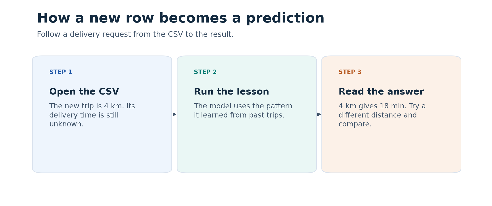

# Start here

**Lesson 001 · Practice**

## Your goal

Read a delivery table, teach a model with three rows, and ask it for a new delivery time.

## Before you start

Read a table and add small numbers.

Use the [main learning path](../../LEARNING-PATH.md) if you have not learned this yet. For extra topics, read [the extra-topic guide](../../ELECTIVES.md). In the repository, these links open the course guides. If you downloaded a ZIP, open README.html for the browser links. Keep the extracted lesson folder directly inside the complete course folder.

## The idea in simple words

Distance is known before the trip. The measured time is the answer. Training learns a rule; prediction uses it.

## Guess first

What happens to the guess when distance rises from 4 to 8? Write your answer before running the script.

## Run one step at a time

1. Extract this ZIP. Open folders until you see `lesson.py`.
2. Open a terminal in that folder. Activate the course environment as shown in Setup. Every `python` below means that environment's Python.
3. The main path uses the common course packages. If this lesson needs more, use the same Python to install `requirements.txt` with the course constraint file. See Setup step 8. Do not install optional media packages just to read a lesson.
4. Run these lines one at a time. Wait for each to finish.

```bash
python lesson.py
```

## Check the result

Read the column names and units before the numbers. The original files produced this example. Your deliberate data edits may change it.

```text
One completed delivery
 distance_km  minutes
           1       12

Compare the recorded and predicted minutes
 distance_km  minutes  predicted_minutes
           5       20               20.0
           6       22               22.0

New delivery estimates
 distance_km  Predicted time (min)
           4                  18.0
```

[See the complete expected output](expected-output.txt). Explain one row aloud. A matching number is a check of the calculation, not proof of real-world quality.

## Change one thing

In new_inputs.csv change 4 to 8. After rerunning, the first estimate should be 26.0 minutes.

Open the named CSV in a plain text editor. Keep its column names and commas. Save the same file name before running again. If you invent a request by changing its inputs, clear its old measured answer. Only score it after you have a real outcome for that new case.

## If you get stuck

If a file is missing, list the files with `dir` or `ls` and enter the folder holding the script. If a column or value is wrong, compare it with a fresh extracted CSV. Use a new folder to start over; keep your edited copy if useful. Use Setup for package or terminal errors.

## Explain the result

<details>
<summary>Read the answer after trying</summary>

It rises from 18 to 26 minutes in this made-up example. Real times can vary.

</details>

You can move on when you can explain the goal, the changed value and why the result did or did not change. Then return to the next box in the main learning path.


## 📋 Sample data

| distance_km | minutes |
| --- | --- |
| 1 | 12 |
| 2 | 14 |
| 3 | 16 |
| 5 | 20 |
| 6 | 22 |

## 📩 Supplied new inputs

| distance_km |
| --- |
| 4 |
| 7 |
| 9 |

## 📊 Read the visual



**👀 Read the visual.** Follow a delivery request from the CSV to the result.

**👉 What to do.** Edit **one input first**. Compare the new estimate with the original so you can trace what changed.
