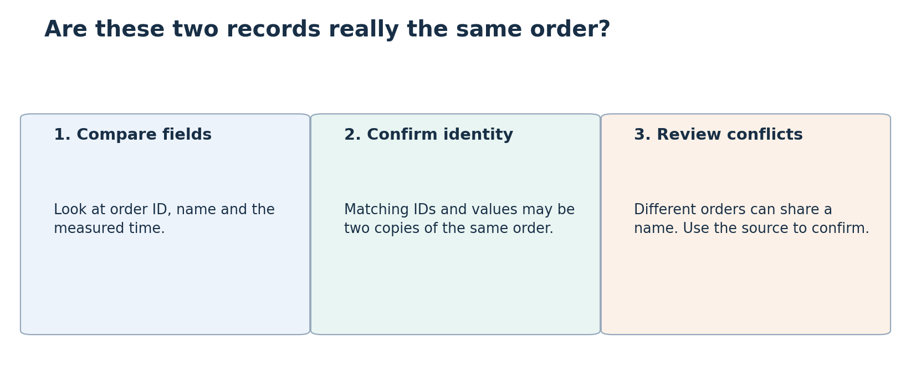

# 1.3.2 Remove Duplicates

**Lesson 049 · Practice**

## Your goal

Check whether repeated order records would give some deliveries extra weight in training.

## Before you start

Explain what one order ID represents.

Use the [learning path](../../LEARNING-PATH.md) to find the earlier skill, the [word list](../../GLOSSARY.md) for a term, and [Setup](../../SETUP.md) for computer steps. Extra-topic prerequisites and bridges are in [Extra topics](../../ELECTIVES.md). In an extracted ZIP, open README.html for the browser links and keep this folder directly inside the complete course folder.

## The idea in simple words

An exact duplicate repeats the same recorded row; it can give one event extra influence.

**Why and when.** Check identity and source before removing copies or dividing records into training and test groups.

**A worked example to follow.** If order A appears twice with identical distance and minutes, keeping one confirmed copy stops A being counted twice. Orders B and C may legitimately share the same measurements.

**Input and output.** The supplied sample fields are `order_id`, `km`, `minutes`. In that field order, one original row is:

```text
A | 2 | 14
```

`(missing)` means a blank, not zero. The result table below belongs to the original supplied files.

**Follow the Python.** Open the complete [lesson.py](lesson.py) beside these instructions. Keep the original field beside the inspected or changed value. Trace the named preparation or review step, and check whether it uses a fixed rule or a value learned from training. The [requirements file](requirements.txt) lists its packages. The next section gives exact run commands; use the same course Python to install and run.

## Guess first

Two distinct shipment IDs both have 5 km and 20 minutes. Remove one? What if they have the same ID but different times? Write a reason before running or opening the answer.

## Run one step at a time

1. Extract this ZIP. Open folders until you see `lesson.py`.
2. Open a terminal in that folder. Activate the course environment as shown in Setup. Every `python` below means that environment's Python.
3. The main path uses the common course packages. If this lesson needs more, use the same Python to install `requirements.txt` with the course constraint file. See Setup step 8. Do not install optional media packages just to read a lesson.
4. Run these lines one at a time. Wait for each to finish.

```bash
python lesson.py
```

## Check the result

Read the column names and units before the numbers. The original files produced this example. Your deliberate data edits may change it.

```text
Repeated rows: 1
D prediction: [30.0]
 km  prediction
  4        18.0
  9        28.0
 13        36.0
```

[See the complete expected output](expected-output.txt). Explain one row aloud. A matching number is a check of the calculation, not proof of real-world quality.

## Change one thing

Edit the input values in new_inputs.csv and compare the displayed predictions.

Open the named CSV in a plain text editor. Keep its column names and commas. Save the same file name before running again. If you invent a request by changing its inputs, clear its old measured answer. Only score it after you have a real outcome for that new case.

## If you get stuck

If a file is missing, list the files with `dir` or `ls` and enter the folder holding the script. If a column or value is wrong, compare it with a fresh extracted CSV. Use a new folder to start over; keep your edited copy if useful. Use Setup for package or terminal errors.

## Explain the result

**Common mistakes and limits.** Equal measurements alone do not prove duplicate events. Conflicting records with one ID need investigation rather than keeping the first arbitrarily.

<details markdown="1">
<summary>Check your choice and reason</summary>

Keep distinct confirmed shipments. For one ID with conflicting times, review the source and correction history. Do not silently choose a time.

</details>

After the guided file change above, close the notes and explain the same decision for a different supplied row. State one condition that makes this method unsuitable. If you cannot explain the reason, repeat the small worked example before adding more code.

## 📋 Sample data

| order_id | km | minutes |
| --- | --- | --- |
| A | 2 | 14 |
| A | 2 | 14 |
| B | 5 | 20 |
| C | 8 | 26 |
| D | 10 | 30 |

## 📩 Supplied new inputs

| km |
| --- |
| 4 |
| 9 |
| 13 |

## 📊 Read the visual



**👀 Read the visual.** Two customer names can look nearly identical while their orders differ.

**👉 What to do.** **Keep both rows** if the source confirms they are separate orders.

<!-- teaching-note:start -->
<!-- teaching-profile:exact_duplicates -->
<!-- teaching-note:end -->
