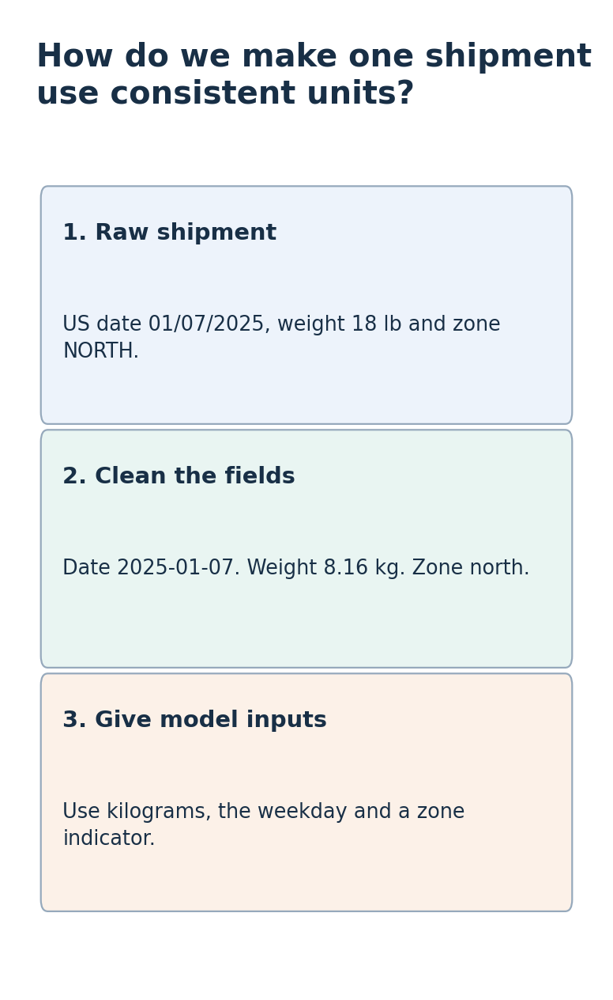

# Standardize formats

**Lesson 055 · Core**

## Your goal

Turn dates, pounds and uneven zone names into consistent model inputs, then predict a new delivery.

## Before you start

Read dates, units and names. Know the difference between a number and text.

Use the [main learning path](../../LEARNING-PATH.md) if you have not learned this yet. For extra topics, read [the extra-topic guide](../../ELECTIVES.md). In the repository, these links open the course guides. If you downloaded a ZIP, open README.html for the browser links. Keep the extracted lesson folder directly inside the complete course folder.

## The idea in simple words

Use one clear format for the same meaning. Ten pounds is about 4.54 kilograms. A spelling change is safe only when the source confirms the same meaning.

## Guess first

Should 10 lb be passed to a kg field as the number 10? Write your answer before running the script.

## Run one step at a time

1. Extract this ZIP. Open folders until you see `lesson.py`.
2. Open a terminal in that folder. Activate the course environment as shown in Setup. Every `python` below means that environment's Python.
3. The main path uses the common course packages. If this lesson needs more, use the same Python to install `requirements.txt` with the course constraint file. See Setup step 8. Do not install optional media packages just to read a lesson.
4. Run these lines one at a time. Wait for each to finish.

```bash
python lesson.py
```

## Check the result

Read the column names and units before the numbers. The original files produced this example. Your deliberate data edits may change it.

```text
Original date Standard date Original weight  Weight (kg) Original zone Standard zone  South flag
   01/02/2025    2025-01-02           10 lb         4.54         NORTH         north           0
   2025-01-03    2025-01-03            8 kg         8.00         south         south           1
   01/04/2025    2025-01-04          35 lbs        15.88         NORTH         north           0
   2025-01-05    2025-01-05           16 kg        16.00         south         south           1
   2025-01-06    2025-01-06           12 kg        12.00         north         north           0
   Shipment  Actual time (min)  Predicted time (min)
Check row 5                 35                  34.5
      date  weight_kg  zone  weekday  is_south  predicted_minutes
2025-01-07   8.164663 north        1         0              26.89
2025-01-09   7.000000 south        3         1              25.89
2025-01-10  13.607771 north        4         0              34.61
```

[See the complete expected output](expected-output.txt). Explain one row aloud. A matching number is a check of the calculation, not proof of real-world quality.

## Change one thing

Try 22 lb on 01/13/2025 in new_inputs.csv. The cleaned row should show 2025-01-13 and about 9.98 kg.

Open the named CSV in a plain text editor. Keep its column names and commas. Save the same file name before running again. If you invent a request by changing its inputs, clear its old measured answer. Only score it after you have a real outcome for that new case.

## If you get stuck

If a file is missing, list the files with `dir` or `ls` and enter the folder holding the script. If a column or value is wrong, compare it with a fresh extracted CSV. Use a new folder to start over; keep your edited copy if useful. Use Setup for package or terminal errors.

## Explain the result

<details>
<summary>Read the answer after trying</summary>

No. Convert it to about 4.54 kg first.

</details>

You can move on when you can explain the goal, the changed value and why the result did or did not change. Then return to the next box in the main learning path.


## 📋 Sample data

| ship_date | weight | unit | zone | minutes |
| --- | --- | --- | --- | --- |
| 01/02/2025 | 10 | lb | NORTH | 19 |
| 2025-01-03 | 8 | kg | south | 27 |
| 01/04/2025 | 35 | lbs | NORTH | 38 |
| 2025-01-05 | 16 | kg | south | 40 |
| 2025-01-06 | 12 | kg | north | 35 |

## 📩 Supplied new inputs

| ship_date | weight | unit | zone |
| --- | --- | --- | --- |
| 01/07/2025 | 18 | lb | NORTH |
| 2025-01-09 | 7 | kg | south |
| 2025-01-10 | 30 | lbs | north |

## 📊 Read the visual



**👀 Read the visual.** The same conversion steps run for training deliveries and new shipments.

**👉 What to do.** Give the model **8.16 kg** for this shipment. Its training weight column uses kilograms.
