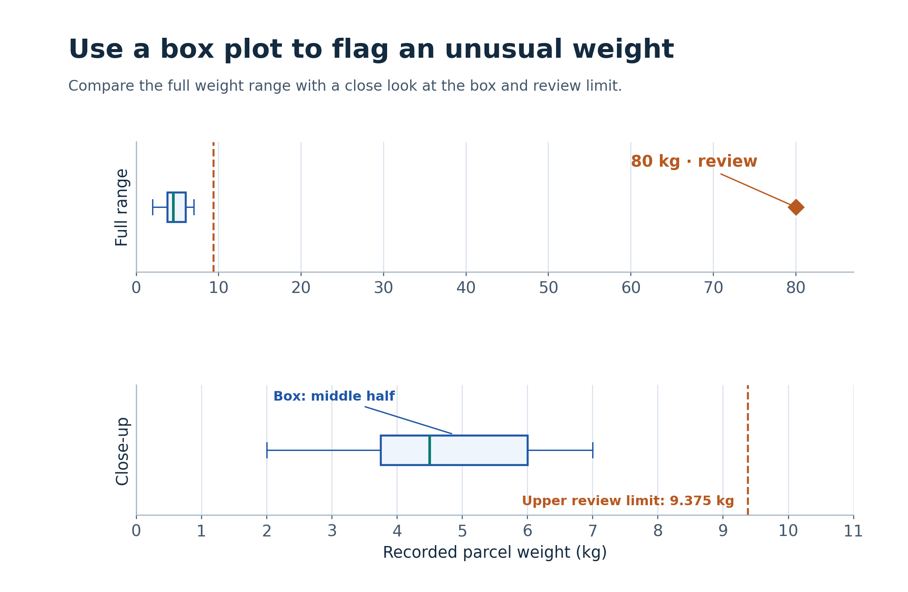

# Interquartile Range (IQR)

**Lesson 064 · Practice**

## Your goal

Use the middle half of the weight distribution to set a review range.

## Before you start

Sort numbers. The middle half is the values between the lower and upper quarters.

Use the [main learning path](../LEARNING-PATH.html) if you have not learned this yet. For extra topics, read [the extra-topic guide](../ELECTIVES.html). These links work when this folder is extracted directly into the complete course folder.

## The idea in simple words

An outlier is an unusual value. A flag says check it. It does not say it is wrong. Use the source to keep, correct or set it aside.

## Guess first

Does an outlier flag prove a recording error? Write your answer before running the script.

## Run one step at a time

1. Extract this ZIP. Open folders until you see `lesson.py`.
2. Open a terminal in that folder. Activate the course environment as shown in Setup. Every `python` below means that environment's Python.
3. The main path uses the common course packages. If this lesson needs more, use the same Python to install `requirements.txt` with the course constraint file. See Setup step 8. Do not install optional media packages just to read a lesson.
4. Run these lines one at a time. Wait for each to finish.

```bash
python lesson.py
```

## Check the result

Read the column names and units before the numbers. The original files produced this example. Your deliberate data edits may change it.

```text
 weight_kg  Z-score  IQR
        80     True True
```

[See the complete expected output](expected-output.txt). Explain one row aloud. A matching number is a check of the calculation, not proof of real-world quality.

## Change one thing

Compare 80 kg with 8 kg. Change or add a measured weight in sample.csv, then look for the flag and the boxplot.

Open the named CSV in a plain text editor. Keep its column names and commas. Save the same file name before running again. If you invent a request by changing its inputs, clear its old measured answer. Only score it after you have a real outcome for that new case.

## If you get stuck

If a file is missing, list the files with `dir` or `ls` and enter the folder holding the script. If a column or value is wrong, compare it with a fresh extracted CSV. Use a new folder to start over; keep your edited copy if useful. Use Setup for package or terminal errors.

## Explain the result

<details>
<summary>Read the answer after trying</summary>

No. A very heavy parcel can be real. Ask for a source check.

</details>

You can move on when you can explain the goal, the changed value and why the result did or did not change. Then return to the next box in the main learning path.


## 📋 Sample data

| weight_kg |
| --- |
| 2 |
| 3 |
| 3 |
| 4 |
| 4 |
| 4 |
| 5 |
| 5 |

Showing the first 8 of 12 rows. The CSV has the full sample.

## 📊 Read the visual



**👀 Read the visual.** Find the dashed upper limit and the 80 kg point.

**👉 What to do.** Check the weight and unit before choosing a correction.
