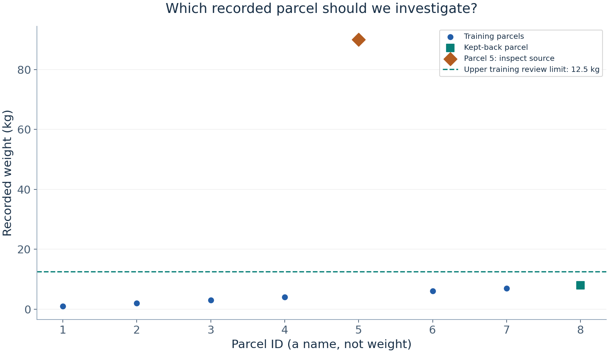
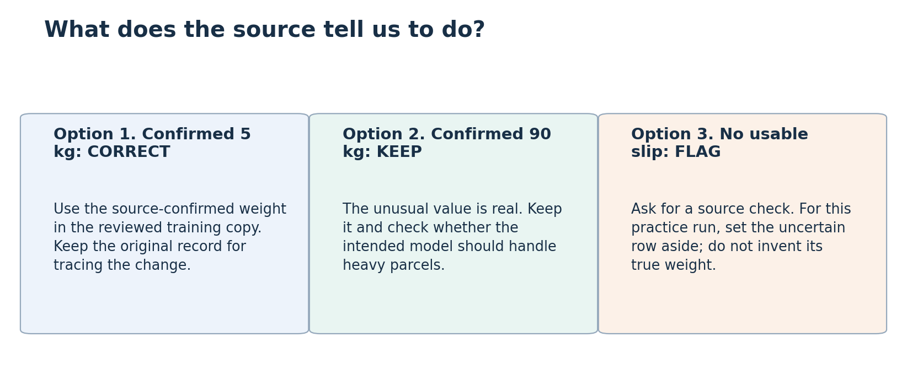
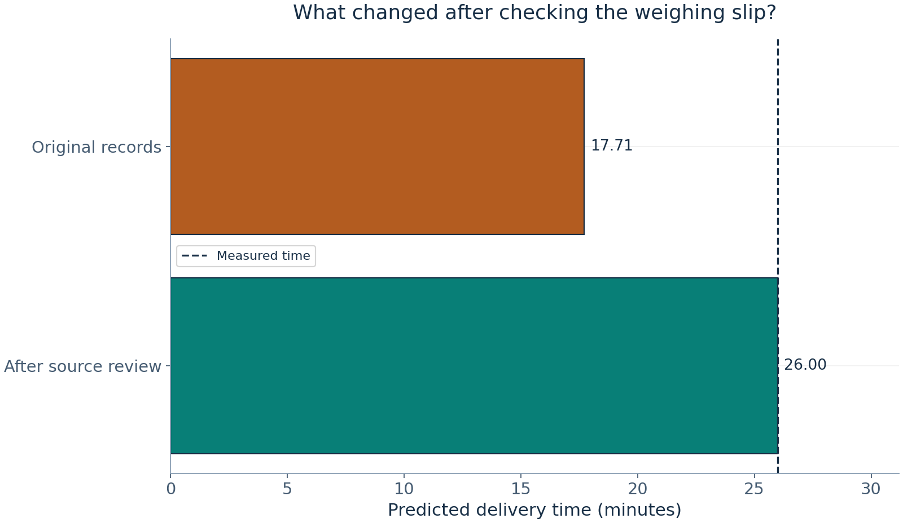

# Spot, check, and handle an outlier

**Lesson 069 · Core**

## Your goal

Investigate a recorded 90 kg parcel. Use the weighing slip to choose KEEP, CORRECT or FLAG, then compare predictions for the same kept-back parcel.

## Before you start

Find a parcel ID on the horizontal axis and kg on the vertical axis.

Use the [learning path](../../LEARNING-PATH.md) to find the earlier skill, the [word list](../../GLOSSARY.md) for a term, and [Setup](../../SETUP.md) for computer steps. Extra-topic prerequisites and bridges are in [Extra topics](../../ELECTIVES.md). In an extracted ZIP, open README.html for the browser links and keep this folder directly inside the complete course folder.

## The idea in simple words

Source review decides whether a flagged measurement is wrong, valid or unresolved.

**Why and when.** Use the source record before changing an unusual training value.

**A worked example to follow.** Parcel 5 has recorded weight 90 kg and crosses the 12.5 kg review line. A slip confirming 5 kg justifies correction; 90 kg justifies keeping it; an absent usable slip leaves it flagged. The later chart compares predictions for the same held-back parcel 8, whose actual time is 26 minutes.

**Input and output.** The supplied sample fields are `parcel`, `weight_kg`, `minutes`. In that field order, one original row is:

```text
1 | 1 | 12
```

`(missing)` means a blank, not zero. The result table below belongs to the original supplied files.

**Follow the Python.** Open the complete [lesson.py](lesson.py) beside these instructions. Keep the original field beside the inspected or changed value. Trace the named preparation or review step, and check whether it uses a fixed rule or a value learned from training. The [requirements file](requirements.txt) lists its packages. The next section gives exact run commands; use the same course Python to install and run.

## Guess first

The slip confirms 90 kg, but correcting to 5 would improve this one score. Which value belongs in the reviewed data? Write a reason before running or opening the answer.

## Run one step at a time

1. Extract this ZIP. Open folders until you see `lesson.py`.
2. Open a terminal in that folder. Activate the course environment as shown in Setup. Every `python` below means that environment's Python.
3. The main path uses the common course packages. If this lesson needs more, use the same Python to install `requirements.txt` with the course constraint file. See Setup step 8. Do not install optional media packages just to read a lesson.
4. Run these lines one at a time. Wait for each to finish.

```bash
python lesson.py
```

## Check the result

Read the column names and units before the numbers. The original files produced this example. Your deliberate data edits may change it.

```text
Training review range: -3.5 to 12.5 kg.
Training records outside that range
 parcel  weight_kg
      5         90

Decision: CORRECT
The slip confirms 5 kg. Change 90 kg to 5 kg.

Check parcel 8
      Training data  Predicted minutes  Actual minutes
   Original records               17.7              26
After source review               26.0              26
```

[See the complete expected output](expected-output.txt). Explain one row aloud. A matching number is a check of the calculation, not proof of real-world quality.

## Change one thing

In weighing_slip.csv, change the verified weight from 5 to 90 for KEEP. Clear the second cell for FLAG.

Open the named CSV in a plain text editor. Keep its column names and commas. Save the same file name before running again. If you invent a request by changing its inputs, clear its old measured answer. Only score it after you have a real outcome for that new case.

## If you get stuck

If a file is missing, list the files with `dir` or `ls` and enter the folder holding the script. If a column or value is wrong, compare it with a fresh extracted CSV. Use a new folder to start over; keep your edited copy if useful. Use Setup for package or terminal errors.

## Explain the result

**Common mistakes and limits.** The flag does not establish an error, and improvement on one held-back trip does not establish general improvement. Do not use the test answer to invent a correction.

<details>
<summary>Check your choice and reason</summary>

Keep 90 kg. Evidence about the measurement decides correction. Model suitability is a separate question requiring more suitable check examples.

</details>

After the guided file change above, close the notes and explain the same decision for a different supplied row. State one condition that makes this method unsuitable. If you cannot explain the reason, repeat the small worked example before adding more code.

## 📋 Sample data

| parcel | weight_kg | minutes |
| --- | --- | --- |
| 1 | 1 | 12 |
| 2 | 2 | 14 |
| 3 | 3 | 16 |
| 4 | 4 | 18 |
| 5 | 90 | 20 |
| 6 | 6 | 22 |
| 7 | 7 | 24 |
| 8 | 8 | 26 |

## Try all three decisions

Leave sample.csv unchanged. Edit only the second cell in the data row of weighing_slip.csv, save, and run the same command.

| Verified weight on the slip | Expected decision | What the script does |
| --- | --- | --- |
| 5 | CORRECT | Uses 5 kg and predicts 26.0 minutes on the check parcel. |
| 90 | KEEP | Keeps 90 kg and predicts 17.7 minutes. |
| Blank | FLAG | Sets the row aside for this practice run and asks for a source check. |

Open [the weighing slip](weighing_slip.csv). Keep the parcel ID as 5.

## 📊 Read the visual



**👀 Read the visual.** Find parcel 5 along the bottom. Its orange diamond is at **90 kg**. The dashed line shows the **12.5 kg** upper review limit learned from the seven training parcels.

**👉 What to do.** **Flag parcel 5 for review.** The plot tells you which record to check.



**👀 Read the visual.** Follow the branch that matches the source. In this exercise the weighing slip shows **5 kg**, so the 90 kg entry gets corrected.

**👉 What to do.** Keep a confirmed 90 kg. If the source is missing, request a reweigh and leave the value flagged.



**👀 Read the visual.** The dashed line is the real time for **parcel 8**, which was kept aside. The orange bar ends at **17.7 min**. The teal bar reaches **26.0 min**.

**👉 What to do.** Use the verified training correction, then check more kept-back deliveries before trusting the improvement in an app.

<!-- teaching-note:start -->
<!-- teaching-profile:outlier_review -->
<!-- teaching-note:end -->
