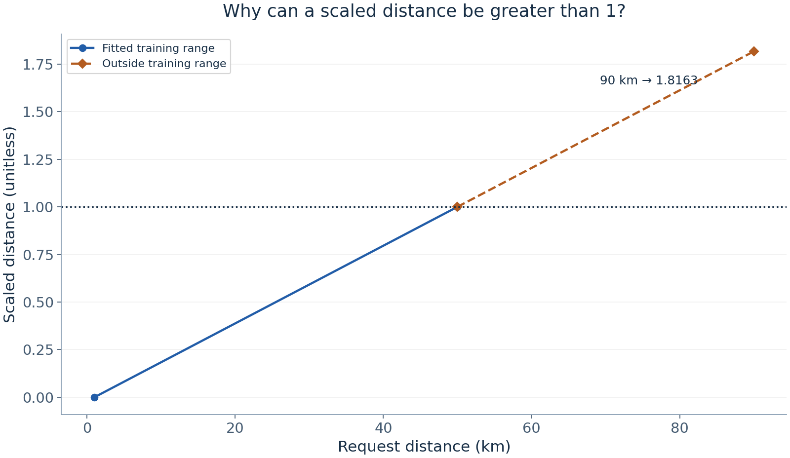

# Normalization (Min-Max Scaling)

**Lesson 071 · Core**

## Your goal

Scale known distances, then see what happens when training covers 1–50 km and someone enters 90 km.

## Before you start

Read a minimum, maximum, average and spread.

Use the [learning path](../../LEARNING-PATH.md) to find the earlier skill, the [word list](../../GLOSSARY.md) for a term, and [Setup](../../SETUP.md) for computer steps. Extra-topic prerequisites and bridges are in [Extra topics](../../ELECTIVES.md). In an extracted ZIP, open README.html for the browser links and keep this folder directly inside the complete course folder.

## The idea in simple words

Scaling changes the numbers passed to a model, using a rule fitted on training values.

**Why and when.** Use it when input units affect distances or penalties. Compare with unchanged inputs; trees often do not need ordinary linear scaling.

**A worked example to follow.** Min-max uses (value − training minimum) ÷ training range. With limits 1 and 50 km, 90 km becomes 89 ÷ 49, about 1.8163. Standard scaling subtracts the training mean and divides by its standard deviation. Robust scaling uses the training median and IQR.

**Input and output.** The supplied sample fields are `distance_km`, `weight_kg`, `delivery_minutes`. In that field order, one original row is:

```text
2 | 1 | 19
```

`(missing)` means a blank, not zero. The result table below belongs to the original supplied files.

**Follow the Python.** Open the complete [lesson.py](lesson.py) beside these instructions. Keep inputs apart from measured answers. Follow this script’s split and fit, then trace the saved preparation into the held-back result and any new request. A request must not supply its own training answer. The [requirements file](requirements.txt) lists its packages. The next section gives exact run commands; use the same course Python to install and run.

## Guess first

The fitted range is 1–50 km. What does 25 km become? Does an out-of-range number automatically mean an invalid measurement? Write a reason before running or opening the answer.

## Run one step at a time

1. Extract this ZIP. Open folders until you see `lesson.py`.
2. Open a terminal in that folder. Activate the course environment as shown in Setup. Every `python` below means that environment's Python.
3. The main path uses the common course packages. If this lesson needs more, use the same Python to install `requirements.txt` with the course constraint file. See Setup step 8. Do not install optional media packages just to read a lesson.
4. Run these lines one at a time. Wait for each to finish.

```bash
python lesson.py
python train_range_model.py
python test_range_model.py
```

## Check the result

Read the column names and units before the numbers. The original files produced this example. Your deliberate data edits may change it.

```text
Training rows before and after scaling
 distance_km  weight_kg  scaled_distance  scaled_weight
           2          1             0.00           0.00
           4          3             0.33           0.67
           6          2             0.67           0.33
           8          4             1.00           1.00

Check the predictions against actual deliveries
 distance_km  weight_kg  actual_minutes  predicted_minutes
          10          1              33               31.0
          12          3              44               42.0

```

[See the complete expected output](expected-output.txt). Explain one row aloud. A matching number is a check of the calculation, not proof of real-world quality.

## Change one thing

Change 90 to 45 in range_requests.csv. Run only test_range_model.py. The app should offer an estimate.

Open the named CSV in a plain text editor. Keep its column names and commas. Save the same file name before running again. If you invent a request by changing its inputs, clear its old measured answer. Only score it after you have a real outcome for that new case.

## If you get stuck

If a file is missing, list the files with `dir` or `ls` and enter the folder holding the script. If a column or value is wrong, compare it with a fresh extracted CSV. Use a new folder to start over; keep your edited copy if useful. Use Setup for package or terminal errors.

## Explain the result

**Common mistakes and limits.** New values can fall outside a fitted 0–1 range. Do not refit on each request. Scaling is not a guarantee of better predictions or a way to make a distribution normal.

<details>
<summary>Check your choice and reason</summary>

25 becomes 24 ÷ 49, about 0.4898. An out-of-range number may be physically possible but outside the evidence for a service. Keep the fitted rule and apply a stated acceptance/fallback policy.

</details>

After the guided file change above, close the notes and explain the same decision for a different supplied row. State one condition that makes this method unsuitable. If you cannot explain the reason, repeat the small worked example before adding more code.

## 📋 Sample data

| distance_km | weight_kg | delivery_minutes |
| --- | --- | --- |
| 2 | 1 | 19 |
| 4 | 3 | 30 |
| 6 | 2 | 29 |
| 8 | 4 | 40 |
| 10 | 1 | 33 |
| 12 | 3 | 44 |

## 📩 Supplied new inputs

| distance_km | weight_kg |
| --- | --- |
| 5 | 2 |
| 10 | 3 |
| 12 | 4 |

## Expected result for the supplied fresh inputs

| Distance (km) | Weight (kg) | Scaled distance | Scaled weight | Predicted minutes |
| ---: | ---: | ---: | ---: | ---: |
| 5 | 2 | 0.50 | 0.33 | 27.5 |
| 10 | 3 | 1.33 | 0.67 | 39.0 |
| 12 | 4 | 1.67 | 1.00 | 46.0 |

The first four deliveries teach the scaler that the smallest training distance is 2 km and the largest is 8 km. A fresh distance above 8 km becomes greater than 1. The model receives the scaled distance and weight before making its prediction.

## 🚚 What if the app receives 90 km?

The files below use a second training example, with distances from **1 to 50 km**.

1. Run `python train_range_model.py` once. It reads [range_training.csv](range_training.csv), checks the result with [range_check.csv](range_check.csv), and saves the saved scale rule and model together.
2. Open [range_requests.csv](range_requests.csv). Leave the 90 km row in place for the first run.
3. Run `python test_range_model.py`. It loads the saved model and shows the scaled distance, demo prediction and app response for each row.
4. Replace 90 with 45 or 105 and run only the test script again. Try entering `unknown` to see the input validation message.

| Entered distance (km) | Scaled distance | Demo prediction (min) | In-range-only app |
| ---: | ---: | ---: | --- |
| 1 | 0.0000 | 12.0 | Shows 12.0 min |
| 25 | 0.4898 | 60.0 | Shows 60.0 min |
| 50 | 1.0000 | 110.0 | Shows 110.0 min |
| 90 | 1.8163 | 190.0 | Shows an outside-range message |

For 90 km the saved scaler still uses 1 and 50, so it calculates `(90 − 1) ÷ (50 − 1) ≈ 1.8163`. The demo prediction extends the fitted line into a range the model has never seen. If you plan to support long routes, collect measured long trips for training and keep some separate to check how the model does.

## 📊 Read the visual



**👀 Read the visual.** Follow 90 km up to the orange diamond. It is above 1 because 90 is above the fitted maximum of 50.

**👉 What to do.** Check whether the app should return an estimate for a distance outside its training range.

<!-- teaching-note:start -->
<!-- teaching-profile:scaling -->
<!-- teaching-note:end -->
