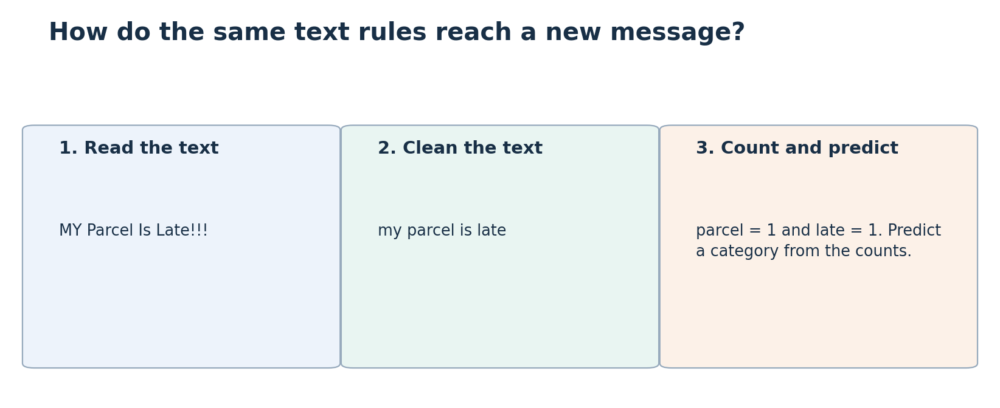

# 1.3.7 Text Data Cleaning

**Lesson 078 · Practice**

## Your goal

Clean the capitalization and punctuation in support messages before classifying them.

## Before you start

Read a message and distinguish its words from its category.

Use the [learning path](../../LEARNING-PATH.md) to find the earlier skill, the [word list](../../GLOSSARY.md) for a term, and [Setup](../../SETUP.md) for computer steps. Extra-topic prerequisites and bridges are in [Extra topics](../../ELECTIVES.md). In an extracted ZIP, open README.html for the browser links and keep this folder directly inside the complete course folder.

## The idea in simple words

Text cleaning gives messages a consistent representation before words are counted.

**Why and when.** Lowercase or remove punctuation only when doing so preserves information useful to the task.

**A worked example to follow.** WHERE IS MY PARCEL!!! becomes where is my parcel in this exercise. The fitted vocabulary gives a word-count column to known words; the trained classifier turns those numbers into a delivery or billing guess.

**Input and output.** The supplied sample fields are `message`, `category`. In that field order, one original row is:

```text
MY Parcel Is Late!!! | delivery
```

`(missing)` means a blank, not zero. The result table below belongs to the original supplied files.

**Follow the Python.** Open the complete [lesson.py](lesson.py) beside these instructions. Keep inputs apart from measured answers. Follow this script’s split and fit, then trace the saved preparation into the held-back result and any new request. A request must not supply its own training answer. The [requirements file](requirements.txt) lists its packages. The next section gives exact run commands; use the same course Python to install and run.

## Guess first

Try not late and late. If your cleanup makes them identical, what information was lost? Should every language use the same cleanup? Write a reason before running or opening the answer.

## Run one step at a time

1. Extract this ZIP. Open folders until you see `lesson.py`.
2. Open a terminal in that folder. Activate the course environment as shown in Setup. Every `python` below means that environment's Python.
3. The main path uses the common course packages. If this lesson needs more, use the same Python to install `requirements.txt` with the course constraint file. See Setup step 8. Do not install optional media packages just to read a lesson.
4. Run these lines one at a time. Wait for each to finish.

```bash
python lesson.py
```

## Check the result

Read the column names and units before the numbers. The original files produced this example. Your deliberate data edits may change it.

```text
    Original message   Cleaned message
MY Parcel Is Late!!! my parcel is late
Check actual / predicted: ['delivery', 'billing'] ['delivery', 'billing']
               Raw message             Clean message Prediction
     WHERE IS MY PARCEL!!!        where is my parcel   delivery
    REFUND my card charge!     refund my card charge    billing
The package never arrived. the package never arrived   delivery
```

[See the complete expected output](expected-output.txt). Explain one row aloud. A matching number is a check of the calculation, not proof of real-world quality.

## Change one thing

Change message in new_inputs.csv, for example from WHERE IS MY PARCEL!!! to The package never arrived.. Compare the printed rows.

Open the named CSV in a plain text editor. Keep its column names and commas. Save the same file name before running again. If you invent a request by changing its inputs, clear its old measured answer. Only score it after you have a real outcome for that new case.

## If you get stuck

If a file is missing, list the files with `dir` or `ls` and enter the folder holding the script. If a column or value is wrong, compare it with a fresh extracted CSV. Use a new folder to start over; keep your edited copy if useful. Use Setup for package or terminal errors.

## Explain the result

**Common mistakes and limits.** NOT LATE differs from LATE. Case and punctuation may matter for names, product codes or sentiment. Unknown words do not receive new columns at prediction time.

<details>
<summary>Check your choice and reason</summary>

Negation was lost. Retain it or change the representation and validate it. Languages and tasks need their own tested tokenization and cleanup rules.

</details>

After the guided file change above, close the notes and explain the same decision for a different supplied row. State one condition that makes this method unsuitable. If you cannot explain the reason, repeat the small worked example before adding more code.

## 📋 Sample data

| message | category |
| --- | --- |
| MY Parcel Is Late!!! | delivery |
| Where is my PACKAGE? | delivery |
| The parcel never arrived. | delivery |
| Please REFUND my payment! | billing |
| My invoice is WRONG? | billing |
| I was charged twice. | billing |
| Where is my parcel? | delivery |
| Please refund this charge! | billing |

## 📩 Supplied new inputs

| message |
| --- |
| WHERE IS MY PARCEL!!! |
| REFUND my card charge! |
| The package never arrived. |

## 📊 Read the visual



**👀 Read the visual.** Use the same text processing for every message.

**👉 What to do.** Try a billing message next. See which words the model can count using its training vocabulary.

<!-- teaching-note:start -->
<!-- teaching-profile:text_clean -->
<!-- teaching-note:end -->
