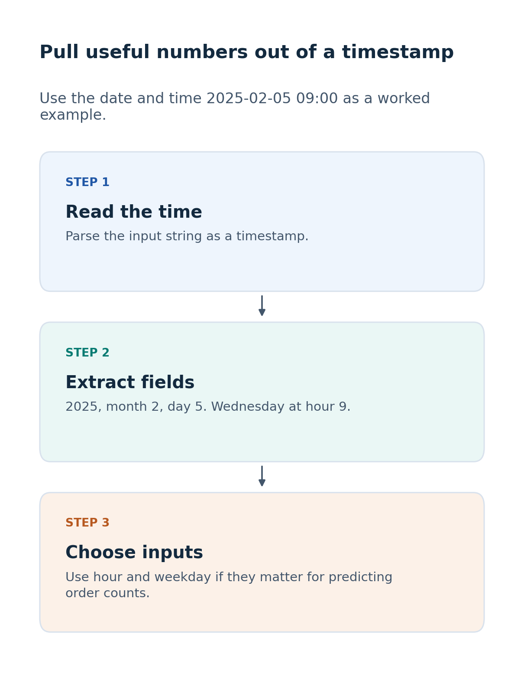

# 1.3.9 Handle Date/Time Data

**Lesson 093 · Practice**

## Your goal

Read written dates and timestamps so Python can use them consistently.

## Before you start

Read a date and time. Know the format used in the file.

Use the [main learning path](../LEARNING-PATH.html) if you have not learned this yet. For extra topics, read [the extra-topic guide](../ELECTIVES.html). These links work when this folder is extracted directly into the complete course folder.

## The idea in simple words

Parse a date once, then take parts such as year or hour. These are possible inputs, not proof they are useful. Keep timezone and prediction timing clear.

## Guess first

Are hour 23 and hour 0 far apart in time? Write your answer before running the script.

## Run one step at a time

1. Extract this ZIP. Open folders until you see `lesson.py`.
2. Open a terminal in that folder. Activate the course environment as shown in Setup. Every `python` below means that environment's Python.
3. The main path uses the common course packages. If this lesson needs more, use the same Python to install `requirements.txt` with the course constraint file. See Setup step 8. Do not install optional media packages just to read a lesson.
4. Run these lines one at a time. Wait for each to finish.

```bash
python lesson.py
```

## Check the result

Read the column names and units before the numbers. The original files produced this example. Your deliberate data edits may change it.

```text
['2025-02-03', '2025-02-04', 'invalid date', '2023-02-10']
```

[See the complete expected output](expected-output.txt). Explain one row aloud. A matching number is a check of the calculation, not proof of real-world quality.

## Change one thing

Change raw_date in sample.csv, for example from 02/03/2025 to invalid. Compare the printed rows.

Open the named CSV in a plain text editor. Keep its column names and commas. Save the same file name before running again. If you invent a request by changing its inputs, clear its old measured answer. Only score it after you have a real outcome for that new case.

## If you get stuck

If a file is missing, list the files with `dir` or `ls` and enter the folder holding the script. If a column or value is wrong, compare it with a fresh extracted CSV. Use a new folder to start over; keep your edited copy if useful. Use Setup for package or terminal errors.

## Explain the result

<details>
<summary>Read the answer after trying</summary>

No. They are an hour apart across midnight. Numeric coding may need to reflect that cycle.

</details>

You can move on when you can explain the goal, the changed value and why the result did or did not change. Then return to the next box in the main learning path.


## 📋 Sample data

| raw_date |
| --- |
| 02/03/2025 |
| 2025-02-04 |
| invalid |
| 1676025600 |

## 📊 Read the visual



**👀 Read the visual.** Use the date and time 2025-02-05 09:00 as a worked example.

**👉 What to do.** Change **09:00** to **17:00** and find the difference in the Hour column.
