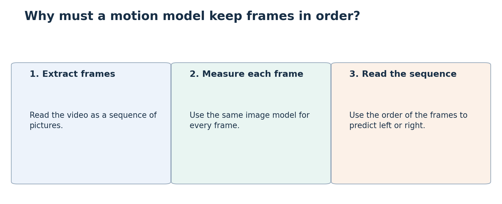

# Video (Frames, Sequences)

**Lesson 122 · Practice**

## Your goal

Make a short video from frames and classify which way an object moves.

## Before you start

Complete pixel and small-network bridges; read an array shape.

Use the [learning path](../../LEARNING-PATH.md) to find the earlier skill, the [word list](../../GLOSSARY.md) for a term, and [Setup](../../SETUP.md) for computer steps. Extra-topic prerequisites and bridges are in [Extra topics](../../ELECTIVES.md). In an extracted ZIP, open README.html for the browser links and keep this folder directly inside the complete course folder.

## The idea in simple words

A video is an ordered sequence of frames. Frame features describe pictures; a sequence model can use their order.

**Why and when.** Use a temporal model when motion or order matters rather than a single still image.

**A worked example to follow.** The moving dot appears at the same four columns in opposite time orders. A small CNN reads frames, and an LSTM reads the resulting sequence. The script also decodes an MP4 before prediction.

**Input and output.** The supplied sample fields are `direction`, `row`. In that field order, one original row is:

```text
0 | 1
```

`(missing)` means a blank, not zero. The result table below belongs to the original supplied files.

**Follow the Python.** Open the complete [lesson.py](lesson.py) beside these instructions. Keep inputs apart from measured answers. Follow this script’s split and fit, then trace the saved preparation into the held-back result and any new request. A request must not supply its own training answer. The [requirements file](requirements.txt) lists its packages. The next section gives exact run commands; use the same course Python to install and run.

## Guess first

If you reverse all frames of a right-moving dot, what changes? Could random frame splitting exaggerate performance? Write a reason before running or opening the answer.

## Run one step at a time

1. Extract this ZIP. Open folders until you see `lesson.py`.
2. Open a terminal in that folder. Activate the course environment as shown in Setup. Every `python` below means that environment's Python.
3. The main path uses the common course packages. If this lesson needs more, use the same Python to install `requirements.txt` with the course constraint file. See Setup step 8. Do not install optional media packages just to read a lesson.
4. Run these lines one at a time. Wait for each to finish.

```bash
python lesson.py
```

## Check the result

Read the column names and units before the numbers. The original files produced this example. Your deliberate data edits may change it.

```text
Clips × frames × channels × height × width: (8, 4, 1, 6, 6)
Decoded MP4 direction: [1]
Directions for all new clips: [1, 0]
```

[See the complete expected output](expected-output.txt). Explain one row aloud. A matching number is a check of the calculation, not proof of real-world quality.

## Change one thing

Try changing direction from 1 to 0 in new_inputs.csv. Compare the new output.

Open the named CSV in a plain text editor. Keep its column names and commas. Save the same file name before running again. If you invent a request by changing its inputs, clear its old measured answer. Only score it after you have a real outcome for that new case.

## If you get stuck

If a file is missing, list the files with `dir` or `ls` and enter the folder holding the script. If a column or value is wrong, compare it with a fresh extracted CSV. Use a new folder to start over; keep your edited copy if useful. Use Setup for package or terminal errors.

## Explain the result

**Common mistakes and limits.** Keep frames from one source clip in the same evaluation group. Toy dot motion is not evidence for reliable recognition in real videos.

<details>
<summary>Check your choice and reason</summary>

The direction reverses although the set of frames is unchanged. Splitting related frames can leak clip information; split by independent source clip or recording session as needed.

</details>

After the guided file change above, close the notes and explain the same decision for a different supplied row. State one condition that makes this method unsuitable. If you cannot explain the reason, repeat the small worked example before adding more code.

## 📋 Sample data

| direction | row |
| --- | --- |
| 0 | 1 |
| 0 | 2 |
| 0 | 3 |
| 0 | 4 |
| 1 | 1 |
| 1 | 2 |
| 1 | 3 |
| 1 | 4 |

## 📩 Supplied new inputs

| direction | row |
| --- | --- |
| 1 | 0 |
| 0 | 5 |

## 📊 Read the visual



**👀 Read the visual.** Keep the pictures in time order so movement stays visible.

**👉 What to do.** Check frame order when direction matters. A picture shows position and the sequence shows movement.

<!-- extra-lab:start -->
## Trace one update before a network

Read the [network bridge](../../ELECTIVES.md#a-bridge-before-networks-trace-one-learning-step) before the larger training loop. The complete [network_bridge.py](network_bridge.py) needs only Python:

```bash
python network_bridge.py
```

Its [recorded output](network-expected-output.txt) follows one input, a weighted sum, a squared mistake, and a change to the weight and bias. It does not measure performance on separate examples. In that practice file change `learning_rate = 0.1` to `learning_rate = 1.0`, save, and run again. This row's loss rises from 1 to 81: a larger step can make learning worse. Restore 0.1 afterward. Complete the array-shape paper task in Extra topics before reading frame or token tensors.
<!-- extra-lab:end -->


<!-- teaching-note:start -->
<!-- teaching-profile:video -->
<!-- teaching-note:end -->
