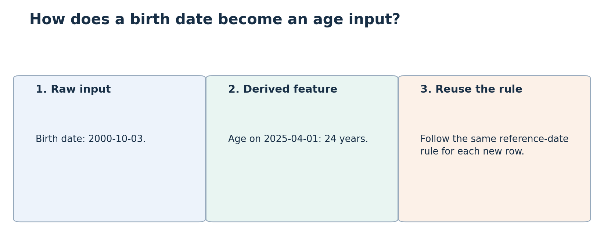

# 1.5. Feature Engineering & Feature Selection

**Lesson 160 · Practice**

## Your goal

See how creating or choosing useful input columns helps the model.

## Before you start

Explain a held-back score and why a target is not an input.

Use the [learning path](../../LEARNING-PATH.md) to find the earlier skill, the [word list](../../GLOSSARY.md) for a term, and [Setup](../../SETUP.md) for computer steps. Extra-topic prerequisites and bridges are in [Extra topics](../../ELECTIVES.md). In an extracted ZIP, open README.html for the browser links and keep this folder directly inside the complete course folder.

## The idea in simple words

Model evaluation measures mistakes; permutation importance asks how a fitted model’s score changes when one input is shuffled.

**Why and when.** Use importance to investigate model reliance on a particular check set, alongside errors and data knowledge.

**A worked example to follow.** The lesson compares classifiers using training folds, checks the chosen rule on kept-back orders, and shuffles distance or weight on separate check rows. A larger score drop suggests more reliance in that check.

**Input and output.** The supplied sample fields are `distance`, `weight`, `answer`. In that field order, one original row is:

```text
37 | 5 | 1
```

`(missing)` means a blank, not zero. The result table below belongs to the original supplied files.

**Follow the Python.** Open the complete [lesson.py](lesson.py) beside these instructions. Keep inputs apart from measured answers. Follow this script’s split and fit, then trace the saved preparation into the held-back result and any new request. A request must not supply its own training answer. The [requirements file](requirements.txt) lists its packages. The next section gives exact run commands; use the same course Python to install and run.

## Guess first

Shuffling distance reduces F1. Does this prove making a delivery shorter would cause it to become less urgent? Write a reason before running or opening the answer.

## Run one step at a time

1. Extract this ZIP. Open folders until you see `lesson.py`.
2. Open a terminal in that folder. Activate the course environment as shown in Setup. Every `python` below means that environment's Python.
3. The main path uses the common course packages. If this lesson needs more, use the same Python to install `requirements.txt` with the course constraint file. See Setup step 8. Do not install optional media packages just to read a lesson.
4. Run these lines one at a time. Wait for each to finish.

```bash
python lesson.py
```

## Check the result

Read the column names and units before the numbers. The original files produced this example. Your deliberate data edits may change it.

```text
accuracy     0.900
precision    0.895
recall       0.944
F1           0.919
AUC-ROC      0.991
 distance  weight  predicted_urgent
        5       2                 0
       28       7                 1
       40       5                 1
```

[See the complete expected output](expected-output.txt). Explain one row aloud. A matching number is a check of the calculation, not proof of real-world quality.

## Change one thing

Edit new_inputs.csv and rerun the script. Change an input and its known answer consistently in sample.csv. Rerun the comparison and check what changes.

Open the named CSV in a plain text editor. Keep its column names and commas. Save the same file name before running again. If you invent a request by changing its inputs, clear its old measured answer. Only score it after you have a real outcome for that new case.

## If you get stuck

If a file is missing, list the files with `dir` or `ls` and enter the folder holding the script. If a column or value is wrong, compare it with a fresh extracted CSV. Use a new folder to start over; keep your edited copy if useful. Use Setup for package or terminal errors.

## Explain the result

**Common mistakes and limits.** Importance is not a cause or a universal property of a field. Correlated inputs can share or hide reliance. A final test is not a repeated feature-selection tool.

<details markdown="1">
<summary>Check your choice and reason</summary>

No. It shows reliance by this fitted model under this check. Causal effects require a suitable design and assumptions, not a shuffled prediction score.

</details>

After the guided file change above, close the notes and explain the same decision for a different supplied row. State one condition that makes this method unsuitable. If you cannot explain the reason, repeat the small worked example before adding more code.

### What this particular check asks

This example keeps exact distance-and-weight combinations out of its test training rows. That is a deliberately stricter, special question. Independent orders may have the same measurements. Equal numbers alone do not prove leakage. Use shipment identity and the intended future job to choose a normal split; see lesson 442.

## 📋 Sample data

| distance | weight | answer |
| --- | --- | --- |
| 37 | 5 | 1 |
| 25 | 7 | 1 |
| 27 | 5 | 1 |
| 35 | 7 | 1 |
| 23 | 6 | 0 |
| 31 | 7 | 1 |
| 33 | 10 | 1 |
| 9 | 2 | 0 |

Showing the first 8 of 120 rows. The CSV has the full sample.

## 📩 Supplied new inputs

| distance | weight |
| --- | --- |
| 5 | 2 |
| 28 | 7 |
| 40 | 5 |

## 📊 Read the visual



**👀 Read the visual.** Choose fields the app can use when the request arrives.

**👉 What to do.** Use a feature only if the app knows it at prediction time. A measured delivery time arrives after the trip.

<!-- teaching-note:start -->
<!-- teaching-profile:importance -->
<!-- teaching-note:end -->
