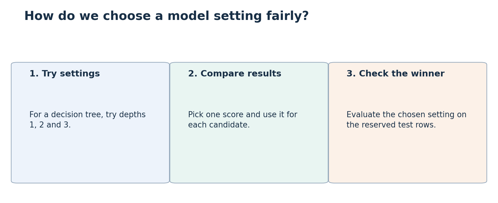

# 1.7. Model Selection & Training

**Lesson 187 · Practice**

## Your goal

Compare candidate models using the same training task and a common error measure.

## Before you start

Calculate a baseline score and explain validation.

Use the [learning path](../../LEARNING-PATH.md) to find the earlier skill, the [word list](../../GLOSSARY.md) for a term, and [Setup](../../SETUP.md) for computer steps. Extra-topic prerequisites and bridges are in [Extra topics](../../ELECTIVES.md). In an extracted ZIP, open README.html for the browser links and keep this folder directly inside the complete course folder.

## The idea in simple words

Model comparison tests candidate learning rules on the same task, rows and metric.

**Why and when.** Use the simplest justified baseline first, then add candidates whose assumptions suit the input and decision.

**A worked example to follow.** The lesson places scaling inside a pipeline and takes the same validation folds for each classifier. A DummyClassifier provides a comparison that learns no useful input relationship.

**Input and output.** The supplied sample fields are `km`, `kg`, `answer`. In that field order, one original row is:

```text
47 | 3 | 1
```

`(missing)` means a blank, not zero. The result table below belongs to the original supplied files.

**Follow the Python.** Open the complete [lesson.py](lesson.py) beside these instructions. Keep inputs apart from measured answers. Follow this script’s split and fit, then trace the saved preparation into the held-back result and any new request. A request must not supply its own training answer. The [requirements file](requirements.txt) lists its packages. The next section gives exact run commands; use the same course Python to install and run.

## Guess first

One candidate has slightly better validation F1 but cannot meet the agreed response time. Must it be chosen? Write a reason before running or opening the answer.

## Run one step at a time

1. Extract this ZIP. Open folders until you see `lesson.py`.
2. Open a terminal in that folder. Activate the course environment as shown in Setup. Every `python` below means that environment's Python.
3. The main path uses the common course packages. If this lesson needs more, use the same Python to install `requirements.txt` with the course constraint file. See Setup step 8. Do not install optional media packages just to read a lesson.
4. Run these lines one at a time. Wait for each to finish.

```bash
python lesson.py
```

## Check the result

Read the column names and units before the numbers. The original files produced this example. Your deliberate data edits may change it.

```text
DummyClassifier 0.687
LogisticRegression 0.908
DecisionTreeClassifier 0.744
RandomForestClassifier 0.825
SVC 0.88
```

[See the complete expected output](expected-output.txt). Explain one row aloud. A matching number is a check of the calculation, not proof of real-world quality.

## Change one thing

Change an input and its known answer consistently in sample.csv. Rerun the comparison and check what changes.

Open the named CSV in a plain text editor. Keep its column names and commas. Save the same file name before running again. If you invent a request by changing its inputs, clear its old measured answer. Only score it after you have a real outcome for that new case.

## If you get stuck

If a file is missing, list the files with `dir` or `ls` and enter the folder holding the script. If a column or value is wrong, compare it with a fresh extracted CSV. Use a new folder to start over; keep your edited copy if useful. Use Setup for package or terminal errors.

## Explain the result

**Common mistakes and limits.** A larger model is not automatically better. A validation winner is not a final test estimate. Also compare practical requirements and failure types.

<details>
<summary>Check your choice and reason</summary>

No. Check uncertainty and the project constraints. Choose a usable procedure with documented trade-offs, then evaluate the frozen choice separately.

</details>

After the guided file change above, close the notes and explain the same decision for a different supplied row. State one condition that makes this method unsuitable. If you cannot explain the reason, repeat the small worked example before adding more code.

## 📋 Sample data

| km | kg | answer |
| --- | --- | --- |
| 47 | 3 | 1 |
| 31 | 6 | 1 |
| 34 | 11 | 1 |
| 44 | 10 | 1 |
| 29 | 8 | 1 |
| 39 | 8 | 1 |
| 41 | 1 | 1 |
| 12 | 9 | 0 |

Showing the first 8 of 84 rows. The CSV has the full sample.

## 📊 Read the visual



**👀 Read the visual.** Try every candidate on the same validation rows.

**👉 What to do.** A deeper tree can memorize the training rows. Use validation results to choose its depth.

These scores compare settings on validation folds. Use an independent test set for the final score after you choose a model.

<!-- teaching-note:start -->
<!-- teaching-profile:model_comparison -->
<!-- teaching-note:end -->
