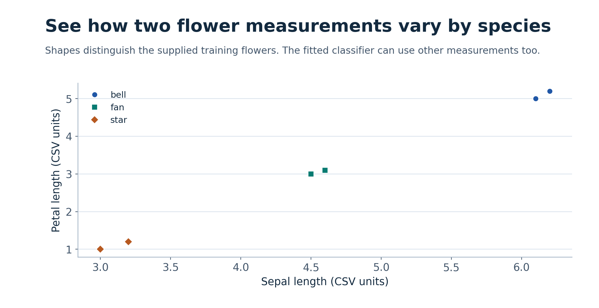

# Visualization

**Lesson 283 · Practice**

## Your goal

Plot petal and sepal measurements to see which flowers look similar.

## Before you start

Read the named fields and explain the preparation taught earlier.

Use the [learning path](../../LEARNING-PATH.md) to find the earlier skill, the [word list](../../GLOSSARY.md) for a term, and [Setup](../../SETUP.md) for computer steps. Extra-topic prerequisites and bridges are in [Extra topics](../../ELECTIVES.md). In an extracted ZIP, open README.html for the browser links and keep this folder directly inside the complete course folder.

## The idea in simple words

Inspect or derive a representation for a stated data question before using it in a fit.

**Why and when.** Use this focused task to explain what the flower measurements representation keeps and changes.

**A worked example to follow.** The flower measurements exercise uses sepal and petal measurements. Its output is species. The flower names star, fan and bell are invented classes with no ranking. Keep the original fields beside the derived value or chart so its meaning can be checked.

**Input and output.** The supplied sample fields are `sepal_length`, `sepal_width`, `petal_length`, `petal_width`, `species`. In that field order, one original row is:

```text
3 | 2 | 1 | .2 | star
```

`(missing)` means a blank, not zero. The result table below belongs to the original supplied files.

**Follow the Python.** Open the complete [lesson.py](lesson.py) beside these instructions. Keep inputs apart from measured answers. Follow this script’s split and fit, then trace the saved preparation into the held-back result and any new request. A request must not supply its own training answer. The [requirements file](requirements.txt) lists its packages. The next section gives exact run commands; use the same course Python to install and run.

## Guess first

Explain one original field and its derived value or plotted point in the flower measurements. What information could the change lose? Write a reason before running or opening the answer.

## Run one step at a time

1. Extract this ZIP. Open folders until you see `lesson.py`.
2. Open a terminal in that folder. Activate the course environment as shown in Setup. Every `python` below means that environment's Python.
3. The main path uses the common course packages. If this lesson needs more, use the same Python to install `requirements.txt` with the course constraint file. See Setup step 8. Do not install optional media packages just to read a lesson.
4. Run these lines one at a time. Wait for each to finish.

```bash
python lesson.py
```

## Check the result

Read the column names and units before the numbers. The original files produced this example. Your deliberate data edits may change it.

```text
Flower measurements to review: {'sepal_length': 0, 'sepal_width': 0, 'petal_length': 0, 'petal_width': 1}
Actual: ['fan', 'bell']
Predicted: ['fan', 'bell']
 sepal_length  sepal_width  petal_length  petal_width prediction
          3.0          2.0           1.0          0.2       star
          5.9          2.9           4.9          1.9       bell
          4.5          2.0           3.0          0.8        fan
```

[See the complete expected output](expected-output.txt). Explain one row aloud. A matching number is a check of the calculation, not proof of real-world quality.

## Change one thing

Change an input in new_inputs.csv. Compare the predictions with the held-out check above.

Open the named CSV in a plain text editor. Keep its column names and commas. Save the same file name before running again. If you invent a request by changing its inputs, clear its old measured answer. Only score it after you have a real outcome for that new case.

## If you get stuck

If a file is missing, list the files with `dir` or `ls` and enter the folder holding the script. If a column or value is wrong, compare it with a fresh extracted CSV. Use a new folder to start over; keep your edited copy if useful. Use Setup for package or terminal errors.

## Explain the result

**Common mistakes and limits.** A clearer picture or a transformed target is not proof of improved validation. Reverse a target transform before interpreting predictions in original units.

<details markdown="1">
<summary>Check your choice and reason</summary>

Name the actual field, units and transformation or axis. Identify the retained meaning and any discarded detail; compare a justified alternative using validation rather than appearance alone.

</details>

After the guided file change above, close the notes and explain the same decision for a different supplied row. State one condition that makes this method unsuitable. If you cannot explain the reason, repeat the small worked example before adding more code.

## 📋 Sample data

| sepal_length | sepal_width | petal_length | petal_width | species |
| --- | --- | --- | --- | --- |
| 3 | 2 | 1 | .2 | star |
| 3.2 | 2.1 | 1.2 | .3 | star |
| 4.5 | 2 | 3 | .8 | fan |
| 4.6 | 2.1 | 3.1 | .9 | fan |
| 6.1 | 3 | 5 | 2 | bell |
| 6.2 | 3.1 | 5.2 | 4.6 | bell |
| 4.7 | 2.2 | 3.2 | .9 | fan |
| 5.9 | 2.9 | 4.9 | 1.9 | bell |

## 📩 Supplied new inputs

| sepal_length | sepal_width | petal_length | petal_width |
| --- | --- | --- | --- |
| 3.0 | 2.0 | 1.0 | 0.2 |
| 5.9 | 2.9 | 4.9 | 1.9 |
| 4.5 | 2.0 | 3.0 | 0.8 |

## 📊 Read the visual



**👀 Read the visual.** Compare each point with the known flower types nearby.

**👉 What to do.** Run the code to use all four measurements for your new prediction.

<!-- teaching-note:start -->
<!-- teaching-profile:dataset_283 -->
<!-- teaching-note:end -->
