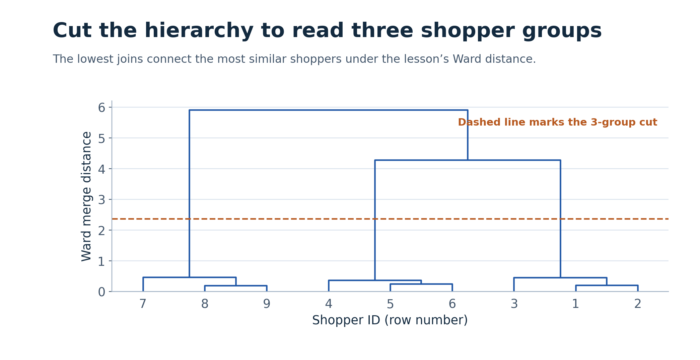

# Hierarchical Clustering

**Lesson 386 · Practice**

## Your goal

See which shoppers merge first by reading the clustering tree from bottom to top.

## Before you start

Understand scaling and distance between inputs.

Use the [main learning path](../LEARNING-PATH.html) if you have not learned this yet. For extra topics, read [the extra-topic guide](../ELECTIVES.html). These links work when this folder is extracted directly into the complete course folder.

## The idea in simple words

Grouping has no supplied correct group labels. Inspect group profiles and stability. A group number is only a name. Some data has no useful groups.

## Guess first

Does group 2 mean better than group 1? Write your answer before running the script.

## Run one step at a time

1. Extract this ZIP. Open folders until you see `lesson.py`.
2. Open a terminal in that folder. Activate the course environment as shown in Setup. Every `python` below means that environment's Python.
3. The main path uses the common course packages. If this lesson needs more, use the same Python to install `requirements.txt` with the course constraint file. See Setup step 8. Do not install optional media packages just to read a lesson.
4. Run these lines one at a time. Wait for each to finish.

```bash
python lesson.py
```

## Check the result

Read the column names and units before the numbers. The original files produced this example. Your deliberate data edits may change it.

```text
Labels: [1, 1, 1, 2, 2, 2, 0, 0, 0]
        age  income  spending
group
0      61.7    92.3      79.7
1      23.3    28.0      70.7
2      43.7    58.7      43.0
```

[See the complete expected output](expected-output.txt). Explain one row aloud. A matching number is a check of the calculation, not proof of real-world quality.

## Change one thing

Add a shopper with age 32, income 40 and spending 57. Regenerate the tree and see which branch joins first.

Open the named CSV in a plain text editor. Keep its column names and commas. Save the same file name before running again. If you invent a request by changing its inputs, clear its old measured answer. Only score it after you have a real outcome for that new case.

## If you get stuck

If a file is missing, list the files with `dir` or `ls` and enter the folder holding the script. If a column or value is wrong, compare it with a fresh extracted CSV. Use a new folder to start over; keep your edited copy if useful. Use Setup for package or terminal errors.

## Explain the result

<details>
<summary>Read the answer after trying</summary>

No. The numbers have no ranking.

</details>

You can move on when you can explain the goal, the changed value and why the result did or did not change. Then return to the next box in the main learning path.


## 📋 Sample data

| age | income | spending |
| --- | --- | --- |
| 21 | 25 | 71 |
| 23 | 28 | 73 |
| 26 | 31 | 68 |
| 42 | 55 | 41 |
| 43 | 59 | 45 |
| 46 | 62 | 43 |
| 59 | 89 | 77 |
| 62 | 93 | 80 |

Showing the first 8 of 9 rows. The CSV has the full sample.

## Graphs



When you edit the CSV, this lesson recomputes the result for the whole table. It does not project a separate new row with an existing fitted estimator.
