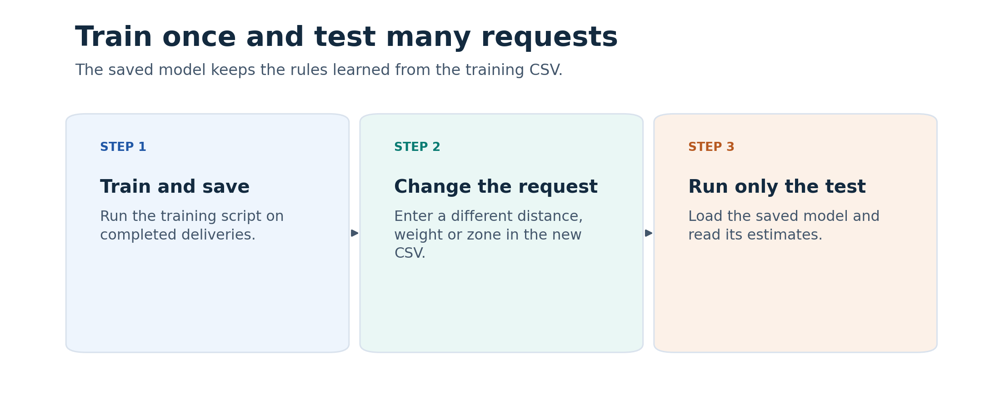

# 🚚 Train, save, and test a delivery model

Read the main learning path before this exercise. You need to know training, validation and test rows, missing values and category inputs. Keep the same active course environment for every command.

**In simple words:** training learns and saves a rule. Prediction opens that saved rule and uses it for a new request. Changing a request does not require learning again.

**Guess first:** If a new weight is blank, should the fill rule use the training weights or learn from that new request? Write your answer first. It should reuse the training rule.

Follow the steps below one at a time. Save a changed CSV before rerunning. Clear an old measured time when you invent a new request. If you get stuck, compare with a fresh copy and use the main Setup guide.

In this extracted folder, run `python -m pip install -r requirements.txt` once.

1. Run `python train_delivery_model.py`. It reads [training_deliveries.csv](training_deliveries.csv), chooses a model using the validation rows, checks it using the test rows, and saves `delivery_model.joblib`.
2. Open [new_deliveries.csv](new_deliveries.csv). Add a short route, a long route, or a route with a blank weight. Use kilometers and kilograms. A blank `actual_minutes` is fine if the delivery hasn't happened yet.
3. Run `python test_delivery_model.py`. It loads the saved model and prints a table. If you enter measured delivery times it also prints their errors.
4. Try another set of deliveries by editing only `new_deliveries.csv` and running the test script again.

| distance_km | weight_kg | zone | actual_minutes |
| --- | --- | --- | --- |
| 5 | 2 | North | 23 |
| 8 | 3 | South | 34 |
| 11 |  | North | 36 |
| 6 | 1 | West |  |

## ✅ Expected result

After training, look for the saved model filename. When you run the test script, look for one prediction per row in new_deliveries.csv and errors only where a measured time exists.

## 🧪 Try one change

Leave the weight blank for the 11 km route and rerun only the test script. The sample model fills in the missing weight and still returns an estimate.

## 📊 Read the visual

**👀 Read the visual.** The saved model keeps the rules learned from the training CSV.

**👉 What to do.** After the first run, change **new_deliveries.csv** and rerun only the test script.
